# Lec 18. 전이 학습: 모델 (Transfer Learning: Models)

← 이전: [Lec17_분포_밖_일반화](Lec17_%EB%B6%84%ED%8F%AC_%EB%B0%96_%EC%9D%BC%EB%B0%98%ED%99%94.md) · [목차](00_MIT%EB%94%A5%EB%9F%AC%EB%8B%9D_%EB%AA%A9%EC%B0%A8.md) · 다음: [Lec19_전이_학습_데이터](Lec19_%EC%A0%84%EC%9D%B4_%ED%95%99%EC%8A%B5_%EB%8D%B0%EC%9D%B4%ED%84%B0.md) →

> [!NOTE]
> **강의 정보**
> - **출처**: MIT OpenCourseWare, [Lec 18. Transfer Learning: Models](https://www.youtube.com/watch?v=tNfuZ9Imt3M) (85분, 2024년 가을 학기)
> - **강사**: Sara Beery
> - **라이선스**: 원 강의는 CC BY-NC-SA 4.0입니다. 이 노트는 영어 자막을 바탕으로 한국어로 옮겨 정리한 2차 저작물이며, 같은 조건(비영리·출처 표기·동일 조건 공유)을 따릅니다.
> - 각 절 제목 아래의 `▶ 영상` 시간을 누르면 영상의 해당 위치로 갑니다.
> - `📐 수학 개념` 줄은 그 절에 쓰인 수학을 정리한 노트로 연결됩니다. 전체 목록은 [00_MIT딥러닝_목차](00_MIT%EB%94%A5%EB%9F%AC%EB%8B%9D_%EB%AA%A9%EC%B0%A8.md).
> - 슬라이드 캡처는 원 강의(CC BY-NC-SA 4.0)에서 가져왔고, "직접 그린 그림"은 이 노트의 숫자로 새로 그렸습니다.
> - `🆕 2026 업데이트` 칸은 강의(2024년 가을) 이후 바뀐 내용을 덧붙인 것입니다.

## 한눈에 보기

| 구분 | 내용 |
|---|---|
| 핵심 질문 | 데이터가 적은 새 과제에서, 이미 배운 모델의 지식을 어떻게 옮겨 쓰나? |
| 무엇을 옮기나 | (1) 입력→출력 **사상**([미세 조정](00_%EB%94%A5%EB%9F%AC%EB%8B%9D_%EC%9A%A9%EC%96%B4%EC%82%AC%EC%A0%84.md#fine-tuning-%EB%AF%B8%EC%84%B8-%EC%A1%B0%EC%A0%95), [도메인 적응](00_%EB%94%A5%EB%9F%AC%EB%8B%9D_%EC%9A%A9%EC%96%B4%EC%82%AC%EC%A0%84.md#domain-adaptation-%EB%8F%84%EB%A9%94%EC%9D%B8-%EC%A0%81%EC%9D%91)), (2) **출력**([지식 증류](00_%EB%94%A5%EB%9F%AC%EB%8B%9D_%EC%9A%A9%EC%96%B4%EC%82%AC%EC%A0%84.md#knowledge-distillation-%EC%A7%80%EC%8B%9D-%EC%A6%9D%EB%A5%98)), (3) **입력**(다음 강의) |
| [미세 조정](00_%EB%94%A5%EB%9F%AC%EB%8B%9D_%EC%9A%A9%EC%96%B4%EC%82%AC%EC%A0%84.md#fine-tuning-%EB%AF%B8%EC%84%B8-%EC%A1%B0%EC%A0%95) | 과제 A로 학습한 $W, b$로 새 망을 초기화하고 과제 B로 계속 [학습](00_%EB%94%A5%EB%9F%AC%EB%8B%9D_%EC%9A%A9%EC%96%B4%EC%82%AC%EC%A0%84.md#training-%ED%95%99%EC%8A%B5). 입출력 모양이 다르면 앞뒤에 "접착" [층](00_%EB%94%A5%EB%9F%AC%EB%8B%9D_%EC%9A%A9%EC%96%B4%EC%82%AC%EC%A0%84.md#layer-%EC%B8%B5)을 단다. 잊지 않게 하려면 얼리기, 작은 [학습률](00_%EB%94%A5%EB%9F%AC%EB%8B%9D_%EC%9A%A9%EC%96%B4%EC%82%AC%EC%A0%84.md#learning-rate-%ED%95%99%EC%8A%B5%EB%A5%A0), [조기 종료](00_%EB%94%A5%EB%9F%AC%EB%8B%9D_%EC%9A%A9%EC%96%B4%EC%82%AC%EC%A0%84.md#early-stopping-%EC%A1%B0%EA%B8%B0-%EC%A2%85%EB%A3%8C), 원래 데이터 섞기 |
| [도메인 적응](00_%EB%94%A5%EB%9F%AC%EB%8B%9D_%EC%9A%A9%EC%96%B4%EC%82%AC%EC%A0%84.md#domain-adaptation-%EB%8F%84%EB%A9%94%EC%9D%B8-%EC%A0%81%EC%9D%91) | 원천과 목표 도메인의 표현 공간을 맞춘다. 도메인 [판별기](00_%EB%94%A5%EB%9F%AC%EB%8B%9D_%EC%9A%A9%EC%96%B4%EC%82%AC%EC%A0%84.md#generator-discriminator-%EC%83%9D%EC%84%B1%EA%B8%B0%EC%99%80-%ED%8C%90%EB%B3%84%EA%B8%B0)의 [기울기](00_%EB%94%A5%EB%9F%AC%EB%8B%9D_%EC%9A%A9%EC%96%B4%EC%82%AC%EC%A0%84.md#gradient-%EA%B8%B0%EC%9A%B8%EA%B8%B0)를 뒤집는 적대적 방법, 라벨 없는 목표 데이터로 하는 비지도 [도메인 적응](00_%EB%94%A5%EB%9F%AC%EB%8B%9D_%EC%9A%A9%EC%96%B4%EC%82%AC%EC%A0%84.md#domain-adaptation-%EB%8F%84%EB%A9%94%EC%9D%B8-%EC%A0%81%EC%9D%91) |
| [지식 증류](00_%EB%94%A5%EB%9F%AC%EB%8B%9D_%EC%9A%A9%EC%96%B4%EC%82%AC%EC%A0%84.md#knowledge-distillation-%EC%A7%80%EC%8B%9D-%EC%A6%9D%EB%A5%98) | 얼린 교사의 출력 분포([소프트 타깃](00_%EB%94%A5%EB%9F%AC%EB%8B%9D_%EC%9A%A9%EC%96%B4%EC%82%AC%EC%A0%84.md#soft-target-%EC%86%8C%ED%94%84%ED%8A%B8-%ED%83%80%EA%B9%83))를 학생이 따라간다. "호랑이를 조금 닮은 고양이"라는 정보가 함께 전해진다. 모달리티 사이, [앙상블](00_%EB%94%A5%EB%9F%AC%EB%8B%9D_%EC%9A%A9%EC%96%B4%EC%82%AC%EC%A0%84.md#ensemble-%EC%95%99%EC%83%81%EB%B8%94), 중간 표현도 증류할 수 있다 |
| 압축 | [가지치기](00_%EB%94%A5%EB%9F%AC%EB%8B%9D_%EC%9A%A9%EC%96%B4%EC%82%AC%EC%A0%84.md#pruning-%EA%B0%80%EC%A7%80%EC%B9%98%EA%B8%B0)·[양자화](00_%EB%94%A5%EB%9F%AC%EB%8B%9D_%EC%9A%A9%EC%96%B4%EC%82%AC%EC%A0%84.md#quantization-%EC%96%91%EC%9E%90%ED%99%94)는 [학습](00_%EB%94%A5%EB%9F%AC%EB%8B%9D_%EC%9A%A9%EC%96%B4%EC%82%AC%EC%A0%84.md#training-%ED%95%99%EC%8A%B5) 없이(또는 조금만) 모델을 줄여 증류보다 싸다 |
| [기반 모델](00_%EB%94%A5%EB%9F%AC%EB%8B%9D_%EC%9A%A9%EC%96%B4%EC%82%AC%EC%A0%84.md#foundation-model-%EA%B8%B0%EB%B0%98-%EB%AA%A8%EB%8D%B8) | 아주 많은 데이터로 학습해 그대로 여러 과제에 쓰는 모델. [미세 조정](00_%EB%94%A5%EB%9F%AC%EB%8B%9D_%EC%9A%A9%EC%96%B4%EC%82%AC%EC%A0%84.md#fine-tuning-%EB%AF%B8%EC%84%B8-%EC%A1%B0%EC%A0%95) 대신 "그냥 물어보기"(프롬프트, [맥락 내 학습](00_%EB%94%A5%EB%9F%AC%EB%8B%9D_%EC%9A%A9%EC%96%B4%EC%82%AC%EC%A0%84.md#in-context-learning-%EB%A7%A5%EB%9D%BD-%EB%82%B4-%ED%95%99%EC%8A%B5), [CLIP](00_%EB%94%A5%EB%9F%AC%EB%8B%9D_%EC%9A%A9%EC%96%B4%EC%82%AC%EC%A0%84.md#clip-%ED%81%B4%EB%A6%BD) 제로샷). 비용과 기후 영향도 크다 |
| 이전·다음 강의 | Lec17 → Lec19 [전이 학습](00_%EB%94%A5%EB%9F%AC%EB%8B%9D_%EC%9A%A9%EC%96%B4%EC%82%AC%EC%A0%84.md#transfer-learning-%EC%A0%84%EC%9D%B4-%ED%95%99%EC%8A%B5): 데이터 |

---

## 1. 적은 데이터로 배우기

▶ 영상 [00:00](https://youtu.be/tNfuZ9Imt3M?t=0)

강사는 두 강의짜리 [전이 학습](00_%EB%94%A5%EB%9F%AC%EB%8B%9D_%EC%9A%A9%EC%96%B4%EC%82%AC%EC%A0%84.md#transfer-learning-%EC%A0%84%EC%9D%B4-%ED%95%99%EC%8A%B5)(Transfer learning) 묶음을 시작합니다. 한 모델이 배운 정보를 새 과제, 새 문제, 새 분포로 옮기는 것입니다. 오늘은 모델이 가진 지식, 다음 시간(화요일)은 데이터(입력)에 관한 지식을 다룹니다.

- **왜 딥러닝인가**: 앤드루 응(Andrew Ng)의 슬라이드처럼, 예전 [학습](00_%EB%94%A5%EB%9F%AC%EB%8B%9D_%EC%9A%A9%EC%96%B4%EC%82%AC%EC%A0%84.md#training-%ED%95%99%EC%8A%B5) 알고리즘은 데이터가 일정량을 넘으면 성능이 더 오르지 않지만([포화](00_%EB%94%A5%EB%9F%AC%EB%8B%9D_%EC%9A%A9%EC%96%B4%EC%82%AC%EC%A0%84.md#saturation-%ED%8F%AC%ED%99%94)) 딥러닝은 데이터를 늘려도 아직 그런 [포화](00_%EB%94%A5%EB%9F%AC%EB%8B%9D_%EC%9A%A9%EC%96%B4%EC%82%AC%EC%A0%84.md#saturation-%ED%8F%AC%ED%99%94)가 보이지 않습니다. 한 분석에 따르면 지금 가장 큰 모델들은 **데이터보다 [용량](00_%EB%94%A5%EB%9F%AC%EB%8B%9D_%EC%9A%A9%EC%96%B4%EC%82%AC%EC%A0%84.md#capacity-%EC%9A%A9%EB%9F%89)이 훨씬 크다**고 합니다. 인터넷 전체 규모의 데이터로도 모델의 계산 [용량](00_%EB%94%A5%EB%9F%AC%EB%8B%9D_%EC%9A%A9%EC%96%B4%EC%82%AC%EC%A0%84.md#capacity-%EC%9A%A9%EB%9F%89)을 다 쓰지 못한다는 뜻입니다(규모의 법칙은 다음 주 Phil의 강의에서).
- 이 강의의 관점: 적은 데이터로 배우는 것, 곧 [전이 학습](00_%EB%94%A5%EB%9F%AC%EB%8B%9D_%EC%9A%A9%EC%96%B4%EC%82%AC%EC%A0%84.md#transfer-learning-%EC%A0%84%EC%9D%B4-%ED%95%99%EC%8A%B5)이 어쩌면 **딥러닝의 핵심 목적**입니다. 좋은 표현과 모델을 배워 두면 그 위에 새 과제를 적은 데이터로 쌓을 수 있습니다.

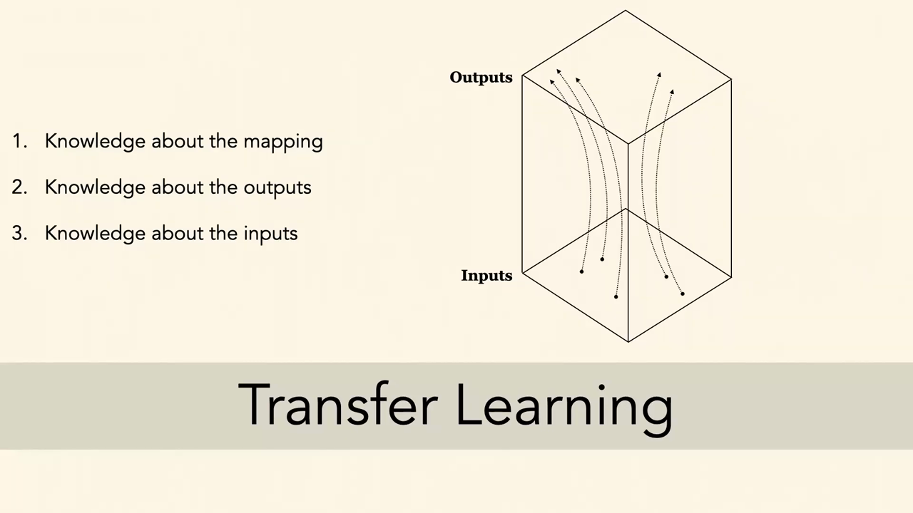
*▲ 강의 슬라이드 [10:03](https://youtu.be/tNfuZ9Imt3M?t=603): [전이 학습](00_%EB%94%A5%EB%9F%AC%EB%8B%9D_%EC%9A%A9%EC%96%B4%EC%82%AC%EC%A0%84.md#transfer-learning-%EC%A0%84%EC%9D%B4-%ED%95%99%EC%8A%B5)에서 옮기는 세 가지 지식. 입력→출력 사상, 출력, 입력*

### 1.1 퓨샷 학습과 사전 지식

▶ 영상 [03:20](https://youtu.be/tNfuZ9Imt3M?t=200)

- **[퓨샷 학습](00_%EB%94%A5%EB%9F%AC%EB%8B%9D_%EC%9A%A9%EC%96%B4%EC%82%AC%EC%A0%84.md#few-shot-learning-zero-shot-learning-%ED%93%A8%EC%83%B7-%ED%95%99%EC%8A%B5%EA%B3%BC-%EC%A0%9C%EB%A1%9C%EC%83%B7-%ED%95%99%EC%8A%B5)(Few-shot learning)**: 아주 적은 예만 보고 배우는 것. 사람은 이것을 놀랄 만큼 잘합니다. 지어낸 기호 하나를 "닥스(dax)"라고 알려 주면 학생들은 아래 기호들 중 닥스를 바로 고릅니다. 세그웨이 사진 하나를 보여 주면 비슷한 세그웨이를 고릅니다.
- **모호함**: 예가 하나뿐이면 범주의 경계가 모호합니다. 강사가 원한 것이 "세그웨이"가 아니라 "바퀴 두 개 달린 것"이었다면? 세그웨이, 스쿠터, 자전거 세 예를 보여 주면 훨씬 분명해집니다. "바퀴 달린 것"처럼 더 넓은 개념이면 더 다양한 예가 필요합니다.
- **사전 지식**: 지금까지의 딥러닝은 빈 석판에서 시작해 한 과제에 쓸 유사도 개념을 처음부터 배웠습니다. 사람은 어려서부터 몸으로 세상을 겪으며 물리, 구조, 유사도에 대한 **정신 모형**을 쌓고, 그 위에서 새것을 배웁니다. 대학에서 하는 일의 상당 부분도 "배우는 법을 배우는 것"입니다. 정신 모형은 문화마다 달라서, 다른 문화권 사람에게 라벨을 맡기면 의도와 다른 라벨이 나오기도 합니다.
- **신경망을 학교에 보내기**: 깊은 망에 사전 지식을 주는 가장 단순한 방법은 다른(많은 데이터가 있는) 과제로 먼저 [사전 학습](00_%EB%94%A5%EB%9F%AC%EB%8B%9D_%EC%9A%A9%EC%96%B4%EC%82%AC%EC%A0%84.md#pre-training-%EC%82%AC%EC%A0%84-%ED%95%99%EC%8A%B5)하고, 그 지식을 새 과제로 옮기는 것입니다.

---

## 2. 무엇을 전이하나

▶ 영상 [08:52](https://youtu.be/tNfuZ9Imt3M?t=532)

모델은 입력을 출력으로 보내는 복잡한 비선형 함수입니다. 옮길 수 있는 지식은 여러 가지입니다.

- 입력과 출력 사이의 **관계(사상)** (오늘의 중심)
- 모델의 **[편향](00_%EB%94%A5%EB%9F%AC%EB%8B%9D_%EC%9A%A9%EC%96%B4%EC%82%AC%EC%A0%84.md#bias-%ED%8E%B8%ED%96%A5)**, **[옵티마이저](00_%EB%94%A5%EB%9F%AC%EB%8B%9D_%EC%9A%A9%EC%96%B4%EC%82%AC%EC%A0%84.md#optimizer-%EC%98%B5%ED%8B%B0%EB%A7%88%EC%9D%B4%EC%A0%80)**(어떻게 최적화하는가)
- 잠재적 **오류 양상**, 윤리적 위험, 사회적 영향

강사는 오늘 다룰 방법들이 꽤 "무식하게 힘으로 하는" 전이라고 말합니다. 예를 들어 세상을 탐색하는 **[내적](00_%EB%94%A5%EB%9F%AC%EB%8B%9D_%EC%9A%A9%EC%96%B4%EC%82%AC%EC%A0%84.md#dot-product-%EB%82%B4%EC%A0%81) 동기**를 배운 에이전트가 그 동기를 새 에이전트에 넘겨 더 효율적으로 탐색하게 하는 방법은 아직 모릅니다. 정보를 나누는 더 좋은 방법은 열린 연구 문제입니다.

질의응답 정리 [10:38](https://youtu.be/tNfuZ9Imt3M?t=638)

- **지식 전이의 [병목](00_%EB%94%A5%EB%9F%AC%EB%8B%9D_%EC%9A%A9%EC%96%B4%EC%82%AC%EC%A0%84.md#bottleneck-%EB%B3%91%EB%AA%A9)은 알고리즘인가, 계산 효율인가?** (2012년의 돌파구도 알고리즘보다 [GPU](00_%EB%94%A5%EB%9F%AC%EB%8B%9D_%EC%9A%A9%EC%96%B4%EC%82%AC%EC%A0%84.md#device-gpu-%EC%9E%A5%EC%B9%98%EC%99%80-gpu) 덕이 컸다는 맥락에서) 강사는 "조금씩 다 해당한다"고 답합니다. [GPU](00_%EB%94%A5%EB%9F%AC%EB%8B%9D_%EC%9A%A9%EC%96%B4%EC%82%AC%EC%A0%84.md#device-gpu-%EC%9E%A5%EC%B9%98%EC%99%80-gpu)를 잘 쓰게 된 것은 강화 [학습](00_%EB%94%A5%EB%9F%AC%EB%8B%9D_%EC%9A%A9%EC%96%B4%EC%82%AC%EC%A0%84.md#training-%ED%95%99%EC%8A%B5)을 포함한 모든 분야에 큰 돌파구였습니다. 하지만 데이터를 효율적으로 뽑고 거기서 효율적으로 배우는 알고리즘([표본 효율](00_%EB%94%A5%EB%9F%AC%EB%8B%9D_%EC%9A%A9%EC%96%B4%EC%82%AC%EC%A0%84.md#sample-efficiency-%ED%91%9C%EB%B3%B8-%ED%9A%A8%EC%9C%A8))은 아직 개선할 여지가 많다고 봅니다.

---

## 3. 미세 조정

▶ 영상 [12:17](https://youtu.be/tNfuZ9Imt3M?t=737)

📐 **수학 개념**: [SGD와 모멘텀](%EC%88%98%ED%95%99%EA%B0%9C%EB%85%90/05_%EC%8B%A0%EA%B2%BD%EB%A7%9D%EC%9D%98_%EA%B3%84%EC%82%B0/MM08_SGD%EC%99%80_%EB%AA%A8%EB%A9%98%ED%85%80.md) · [최근접 이웃과 탐침](%EC%88%98%ED%95%99%EA%B0%9C%EB%85%90/10_%ED%91%9C%ED%98%84_%ED%95%99%EC%8A%B5/MM42_%EC%B5%9C%EA%B7%BC%EC%A0%91_%EC%9D%B4%EC%9B%83%EA%B3%BC_%ED%83%90%EC%B9%A8.md) · [PCA와 선형 오토인코더](%EC%88%98%ED%95%99%EA%B0%9C%EB%85%90/10_%ED%91%9C%ED%98%84_%ED%95%99%EC%8A%B5/MM40_PCA%EC%99%80_%EC%84%A0%ED%98%95_%EC%98%A4%ED%86%A0%EC%9D%B8%EC%BD%94%EB%8D%94.md)

### 3.1 사전 학습한 인코더 옮기기

▶ 영상 [12:17](https://youtu.be/tNfuZ9Imt3M?t=737)

- **예: 음악**: 스포티파이의 모든 곡에 장르 라벨이 있다면, 장르 인식([사전 학습](00_%EB%94%A5%EB%9F%AC%EB%8B%9D_%EC%9A%A9%EC%96%B4%EC%82%AC%EC%A0%84.md#pre-training-%EC%82%AC%EC%A0%84-%ED%95%99%EC%8A%B5), 데이터 많음)은 음악의 구조와 "어떤 곡끼리 비슷한가"를 가르칩니다. 이것을 내 취향 예측(적응, 데이터 적음: 내가 들어 본 곡뿐)으로 옮기고, 새 곡에서 시험합니다. 적응한 모델을 $f'$로 씁니다.
- **[미세 조정](00_%EB%94%A5%EB%9F%AC%EB%8B%9D_%EC%9A%A9%EC%96%B4%EC%82%AC%EC%A0%84.md#fine-tuning-%EB%AF%B8%EC%84%B8-%EC%A1%B0%EC%A0%95)([Fine-tuning](00_%EB%94%A5%EB%9F%AC%EB%8B%9D_%EC%9A%A9%EC%96%B4%EC%82%AC%EC%A0%84.md#fine-tuning-%EB%AF%B8%EC%84%B8-%EC%A1%B0%EC%A0%95))의 절차**:
  1. 과제 A로 망을 사전 학습해 [파라미터](00_%EB%94%A5%EB%9F%AC%EB%8B%9D_%EC%9A%A9%EC%96%B4%EC%82%AC%EC%A0%84.md#parameter-%ED%8C%8C%EB%9D%BC%EB%AF%B8%ED%84%B0) $W$, $b$를 얻는다.
  2. 둘째 망을 $W$, $b$의 **일부 또는 전부**로 초기화한다. 마지막 [층](00_%EB%94%A5%EB%9F%AC%EB%8B%9D_%EC%9A%A9%EC%96%B4%EC%82%AC%EC%A0%84.md#layer-%EC%B8%B5)은 [사전 과제](00_%EB%94%A5%EB%9F%AC%EB%8B%9D_%EC%9A%A9%EC%96%B4%EC%82%AC%EC%A0%84.md#pretext-task-%EC%82%AC%EC%A0%84-%EA%B3%BC%EC%A0%9C)에 특화되어 있고 출력 모양도 다를 수 있으므로 보통 잘라 내고 새 [층](00_%EB%94%A5%EB%9F%AC%EB%8B%9D_%EC%9A%A9%EC%96%B4%EC%82%AC%EC%A0%84.md#layer-%EC%B8%B5)을 단다. 앞쪽 [층](00_%EB%94%A5%EB%9F%AC%EB%8B%9D_%EC%9A%A9%EC%96%B4%EC%82%AC%EC%A0%84.md#layer-%EC%B8%B5)의 특징만 가져오고 싶으면 더 적게 가져온다.
  3. 둘째 망을 과제 B로 학습해 $W'$, $b'$를 얻는다.
- 옮기는 것은 **[학습된 표현](00_%EB%94%A5%EB%9F%AC%EB%8B%9D_%EC%9A%A9%EC%96%B4%EC%82%AC%EC%A0%84.md#representation-learning-%ED%91%9C%ED%98%84-%ED%95%99%EC%8A%B5)**, 곧 인코더(그 [가중치](00_%EB%94%A5%EB%9F%AC%EB%8B%9D_%EC%9A%A9%EC%96%B4%EC%82%AC%EC%A0%84.md#weight-%EA%B0%80%EC%A4%91%EC%B9%98)와 [편향](00_%EB%94%A5%EB%9F%AC%EB%8B%9D_%EC%9A%A9%EC%96%B4%EC%82%AC%EC%A0%84.md#bias-%ED%8E%B8%ED%96%A5))입니다.
- **경험적 관찰**: 입력 종류가 같으면(이미지→이미지) [미세 조정](00_%EB%94%A5%EB%9F%AC%EB%8B%9D_%EC%9A%A9%EC%96%B4%EC%82%AC%EC%A0%84.md#fine-tuning-%EB%AF%B8%EC%84%B8-%EC%A1%B0%EC%A0%95) 뒤에도 특히 **앞쪽 [층](00_%EB%94%A5%EB%9F%AC%EB%8B%9D_%EC%9A%A9%EC%96%B4%EC%82%AC%EC%A0%84.md#layer-%EC%B8%B5)의 구조가 대부분 그대로** 남습니다. [학습률](00_%EB%94%A5%EB%9F%AC%EB%8B%9D_%EC%9A%A9%EC%96%B4%EC%82%AC%EC%A0%84.md#learning-rate-%ED%95%99%EC%8A%B5%EB%A5%A0)을 낮추거나 일부를 얼리지 않아도 그렇습니다. 앞쪽 [층](00_%EB%94%A5%EB%9F%AC%EB%8B%9D_%EC%9A%A9%EC%96%B4%EC%82%AC%EC%A0%84.md#layer-%EC%B8%B5)이 이미지나 소리에 "보편적으로" 쓸모 있는 무언가를 담는다는 증거로 볼 수 있습니다.
- 이전에 본 **자기 지도 [대조 학습](00_%EB%94%A5%EB%9F%AC%EB%8B%9D_%EC%9A%A9%EC%96%B4%EC%82%AC%EC%A0%84.md#contrastive-learning-%EB%8C%80%EC%A1%B0-%ED%95%99%EC%8A%B5)**([Lec12 6](Lec12_%EC%9C%A0%EC%82%AC%EB%8F%84_%EA%B8%B0%EB%B0%98_%ED%91%9C%ED%98%84_%ED%95%99%EC%8A%B5.md#6-%EC%9E%90%EA%B8%B0-%EC%A7%80%EB%8F%84-%EB%8C%80%EC%A1%B0-%ED%95%99%EC%8A%B5))도 같은 틀입니다. 라벨이 필요 없어 훨씬 많은 데이터로 사전 학습할 수 있고, 그 표현을 새 인식 과제로 미세 조정합니다. 인코더를 얼리고 헤드만 배우는 [선형 탐침](00_%EB%94%A5%EB%9F%AC%EB%8B%9D_%EC%9A%A9%EC%96%B4%EC%82%AC%EC%A0%84.md#probe-linear-probe-%ED%83%90%EC%B9%A8%EA%B3%BC-%EC%84%A0%ED%98%95-%ED%83%90%EC%B9%A8)과의 차이는 [Lec11 5.2](Lec11_%ED%91%9C%ED%98%84_%ED%95%99%EC%8A%B5_%EC%9E%AC%EA%B5%AC%EC%84%B1.md#52-%EC%84%A0%ED%98%95-%ED%83%90%EC%B9%A8%EA%B3%BC-%EB%AF%B8%EC%84%B8-%EC%A1%B0%EC%A0%95)에서 보았습니다.

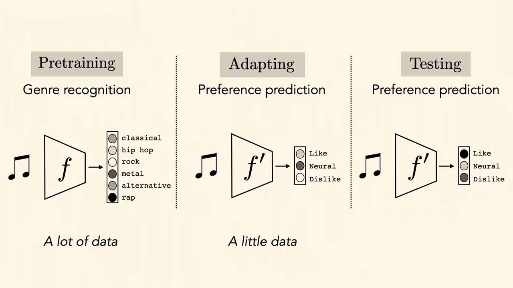
*▲ 강의 슬라이드 [13:10](https://youtu.be/tNfuZ9Imt3M?t=790): [사전 학습](00_%EB%94%A5%EB%9F%AC%EB%8B%9D_%EC%9A%A9%EC%96%B4%EC%82%AC%EC%A0%84.md#pre-training-%EC%82%AC%EC%A0%84-%ED%95%99%EC%8A%B5)(장르 인식, 데이터 많음) → 적응(취향 예측, 데이터 적음) → 시험*

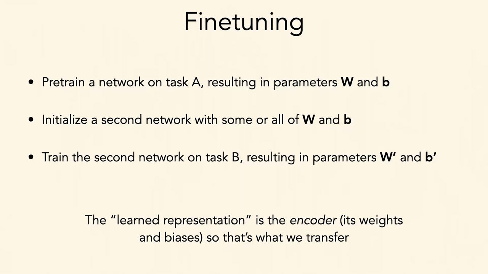
*▲ 강의 슬라이드 [15:35](https://youtu.be/tNfuZ9Imt3M?t=935): [미세 조정](00_%EB%94%A5%EB%9F%AC%EB%8B%9D_%EC%9A%A9%EC%96%B4%EC%82%AC%EC%A0%84.md#fine-tuning-%EB%AF%B8%EC%84%B8-%EC%A1%B0%EC%A0%95)의 세 단계. 옮기는 "학습된 표현"은 인코더([가중치](00_%EB%94%A5%EB%9F%AC%EB%8B%9D_%EC%9A%A9%EC%96%B4%EC%82%AC%EC%A0%84.md#weight-%EA%B0%80%EC%A4%91%EC%B9%98)와 [편향](00_%EB%94%A5%EB%9F%AC%EB%8B%9D_%EC%9A%A9%EC%96%B4%EC%82%AC%EC%A0%84.md#bias-%ED%8E%B8%ED%96%A5))다*

[미세 조정](00_%EB%94%A5%EB%9F%AC%EB%8B%9D_%EC%9A%A9%EC%96%B4%EC%82%AC%EC%A0%84.md#fine-tuning-%EB%AF%B8%EC%84%B8-%EC%A1%B0%EC%A0%95)은 사전 학습한 값에서 출발하는 [경사하강법](00_%EB%94%A5%EB%9F%AC%EB%8B%9D_%EC%9A%A9%EC%96%B4%EC%82%AC%EC%A0%84.md#gradient-descent-%EA%B2%BD%EC%82%AC%ED%95%98%EA%B0%95%EB%B2%95)입니다.

$$
\theta^{(0)} = \theta_A, \qquad \theta \leftarrow \theta - \eta\, \nabla_\theta \mathcal{L}_B(\theta)
$$

기호 풀이

| 기호 | 읽는 법 | 뜻 | 예제 값 |
| --- | --- | --- | --- |
| $\theta_A$ | 세타 에이 | 과제 A로 사전 학습한 [파라미터](00_%EB%94%A5%EB%9F%AC%EB%8B%9D_%EC%9A%A9%EC%96%B4%EC%82%AC%EC%A0%84.md#parameter-%ED%8C%8C%EB%9D%BC%EB%AF%B8%ED%84%B0) ($W$, $b$) | 2.0 |
| $\theta^{(0)}$ | 세타 영 | 과제 B [학습](00_%EB%94%A5%EB%9F%AC%EB%8B%9D_%EC%9A%A9%EC%96%B4%EC%82%AC%EC%A0%84.md#training-%ED%95%99%EC%8A%B5)의 시작점 | 2.0 |
| $\mathcal{L}_B$ | 엘 비 | 과제 B의 [손실](00_%EB%94%A5%EB%9F%AC%EB%8B%9D_%EC%9A%A9%EC%96%B4%EC%82%AC%EC%A0%84.md#loss-function-%EC%86%90%EC%8B%A4-%ED%95%A8%EC%88%98) | |
| $\nabla_\theta \mathcal{L}_B$ | 나블라 | [손실](00_%EB%94%A5%EB%9F%AC%EB%8B%9D_%EC%9A%A9%EC%96%B4%EC%82%AC%EC%A0%84.md#loss-function-%EC%86%90%EC%8B%A4-%ED%95%A8%EC%88%98)의 [기울기](00_%EB%94%A5%EB%9F%AC%EB%8B%9D_%EC%9A%A9%EC%96%B4%EC%82%AC%EC%A0%84.md#gradient-%EA%B8%B0%EC%9A%B8%EA%B8%B0) | 4 |
| $\eta$ | 에타 | [학습률](00_%EB%94%A5%EB%9F%AC%EB%8B%9D_%EC%9A%A9%EC%96%B4%EC%82%AC%EC%A0%84.md#learning-rate-%ED%95%99%EC%8A%B5%EB%A5%A0) | 0.01, 0.5 |
| $\theta$ | 세타 | 갱신 뒤의 [파라미터](00_%EB%94%A5%EB%9F%AC%EB%8B%9D_%EC%9A%A9%EC%96%B4%EC%82%AC%EC%A0%84.md#parameter-%ED%8C%8C%EB%9D%BC%EB%AF%B8%ED%84%B0) ($W'$, $b'$) | 1.96, 0 |

예제와 풀이

**문제**: 사전 학습한 [가중치](00_%EB%94%A5%EB%9F%AC%EB%8B%9D_%EC%9A%A9%EC%96%B4%EC%82%AC%EC%A0%84.md#weight-%EA%B0%80%EC%A4%91%EC%B9%98)가 2.0이고, 과제 B의 [손실](00_%EB%94%A5%EB%9F%AC%EB%8B%9D_%EC%9A%A9%EC%96%B4%EC%82%AC%EC%A0%84.md#loss-function-%EC%86%90%EC%8B%A4-%ED%95%A8%EC%88%98) [기울기](00_%EB%94%A5%EB%9F%AC%EB%8B%9D_%EC%9A%A9%EC%96%B4%EC%82%AC%EC%A0%84.md#gradient-%EA%B8%B0%EC%9A%B8%EA%B8%B0)가 4다. [학습률](00_%EB%94%A5%EB%9F%AC%EB%8B%9D_%EC%9A%A9%EC%96%B4%EC%82%AC%EC%A0%84.md#learning-rate-%ED%95%99%EC%8A%B5%EB%A5%A0) 0.01과 0.5로 한 번씩 갱신하면 [가중치](00_%EB%94%A5%EB%9F%AC%EB%8B%9D_%EC%9A%A9%EC%96%B4%EC%82%AC%EC%A0%84.md#weight-%EA%B0%80%EC%A4%91%EC%B9%98)는 각각 얼마가 되나?

**주어진 값**
- $\theta_A = 2.0$ (사전 학습한 [가중치](00_%EB%94%A5%EB%9F%AC%EB%8B%9D_%EC%9A%A9%EC%96%B4%EC%82%AC%EC%A0%84.md#weight-%EA%B0%80%EC%A4%91%EC%B9%98), 시작점)
- $\nabla_\theta \mathcal{L}_B = 4$ (과제 B [손실](00_%EB%94%A5%EB%9F%AC%EB%8B%9D_%EC%9A%A9%EC%96%B4%EC%82%AC%EC%A0%84.md#loss-function-%EC%86%90%EC%8B%A4-%ED%95%A8%EC%88%98)의 [기울기](00_%EB%94%A5%EB%9F%AC%EB%8B%9D_%EC%9A%A9%EC%96%B4%EC%82%AC%EC%A0%84.md#gradient-%EA%B8%B0%EC%9A%B8%EA%B8%B0))
- $\eta = 0.01$ 또는 $0.5$ ([학습률](00_%EB%94%A5%EB%9F%AC%EB%8B%9D_%EC%9A%A9%EC%96%B4%EC%82%AC%EC%A0%84.md#learning-rate-%ED%95%99%EC%8A%B5%EB%A5%A0))

**풀이**
1. 식을 그대로 쓴다: $\theta \leftarrow \theta - \eta\, \nabla_\theta \mathcal{L}_B(\theta)$
2. 값을 대입한다 ($\eta = 0.01$): $\theta \leftarrow 2.0 - 0.01 \times 4$
3. 곱셈을 먼저 한다: $0.01 \times 4 = 0.04$ 이므로 $\theta \leftarrow 2.0 - 0.04$
4. 뺀다: $2.0 - 0.04 = 1.96$
5. 값을 대입한다 ($\eta = 0.5$): $\theta \leftarrow 2.0 - 0.5 \times 4$
6. 곱셈을 먼저 한다: $0.5 \times 4 = 2$ 이므로 $\theta \leftarrow 2.0 - 2$
7. 뺀다: $2.0 - 2 = 0$

**답**: 작은 [학습률](00_%EB%94%A5%EB%9F%AC%EB%8B%9D_%EC%9A%A9%EC%96%B4%EC%82%AC%EC%A0%84.md#learning-rate-%ED%95%99%EC%8A%B5%EB%A5%A0)이면 **1.96**([사전 학습](00_%EB%94%A5%EB%9F%AC%EB%8B%9D_%EC%9A%A9%EC%96%B4%EC%82%AC%EC%A0%84.md#pre-training-%EC%82%AC%EC%A0%84-%ED%95%99%EC%8A%B5) 값 근처), 큰 [학습률](00_%EB%94%A5%EB%9F%AC%EB%8B%9D_%EC%9A%A9%EC%96%B4%EC%82%AC%EC%A0%84.md#learning-rate-%ED%95%99%EC%8A%B5%EB%A5%A0)이면 **0**(한 번에 멀리 감). 3.3절의 "작은 [학습률](00_%EB%94%A5%EB%9F%AC%EB%8B%9D_%EC%9A%A9%EC%96%B4%EC%82%AC%EC%A0%84.md#learning-rate-%ED%95%99%EC%8A%B5%EB%A5%A0)로 잊지 않게 하기"가 이 차이다.

내 이해

### 3.2 입력·출력 모양이 다를 때

▶ 영상 [17:27](https://youtu.be/tNfuZ9Imt3M?t=1047)

- **예**: RGB 사진으로 밀과 옥수수 두 범주를 사전 학습했는데, 실제로는 **흑백**([채널](00_%EB%94%A5%EB%9F%AC%EB%8B%9D_%EC%9A%A9%EC%96%B4%EC%82%AC%EC%A0%84.md#channel-%EC%B1%84%EB%84%90) 1개) 사진으로 **콩까지 세 범주**를 맞혀야 합니다. $\mathcal{X}' \ne \mathcal{X}$, $\mathcal{Y}' \ne \mathcal{Y}$라 모델 구조 자체가 달라야 합니다.
- **접착(glue) [층](00_%EB%94%A5%EB%9F%AC%EB%8B%9D_%EC%9A%A9%EC%96%B4%EC%82%AC%EC%A0%84.md#layer-%EC%B8%B5)**: 사전 학습할 때부터 앞뒤에 작은 사상 $f_1$, $f_3$을 두고 가운데 큰 몸통 $f_2$를 둡니다. [미세 조정](00_%EB%94%A5%EB%9F%AC%EB%8B%9D_%EC%9A%A9%EC%96%B4%EC%82%AC%EC%A0%84.md#fine-tuning-%EB%AF%B8%EC%84%B8-%EC%A1%B0%EC%A0%95) 때는 $f_1 \to f_1'$, $f_3 \to f_3'$로 바꾸고([층](00_%EB%94%A5%EB%9F%AC%EB%8B%9D_%EC%9A%A9%EC%96%B4%EC%82%AC%EC%A0%84.md#layer-%EC%B8%B5) 수, 크기가 달라도 됨) $f_2$는 그대로 씁니다. 출력만 하나 늘었다면 마지막 [출력층](00_%EB%94%A5%EB%9F%AC%EB%8B%9D_%EC%9A%A9%EC%96%B4%EC%82%AC%EC%A0%84.md#output-layer-%EC%B6%9C%EB%A0%A5%EC%B8%B5) 위에 재사영을 배우거나, 인코더→범주 사상($f_3$)만 갈아 끼우면 됩니다. 구조의 대부분은 바뀌지 않습니다.
- **RGB-D**: 로봇 분야는 깊이(D) [채널](00_%EB%94%A5%EB%9F%AC%EB%8B%9D_%EC%9A%A9%EC%96%B4%EC%82%AC%EC%A0%84.md#channel-%EC%B1%84%EB%84%90)이 더 있습니다. 깊이 없이 학습한 ImageNet·LAION 모델에서도 전이 이득이 크므로, 4채널을 3채널로 보내는 작은 인코딩을 배웁니다.
- **초분광 위성 영상**: [채널](00_%EB%94%A5%EB%9F%AC%EB%8B%9D_%EC%9A%A9%EC%96%B4%EC%82%AC%EC%A0%84.md#channel-%EC%B1%84%EB%84%90)이 수백 개(예: 380개)라 이를 모두 배우기는 계산이 비싸고, 데이터가 적으면 [파라미터](00_%EB%94%A5%EB%9F%AC%EB%8B%9D_%EC%9A%A9%EC%96%B4%EC%82%AC%EC%A0%84.md#parameter-%ED%8C%8C%EB%9D%BC%EB%AF%B8%ED%84%B0)가 너무 많습니다. 그래서 [PCA](00_%EB%94%A5%EB%9F%AC%EB%8B%9D_%EC%9A%A9%EC%96%B4%EC%82%AC%EC%A0%84.md#pca-principal-component-analysis-%EC%A3%BC%EC%84%B1%EB%B6%84-%EB%B6%84%EC%84%9D)로 정보가 가장 많은 주성분 3개를 뽑아 3채널 입력으로 쓰기도 합니다([MM40_PCA와_선형_오토인코더](%EC%88%98%ED%95%99%EA%B0%9C%EB%85%90/10_%ED%91%9C%ED%98%84_%ED%95%99%EC%8A%B5/MM40_PCA%EC%99%80_%EC%84%A0%ED%98%95_%EC%98%A4%ED%86%A0%EC%9D%B8%EC%BD%94%EB%8D%94.md)).
- **[가중치](00_%EB%94%A5%EB%9F%AC%EB%8B%9D_%EC%9A%A9%EC%96%B4%EC%82%AC%EC%A0%84.md#weight-%EA%B0%80%EC%A4%91%EC%B9%98) 복사로 초기화**: 새로 붙인 부분은 처음부터 학습해야 하지만, 처음부터 끝까지 학습하는 것보다 훨씬 적습니다. 데이터가 정말 적으면 RGB-D의 새 깊이 [채널](00_%EB%94%A5%EB%9F%AC%EB%8B%9D_%EC%9A%A9%EC%96%B4%EC%82%AC%EC%A0%84.md#channel-%EC%B1%84%EB%84%90)을 예컨대 **파랑 [채널](00_%EB%94%A5%EB%9F%AC%EB%8B%9D_%EC%9A%A9%EC%96%B4%EC%82%AC%EC%A0%84.md#channel-%EC%B1%84%EB%84%90)의 [가중치](00_%EB%94%A5%EB%9F%AC%EB%8B%9D_%EC%9A%A9%EC%96%B4%EC%82%AC%EC%A0%84.md#weight-%EA%B0%80%EC%A4%91%EC%B9%98)로 초기화**하기도 합니다.
- **[정답](00_%EB%94%A5%EB%9F%AC%EB%8B%9D_%EC%9A%A9%EC%96%B4%EC%82%AC%EC%A0%84.md#label-%EC%A0%95%EB%8B%B5)은 없다**: 어떤 데이터에 무엇이 최선인지 알려 주는 완벽한 규칙은 없습니다. 그래서 여러 선택을 비교할 수 있는 **자기 데이터의 벤치마크**를 설계하는 것이 중요합니다.

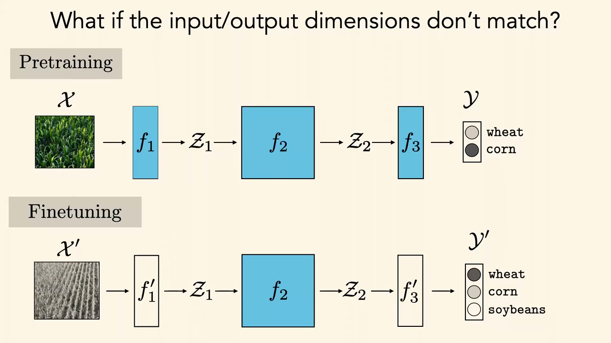
*▲ 강의 슬라이드 [20:28](https://youtu.be/tNfuZ9Imt3M?t=1228): 입출력 모양이 다를 때. 몸통 $f_2$는 그대로 두고 앞뒤의 $f_1$, $f_3$만 $f_1'$, $f_3'$로 바꾼다 (밀·옥수수 → 밀·옥수수·콩)*

접착 [층](00_%EB%94%A5%EB%9F%AC%EB%8B%9D_%EC%9A%A9%EC%96%B4%EC%82%AC%EC%A0%84.md#layer-%EC%B8%B5)을 1×1 [합성곱](00_%EB%94%A5%EB%9F%AC%EB%8B%9D_%EC%9A%A9%EC%96%B4%EC%82%AC%EC%A0%84.md#convolution-%ED%95%A9%EC%84%B1%EA%B3%B1)([채널](00_%EB%94%A5%EB%9F%AC%EB%8B%9D_%EC%9A%A9%EC%96%B4%EC%82%AC%EC%A0%84.md#channel-%EC%B1%84%EB%84%90)마다 [가중합](00_%EB%94%A5%EB%9F%AC%EB%8B%9D_%EC%9A%A9%EC%96%B4%EC%82%AC%EC%A0%84.md#weighted-sum-%EA%B0%80%EC%A4%91%ED%95%A9))으로 만들면, 새로 배울 [파라미터](00_%EB%94%A5%EB%9F%AC%EB%8B%9D_%EC%9A%A9%EC%96%B4%EC%82%AC%EC%A0%84.md#parameter-%ED%8C%8C%EB%9D%BC%EB%AF%B8%ED%84%B0) 수는 입력 [채널](00_%EB%94%A5%EB%9F%AC%EB%8B%9D_%EC%9A%A9%EC%96%B4%EC%82%AC%EC%A0%84.md#channel-%EC%B1%84%EB%84%90) 수로 정해집니다.

$$
\#\theta_{f_1'} = C_{\text{in}} \times 3 + 3
$$

기호 풀이

| 기호 | 읽는 법 | 뜻 | 예제 값 |
| --- | --- | --- | --- |
| $C_{\text{in}}$ | 씨 인 | 새 입력의 [채널](00_%EB%94%A5%EB%9F%AC%EB%8B%9D_%EC%9A%A9%EC%96%B4%EC%82%AC%EC%A0%84.md#channel-%EC%B1%84%EB%84%90) 수 | 4 (RGB-D), 380 (초분광) |
| $3$ | | [사전 학습](00_%EB%94%A5%EB%9F%AC%EB%8B%9D_%EC%9A%A9%EC%96%B4%EC%82%AC%EC%A0%84.md#pre-training-%EC%82%AC%EC%A0%84-%ED%95%99%EC%8A%B5) 모델이 받는 [채널](00_%EB%94%A5%EB%9F%AC%EB%8B%9D_%EC%9A%A9%EC%96%B4%EC%82%AC%EC%A0%84.md#channel-%EC%B1%84%EB%84%90) 수 (RGB) | 3 |
| $C_{\text{in}} \times 3$ | | 출력 [채널](00_%EB%94%A5%EB%9F%AC%EB%8B%9D_%EC%9A%A9%EC%96%B4%EC%82%AC%EC%A0%84.md#channel-%EC%B1%84%EB%84%90)마다 입력 [채널](00_%EB%94%A5%EB%9F%AC%EB%8B%9D_%EC%9A%A9%EC%96%B4%EC%82%AC%EC%A0%84.md#channel-%EC%B1%84%EB%84%90) [가중치](00_%EB%94%A5%EB%9F%AC%EB%8B%9D_%EC%9A%A9%EC%96%B4%EC%82%AC%EC%A0%84.md#weight-%EA%B0%80%EC%A4%91%EC%B9%98) | 12, 1140 |
| $+3$ | | 출력 [채널](00_%EB%94%A5%EB%9F%AC%EB%8B%9D_%EC%9A%A9%EC%96%B4%EC%82%AC%EC%A0%84.md#channel-%EC%B1%84%EB%84%90)마다 [편향](00_%EB%94%A5%EB%9F%AC%EB%8B%9D_%EC%9A%A9%EC%96%B4%EC%82%AC%EC%A0%84.md#bias-%ED%8E%B8%ED%96%A5) 1개 | 3 |
| $\#\theta_{f_1'}$ | [파라미터](00_%EB%94%A5%EB%9F%AC%EB%8B%9D_%EC%9A%A9%EC%96%B4%EC%82%AC%EC%A0%84.md#parameter-%ED%8C%8C%EB%9D%BC%EB%AF%B8%ED%84%B0) 수 | 접착 [층](00_%EB%94%A5%EB%9F%AC%EB%8B%9D_%EC%9A%A9%EC%96%B4%EC%82%AC%EC%A0%84.md#layer-%EC%B8%B5)에서 새로 배울 [파라미터](00_%EB%94%A5%EB%9F%AC%EB%8B%9D_%EC%9A%A9%EC%96%B4%EC%82%AC%EC%A0%84.md#parameter-%ED%8C%8C%EB%9D%BC%EB%AF%B8%ED%84%B0) 수 | 15, 1143 |

예제와 풀이

**문제**: RGB-D(4채널) 입력과 380채널 초분광 입력을 RGB 3채널 모델에 넣으려고 1×1 [합성곱](00_%EB%94%A5%EB%9F%AC%EB%8B%9D_%EC%9A%A9%EC%96%B4%EC%82%AC%EC%A0%84.md#convolution-%ED%95%A9%EC%84%B1%EA%B3%B1) 접착 [층](00_%EB%94%A5%EB%9F%AC%EB%8B%9D_%EC%9A%A9%EC%96%B4%EC%82%AC%EC%A0%84.md#layer-%EC%B8%B5)을 단다. 새로 배울 [파라미터](00_%EB%94%A5%EB%9F%AC%EB%8B%9D_%EC%9A%A9%EC%96%B4%EC%82%AC%EC%A0%84.md#parameter-%ED%8C%8C%EB%9D%BC%EB%AF%B8%ED%84%B0)는 각각 몇 개인가?

**주어진 값**
- $C_{\text{in}} = 4$ (RGB-D의 [채널](00_%EB%94%A5%EB%9F%AC%EB%8B%9D_%EC%9A%A9%EC%96%B4%EC%82%AC%EC%A0%84.md#channel-%EC%B1%84%EB%84%90) 수) 또는 $380$ (초분광의 [채널](00_%EB%94%A5%EB%9F%AC%EB%8B%9D_%EC%9A%A9%EC%96%B4%EC%82%AC%EC%A0%84.md#channel-%EC%B1%84%EB%84%90) 수)
- 출력 [채널](00_%EB%94%A5%EB%9F%AC%EB%8B%9D_%EC%9A%A9%EC%96%B4%EC%82%AC%EC%A0%84.md#channel-%EC%B1%84%EB%84%90) 3 ([사전 학습](00_%EB%94%A5%EB%9F%AC%EB%8B%9D_%EC%9A%A9%EC%96%B4%EC%82%AC%EC%A0%84.md#pre-training-%EC%82%AC%EC%A0%84-%ED%95%99%EC%8A%B5) 모델의 입력)

**풀이**
1. 식을 그대로 쓴다: $\#\theta_{f_1'} = C_{\text{in}} \times 3 + 3$
2. 값을 대입한다 (RGB-D): $\#\theta = 4 \times 3 + 3$
3. 곱셈을 먼저 한다: $4 \times 3 = 12$ 이므로 $\#\theta = 12 + 3$
4. 더한다: $12 + 3 = 15$
5. 값을 대입한다 (초분광): $\#\theta = 380 \times 3 + 3$
6. 곱셈을 먼저 한다: $380 \times 3 = 1140$ 이므로 $\#\theta = 1140 + 3$
7. 더한다: $1140 + 3 = 1143$

**답**: RGB-D **15개**, 초분광 **1143개**. [PCA](00_%EB%94%A5%EB%9F%AC%EB%8B%9D_%EC%9A%A9%EC%96%B4%EC%82%AC%EC%A0%84.md#pca-principal-component-analysis-%EC%A3%BC%EC%84%B1%EB%B6%84-%EB%B6%84%EC%84%9D)로 3채널을 뽑으면 배울 [파라미터](00_%EB%94%A5%EB%9F%AC%EB%8B%9D_%EC%9A%A9%EC%96%B4%EC%82%AC%EC%A0%84.md#parameter-%ED%8C%8C%EB%9D%BC%EB%AF%B8%ED%84%B0)가 0개라, 데이터가 아주 적을 때 쓴다.

내 이해

질의응답 정리 [21:29](https://youtu.be/tNfuZ9Imt3M?t=1289)

- **[미세 조정](00_%EB%94%A5%EB%9F%AC%EB%8B%9D_%EC%9A%A9%EC%96%B4%EC%82%AC%EC%A0%84.md#fine-tuning-%EB%AF%B8%EC%84%B8-%EC%A1%B0%EC%A0%95) 때 $f_2$ 옆에 병렬로 [채널](00_%EB%94%A5%EB%9F%AC%EB%8B%9D_%EC%9A%A9%EC%96%B4%EC%82%AC%EC%A0%84.md#channel-%EC%B1%84%EB%84%90)([층](00_%EB%94%A5%EB%9F%AC%EB%8B%9D_%EC%9A%A9%EC%96%B4%EC%82%AC%EC%A0%84.md#layer-%EC%B8%B5))을 더 붙이기도 하나?** 입력 크기를 바꾸는 것은 흔합니다. [사전 학습](00_%EB%94%A5%EB%9F%AC%EB%8B%9D_%EC%9A%A9%EC%96%B4%EC%82%AC%EC%A0%84.md#pre-training-%EC%82%AC%EC%A0%84-%ED%95%99%EC%8A%B5) 모델이 고정 입력 크기를 가정하면, 큰 이미지를 그 크기로 줄이는 작은 $f_1$을 배웁니다. 이 모델들을 **모듈식 블록**([모듈 재사용](00_%EB%94%A5%EB%9F%AC%EB%8B%9D_%EC%9A%A9%EC%96%B4%EC%82%AC%EC%A0%84.md#modular-reuse-%EB%AA%A8%EB%93%88-%EC%9E%AC%EC%82%AC%EC%9A%A9))으로 보고, 잘 학습된 블록이 쓸모 있도록 주변에 필요한 블록을 더하는 것이 요점입니다. 블록 내부의 [가중치](00_%EB%94%A5%EB%9F%AC%EB%8B%9D_%EC%9A%A9%EC%96%B4%EC%82%AC%EC%A0%84.md#weight-%EA%B0%80%EC%A4%91%EC%B9%98)나 구조를 건드리기 시작하면 복잡해집니다. 모델 압축은 오히려 블록에서 무언가를 **빼는** 분야이고(6절), 무언가를 **더하는** 연구는 강사가 많이 보지 못했습니다. 더할수록 수식 구조가 바뀌어 [사전 학습](00_%EB%94%A5%EB%9F%AC%EB%8B%9D_%EC%9A%A9%EC%96%B4%EC%82%AC%EC%A0%84.md#pre-training-%EC%82%AC%EC%A0%84-%ED%95%99%EC%8A%B5)의 가치가 줄어든다고 봅니다.

### 3.3 일반 표현을 잊지 않게 하기

▶ 영상 [25:31](https://youtu.be/tNfuZ9Imt3M?t=1531)

📐 **수학 개념**: [SGD와 모멘텀](%EC%88%98%ED%95%99%EA%B0%9C%EB%85%90/05_%EC%8B%A0%EA%B2%BD%EB%A7%9D%EC%9D%98_%EA%B3%84%EC%82%B0/MM08_SGD%EC%99%80_%EB%AA%A8%EB%A9%98%ED%85%80.md) · [기댓값과 일반화 간극](%EC%88%98%ED%95%99%EA%B0%9C%EB%85%90/04_%ED%99%95%EB%A5%A0%EA%B3%BC_%EC%A0%95%EB%B3%B4/MM22_%EA%B8%B0%EB%8C%93%EA%B0%92%EA%B3%BC_%EC%9D%BC%EB%B0%98%ED%99%94_%EA%B0%84%EA%B7%B9.md)

- 데이터가 적은데 모델 전체를 [손실](00_%EB%94%A5%EB%9F%AC%EB%8B%9D_%EC%9A%A9%EC%96%B4%EC%82%AC%EC%A0%84.md#loss-function-%EC%86%90%EC%8B%A4-%ED%95%A8%EC%88%98)이 포화될 때까지 학습하면 **[파국적 망각](00_%EB%94%A5%EB%9F%AC%EB%8B%9D_%EC%9A%A9%EC%96%B4%EC%82%AC%EC%A0%84.md#catastrophic-forgetting-%ED%8C%8C%EA%B5%AD%EC%A0%81-%EB%A7%9D%EA%B0%81)**(catastrophic forgetting)이 일어납니다([Lec10](Lec10_%EA%B8%B0%EC%96%B5%EA%B3%BC_%EC%8B%9C%ED%80%80%EC%8A%A4.md)의 [시퀀스](00_%EB%94%A5%EB%9F%AC%EB%8B%9D_%EC%9A%A9%EC%96%B4%EC%82%AC%EC%A0%84.md#sequence-%EC%8B%9C%ED%80%80%EC%8A%A4)에서 본 문제). [가중치](00_%EB%94%A5%EB%9F%AC%EB%8B%9D_%EC%9A%A9%EC%96%B4%EC%82%AC%EC%A0%84.md#weight-%EA%B0%80%EC%A4%91%EC%B9%98)가 너무 많이 바뀌어 원래 데이터에서 배운 것을 잃습니다. 흥미롭게도 큰 모델보다 작은 모델에서 더 자주 일어납니다.
- 새 과제에 충분히 특화하면서 일반 표현을 너무 잊지 않는 균형을 잡는 방법:
  - **대부분을 얼리기**: 마지막 [층](00_%EB%94%A5%EB%9F%AC%EB%8B%9D_%EC%9A%A9%EC%96%B4%EC%82%AC%EC%A0%84.md#layer-%EC%B8%B5)(또는 앞에 새로 붙인 [층](00_%EB%94%A5%EB%9F%AC%EB%8B%9D_%EC%9A%A9%EC%96%B4%EC%82%AC%EC%A0%84.md#layer-%EC%B8%B5))만 학습합니다.
  - **작은 [학습률](00_%EB%94%A5%EB%9F%AC%EB%8B%9D_%EC%9A%A9%EC%96%B4%EC%82%AC%EC%A0%84.md#learning-rate-%ED%95%99%EC%8A%B5%EB%A5%A0)**: 한 걸음에 너무 멀리 가지 못하게 합니다(3.1절 예제).
  - **[조기 종료](00_%EB%94%A5%EB%9F%AC%EB%8B%9D_%EC%9A%A9%EC%96%B4%EC%82%AC%EC%A0%84.md#early-stopping-%EC%A1%B0%EA%B8%B0-%EC%A2%85%EB%A3%8C)**(early stopping): [검증 데이터](00_%EB%94%A5%EB%9F%AC%EB%8B%9D_%EC%9A%A9%EC%96%B4%EC%82%AC%EC%A0%84.md#validation-data-%EA%B2%80%EC%A6%9D-%EB%8D%B0%EC%9D%B4%ED%84%B0)에서 가장 좋았던 시점의 [가중치](00_%EB%94%A5%EB%9F%AC%EB%8B%9D_%EC%9A%A9%EC%96%B4%EC%82%AC%EC%A0%84.md#weight-%EA%B0%80%EC%A4%91%EC%B9%98)를 고릅니다. 너무 오래 학습해 잊기 전에 멈추는 셈입니다.
  - **원래 데이터도 계속 [학습](00_%EB%94%A5%EB%9F%AC%EB%8B%9D_%EC%9A%A9%EC%96%B4%EC%82%AC%EC%A0%84.md#training-%ED%95%99%EC%8A%B5)**: 원래 [학습 데이터](00_%EB%94%A5%EB%9F%AC%EB%8B%9D_%EC%9A%A9%EC%96%B4%EC%82%AC%EC%A0%84.md#training-data-test-data-%ED%95%99%EC%8A%B5-%EB%8D%B0%EC%9D%B4%ED%84%B0%EC%99%80-%EC%8B%9C%ED%97%98-%EB%8D%B0%EC%9D%B4%ED%84%B0)에 접근할 수 있으면 [미세 조정](00_%EB%94%A5%EB%9F%AC%EB%8B%9D_%EC%9A%A9%EC%96%B4%EC%82%AC%EC%A0%84.md#fine-tuning-%EB%AF%B8%EC%84%B8-%EC%A1%B0%EC%A0%95) 중에도 섞어 줍니다. 잘 통하지만 표본 균형을 잡아야 하고, 입력 종류나 목표가 다르면 어렵습니다(예: 대조 [사전 학습](00_%EB%94%A5%EB%9F%AC%EB%8B%9D_%EC%9A%A9%EC%96%B4%EC%82%AC%EC%A0%84.md#pre-training-%EC%82%AC%EC%A0%84-%ED%95%99%EC%8A%B5) 뒤 [분류](00_%EB%94%A5%EB%9F%AC%EB%8B%9D_%EC%9A%A9%EC%96%B4%EC%82%AC%EC%A0%84.md#regression-classification-%ED%9A%8C%EA%B7%80%EC%99%80-%EB%B6%84%EB%A5%98)를 할 때 대조 목적을 계속 함께 돌리기는 더 복잡함).
- 이 선택들은 모두 **대표성 있는 [검증 데이터](00_%EB%94%A5%EB%9F%AC%EB%8B%9D_%EC%9A%A9%EC%96%B4%EC%82%AC%EC%A0%84.md#validation-data-%EA%B2%80%EC%A6%9D-%EB%8D%B0%EC%9D%B4%ED%84%B0)**, 곧 잘 짜인 벤치마크를 전제합니다. 앞으로 [분포 이동](00_%EB%94%A5%EB%9F%AC%EB%8B%9D_%EC%9A%A9%EC%96%B4%EC%82%AC%EC%A0%84.md#distribution-shift-%EB%B6%84%ED%8F%AC-%EC%9D%B4%EB%8F%99)이 있으면 이것이 늘 가능하지는 않습니다.

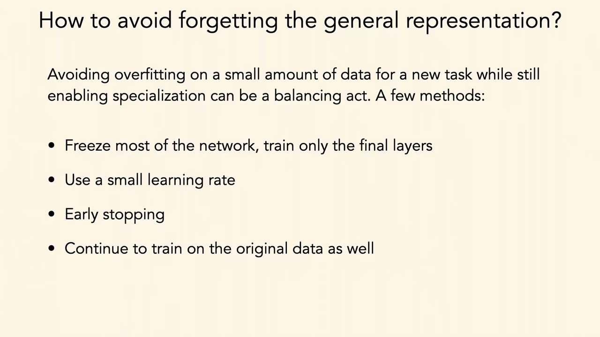
*▲ 강의 슬라이드 [27:50](https://youtu.be/tNfuZ9Imt3M?t=1670): 일반 표현을 잊지 않는 네 방법. 대부분 얼리기, 작은 [학습률](00_%EB%94%A5%EB%9F%AC%EB%8B%9D_%EC%9A%A9%EC%96%B4%EC%82%AC%EC%A0%84.md#learning-rate-%ED%95%99%EC%8A%B5%EB%A5%A0), [조기 종료](00_%EB%94%A5%EB%9F%AC%EB%8B%9D_%EC%9A%A9%EC%96%B4%EC%82%AC%EC%A0%84.md#early-stopping-%EC%A1%B0%EA%B8%B0-%EC%A2%85%EB%A3%8C), 원래 데이터도 [학습](00_%EB%94%A5%EB%9F%AC%EB%8B%9D_%EC%9A%A9%EC%96%B4%EC%82%AC%EC%A0%84.md#training-%ED%95%99%EC%8A%B5)*

강사의 한마디: 표의 굵은 숫자 [28:14](https://youtu.be/tNfuZ9Imt3M?t=1694)

요즘 기계 [학습](00_%EB%94%A5%EB%9F%AC%EB%8B%9D_%EC%9A%A9%EC%96%B4%EC%82%AC%EC%A0%84.md#training-%ED%95%99%EC%8A%B5)은 표의 **굵은 숫자** 하나에 집착합니다. 모델이 하는 일의 모든 중요한 차원을 숫자 하나로 나타낼 수 있다는 가정인데, 강사는 그렇지 않다고 봅니다. 자기 모델이 가장 잘하는 지표만 골라 싣는 것은 나쁜 습관이고, 결함과 한계를 솔직히 쓴 논문을 좋아한다고 말합니다.

---

## 4. 도메인 적응

▶ 영상 [29:51](https://youtu.be/tNfuZ9Imt3M?t=1791)

📐 **수학 개념**: [그래디언트 반전과 도메인 적대 학습](%EC%88%98%ED%95%99%EA%B0%9C%EB%85%90/12_%EA%B0%95%EA%B1%B4%EC%84%B1%EA%B3%BC_%EC%A0%84%EC%9D%B4/MM66_%EA%B7%B8%EB%9E%98%EB%94%94%EC%96%B8%ED%8A%B8_%EB%B0%98%EC%A0%84%EA%B3%BC_%EB%8F%84%EB%A9%94%EC%9D%B8_%EC%A0%81%EB%8C%80_%ED%95%99%EC%8A%B5.md) · [지수 이동 평균](%EC%88%98%ED%95%99%EA%B0%9C%EB%85%90/05_%EC%8B%A0%EA%B2%BD%EB%A7%9D%EC%9D%98_%EA%B3%84%EC%82%B0/MM36_%EC%A7%80%EC%88%98_%EC%9D%B4%EB%8F%99_%ED%8F%89%EA%B7%A0.md) · [온도 소프트맥스와 지식 증류](%EC%88%98%ED%95%99%EA%B0%9C%EB%85%90/12_%EA%B0%95%EA%B1%B4%EC%84%B1%EA%B3%BC_%EC%A0%84%EC%9D%B4/MM65_%EC%98%A8%EB%8F%84_%EC%86%8C%ED%94%84%ED%8A%B8%EB%A7%A5%EC%8A%A4%EC%99%80_%EC%A7%80%EC%8B%9D_%EC%A6%9D%EB%A5%98.md)

**[도메인 적응](00_%EB%94%A5%EB%9F%AC%EB%8B%9D_%EC%9A%A9%EC%96%B4%EC%82%AC%EC%A0%84.md#domain-adaptation-%EB%8F%84%EB%A9%94%EC%9D%B8-%EC%A0%81%EC%9D%91)**(Domain adaptation)은 원천 도메인(source)과 목표 도메인(target)이 있을 때, 목표에서 잘하면서 **두 도메인의 표현 공간이 잘 맞춰지도록** 하는 연구 분야입니다. 지난주의 [분포 이동](00_%EB%94%A5%EB%9F%AC%EB%8B%9D_%EC%9A%A9%EC%96%B4%EC%82%AC%EC%A0%84.md#distribution-shift-%EB%B6%84%ED%8F%AC-%EC%9D%B4%EB%8F%99) 문제에서 많이 쓰이지만 [미세 조정](00_%EB%94%A5%EB%9F%AC%EB%8B%9D_%EC%9A%A9%EC%96%B4%EC%82%AC%EC%A0%84.md#fine-tuning-%EB%AF%B8%EC%84%B8-%EC%A1%B0%EC%A0%95)의 한 방법으로도 쓸 수 있습니다. 특징 공간을 전반적으로 맞춰 두면 적은 데이터로 사상을 배울 수 있다는 것이 동기입니다. 한 방법은 원천 도메인에서 출력까지의 모델을 배운 뒤, **목표→원천** 사상을 배워 데이터가 많은 원천 공간으로 옮겨 놓고 같은 모델로 예측하는 것입니다.

### 4.1 적대적 도메인 적응

▶ 영상 [30:57](https://youtu.be/tNfuZ9Imt3M?t=1857)

- [학습](00_%EB%94%A5%EB%9F%AC%EB%8B%9D_%EC%9A%A9%EC%96%B4%EC%82%AC%EC%A0%84.md#training-%ED%95%99%EC%8A%B5) 중에 원천과 목표 데이터를 함께 넣고, 입력마다 **범주**와 **어느 도메인에서 왔는지**를 둘 다 예측합니다.
- **예**: 아마존 상품 사진(깨끗한 배경)과 이베이 사진(지저분한 책상 위)의 컴퓨터 하드웨어. "어떤 컴퓨터인가"와 "아마존인가 이베이인가"를 함께 예측합니다.
- **적대적인 부분**: 도메인 예측기에서 오는 **[기울기](00_%EB%94%A5%EB%9F%AC%EB%8B%9D_%EC%9A%A9%EC%96%B4%EC%82%AC%EC%A0%84.md#gradient-%EA%B8%B0%EC%9A%B8%EA%B8%B0)를 뒤집습니다**([그래디언트 반전 층](00_%EB%94%A5%EB%9F%AC%EB%8B%9D_%EC%9A%A9%EC%96%B4%EC%82%AC%EC%A0%84.md#gradient-reversal-layer-%EA%B7%B8%EB%9E%98%EB%94%94%EC%96%B8%ED%8A%B8-%EB%B0%98%EC%A0%84-%EC%B8%B5), DANN). 그러면 모델은 범주는 최대한 잘, 도메인은 최대한 **못** 맞히도록 학습되고, 두 도메인의 표현이 겹치게 됩니다.
- 목표 도메인에 범주 라벨이 하나도 없어도 "목표 도메인에서 왔다"는 정보만으로 이 [학습](00_%EB%94%A5%EB%9F%AC%EB%8B%9D_%EC%9A%A9%EC%96%B4%EC%82%AC%EC%A0%84.md#training-%ED%95%99%EC%8A%B5)을 할 수 있습니다. 라벨이 아주 적거나 없어도 목표 도메인에서 범주를 찾는 데 도움이 될 수 있습니다.

$$
E(\theta_f, \theta_y, \theta_d) = \mathcal{L}_y(\theta_f, \theta_y) - \lambda\, \mathcal{L}_d(\theta_f, \theta_d)
$$

기호 풀이

| 기호 | 읽는 법 | 뜻 | 예제 값 |
| --- | --- | --- | --- |
| $\theta_f$ | 세타 에프 | 특징 추출기의 [파라미터](00_%EB%94%A5%EB%9F%AC%EB%8B%9D_%EC%9A%A9%EC%96%B4%EC%82%AC%EC%A0%84.md#parameter-%ED%8C%8C%EB%9D%BC%EB%AF%B8%ED%84%B0). $E$를 줄이는 쪽 | |
| $\theta_y$ | 세타 와이 | 범주(라벨) 예측기의 [파라미터](00_%EB%94%A5%EB%9F%AC%EB%8B%9D_%EC%9A%A9%EC%96%B4%EC%82%AC%EC%A0%84.md#parameter-%ED%8C%8C%EB%9D%BC%EB%AF%B8%ED%84%B0). $E$를 줄이는 쪽 | |
| $\theta_d$ | 세타 디 | 도메인 [판별기](00_%EB%94%A5%EB%9F%AC%EB%8B%9D_%EC%9A%A9%EC%96%B4%EC%82%AC%EC%A0%84.md#generator-discriminator-%EC%83%9D%EC%84%B1%EA%B8%B0%EC%99%80-%ED%8C%90%EB%B3%84%EA%B8%B0)의 [파라미터](00_%EB%94%A5%EB%9F%AC%EB%8B%9D_%EC%9A%A9%EC%96%B4%EC%82%AC%EC%A0%84.md#parameter-%ED%8C%8C%EB%9D%BC%EB%AF%B8%ED%84%B0). $E$를 키우는($\mathcal{L}_d$를 줄이는) 쪽 | |
| $\mathcal{L}_y$ | 라벨 [손실](00_%EB%94%A5%EB%9F%AC%EB%8B%9D_%EC%9A%A9%EC%96%B4%EC%82%AC%EC%A0%84.md#loss-function-%EC%86%90%EC%8B%A4-%ED%95%A8%EC%88%98) | 범주 예측 [손실](00_%EB%94%A5%EB%9F%AC%EB%8B%9D_%EC%9A%A9%EC%96%B4%EC%82%AC%EC%A0%84.md#loss-function-%EC%86%90%EC%8B%A4-%ED%95%A8%EC%88%98) | 0.4 |
| $\mathcal{L}_d$ | 도메인 [손실](00_%EB%94%A5%EB%9F%AC%EB%8B%9D_%EC%9A%A9%EC%96%B4%EC%82%AC%EC%A0%84.md#loss-function-%EC%86%90%EC%8B%A4-%ED%95%A8%EC%88%98) | 도메인 예측 [손실](00_%EB%94%A5%EB%9F%AC%EB%8B%9D_%EC%9A%A9%EC%96%B4%EC%82%AC%EC%A0%84.md#loss-function-%EC%86%90%EC%8B%A4-%ED%95%A8%EC%88%98) | 0.6 |
| $\lambda$ | 람다 | 도메인 항의 비중 (그래디언트 반전의 세기) | 1 |
| $E$ | 이 | 전체 목적 함수 | -0.2 |

예제와 풀이

**문제**: 범주 [손실](00_%EB%94%A5%EB%9F%AC%EB%8B%9D_%EC%9A%A9%EC%96%B4%EC%82%AC%EC%A0%84.md#loss-function-%EC%86%90%EC%8B%A4-%ED%95%A8%EC%88%98)이 0.4, 도메인 [손실](00_%EB%94%A5%EB%9F%AC%EB%8B%9D_%EC%9A%A9%EC%96%B4%EC%82%AC%EC%A0%84.md#loss-function-%EC%86%90%EC%8B%A4-%ED%95%A8%EC%88%98)이 0.6, 비중 $\lambda$가 1일 때 목적 함수 $E$는? 특징 추출기는 이 값을 어느 쪽으로 움직이려 하나?

**주어진 값**
- $\mathcal{L}_y = 0.4$ (범주 예측 [손실](00_%EB%94%A5%EB%9F%AC%EB%8B%9D_%EC%9A%A9%EC%96%B4%EC%82%AC%EC%A0%84.md#loss-function-%EC%86%90%EC%8B%A4-%ED%95%A8%EC%88%98))
- $\mathcal{L}_d = 0.6$ (도메인 예측 [손실](00_%EB%94%A5%EB%9F%AC%EB%8B%9D_%EC%9A%A9%EC%96%B4%EC%82%AC%EC%A0%84.md#loss-function-%EC%86%90%EC%8B%A4-%ED%95%A8%EC%88%98))
- $\lambda = 1$ (도메인 항의 비중)

**풀이**
1. 식을 그대로 쓴다: $E = \mathcal{L}_y - \lambda\, \mathcal{L}_d$
2. 값을 대입한다: $E = 0.4 - 1 \times 0.6$
3. 곱셈을 먼저 한다: $1 \times 0.6 = 0.6$ 이므로 $E = 0.4 - 0.6$
4. 뺀다: $0.4 - 0.6 = -0.2$

**답**: $E = $ **-0.2**. 특징 추출기는 $E$를 더 줄이려 하므로 $\mathcal{L}_y$는 줄이고 $\mathcal{L}_d$는 **키운다**(도메인을 못 맞히게). [기울기](00_%EB%94%A5%EB%9F%AC%EB%8B%9D_%EC%9A%A9%EC%96%B4%EC%82%AC%EC%A0%84.md#gradient-%EA%B8%B0%EC%9A%B8%EA%B8%B0) 계산은 [MM66_그래디언트_반전과_도메인_적대_학습](%EC%88%98%ED%95%99%EA%B0%9C%EB%85%90/12_%EA%B0%95%EA%B1%B4%EC%84%B1%EA%B3%BC_%EC%A0%84%EC%9D%B4/MM66_%EA%B7%B8%EB%9E%98%EB%94%94%EC%96%B8%ED%8A%B8_%EB%B0%98%EC%A0%84%EA%B3%BC_%EB%8F%84%EB%A9%94%EC%9D%B8_%EC%A0%81%EB%8C%80_%ED%95%99%EC%8A%B5.md).

내 이해

### 4.2 비지도 도메인 적응

▶ 영상 [33:12](https://youtu.be/tNfuZ9Imt3M?t=1992)

**비지도 [도메인 적응](00_%EB%94%A5%EB%9F%AC%EB%8B%9D_%EC%9A%A9%EC%96%B4%EC%82%AC%EC%A0%84.md#domain-adaptation-%EB%8F%84%EB%A9%94%EC%9D%B8-%EC%A0%81%EC%9D%91)**(UDA)은 라벨 있는 원천 데이터와 **라벨 없는 목표 데이터**로 목표에서 잘하는 모델을 만드는 문제입니다.

- **왜 이런 상황이 생기나 (강사의 연구)**: 강의 수중 음파(소나) 영상에서 상류로 올라가는 물고기를 세어 지속 가능한 어업 [정책](00_%EB%94%A5%EB%9F%AC%EB%8B%9D_%EC%9A%A9%EC%96%B4%EC%82%AC%EC%A0%84.md#policy-%EC%A0%95%EC%B1%85)을 세웁니다. 라벨이 많은 강도 있지만, 모든 강에서, 그리고 강이 변하거나 센서를 옮겨도 잘 돌아가야 합니다.
- **방법이 발전한 순서**:
  1. **문턱값 보정**: 원천으로 학습한 모델을 목표에 돌리고, 확신이 문턱값보다 높은 예측을 [정답](00_%EB%94%A5%EB%9F%AC%EB%8B%9D_%EC%9A%A9%EC%96%B4%EC%82%AC%EC%A0%84.md#label-%EC%A0%95%EB%8B%B5)처럼 씁니다([의사 라벨](00_%EB%94%A5%EB%9F%AC%EB%8B%9D_%EC%9A%A9%EC%96%B4%EC%82%AC%EC%A0%84.md#pseudo-label-%EC%9D%98%EC%82%AC-%EB%9D%BC%EB%B2%A8)). 대개 잘 안 됩니다.
  2. **학생 모델**: 그 예측을 약한 지도로 삼아 새 학생 모델을 학습합니다(증류의 한 형태, 5절). 원래 예측보다 조금 낫지만 문턱값이 아주 까다롭습니다.
  3. **EMA 교사**: [지수 이동 평균](00_%EB%94%A5%EB%9F%AC%EB%8B%9D_%EC%9A%A9%EC%96%B4%EC%82%AC%EC%A0%84.md#exponential-moving-average-%EC%A7%80%EC%88%98-%EC%9D%B4%EB%8F%99-%ED%8F%89%EA%B7%A0)으로 학생 [가중치](00_%EB%94%A5%EB%9F%AC%EB%8B%9D_%EC%9A%A9%EC%96%B4%EC%82%AC%EC%A0%84.md#weight-%EA%B0%80%EC%A4%91%EC%B9%98)를 천천히 따라가는 교사를 둬서 교사도 느리게 갱신합니다([MM36_지수_이동_평균](%EC%88%98%ED%95%99%EA%B0%9C%EB%85%90/05_%EC%8B%A0%EA%B2%BD%EB%A7%9D%EC%9D%98_%EA%B3%84%EC%82%B0/MM36_%EC%A7%80%EC%88%98_%EC%9D%B4%EB%8F%99_%ED%8F%89%EA%B7%A0.md)).
  4. **원천 데이터도 [학습](00_%EB%94%A5%EB%9F%AC%EB%8B%9D_%EC%9A%A9%EC%96%B4%EC%82%AC%EC%A0%84.md#training-%ED%95%99%EC%8A%B5)**: 학생이 원천과 목표 모두에서 배웁니다.
  5. **부가 장치**: 문턱값 대신 [소프트맥스](00_%EB%94%A5%EB%9F%AC%EB%8B%9D_%EC%9A%A9%EC%96%B4%EC%82%AC%EC%A0%84.md#softmax-%EC%86%8C%ED%94%84%ED%8A%B8%EB%A7%A5%EC%8A%A4), 예측 하나가 아니라 출력 분포를 맞추는 **증류 [손실](00_%EB%94%A5%EB%9F%AC%EB%8B%9D_%EC%9A%A9%EC%96%B4%EC%82%AC%EC%A0%84.md#loss-function-%EC%86%90%EC%8B%A4-%ED%95%A8%EC%88%98)**([MM65_온도_소프트맥스와_지식_증류](%EC%88%98%ED%95%99%EA%B0%9C%EB%85%90/12_%EA%B0%95%EA%B1%B4%EC%84%B1%EA%B3%BC_%EC%A0%84%EC%9D%B4/MM65_%EC%98%A8%EB%8F%84_%EC%86%8C%ED%94%84%ED%8A%B8%EB%A7%A5%EC%8A%A4%EC%99%80_%EC%A7%80%EC%8B%9D_%EC%A6%9D%EB%A5%98.md)), 원천·목표 특징을 겹치게 하는 **명시적 특징 정렬**.
- **통합**: 요즘 [도메인 적응](00_%EB%94%A5%EB%9F%AC%EB%8B%9D_%EC%9A%A9%EC%96%B4%EC%82%AC%EC%A0%84.md#domain-adaptation-%EB%8F%84%EB%A9%94%EC%9D%B8-%EC%A0%81%EC%9D%91) 구조는 거의 모두 이 부품들의 조합입니다. 실험 방식을 하나로 통합해 보니 기존 어느 방법보다 나은 조합을 찾을 수 있었다고 합니다.
- **한계와 직관**: 목표 라벨로 학습하는 것만큼 좋지는 않지만, 잘 만들면 꽤 가까워집니다. 모델이 목표 도메인의 **통계**에 대해 쓸모 있는 것을 배워 [가중치](00_%EB%94%A5%EB%9F%AC%EB%8B%9D_%EC%9A%A9%EC%96%B4%EC%82%AC%EC%A0%84.md#weight-%EA%B0%80%EC%A4%91%EC%B9%98)를 새 통계 쪽으로 옮기기 때문으로 보입니다. 또한 결과는 **출발 모델이 얼마나 좋은가**에 크게 좌우됩니다. 라벨 있는 적은 데이터 대신 라벨 없는 많은 데이터로 하는 [미세 조정](00_%EB%94%A5%EB%9F%AC%EB%8B%9D_%EC%9A%A9%EC%96%B4%EC%82%AC%EC%A0%84.md#fine-tuning-%EB%AF%B8%EC%84%B8-%EC%A1%B0%EC%A0%95)이라고 볼 수 있습니다.

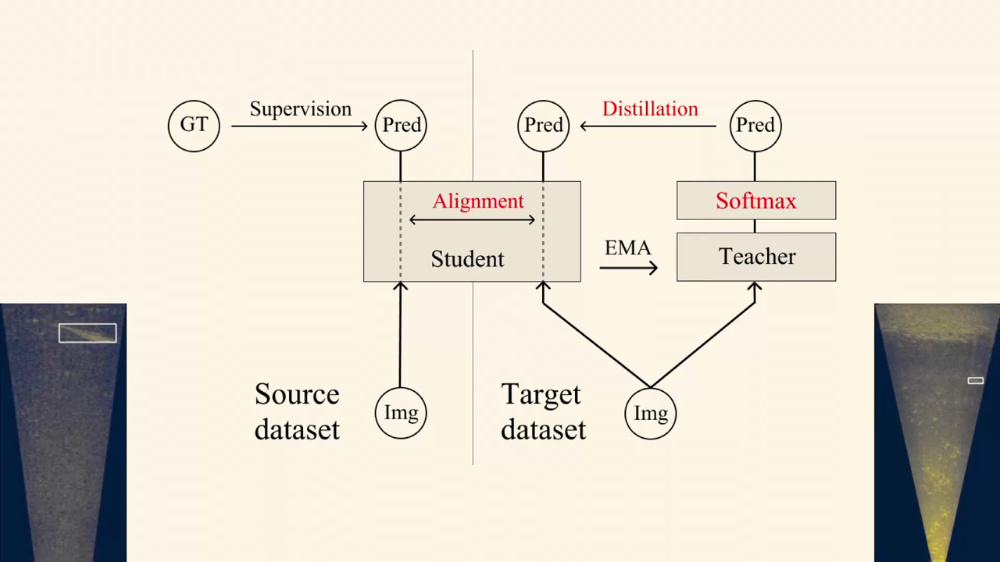
*▲ 강의 슬라이드 [36:05](https://youtu.be/tNfuZ9Imt3M?t=2165): 비지도 [도메인 적응](00_%EB%94%A5%EB%9F%AC%EB%8B%9D_%EC%9A%A9%EC%96%B4%EC%82%AC%EC%A0%84.md#domain-adaptation-%EB%8F%84%EB%A9%94%EC%9D%B8-%EC%A0%81%EC%9D%91)의 부품. 원천 [지도 학습](00_%EB%94%A5%EB%9F%AC%EB%8B%9D_%EC%9A%A9%EC%96%B4%EC%82%AC%EC%A0%84.md#supervised-learning-%EC%A7%80%EB%8F%84-%ED%95%99%EC%8A%B5), 학생-교사 EMA, 교사의 [소프트맥스](00_%EB%94%A5%EB%9F%AC%EB%8B%9D_%EC%9A%A9%EC%96%B4%EC%82%AC%EC%A0%84.md#softmax-%EC%86%8C%ED%94%84%ED%8A%B8%EB%A7%A5%EC%8A%A4)와 증류, 원천·목표 특징 정렬*

문턱값으로 [의사 라벨](00_%EB%94%A5%EB%9F%AC%EB%8B%9D_%EC%9A%A9%EC%96%B4%EC%82%AC%EC%A0%84.md#pseudo-label-%EC%9D%98%EC%82%AC-%EB%9D%BC%EB%B2%A8)을 고르는 규칙은 다음과 같습니다.

$$
\hat y = \arg\max_k p_k \quad \text{단,}\ \max_k p_k \ge \tau\ \text{일 때만 쓴다}
$$

기호 풀이

| 기호 | 읽는 법 | 뜻 | 예제 값 |
| --- | --- | --- | --- |
| $p_k$ | 피 케이 | 원천 모델이 목표 표본에 준 $k$번 범주의 [확률](00_%EB%94%A5%EB%9F%AC%EB%8B%9D_%EC%9A%A9%EC%96%B4%EC%82%AC%EC%A0%84.md#probability-%ED%99%95%EB%A5%A0) | (0.9, 0.06, 0.04) |
| $\max_k p_k$ | 맥스 | 가장 큰 [확률](00_%EB%94%A5%EB%9F%AC%EB%8B%9D_%EC%9A%A9%EC%96%B4%EC%82%AC%EC%A0%84.md#probability-%ED%99%95%EB%A5%A0) (확신) | 0.9 |
| $\arg\max_k$ | [아그맥스](00_%EB%94%A5%EB%9F%AC%EB%8B%9D_%EC%9A%A9%EC%96%B4%EC%82%AC%EC%A0%84.md#argmax-%EC%B5%9C%EB%8C%93%EA%B0%92-%EC%9C%84%EC%B9%98) | 가장 큰 [확률](00_%EB%94%A5%EB%9F%AC%EB%8B%9D_%EC%9A%A9%EC%96%B4%EC%82%AC%EC%A0%84.md#probability-%ED%99%95%EB%A5%A0)을 가진 범주 번호 | 1 |
| $\tau$ | 타우 | 문턱값 | 0.8 |
| $\hat y$ | 와이 햇 | [의사 라벨](00_%EB%94%A5%EB%9F%AC%EB%8B%9D_%EC%9A%A9%EC%96%B4%EC%82%AC%EC%A0%84.md#pseudo-label-%EC%9D%98%EC%82%AC-%EB%9D%BC%EB%B2%A8) | 1번 범주 |

예제와 풀이

**문제**: 문턱값이 0.8이다. 원천 모델이 목표 표본 두 개에 [확률](00_%EB%94%A5%EB%9F%AC%EB%8B%9D_%EC%9A%A9%EC%96%B4%EC%82%AC%EC%A0%84.md#probability-%ED%99%95%EB%A5%A0) (0.55, 0.3, 0.15)와 (0.9, 0.06, 0.04)를 냈다. 각각 [의사 라벨](00_%EB%94%A5%EB%9F%AC%EB%8B%9D_%EC%9A%A9%EC%96%B4%EC%82%AC%EC%A0%84.md#pseudo-label-%EC%9D%98%EC%82%AC-%EB%9D%BC%EB%B2%A8)을 받나?

**주어진 값**
- $\tau = 0.8$ (문턱값)
- 표본 A: $p = (0.55, 0.3, 0.15)$ (세 범주의 [확률](00_%EB%94%A5%EB%9F%AC%EB%8B%9D_%EC%9A%A9%EC%96%B4%EC%82%AC%EC%A0%84.md#probability-%ED%99%95%EB%A5%A0))
- 표본 B: $p = (0.9, 0.06, 0.04)$

**풀이**
1. 식을 그대로 쓴다: $\hat y = \arg\max_k p_k$ (단, $\max_k p_k \ge \tau$일 때만)
2. 값을 대입한다 (표본 A): $\hat y = \arg\max(0.55, 0.3, 0.15)$, 조건 $\max(0.55, 0.3, 0.15) \ge 0.8$
3. 가장 큰 값을 고른다: $\max = 0.55$
4. 문턱값과 비교한다: $0.55 < 0.8$ 이므로 조건이 거짓 → 버린다
5. 값을 대입한다 (표본 B): $\hat y = \arg\max(0.9, 0.06, 0.04)$, 조건 $\max(0.9, 0.06, 0.04) \ge 0.8$
6. 가장 큰 값을 고른다: $\max = 0.9$ (1번 범주)
7. 문턱값과 비교한다: $0.9 \ge 0.8$ 이므로 조건이 참 → $\hat y = 1$번 범주

**답**: 표본 A는 **버리고**, 표본 B는 **1번 범주**라는 [의사 라벨](00_%EB%94%A5%EB%9F%AC%EB%8B%9D_%EC%9A%A9%EC%96%B4%EC%82%AC%EC%A0%84.md#pseudo-label-%EC%9D%98%EC%82%AC-%EB%9D%BC%EB%B2%A8)을 받는다. 문턱값을 0.5로 내리면 A도 들어오지만 틀린 라벨이 섞일 위험이 커진다(강사가 말한 "까다로운 보정").

내 이해

질의응답 정리 [37:12](https://youtu.be/tNfuZ9Imt3M?t=2232)

- **라벨이 전혀 없는 곳에 배포하면 잘했는지 어떻게 아나?** 강사는 이것이 [도메인 적응](00_%EB%94%A5%EB%9F%AC%EB%8B%9D_%EC%9A%A9%EC%96%B4%EC%82%AC%EC%A0%84.md#domain-adaptation-%EB%8F%84%EB%A9%94%EC%9D%B8-%EC%A0%81%EC%9D%91) 문헌의 "방 안의 코끼리"라고 답합니다. 논문들은 거의 늘 **라벨 있는 목표 [검증 데이터](00_%EB%94%A5%EB%9F%AC%EB%8B%9D_%EC%9A%A9%EC%96%B4%EC%82%AC%EC%A0%84.md#validation-data-%EA%B2%80%EC%A6%9D-%EB%8D%B0%EC%9D%B4%ED%84%B0)**로 굵은 숫자를 보고합니다. 모델 선택에 라벨을 써야 한다면 그 라벨로 그냥 학습하면 되지 않느냐는 물음이 남습니다. 고를 것이 아무것도 없을 때 잘하는 방법은 아직 부족합니다.
- **결국 비용과 시간을 줄이려는 것 아닌가?** 사람의 손을 덜 쓰는 것도 한 이유지만, 더 잘 맞는 상황은 **데이터를 사람에게 가져올 대역폭이 없는 곳**입니다. 강사의 센서는 알래스카 오지의 강에 있어 앵커리지까지 비행기, 수상 비행기, 도보로 가야 하고 위성 통신이나 전력도 부족합니다. 달이나 심해의 항법도 비슷합니다. 다만 참 라벨 없이 스스로 배우는 시스템은 품질 관리가 없으면 점점 나빠지는 악순환에 빠질 수 있고, 원천 데이터를 얼마나 계속 가지고 있어야 하는지도 문제입니다.

---

## 5. 출력 지식 옮기기: 지식 증류

▶ 영상 [41:13](https://youtu.be/tNfuZ9Imt3M?t=2473)

📐 **수학 개념**: [온도 소프트맥스와 지식 증류](%EC%88%98%ED%95%99%EA%B0%9C%EB%85%90/12_%EA%B0%95%EA%B1%B4%EC%84%B1%EA%B3%BC_%EC%A0%84%EC%9D%B4/MM65_%EC%98%A8%EB%8F%84_%EC%86%8C%ED%94%84%ED%8A%B8%EB%A7%A5%EC%8A%A4%EC%99%80_%EC%A7%80%EC%8B%9D_%EC%A6%9D%EB%A5%98.md) · [엔트로피](%EC%88%98%ED%95%99%EA%B0%9C%EB%85%90/04_%ED%99%95%EB%A5%A0%EA%B3%BC_%EC%A0%95%EB%B3%B4/M10_%EC%97%94%ED%8A%B8%EB%A1%9C%ED%94%BC.md) · [KL 발산과 최대 우도](%EC%88%98%ED%95%99%EA%B0%9C%EB%85%90/04_%ED%99%95%EB%A5%A0%EA%B3%BC_%EC%A0%95%EB%B3%B4/MM51_KL_%EB%B0%9C%EC%82%B0%EA%B3%BC_%EC%B5%9C%EB%8C%80_%EC%9A%B0%EB%8F%84.md) · [앙상블 평균과 오차 상쇄](%EC%88%98%ED%95%99%EA%B0%9C%EB%85%90/08_%EC%9D%BC%EB%B0%98%ED%99%94/MM67_%EC%95%99%EC%83%81%EB%B8%94_%ED%8F%89%EA%B7%A0%EA%B3%BC_%EC%98%A4%EC%B0%A8_%EC%83%81%EC%87%84.md) · [InfoNCE](%EC%88%98%ED%95%99%EA%B0%9C%EB%85%90/10_%ED%91%9C%ED%98%84_%ED%95%99%EC%8A%B5/MM45_%EC%82%BC%EC%A4%91%ED%95%AD_%EC%86%90%EC%8B%A4%EA%B3%BC_InfoNCE.md)

### 5.1 교사와 학생

▶ 영상 [41:13](https://youtu.be/tNfuZ9Imt3M?t=2473)

- **복습**: [교차 엔트로피](00_%EB%94%A5%EB%9F%AC%EB%8B%9D_%EC%9A%A9%EC%96%B4%EC%82%AC%EC%A0%84.md#cross-entropy-%EA%B5%90%EC%B0%A8-%EC%97%94%ED%8A%B8%EB%A1%9C%ED%94%BC)로 분류기를 학습할 때, 모델은 입력 $\mathbf{x}$에 대해 [소프트맥스](00_%EB%94%A5%EB%9F%AC%EB%8B%9D_%EC%9A%A9%EC%96%B4%EC%82%AC%EC%A0%84.md#softmax-%EC%86%8C%ED%94%84%ED%8A%B8%EB%A7%A5%EC%8A%A4) [확률](00_%EB%94%A5%EB%9F%AC%EB%8B%9D_%EC%9A%A9%EC%96%B4%EC%82%AC%EC%A0%84.md#probability-%ED%99%95%EB%A5%A0) $\hat{\mathbf{y}}$를 내고, [정답](00_%EB%94%A5%EB%9F%AC%EB%8B%9D_%EC%9A%A9%EC%96%B4%EC%82%AC%EC%A0%84.md#label-%EC%A0%95%EB%8B%B5)은 [원-핫](00_%EB%94%A5%EB%9F%AC%EB%8B%9D_%EC%9A%A9%EC%96%B4%EC%82%AC%EC%A0%84.md#one-hot-encoding-%EC%9B%90-%ED%95%AB-%EC%9D%B8%EC%BD%94%EB%94%A9) 라벨 $\mathbf{y}$(고양이만 1)입니다. [교차 엔트로피](00_%EB%94%A5%EB%9F%AC%EB%8B%9D_%EC%9A%A9%EC%96%B4%EC%82%AC%EC%A0%84.md#cross-entropy-%EA%B5%90%EC%B0%A8-%EC%97%94%ED%8A%B8%EB%A1%9C%ED%94%BC)는 예측 분포를 [정답](00_%EB%94%A5%EB%9F%AC%EB%8B%9D_%EC%9A%A9%EC%96%B4%EC%82%AC%EC%A0%84.md#label-%EC%A0%95%EB%8B%B5) 분포에 가깝게 만듭니다. 이것도 일종의 **교사([정답](00_%EB%94%A5%EB%9F%AC%EB%8B%9D_%EC%9A%A9%EC%96%B4%EC%82%AC%EC%A0%84.md#label-%EC%A0%95%EB%8B%B5))와 학생(모델)**으로 볼 수 있습니다.
- **[지식 증류](00_%EB%94%A5%EB%9F%AC%EB%8B%9D_%EC%9A%A9%EC%96%B4%EC%82%AC%EC%A0%84.md#knowledge-distillation-%EC%A7%80%EC%8B%9D-%EC%A6%9D%EB%A5%98)**(Knowledge distillation, Hinton·Vinyals·Dean 2015): 이제 교사는 크게 사전 학습한 **얼린** 모델 $f^T$입니다(슬라이드의 자물쇠). 학생 $f^S$의 출력 $\mathbf{y}^S$가 교사의 출력 $\mathbf{y}^T$에 가깝도록 학습합니다. 교사가 고양이도 높게, **호랑이도 꽤 높게** 예측하면 학생도 그 분포를 따라갑니다.
- **왜 분포를 맞추나** (학생들의 답): (1) 더 작고 빠른 모델로 같은 것을 배울 수 있다. (2) 더 중요한 이유로, 분포가 **범주 사이의 유사도**를 알려 준다. 키 큰 풀숲의 주황색 고양이 사진이면 교사는 "호랑이와 꽤 비슷하다"고 말할 것이고, 학생은 "이건 고양이"가 아니라 "**호랑이를 조금 닮은 고양이**"를 배웁니다. 단순히 나뉜 범주 이상의 맥락입니다.
- **닫힌 모델 시대의 함의**: 모델 자체가 아니라 **출력 점수만** 볼 수 있어도, 그 점수를 따라 하는 모델을 배울 수 있습니다. 많은 비공개 모델이 전체 범주의 [확률](00_%EB%94%A5%EB%9F%AC%EB%8B%9D_%EC%9A%A9%EC%96%B4%EC%82%AC%EC%A0%84.md#probability-%ED%99%95%EB%A5%A0)을 주지 않는 이유 중 하나일 수 있다고 강사는 말합니다.

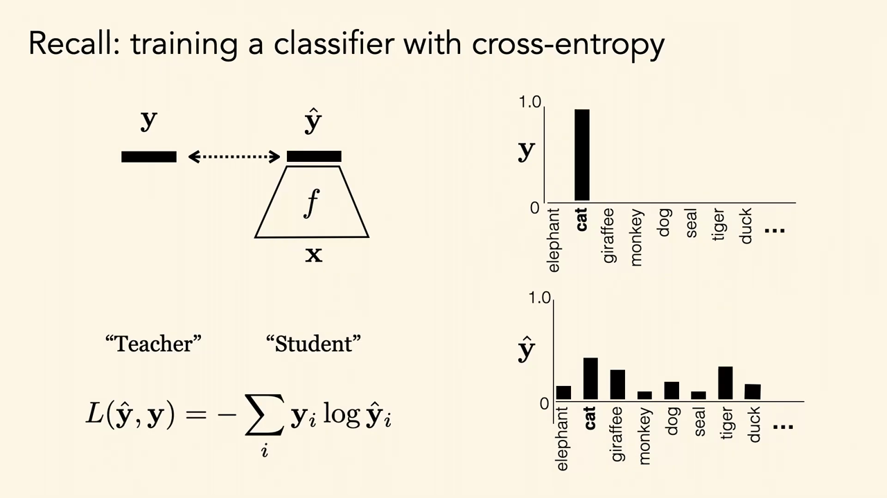
*▲ 강의 슬라이드 [42:26](https://youtu.be/tNfuZ9Imt3M?t=2546): 복습. [원-핫](00_%EB%94%A5%EB%9F%AC%EB%8B%9D_%EC%9A%A9%EC%96%B4%EC%82%AC%EC%A0%84.md#one-hot-encoding-%EC%9B%90-%ED%95%AB-%EC%9D%B8%EC%BD%94%EB%94%A9) [정답](00_%EB%94%A5%EB%9F%AC%EB%8B%9D_%EC%9A%A9%EC%96%B4%EC%82%AC%EC%A0%84.md#label-%EC%A0%95%EB%8B%B5) $\mathbf{y}$("교사")와 예측 $\hat{\mathbf{y}}$("학생") 사이의 [교차 엔트로피](00_%EB%94%A5%EB%9F%AC%EB%8B%9D_%EC%9A%A9%EC%96%B4%EC%82%AC%EC%A0%84.md#cross-entropy-%EA%B5%90%EC%B0%A8-%EC%97%94%ED%8A%B8%EB%A1%9C%ED%94%BC) $L(\hat{\mathbf{y}}, \mathbf{y}) = -\sum_i y_i \log \hat y_i$*

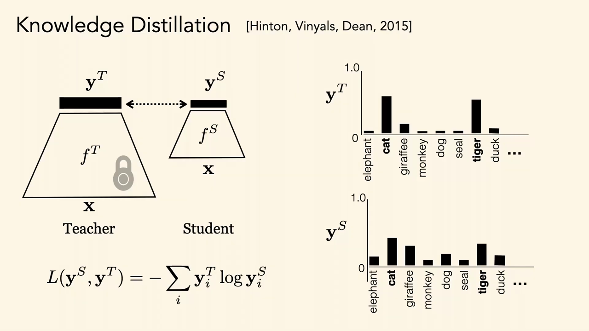
*▲ 강의 슬라이드 [45:59](https://youtu.be/tNfuZ9Imt3M?t=2759): [지식 증류](00_%EB%94%A5%EB%9F%AC%EB%8B%9D_%EC%9A%A9%EC%96%B4%EC%82%AC%EC%A0%84.md#knowledge-distillation-%EC%A7%80%EC%8B%9D-%EC%A6%9D%EB%A5%98). 얼린 교사 $f^T$의 분포(고양이와 호랑이가 높음)를 학생 $f^S$가 따라간다*

증류의 [손실](00_%EB%94%A5%EB%9F%AC%EB%8B%9D_%EC%9A%A9%EC%96%B4%EC%82%AC%EC%A0%84.md#loss-function-%EC%86%90%EC%8B%A4-%ED%95%A8%EC%88%98)은 [정답](00_%EB%94%A5%EB%9F%AC%EB%8B%9D_%EC%9A%A9%EC%96%B4%EC%82%AC%EC%A0%84.md#label-%EC%A0%95%EB%8B%B5) 대신 교사의 분포를 넣은 [교차 엔트로피](00_%EB%94%A5%EB%9F%AC%EB%8B%9D_%EC%9A%A9%EC%96%B4%EC%82%AC%EC%A0%84.md#cross-entropy-%EA%B5%90%EC%B0%A8-%EC%97%94%ED%8A%B8%EB%A1%9C%ED%94%BC)입니다.

$$
L(\mathbf{y}^S, \mathbf{y}^T) = -\sum_i y_i^T \log y_i^S
$$

기호 풀이

| 기호 | 읽는 법 | 뜻 | 예제 값 |
| --- | --- | --- | --- |
| $\mathbf{y}^T$ | 와이 티 | 교사의 출력 분포 ([소프트 타깃](00_%EB%94%A5%EB%9F%AC%EB%8B%9D_%EC%9A%A9%EC%96%B4%EC%82%AC%EC%A0%84.md#soft-target-%EC%86%8C%ED%94%84%ED%8A%B8-%ED%83%80%EA%B9%83)) | (0.7, 0.3) |
| $\mathbf{y}^S$ | 와이 에스 | 학생의 출력 분포 | (0.6, 0.4) |
| $y_i^T, y_i^S$ | | $i$번 범주의 [확률](00_%EB%94%A5%EB%9F%AC%EB%8B%9D_%EC%9A%A9%EC%96%B4%EC%82%AC%EC%A0%84.md#probability-%ED%99%95%EB%A5%A0) | 0.7, 0.6 |
| $\sum_i$ | 시그마 | 모든 범주에 대해 더한다 | |
| $\log$ | [로그](00_%EB%94%A5%EB%9F%AC%EB%8B%9D_%EC%9A%A9%EC%96%B4%EC%82%AC%EC%A0%84.md#log-ln-%EB%A1%9C%EA%B7%B8) | 자연로그 $\ln$ ([M07_로그](%EC%88%98%ED%95%99%EA%B0%9C%EB%85%90/01_%EC%88%98%EC%99%80_%ED%95%A8%EC%88%98/M07_%EB%A1%9C%EA%B7%B8.md)) | |
| $L$ | 엘 | 증류 [손실](00_%EB%94%A5%EB%9F%AC%EB%8B%9D_%EC%9A%A9%EC%96%B4%EC%82%AC%EC%A0%84.md#loss-function-%EC%86%90%EC%8B%A4-%ED%95%A8%EC%88%98) | 0.6325 |

예제와 풀이

**문제**: 두 범주(고양이, 호랑이)에서 교사는 (0.7, 0.3), 학생은 (0.6, 0.4)를 냈다. 증류 [손실](00_%EB%94%A5%EB%9F%AC%EB%8B%9D_%EC%9A%A9%EC%96%B4%EC%82%AC%EC%A0%84.md#loss-function-%EC%86%90%EC%8B%A4-%ED%95%A8%EC%88%98)은?

**주어진 값**
- $\mathbf{y}^T = (0.7, 0.3)$ (교사의 [소프트 타깃](00_%EB%94%A5%EB%9F%AC%EB%8B%9D_%EC%9A%A9%EC%96%B4%EC%82%AC%EC%A0%84.md#soft-target-%EC%86%8C%ED%94%84%ED%8A%B8-%ED%83%80%EA%B9%83))
- $\mathbf{y}^S = (0.6, 0.4)$ (학생의 예측)

**풀이**
1. 식을 그대로 쓴다: $L = -\sum_i y_i^T \log y_i^S$
2. 값을 대입한다 (Σ를 두 항으로 펼침): $L = -(0.7 \log 0.6 + 0.3 \log 0.4)$
3. [로그](00_%EB%94%A5%EB%9F%AC%EB%8B%9D_%EC%9A%A9%EC%96%B4%EC%82%AC%EC%A0%84.md#log-ln-%EB%A1%9C%EA%B7%B8)를 계산한다. $\log y$(= ln)는 약 2.718인 $e$를 몇 제곱해야 $y$가 되는지다: $\ln 0.6 = -0.5108$, $\ln 0.4 = -0.9163$ 이므로 $L = -(0.7 \times (-0.5108) + 0.3 \times (-0.9163))$
4. 곱셈을 한다: $0.7 \times (-0.5108) = -0.3576$, $0.3 \times (-0.9163) = -0.2749$ 이므로 $L = -(-0.3576 - 0.2749)$
5. 괄호 안을 더한다: $-0.3576 - 0.2749 = -0.6325$
6. 부호를 바꾼다: $-(-0.6325) = 0.6325$

**답**: $L = $ **0.6325**. 학생이 교사와 똑같이 (0.7, 0.3)을 내면 0.6109(교사의 [엔트로피](00_%EB%94%A5%EB%9F%AC%EB%8B%9D_%EC%9A%A9%EC%96%B4%EC%82%AC%EC%A0%84.md#entropy-%EC%97%94%ED%8A%B8%EB%A1%9C%ED%94%BC))까지 내려가고, 그보다 작아질 수는 없다. 온도 $T$와 $T^2$ 배율을 넣은 완전한 형태는 [MM65_온도_소프트맥스와_지식_증류](%EC%88%98%ED%95%99%EA%B0%9C%EB%85%90/12_%EA%B0%95%EA%B1%B4%EC%84%B1%EA%B3%BC_%EC%A0%84%EC%9D%B4/MM65_%EC%98%A8%EB%8F%84_%EC%86%8C%ED%94%84%ED%8A%B8%EB%A7%A5%EC%8A%A4%EC%99%80_%EC%A7%80%EC%8B%9D_%EC%A6%9D%EB%A5%98.md).

내 이해

### 5.2 소프트 타깃이 주는 정보

▶ 영상 [45:50](https://youtu.be/tNfuZ9Imt3M?t=2750)

- 입력마다 받는 "라벨"이 [정답](00_%EB%94%A5%EB%9F%AC%EB%8B%9D_%EC%9A%A9%EC%96%B4%EC%82%AC%EC%A0%84.md#label-%EC%A0%95%EB%8B%B5) 범주 하나보다 정보가 많습니다. **[소프트 타깃](00_%EB%94%A5%EB%9F%AC%EB%8B%9D_%EC%9A%A9%EC%96%B4%EC%82%AC%EC%A0%84.md#soft-target-%EC%86%8C%ED%94%84%ED%8A%B8-%ED%83%80%EA%B9%83)**(soft target)은 "이건 개"가 아니라 "고양이를 조금 닮았고 곰과는 아주 다른 개", 그러니까 아마 작은 개라는 것까지 알려 줍니다.
- Hinton 등의 원 논문(음성 인식)에서는 이렇게 학습하면 **[학습](00_%EB%94%A5%EB%9F%AC%EB%8B%9D_%EC%9A%A9%EC%96%B4%EC%82%AC%EC%A0%84.md#training-%ED%95%99%EC%8A%B5) [정확도](00_%EB%94%A5%EB%9F%AC%EB%8B%9D_%EC%9A%A9%EC%96%B4%EC%82%AC%EC%A0%84.md#accuracy-%EC%A0%95%ED%99%95%EB%8F%84)는 낮아도 시험 [정확도](00_%EB%94%A5%EB%9F%AC%EB%8B%9D_%EC%9A%A9%EC%96%B4%EC%82%AC%EC%A0%84.md#accuracy-%EC%A0%95%ED%99%95%EB%8F%84)는 높아졌습니다**.
- [소프트 타깃](00_%EB%94%A5%EB%9F%AC%EB%8B%9D_%EC%9A%A9%EC%96%B4%EC%82%AC%EC%A0%84.md#soft-target-%EC%86%8C%ED%94%84%ED%8A%B8-%ED%83%80%EA%B9%83)의 [엔트로피](00_%EB%94%A5%EB%9F%AC%EB%8B%9D_%EC%9A%A9%EC%96%B4%EC%82%AC%EC%A0%84.md#entropy-%EC%97%94%ED%8A%B8%EB%A1%9C%ED%94%BC)가 높으면 하드 타깃보다 [학습](00_%EB%94%A5%EB%9F%AC%EB%8B%9D_%EC%9A%A9%EC%96%B4%EC%82%AC%EC%A0%84.md#training-%ED%95%99%EC%8A%B5) 사례당 정보가 훨씬 많고, 사례 사이 [기울기](00_%EB%94%A5%EB%9F%AC%EB%8B%9D_%EC%9A%A9%EC%96%B4%EC%82%AC%EC%A0%84.md#gradient-%EA%B8%B0%EC%9A%B8%EA%B8%B0)의 [분산](00_%EB%94%A5%EB%9F%AC%EB%8B%9D_%EC%9A%A9%EC%96%B4%EC%82%AC%EC%A0%84.md#variance-%EB%B6%84%EC%82%B0)도 작습니다. 그래서 작은 모델을 원래보다 **훨씬 적은 데이터**와 **더 큰 [학습률](00_%EB%94%A5%EB%9F%AC%EB%8B%9D_%EC%9A%A9%EC%96%B4%EC%82%AC%EC%A0%84.md#learning-rate-%ED%95%99%EC%8A%B5%EB%A5%A0)**로 학습할 수 있습니다. [엔트로피](00_%EB%94%A5%EB%9F%AC%EB%8B%9D_%EC%9A%A9%EC%96%B4%EC%82%AC%EC%A0%84.md#entropy-%EC%97%94%ED%8A%B8%EB%A1%9C%ED%94%BC)를 높이는 손잡이가 [소프트맥스](00_%EB%94%A5%EB%9F%AC%EB%8B%9D_%EC%9A%A9%EC%96%B4%EC%82%AC%EC%A0%84.md#softmax-%EC%86%8C%ED%94%84%ED%8A%B8%EB%A7%A5%EC%8A%A4)의 **온도**입니다.

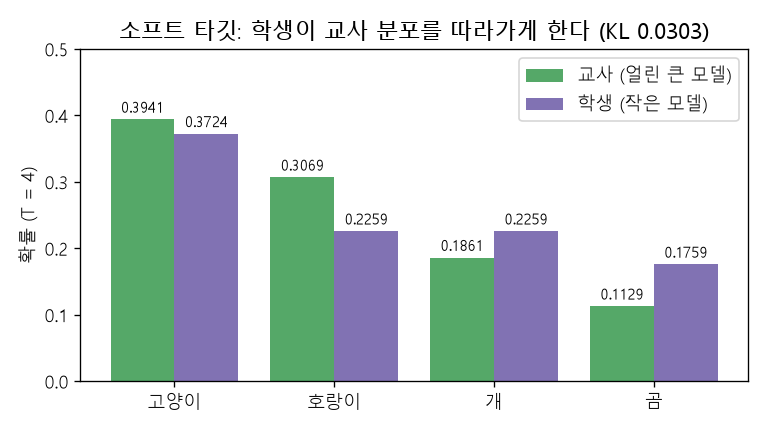
*▲ 직접 그린 그림: 교사 [로짓](00_%EB%94%A5%EB%9F%AC%EB%8B%9D_%EC%9A%A9%EC%96%B4%EC%82%AC%EC%A0%84.md#logit-%EB%A1%9C%EC%A7%93) (4, 3, 1, -1)과 학생 [로짓](00_%EB%94%A5%EB%9F%AC%EB%8B%9D_%EC%9A%A9%EC%96%B4%EC%82%AC%EC%A0%84.md#logit-%EB%A1%9C%EC%A7%93) (3, 1, 1, 0)을 온도 4로 부드럽게 한 분포. 학생이 교사 분포를 따라가도록 KL 0.0303을 줄인다 ([MM65_온도_소프트맥스와_지식_증류](%EC%88%98%ED%95%99%EA%B0%9C%EB%85%90/12_%EA%B0%95%EA%B1%B4%EC%84%B1%EA%B3%BC_%EC%A0%84%EC%9D%B4/MM65_%EC%98%A8%EB%8F%84_%EC%86%8C%ED%94%84%ED%8A%B8%EB%A7%A5%EC%8A%A4%EC%99%80_%EC%A7%80%EC%8B%9D_%EC%A6%9D%EB%A5%98.md)의 숫자)*

> [!TIP]
> **🆕 2026 업데이트: 출력만 보고 하는 증류가 주류가 되다**
> - **강의**: 출력 점수만 볼 수 있어도 그것을 따라 하는 모델을 배울 수 있다([소프트 타깃](00_%EB%94%A5%EB%9F%AC%EB%8B%9D_%EC%9A%A9%EC%96%B4%EC%82%AC%EC%A0%84.md#soft-target-%EC%86%8C%ED%94%84%ED%8A%B8-%ED%83%80%EA%B9%83) 증류, Hinton 등 2015).
> - **현재**: 큰 [언어 모델](00_%EB%94%A5%EB%9F%AC%EB%8B%9D_%EC%9A%A9%EC%96%B4%EC%82%AC%EC%A0%84.md#language-model-%EC%96%B8%EC%96%B4-%EB%AA%A8%EB%8D%B8)에서는 [확률](00_%EB%94%A5%EB%9F%AC%EB%8B%9D_%EC%9A%A9%EC%96%B4%EC%82%AC%EC%A0%84.md#probability-%ED%99%95%EB%A5%A0) 분포가 아니라 교사가 **생성한 글 자체**를 [학습 데이터](00_%EB%94%A5%EB%9F%AC%EB%8B%9D_%EC%9A%A9%EC%96%B4%EC%82%AC%EC%A0%84.md#training-data-test-data-%ED%95%99%EC%8A%B5-%EB%8D%B0%EC%9D%B4%ED%84%B0%EC%99%80-%EC%8B%9C%ED%97%98-%EB%8D%B0%EC%9D%B4%ED%84%B0)로 쓰는 증류가 널리 쓰인다. DeepSeek-R1(2025)은 강화 [학습](00_%EB%94%A5%EB%9F%AC%EB%8B%9D_%EC%9A%A9%EC%96%B4%EC%82%AC%EC%A0%84.md#training-%ED%95%99%EC%8A%B5)으로 만든 [추론 모델](00_%EB%94%A5%EB%9F%AC%EB%8B%9D_%EC%9A%A9%EC%96%B4%EC%82%AC%EC%A0%84.md#reasoning-model-%EC%B6%94%EB%A1%A0-%EB%AA%A8%EB%8D%B8)이 생성한 약 80만 개 표본으로 Qwen2.5와 Llama 3 계열의 작은 밀집 모델 6개(1.5B~70B)를 지도 [미세 조정](00_%EB%94%A5%EB%9F%AC%EB%8B%9D_%EC%9A%A9%EC%96%B4%EC%82%AC%EC%A0%84.md#fine-tuning-%EB%AF%B8%EC%84%B8-%EC%A1%B0%EC%A0%95)만 해서 공개했고, 이렇게 증류한 32B 모델이 AIME 2024에서 72.6%를 냈다. 논문은 작은 모델에 직접 강화 [학습](00_%EB%94%A5%EB%9F%AC%EB%8B%9D_%EC%9A%A9%EC%96%B4%EC%82%AC%EC%A0%84.md#training-%ED%95%99%EC%8A%B5)을 하는 것보다 큰 모델에서 증류하는 편이 계산 대비 성능이 훨씬 좋다고 보고했다. 연구 결과는 2025년 Nature에 실렸다.
> - **출처**: [DeepSeek-AI, DeepSeek-R1: Incentivizing Reasoning Capability in LLMs via Reinforcement Learning (arXiv 2025; Nature 645, 2025)](https://arxiv.org/abs/2501.12948)

### 5.3 모달리티를 건너는 증류와 앙상블 증류

▶ 영상 [47:00](https://youtu.be/tNfuZ9Imt3M?t=2820)

- **모달리티 사이의 증류**: 교사는 RGB 사진으로 범주를 예측하고, 학생은 **깊이 영상**만 봅니다(Gupta 등 2015). RGB에는 라벨이 있지만 깊이에는 없을 때 쓸모 있습니다. SoundNet(Aytar 등 2016)은 라벨 없는 영상에서, 사진을 보는 시각 인식 망의 물체·장면 분포를 소리 파형만 보는 망으로 [KL 발산](00_%EB%94%A5%EB%9F%AC%EB%8B%9D_%EC%9A%A9%EC%96%B4%EC%82%AC%EC%A0%84.md#kl-divergence-kl-%EB%B0%9C%EC%82%B0)을 써서 증류합니다.
- **[앙상블](00_%EB%94%A5%EB%9F%AC%EB%8B%9D_%EC%9A%A9%EC%96%B4%EC%82%AC%EC%A0%84.md#ensemble-%EC%95%99%EC%83%81%EB%B8%94) 증류**: 지금도 여러 모델의 [앙상블](00_%EB%94%A5%EB%9F%AC%EB%8B%9D_%EC%9A%A9%EC%96%B4%EC%82%AC%EC%A0%84.md#ensemble-%EC%95%99%EC%83%81%EB%B8%94)이 단일 모델보다 예측이 좋은 경우가 많습니다. 고전적인 이유는 각 모델이 **같은 [정답](00_%EB%94%A5%EB%9F%AC%EB%8B%9D_%EC%9A%A9%EC%96%B4%EC%82%AC%EC%A0%84.md#label-%EC%A0%95%EB%8B%B5)은 자주 맞히지만 같은 실수는 덜 한다**는 것입니다. [오차](00_%EB%94%A5%EB%9F%AC%EB%8B%9D_%EC%9A%A9%EC%96%B4%EC%82%AC%EC%A0%84.md#error-%EC%98%A4%EC%B0%A8)는 상쇄되고 진실은 공유됩니다. 하지만 모델 셋을 늘 돌리기는 비싸므로, [앙상블](00_%EB%94%A5%EB%9F%AC%EB%8B%9D_%EC%9A%A9%EC%96%B4%EC%82%AC%EC%A0%84.md#ensemble-%EC%95%99%EC%83%81%EB%B8%94)의 출력 분포를 학생 하나에 증류합니다.
- **한계**: 데이터에서 배운 [편향](00_%EB%94%A5%EB%9F%AC%EB%8B%9D_%EC%9A%A9%EC%96%B4%EC%82%AC%EC%A0%84.md#bias-%ED%8E%B8%ED%96%A5)은 모든 모델에 공통일 수 있습니다. [앙상블](00_%EB%94%A5%EB%9F%AC%EB%8B%9D_%EC%9A%A9%EC%96%B4%EC%82%AC%EC%A0%84.md#ensemble-%EC%95%99%EC%83%81%EB%B8%94)의 **모든** 모델이 틀리는 구석 사례는 증류한 학생도 잘하지 못합니다. 그래도 훨씬 효율적입니다([MM67_앙상블_평균과_오차_상쇄](%EC%88%98%ED%95%99%EA%B0%9C%EB%85%90/08_%EC%9D%BC%EB%B0%98%ED%99%94/MM67_%EC%95%99%EC%83%81%EB%B8%94_%ED%8F%89%EA%B7%A0%EA%B3%BC_%EC%98%A4%EC%B0%A8_%EC%83%81%EC%87%84.md)).

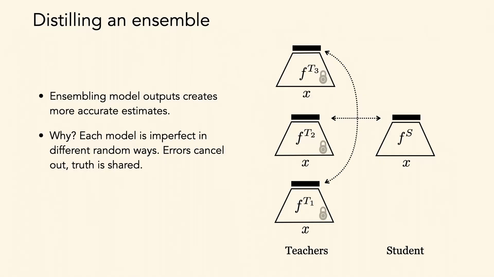
*▲ 강의 슬라이드 [49:05](https://youtu.be/tNfuZ9Imt3M?t=2945): [앙상블](00_%EB%94%A5%EB%9F%AC%EB%8B%9D_%EC%9A%A9%EC%96%B4%EC%82%AC%EC%A0%84.md#ensemble-%EC%95%99%EC%83%81%EB%B8%94) 증류. 얼린 교사 셋의 출력을 학생 하나가 따라간다. "각 모델은 서로 다른 무작위 방식으로 불완전하다. [오차](00_%EB%94%A5%EB%9F%AC%EB%8B%9D_%EC%9A%A9%EC%96%B4%EC%82%AC%EC%A0%84.md#error-%EC%98%A4%EC%B0%A8)는 상쇄되고 진실은 공유된다"*

[앙상블](00_%EB%94%A5%EB%9F%AC%EB%8B%9D_%EC%9A%A9%EC%96%B4%EC%82%AC%EC%A0%84.md#ensemble-%EC%95%99%EC%83%81%EB%B8%94) 교사의 분포는 모델별 분포의 평균입니다.

$$
\bar{\mathbf{p}} = \frac{1}{M}\sum_{m=1}^{M} \mathbf{p}_m
$$

기호 풀이

| 기호 | 읽는 법 | 뜻 | 예제 값 |
| --- | --- | --- | --- |
| $M$ | 엠 | [앙상블](00_%EB%94%A5%EB%9F%AC%EB%8B%9D_%EC%9A%A9%EC%96%B4%EC%82%AC%EC%A0%84.md#ensemble-%EC%95%99%EC%83%81%EB%B8%94)의 모델 수 | 3 |
| $\mathbf{p}_m$ | 피 엠 | $m$번 교사의 [확률](00_%EB%94%A5%EB%9F%AC%EB%8B%9D_%EC%9A%A9%EC%96%B4%EC%82%AC%EC%A0%84.md#probability-%ED%99%95%EB%A5%A0) 벡터 (고양이, 호랑이, 개) | (0.6, 0.3, 0.1) 등 |
| $\bar{\mathbf{p}}$ | 피 바 | 칸별 평균. 학생이 따라갈 [소프트 타깃](00_%EB%94%A5%EB%9F%AC%EB%8B%9D_%EC%9A%A9%EC%96%B4%EC%82%AC%EC%A0%84.md#soft-target-%EC%86%8C%ED%94%84%ED%8A%B8-%ED%83%80%EA%B9%83) | (0.6, 0.3, 0.1) |

예제와 풀이

**문제**: 교사 셋이 같은 사진에 (고양이, 호랑이, 개) [확률](00_%EB%94%A5%EB%9F%AC%EB%8B%9D_%EC%9A%A9%EC%96%B4%EC%82%AC%EC%A0%84.md#probability-%ED%99%95%EB%A5%A0)을 (0.6, 0.3, 0.1), (0.4, 0.5, 0.1), (0.8, 0.1, 0.1)로 냈다. 학생이 따라갈 [앙상블](00_%EB%94%A5%EB%9F%AC%EB%8B%9D_%EC%9A%A9%EC%96%B4%EC%82%AC%EC%A0%84.md#ensemble-%EC%95%99%EC%83%81%EB%B8%94) 분포는?

**주어진 값**
- $M = 3$ (교사 수)
- $\mathbf{p}_1 = (0.6, 0.3, 0.1)$, $\mathbf{p}_2 = (0.4, 0.5, 0.1)$, $\mathbf{p}_3 = (0.8, 0.1, 0.1)$ (교사별 [확률](00_%EB%94%A5%EB%9F%AC%EB%8B%9D_%EC%9A%A9%EC%96%B4%EC%82%AC%EC%A0%84.md#probability-%ED%99%95%EB%A5%A0))

**풀이**
1. 식을 그대로 쓴다: $\bar{\mathbf{p}} = \dfrac{1}{M}\sum_{m=1}^{M} \mathbf{p}_m$
2. 값을 대입한다: $\bar{\mathbf{p}} = \dfrac{1}{3}\big((0.6, 0.3, 0.1) + (0.4, 0.5, 0.1) + (0.8, 0.1, 0.1)\big)$
3. 고양이 칸을 더한다: $0.6 + 0.4 + 0.8 = 1.8$
4. 호랑이 칸을 더한다: $0.3 + 0.5 + 0.1 = 0.9$
5. 개 칸을 더한다: $0.1 + 0.1 + 0.1 = 0.3$
6. 칸마다 3으로 나눈다: $1.8 / 3 = 0.6$, $0.9 / 3 = 0.3$, $0.3 / 3 = 0.1$

**답**: $\bar{\mathbf{p}} = $ **(0.6, 0.3, 0.1)**. 둘째 교사(호랑이 0.5)와 셋째 교사(호랑이 0.1)의 엇갈림이 상쇄되었다.

내 이해

### 5.4 표현 증류

▶ 영상 [49:10](https://youtu.be/tNfuZ9Imt3M?t=2950)

- 출력만이 아니라 **표현 자체의 지식**도 증류할 수 있습니다. **대조 표현 증류**(CRD, Tian·Krishnan·Isola 2020)는 모델 중간의 [임베딩](00_%EB%94%A5%EB%9F%AC%EB%8B%9D_%EC%9A%A9%EC%96%B4%EC%82%AC%EC%A0%84.md#embedding-%EC%9E%84%EB%B2%A0%EB%94%A9)을 [대조 학습](00_%EB%94%A5%EB%9F%AC%EB%8B%9D_%EC%9A%A9%EC%96%B4%EC%82%AC%EC%A0%84.md#contrastive-learning-%EB%8C%80%EC%A1%B0-%ED%95%99%EC%8A%B5)으로 맞춥니다.
- [대조 학습](00_%EB%94%A5%EB%9F%AC%EB%8B%9D_%EC%9A%A9%EC%96%B4%EC%82%AC%EC%A0%84.md#contrastive-learning-%EB%8C%80%EC%A1%B0-%ED%95%99%EC%8A%B5)은 [임베딩](00_%EB%94%A5%EB%9F%AC%EB%8B%9D_%EC%9A%A9%EC%96%B4%EC%82%AC%EC%A0%84.md#embedding-%EC%9E%84%EB%B2%A0%EB%94%A9)이 어떤 "보기 변환"(회전 등)에 불변하도록 지도합니다([Lec12 6](Lec12_%EC%9C%A0%EC%82%AC%EB%8F%84_%EA%B8%B0%EB%B0%98_%ED%91%9C%ED%98%84_%ED%95%99%EC%8A%B5.md#6-%EC%9E%90%EA%B8%B0-%EC%A7%80%EB%8F%84-%EB%8C%80%EC%A1%B0-%ED%95%99%EC%8A%B5)). 여기서는 같은 입력에 대한 **교사의 보기(큰 망)와 학생의 보기(작은 망)**를 두 보기로 봅니다. 그러면 학생은 교사와 같은 [임베딩](00_%EB%94%A5%EB%9F%AC%EB%8B%9D_%EC%9A%A9%EC%96%B4%EC%82%AC%EC%A0%84.md#embedding-%EC%9E%84%EB%B2%A0%EB%94%A9)을 내도록 배웁니다.
- CIFAR-100에서 학생 [로짓](00_%EB%94%A5%EB%9F%AC%EB%8B%9D_%EC%9A%A9%EC%96%B4%EC%82%AC%EC%A0%84.md#logit-%EB%A1%9C%EC%A7%93)과 교사 [로짓](00_%EB%94%A5%EB%9F%AC%EB%8B%9D_%EC%9A%A9%EC%96%B4%EC%82%AC%EC%A0%84.md#logit-%EB%A1%9C%EC%A7%93)의 차이의 상관 계수(100×100 범주)를 보면, 보통 [지식 증류](00_%EB%94%A5%EB%9F%AC%EB%8B%9D_%EC%9A%A9%EC%96%B4%EC%82%AC%EC%A0%84.md#knowledge-distillation-%EC%A7%80%EC%8B%9D-%EC%A6%9D%EB%A5%98)보다 CRD가 훨씬 깨끗한(상관이 적은) 모양을 보입니다.

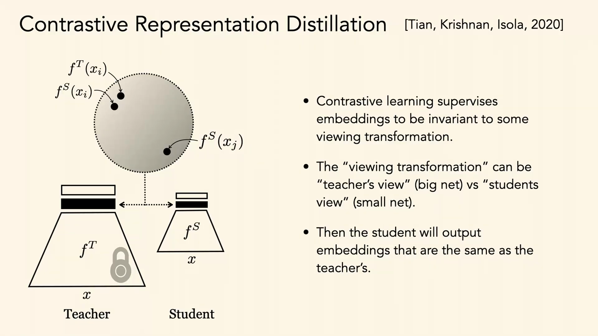
*▲ 강의 슬라이드 [53:05](https://youtu.be/tNfuZ9Imt3M?t=3185): 대조 표현 증류. 같은 입력의 교사 [임베딩](00_%EB%94%A5%EB%9F%AC%EB%8B%9D_%EC%9A%A9%EC%96%B4%EC%82%AC%EC%A0%84.md#embedding-%EC%9E%84%EB%B2%A0%EB%94%A9) $f^T(x_i)$와 학생 [임베딩](00_%EB%94%A5%EB%9F%AC%EB%8B%9D_%EC%9A%A9%EC%96%B4%EC%82%AC%EC%A0%84.md#embedding-%EC%9E%84%EB%B2%A0%EB%94%A9) $f^S(x_i)$를 양성 쌍으로 당기고, 다른 입력 $f^S(x_j)$는 민다*

질의응답 정리 [50:15](https://youtu.be/tNfuZ9Imt3M?t=3015)

- **실제로 학생은 교사보다 얼마나 작은가?** 데이터와 과제가 얼마나 복잡한지에 달렸습니다. 모델을 얼마나 작게 만들어도 쓸모 있는지는 모델링하려는 정보의 복잡도와 직접 관련됩니다. 휴대폰에서 돌리려면 작아야 하고(H200급 모델을 휴대폰에 넣을 수는 없음), 증류 말고도 압축, [양자화](00_%EB%94%A5%EB%9F%AC%EB%8B%9D_%EC%9A%A9%EC%96%B4%EC%82%AC%EC%A0%84.md#quantization-%EC%96%91%EC%9E%90%ED%99%94), [가지치기](00_%EB%94%A5%EB%9F%AC%EB%8B%9D_%EC%9A%A9%EC%96%B4%EC%82%AC%EC%A0%84.md#pruning-%EA%B0%80%EC%A7%80%EC%B9%98%EA%B8%B0) 등이 있으며 아주 작은 모델을 잘 만드는 방법은 보통 이것들의 조합입니다.
- **Claude, Gemini처럼 크기별 모델을 내는 것도 이 기법들의 결과인가?** 회사들이 영업 비밀을 말해 주지 않아 모른다고 답합니다. 크기별로 내는 이유는 쓰는 곳마다 자원(물리적 제약, 돈, 속도)이 다르기 때문입니다. 보통 큰 모델이 작은 모델보다 낫지만 "감당할 수 있는 가장 큰 모델"을 씁니다.

---

## 6. 압축과 증류

▶ 영상 [53:44](https://youtu.be/tNfuZ9Imt3M?t=3224)

📐 **수학 개념**: [가지치기와 양자화](%EC%88%98%ED%95%99%EA%B0%9C%EB%85%90/12_%EA%B0%95%EA%B1%B4%EC%84%B1%EA%B3%BC_%EC%A0%84%EC%9D%B4/MM68_%EA%B0%80%EC%A7%80%EC%B9%98%EA%B8%B0%EC%99%80_%EC%96%91%EC%9E%90%ED%99%94.md)

- 둘 다 큰 모델과 비슷한 [정확도](00_%EB%94%A5%EB%9F%AC%EB%8B%9D_%EC%9A%A9%EC%96%B4%EC%82%AC%EC%A0%84.md#accuracy-%EC%A0%95%ED%99%95%EB%8F%84)의 **작은 모델**을 줍니다.
- **증류**: [SGD](00_%EB%94%A5%EB%9F%AC%EB%8B%9D_%EC%9A%A9%EC%96%B4%EC%82%AC%EC%A0%84.md#stochastic-gradient-descent-%ED%99%95%EB%A5%A0%EC%A0%81-%EA%B2%BD%EC%82%AC%ED%95%98%EA%B0%95%EB%B2%95)로 작은 모델이 큰 모델의 특성을 따라가도록 **[학습](00_%EB%94%A5%EB%9F%AC%EB%8B%9D_%EC%9A%A9%EC%96%B4%EC%82%AC%EC%A0%84.md#training-%ED%95%99%EC%8A%B5)**합니다. 이 [학습](00_%EB%94%A5%EB%9F%AC%EB%8B%9D_%EC%9A%A9%EC%96%B4%EC%82%AC%EC%A0%84.md#training-%ED%95%99%EC%8A%B5)이 계산상 비쌀 수 있습니다.
- **압축**: [가지치기](00_%EB%94%A5%EB%9F%AC%EB%8B%9D_%EC%9A%A9%EC%96%B4%EC%82%AC%EC%A0%84.md#pruning-%EA%B0%80%EC%A7%80%EC%B9%98%EA%B8%B0)나 [양자화](00_%EB%94%A5%EB%9F%AC%EB%8B%9D_%EC%9A%A9%EC%96%B4%EC%82%AC%EC%A0%84.md#quantization-%EC%96%91%EC%9E%90%ED%99%94)로 큰 모델의 계산 비용을 직접 줄입니다. 훨씬 효율적일 수 있어서, [학습](00_%EB%94%A5%EB%9F%AC%EB%8B%9D_%EC%9A%A9%EC%96%B4%EC%82%AC%EC%A0%84.md#training-%ED%95%99%EC%8A%B5) 비용 때문에 압축을 고르기도 합니다. [가지치기](00_%EB%94%A5%EB%9F%AC%EB%8B%9D_%EC%9A%A9%EC%96%B4%EC%82%AC%EC%A0%84.md#pruning-%EA%B0%80%EC%A7%80%EC%B9%98%EA%B8%B0)는 그냥 지우는 것이라 아주 싸고, [양자화](00_%EB%94%A5%EB%9F%AC%EB%8B%9D_%EC%9A%A9%EC%96%B4%EC%82%AC%EC%A0%84.md#quantization-%EC%96%91%EC%9E%90%ED%99%94)는 조금 더 비싸며 "중간 표현이 비슷하게" 하려 한다는 점에서 증류와 닮은 면이 있습니다.
- **Optimal Brain Compression**(Frantar 등 2023)은 [가지치기](00_%EB%94%A5%EB%9F%AC%EB%8B%9D_%EC%9A%A9%EC%96%B4%EC%82%AC%EC%A0%84.md#pruning-%EA%B0%80%EC%A7%80%EC%B9%98%EA%B8%B0)와 [양자화](00_%EB%94%A5%EB%9F%AC%EB%8B%9D_%EC%9A%A9%EC%96%B4%EC%82%AC%EC%A0%84.md#quantization-%EC%96%91%EC%9E%90%ED%99%94)를 함께 하면서, 계산을 비싸게 하지 않고 전역적으로 최적에 가까운 마스크를 찾습니다. 압축이 싸야 하는 이유는 클라우드가 아니라 **기기(엣지) 위에서** 바로 압축해야 할 때가 있기 때문입니다.
- **특화하면서 압축하기**: 범용 대형 모델(ImageNet)에서, 예컨대 **상어만 아는** 작은 특화 모델이 필요하다면, 압축하면서 그 분포에 특화하도록 두면 훨씬 많이 줄이면서 [정확도](00_%EB%94%A5%EB%9F%AC%EB%8B%9D_%EC%9A%A9%EC%96%B4%EC%82%AC%EC%A0%84.md#accuracy-%EC%A0%95%ED%99%95%EB%8F%84)를 유지할 수 있었다고 합니다(강사 연구실의 TACO). 원래 정보를 다 지킬 필요가 없으니 직관적으로도 그렇습니다.

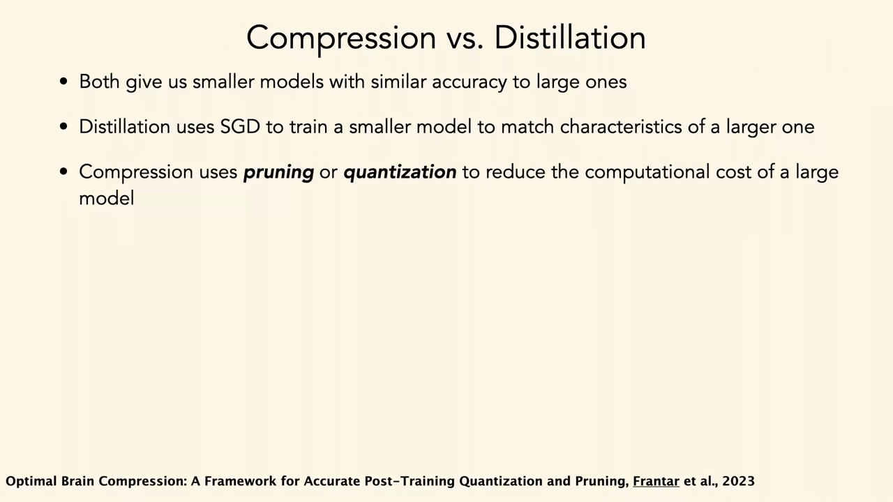
*▲ 강의 슬라이드 [54:26](https://youtu.be/tNfuZ9Imt3M?t=3266): 압축과 증류. 둘 다 작은 모델을 주지만, 증류는 SGD로 새로 학습하고 압축은 [가지치기](00_%EB%94%A5%EB%9F%AC%EB%8B%9D_%EC%9A%A9%EC%96%B4%EC%82%AC%EC%A0%84.md#pruning-%EA%B0%80%EC%A7%80%EC%B9%98%EA%B8%B0)·[양자화](00_%EB%94%A5%EB%9F%AC%EB%8B%9D_%EC%9A%A9%EC%96%B4%EC%82%AC%EC%A0%84.md#quantization-%EC%96%91%EC%9E%90%ED%99%94)로 큰 모델의 비용을 줄인다*

---

## 7. 기반 모델

▶ 영상 [56:20](https://youtu.be/tNfuZ9Imt3M?t=3380)

### 7.1 기반 모델이란

▶ 영상 [56:20](https://youtu.be/tNfuZ9Imt3M?t=3380)

- **[기반 모델](00_%EB%94%A5%EB%9F%AC%EB%8B%9D_%EC%9A%A9%EC%96%B4%EC%82%AC%EC%A0%84.md#foundation-model-%EA%B8%B0%EB%B0%98-%EB%AA%A8%EB%8D%B8)**(Foundation model)은 스탠퍼드 컴퓨터과학과(Bommasani 등 2021)가 만든 말로, 아주 쓸모 있는 [전이 학습](00_%EB%94%A5%EB%9F%AC%EB%8B%9D_%EC%9A%A9%EC%96%B4%EC%82%AC%EC%A0%84.md#transfer-learning-%EC%A0%84%EC%9D%B4-%ED%95%99%EC%8A%B5) 모델, 곧 **많은 다운스트림 과제에 두루 효과적인** 모델을 가리킵니다.
- 어떤 [기반 모델](00_%EB%94%A5%EB%9F%AC%EB%8B%9D_%EC%9A%A9%EC%96%B4%EC%82%AC%EC%A0%84.md#foundation-model-%EA%B8%B0%EB%B0%98-%EB%AA%A8%EB%8D%B8)은 본질적으로 **[표현 학습](00_%EB%94%A5%EB%9F%AC%EB%8B%9D_%EC%9A%A9%EC%96%B4%EC%82%AC%EC%A0%84.md#representation-learning-%ED%91%9C%ED%98%84-%ED%95%99%EC%8A%B5)** 모델이라 "[미세 조정](00_%EB%94%A5%EB%9F%AC%EB%8B%9D_%EC%9A%A9%EC%96%B4%EC%82%AC%EC%A0%84.md#fine-tuning-%EB%AF%B8%EC%84%B8-%EC%A1%B0%EC%A0%95)이 필요한가?"가 질문이 됩니다. [기반 모델](00_%EB%94%A5%EB%9F%AC%EB%8B%9D_%EC%9A%A9%EC%96%B4%EC%82%AC%EC%A0%84.md#foundation-model-%EA%B8%B0%EB%B0%98-%EB%AA%A8%EB%8D%B8)이 일반적일수록 사람들이 원하는 것이 그 아주 넓은 분포 안에 있을 가능성이 커서 [미세 조정](00_%EB%94%A5%EB%9F%AC%EB%8B%9D_%EC%9A%A9%EC%96%B4%EC%82%AC%EC%A0%84.md#fine-tuning-%EB%AF%B8%EC%84%B8-%EC%A1%B0%EC%A0%95)이 덜 필요합니다.
- [미세 조정](00_%EB%94%A5%EB%9F%AC%EB%8B%9D_%EC%9A%A9%EC%96%B4%EC%82%AC%EC%A0%84.md#fine-tuning-%EB%AF%B8%EC%84%B8-%EC%A1%B0%EC%A0%95)이 필요 없으면 훨씬 **접근하기 쉬워집니다**. ChatGPT, [CLIP](00_%EB%94%A5%EB%9F%AC%EB%8B%9D_%EC%9A%A9%EC%96%B4%EC%82%AC%EC%A0%84.md#clip-%ED%81%B4%EB%A6%BD), 대형 이미지 [생성 모델](00_%EB%94%A5%EB%9F%AC%EB%8B%9D_%EC%9A%A9%EC%96%B4%EC%82%AC%EC%A0%84.md#generative-model-%EC%83%9D%EC%84%B1-%EB%AA%A8%EB%8D%B8)의 힘은 대부분의 사용자가 재학습 없이 **그대로 쓸 수 있다**는 데 있습니다. [기반 모델](00_%EB%94%A5%EB%9F%AC%EB%8B%9D_%EC%9A%A9%EC%96%B4%EC%82%AC%EC%A0%84.md#foundation-model-%EA%B8%B0%EB%B0%98-%EB%AA%A8%EB%8D%B8)의 쓸모는 "사람들이 하고 싶은 일 중 몇 %를 특별한 [학습](00_%EB%94%A5%EB%9F%AC%EB%8B%9D_%EC%9A%A9%EC%96%B4%EC%82%AC%EC%A0%84.md#training-%ED%95%99%EC%8A%B5) 없이 해내는가"로 생각해 볼 수 있습니다.
- 뉴턴의 말 "내가 더 멀리 보았다면, 거인의 어깨 위에 서 있었기 때문이다". 기반이 클수록 더 높은 곳에서 출발합니다.

### 7.2 규모와 비용

▶ 영상 [58:26](https://youtu.be/tNfuZ9Imt3M?t=3506)

📐 **수학 개념**: [지수와 e](%EC%88%98%ED%95%99%EA%B0%9C%EB%85%90/01_%EC%88%98%EC%99%80_%ED%95%A8%EC%88%98/M06_%EC%A7%80%EC%88%98%EC%99%80_e.md) · [로그](%EC%88%98%ED%95%99%EA%B0%9C%EB%85%90/01_%EC%88%98%EC%99%80_%ED%95%A8%EC%88%98/M07_%EB%A1%9C%EA%B7%B8.md)

- **계산량의 지수적 증가**: OpenAI의 2018년 도표([로그](00_%EB%94%A5%EB%9F%AC%EB%8B%9D_%EC%9A%A9%EC%96%B4%EC%82%AC%EC%A0%84.md#log-ln-%EB%A1%9C%EA%B7%B8) 축)에 따르면 AlexNet에서 AlphaGo Zero까지 [학습](00_%EB%94%A5%EB%9F%AC%EB%8B%9D_%EC%9A%A9%EC%96%B4%EC%82%AC%EC%A0%84.md#training-%ED%95%99%EC%8A%B5) 계산량이 **30만 배** 늘었습니다. 요즘 모델은 [파라미터](00_%EB%94%A5%EB%9F%AC%EB%8B%9D_%EC%9A%A9%EC%96%B4%EC%82%AC%EC%A0%84.md#parameter-%ED%8C%8C%EB%9D%BC%EB%AF%B8%ED%84%B0)가 수십억~수조 개이고, 아주 큰 모델일수록 일반적으로 쓸모 있습니다.
- **누가 만드나**: 2021년까지의 계산량을 보면 학계와 산학 협력의 계산량은 거의 그대로인데 **산업계만** 크게 늘었습니다. 비용을 감당할 수 있는 곳이 산업계뿐이기 때문입니다. Microsoft는 내년 계산에 800억 달러를 쓴다고 발표했다고 합니다(상당 부분은 OpenAI 등이 쓰는 데이터 센터 운영).
- **기후 비용**: 1760억 [파라미터](00_%EB%94%A5%EB%9F%AC%EB%8B%9D_%EC%9A%A9%EC%96%B4%EC%82%AC%EC%A0%84.md#parameter-%ED%8C%8C%EB%9D%BC%EB%AF%B8%ED%84%B0) [언어 모델](00_%EB%94%A5%EB%9F%AC%EB%8B%9D_%EC%9A%A9%EC%96%B4%EC%82%AC%EC%A0%84.md#language-model-%EC%96%B8%EC%96%B4-%EB%AA%A8%EB%8D%B8) BLOOM의 탄소 발자국 연구(Luccioni 등 2023)는 수명 주기 중 장비 제조, 모델 [학습](00_%EB%94%A5%EB%9F%AC%EB%8B%9D_%EC%9A%A9%EC%96%B4%EC%82%AC%EC%A0%84.md#training-%ED%95%99%EC%8A%B5), 배포 세 단계를 봤습니다(강의에서는 Microsoft의 모델이라고 했지만, BLOOM은 Hugging Face가 이끈 BigScience 공동 연구의 공개 모델이다). 탄소 배출을 크게 가르는 요인은 **데이터 센터 전력원의 지속 가능성**이었습니다. 훨씬 작은 모델도 재생 에너지가 아닌 곳에서 학습하면 배출이 훨씬 클 수 있습니다. 비용 부담 덕에 회사들이 재생 에너지에 관심을 두게 된 것은 좋은 점이지만, 배출의 기후 비용은 회사가 치르지 않습니다.
- **물**: 냉각에 물이 듭니다. 강사는 [GPT](00_%EB%94%A5%EB%9F%AC%EB%8B%9D_%EC%9A%A9%EC%96%B4%EC%82%AC%EC%A0%84.md#gpt-%EC%83%9D%EC%84%B1%ED%98%95-%EC%82%AC%EC%A0%84%ED%95%99%EC%8A%B5-%ED%8A%B8%EB%9E%9C%EC%8A%A4%ED%8F%AC%EB%A8%B8)-3를 주로 아이오와에서 학습하는 동안 주의 물 사용이 크게 늘었다는 이야기와, ChatGPT 질의 약 50번에 물 한 병이라는 추정을 소개합니다(모두 강사가 기억에 의존해 인용한 수치). 전력 수요도 커서, 데이터 센터 전력을 위해 **스리마일섬** 원전 재가동이 뉴스가 되었습니다(강의에서는 Google이라고 했지만, 2024년 9월 20년 전력 구매 계약을 맺은 쪽은 Microsoft다: [Constellation과 Microsoft의 계약 보도, ANS 2024](https://ans.org/news/article-6402/constellation-announces-tmi1-restart-power-purchase-agreement-with-microsoft)). 자원을 쓰는 규모와 이익을 보는 사람이 어긋나는 윤리 문제도 있습니다. 강사는 검색마다 AI를 돌리지 않는 "기후 친화적 검색"을 고를 수 있으면 좋겠다고 말합니다.
- **[학습](00_%EB%94%A5%EB%9F%AC%EB%8B%9D_%EC%9A%A9%EC%96%B4%EC%82%AC%EC%A0%84.md#training-%ED%95%99%EC%8A%B5) 비용 (조금 오래된 수치)**: DALL-E 2는 반쯤 정제한 글-그림 쌍 6억 5천만 개, [GPT](00_%EB%94%A5%EB%9F%AC%EB%8B%9D_%EC%9A%A9%EC%96%B4%EC%82%AC%EC%A0%84.md#gpt-%EC%83%9D%EC%84%B1%ED%98%95-%EC%82%AC%EC%A0%84%ED%95%99%EC%8A%B5-%ED%8A%B8%EB%9E%9C%EC%8A%A4%ED%8F%AC%EB%A8%B8)-3는 한 번 [학습](00_%EB%94%A5%EB%9F%AC%EB%8B%9D_%EC%9A%A9%EC%96%B4%EC%82%AC%EC%A0%84.md#training-%ED%95%99%EC%8A%B5)에 약 460만 달러(실제로는 [하이퍼파라미터](00_%EB%94%A5%EB%9F%AC%EB%8B%9D_%EC%9A%A9%EC%96%B4%EC%82%AC%EC%A0%84.md#hyperparameter-%ED%95%98%EC%9D%B4%ED%8D%BC%ED%8C%8C%EB%9D%BC%EB%AF%B8%ED%84%B0) 탐색 등으로 여러 번 [학습](00_%EB%94%A5%EB%9F%AC%EB%8B%9D_%EC%9A%A9%EC%96%B4%EC%82%AC%EC%A0%84.md#training-%ED%95%99%EC%8A%B5)), PaLM 논문 저자는 67명이었습니다. 이 숫자들은 계속 커지고 있습니다.
- **인프라로 보는 관점**: 결과물을 고속도로망이나 운영체제 같은 **기반 인프라**로 보면 이 비용이 작을 수도 있다는 주장이 있습니다. 근거 하나는 규모입니다. 58개 과제의 성능을 모델 크기별로 그리면, 아주 큰 모델에서야 평균적인 사람만큼 하기 시작합니다. 강사의 생각은 "그렇다면 이제 효율 연구로 다시 줄이자"입니다.

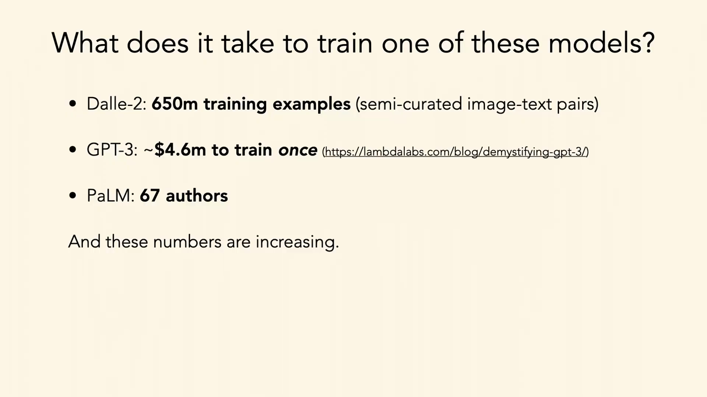
*▲ 강의 슬라이드 [67:35](https://youtu.be/tNfuZ9Imt3M?t=4055): 이런 모델을 학습하려면? DALL-E 2 [학습](00_%EB%94%A5%EB%9F%AC%EB%8B%9D_%EC%9A%A9%EC%96%B4%EC%82%AC%EC%A0%84.md#training-%ED%95%99%EC%8A%B5) 예 6억 5천만 개, [GPT](00_%EB%94%A5%EB%9F%AC%EB%8B%9D_%EC%9A%A9%EC%96%B4%EC%82%AC%EC%A0%84.md#gpt-%EC%83%9D%EC%84%B1%ED%98%95-%EC%82%AC%EC%A0%84%ED%95%99%EC%8A%B5-%ED%8A%B8%EB%9E%9C%EC%8A%A4%ED%8F%AC%EB%A8%B8)-3 한 번 [학습](00_%EB%94%A5%EB%9F%AC%EB%8B%9D_%EC%9A%A9%EC%96%B4%EC%82%AC%EC%A0%84.md#training-%ED%95%99%EC%8A%B5)에 약 460만 달러, PaLM 저자 67명. 그리고 숫자는 커지는 중*

계산량이 일정한 주기로 두 배가 되면, 늘어난 배수와 걸린 시간 사이에 다음 관계가 있습니다.

$$
\text{배수} = 2^{\Delta t / T_d} \quad\Longleftrightarrow\quad \Delta t = T_d \times \log_2(\text{배수})
$$

기호 풀이

| 기호 | 읽는 법 | 뜻 | 예제 값 |
| --- | --- | --- | --- |
| $T_d$ | 티 디 | 계산량이 두 배가 되는 데 걸리는 시간 | 3.4개월 |
| $\Delta t$ | 델타 티 | 걸린 시간 | 61.86개월 |
| 배수 | | 처음 대비 늘어난 배수 | 300,000 |
| $\log_2$ | [로그](00_%EB%94%A5%EB%9F%AC%EB%8B%9D_%EC%9A%A9%EC%96%B4%EC%82%AC%EC%A0%84.md#log-ln-%EB%A1%9C%EA%B7%B8) 2 | 2를 몇 번 곱해야 그 수가 되는지 (두 배가 된 횟수) | 18.19 |

예제와 풀이

**문제**: [학습](00_%EB%94%A5%EB%9F%AC%EB%8B%9D_%EC%9A%A9%EC%96%B4%EC%82%AC%EC%A0%84.md#training-%ED%95%99%EC%8A%B5) 계산량이 3.4개월마다 두 배가 되어 30만 배가 되었다. 몇 개월이 걸렸나?

**주어진 값**
- $T_d = 3.4$개월 (두 배가 되는 주기, OpenAI 2018)
- 배수 $= 300{,}000$ (AlexNet → AlphaGo Zero)

**풀이**
1. 식을 그대로 쓴다: $\Delta t = T_d \times \log_2(\text{배수})$
2. 값을 대입한다: $\Delta t = 3.4 \times \log_2(300{,}000)$
3. [로그](00_%EB%94%A5%EB%9F%AC%EB%8B%9D_%EC%9A%A9%EC%96%B4%EC%82%AC%EC%A0%84.md#log-ln-%EB%A1%9C%EA%B7%B8)를 계산한다. $\log_2 x$는 2를 몇 번 곱해야 $x$가 되는지이고 계산기에서 $\ln x / \ln 2$로 구한다: $\log_2(300{,}000) = 18.1946$ 이므로 $\Delta t = 3.4 \times 18.1946$
4. 곱한다: $3.4 \times 18.1946 = 61.86$
5. 해로 바꾼다: $61.86 / 12 = 5.16$

**답**: 약 **61.86개월**(약 5.2년). 18번 남짓 두 배가 된 셈이다. 같은 식으로 1년에 몇 배인지 보면 $2^{12/3.4} = 11.55$배다.

내 이해

> [!TIP]
> **🆕 2026 업데이트: [학습](00_%EB%94%A5%EB%9F%AC%EB%8B%9D_%EC%9A%A9%EC%96%B4%EC%82%AC%EC%A0%84.md#training-%ED%95%99%EC%8A%B5) 계산량은 지금도 해마다 4~5배**
> - **강의**: OpenAI의 2018년까지 도표. 3.4개월마다 두 배(1년에 약 11.5배), AlexNet→AlphaGo Zero 30만 배.
> - **현재**: Epoch AI가 2010년~2024년 5월의 주요 모델을 분석한 결과, [학습](00_%EB%94%A5%EB%9F%AC%EB%8B%9D_%EC%9A%A9%EC%96%B4%EC%82%AC%EC%A0%84.md#training-%ED%95%99%EC%8A%B5) 계산량은 **1년에 4~5배**(약 6개월마다 두 배) 늘었다. 상위 10개 최전선 모델은 연 5.3배, 2018년 이후로는 약 4.2배다. 예를 들어 [GPT](00_%EB%94%A5%EB%9F%AC%EB%8B%9D_%EC%9A%A9%EC%96%B4%EC%82%AC%EC%A0%84.md#gpt-%EC%83%9D%EC%84%B1%ED%98%95-%EC%82%AC%EC%A0%84%ED%95%99%EC%8A%B5-%ED%8A%B8%EB%9E%9C%EC%8A%A4%ED%8F%AC%EB%A8%B8)-3(2020)는 약 $3 \times 10^{23}$ FLOP, [GPT](00_%EB%94%A5%EB%9F%AC%EB%8B%9D_%EC%9A%A9%EC%96%B4%EC%82%AC%EC%A0%84.md#gpt-%EC%83%9D%EC%84%B1%ED%98%95-%EC%82%AC%EC%A0%84%ED%95%99%EC%8A%B5-%ED%8A%B8%EB%9E%9C%EC%8A%A4%ED%8F%AC%EB%A8%B8)-4(2023)는 약 $2 \times 10^{25}$, Gemini Ultra(2023)는 약 $5 \times 10^{25}$ FLOP으로 추정된다. 2018년 도표의 3.4개월 주기는 계속되지 않았지만, 증가 자체는 멈추지 않았다.
> - **출처**: [Sevilla & Roldán, Training compute of frontier AI models grows by 4-5x per year (Epoch AI, 2024)](https://epoch.ai/blog/training-compute-of-frontier-ai-models-grows-by-4-5x-per-year)

> [!TIP]
> **🆕 2026 업데이트: 질의 하나의 에너지와 물을 회사가 직접 재다**
> - **강의**: ChatGPT 질의 약 50번에 물 한 병(대략 질의당 10 mL)이라는 추정을 소개하고, 회사들의 투명성이 부족하다고 지적했다.
> - **현재**: Google은 2025년 8월 Gemini 앱의 **중앙값 텍스트 질의 하나**가 에너지 0.24 Wh, 물 0.26 mL(약 다섯 방울)를 쓴다고 측정 방법과 함께 발표했고, 12개월 사이 질의당 에너지는 33배, 탄소는 44배 줄었다고 보고했다. 다만 이 수치는 [학습](00_%EB%94%A5%EB%9F%AC%EB%8B%9D_%EC%9A%A9%EC%96%B4%EC%82%AC%EC%A0%84.md#training-%ED%95%99%EC%8A%B5), 네트워크, 사용자 기기 에너지를 빼고 발전소의 간접 물 사용을 넣지 않아 비판도 받는다. 전체 규모로는 IEA가 2024년 전 세계 데이터 센터 전력 사용을 약 415 TWh(세계 전력의 약 1.5%)로 추정하고 2030년에 약 945 TWh로 두 배 넘게 늘 것으로 전망한다. 질의 하나는 생각보다 작을 수 있지만 전체 수요는 빠르게 커지는 중이다.
> - **출처**: [Elsworth et al., Measuring the environmental impact of delivering AI at Google Scale (arXiv 2025)](https://arxiv.org/abs/2508.15734) · [IEA, Energy and AI: Executive summary (2025)](https://www.iea.org/reports/energy-and-ai/executive-summary)

질의응답 정리 [63:35](https://youtu.be/tNfuZ9Imt3M?t=3815)

- **냉각에 쓴 물은 마실 수 없게 되나?** 강사는 기계·열·수자원 공학은 전문 밖이라 답하기 어렵다면서, 바닷물 냉각 같은 연구가 많고 데이터 센터의 기후 부담을 줄이려는 연구가 활발하다고 말합니다.
- **구글 검색 10번과 ChatGPT 한 번의 계산 비용을 비교한 연구가 있나?** 모른다고 답합니다. 시스템 구조(전역 유사도 검색 등)와 사용자의 검색 실력에도 달렸습니다. 강사가 바라는 것은 회사들의 **투명성**입니다. 이미 많은 회사가 쉬운 질의는 작은 모델로, 어려운 질의만 큰 모델로 보내는 식으로 효율을 높이고 있습니다.

---

## 8. 그냥 물어보기: 프롬프트

▶ 영상 [69:10](https://youtu.be/tNfuZ9Imt3M?t=4150)

📐 **수학 개념**: [확률의 연쇄법칙과 빔 서치](%EC%88%98%ED%95%99%EA%B0%9C%EB%85%90/04_%ED%99%95%EB%A5%A0%EA%B3%BC_%EC%A0%95%EB%B3%B4/MM39_%ED%99%95%EB%A5%A0%EC%9D%98_%EC%97%B0%EC%87%84%EB%B2%95%EC%B9%99%EA%B3%BC_%EB%B9%94_%EC%84%9C%EC%B9%98.md) · [단위 구와 코사인 유사도](%EC%88%98%ED%95%99%EA%B0%9C%EB%85%90/03_%EC%84%A0%ED%98%95%EB%8C%80%EC%88%98/MM44_%EB%8B%A8%EC%9C%84_%EA%B5%AC%EC%99%80_%EC%BD%94%EC%82%AC%EC%9D%B8_%EC%9C%A0%EC%82%AC%EB%8F%84.md)

### 8.1 프롬프트 공학과 맥락 내 학습

▶ 영상 [69:10](https://youtu.be/tNfuZ9Imt3M?t=4150)

- **[기반 모델](00_%EB%94%A5%EB%9F%AC%EB%8B%9D_%EC%9A%A9%EC%96%B4%EC%82%AC%EC%A0%84.md#foundation-model-%EA%B8%B0%EB%B0%98-%EB%AA%A8%EB%8D%B8) [학습](00_%EB%94%A5%EB%9F%AC%EB%8B%9D_%EC%9A%A9%EC%96%B4%EC%82%AC%EC%A0%84.md#training-%ED%95%99%EC%8A%B5)**: 엄청난 데이터 → 학습기 → 바로 쓸 수 있는 여러 모델([BERT](00_%EB%94%A5%EB%9F%AC%EB%8B%9D_%EC%9A%A9%EC%96%B4%EC%82%AC%EC%A0%84.md#bert-%EB%B2%84%ED%8A%B8), [SimCLR](00_%EB%94%A5%EB%9F%AC%EB%8B%9D_%EC%9A%A9%EC%96%B4%EC%82%AC%EC%A0%84.md#simclr-simclr-%EB%8C%80%EC%A1%B0-%ED%95%99%EC%8A%B5), [GPT](00_%EB%94%A5%EB%9F%AC%EB%8B%9D_%EC%9A%A9%EC%96%B4%EC%82%AC%EC%A0%84.md#gpt-%EC%83%9D%EC%84%B1%ED%98%95-%EC%82%AC%EC%A0%84%ED%95%99%EC%8A%B5-%ED%8A%B8%EB%9E%9C%EC%8A%A4%ED%8F%AC%EB%A8%B8), DALL-E, VQGAN 등).
- **[기반 모델](00_%EB%94%A5%EB%9F%AC%EB%8B%9D_%EC%9A%A9%EC%96%B4%EC%82%AC%EC%A0%84.md#foundation-model-%EA%B8%B0%EB%B0%98-%EB%AA%A8%EB%8D%B8) 쓰기**: 데이터가 거의 없거나 전혀 없을 때, **어댑터**(AI 에이전트일 수도, [CLIP](00_%EB%94%A5%EB%9F%AC%EB%8B%9D_%EC%9A%A9%EC%96%B4%EC%82%AC%EC%A0%84.md#clip-%ED%81%B4%EB%A6%BD)을 불러오는 단순한 것일 수도)로 새 문제를 풉니다. 요즘 실리콘밸리 스타트업의 상당수가 이 **"그냥 물어보기"(just ask)** 방식, 곧 대형 [언어 모델](00_%EB%94%A5%EB%9F%AC%EB%8B%9D_%EC%9A%A9%EC%96%B4%EC%82%AC%EC%A0%84.md#language-model-%EC%96%B8%EC%96%B4-%EB%AA%A8%EB%8D%B8)에 영리하게 물어보는 방법을 만드는 것이라고 강사는 말합니다. 더는 기계 **[학습](00_%EB%94%A5%EB%9F%AC%EB%8B%9D_%EC%9A%A9%EC%96%B4%EC%82%AC%EC%A0%84.md#training-%ED%95%99%EC%8A%B5)**이 아니라 **[프롬프트 공학](00_%EB%94%A5%EB%9F%AC%EB%8B%9D_%EC%9A%A9%EC%96%B4%EC%82%AC%EC%A0%84.md#prompt-engineering-%ED%94%84%EB%A1%AC%ED%94%84%ED%8A%B8-%EA%B3%B5%ED%95%99)**(prompt engineering)이라는 새 연구 방식입니다.
- **[GPT](00_%EB%94%A5%EB%9F%AC%EB%8B%9D_%EC%9A%A9%EC%96%B4%EC%82%AC%EC%A0%84.md#gpt-%EC%83%9D%EC%84%B1%ED%98%95-%EC%82%AC%EC%A0%84%ED%95%99%EC%8A%B5-%ED%8A%B8%EB%9E%9C%EC%8A%A4%ED%8F%AC%EB%A8%B8)-3**: 다음 글자를 예측하도록 [자기회귀](00_%EB%94%A5%EB%9F%AC%EB%8B%9D_%EC%9A%A9%EC%96%B4%EC%82%AC%EC%A0%84.md#autoregressive-model-%EC%9E%90%EA%B8%B0%ED%9A%8C%EA%B7%80-%EB%AA%A8%EB%8D%B8)로 학습했습니다. "[리뷰] 이 리뷰의 감정은 ___"이라고 빈칸을 주면 "긍정"을 채웁니다. 소수 목록을 주고 이어 쓰라고 하면 이어 씁니다. 이것이 복잡한 패턴을 배워 재현하는 것인지, [학습 데이터](00_%EB%94%A5%EB%9F%AC%EB%8B%9D_%EC%9A%A9%EC%96%B4%EC%82%AC%EC%A0%84.md#training-data-test-data-%ED%95%99%EC%8A%B5-%EB%8D%B0%EC%9D%B4%ED%84%B0%EC%99%80-%EC%8B%9C%ED%97%98-%EB%8D%B0%EC%9D%B4%ED%84%B0)에서 패턴을 찾아 맞추는 커널 기계에 가까운 것인지는 사람마다 의견이 갈립니다.
- **[맥락 내 학습](00_%EB%94%A5%EB%9F%AC%EB%8B%9D_%EC%9A%A9%EC%96%B4%EC%82%AC%EC%A0%84.md#in-context-learning-%EB%A7%A5%EB%9D%BD-%EB%82%B4-%ED%95%99%EC%8A%B5)**(in-context learning): 바깥 고리는 비지도 [사전 학습](00_%EB%94%A5%EB%9F%AC%EB%8B%9D_%EC%9A%A9%EC%96%B4%EC%82%AC%EC%A0%84.md#pre-training-%EC%82%AC%EC%A0%84-%ED%95%99%EC%8A%B5) 동안의 SGD [학습](00_%EB%94%A5%EB%9F%AC%EB%8B%9D_%EC%9A%A9%EC%96%B4%EC%82%AC%EC%A0%84.md#training-%ED%95%99%EC%8A%B5)이고, 안쪽 고리는 "이런 예들처럼 해 줘"라고 예를 주고 이어 하게 하는 것입니다. 메타 [학습](00_%EB%94%A5%EB%9F%AC%EB%8B%9D_%EC%9A%A9%EC%96%B4%EC%82%AC%EC%A0%84.md#training-%ED%95%99%EC%8A%B5)(다음 시간)과 닮았습니다. 코끼리 아이콘으로 숫자 세기를 몇 줄 보여 주면 계속 세고, 영어-스페인어 번역 예 몇 개로 번역도 합니다.
- **취약함**: 좋은 프롬프트를 손으로 만들기는 까다롭고, 질문 템플릿을 조금만 바꿔도 결과가 크게 달라집니다. 램프의 요정처럼, "지구에서 고통을 없애 줘"라고 빌면 모두를 없앨 수도 있으니 조심해서 물어야 합니다. 여러 프롬프트로 물어 앙상블하는 방법도 있지만 계산이 비쌉니다.

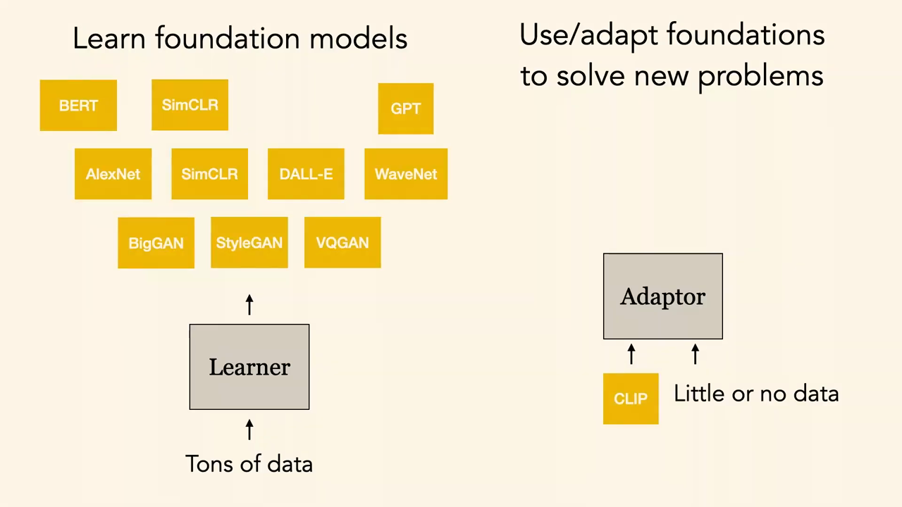
*▲ 강의 슬라이드 [69:35](https://youtu.be/tNfuZ9Imt3M?t=4175): [기반 모델](00_%EB%94%A5%EB%9F%AC%EB%8B%9D_%EC%9A%A9%EC%96%B4%EC%82%AC%EC%A0%84.md#foundation-model-%EA%B8%B0%EB%B0%98-%EB%AA%A8%EB%8D%B8)을 많은 데이터로 학습하고(왼쪽), 적은 데이터나 데이터 없이 어댑터로 새 문제에 쓴다(오른쪽)*

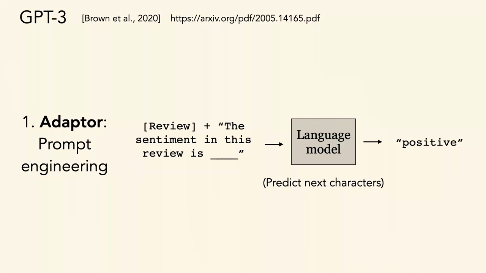
*▲ 강의 슬라이드 [70:35](https://youtu.be/tNfuZ9Imt3M?t=4235): 어댑터로서의 [프롬프트 공학](00_%EB%94%A5%EB%9F%AC%EB%8B%9D_%EC%9A%A9%EC%96%B4%EC%82%AC%EC%A0%84.md#prompt-engineering-%ED%94%84%EB%A1%AC%ED%94%84%ED%8A%B8-%EA%B3%B5%ED%95%99). 다음 글자를 예측하는 [언어 모델](00_%EB%94%A5%EB%9F%AC%EB%8B%9D_%EC%9A%A9%EC%96%B4%EC%82%AC%EC%A0%84.md#language-model-%EC%96%B8%EC%96%B4-%EB%AA%A8%EB%8D%B8)에 "이 리뷰의 감정은 ___"을 넣으면 "positive"*

### 8.2 소프트 프롬프트와 생각의 사슬

▶ 영상 [72:30](https://youtu.be/tNfuZ9Imt3M?t=4350)

- **[소프트 프롬프트](00_%EB%94%A5%EB%9F%AC%EB%8B%9D_%EC%9A%A9%EC%96%B4%EC%82%AC%EC%A0%84.md#soft-prompt-prompt-tuning-%EC%86%8C%ED%94%84%ED%8A%B8-%ED%94%84%EB%A1%AC%ED%94%84%ED%8A%B8%EC%99%80-%ED%94%84%EB%A1%AC%ED%94%84%ED%8A%B8-%ED%8A%9C%EB%8B%9D)**([프롬프트 튜닝](00_%EB%94%A5%EB%9F%AC%EB%8B%9D_%EC%9A%A9%EC%96%B4%EC%82%AC%EC%A0%84.md#soft-prompt-prompt-tuning-%EC%86%8C%ED%94%84%ED%8A%B8-%ED%94%84%EB%A1%AC%ED%94%84%ED%8A%B8%EC%99%80-%ED%94%84%EB%A1%AC%ED%94%84%ED%8A%B8-%ED%8A%9C%EB%8B%9D)): 모델 [파라미터](00_%EB%94%A5%EB%9F%AC%EB%8B%9D_%EC%9A%A9%EC%96%B4%EC%82%AC%EC%A0%84.md#parameter-%ED%8C%8C%EB%9D%BC%EB%AF%B8%ED%84%B0)는 얼려 두고, 입력 앞에 붙이는 작은 **연속 벡터**(특수 [토큰](00_%EB%94%A5%EB%9F%AC%EB%8B%9D_%EC%9A%A9%EC%96%B4%EC%82%AC%EC%A0%84.md#token-%ED%86%A0%ED%81%B0)의 [임베딩](00_%EB%94%A5%EB%9F%AC%EB%8B%9D_%EC%9A%A9%EC%96%B4%EC%82%AC%EC%A0%84.md#embedding-%EC%9E%84%EB%B2%A0%EB%94%A9))만 과제에 맞게 최적화합니다. 다시 보통의 [학습](00_%EB%94%A5%EB%9F%AC%EB%8B%9D_%EC%9A%A9%EC%96%B4%EC%82%AC%EC%A0%84.md#training-%ED%95%99%EC%8A%B5) 틀로 돌아와 "모델에 넣을 최적의 말"을 찾는 셈입니다. 찾은 [토큰](00_%EB%94%A5%EB%9F%AC%EB%8B%9D_%EC%9A%A9%EC%96%B4%EC%82%AC%EC%A0%84.md#token-%ED%86%A0%ED%81%B0)은 사람이 보면 뜻이 없을 수 있지만, 분포의 알맞은 자리를 찾아 패턴 맞추기를 돕습니다.
- **[생각의 사슬](00_%EB%94%A5%EB%9F%AC%EB%8B%9D_%EC%9A%A9%EC%96%B4%EC%82%AC%EC%A0%84.md#chain-of-thought-prompting-%EC%83%9D%EA%B0%81%EC%9D%98-%EC%82%AC%EC%8A%AC-%ED%94%84%EB%A1%AC%ED%94%84%ED%8C%85)**(chain-of-thought) [프롬프팅](00_%EB%94%A5%EB%9F%AC%EB%8B%9D_%EC%9A%A9%EC%96%B4%EC%82%AC%EC%A0%84.md#prompting-%ED%94%84%EB%A1%AC%ED%94%84%ED%8C%85)(Wei 등 2022): 보통 프롬프트는 질문-답 예를 보여 주고 새 질문을 던집니다. 생각의 사슬은 **추론 과정이 담긴 답**을 예로 보여 줍니다. 그러면 모델도 논리를 펼치며 답하고, 답이 맞을 가능성이 커집니다. 수학 문장제에서 보통 프롬프트보다 크게 낫고 이전 최고 성능도 넘었습니다.
- "너는 아주 똑똑해", "너는 과학자야"라고 먼저 말하는 것도 효과가 있습니다. 사람처럼 여기게 되는 이유이기도 하지만, 강사는 칭찬이 필요해서가 아니라 과학자가 쓴, 더 정확할 가능성이 높은 글에서 배운 **분포의 자리**를 찾아가게 하기 때문이라고 봅니다.

[소프트 프롬프트](00_%EB%94%A5%EB%9F%AC%EB%8B%9D_%EC%9A%A9%EC%96%B4%EC%82%AC%EC%A0%84.md#soft-prompt-prompt-tuning-%EC%86%8C%ED%94%84%ED%8A%B8-%ED%94%84%EB%A1%AC%ED%94%84%ED%8A%B8%EC%99%80-%ED%94%84%EB%A1%AC%ED%94%84%ED%8A%B8-%ED%8A%9C%EB%8B%9D)에서 새로 배우는 [파라미터](00_%EB%94%A5%EB%9F%AC%EB%8B%9D_%EC%9A%A9%EC%96%B4%EC%82%AC%EC%A0%84.md#parameter-%ED%8C%8C%EB%9D%BC%EB%AF%B8%ED%84%B0) 수는 [토큰](00_%EB%94%A5%EB%9F%AC%EB%8B%9D_%EC%9A%A9%EC%96%B4%EC%82%AC%EC%A0%84.md#token-%ED%86%A0%ED%81%B0) 수와 [임베딩](00_%EB%94%A5%EB%9F%AC%EB%8B%9D_%EC%9A%A9%EC%96%B4%EC%82%AC%EC%A0%84.md#embedding-%EC%9E%84%EB%B2%A0%EB%94%A9) 차원의 곱입니다.

$$
\#\theta_{\text{prompt}} = n_p \times d
$$

기호 풀이

| 기호 | 읽는 법 | 뜻 | 예제 값 |
| --- | --- | --- | --- |
| $n_p$ | 엔 피 | 앞에 붙이는 [소프트 프롬프트](00_%EB%94%A5%EB%9F%AC%EB%8B%9D_%EC%9A%A9%EC%96%B4%EC%82%AC%EC%A0%84.md#soft-prompt-prompt-tuning-%EC%86%8C%ED%94%84%ED%8A%B8-%ED%94%84%EB%A1%AC%ED%94%84%ED%8A%B8%EC%99%80-%ED%94%84%EB%A1%AC%ED%94%84%ED%8A%B8-%ED%8A%9C%EB%8B%9D) [토큰](00_%EB%94%A5%EB%9F%AC%EB%8B%9D_%EC%9A%A9%EC%96%B4%EC%82%AC%EC%A0%84.md#token-%ED%86%A0%ED%81%B0) 수 | 20 |
| $d$ | 디 | [토큰](00_%EB%94%A5%EB%9F%AC%EB%8B%9D_%EC%9A%A9%EC%96%B4%EC%82%AC%EC%A0%84.md#token-%ED%86%A0%ED%81%B0) [임베딩](00_%EB%94%A5%EB%9F%AC%EB%8B%9D_%EC%9A%A9%EC%96%B4%EC%82%AC%EC%A0%84.md#embedding-%EC%9E%84%EB%B2%A0%EB%94%A9) 차원 | 4096 |
| $\#\theta_{\text{prompt}}$ | [파라미터](00_%EB%94%A5%EB%9F%AC%EB%8B%9D_%EC%9A%A9%EC%96%B4%EC%82%AC%EC%A0%84.md#parameter-%ED%8C%8C%EB%9D%BC%EB%AF%B8%ED%84%B0) 수 | 새로 배울 [파라미터](00_%EB%94%A5%EB%9F%AC%EB%8B%9D_%EC%9A%A9%EC%96%B4%EC%82%AC%EC%A0%84.md#parameter-%ED%8C%8C%EB%9D%BC%EB%AF%B8%ED%84%B0) 수 (모델은 얼림) | 81,920 |

예제와 풀이

**문제**: [임베딩](00_%EB%94%A5%EB%9F%AC%EB%8B%9D_%EC%9A%A9%EC%96%B4%EC%82%AC%EC%A0%84.md#embedding-%EC%9E%84%EB%B2%A0%EB%94%A9) 차원이 4096인 70억 [파라미터](00_%EB%94%A5%EB%9F%AC%EB%8B%9D_%EC%9A%A9%EC%96%B4%EC%82%AC%EC%A0%84.md#parameter-%ED%8C%8C%EB%9D%BC%EB%AF%B8%ED%84%B0) 모델에 [소프트 프롬프트](00_%EB%94%A5%EB%9F%AC%EB%8B%9D_%EC%9A%A9%EC%96%B4%EC%82%AC%EC%A0%84.md#soft-prompt-prompt-tuning-%EC%86%8C%ED%94%84%ED%8A%B8-%ED%94%84%EB%A1%AC%ED%94%84%ED%8A%B8%EC%99%80-%ED%94%84%EB%A1%AC%ED%94%84%ED%8A%B8-%ED%8A%9C%EB%8B%9D) [토큰](00_%EB%94%A5%EB%9F%AC%EB%8B%9D_%EC%9A%A9%EC%96%B4%EC%82%AC%EC%A0%84.md#token-%ED%86%A0%ED%81%B0) 20개를 붙인다. 새로 배울 [파라미터](00_%EB%94%A5%EB%9F%AC%EB%8B%9D_%EC%9A%A9%EC%96%B4%EC%82%AC%EC%A0%84.md#parameter-%ED%8C%8C%EB%9D%BC%EB%AF%B8%ED%84%B0)는 몇 개이고 모델 전체의 몇 %인가?

**주어진 값**
- $n_p = 20$ ([소프트 프롬프트](00_%EB%94%A5%EB%9F%AC%EB%8B%9D_%EC%9A%A9%EC%96%B4%EC%82%AC%EC%A0%84.md#soft-prompt-prompt-tuning-%EC%86%8C%ED%94%84%ED%8A%B8-%ED%94%84%EB%A1%AC%ED%94%84%ED%8A%B8%EC%99%80-%ED%94%84%EB%A1%AC%ED%94%84%ED%8A%B8-%ED%8A%9C%EB%8B%9D) [토큰](00_%EB%94%A5%EB%9F%AC%EB%8B%9D_%EC%9A%A9%EC%96%B4%EC%82%AC%EC%A0%84.md#token-%ED%86%A0%ED%81%B0) 수)
- $d = 4096$ ([임베딩](00_%EB%94%A5%EB%9F%AC%EB%8B%9D_%EC%9A%A9%EC%96%B4%EC%82%AC%EC%A0%84.md#embedding-%EC%9E%84%EB%B2%A0%EB%94%A9) 차원)
- 모델 전체 [파라미터](00_%EB%94%A5%EB%9F%AC%EB%8B%9D_%EC%9A%A9%EC%96%B4%EC%82%AC%EC%A0%84.md#parameter-%ED%8C%8C%EB%9D%BC%EB%AF%B8%ED%84%B0) $7 \times 10^9$ (얼려 둠)

**풀이**
1. 식을 그대로 쓴다: $\#\theta_{\text{prompt}} = n_p \times d$
2. 값을 대입한다: $\#\theta_{\text{prompt}} = 20 \times 4096$
3. 곱한다: $20 \times 4096 = 81{,}920$
4. 전체로 나눈다: $81{,}920 / (7 \times 10^9) = 0.0000117$
5. 100을 곱해 %로 바꾼다: $0.0000117 \times 100 = 0.00117\%$

**답**: **81,920개**, 전체의 약 **0.00117%**. 과제마다 이 작은 벡터만 저장하면 된다.

내 이해

> [!TIP]
> **🆕 2026 업데이트: 생각의 사슬이 프롬프트 요령에서 학습된 능력으로**
> - **강의**: 생각의 사슬은 추론이 담긴 예를 프롬프트로 보여 줘서 모델이 논리를 펼치게 하는 요령이다.
> - **현재**: 2024년 9월 OpenAI o1부터, 대규모 **강화 [학습](00_%EB%94%A5%EB%9F%AC%EB%8B%9D_%EC%9A%A9%EC%96%B4%EC%82%AC%EC%A0%84.md#training-%ED%95%99%EC%8A%B5)**으로 모델이 답하기 전에 긴 생각의 사슬을 스스로 생성하도록 학습한 **[추론 모델](00_%EB%94%A5%EB%9F%AC%EB%8B%9D_%EC%9A%A9%EC%96%B4%EC%82%AC%EC%A0%84.md#reasoning-model-%EC%B6%94%EB%A1%A0-%EB%AA%A8%EB%8D%B8)**이 나왔다. o1은 강화 [학습](00_%EB%94%A5%EB%9F%AC%EB%8B%9D_%EC%9A%A9%EC%96%B4%EC%82%AC%EC%A0%84.md#training-%ED%95%99%EC%8A%B5)([학습](00_%EB%94%A5%EB%9F%AC%EB%8B%9D_%EC%9A%A9%EC%96%B4%EC%82%AC%EC%A0%84.md#training-%ED%95%99%EC%8A%B5) 계산)을 늘릴수록, 그리고 답하기 전 생각하는 시간([테스트 시점 계산](00_%EB%94%A5%EB%9F%AC%EB%8B%9D_%EC%9A%A9%EC%96%B4%EC%82%AC%EC%A0%84.md#test-time-compute-%ED%85%8C%EC%8A%A4%ED%8A%B8-%EC%8B%9C%EC%A0%90-%EA%B3%84%EC%82%B0))을 늘릴수록 성능이 꾸준히 오른다고 보고했다. DeepSeek-R1(2025)은 [정답](00_%EB%94%A5%EB%9F%AC%EB%8B%9D_%EC%9A%A9%EC%96%B4%EC%82%AC%EC%A0%84.md#label-%EC%A0%95%EB%8B%B5) 여부만 보상으로 주는 강화 학습만으로 자기 [검증](00_%EB%94%A5%EB%9F%AC%EB%8B%9D_%EC%9A%A9%EC%96%B4%EC%82%AC%EC%A0%84.md#validation-data-%EA%B2%80%EC%A6%9D-%EB%8D%B0%EC%9D%B4%ED%84%B0), 반성 같은 추론 행동이 나타남을 보였다. 이제 생각의 사슬은 프롬프트로 끌어내는 것을 넘어 모델 [학습](00_%EB%94%A5%EB%9F%AC%EB%8B%9D_%EC%9A%A9%EC%96%B4%EC%82%AC%EC%A0%84.md#training-%ED%95%99%EC%8A%B5)의 목표가 되었다.
> - **출처**: [OpenAI, Learning to reason with LLMs (2024)](https://openai.com/index/learning-to-reason-with-llms/) · [DeepSeek-AI, DeepSeek-R1 (arXiv 2025; Nature 645, 2025)](https://arxiv.org/abs/2501.12948)

---

## 9. CLIP과 시각 프롬프트

▶ 영상 [75:50](https://youtu.be/tNfuZ9Imt3M?t=4550)

📐 **수학 개념**: [단위 구와 코사인 유사도](%EC%88%98%ED%95%99%EA%B0%9C%EB%85%90/03_%EC%84%A0%ED%98%95%EB%8C%80%EC%88%98/MM44_%EB%8B%A8%EC%9C%84_%EA%B5%AC%EC%99%80_%EC%BD%94%EC%82%AC%EC%9D%B8_%EC%9C%A0%EC%82%AC%EB%8F%84.md) · [최근접 이웃과 탐침](%EC%88%98%ED%95%99%EA%B0%9C%EB%85%90/10_%ED%91%9C%ED%98%84_%ED%95%99%EC%8A%B5/MM42_%EC%B5%9C%EA%B7%BC%EC%A0%91_%EC%9D%B4%EC%9B%83%EA%B3%BC_%ED%83%90%EC%B9%A8.md) · [삼중항 손실과 InfoNCE](%EC%88%98%ED%95%99%EA%B0%9C%EB%85%90/10_%ED%91%9C%ED%98%84_%ED%95%99%EC%8A%B5/MM45_%EC%82%BC%EC%A4%91%ED%95%AD_%EC%86%90%EC%8B%A4%EA%B3%BC_InfoNCE.md)

### 9.1 CLIP: 표현으로 쓰기, 그냥 물어보기

▶ 영상 [75:50](https://youtu.be/tNfuZ9Imt3M?t=4550)

- **[CLIP](00_%EB%94%A5%EB%9F%AC%EB%8B%9D_%EC%9A%A9%EC%96%B4%EC%82%AC%EC%A0%84.md#clip-%ED%81%B4%EB%A6%BD)**도 [기반 모델](00_%EB%94%A5%EB%9F%AC%EB%8B%9D_%EC%9A%A9%EC%96%B4%EC%82%AC%EC%A0%84.md#foundation-model-%EA%B8%B0%EB%B0%98-%EB%AA%A8%EB%8D%B8)입니다. 글과 그림 사이의 의미 유사도를 [대조 학습](00_%EB%94%A5%EB%9F%AC%EB%8B%9D_%EC%9A%A9%EC%96%B4%EC%82%AC%EC%A0%84.md#contrastive-learning-%EB%8C%80%EC%A1%B0-%ED%95%99%EC%8A%B5)으로 배웠습니다([Lec11 2.4](Lec11_%ED%91%9C%ED%98%84_%ED%95%99%EC%8A%B5_%EC%9E%AC%EA%B5%AC%EC%84%B1.md#24-%ED%81%B0-%EB%A7%9D%EC%9D%98-%EC%B8%B5%EB%B3%84-%ED%91%9C%ED%98%84-clip)).
- **[표현 학습](00_%EB%94%A5%EB%9F%AC%EB%8B%9D_%EC%9A%A9%EC%96%B4%EC%82%AC%EC%A0%84.md#representation-learning-%ED%91%9C%ED%98%84-%ED%95%99%EC%8A%B5) 모델로 쓰기**: 이미지 인코딩 위에 선형 분류기를 어댑터로 얹습니다([선형 탐침](00_%EB%94%A5%EB%9F%AC%EB%8B%9D_%EC%9A%A9%EC%96%B4%EC%82%AC%EC%A0%84.md#probe-linear-probe-%ED%83%90%EC%B9%A8%EA%B3%BC-%EC%84%A0%ED%98%95-%ED%83%90%EC%B9%A8)). 범주당 라벨 이미지 수를 늘리며 성능을 잴 수 있습니다.
- **그냥 물어보기**([제로샷](00_%EB%94%A5%EB%9F%AC%EB%8B%9D_%EC%9A%A9%EC%96%B4%EC%82%AC%EC%A0%84.md#few-shot-learning-zero-shot-learning-%ED%93%A8%EC%83%B7-%ED%95%99%EC%8A%B5%EA%B3%BC-%EC%A0%9C%EB%A1%9C%EC%83%B7-%ED%95%99%EC%8A%B5) [분류](00_%EB%94%A5%EB%9F%AC%EB%8B%9D_%EC%9A%A9%EC%96%B4%EC%82%AC%EC%A0%84.md#regression-classification-%ED%9A%8C%EA%B7%80%EC%99%80-%EB%B6%84%EB%A5%98)): 관심 범주로 미세 조정하는 대신, 이미지와 가장 비슷한 "a photo of a ___" 꼴의 글을 찾습니다.
- **이상할 만큼 취약함**: "a photo of a dog"와 "photo of dog"의 텍스트 [임베딩](00_%EB%94%A5%EB%9F%AC%EB%8B%9D_%EC%9A%A9%EC%96%B4%EC%82%AC%EC%A0%84.md#embedding-%EC%9E%84%EB%B2%A0%EB%94%A9)이 꽤 달라서 제로샷 성능이 크게 바뀝니다.
- **그림 양식도 물을 수 있다**: "a sketch of a banana"와 "a photo of a banana"를 인코딩해 바나나 스케치 그림과의 [코사인 유사도](00_%EB%94%A5%EB%9F%AC%EB%8B%9D_%EC%9A%A9%EC%96%B4%EC%82%AC%EC%A0%84.md#cosine-similarity-%EC%BD%94%EC%82%AC%EC%9D%B8-%EC%9C%A0%EC%82%AC%EB%8F%84)를 비교하면, 사진보다 스케치에 가깝다고 답합니다.
- **조합에 약함**: 강사 팀은 [iNaturalist](00_%EB%94%A5%EB%9F%AC%EB%8B%9D_%EC%9A%A9%EC%96%B4%EC%82%AC%EC%A0%84.md#inaturalist-%EC%83%9D%EB%AC%BC-%EC%A2%85-%EC%82%AC%EC%A7%84-%EB%8D%B0%EC%9D%B4%ED%84%B0%EC%85%8B)의 큰 사진 저장소를 글로 검색하는 연구를 하는데, [CLIP](00_%EB%94%A5%EB%9F%AC%EB%8B%9D_%EC%9A%A9%EC%96%B4%EC%82%AC%EC%A0%84.md#clip-%ED%81%B4%EB%A6%BD)은 단순한 개념에는 강하지만 **조합**에는 약합니다. "또는"에는 강하고 "그리고"에는 약합니다. 인코딩이 단어 주머니(bag of words)처럼 동작해서, "어린 흰머리수리"를 찾으면 어린 것들의 사진과 흰머리수리 사진이 나오지 둘 다인 사진을 우선하지 않습니다. **부정**에도 약해서 "흰머리수리가 아닌 사진"을 찾으면 흰머리수리 사진이 나옵니다([CLIP](00_%EB%94%A5%EB%9F%AC%EB%8B%9D_%EC%9A%A9%EC%96%B4%EC%82%AC%EC%A0%84.md#clip-%ED%81%B4%EB%A6%BD)에게 "아니"를 가르치는 연구가 따로 있음).

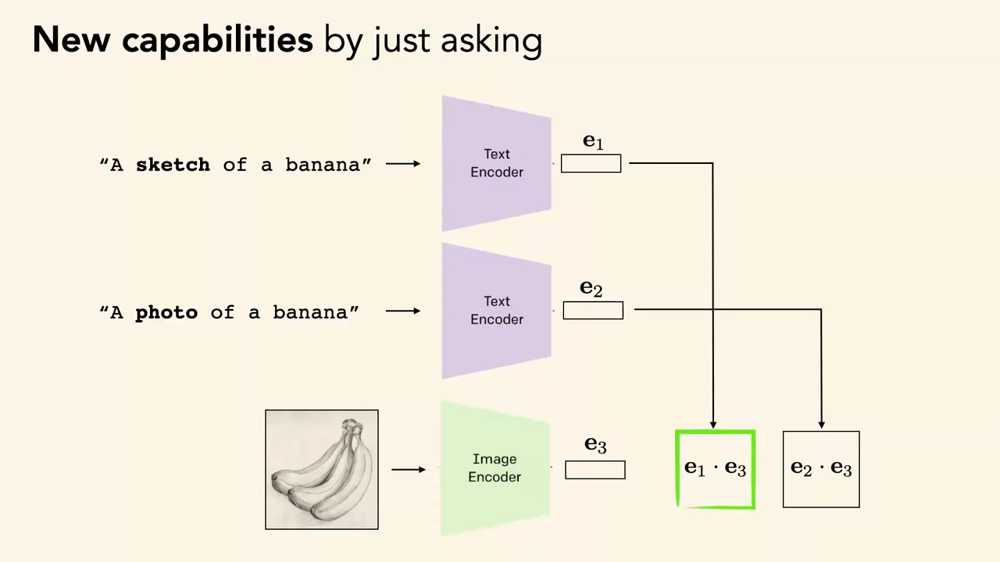
*▲ 강의 슬라이드 [77:28](https://youtu.be/tNfuZ9Imt3M?t=4648): 그냥 물어보기로 생긴 새 능력. "A sketch of a banana"($\mathbf{e}_1$)와 "A photo of a banana"($\mathbf{e}_2$) 중 스케치 그림($\mathbf{e}_3$)과 [내적](00_%EB%94%A5%EB%9F%AC%EB%8B%9D_%EC%9A%A9%EC%96%B4%EC%82%AC%EC%A0%84.md#dot-product-%EB%82%B4%EC%A0%81)이 더 큰 쪽을 고른다*

제로샷 [분류](00_%EB%94%A5%EB%9F%AC%EB%8B%9D_%EC%9A%A9%EC%96%B4%EC%82%AC%EC%A0%84.md#regression-classification-%ED%9A%8C%EA%B7%80%EC%99%80-%EB%B6%84%EB%A5%98)는 그림 [임베딩](00_%EB%94%A5%EB%9F%AC%EB%8B%9D_%EC%9A%A9%EC%96%B4%EC%82%AC%EC%A0%84.md#embedding-%EC%9E%84%EB%B2%A0%EB%94%A9)과 가장 비슷한 글 [임베딩](00_%EB%94%A5%EB%9F%AC%EB%8B%9D_%EC%9A%A9%EC%96%B4%EC%82%AC%EC%A0%84.md#embedding-%EC%9E%84%EB%B2%A0%EB%94%A9)의 범주를 고릅니다.

$$
\hat y = \arg\max_k \cos\big(f(x),\, g(t_k)\big), \qquad \cos(\mathbf{a}, \mathbf{b}) = \frac{\mathbf{a}^\top \mathbf{b}}{\|\mathbf{a}\|\,\|\mathbf{b}\|}
$$

기호 풀이

| 기호 | 읽는 법 | 뜻 | 예제 값 |
| --- | --- | --- | --- |
| $f(x)$ | 에프 엑스 | 그림 인코더가 낸 그림 [임베딩](00_%EB%94%A5%EB%9F%AC%EB%8B%9D_%EC%9A%A9%EC%96%B4%EC%82%AC%EC%A0%84.md#embedding-%EC%9E%84%EB%B2%A0%EB%94%A9) | (0.6, 0.8) |
| $t_k$ | 티 케이 | $k$번 범주의 글 프롬프트 ("a photo of a dog") | |
| $g(t_k)$ | 지 티 케이 | 글 인코더가 낸 글 [임베딩](00_%EB%94%A5%EB%9F%AC%EB%8B%9D_%EC%9A%A9%EC%96%B4%EC%82%AC%EC%A0%84.md#embedding-%EC%9E%84%EB%B2%A0%EB%94%A9) | 개 (0.8, 0.6), 고양이 (0, 1) |
| $\cos$ | 코사인 | [코사인 유사도](00_%EB%94%A5%EB%9F%AC%EB%8B%9D_%EC%9A%A9%EC%96%B4%EC%82%AC%EC%A0%84.md#cosine-similarity-%EC%BD%94%EC%82%AC%EC%9D%B8-%EC%9C%A0%EC%82%AC%EB%8F%84). 길이 1인 벡터끼리는 [내적](00_%EB%94%A5%EB%9F%AC%EB%8B%9D_%EC%9A%A9%EC%96%B4%EC%82%AC%EC%A0%84.md#dot-product-%EB%82%B4%EC%A0%81) | 0.96, 0.8 |
| $\lVert \mathbf{a} \rVert$ | [노름](00_%EB%94%A5%EB%9F%AC%EB%8B%9D_%EC%9A%A9%EC%96%B4%EC%82%AC%EC%A0%84.md#norm-%EB%85%B8%EB%A6%84) | 벡터의 길이 | 1 |
| $\hat y$ | 와이 햇 | 고른 범주 | 개 |

예제와 풀이

**문제**: 길이 1로 맞춘 그림 [임베딩](00_%EB%94%A5%EB%9F%AC%EB%8B%9D_%EC%9A%A9%EC%96%B4%EC%82%AC%EC%A0%84.md#embedding-%EC%9E%84%EB%B2%A0%EB%94%A9)이 (0.6, 0.8)이다. "a photo of a dog"의 글 [임베딩](00_%EB%94%A5%EB%9F%AC%EB%8B%9D_%EC%9A%A9%EC%96%B4%EC%82%AC%EC%A0%84.md#embedding-%EC%9E%84%EB%B2%A0%EB%94%A9)은 (0.8, 0.6), "a photo of a cat"은 (0, 1)이다. [CLIP](00_%EB%94%A5%EB%9F%AC%EB%8B%9D_%EC%9A%A9%EC%96%B4%EC%82%AC%EC%A0%84.md#clip-%ED%81%B4%EB%A6%BD) 제로샷 [분류](00_%EB%94%A5%EB%9F%AC%EB%8B%9D_%EC%9A%A9%EC%96%B4%EC%82%AC%EC%A0%84.md#regression-classification-%ED%9A%8C%EA%B7%80%EC%99%80-%EB%B6%84%EB%A5%98)는 무엇을 고르나?

**주어진 값**
- $f(x) = (0.6, 0.8)$ (그림 [임베딩](00_%EB%94%A5%EB%9F%AC%EB%8B%9D_%EC%9A%A9%EC%96%B4%EC%82%AC%EC%A0%84.md#embedding-%EC%9E%84%EB%B2%A0%EB%94%A9), 길이 1)
- $g(t_{\text{개}}) = (0.8, 0.6)$, $g(t_{\text{고양이}}) = (0, 1)$ (글 [임베딩](00_%EB%94%A5%EB%9F%AC%EB%8B%9D_%EC%9A%A9%EC%96%B4%EC%82%AC%EC%A0%84.md#embedding-%EC%9E%84%EB%B2%A0%EB%94%A9), 길이 1)

**풀이**
1. 식을 그대로 쓴다: $\hat y = \arg\max_k \cos\big(f(x), g(t_k)\big)$, $\cos(\mathbf{a}, \mathbf{b}) = \dfrac{\mathbf{a}^\top \mathbf{b}}{\|\mathbf{a}\|\|\mathbf{b}\|}$
2. 값을 대입한다 (개): $\cos = \dfrac{(0.6, 0.8)^\top (0.8, 0.6)}{1 \times 1}$
3. [내적](00_%EB%94%A5%EB%9F%AC%EB%8B%9D_%EC%9A%A9%EC%96%B4%EC%82%AC%EC%A0%84.md#dot-product-%EB%82%B4%EC%A0%81)을 칸별로 곱해 더한다: $0.6 \times 0.8 + 0.8 \times 0.6 = 0.48 + 0.48 = 0.96$
4. 길이로 나눈다: $0.96 / 1 = 0.96$
5. 값을 대입한다 (고양이): $\cos = \dfrac{(0.6, 0.8)^\top (0, 1)}{1 \times 1}$
6. [내적](00_%EB%94%A5%EB%9F%AC%EB%8B%9D_%EC%9A%A9%EC%96%B4%EC%82%AC%EC%A0%84.md#dot-product-%EB%82%B4%EC%A0%81)을 칸별로 곱해 더한다: $0.6 \times 0 + 0.8 \times 1 = 0 + 0.8 = 0.8$
7. 큰 쪽을 고른다: $0.96 > 0.8$ 이므로 $\hat y = $ 개

**답**: **개**(0.96 대 0.8). 프롬프트를 "photo of dog"로 바꾸면 글 [임베딩](00_%EB%94%A5%EB%9F%AC%EB%8B%9D_%EC%9A%A9%EC%96%B4%EC%82%AC%EC%A0%84.md#embedding-%EC%9E%84%EB%B2%A0%EB%94%A9)이 달라져 이 비교가 뒤집힐 수도 있다는 것이 강의의 "취약함"이다.

내 이해

### 9.2 시각 프롬프트

▶ 영상 [78:38](https://youtu.be/tNfuZ9Imt3M?t=4718)

- **[시각 프롬프트](00_%EB%94%A5%EB%9F%AC%EB%8B%9D_%EC%9A%A9%EC%96%B4%EC%82%AC%EC%A0%84.md#visual-prompting-%EC%8B%9C%EA%B0%81-%ED%94%84%EB%A1%AC%ED%94%84%ED%8A%B8)**(visual prompting, Bahng 등 2022): 글 인코더 쪽을 바꾸는 대신 **그림 쪽에 프롬프트**를 더합니다. 그림 가장자리에 붙일 최적의 테두리 무늬를 학습해, 얼린 [CLIP](00_%EB%94%A5%EB%9F%AC%EB%8B%9D_%EC%9A%A9%EC%96%B4%EC%82%AC%EC%A0%84.md#clip-%ED%81%B4%EB%A6%BD)이 올바른 범주를 고를 가능성을 최대로 합니다. 적대적 잡음의 반대, 곧 **이로운 잡음**을 배우는 셈입니다. 한 데이터셋·도메인에서는 어떤 입력에 더해도 도움이 되는 잡음입니다.
- 거꾸로 이미지에 더해 [CLIP](00_%EB%94%A5%EB%9F%AC%EB%8B%9D_%EC%9A%A9%EC%96%B4%EC%82%AC%EC%A0%84.md#clip-%ED%81%B4%EB%A6%BD)을 최대한 틀리게 만드는 적대적 재프로그래밍도 가능합니다.
- **분홍 픽셀 하나**: 위성 영상 실험에서 모든 영상의 같은 자리 픽셀 하나를 특정 분홍색으로 바꿨더니 모든 범주에서 [정확도](00_%EB%94%A5%EB%9F%AC%EB%8B%9D_%EC%9A%A9%EC%96%B4%EC%82%AC%EC%A0%84.md#accuracy-%EC%A0%95%ED%99%95%EB%8F%84)가 약 **3%p** 올랐습니다. 이런 요령이 최선이라는 뜻이 아니라, 이 모델들이 배운 통계적 표현이 얼마나 **깨지기 쉽고 복잡한지** 보여 준다는 것이 강사의 요점입니다.
- **적응은 입력, 사상, 출력 어디서나**: [사전 학습](00_%EB%94%A5%EB%9F%AC%EB%8B%9D_%EC%9A%A9%EC%96%B4%EC%82%AC%EC%A0%84.md#pre-training-%EC%82%AC%EC%A0%84-%ED%95%99%EC%8A%B5) 모델을 미세 조정하거나(사상), 선형 [층](00_%EB%94%A5%EB%9F%AC%EB%8B%9D_%EC%9A%A9%EC%96%B4%EC%82%AC%EC%A0%84.md#layer-%EC%B8%B5)만 배우거나(출력 쪽), 이미지에 무언가를 더하는(입력) [시각 프롬프트](00_%EB%94%A5%EB%9F%AC%EB%8B%9D_%EC%9A%A9%EC%96%B4%EC%82%AC%EC%A0%84.md#visual-prompting-%EC%8B%9C%EA%B0%81-%ED%94%84%EB%A1%AC%ED%94%84%ED%8A%B8)를 할 수 있습니다. [시각 프롬프트](00_%EB%94%A5%EB%9F%AC%EB%8B%9D_%EC%9A%A9%EC%96%B4%EC%82%AC%EC%A0%84.md#visual-prompting-%EC%8B%9C%EA%B0%81-%ED%94%84%EB%A1%AC%ED%94%84%ED%8A%B8)는 입력을 넣고 출력만 보면 되므로, 증류처럼 **모델 [가중치](00_%EB%94%A5%EB%9F%AC%EB%8B%9D_%EC%9A%A9%EC%96%B4%EC%82%AC%EC%A0%84.md#weight-%EA%B0%80%EC%A4%91%EC%B9%98)나 [로짓](00_%EB%94%A5%EB%9F%AC%EB%8B%9D_%EC%9A%A9%EC%96%B4%EC%82%AC%EC%A0%84.md#logit-%EB%A1%9C%EC%A7%93)에 접근할 수 없어도** 쓸 수 있습니다(Visual Prompt Tuning은 큰 ViT의 입력 쪽에 [학습](00_%EB%94%A5%EB%9F%AC%EB%8B%9D_%EC%9A%A9%EC%96%B4%EC%82%AC%EC%A0%84.md#training-%ED%95%99%EC%8A%B5) [토큰](00_%EB%94%A5%EB%9F%AC%EB%8B%9D_%EC%9A%A9%EC%96%B4%EC%82%AC%EC%A0%84.md#token-%ED%86%A0%ED%81%B0)을 넣는 변형).
- **빈칸 채우기로 분할**: 그림 하나와 그 분할 마스크 예, 그다음 새 그림과 빈칸을 한 격자 그림으로 만들어 인페인팅(빈 곳 채우기) [기반 모델](00_%EB%94%A5%EB%9F%AC%EB%8B%9D_%EC%9A%A9%EC%96%B4%EC%82%AC%EC%A0%84.md#foundation-model-%EA%B8%B0%EB%B0%98-%EB%AA%A8%EB%8D%B8)에 주면, 분할을 따로 학습하지 않았는데도 마스크를 그려 냅니다(Bar 등 2022). 윤곽 검출, 색칠, 인페인팅 같은 다른 과제도 같은 방식으로 됩니다.

---

## 10. 기반 모델 조합하기

▶ 영상 [83:39](https://youtu.be/tNfuZ9Imt3M?t=5019)

- [기반 모델](00_%EB%94%A5%EB%9F%AC%EB%8B%9D_%EC%9A%A9%EC%96%B4%EC%82%AC%EC%A0%84.md#foundation-model-%EA%B8%B0%EB%B0%98-%EB%AA%A8%EB%8D%B8)을 배우고 적응시키는 것 말고, 여러 [기반 모델](00_%EB%94%A5%EB%9F%AC%EB%8B%9D_%EC%9A%A9%EC%96%B4%EC%82%AC%EC%A0%84.md#foundation-model-%EA%B8%B0%EB%B0%98-%EB%AA%A8%EB%8D%B8)을 블록처럼 **이어 붙여** 새 시스템을 만들 수 있습니다.
- **VQGAN + [CLIP](00_%EB%94%A5%EB%9F%AC%EB%8B%9D_%EC%9A%A9%EC%96%B4%EC%82%AC%EC%A0%84.md#clip-%ED%81%B4%EB%A6%BD)**: 글→그림을 하려면 그림 [생성기](00_%EB%94%A5%EB%9F%AC%EB%8B%9D_%EC%9A%A9%EC%96%B4%EC%82%AC%EC%A0%84.md#generator-discriminator-%EC%83%9D%EC%84%B1%EA%B8%B0%EC%99%80-%ED%8C%90%EB%B3%84%EA%B8%B0)(VQGAN)와 글-그림 의미 유사도를 아는 [CLIP](00_%EB%94%A5%EB%9F%AC%EB%8B%9D_%EC%9A%A9%EC%96%B4%EC%82%AC%EC%A0%84.md#clip-%ED%81%B4%EB%A6%BD)을 붙이고, [생성기](00_%EB%94%A5%EB%9F%AC%EB%8B%9D_%EC%9A%A9%EC%96%B4%EC%82%AC%EC%A0%84.md#generator-discriminator-%EC%83%9D%EC%84%B1%EA%B8%B0%EC%99%80-%ED%8C%90%EB%B3%84%EA%B8%B0)의 잠재 벡터를 최적화해 글 프롬프트와 [CLIP](00_%EB%94%A5%EB%9F%AC%EB%8B%9D_%EC%9A%A9%EC%96%B4%EC%82%AC%EC%A0%84.md#clip-%ED%81%B4%EB%A6%BD) 유사도가 가장 큰 그림을 얻습니다([Lec02 9.3](Lec02_%EC%8B%A0%EA%B2%BD%EB%A7%9D_%ED%95%99%EC%8A%B5.md#93-%ED%8C%8C%EB%9D%BC%EB%AF%B8%ED%84%B0-%EC%B5%9C%EC%A0%81%ED%99%94%EC%99%80-%EC%9E%85%EB%A0%A5-%EC%B5%9C%EC%A0%81%ED%99%94)의 입력 최적화).
- **DALL-E 2**도 [CLIP](00_%EB%94%A5%EB%9F%AC%EB%8B%9D_%EC%9A%A9%EC%96%B4%EC%82%AC%EC%A0%84.md#clip-%ED%81%B4%EB%A6%BD) 목적을 쓰고, 디코딩을 더 효율적으로 하는 사전(prior) 모델을 더한 예입니다.

---

## 11. 정리

▶ 영상 [84:51](https://youtu.be/tNfuZ9Imt3M?t=5091)

- 오늘은 적은 데이터로 배우기, **사상**에 대한 지식 옮기기([미세 조정](00_%EB%94%A5%EB%9F%AC%EB%8B%9D_%EC%9A%A9%EC%96%B4%EC%82%AC%EC%A0%84.md#fine-tuning-%EB%AF%B8%EC%84%B8-%EC%A1%B0%EC%A0%95), [도메인 적응](00_%EB%94%A5%EB%9F%AC%EB%8B%9D_%EC%9A%A9%EC%96%B4%EC%82%AC%EC%A0%84.md#domain-adaptation-%EB%8F%84%EB%A9%94%EC%9D%B8-%EC%A0%81%EC%9D%91)), **출력**에 대한 지식 옮기기([지식 증류](00_%EB%94%A5%EB%9F%AC%EB%8B%9D_%EC%9A%A9%EC%96%B4%EC%82%AC%EC%A0%84.md#knowledge-distillation-%EC%A7%80%EC%8B%9D-%EC%A6%9D%EB%A5%98)), 그리고 [기반 모델](00_%EB%94%A5%EB%9F%AC%EB%8B%9D_%EC%9A%A9%EC%96%B4%EC%82%AC%EC%A0%84.md#foundation-model-%EA%B8%B0%EB%B0%98-%EB%AA%A8%EB%8D%B8)을 다뤘습니다.
- 다음 시간(Lec19)은 **입력(데이터)**에 대한 지식 옮기기로 이어집니다.
- 강사의 마지막 말: "너무 슬퍼하지 말되, ChatGPT를 쓰기 전에 한 번 더 생각해 보세요."

---

## 12. 용어 정리

용어사전에 있는 용어는 위 본문에 링크를 걸었습니다. 아래는 이번 강의에서 새로 나온 용어입니다.

| 용어 | 뜻 |
|---|---|
| [퓨샷 학습과 제로샷 학습](00_%EB%94%A5%EB%9F%AC%EB%8B%9D_%EC%9A%A9%EC%96%B4%EC%82%AC%EC%A0%84.md#few-shot-learning-zero-shot-learning-%ED%93%A8%EC%83%B7-%ED%95%99%EC%8A%B5%EA%B3%BC-%EC%A0%9C%EB%A1%9C%EC%83%B7-%ED%95%99%EC%8A%B5)(Few-shot, Zero-shot learning) | 예 몇 개만 보고(퓨샷), 또는 예 없이 설명만으로(제로샷) 새 과제를 푸는 것 |
| [파국적 망각](00_%EB%94%A5%EB%9F%AC%EB%8B%9D_%EC%9A%A9%EC%96%B4%EC%82%AC%EC%A0%84.md#catastrophic-forgetting-%ED%8C%8C%EA%B5%AD%EC%A0%81-%EB%A7%9D%EA%B0%81)(Catastrophic forgetting) | 새 과제를 학습하며 [가중치](00_%EB%94%A5%EB%9F%AC%EB%8B%9D_%EC%9A%A9%EC%96%B4%EC%82%AC%EC%A0%84.md#weight-%EA%B0%80%EC%A4%91%EC%B9%98)가 크게 바뀌어 이전에 배운 것을 잃는 현상 |
| [조기 종료](00_%EB%94%A5%EB%9F%AC%EB%8B%9D_%EC%9A%A9%EC%96%B4%EC%82%AC%EC%A0%84.md#early-stopping-%EC%A1%B0%EA%B8%B0-%EC%A2%85%EB%A3%8C)(Early stopping) | [검증](00_%EB%94%A5%EB%9F%AC%EB%8B%9D_%EC%9A%A9%EC%96%B4%EC%82%AC%EC%A0%84.md#validation-data-%EA%B2%80%EC%A6%9D-%EB%8D%B0%EC%9D%B4%ED%84%B0) 성능이 가장 좋을 때의 [가중치](00_%EB%94%A5%EB%9F%AC%EB%8B%9D_%EC%9A%A9%EC%96%B4%EC%82%AC%EC%A0%84.md#weight-%EA%B0%80%EC%A4%91%EC%B9%98)를 골라 [학습](00_%EB%94%A5%EB%9F%AC%EB%8B%9D_%EC%9A%A9%EC%96%B4%EC%82%AC%EC%A0%84.md#training-%ED%95%99%EC%8A%B5)을 멈추는 것 |
| [도메인 적응](00_%EB%94%A5%EB%9F%AC%EB%8B%9D_%EC%9A%A9%EC%96%B4%EC%82%AC%EC%A0%84.md#domain-adaptation-%EB%8F%84%EB%A9%94%EC%9D%B8-%EC%A0%81%EC%9D%91)(Domain adaptation) | 원천 도메인에서 배운 모델이 목표 도메인에서도 잘하도록 표현을 맞추는 것. 목표 라벨이 없으면 비지도 [도메인 적응](00_%EB%94%A5%EB%9F%AC%EB%8B%9D_%EC%9A%A9%EC%96%B4%EC%82%AC%EC%A0%84.md#domain-adaptation-%EB%8F%84%EB%A9%94%EC%9D%B8-%EC%A0%81%EC%9D%91) |
| [그래디언트 반전 층](00_%EB%94%A5%EB%9F%AC%EB%8B%9D_%EC%9A%A9%EC%96%B4%EC%82%AC%EC%A0%84.md#gradient-reversal-layer-%EA%B7%B8%EB%9E%98%EB%94%94%EC%96%B8%ED%8A%B8-%EB%B0%98%EC%A0%84-%EC%B8%B5)(Gradient reversal layer) | 앞으로는 항등, 뒤로는 [기울기](00_%EB%94%A5%EB%9F%AC%EB%8B%9D_%EC%9A%A9%EC%96%B4%EC%82%AC%EC%A0%84.md#gradient-%EA%B8%B0%EC%9A%B8%EA%B8%B0)에 $-\lambda$를 곱해 도메인을 못 맞히는 특징을 배우게 하는 [층](00_%EB%94%A5%EB%9F%AC%EB%8B%9D_%EC%9A%A9%EC%96%B4%EC%82%AC%EC%A0%84.md#layer-%EC%B8%B5) (DANN) |
| [의사 라벨](00_%EB%94%A5%EB%9F%AC%EB%8B%9D_%EC%9A%A9%EC%96%B4%EC%82%AC%EC%A0%84.md#pseudo-label-%EC%9D%98%EC%82%AC-%EB%9D%BC%EB%B2%A8)([Pseudo-label](00_%EB%94%A5%EB%9F%AC%EB%8B%9D_%EC%9A%A9%EC%96%B4%EC%82%AC%EC%A0%84.md#pseudo-label-%EC%9D%98%EC%82%AC-%EB%9D%BC%EB%B2%A8)) | 라벨 없는 데이터에 모델의 확신 높은 예측을 [정답](00_%EB%94%A5%EB%9F%AC%EB%8B%9D_%EC%9A%A9%EC%96%B4%EC%82%AC%EC%A0%84.md#label-%EC%A0%95%EB%8B%B5)처럼 붙인 것 |
| [지식 증류](00_%EB%94%A5%EB%9F%AC%EB%8B%9D_%EC%9A%A9%EC%96%B4%EC%82%AC%EC%A0%84.md#knowledge-distillation-%EC%A7%80%EC%8B%9D-%EC%A6%9D%EB%A5%98)(Knowledge distillation) | 얼린 교사 모델의 출력 분포를 학생 모델이 따라가도록 학습하는 것 |
| [소프트 타깃](00_%EB%94%A5%EB%9F%AC%EB%8B%9D_%EC%9A%A9%EC%96%B4%EC%82%AC%EC%A0%84.md#soft-target-%EC%86%8C%ED%94%84%ED%8A%B8-%ED%83%80%EA%B9%83)([Soft target](00_%EB%94%A5%EB%9F%AC%EB%8B%9D_%EC%9A%A9%EC%96%B4%EC%82%AC%EC%A0%84.md#soft-target-%EC%86%8C%ED%94%84%ED%8A%B8-%ED%83%80%EA%B9%83)) | 교사가 낸 [확률](00_%EB%94%A5%EB%9F%AC%EB%8B%9D_%EC%9A%A9%EC%96%B4%EC%82%AC%EC%A0%84.md#probability-%ED%99%95%EB%A5%A0) 분포. [정답](00_%EB%94%A5%EB%9F%AC%EB%8B%9D_%EC%9A%A9%EC%96%B4%EC%82%AC%EC%A0%84.md#label-%EC%A0%95%EB%8B%B5) 하나보다 범주 사이 유사도 정보를 더 담는다 |
| [소프트맥스 온도](00_%EB%94%A5%EB%9F%AC%EB%8B%9D_%EC%9A%A9%EC%96%B4%EC%82%AC%EC%A0%84.md#softmax-temperature-%EC%86%8C%ED%94%84%ED%8A%B8%EB%A7%A5%EC%8A%A4-%EC%98%A8%EB%8F%84)(Softmax temperature) | [로짓](00_%EB%94%A5%EB%9F%AC%EB%8B%9D_%EC%9A%A9%EC%96%B4%EC%82%AC%EC%A0%84.md#logit-%EB%A1%9C%EC%A7%93)을 나누는 수 $T$. 클수록 분포가 평평해진다 |
| [앙상블](00_%EB%94%A5%EB%9F%AC%EB%8B%9D_%EC%9A%A9%EC%96%B4%EC%82%AC%EC%A0%84.md#ensemble-%EC%95%99%EC%83%81%EB%B8%94)([Ensemble](00_%EB%94%A5%EB%9F%AC%EB%8B%9D_%EC%9A%A9%EC%96%B4%EC%82%AC%EC%A0%84.md#ensemble-%EC%95%99%EC%83%81%EB%B8%94)) | 여러 모델의 예측을 평균하거나 다수결해 [오차](00_%EB%94%A5%EB%9F%AC%EB%8B%9D_%EC%9A%A9%EC%96%B4%EC%82%AC%EC%A0%84.md#error-%EC%98%A4%EC%B0%A8)를 상쇄하는 것 |
| [가지치기](00_%EB%94%A5%EB%9F%AC%EB%8B%9D_%EC%9A%A9%EC%96%B4%EC%82%AC%EC%A0%84.md#pruning-%EA%B0%80%EC%A7%80%EC%B9%98%EA%B8%B0)([Pruning](00_%EB%94%A5%EB%9F%AC%EB%8B%9D_%EC%9A%A9%EC%96%B4%EC%82%AC%EC%A0%84.md#pruning-%EA%B0%80%EC%A7%80%EC%B9%98%EA%B8%B0)) | 중요하지 않은 [가중치](00_%EB%94%A5%EB%9F%AC%EB%8B%9D_%EC%9A%A9%EC%96%B4%EC%82%AC%EC%A0%84.md#weight-%EA%B0%80%EC%A4%91%EC%B9%98)를 0으로 만들어 모델을 줄이는 것 |
| [기반 모델](00_%EB%94%A5%EB%9F%AC%EB%8B%9D_%EC%9A%A9%EC%96%B4%EC%82%AC%EC%A0%84.md#foundation-model-%EA%B8%B0%EB%B0%98-%EB%AA%A8%EB%8D%B8)(Foundation model) | 아주 많은 데이터로 학습해 여러 다운스트림 과제에 그대로 또는 조금만 고쳐 쓰는 모델 |
| [프롬프트 공학](00_%EB%94%A5%EB%9F%AC%EB%8B%9D_%EC%9A%A9%EC%96%B4%EC%82%AC%EC%A0%84.md#prompt-engineering-%ED%94%84%EB%A1%AC%ED%94%84%ED%8A%B8-%EA%B3%B5%ED%95%99)(Prompt engineering) | 모델을 바꾸지 않고 입력 글(프롬프트)을 잘 짜서 원하는 출력을 얻는 것 |
| [맥락 내 학습](00_%EB%94%A5%EB%9F%AC%EB%8B%9D_%EC%9A%A9%EC%96%B4%EC%82%AC%EC%A0%84.md#in-context-learning-%EB%A7%A5%EB%9D%BD-%EB%82%B4-%ED%95%99%EC%8A%B5)(In-context learning) | [가중치](00_%EB%94%A5%EB%9F%AC%EB%8B%9D_%EC%9A%A9%EC%96%B4%EC%82%AC%EC%A0%84.md#weight-%EA%B0%80%EC%A4%91%EC%B9%98) 갱신 없이 프롬프트 안의 예만 보고 과제를 따라 하는 것 |
| [소프트 프롬프트](00_%EB%94%A5%EB%9F%AC%EB%8B%9D_%EC%9A%A9%EC%96%B4%EC%82%AC%EC%A0%84.md#soft-prompt-prompt-tuning-%EC%86%8C%ED%94%84%ED%8A%B8-%ED%94%84%EB%A1%AC%ED%94%84%ED%8A%B8%EC%99%80-%ED%94%84%EB%A1%AC%ED%94%84%ED%8A%B8-%ED%8A%9C%EB%8B%9D)([Soft prompt](00_%EB%94%A5%EB%9F%AC%EB%8B%9D_%EC%9A%A9%EC%96%B4%EC%82%AC%EC%A0%84.md#soft-prompt-prompt-tuning-%EC%86%8C%ED%94%84%ED%8A%B8-%ED%94%84%EB%A1%AC%ED%94%84%ED%8A%B8%EC%99%80-%ED%94%84%EB%A1%AC%ED%94%84%ED%8A%B8-%ED%8A%9C%EB%8B%9D)) | 모델은 얼리고 입력 앞에 붙는 연속 벡터만 학습하는 프롬프트 |
| [생각의 사슬](00_%EB%94%A5%EB%9F%AC%EB%8B%9D_%EC%9A%A9%EC%96%B4%EC%82%AC%EC%A0%84.md#chain-of-thought-prompting-%EC%83%9D%EA%B0%81%EC%9D%98-%EC%82%AC%EC%8A%AC-%ED%94%84%EB%A1%AC%ED%94%84%ED%8C%85)(Chain-of-thought) | 추론 과정을 담은 예를 보여 줘 모델이 단계별로 답하게 하는 [프롬프팅](00_%EB%94%A5%EB%9F%AC%EB%8B%9D_%EC%9A%A9%EC%96%B4%EC%82%AC%EC%A0%84.md#prompting-%ED%94%84%EB%A1%AC%ED%94%84%ED%8C%85) |
| [CLIP](00_%EB%94%A5%EB%9F%AC%EB%8B%9D_%EC%9A%A9%EC%96%B4%EC%82%AC%EC%A0%84.md#clip-%ED%81%B4%EB%A6%BD) | 글과 그림을 같은 [임베딩](00_%EB%94%A5%EB%9F%AC%EB%8B%9D_%EC%9A%A9%EC%96%B4%EC%82%AC%EC%A0%84.md#embedding-%EC%9E%84%EB%B2%A0%EB%94%A9) 공간에 놓도록 대조 학습한 모델. 제로샷 [분류](00_%EB%94%A5%EB%9F%AC%EB%8B%9D_%EC%9A%A9%EC%96%B4%EC%82%AC%EC%A0%84.md#regression-classification-%ED%9A%8C%EA%B7%80%EC%99%80-%EB%B6%84%EB%A5%98)에 쓴다 |
| [시각 프롬프트](00_%EB%94%A5%EB%9F%AC%EB%8B%9D_%EC%9A%A9%EC%96%B4%EC%82%AC%EC%A0%84.md#visual-prompting-%EC%8B%9C%EA%B0%81-%ED%94%84%EB%A1%AC%ED%94%84%ED%8A%B8)(Visual prompting) | 얼린 모델의 입력 그림에 더할 무늬(이로운 잡음)를 학습하는 적응 방법 |
