# Lec 19. 전이 학습: 데이터 (Transfer Learning: Data)

← 이전: [Lec18_전이_학습_모델](Lec18_%EC%A0%84%EC%9D%B4_%ED%95%99%EC%8A%B5_%EB%AA%A8%EB%8D%B8.md) · [목차](00_MIT%EB%94%A5%EB%9F%AC%EB%8B%9D_%EB%AA%A9%EC%B0%A8.md) · 다음: [Lec20_스케일링_법칙](Lec20_%EC%8A%A4%EC%BC%80%EC%9D%BC%EB%A7%81_%EB%B2%95%EC%B9%99.md) →

> [!NOTE]
> **강의 정보**
> - **출처**: MIT OpenCourseWare, [Lec 19. Transfer Learning: Data](https://www.youtube.com/watch?v=RUdQMHV-7KM) (75분, 2024년 가을 학기)
> - **강사**: Sara Beery
> - **라이선스**: 원 강의는 CC BY-NC-SA 4.0입니다. 이 노트는 영어 자막을 바탕으로 한국어로 옮겨 정리한 2차 저작물이며, 같은 조건(비영리·출처 표기·동일 조건 공유)을 따릅니다.
> - 각 절 제목 아래의 `▶ 영상` 시간을 누르면 영상의 해당 위치로 갑니다.
> - `📐 수학 개념` 줄은 그 절에 쓰인 수학을 정리한 노트로 연결됩니다. 전체 목록은 [00_MIT딥러닝_목차](00_MIT%EB%94%A5%EB%9F%AC%EB%8B%9D_%EB%AA%A9%EC%B0%A8.md).
> - 슬라이드 캡처는 원 강의(CC BY-NC-SA 4.0)에서 가져왔고, "직접 그린 그림"은 이 노트의 숫자로 새로 그렸습니다.
> - `🆕 2026 업데이트` 칸은 강의(2024년 가을) 이후 바뀐 내용을 덧붙인 것입니다.

## 한눈에 보기

| 구분 | 내용 |
|---|---|
| 핵심 질문 | 입력(데이터)에 대한 지식을 어떻게 옮기고, 적응을 잘하는 모델은 어떻게 배우나? |
| [데이터++](00_%EB%94%A5%EB%9F%AC%EB%8B%9D_%EC%9A%A9%EC%96%B4%EC%82%AC%EC%A0%84.md#data-%EB%8D%B0%EC%9D%B4%ED%84%B0-%ED%94%8C%EB%9F%AC%EC%8A%A4%ED%94%8C%EB%9F%AC%EC%8A%A4) | 잘 학습한 [생성 모델](00_%EB%94%A5%EB%9F%AC%EB%8B%9D_%EC%9A%A9%EC%96%B4%EC%82%AC%EC%A0%84.md#generative-model-%EC%83%9D%EC%84%B1-%EB%AA%A8%EB%8D%B8) $\{x, z, G, G^{-1}\}$을 "기능이 더 붙은 데이터"로 본다. [보간](00_%EB%94%A5%EB%9F%AC%EB%8B%9D_%EC%9A%A9%EC%96%B4%EC%82%AC%EC%A0%84.md#interpolation-%EB%B3%B4%EA%B0%84), 조작, 합성, 최적화, 라벨 붙이기를 할 수 있다 |
| [잠재 공간](00_%EB%94%A5%EB%9F%AC%EB%8B%9D_%EC%9A%A9%EC%96%B4%EC%82%AC%EC%A0%84.md#latent-space-%EC%9E%A0%EC%9E%AC-%EA%B3%B5%EA%B0%84) | 잠재 벡터를 조금 움직여 반사실("밤이었다면?")을 만든다. 낮→밤 같은 [잠재 방향](00_%EB%94%A5%EB%9F%AC%EB%8B%9D_%EC%9A%A9%EC%96%B4%EC%82%AC%EC%A0%84.md#latent-direction-%EC%9E%A0%EC%9E%AC-%EB%B0%A9%ED%96%A5)을 찾고, 덜 휘어진 중간 공간($w$)에서 [보간](00_%EB%94%A5%EB%9F%AC%EB%8B%9D_%EC%9A%A9%EC%96%B4%EC%82%AC%EC%A0%84.md#interpolation-%EB%B3%B4%EA%B0%84)하면 더 자연스럽다 |
| 쓰임 | 생성 변형의 [앙상블](00_%EB%94%A5%EB%9F%AC%EB%8B%9D_%EC%9A%A9%EC%96%B4%EC%82%AC%EC%A0%84.md#ensemble-%EC%95%99%EC%83%81%EB%B8%94), DatasetGAN(라벨 붙은 [GAN](00_%EB%94%A5%EB%9F%AC%EB%8B%9D_%EC%9A%A9%EC%96%B4%EC%82%AC%EC%A0%84.md#gan-generative-adversarial-network-%EC%83%9D%EC%84%B1%EC%A0%81-%EC%A0%81%EB%8C%80-%EC%8B%A0%EA%B2%BD%EB%A7%9D) 이미지 1장 ≈ 실제 이미지 100장), 분류기 설명(StylEx), 잠재 시점으로 만든 [대조 학습](00_%EB%94%A5%EB%9F%AC%EB%8B%9D_%EC%9A%A9%EC%96%B4%EC%82%AC%EC%A0%84.md#contrastive-learning-%EB%8C%80%EC%A1%B0-%ED%95%99%EC%8A%B5) 양성 쌍 |
| 한계 | [생성기](00_%EB%94%A5%EB%9F%AC%EB%8B%9D_%EC%9A%A9%EC%96%B4%EC%82%AC%EC%A0%84.md#generator-discriminator-%EC%83%9D%EC%84%B1%EA%B8%B0%EC%99%80-%ED%8C%90%EB%B3%84%EA%B8%B0)는 데이터에 있는 [편향](00_%EB%94%A5%EB%9F%AC%EB%8B%9D_%EC%9A%A9%EC%96%B4%EC%82%AC%EC%A0%84.md#bias-%ED%8E%B8%ED%96%A5)을 그대로 담고, 드문 범주는 잘 못 만든다. 다양성과 충실도는 맞바꿔야 하고, 생성 데이터만 되풀이해 학습하면 [모델 붕괴](00_%EB%94%A5%EB%9F%AC%EB%8B%9D_%EC%9A%A9%EC%96%B4%EC%82%AC%EC%A0%84.md#model-collapse-%EB%AA%A8%EB%8D%B8-%EB%B6%95%EA%B4%B4)가 온다 |
| [메타 학습](00_%EB%94%A5%EB%9F%AC%EB%8B%9D_%EC%9A%A9%EC%96%B4%EC%82%AC%EC%A0%84.md#meta-learning-%EB%A9%94%ED%83%80-%ED%95%99%EC%8A%B5) | 배우는 법을 배운다. [MAML](00_%EB%94%A5%EB%9F%AC%EB%8B%9D_%EC%9A%A9%EC%96%B4%EC%82%AC%EC%A0%84.md#maml-model-agnostic-meta-learning-%EB%AA%A8%EB%8D%B8-%EB%AC%B4%EA%B4%80-%EB%A9%94%ED%83%80-%ED%95%99%EC%8A%B5)은 몇 걸음이면 적응하는 초기값을 이중 고리로 배운다(비싸다). [GPT](00_%EB%94%A5%EB%9F%AC%EB%8B%9D_%EC%9A%A9%EC%96%B4%EC%82%AC%EC%A0%84.md#gpt-%EC%83%9D%EC%84%B1%ED%98%95-%EC%82%AC%EC%A0%84%ED%95%99%EC%8A%B5-%ED%8A%B8%EB%9E%9C%EC%8A%A4%ED%8F%AC%EB%A8%B8)의 [맥락 내 학습](00_%EB%94%A5%EB%9F%AC%EB%8B%9D_%EC%9A%A9%EC%96%B4%EC%82%AC%EC%A0%84.md#in-context-learning-%EB%A7%A5%EB%9D%BD-%EB%82%B4-%ED%95%99%EC%8A%B5)도 [시퀀스](00_%EB%94%A5%EB%9F%AC%EB%8B%9D_%EC%9A%A9%EC%96%B4%EC%82%AC%EC%A0%84.md#sequence-%EC%8B%9C%ED%80%80%EC%8A%A4) 모델링으로 하는 [메타 학습](00_%EB%94%A5%EB%9F%AC%EB%8B%9D_%EC%9A%A9%EC%96%B4%EC%82%AC%EC%A0%84.md#meta-learning-%EB%A9%94%ED%83%80-%ED%95%99%EC%8A%B5)으로 볼 수 있다 |
| 이전·다음 강의 | [Lec18](Lec18_%EC%A0%84%EC%9D%B4_%ED%95%99%EC%8A%B5_%EB%AA%A8%EB%8D%B8.md) [전이 학습](00_%EB%94%A5%EB%9F%AC%EB%8B%9D_%EC%9A%A9%EC%96%B4%EC%82%AC%EC%A0%84.md#transfer-learning-%EC%A0%84%EC%9D%B4-%ED%95%99%EC%8A%B5): 모델 → Lec19 (강사의 마지막 강의) |

---

## 1. 입력에 대한 지식 옮기기

▶ 영상 [01:05](https://youtu.be/RUdQMHV-7KM?t=65)

[Lec18](Lec18_%EC%A0%84%EC%9D%B4_%ED%95%99%EC%8A%B5_%EB%AA%A8%EB%8D%B8.md)에서 모델이 가진 지식(사상과 출력)을 옮겼다면, 오늘은 짧은 [전이 학습](00_%EB%94%A5%EB%9F%AC%EB%8B%9D_%EC%9A%A9%EC%96%B4%EC%82%AC%EC%A0%84.md#transfer-learning-%EC%A0%84%EC%9D%B4-%ED%95%99%EC%8A%B5)(Transfer learning) 묶음의 마지막으로 **입력에 대한 지식**을 옮깁니다([Lec18 1](Lec18_%EC%A0%84%EC%9D%B4_%ED%95%99%EC%8A%B5_%EB%AA%A8%EB%8D%B8.md#1-%EC%A0%81%EC%9D%80-%EB%8D%B0%EC%9D%B4%ED%84%B0%EB%A1%9C-%EB%B0%B0%EC%9A%B0%EA%B8%B0)의 세 갈래 중 셋째). 두 가지를 다룹니다.

- **[생성 모델](00_%EB%94%A5%EB%9F%AC%EB%8B%9D_%EC%9A%A9%EC%96%B4%EC%82%AC%EC%A0%84.md#generative-model-%EC%83%9D%EC%84%B1-%EB%AA%A8%EB%8D%B8)을 데이터로 보기**: 입력이 어떤 분포에서 오는지 알면, 그 지식으로 [학습](00_%EB%94%A5%EB%9F%AC%EB%8B%9D_%EC%9A%A9%EC%96%B4%EC%82%AC%EC%A0%84.md#training-%ED%95%99%EC%8A%B5)을 이끌거나 빠르게 하거나 특정한 종류의 [학습](00_%EB%94%A5%EB%9F%AC%EB%8B%9D_%EC%9A%A9%EC%96%B4%EC%82%AC%EC%A0%84.md#training-%ED%95%99%EC%8A%B5)을 겨냥할 수 있습니다.
- **배우는 법 배우기([메타 학습](00_%EB%94%A5%EB%9F%AC%EB%8B%9D_%EC%9A%A9%EC%96%B4%EC%82%AC%EC%A0%84.md#meta-learning-%EB%A9%94%ED%83%80-%ED%95%99%EC%8A%B5), [Meta-learning](00_%EB%94%A5%EB%9F%AC%EB%8B%9D_%EC%9A%A9%EC%96%B4%EC%82%AC%EC%A0%84.md#meta-learning-%EB%A9%94%ED%83%80-%ED%95%99%EC%8A%B5))**: 처음부터 [전이 학습](00_%EB%94%A5%EB%9F%AC%EB%8B%9D_%EC%9A%A9%EC%96%B4%EC%82%AC%EC%A0%84.md#transfer-learning-%EC%A0%84%EC%9D%B4-%ED%95%99%EC%8A%B5)을 잘하도록, 곧 정보를 나누고 새것을 빨리 배우도록 설계한 모델입니다.

수업 안내 [00:00](https://youtu.be/RUdQMHV-7KM?t=0)

- 이번 주 금요일이 프로젝트 제안서 마감입니다. 강사진이 채점 기준표를 Piazza에 올렸습니다(10점 만점, 다섯 항목 각 2점).
- 이 강의가 강사(Sara Beery)의 이번 학기 마지막 강의입니다.

---

## 2. 데이터++: 생성 모델을 데이터로 보기

▶ 영상 [02:14](https://youtu.be/RUdQMHV-7KM?t=134)

📐 **수학 개념**: [선형 보간과 잠재 방향](%EC%88%98%ED%95%99%EA%B0%9C%EB%85%90/03_%EC%84%A0%ED%98%95%EB%8C%80%EC%88%98/MM69_%EC%84%A0%ED%98%95_%EB%B3%B4%EA%B0%84%EA%B3%BC_%EC%9E%A0%EC%9E%AC_%EB%B0%A9%ED%96%A5.md) · [확률 밀도와 정규분포](%EC%88%98%ED%95%99%EA%B0%9C%EB%85%90/04_%ED%99%95%EB%A5%A0%EA%B3%BC_%EC%A0%95%EB%B3%B4/MM50_%ED%99%95%EB%A5%A0_%EB%B0%80%EB%8F%84%EC%99%80_%EC%A0%95%EA%B7%9C%EB%B6%84%ED%8F%AC.md)

### 2.1 생성 모델은 데이터의 압축

▶ 영상 [02:14](https://youtu.be/RUdQMHV-7KM?t=134)

- Phil의 강의([Lec14](Lec14_%EC%83%9D%EC%84%B1_%EB%AA%A8%EB%8D%B8_%EA%B8%B0%EC%B4%88.md)~[Lec16](Lec16_%EC%A1%B0%EA%B1%B4%EB%B6%80_%EC%83%9D%EC%84%B1_%EB%AA%A8%EB%8D%B8.md))에서 데이터와 같은 분포에서 표본을 뽑는 [생성 모델](00_%EB%94%A5%EB%9F%AC%EB%8B%9D_%EC%9A%A9%EC%96%B4%EC%82%AC%EC%A0%84.md#generative-model-%EC%83%9D%EC%84%B1-%EB%AA%A8%EB%8D%B8)을 배웠습니다. 언뜻 보면 이상합니다. 이미 가진 데이터를 흉내 내는 모델을 만들었을 뿐인데, 무엇을 더 얻는다는 걸까요?
- 강사의 답: [생성 모델](00_%EB%94%A5%EB%9F%AC%EB%8B%9D_%EC%9A%A9%EC%96%B4%EC%82%AC%EC%A0%84.md#generative-model-%EC%83%9D%EC%84%B1-%EB%AA%A8%EB%8D%B8)이 아주 좋다면 그 모델 자체를 **데이터에 접근하는 새 방법**으로 볼 수 있고, 처음 [학습 데이터](00_%EB%94%A5%EB%9F%AC%EB%8B%9D_%EC%9A%A9%EC%96%B4%EC%82%AC%EC%A0%84.md#training-data-test-data-%ED%95%99%EC%8A%B5-%EB%8D%B0%EC%9D%B4%ED%84%B0%EC%99%80-%EC%8B%9C%ED%97%98-%EB%8D%B0%EC%9D%B4%ED%84%B0)가 할 수 없던 일을 할 수 있습니다. 이것을 **[데이터++](00_%EB%94%A5%EB%9F%AC%EB%8B%9D_%EC%9A%A9%EC%96%B4%EC%82%AC%EC%A0%84.md#data-%EB%8D%B0%EC%9D%B4%ED%84%B0-%ED%94%8C%EB%9F%AC%EC%8A%A4%ED%94%8C%EB%9F%AC%EC%8A%A4)**(data++)라고 부릅니다.
- 첫 Stable Diffusion 공개 글은 이 모델을 "인류의 시각 정보를 몇 기가바이트 파일 하나로 압축한 것"이라고 소개했습니다. 인터넷의 모든 이미지를 저장하는 [용량](00_%EB%94%A5%EB%9F%AC%EB%8B%9D_%EC%9A%A9%EC%96%B4%EC%82%AC%EC%A0%84.md#capacity-%EC%9A%A9%EB%9F%89)과 모델 파일 하나의 [용량](00_%EB%94%A5%EB%9F%AC%EB%8B%9D_%EC%9A%A9%EC%96%B4%EC%82%AC%EC%A0%84.md#capacity-%EC%9A%A9%EB%9F%89)을 비교하면, [생성 모델](00_%EB%94%A5%EB%9F%AC%EB%8B%9D_%EC%9A%A9%EC%96%B4%EC%82%AC%EC%A0%84.md#generative-model-%EC%83%9D%EC%84%B1-%EB%AA%A8%EB%8D%B8)은 놀라운 **데이터 압축**입니다. [잠재 변수](00_%EB%94%A5%EB%9F%AC%EB%8B%9D_%EC%9A%A9%EC%96%B4%EC%82%AC%EC%A0%84.md#latent-variable-%EC%9E%A0%EC%9E%AC-%EB%B3%80%EC%88%98) 하나에서 무엇이든 그려 낼 수 있기 때문입니다.

### 2.2 데이터를 일급 객체로

▶ 영상 [04:30](https://youtu.be/RUdQMHV-7KM?t=270)

데이터++ 객체를 네 가지로 정의합니다.

- $x$: 원래 [학습 데이터](00_%EB%94%A5%EB%9F%AC%EB%8B%9D_%EC%9A%A9%EC%96%B4%EC%82%AC%EC%A0%84.md#training-data-test-data-%ED%95%99%EC%8A%B5-%EB%8D%B0%EC%9D%B4%ED%84%B0%EC%99%80-%EC%8B%9C%ED%97%98-%EB%8D%B0%EC%9D%B4%ED%84%B0)(의 집합)
- $z$: 그 데이터에 대응하는 **[잠재 변수](00_%EB%94%A5%EB%9F%AC%EB%8B%9D_%EC%9A%A9%EC%96%B4%EC%82%AC%EC%A0%84.md#latent-variable-%EC%9E%A0%EC%9E%AC-%EB%B3%80%EC%88%98)**의 집합
- $G$: [잠재 변수](00_%EB%94%A5%EB%9F%AC%EB%8B%9D_%EC%9A%A9%EC%96%B4%EC%82%AC%EC%A0%84.md#latent-variable-%EC%9E%A0%EC%9E%AC-%EB%B3%80%EC%88%98)를 데이터로 보내는 [생성기](00_%EB%94%A5%EB%9F%AC%EB%8B%9D_%EC%9A%A9%EC%96%B4%EC%82%AC%EC%A0%84.md#generator-discriminator-%EC%83%9D%EC%84%B1%EA%B8%B0%EC%99%80-%ED%8C%90%EB%B3%84%EA%B8%B0)(학습한 [생성 모델](00_%EB%94%A5%EB%9F%AC%EB%8B%9D_%EC%9A%A9%EC%96%B4%EC%82%AC%EC%A0%84.md#generative-model-%EC%83%9D%EC%84%B1-%EB%AA%A8%EB%8D%B8))
- $G^{-1}$: 데이터를 그 [잠재 변수](00_%EB%94%A5%EB%9F%AC%EB%8B%9D_%EC%9A%A9%EC%96%B4%EC%82%AC%EC%A0%84.md#latent-variable-%EC%9E%A0%EC%9E%AC-%EB%B3%80%EC%88%98)로 되돌리는 역사상

$$
\mathbf{x} = G(\mathbf{z}), \qquad \mathbf{z} = G^{-1}(\mathbf{x})
$$

기호 풀이

| 기호 | 읽는 법 | 뜻 | 예제 값 |
| --- | --- | --- | --- |
| $\mathbf{z}$ | 제트 | 잠재 벡터 (생성의 조절 손잡이) | 2, 3 |
| $G$ | 지 | [생성기](00_%EB%94%A5%EB%9F%AC%EB%8B%9D_%EC%9A%A9%EC%96%B4%EC%82%AC%EC%A0%84.md#generator-discriminator-%EC%83%9D%EC%84%B1%EA%B8%B0%EC%99%80-%ED%8C%90%EB%B3%84%EA%B8%B0): 잠재 벡터 → 데이터 | $G(z) = 2z + 1$ |
| $\mathbf{x}$ | 엑스 | 데이터 (이미지 등) | 5, 7 |
| $G^{-1}$ | 지 인버스 | 역사상: 데이터 → 잠재 벡터 (인코더나 최적화로 구함) | $G^{-1}(x) = (x - 1)/2$ |

예제와 풀이

**문제**: 아주 단순한 [생성기](00_%EB%94%A5%EB%9F%AC%EB%8B%9D_%EC%9A%A9%EC%96%B4%EC%82%AC%EC%A0%84.md#generator-discriminator-%EC%83%9D%EC%84%B1%EA%B8%B0%EC%99%80-%ED%8C%90%EB%B3%84%EA%B8%B0) $G(z) = 2z + 1$이 있다. 잠재 값 2로 만든 데이터는 무엇이고, 데이터 7은 어떤 잠재 값에서 왔나?

**주어진 값**
- $G(z) = 2z + 1$ ([생성기](00_%EB%94%A5%EB%9F%AC%EB%8B%9D_%EC%9A%A9%EC%96%B4%EC%82%AC%EC%A0%84.md#generator-discriminator-%EC%83%9D%EC%84%B1%EA%B8%B0%EC%99%80-%ED%8C%90%EB%B3%84%EA%B8%B0))
- $z = 2$ (잠재 값)
- $x = 7$ (되돌릴 데이터)

**풀이**
1. 식을 그대로 쓴다: $x = G(z) = 2z + 1$
2. 값을 대입한다: $x = 2 \times 2 + 1$
3. 곱셈을 먼저 한다: $2 \times 2 = 4$ 이므로 $x = 4 + 1$
4. 더한다: $4 + 1 = 5$
5. 역사상을 쓴다: $7 = 2z + 1$을 $z$에 대해 풀면 $z = G^{-1}(x) = (x - 1)/2$
6. 값을 대입한다: $z = (7 - 1)/2$
7. 괄호를 계산한다: $7 - 1 = 6$ 이므로 $z = 6/2$
8. 나눈다: $6 / 2 = 3$

**답**: $G(2) = $ **5**, $G^{-1}(7) = $ **3**. 실제 [생성기](00_%EB%94%A5%EB%9F%AC%EB%8B%9D_%EC%9A%A9%EC%96%B4%EC%82%AC%EC%A0%84.md#generator-discriminator-%EC%83%9D%EC%84%B1%EA%B8%B0%EC%99%80-%ED%8C%90%EB%B3%84%EA%B8%B0)는 비선형이라 $G^{-1}$을 식으로 풀 수 없어 인코더를 따로 배우거나 최적화로 찾는다.

내 이해

이 객체($\mathbb{X} = \{x, z, G, G^{-1}\}$) 위에는 데이터만으로는 하기 어려운 **연산**을 정의할 수 있습니다.

- **[보간](00_%EB%94%A5%EB%9F%AC%EB%8B%9D_%EC%9A%A9%EC%96%B4%EC%82%AC%EC%A0%84.md#interpolation-%EB%B3%B4%EA%B0%84)**(interpolation): $\alpha \mathbb{X}_1 + (1-\alpha)\mathbb{X}_2 \to \mathbb{X}_3$. 두 데이터 객체(다른 데이터셋이나 다른 [생성기](00_%EB%94%A5%EB%9F%AC%EB%8B%9D_%EC%9A%A9%EC%96%B4%EC%82%AC%EC%A0%84.md#generator-discriminator-%EC%83%9D%EC%84%B1%EA%B8%B0%EC%99%80-%ED%8C%90%EB%B3%84%EA%B8%B0)) 사이를 섞어 새 객체를 만듭니다.
- **조작**(manipulation): $\mathbb{X}_1 + w \to \mathbb{X}_2$. 어떤 방향 $w$를 더해 새 객체를 만듭니다.
- **합성**(composition): $\mathbb{X}_1[m] + \mathbb{X}_2[1-m] \to \mathbb{X}_3$. 마스크 $m$으로 두 객체의 부분을 이어 붙입니다. 사이를 섞는 [보간](00_%EB%94%A5%EB%9F%AC%EB%8B%9D_%EC%9A%A9%EC%96%B4%EC%82%AC%EC%A0%84.md#interpolation-%EB%B3%B4%EA%B0%84)과 다릅니다.
- **최적화**(optimization): $\arg\min_{\mathbb{X}} f(\mathbb{X})$. 어떤 기준에서 가장 좋은 데이터 객체를 찾습니다.

그래픽스, 시각화, [데이터 증강](00_%EB%94%A5%EB%9F%AC%EB%8B%9D_%EC%9A%A9%EC%96%B4%EC%82%AC%EC%A0%84.md#data-augmentation-%EB%8D%B0%EC%9D%B4%ED%84%B0-%EC%A6%9D%EA%B0%95), 반사실 추론 등에 쓸 수 있고, 이 방향의 연구는 아직 진행 중입니다.

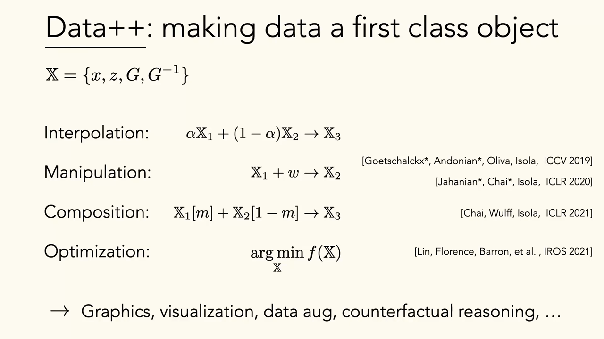
*▲ 강의 슬라이드 [07:50](https://youtu.be/RUdQMHV-7KM?t=470): 데이터++를 일급 객체로. $\mathbb{X} = \{x, z, G, G^{-1}\}$ 위의 [보간](00_%EB%94%A5%EB%9F%AC%EB%8B%9D_%EC%9A%A9%EC%96%B4%EC%82%AC%EC%A0%84.md#interpolation-%EB%B3%B4%EA%B0%84), 조작, 합성, 최적화*

### 2.3 잠재 변수는 조절 손잡이

▶ 영상 [07:54](https://youtu.be/RUdQMHV-7KM?t=474)

- [잠재 변수](00_%EB%94%A5%EB%9F%AC%EB%8B%9D_%EC%9A%A9%EC%96%B4%EC%82%AC%EC%A0%84.md#latent-variable-%EC%9E%A0%EC%9E%AC-%EB%B3%80%EC%88%98) $z$는 무엇을 만들지 정하는 **조절 장치**입니다. 보통 $z \sim \mathcal{N}(0, 1)$이 되도록 제약을 둡니다([MM50_확률_밀도와_정규분포](%EC%88%98%ED%95%99%EA%B0%9C%EB%85%90/04_%ED%99%95%EB%A5%A0%EA%B3%BC_%EC%A0%95%EB%B3%B4/MM50_%ED%99%95%EB%A5%A0_%EB%B0%80%EB%8F%84%EC%99%80_%EC%A0%95%EA%B7%9C%EB%B6%84%ED%8F%AC.md)). [잠재 공간](00_%EB%94%A5%EB%9F%AC%EB%8B%9D_%EC%9A%A9%EC%96%B4%EC%82%AC%EC%A0%84.md#latent-space-%EC%9E%A0%EC%9E%AC-%EA%B3%B5%EA%B0%84)의 다른 점을 고르면 다른 이미지가 나옵니다.
- [잠재 공간](00_%EB%94%A5%EB%9F%AC%EB%8B%9D_%EC%9A%A9%EC%96%B4%EC%82%AC%EC%A0%84.md#latent-space-%EC%9E%A0%EC%9E%AC-%EA%B3%B5%EA%B0%84)에서의 움직임과 생성된 이미지 사이의 관계를 알면 **제어**가 됩니다. 자연 이미지의 [다양체](00_%EB%94%A5%EB%9F%AC%EB%8B%9D_%EC%9A%A9%EC%96%B4%EC%82%AC%EC%A0%84.md#data-manifold-%EB%8D%B0%EC%9D%B4%ED%84%B0-%EB%8B%A4%EC%96%91%EC%B2%B4)에서 어떤 축은 새의 자세(방향)에, 어떤 축은 배경색에 대응할 수 있습니다. 이렇게 변화 요인이 축마다 나뉘어 있는 것을 **[얽힘 풀린](00_%EB%94%A5%EB%9F%AC%EB%8B%9D_%EC%9A%A9%EC%96%B4%EC%82%AC%EC%A0%84.md#disentangled-representation-%EC%96%BD%ED%9E%98-%ED%92%80%EB%A6%B0-%ED%91%9C%ED%98%84)**(disentangled) 요인이라고 합니다([Lec15 12.1](Lec15_%EB%B3%80%EB%B6%84_%EC%98%A4%ED%86%A0%EC%9D%B8%EC%BD%94%EB%8D%94.md#121-%EC%96%BD%ED%9E%98-%ED%92%80%EB%A6%B0-%EC%B6%95)).

질의응답 정리 [09:03](https://youtu.be/RUdQMHV-7KM?t=543)

- **두 잠재 축은 선형 [독립](00_%EB%94%A5%EB%9F%AC%EB%8B%9D_%EC%9A%A9%EC%96%B4%EC%82%AC%EC%A0%84.md#independence-%EB%8F%85%EB%A6%BD)이라고 가정하나? 실제로도 그런가?** 어떤 사영에서 직교하는 방향을 찾을 수 있고, 그 직교 방향이 실제 이미지의 깨끗한 변화 요인에 대응한다는 가정입니다. 일부 [생성 모델](00_%EB%94%A5%EB%9F%AC%EB%8B%9D_%EC%9A%A9%EC%96%B4%EC%82%AC%EC%A0%84.md#generative-model-%EC%83%9D%EC%84%B1-%EB%AA%A8%EB%8D%B8)에서는 맞지만 찾기가 쉽지 않습니다. 논문들은 "낮→밤으로 바뀌는 방향을 찾았다"는 식으로 잘 된 예만 골라 보여 주기도 합니다. [잠재 공간](00_%EB%94%A5%EB%9F%AC%EB%8B%9D_%EC%9A%A9%EC%96%B4%EC%82%AC%EC%A0%84.md#latent-space-%EC%9E%A0%EC%9E%AC-%EA%B3%B5%EA%B0%84)의 차원이 높을수록 변화 요인을 깨끗하게 풀어내기는 어렵고, 방법도 경험적인 요령에 가깝습니다.

---

## 3. 잠재 공간에서 반사실 묻기

▶ 영상 [10:48](https://youtu.be/RUdQMHV-7KM?t=648)

📐 **수학 개념**: [선형 보간과 잠재 방향](%EC%88%98%ED%95%99%EA%B0%9C%EB%85%90/03_%EC%84%A0%ED%98%95%EB%8C%80%EC%88%98/MM69_%EC%84%A0%ED%98%95_%EB%B3%B4%EA%B0%84%EA%B3%BC_%EC%9E%A0%EC%9E%AC_%EB%B0%A9%ED%96%A5.md) · [앙상블 평균과 오차 상쇄](%EC%88%98%ED%95%99%EA%B0%9C%EB%85%90/08_%EC%9D%BC%EB%B0%98%ED%99%94/MM67_%EC%95%99%EC%83%81%EB%B8%94_%ED%8F%89%EA%B7%A0%EA%B3%BC_%EC%98%A4%EC%B0%A8_%EC%83%81%EC%87%84.md) · [벡터와 행렬](%EC%88%98%ED%95%99%EA%B0%9C%EB%85%90/03_%EC%84%A0%ED%98%95%EB%8C%80%EC%88%98/M05_%EB%B2%A1%ED%84%B0%EC%99%80_%ED%96%89%EB%A0%AC.md)

실제 이미지를 $G^{-1}$로 [잠재 공간](00_%EB%94%A5%EB%9F%AC%EB%8B%9D_%EC%9A%A9%EC%96%B4%EC%82%AC%EC%A0%84.md#latent-space-%EC%9E%A0%EC%9E%AC-%EA%B3%B5%EA%B0%84)에 보내면, 측정하고 조작할 수 있는 변화 요인이 있다는 가정 아래 **반사실**(counterfactual) 질문을 할 수 있습니다. "이 사진이 다른 각도였다면? 밤이었다면?"

### 3.1 생성 변형의 앙상블

▶ 영상 [11:22](https://youtu.be/RUdQMHV-7KM?t=682)

- 실제 입력 이미지를 [잠재 공간](00_%EB%94%A5%EB%9F%AC%EB%8B%9D_%EC%9A%A9%EC%96%B4%EC%82%AC%EC%A0%84.md#latent-space-%EC%9E%A0%EC%9E%AC-%EA%B3%B5%EA%B0%84)으로 보내고, 그 **근처를 움직여** 자세, 방향이 조금씩 다른 그럴듯한 변형을 만든 뒤, 분류기의 예측을 [앙상블](00_%EB%94%A5%EB%9F%AC%EB%8B%9D_%EC%9A%A9%EC%96%B4%EC%82%AC%EC%A0%84.md#ensemble-%EC%95%99%EC%83%81%EB%B8%94)합니다. 그러면 [분류](00_%EB%94%A5%EB%9F%AC%EB%8B%9D_%EC%9A%A9%EC%96%B4%EC%82%AC%EC%A0%84.md#regression-classification-%ED%9A%8C%EA%B7%80%EC%99%80-%EB%B6%84%EB%A5%98) [정확도](00_%EB%94%A5%EB%9F%AC%EB%8B%9D_%EC%9A%A9%EC%96%B4%EC%82%AC%EC%A0%84.md#accuracy-%EC%A0%95%ED%99%95%EB%8F%84)와 강건성이 올라갑니다.
- [생성기](00_%EB%94%A5%EB%9F%AC%EB%8B%9D_%EC%9A%A9%EC%96%B4%EC%82%AC%EC%A0%84.md#generator-discriminator-%EC%83%9D%EC%84%B1%EA%B8%B0%EC%99%80-%ED%8C%90%EB%B3%84%EA%B8%B0) 안에서 하는 **[테스트 시점 증강](00_%EB%94%A5%EB%9F%AC%EB%8B%9D_%EC%9A%A9%EC%96%B4%EC%82%AC%EC%A0%84.md#test-time-augmentation-%ED%85%8C%EC%8A%A4%ED%8A%B8-%EC%8B%9C%EC%A0%90-%EC%A6%9D%EA%B0%95)**(test-time augmentation)과 같습니다. [잠재 공간](00_%EB%94%A5%EB%9F%AC%EB%8B%9D_%EC%9A%A9%EC%96%B4%EC%82%AC%EC%A0%84.md#latent-space-%EC%9E%A0%EC%9E%AC-%EA%B3%B5%EA%B0%84)을 탐색하면 원래 [학습 데이터](00_%EB%94%A5%EB%9F%AC%EB%8B%9D_%EC%9A%A9%EC%96%B4%EC%82%AC%EC%A0%84.md#training-data-test-data-%ED%95%99%EC%8A%B5-%EB%8D%B0%EC%9D%B4%ED%84%B0%EC%99%80-%EC%8B%9C%ED%97%98-%EB%8D%B0%EC%9D%B4%ED%84%B0) 이상의 것을 얻을 수 있다는 증거입니다.

$$
\hat p(y \mid \mathbf{x}) = \frac{1}{K}\sum_{k=1}^{K} p\big(y \mid G(G^{-1}(\mathbf{x}) + \boldsymbol{\delta}_k)\big)
$$

기호 풀이

| 기호 | 읽는 법 | 뜻 | 예제 값 |
| --- | --- | --- | --- |
| $\mathbf{x}$ | 엑스 | 분류할 실제 이미지 | 고양이 사진 |
| $G^{-1}(\mathbf{x})$ | 지 인버스 엑스 | 그 이미지의 잠재 벡터 | |
| $\boldsymbol{\delta}_k$ | 델타 케이 | $k$번째 작은 이동 (자세, 방향 바꾸기) | |
| $G(\cdot)$ | 지 | 이동한 잠재 벡터로 만든 변형 이미지 | |
| $p(y \mid \cdot)$ | 피 와이 | 분류기가 낸 범주 $y$의 [확률](00_%EB%94%A5%EB%9F%AC%EB%8B%9D_%EC%9A%A9%EC%96%B4%EC%82%AC%EC%A0%84.md#probability-%ED%99%95%EB%A5%A0) | 0.9, 0.6, 0.75 |
| $K$ | 케이 | 변형의 수 | 3 |
| $\hat p(y \mid \mathbf{x})$ | 피 햇 | [앙상블](00_%EB%94%A5%EB%9F%AC%EB%8B%9D_%EC%9A%A9%EC%96%B4%EC%82%AC%EC%A0%84.md#ensemble-%EC%95%99%EC%83%81%EB%B8%94) 예측 (평균) | 0.75 |

예제와 풀이

**문제**: 고양이 사진 하나를 [잠재 공간](00_%EB%94%A5%EB%9F%AC%EB%8B%9D_%EC%9A%A9%EC%96%B4%EC%82%AC%EC%A0%84.md#latent-space-%EC%9E%A0%EC%9E%AC-%EA%B3%B5%EA%B0%84)에서 세 방향으로 조금씩 움직여 변형 3장을 만들었다. 분류기가 각 변형에 "고양이" [확률](00_%EB%94%A5%EB%9F%AC%EB%8B%9D_%EC%9A%A9%EC%96%B4%EC%82%AC%EC%A0%84.md#probability-%ED%99%95%EB%A5%A0)을 0.9, 0.6, 0.75로 냈다. [앙상블](00_%EB%94%A5%EB%9F%AC%EB%8B%9D_%EC%9A%A9%EC%96%B4%EC%82%AC%EC%A0%84.md#ensemble-%EC%95%99%EC%83%81%EB%B8%94) 예측은?

**주어진 값**
- $K = 3$ (변형 수)
- $p_1 = 0.9$, $p_2 = 0.6$, $p_3 = 0.75$ (변형마다 고양이 [확률](00_%EB%94%A5%EB%9F%AC%EB%8B%9D_%EC%9A%A9%EC%96%B4%EC%82%AC%EC%A0%84.md#probability-%ED%99%95%EB%A5%A0))

**풀이**
1. 식을 그대로 쓴다: $\hat p = \dfrac{1}{K}\sum_{k=1}^{K} p_k$
2. 값을 대입한다: $\hat p = \dfrac{1}{3}\sum_{k=1}^{3} p_k$
3. Σ를 풀어 쓴다: $\hat p = \dfrac{1}{3}(0.9 + 0.6 + 0.75)$
4. 앞의 둘을 더한다: $0.9 + 0.6 = 1.5$ 이므로 $\hat p = \dfrac{1}{3}(1.5 + 0.75)$
5. 마저 더한다: $1.5 + 0.75 = 2.25$ 이므로 $\hat p = \dfrac{2.25}{3}$
6. 나눈다: $2.25 / 3 = 0.75$

**답**: $\hat p = $ **0.75**. 어떤 변형에서 흔들린 예측(0.6)이 다른 변형으로 보완된다([MM67_앙상블_평균과_오차_상쇄](%EC%88%98%ED%95%99%EA%B0%9C%EB%85%90/08_%EC%9D%BC%EB%B0%98%ED%99%94/MM67_%EC%95%99%EC%83%81%EB%B8%94_%ED%8F%89%EA%B7%A0%EA%B3%BC_%EC%98%A4%EC%B0%A8_%EC%83%81%EC%87%84.md)).

내 이해

- **숨은 가정**: 이 방법에는 "이미지 공간에서 가까운 것은 같은 범주이고 범주 경계를 크게 넘지 않는다"는 지식이 깔려 있습니다. "고양이"를 맞히는 데는 그럴듯하지만, **품종**처럼 [세분 분류](00_%EB%94%A5%EB%9F%AC%EB%8B%9D_%EC%9A%A9%EC%96%B4%EC%82%AC%EC%A0%84.md#fine-grained-classification-%EC%84%B8%EB%B6%84-%EB%B6%84%EB%A5%98)를 할 때는 변화 요인이 범주 경계를 깰 수 있습니다. 동물을 오래 연구한 강사에게는 귀 길이가 달라진 변형이 이미 다른 품종으로 보인다고 합니다. 어떤 변화 요인이 좋고 나쁜지는 늘 풀려는 문제에 달려 있습니다.

### 3.2 잠재 방향 찾기

▶ 영상 [13:41](https://youtu.be/RUdQMHV-7KM?t=821)

- **실험으로 찾기**: 같은 대상의 낮 사진과 밤 사진을 [잠재 공간](00_%EB%94%A5%EB%9F%AC%EB%8B%9D_%EC%9A%A9%EC%96%B4%EC%82%AC%EC%A0%84.md#latent-space-%EC%9E%A0%EC%9E%AC-%EA%B3%B5%EA%B0%84)으로 보내고, 한쪽에서 다른 쪽으로 가는 **방향 벡터**를 계산합니다. 이것이 그 반사실("밤이라면")에 대응하는 [잠재 방향](00_%EB%94%A5%EB%9F%AC%EB%8B%9D_%EC%9A%A9%EC%96%B4%EC%82%AC%EC%A0%84.md#latent-direction-%EC%9E%A0%EC%9E%AC-%EB%B0%A9%ED%96%A5)입니다.
- 이미지를 잘라 확대하는 식의 변환으로 방향을 여러 번 구해 평균하면, 입력과 관계없이 통하는 **줌인·줌아웃, 이동, 밝게·어둡게** 방향을 찾을 수 있습니다([GAN](00_%EB%94%A5%EB%9F%AC%EB%8B%9D_%EC%9A%A9%EC%96%B4%EC%82%AC%EC%A0%84.md#gan-generative-adversarial-network-%EC%83%9D%EC%84%B1%EC%A0%81-%EC%A0%81%EB%8C%80-%EC%8B%A0%EA%B2%BD%EB%A7%9D) steerability).
- **데이터 [편향](00_%EB%94%A5%EB%9F%AC%EB%8B%9D_%EC%9A%A9%EC%96%B4%EC%82%AC%EC%A0%84.md#bias-%ED%8E%B8%ED%96%A5)이 드러난다**: "어둡게" 방향을 화산 사진에 적용하면 화산이 **분화**합니다. 사람들은 분화하지 않는 화산을 밤에 찍지 않기 때문입니다. 그래서 "화산 분화 벡터"도 낮보다 밤에 더 격렬하게 나옵니다. 겨울→봄, 불 켜기, 낮→밤 같은 변환 벡터도 있습니다.
- **다른 모달리티**: 단어 [임베딩](00_%EB%94%A5%EB%9F%AC%EB%8B%9D_%EC%9A%A9%EC%96%B4%EC%82%AC%EC%A0%84.md#embedding-%EC%9E%84%EB%B2%A0%EB%94%A9) 모델 [word2vec](00_%EB%94%A5%EB%9F%AC%EB%8B%9D_%EC%9A%A9%EC%96%B4%EC%82%AC%EC%A0%84.md#word2vec-%EC%9B%8C%EB%93%9C%ED%88%AC%EB%B2%A1)에는 **시제**를 바꾸는 방향이 있어, 같은 방향으로 움직이면 swimming→swam, walking→walked가 됩니다. 이런 얽힘 풀린 방향은 여러 모달리티에서 발견되었습니다.

$$
\mathbf{d} = G^{-1}(\mathbf{x}_{\text{밤}}) - G^{-1}(\mathbf{x}_{\text{낮}}), \qquad \mathbf{x}' = G\big(G^{-1}(\mathbf{x}) + \alpha\,\mathbf{d}\big)
$$

기호 풀이

| 기호 | 읽는 법 | 뜻 | 예제 값 |
| --- | --- | --- | --- |
| $\mathbf{x}_{\text{낮}}$, $\mathbf{x}_{\text{밤}}$ | 엑스 낮, 엑스 밤 | 같은 장면의 낮 사진과 밤 사진 | |
| $G^{-1}(\cdot)$ | 지 인버스 | 사진의 잠재 벡터 | $(1, 2)$, $(1, -1)$ |
| $\mathbf{d}$ | 디 | [잠재 방향](00_%EB%94%A5%EB%9F%AC%EB%8B%9D_%EC%9A%A9%EC%96%B4%EC%82%AC%EC%A0%84.md#latent-direction-%EC%9E%A0%EC%9E%AC-%EB%B0%A9%ED%96%A5) (낮 → 밤) | $(0, -3)$ |
| $\mathbf{x}$ | 엑스 | 바꾸고 싶은 다른 사진 (잠재 벡터 $(3, 1)$) | |
| $\alpha$ | 알파 | 바꾸는 세기 | 0.5 |
| $\mathbf{x}'$ | 엑스 프라임 | 밤으로 바꾼 사진 (잠재 벡터 $(3, -0.5)$) | |

예제와 풀이

**문제**: 낮 사진의 잠재 벡터가 $(1, 2)$, 같은 장면 밤 사진의 잠재 벡터가 $(1, -1)$이다. 다른 사진(잠재 벡터 $(3, 1)$)을 세기 0.5로 밤 쪽으로 바꿀 때 [생성기](00_%EB%94%A5%EB%9F%AC%EB%8B%9D_%EC%9A%A9%EC%96%B4%EC%82%AC%EC%A0%84.md#generator-discriminator-%EC%83%9D%EC%84%B1%EA%B8%B0%EC%99%80-%ED%8C%90%EB%B3%84%EA%B8%B0)에 넣을 잠재 벡터는?

**주어진 값**
- $G^{-1}(\mathbf{x}_{\text{낮}}) = (1, 2)$ (낮 사진의 잠재 벡터)
- $G^{-1}(\mathbf{x}_{\text{밤}}) = (1, -1)$ (밤 사진의 잠재 벡터)
- $G^{-1}(\mathbf{x}) = (3, 1)$ (바꿀 사진의 잠재 벡터)
- $\alpha = 0.5$ (세기)

**풀이**
1. 식을 그대로 쓴다: $\mathbf{d} = G^{-1}(\mathbf{x}_{\text{밤}}) - G^{-1}(\mathbf{x}_{\text{낮}})$, 넣을 벡터 $= G^{-1}(\mathbf{x}) + \alpha\,\mathbf{d}$
2. 값을 대입한다: $\mathbf{d} = (1, -1) - (1, 2)$, 넣을 벡터 $= (3, 1) + 0.5\,\mathbf{d}$
3. 성분끼리 뺀다: $1 - 1 = 0$, $-1 - 2 = -3$ 이므로 $\mathbf{d} = (0, -3)$
4. 세기를 성분마다 곱한다: $0.5 \times 0 = 0$, $0.5 \times (-3) = -1.5$ 이므로 넣을 벡터 $= (3, 1) + (0, -1.5)$
5. 성분끼리 더한다: $3 + 0 = 3$, $1 + (-1.5) = -0.5$

**답**: **(3, -0.5)**. 이 벡터를 $G$에 넣으면 "반쯤 밤"인 사진이 나온다. 자세한 계산과 단어 유추는 [MM69_선형_보간과_잠재_방향](%EC%88%98%ED%95%99%EA%B0%9C%EB%85%90/03_%EC%84%A0%ED%98%95%EB%8C%80%EC%88%98/MM69_%EC%84%A0%ED%98%95_%EB%B3%B4%EA%B0%84%EA%B3%BC_%EC%9E%A0%EC%9E%AC_%EB%B0%A9%ED%96%A5.md).

내 이해

### 3.3 어디서 보간하나: z 공간과 w 공간

▶ 영상 [17:03](https://youtu.be/RUdQMHV-7KM?t=1023)

- [GAN](00_%EB%94%A5%EB%9F%AC%EB%8B%9D_%EC%9A%A9%EC%96%B4%EC%82%AC%EC%A0%84.md#gan-generative-adversarial-network-%EC%83%9D%EC%84%B1%EC%A0%81-%EC%A0%81%EB%8C%80-%EC%8B%A0%EA%B2%BD%EB%A7%9D)의 [잠재 공간](00_%EB%94%A5%EB%9F%AC%EB%8B%9D_%EC%9A%A9%EC%96%B4%EC%82%AC%EC%A0%84.md#latent-space-%EC%9E%A0%EC%9E%AC-%EA%B3%B5%EA%B0%84)에서 직선으로 걸어가며 이미지를 보면 어느 정도 되지만, 잘 된 예를 골라 보여 주는 경우가 많습니다. 어떤 방향은 쓰레기 같은 그림이 나오거나 해석할 수 있는 요인으로 풀리지 않습니다.
- **[StyleGAN](00_%EB%94%A5%EB%9F%AC%EB%8B%9D_%EC%9A%A9%EC%96%B4%EC%82%AC%EC%A0%84.md#stylegan-%EC%8A%A4%ED%83%80%EC%9D%BCgan)**은 모델의 어느 [층](00_%EB%94%A5%EB%9F%AC%EB%8B%9D_%EC%9A%A9%EC%96%B4%EC%82%AC%EC%A0%84.md#layer-%EC%B8%B5)의 중간 표현이든 또 하나의 [잠재 공간](00_%EB%94%A5%EB%9F%AC%EB%8B%9D_%EC%9A%A9%EC%96%B4%EC%82%AC%EC%A0%84.md#latent-space-%EC%9E%A0%EC%9E%AC-%EA%B3%B5%EA%B0%84)이라는 점에 주목했고, 입력 $z$보다 **앞쪽 중간 [층](00_%EB%94%A5%EB%9F%AC%EB%8B%9D_%EC%9A%A9%EC%96%B4%EC%82%AC%EC%A0%84.md#layer-%EC%B8%B5)($w$ 공간)이 더 좋은 잠재 표현**이라는 것을 발견했습니다.
- **픽셀 공간 [보간](00_%EB%94%A5%EB%9F%AC%EB%8B%9D_%EC%9A%A9%EC%96%B4%EC%82%AC%EC%A0%84.md#interpolation-%EB%B3%B4%EA%B0%84)**: 자연 이미지의 [다양체](00_%EB%94%A5%EB%9F%AC%EB%8B%9D_%EC%9A%A9%EC%96%B4%EC%82%AC%EC%A0%84.md#data-manifold-%EB%8D%B0%EC%9D%B4%ED%84%B0-%EB%8B%A4%EC%96%91%EC%B2%B4)는 비선형입니다. 파랑새 사진과 파리 사진을 픽셀에서 직선으로 섞으면 다양체를 벗어나, 두 그림을 겹쳐 놓은 듯한 비현실적인 이미지가 나옵니다.
- **[잠재 공간](00_%EB%94%A5%EB%9F%AC%EB%8B%9D_%EC%9A%A9%EC%96%B4%EC%82%AC%EC%A0%84.md#latent-space-%EC%9E%A0%EC%9E%AC-%EA%B3%B5%EA%B0%84) [보간](00_%EB%94%A5%EB%9F%AC%EB%8B%9D_%EC%9A%A9%EC%96%B4%EC%82%AC%EC%A0%84.md#interpolation-%EB%B3%B4%EA%B0%84)**: 잘 학습한 [잠재 공간](00_%EB%94%A5%EB%9F%AC%EB%8B%9D_%EC%9A%A9%EC%96%B4%EC%82%AC%EC%A0%84.md#latent-space-%EC%9E%A0%EC%9E%AC-%EA%B3%B5%EA%B0%84)은 어느 점이든 자연 이미지 다양체 위로 보냅니다. 그래서 [잠재 공간](00_%EB%94%A5%EB%9F%AC%EB%8B%9D_%EC%9A%A9%EC%96%B4%EC%82%AC%EC%A0%84.md#latent-space-%EC%9E%A0%EC%9E%AC-%EA%B3%B5%EA%B0%84)의 직선은 다양체 위의 휘어진 길이 됩니다. BigGAN(2018)의 예처럼 더 자연스러워 보이지만, 그래도 "반은 새, 반은 파리"인 현실에 없는 그림이 나옵니다. 모델이 다양체 안에 머물며 할 수 있는 최선을 다한 결과입니다.

$$
\mathbf{x}(t) = G\big((1 - t)\,\mathbf{z}_0 + t\,\mathbf{z}_1\big) \quad \text{vs} \quad \mathbf{x}(t) = (1 - t)\,\mathbf{x}_0 + t\,\mathbf{x}_1
$$

기호 풀이

| 기호 | 읽는 법 | 뜻 | 예제 값 |
| --- | --- | --- | --- |
| $\mathbf{z}_0$, $\mathbf{z}_1$ | 제트 영, 제트 일 | 두 이미지의 [잠재 변수](00_%EB%94%A5%EB%9F%AC%EB%8B%9D_%EC%9A%A9%EC%96%B4%EC%82%AC%EC%A0%84.md#latent-variable-%EC%9E%A0%EC%9E%AC-%EB%B3%80%EC%88%98) (여기서는 각도) | 20도, 160도 |
| $\mathbf{x}_0$, $\mathbf{x}_1$ | 엑스 영, 엑스 일 | 두 이미지 (여기서는 원 위의 점) | $(0.9397, 0.342)$, $(-0.9397, 0.342)$ |
| $t$ | 티 | 섞는 비율 | 0.5 |
| $G$ | 지 | [생성기](00_%EB%94%A5%EB%9F%AC%EB%8B%9D_%EC%9A%A9%EC%96%B4%EC%82%AC%EC%A0%84.md#generator-discriminator-%EC%83%9D%EC%84%B1%EA%B8%B0%EC%99%80-%ED%8C%90%EB%B3%84%EA%B8%B0) (각도 → 원 위의 점, 개념도) | $G(\theta) = (\cos\theta, \sin\theta)$ |
| 왼쪽 식 | | [잠재 공간](00_%EB%94%A5%EB%9F%AC%EB%8B%9D_%EC%9A%A9%EC%96%B4%EC%82%AC%EC%A0%84.md#latent-space-%EC%9E%A0%EC%9E%AC-%EA%B3%B5%EA%B0%84) [보간](00_%EB%94%A5%EB%9F%AC%EB%8B%9D_%EC%9A%A9%EC%96%B4%EC%82%AC%EC%A0%84.md#interpolation-%EB%B3%B4%EA%B0%84) | $(0, 1)$ (다양체 위) |
| 오른쪽 식 | | 픽셀 공간 [보간](00_%EB%94%A5%EB%9F%AC%EB%8B%9D_%EC%9A%A9%EC%96%B4%EC%82%AC%EC%A0%84.md#interpolation-%EB%B3%B4%EA%B0%84) | $(0, 0.342)$ (다양체 밖) |

예제와 풀이

**문제**: 자연 이미지 다양체를 반지름 1인 원으로 보는 개념도에서, [생성기](00_%EB%94%A5%EB%9F%AC%EB%8B%9D_%EC%9A%A9%EC%96%B4%EC%82%AC%EC%A0%84.md#generator-discriminator-%EC%83%9D%EC%84%B1%EA%B8%B0%EC%99%80-%ED%8C%90%EB%B3%84%EA%B8%B0)는 각도 $\theta$를 원 위의 점 $(\cos\theta, \sin\theta)$로 보낸다. 20도와 160도에 있는 두 이미지의 한가운데($t = 0.5$)를 [잠재 공간](00_%EB%94%A5%EB%9F%AC%EB%8B%9D_%EC%9A%A9%EC%96%B4%EC%82%AC%EC%A0%84.md#latent-space-%EC%9E%A0%EC%9E%AC-%EA%B3%B5%EA%B0%84)과 픽셀 공간에서 각각 구하라.

**주어진 값**
- $\mathbf{z}_0 = 20°$, $\mathbf{z}_1 = 160°$ ([잠재 변수](00_%EB%94%A5%EB%9F%AC%EB%8B%9D_%EC%9A%A9%EC%96%B4%EC%82%AC%EC%A0%84.md#latent-variable-%EC%9E%A0%EC%9E%AC-%EB%B3%80%EC%88%98) = 각도)
- $\mathbf{x}_0 = (\cos 20°, \sin 20°) = (0.9397, 0.342)$, $\mathbf{x}_1 = (\cos 160°, \sin 160°) = (-0.9397, 0.342)$ (두 이미지). cos, sin은 원 위의 점의 가로·세로 좌표이고 계산기(코드)로 구한다
- $t = 0.5$ (한가운데)

**풀이**
1. [잠재 공간](00_%EB%94%A5%EB%9F%AC%EB%8B%9D_%EC%9A%A9%EC%96%B4%EC%82%AC%EC%A0%84.md#latent-space-%EC%9E%A0%EC%9E%AC-%EA%B3%B5%EA%B0%84) 식을 그대로 쓴다: $\mathbf{x}(t) = G\big((1 - t)\,\mathbf{z}_0 + t\,\mathbf{z}_1\big)$
2. 값을 대입한다: $\mathbf{x}(0.5) = G(0.5 \times 20° + 0.5 \times 160°)$
3. 곱한다: $0.5 \times 20 = 10$, $0.5 \times 160 = 80$ 이므로 $\mathbf{x} = G(10° + 80°)$
4. 더한다: $10 + 80 = 90$ 이므로 $\mathbf{x} = G(90°) = (\cos 90°, \sin 90°)$
5. cos, sin 값을 넣는다: $\cos 90° = 0$, $\sin 90° = 1$ 이므로 $\mathbf{x} = (0, 1)$
6. 픽셀 공간 식을 그대로 쓴다: $\mathbf{x}(t) = (1 - t)\,\mathbf{x}_0 + t\,\mathbf{x}_1$
7. 값을 대입한다: $\mathbf{x}(0.5) = 0.5\,(0.9397, 0.342) + 0.5\,(-0.9397, 0.342)$
8. 성분마다 곱한다: $(0.4699, 0.171) + (-0.4699, 0.171)$
9. 성분끼리 더한다: $0.4699 - 0.4699 = 0$, $0.171 + 0.171 = 0.342$ 이므로 $\mathbf{x} = (0, 0.342)$
10. 원점에서의 거리를 비교한다: $(0, 1)$은 거리 1 (원 위), $(0, 0.342)$는 거리 0.342 (원 안)

**답**: [잠재 공간](00_%EB%94%A5%EB%9F%AC%EB%8B%9D_%EC%9A%A9%EC%96%B4%EC%82%AC%EC%A0%84.md#latent-space-%EC%9E%A0%EC%9E%AC-%EA%B3%B5%EA%B0%84) [보간](00_%EB%94%A5%EB%9F%AC%EB%8B%9D_%EC%9A%A9%EC%96%B4%EC%82%AC%EC%A0%84.md#interpolation-%EB%B3%B4%EA%B0%84)은 **(0, 1)**로 다양체 위에, 픽셀 공간 [보간](00_%EB%94%A5%EB%9F%AC%EB%8B%9D_%EC%9A%A9%EC%96%B4%EC%82%AC%EC%A0%84.md#interpolation-%EB%B3%B4%EA%B0%84)은 **(0, 0.342)**로 다양체 밖에 있다. 두 사진을 겹친 "합성 사진"이 자연 이미지가 아닌 이유다.

내 이해

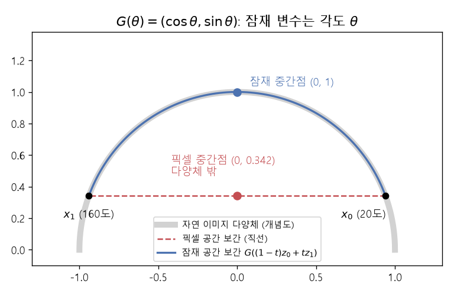
*▲ 직접 그린 그림: 원을 자연 이미지 다양체로 본 개념도. 20도와 160도의 두 점을 픽셀에서 직선으로 섞으면 중간점 $(0, 0.342)$가 다양체 밖에 있고(빨강), 각도([잠재 변수](00_%EB%94%A5%EB%9F%AC%EB%8B%9D_%EC%9A%A9%EC%96%B4%EC%82%AC%EC%A0%84.md#latent-variable-%EC%9E%A0%EC%9E%AC-%EB%B3%80%EC%88%98))를 섞으면 다양체를 따라 $(0, 1)$을 지난다(파랑)*

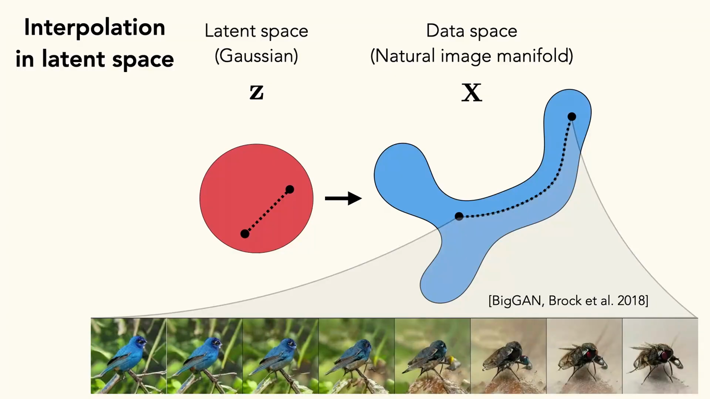
*▲ 강의 슬라이드 [20:10](https://youtu.be/RUdQMHV-7KM?t=1210): [잠재 공간](00_%EB%94%A5%EB%9F%AC%EB%8B%9D_%EC%9A%A9%EC%96%B4%EC%82%AC%EC%A0%84.md#latent-space-%EC%9E%A0%EC%9E%AC-%EA%B3%B5%EA%B0%84)(가우시안)의 직선이 데이터 공간(자연 이미지 다양체)에서는 휘어진 길이 된다. 아래 줄은 BigGAN의 새→파리 [보간](00_%EB%94%A5%EB%9F%AC%EB%8B%9D_%EC%9A%A9%EC%96%B4%EC%82%AC%EC%A0%84.md#interpolation-%EB%B3%B4%EA%B0%84)*

- **왜 $z$ 공간의 직선이 최선이 아닌가**: [VAE 강의](Lec15_%EB%B3%80%EB%B6%84_%EC%98%A4%ED%86%A0%EC%9D%B8%EC%BD%94%EB%8D%94.md)의 그림처럼, 데이터 분포를 잠재 분포(가우시안 공)로 보내도록 학습하면 데이터를 공 모양으로 **구겨 넣는** 셈입니다. [잠재 공간](00_%EB%94%A5%EB%9F%AC%EB%8B%9D_%EC%9A%A9%EC%96%B4%EC%82%AC%EC%A0%84.md#latent-space-%EC%9E%A0%EC%9E%AC-%EA%B3%B5%EA%B0%84)의 모든 점이 다양체 위로 가도록 했어도 **솔기**(seam)와 "위험 지대"가 생깁니다. [잠재 공간](00_%EB%94%A5%EB%9F%AC%EB%8B%9D_%EC%9A%A9%EC%96%B4%EC%82%AC%EC%A0%84.md#latent-space-%EC%9E%A0%EC%9E%AC-%EA%B3%B5%EA%B0%84)에서는 가까운데 데이터 공간에서는 멀리 떨어진 곳이 있어, 솔기를 건너는 직선 [보간](00_%EB%94%A5%EB%9F%AC%EB%8B%9D_%EC%9A%A9%EC%96%B4%EC%82%AC%EC%A0%84.md#interpolation-%EB%B3%B4%EA%B0%84)은 갑작스럽게 부자연스러워집니다.
- 이것이 [StyleGAN](00_%EB%94%A5%EB%9F%AC%EB%8B%9D_%EC%9A%A9%EC%96%B4%EC%82%AC%EC%A0%84.md#stylegan-%EC%8A%A4%ED%83%80%EC%9D%BCgan)의 발견을 설명해 줍니다. 완전히 볼록한(가우시안) $z$ 공간과 휘어진 데이터 공간 **사이의 중간 표현**($w$)은 덜 일그러져 있어 솔기를 건너거나 위험 지대에 빠질 가능성이 적습니다. 경험적으로도 "때때로" 그렇습니다(강사: "우리가 제일 좋아하는 말이죠, 때때로").
- **StyleSpace**(2020)는 이 중간 공간을 써서 자동차의 후드 모양, 전조등 종류, 차체 색, 배경을 따로따로 깔끔하게 바꾸는 축을 찾았습니다. [보간](00_%EB%94%A5%EB%9F%AC%EB%8B%9D_%EC%9A%A9%EC%96%B4%EC%82%AC%EC%A0%84.md#interpolation-%EB%B3%B4%EA%B0%84)이 나쁘게 동작하는 부분을 피하는 중간 공간이 얽힘 풀린 축을 찾는 데 유리하다는 뜻입니다.

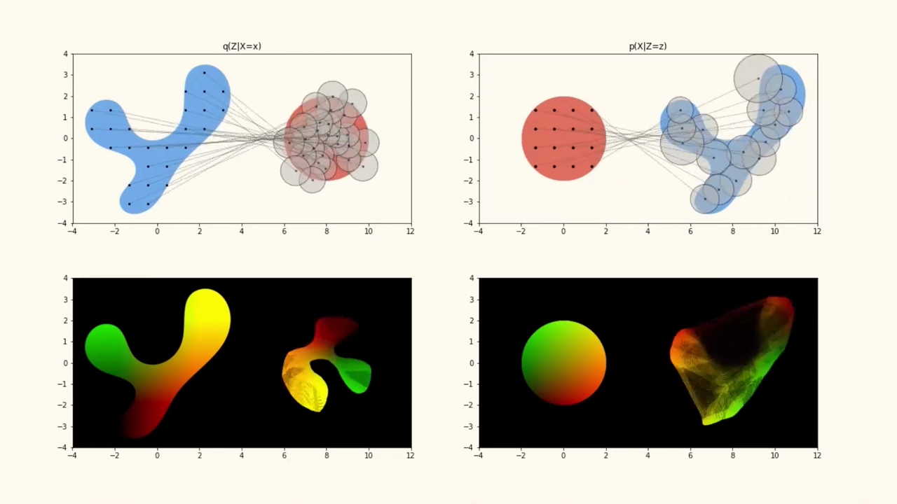
*▲ 강의 슬라이드 [21:40](https://youtu.be/RUdQMHV-7KM?t=1300): [VAE](00_%EB%94%A5%EB%9F%AC%EB%8B%9D_%EC%9A%A9%EC%96%B4%EC%82%AC%EC%A0%84.md#variational-autoencoder-vae-%EB%B3%80%EB%B6%84-%EC%98%A4%ED%86%A0%EC%9D%B8%EC%BD%94%EB%8D%94)가 학습되며 데이터 공간(파랑)을 가우시안 [잠재 공간](00_%EB%94%A5%EB%9F%AC%EB%8B%9D_%EC%9A%A9%EC%96%B4%EC%82%AC%EC%A0%84.md#latent-space-%EC%9E%A0%EC%9E%AC-%EA%B3%B5%EA%B0%84)(빨강)으로 구겨 넣는다. 색은 두 공간의 대응. 다시 펼친 오른쪽 아래에 솔기와 일그러짐이 보인다*

---

## 4. 생성 데이터에 라벨 붙이기

▶ 영상 [23:29](https://youtu.be/RUdQMHV-7KM?t=1409)

📐 **수학 개념**: [최근접 이웃과 탐침](%EC%88%98%ED%95%99%EA%B0%9C%EB%85%90/10_%ED%91%9C%ED%98%84_%ED%95%99%EC%8A%B5/MM42_%EC%B5%9C%EA%B7%BC%EC%A0%91_%EC%9D%B4%EC%9B%83%EA%B3%BC_%ED%83%90%EC%B9%A8.md)

- [생성 모델](00_%EB%94%A5%EB%9F%AC%EB%8B%9D_%EC%9A%A9%EC%96%B4%EC%82%AC%EC%A0%84.md#generative-model-%EC%83%9D%EC%84%B1-%EB%AA%A8%EB%8D%B8)을 학습한 실제 데이터에 라벨이 있다고 합시다. [잠재 공간](00_%EB%94%A5%EB%9F%AC%EB%8B%9D_%EC%9A%A9%EC%96%B4%EC%82%AC%EC%A0%84.md#latent-space-%EC%9E%A0%EC%9E%AC-%EA%B3%B5%EA%B0%84)에는 실제 데이터에 대응하는 곳 말고도 **순수하게 생성된** 데이터에 대응하는 넓은 공간이 있습니다.
- 잘 만든 다양체에서는 **가까운 점이 의미상으로도 비슷**하다는 가정을 둡니다. 너무 멀리 가지 않으면 범주가 그대로라는 것입니다. 그러면 "가까운 점에 비슷한 라벨을 준다"는 기계 [학습](00_%EB%94%A5%EB%9F%AC%EB%8B%9D_%EC%9A%A9%EC%96%B4%EC%82%AC%EC%A0%84.md#training-%ED%95%99%EC%8A%B5)의 보통 [귀납 편향](00_%EB%94%A5%EB%9F%AC%EB%8B%9D_%EC%9A%A9%EC%96%B4%EC%82%AC%EC%A0%84.md#inductive-bias-%EA%B7%80%EB%82%A9-%ED%8E%B8%ED%96%A5)으로 생성 데이터에도 라벨을 붙일 수 있습니다([MM42_최근접_이웃과_탐침](%EC%88%98%ED%95%99%EA%B0%9C%EB%85%90/10_%ED%91%9C%ED%98%84_%ED%95%99%EC%8A%B5/MM42_%EC%B5%9C%EA%B7%BC%EC%A0%91_%EC%9D%B4%EC%9B%83%EA%B3%BC_%ED%83%90%EC%B9%A8.md)). 근처의 작은 변화는 장면, 맥락 같은 요인을 바꿀 뿐 대상의 범주는 바꾸지 않는다는 가정입니다.

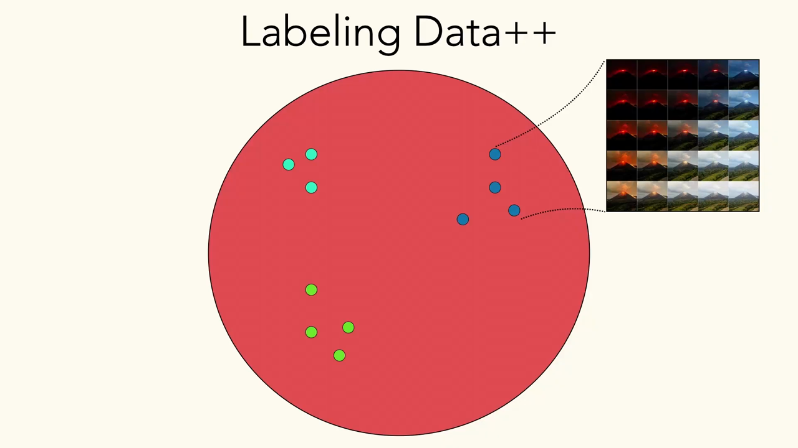
*▲ 강의 슬라이드 [25:00](https://youtu.be/RUdQMHV-7KM?t=1500): 데이터++에 라벨 붙이기. [잠재 공간](00_%EB%94%A5%EB%9F%AC%EB%8B%9D_%EC%9A%A9%EC%96%B4%EC%82%AC%EC%A0%84.md#latent-space-%EC%9E%A0%EC%9E%AC-%EA%B3%B5%EA%B0%84)에서 라벨을 아는 실제 점(색깔 점) 근처의 생성 데이터는 같은 범주로 본다*

- **DatasetGAN**(2021): 자동차 부품의 [의미 분할](00_%EB%94%A5%EB%9F%AC%EB%8B%9D_%EC%9A%A9%EC%96%B4%EC%82%AC%EC%A0%84.md#semantic-segmentation-%EC%9D%98%EB%AF%B8-%EB%B6%84%ED%95%A0)처럼 라벨이 아주 비싼 과제를 겨냥했습니다.
  1. [StyleGAN](00_%EB%94%A5%EB%9F%AC%EB%8B%9D_%EC%9A%A9%EC%96%B4%EC%82%AC%EC%A0%84.md#stylegan-%EC%8A%A4%ED%83%80%EC%9D%BCgan)을 이미지로 학습합니다.
  2. [생성기](00_%EB%94%A5%EB%9F%AC%EB%8B%9D_%EC%9A%A9%EC%96%B4%EC%82%AC%EC%A0%84.md#generator-discriminator-%EC%83%9D%EC%84%B1%EA%B8%B0%EC%99%80-%ED%8C%90%EB%B3%84%EA%B8%B0)의 중간 [특징 맵](00_%EB%94%A5%EB%9F%AC%EB%8B%9D_%EC%9A%A9%EC%96%B4%EC%82%AC%EC%A0%84.md#feature-map-%ED%8A%B9%EC%A7%95-%EB%A7%B5)(공간 배치가 유지됨)을 픽셀마다 이어 붙여 **픽셀 특징 벡터**를 만들고, 사람이 손으로 분할한 **아주 적은 수**의 생성 이미지로 픽셀 특징 → 부품 라벨을 내는 가벼운 분류기("라벨링 팔")를 배웁니다.
  3. [생성기](00_%EB%94%A5%EB%9F%AC%EB%8B%9D_%EC%9A%A9%EC%96%B4%EC%82%AC%EC%A0%84.md#generator-discriminator-%EC%83%9D%EC%84%B1%EA%B8%B0%EC%99%80-%ED%8C%90%EB%B3%84%EA%B8%B0)로 이미지와 라벨 쌍을 대량으로 만듭니다(약한 라벨이지만 잘 정렬된 [잠재 공간](00_%EB%94%A5%EB%9F%AC%EB%8B%9D_%EC%9A%A9%EC%96%B4%EC%82%AC%EC%A0%84.md#latent-space-%EC%9E%A0%EC%9E%AC-%EA%B3%B5%EA%B0%84)에 근거한 라벨).
  4. 이 [합성 데이터](00_%EB%94%A5%EB%9F%AC%EB%8B%9D_%EC%9A%A9%EC%96%B4%EC%82%AC%EC%A0%84.md#synthetic-data-%ED%95%A9%EC%84%B1-%EB%8D%B0%EC%9D%B4%ED%84%B0)로 부품 분할 모델을 학습하고 **실제 데이터에서 시험**합니다.
- 결과: **라벨 붙인 [GAN](00_%EB%94%A5%EB%9F%AC%EB%8B%9D_%EC%9A%A9%EC%96%B4%EC%82%AC%EC%A0%84.md#gan-generative-adversarial-network-%EC%83%9D%EC%84%B1%EC%A0%81-%EC%A0%81%EB%8C%80-%EC%8B%A0%EA%B2%BD%EB%A7%9D) 이미지 1장이 일반 라벨 이미지 약 100장의 가치**였습니다(같은 [정확도](00_%EB%94%A5%EB%9F%AC%EB%8B%9D_%EC%9A%A9%EC%96%B4%EC%82%AC%EC%A0%84.md#accuracy-%EC%A0%95%ED%99%95%EB%8F%84)를 얻는 데 필요한 양). [생성기](00_%EB%94%A5%EB%9F%AC%EB%8B%9D_%EC%9A%A9%EC%96%B4%EC%82%AC%EC%A0%84.md#generator-discriminator-%EC%83%9D%EC%84%B1%EA%B8%B0%EC%99%80-%ED%8C%90%EB%B3%84%EA%B8%B0)를 학습하면서 모델이 변화 요인과 유사도가 잘 정렬된 표현을 배웠기 때문에, 픽셀보다 의미가 잘 정돈된 특징 위에서 효율적으로 배울 수 있었던 것입니다.
- 분할 라벨을 붙여 본 학생이 손을 들자 강사는 "정말 괴롭죠"라고 말합니다. 특히 물체의 경계처럼 세밀한 부분은 끝없이 오래 걸립니다. 그래서 적은 라벨로 잘 [일반화](00_%EB%94%A5%EB%9F%AC%EB%8B%9D_%EC%9A%A9%EC%96%B4%EC%82%AC%EC%A0%84.md#generalization-%EC%9D%BC%EB%B0%98%ED%99%94)하는 것이 값집니다.
- **요즘의 출발점**: 꼭 [생성 모델](00_%EB%94%A5%EB%9F%AC%EB%8B%9D_%EC%9A%A9%EC%96%B4%EC%82%AC%EC%A0%84.md#generative-model-%EC%83%9D%EC%84%B1-%EB%AA%A8%EB%8D%B8)이 아니어도, 잘 배운 표현 공간([기반 모델](00_%EB%94%A5%EB%9F%AC%EB%8B%9D_%EC%9A%A9%EC%96%B4%EC%82%AC%EC%A0%84.md#foundation-model-%EA%B8%B0%EB%B0%98-%EB%AA%A8%EB%8D%B8))에서 효율적으로 배우는 연구가 많습니다. 분할을 하려면 대부분 **[SAM](00_%EB%94%A5%EB%9F%AC%EB%8B%9D_%EC%9A%A9%EC%96%B4%EC%82%AC%EC%A0%84.md#segment-anything-model-sam-%EC%84%B8%EA%B7%B8%EB%A8%BC%ED%8A%B8-%EC%95%A0%EB%8B%88%EC%8B%B1-%EB%AA%A8%EB%8D%B8)**([Segment Anything Model](00_%EB%94%A5%EB%9F%AC%EB%8B%9D_%EC%9A%A9%EC%96%B4%EC%82%AC%EC%A0%84.md#segment-anything-model-sam-%EC%84%B8%EA%B7%B8%EB%A8%BC%ED%8A%B8-%EC%95%A0%EB%8B%88%EC%8B%B1-%EB%AA%A8%EB%8D%B8))에서 시작합니다. [SAM](00_%EB%94%A5%EB%9F%AC%EB%8B%9D_%EC%9A%A9%EC%96%B4%EC%82%AC%EC%A0%84.md#segment-anything-model-sam-%EC%84%B8%EA%B7%B8%EB%A8%BC%ED%8A%B8-%EC%95%A0%EB%8B%88%EC%8B%B1-%EB%AA%A8%EB%8D%B8)은 물체를 오려 여러 배경과 배치에 붙여 넣는 **복사-붙여넣기 증강**으로 [정답](00_%EB%94%A5%EB%9F%AC%EB%8B%9D_%EC%9A%A9%EC%96%B4%EC%82%AC%EC%A0%84.md#label-%EC%A0%95%EB%8B%B5) 마스크를 보장한 대규모 데이터를 만들고, 세밀한 의미를 담는 DINOv2 같은 특징을 활용해 [일반화](00_%EB%94%A5%EB%9F%AC%EB%8B%9D_%EC%9A%A9%EC%96%B4%EC%82%AC%EC%A0%84.md#generalization-%EC%9D%BC%EB%B0%98%ED%99%94)가 잘 되는 분할 모델을 배웠다고 강사는 설명합니다.

> [!TIP]
> **🆕 2026 업데이트: 분할과 자기 지도 특징의 다음 세대**
> - **강의**: 분할은 [SAM](00_%EB%94%A5%EB%9F%AC%EB%8B%9D_%EC%9A%A9%EC%96%B4%EC%82%AC%EC%A0%84.md#segment-anything-model-sam-%EC%84%B8%EA%B7%B8%EB%A8%BC%ED%8A%B8-%EC%95%A0%EB%8B%88%EC%8B%B1-%EB%AA%A8%EB%8D%B8)에서, 세밀한 특징은 DINOv2에서 시작한다(2023년 모델).
> - **현재**: Meta는 2025년 11월 **[SAM](00_%EB%94%A5%EB%9F%AC%EB%8B%9D_%EC%9A%A9%EC%96%B4%EC%82%AC%EC%A0%84.md#segment-anything-model-sam-%EC%84%B8%EA%B7%B8%EB%A8%BC%ED%8A%B8-%EC%95%A0%EB%8B%88%EC%8B%B1-%EB%AA%A8%EB%8D%B8) 3**를 공개했다. 클릭이나 상자 대신 "노란 스쿨버스" 같은 짧은 명사구나 예시 이미지로 개념을 지정하면, 이미지와 동영상에서 그 개념의 **모든 인스턴스**를 분할하고 추적한다(Promptable Concept Segmentation). 데이터 엔진으로 고유 개념 라벨 400만 개짜리 데이터를 만들었고, 개념 분할에서 기존 시스템보다 약 2배 좋다고 보고했다. 같은 해 8월에는 **DINOv3**가 나왔다. 라벨 없이 17억 장 이미지로 70억 [파라미터](00_%EB%94%A5%EB%9F%AC%EB%8B%9D_%EC%9A%A9%EC%96%B4%EC%82%AC%EC%A0%84.md#parameter-%ED%8C%8C%EB%9D%BC%EB%AF%B8%ED%84%B0) ViT를 [자기 지도 학습](00_%EB%94%A5%EB%9F%AC%EB%8B%9D_%EC%9A%A9%EC%96%B4%EC%82%AC%EC%A0%84.md#self-supervised-learning-%EC%9E%90%EA%B8%B0-%EC%A7%80%EB%8F%84-%ED%95%99%EC%8A%B5)하고, 긴 [학습](00_%EB%94%A5%EB%9F%AC%EB%8B%9D_%EC%9A%A9%EC%96%B4%EC%82%AC%EC%A0%84.md#training-%ED%95%99%EC%8A%B5)에서 조밀한 [특징 맵](00_%EB%94%A5%EB%9F%AC%EB%8B%9D_%EC%9A%A9%EC%96%B4%EC%82%AC%EC%A0%84.md#feature-map-%ED%8A%B9%EC%A7%95-%EB%A7%B5)이 나빠지는 문제를 Gram anchoring으로 막았다. 큰 교사를 작은 모델들로 증류해 함께 공개했고, 얼린 백본만으로 여러 조밀 예측 과제에서 이전 자기 지도·약지도 모델을 넘었다.
> - **출처**: [Carion 등, SAM 3: Segment Anything with Concepts (arXiv 2025)](https://arxiv.org/abs/2511.16719) · [Siméoni 등, DINOv3 (arXiv 2025)](https://arxiv.org/abs/2508.10104) · [Meta AI, DINOv3 소개 (2025)](https://ai.meta.com/blog/dinov3-self-supervised-vision-model/)

---

## 5. 생성 모델로 설명하기

▶ 영상 [30:08](https://youtu.be/RUdQMHV-7KM?t=1808)

- 보통의 [분류](00_%EB%94%A5%EB%9F%AC%EB%8B%9D_%EC%9A%A9%EC%96%B4%EC%82%AC%EC%A0%84.md#regression-classification-%ED%9A%8C%EA%B7%80%EC%99%80-%EB%B6%84%EB%A5%98)는 이미지를 넣고 "고양이"라는 범주를 냅니다. 데이터++ 공간에서 반사실을 탐색하면 **왜** 고양이로 분류했는지도 물을 수 있습니다([반사실 설명](00_%EB%94%A5%EB%9F%AC%EB%8B%9D_%EC%9A%A9%EC%96%B4%EC%82%AC%EC%A0%84.md#counterfactual-explanation-%EB%B0%98%EC%82%AC%EC%8B%A4-%EC%84%A4%EB%AA%85)).
- **StylEx**(2021): 고양이 사진을 $G^{-1}$과 $G$를 거쳐 같은 이미지로 다시 만든 뒤, [잠재 공간](00_%EB%94%A5%EB%9F%AC%EB%8B%9D_%EC%9A%A9%EC%96%B4%EC%82%AC%EC%A0%84.md#latent-space-%EC%9E%A0%EC%9E%AC-%EA%B3%B5%EA%B0%84)을 흔들어 보며 분류기의 예측이 어떻게 바뀌는지 봅니다. 예측 범주를 가장 크게 바꾸는 StyleSpace 방향 상위 $K$개를 찾아 순위를 매깁니다.
  - **입을 벌리기**: 고양이→개로 예측을 가장 크게 옮기는 방향이었습니다. 개가 고양이보다 헐떡이는 일이 훨씬 많기 때문일 것입니다.
  - **눈에 비한 동공 크기**, **귀가 얼마나 뾰족한가**도 고양이 [확률](00_%EB%94%A5%EB%9F%AC%EB%8B%9D_%EC%9A%A9%EC%96%B4%EC%82%AC%EC%A0%84.md#probability-%ED%99%95%EB%A5%A0)을 바꿨습니다.
  - 이것도 데이터 [편향](00_%EB%94%A5%EB%9F%AC%EB%8B%9D_%EC%9A%A9%EC%96%B4%EC%82%AC%EC%A0%84.md#bias-%ED%8E%B8%ED%96%A5)을 보여 줍니다. 브리티시 숏헤어처럼 귀가 짧은 고양이도 많지만, 대개 길고 뾰족한 귀는 고양이, 짧거나 접힌 귀는 개입니다.
- **범주별 설명: 나이 분류기**: 사람의 "겉보기 나이"를 예측하는 분류기를 조사하자 **눈썹이 두꺼울수록**, **피부가 밝을수록**(동시에 결이 매끈해지는, 깔끔히 풀리지 않은 요인) 더 어리게, **안경**과 **흰머리**는 더 나이 들게 예측했습니다. 흰머리처럼 이해되는 것도 있지만, 어떤 요인은 모델이 배우지 않았으면 하는 것, 곧 배포할 모델의 **[공정성](00_%EB%94%A5%EB%9F%AC%EB%8B%9D_%EC%9A%A9%EC%96%B4%EC%82%AC%EC%A0%84.md#fairness-%EA%B3%B5%EC%A0%95%EC%84%B1)**과 관련된 편향일 수 있습니다.
- **과학·의료 데이터**: 같은 방법을 망막 안저 사진에 적용해, 특정 질병 예측을 가장 크게 바꾸는 상위 네 방향을 보였습니다. 이를 의사에게 보여 주자 의사가 실제로 보는 세밀한 특징과 일치했습니다. 전문가가 "그 변화는 그 병과 관련 있다"고 동의할 수 있으면 모델이 엉뚱한 상관을 잡지 않았다는 **신뢰**의 근거가 됩니다.
- **한계와 최근 방향**: [잠재 방향](00_%EB%94%A5%EB%9F%AC%EB%8B%9D_%EC%9A%A9%EC%96%B4%EC%82%AC%EC%A0%84.md#latent-direction-%EC%9E%A0%EC%9E%AC-%EB%B0%A9%ED%96%A5)을 찾은 뒤 그것이 무엇을 뜻하는지 사람이 손으로 분석해야 하므로 품이 많이 듭니다. 최근에는 **글 조건 [확산 모델](00_%EB%94%A5%EB%9F%AC%EB%8B%9D_%EC%9A%A9%EC%96%B4%EC%82%AC%EC%A0%84.md#diffusion-model-%ED%99%95%EC%82%B0-%EB%AA%A8%EB%8D%B8)**로 반사실을 만듭니다. 글이 원하는 대로 정확히 생성된다는 보장은 없지만, 단순하고 해석 가능한 제어 수단이라 반사실 [가설](00_%EB%94%A5%EB%9F%AC%EB%8B%9D_%EC%9A%A9%EC%96%B4%EC%82%AC%EC%A0%84.md#hypothesis-%EA%B0%80%EC%84%A4)을 효율적으로 시험할 수 있습니다. 예를 들어 Dataset Interfaces(2023)는 사람이 떠올린 반사실("접시 위에 포크가 있다면")을 글로 생성해 모델 성능을 정량적으로 재며, [생성기](00_%EB%94%A5%EB%9F%AC%EB%8B%9D_%EC%9A%A9%EC%96%B4%EC%82%AC%EC%A0%84.md#generator-discriminator-%EC%83%9D%EC%84%B1%EA%B8%B0%EC%99%80-%ED%8C%90%EB%B3%84%EA%B8%B0)를 실제 데이터셋을 조사하는 **인터페이스**로 씁니다([MM61_분류기_없는_가이던스](%EC%88%98%ED%95%99%EA%B0%9C%EB%85%90/11_%EC%83%9D%EC%84%B1_%EB%AA%A8%EB%8D%B8/MM61_%EB%B6%84%EB%A5%98%EA%B8%B0_%EC%97%86%EB%8A%94_%EA%B0%80%EC%9D%B4%EB%8D%98%EC%8A%A4.md)).

---

## 6. 생성 데이터로 표현 학습

▶ 영상 [38:07](https://youtu.be/RUdQMHV-7KM?t=2287)

📐 **수학 개념**: [삼중항 손실과 InfoNCE](%EC%88%98%ED%95%99%EA%B0%9C%EB%85%90/10_%ED%91%9C%ED%98%84_%ED%95%99%EC%8A%B5/MM45_%EC%82%BC%EC%A4%91%ED%95%AD_%EC%86%90%EC%8B%A4%EA%B3%BC_InfoNCE.md) · [단위 구와 코사인 유사도](%EC%88%98%ED%95%99%EA%B0%9C%EB%85%90/03_%EC%84%A0%ED%98%95%EB%8C%80%EC%88%98/MM44_%EB%8B%A8%EC%9C%84_%EA%B5%AC%EC%99%80_%EC%BD%94%EC%82%AC%EC%9D%B8_%EC%9C%A0%EC%82%AC%EB%8F%84.md) · [립시츠 연속과 노름](%EC%88%98%ED%95%99%EA%B0%9C%EB%85%90/03_%EC%84%A0%ED%98%95%EB%8C%80%EC%88%98/MM11_%EB%A6%BD%EC%8B%9C%EC%B8%A0_%EC%97%B0%EC%86%8D%EA%B3%BC_%EB%85%B8%EB%A6%84.md)

### 6.1 생성기가 데이터보다 많은 정보를 줄 수 있나

▶ 영상 [38:07](https://youtu.be/RUdQMHV-7KM?t=2287)

- 생성 데이터가 설명이나 데이터셋 탐색에 쓸모 있다면, **[표현 학습](00_%EB%94%A5%EB%9F%AC%EB%8B%9D_%EC%9A%A9%EC%96%B4%EC%82%AC%EC%A0%84.md#representation-learning-%ED%91%9C%ED%98%84-%ED%95%99%EC%8A%B5)**에도 쓸 수 있을까요? 실제 데이터만큼, 혹은 그보다 잘? 여기서부터 복잡해집니다.
- **정보 이론의 반론**: 가진 정보가 데이터뿐이라면, 그 데이터로 학습한 [생성기](00_%EB%94%A5%EB%9F%AC%EB%8B%9D_%EC%9A%A9%EC%96%B4%EC%82%AC%EC%A0%84.md#generator-discriminator-%EC%83%9D%EC%84%B1%EA%B8%B0%EC%99%80-%ED%8C%90%EB%B3%84%EA%B8%B0)에서 데이터보다 많은 정보를 꺼낼 수는 없어 보입니다. 무에서 유를 만들 수는 없으니까요.
- **반대 논리**: 구조 설계와 [학습](00_%EB%94%A5%EB%9F%AC%EB%8B%9D_%EC%9A%A9%EC%96%B4%EC%82%AC%EC%A0%84.md#training-%ED%95%99%EC%8A%B5) 방식에는 데이터에 없던 지식이 들어 있습니다. [합성곱](00_%EB%94%A5%EB%9F%AC%EB%8B%9D_%EC%9A%A9%EC%96%B4%EC%82%AC%EC%A0%84.md#convolution-%ED%95%A9%EC%84%B1%EA%B3%B1) 신경망은 "이미지에는 국소 구조가 있다"는 지식을 주입한 것입니다([귀납 편향](00_%EB%94%A5%EB%9F%AC%EB%8B%9D_%EC%9A%A9%EC%96%B4%EC%82%AC%EC%A0%84.md#inductive-bias-%EA%B7%80%EB%82%A9-%ED%8E%B8%ED%96%A5)). 그렇다면 **[데이터 증강](00_%EB%94%A5%EB%9F%AC%EB%8B%9D_%EC%9A%A9%EC%96%B4%EC%82%AC%EC%A0%84.md#data-augmentation-%EB%8D%B0%EC%9D%B4%ED%84%B0-%EC%A6%9D%EA%B0%95)**도 일종의 이미지 생성 알고리즘입니다. 무작위 뒤집기는 범주를 그대로 지키는 새 이미지를 만드는 알고리즘이고, 전경 물체를 다른 배경에 붙이는 복사-붙여넣기 증강은 학습된 [생성 모델](00_%EB%94%A5%EB%9F%AC%EB%8B%9D_%EC%9A%A9%EC%96%B4%EC%82%AC%EC%A0%84.md#generative-model-%EC%83%9D%EC%84%B1-%EB%AA%A8%EB%8D%B8)에 더 가깝습니다. 이런 공학적 요령이 강건성을 크게 높여 왔는데, 이미지 다양체에 더 가깝게 [보간](00_%EB%94%A5%EB%9F%AC%EB%8B%9D_%EC%9A%A9%EC%96%B4%EC%82%AC%EC%A0%84.md#interpolation-%EB%B3%B4%EA%B0%84)하는 학습된 [생성기](00_%EB%94%A5%EB%9F%AC%EB%8B%9D_%EC%9A%A9%EC%96%B4%EC%82%AC%EC%A0%84.md#generator-discriminator-%EC%83%9D%EC%84%B1%EA%B8%B0%EC%99%80-%ED%8C%90%EB%B3%84%EA%B8%B0)와 무엇이 다를까요? 어느 정도는 말의 문제입니다.
- **드문 범주의 닭과 달걀 문제**: 강사의 대학원생은 [생성 모델](00_%EB%94%A5%EB%9F%AC%EB%8B%9D_%EC%9A%A9%EC%96%B4%EC%82%AC%EC%A0%84.md#generative-model-%EC%83%9D%EC%84%B1-%EB%AA%A8%EB%8D%B8)로 **드문 것**을 더 잘 인식하는 연구를 합니다. 그런데 드물기 때문에 그것을 잘 만드는 [생성기](00_%EB%94%A5%EB%9F%AC%EB%8B%9D_%EC%9A%A9%EC%96%B4%EC%82%AC%EC%A0%84.md#generator-discriminator-%EC%83%9D%EC%84%B1%EA%B8%B0%EC%99%80-%ED%8C%90%EB%B3%84%EA%B8%B0)를 학습하기도 어렵습니다. [생성 모델](00_%EB%94%A5%EB%9F%AC%EB%8B%9D_%EC%9A%A9%EC%96%B4%EC%82%AC%EC%A0%84.md#generative-model-%EC%83%9D%EC%84%B1-%EB%AA%A8%EB%8D%B8)로 드문 범주 [분류](00_%EB%94%A5%EB%9F%AC%EB%8B%9D_%EC%9A%A9%EC%96%B4%EC%82%AC%EC%A0%84.md#regression-classification-%ED%9A%8C%EA%B7%80%EC%99%80-%EB%B6%84%EB%A5%98)를 개선했다는 연구들은 대개 [생성 모델](00_%EB%94%A5%EB%9F%AC%EB%8B%9D_%EC%9A%A9%EC%96%B4%EC%82%AC%EC%A0%84.md#generative-model-%EC%83%9D%EC%84%B1-%EB%AA%A8%EB%8D%B8)을 아주 많은 데이터로 학습하는 "반칙"을 했습니다. 아주 제한된 경우에만 이득을 찾았고, 단순하지 않다고 합니다.

질의응답 정리 [39:20](https://youtu.be/RUdQMHV-7KM?t=2360)

- **이 [생성 모델](00_%EB%94%A5%EB%9F%AC%EB%8B%9D_%EC%9A%A9%EC%96%B4%EC%82%AC%EC%A0%84.md#generative-model-%EC%83%9D%EC%84%B1-%EB%AA%A8%EB%8D%B8)은 처음부터 학습한 것인가, 이미 [사전 학습](00_%EB%94%A5%EB%9F%AC%EB%8B%9D_%EC%9A%A9%EC%96%B4%EC%82%AC%EC%A0%84.md#pre-training-%EC%82%AC%EC%A0%84-%ED%95%99%EC%8A%B5)된 모델 위에 만든 것인가?** 이 시스템 자체가 [전이 학습](00_%EB%94%A5%EB%9F%AC%EB%8B%9D_%EC%9A%A9%EC%96%B4%EC%82%AC%EC%A0%84.md#transfer-learning-%EC%A0%84%EC%9D%B4-%ED%95%99%EC%8A%B5)의 한 방식이라고 볼 수 있습니다. 단순하게 그 데이터로 처음부터 학습했다고 가정합니다. 그렇지 않으면 이해하기가 훨씬 복잡해집니다. 이 점이 바로 "[생성기](00_%EB%94%A5%EB%9F%AC%EB%8B%9D_%EC%9A%A9%EC%96%B4%EC%82%AC%EC%A0%84.md#generator-discriminator-%EC%83%9D%EC%84%B1%EA%B8%B0%EC%99%80-%ED%8C%90%EB%B3%84%EA%B8%B0)에서 데이터보다 많은 정보를 얻을 수 있나"라는 학계의 큰 논쟁이 어려운 이유이기도 합니다.

### 6.2 잠재 시점으로 대조 학습

▶ 영상 [43:18](https://youtu.be/RUdQMHV-7KM?t=2598)

- 보통의 [대조 학습](00_%EB%94%A5%EB%9F%AC%EB%8B%9D_%EC%9A%A9%EC%96%B4%EC%82%AC%EC%A0%84.md#contrastive-learning-%EB%8C%80%EC%A1%B0-%ED%95%99%EC%8A%B5)([SimCLR](00_%EB%94%A5%EB%9F%AC%EB%8B%9D_%EC%9A%A9%EC%96%B4%EC%82%AC%EC%A0%84.md#simclr-simclr-%EB%8C%80%EC%A1%B0-%ED%95%99%EC%8A%B5) 등, [Lec12 6.2](Lec12_%EC%9C%A0%EC%82%AC%EB%8F%84_%EA%B8%B0%EB%B0%98_%ED%91%9C%ED%98%84_%ED%95%99%EC%8A%B5.md#62-%EC%A6%9D%EA%B0%95%EC%9C%BC%EB%A1%9C-%EC%96%91%EC%84%B1-%EC%8C%8D-%EB%A7%8C%EB%93%A4%EA%B8%B0-simclr))은 무작위 자르기, 뒤집기, 색 흔들기처럼 **범주 경계를 넘지 않는다고 아는** 변환으로 한 이미지의 두 시점을 만들어 [양성 쌍](00_%EB%94%A5%EB%9F%AC%EB%8B%9D_%EC%9A%A9%EC%96%B4%EC%82%AC%EC%A0%84.md#positive-pair-negative-pair-%EC%96%91%EC%84%B1-%EC%8C%8D%EA%B3%BC-%EC%9D%8C%EC%84%B1-%EC%8C%8D)으로 씁니다.
- Jahanian 등(ICLR 2022)은 대신 **[잠재 공간](00_%EB%94%A5%EB%9F%AC%EB%8B%9D_%EC%9A%A9%EC%96%B4%EC%82%AC%EC%A0%84.md#latent-space-%EC%9E%A0%EC%9E%AC-%EA%B3%B5%EA%B0%84)에서 조금 움직여** 두 시점을 만듭니다. 실제 이미지의 잠재 벡터 둘레의 **공** 안에서 어느 방향으로 움직여도 같은 대상의 다른 시점이라고 보는 것입니다. 이 움직임은 실제 이미지 다양체를 따라 데이터 공간으로 옮겨집니다. 이것을 **잠재 시점**(latent views)이라 부릅니다.

$$
\mathbf{z}' = \mathbf{z} + \boldsymbol{\delta}, \quad \|\boldsymbol{\delta}\| \le r \qquad \Rightarrow \qquad \text{양성 쌍}\ \big(G(\mathbf{z}),\ G(\mathbf{z}')\big)
$$

기호 풀이

| 기호 | 읽는 법 | 뜻 | 예제 값 |
| --- | --- | --- | --- |
| $\mathbf{z}$ | 제트 | 기준 이미지의 잠재 벡터 | $(1, 2)$ |
| $\boldsymbol{\delta}$ | 델타 | 잠재 공간에서의 작은 이동 | $(0.3, -0.4)$ |
| $\|\boldsymbol{\delta}\|$ | 델타의 [노름](00_%EB%94%A5%EB%9F%AC%EB%8B%9D_%EC%9A%A9%EC%96%B4%EC%82%AC%EC%A0%84.md#norm-%EB%85%B8%EB%A6%84) | 이동 거리 (각 성분 제곱의 합의 제곱근) | 0.5 |
| $r$ | 알 | 공의 반지름 ([하이퍼파라미터](00_%EB%94%A5%EB%9F%AC%EB%8B%9D_%EC%9A%A9%EC%96%B4%EC%82%AC%EC%A0%84.md#hyperparameter-%ED%95%98%EC%9D%B4%ED%8D%BC%ED%8C%8C%EB%9D%BC%EB%AF%B8%ED%84%B0)) | 0.6 |
| $\mathbf{z}'$ | 제트 프라임 | 둘째 시점의 잠재 벡터 | $(1.3, 1.6)$ |
| $G(\mathbf{z}), G(\mathbf{z}')$ | | [생성기](00_%EB%94%A5%EB%9F%AC%EB%8B%9D_%EC%9A%A9%EC%96%B4%EC%82%AC%EC%A0%84.md#generator-discriminator-%EC%83%9D%EC%84%B1%EA%B8%B0%EC%99%80-%ED%8C%90%EB%B3%84%EA%B8%B0)가 만든 두 시점 이미지 → [양성 쌍](00_%EB%94%A5%EB%9F%AC%EB%8B%9D_%EC%9A%A9%EC%96%B4%EC%82%AC%EC%A0%84.md#positive-pair-negative-pair-%EC%96%91%EC%84%B1-%EC%8C%8D%EA%B3%BC-%EC%9D%8C%EC%84%B1-%EC%8C%8D) | |

예제와 풀이

**문제**: 기준 잠재 벡터가 $(1, 2)$이고 공의 반지름이 0.6이다. 이동 $(0.3, -0.4)$는 공 안에 있나? 있다면 둘째 시점의 잠재 벡터는?

**주어진 값**
- $\mathbf{z} = (1, 2)$ (기준 잠재 벡터)
- $\boldsymbol{\delta} = (0.3, -0.4)$ (이동)
- $r = 0.6$ (공의 반지름)

**풀이**
1. 식을 그대로 쓴다: $\|\boldsymbol{\delta}\| \le r$ 인지 확인하고 $\mathbf{z}' = \mathbf{z} + \boldsymbol{\delta}$
2. 값을 대입한다: $\|(0.3, -0.4)\| \le 0.6$ ?, $\mathbf{z}' = (1, 2) + (0.3, -0.4)$
3. 거리 식을 풀어 쓴다: $\|\boldsymbol{\delta}\| = \sqrt{0.3^2 + (-0.4)^2}$ (√는 제곱하면 그 수가 되는 양수, 제곱근)
4. 제곱한다: $0.3^2 = 0.09$, $(-0.4)^2 = 0.16$ 이므로 $\|\boldsymbol{\delta}\| = \sqrt{0.09 + 0.16}$
5. 더한다: $0.09 + 0.16 = 0.25$ 이므로 $\|\boldsymbol{\delta}\| = \sqrt{0.25}$
6. 제곱근을 구한다: $0.5 \times 0.5 = 0.25$ 이므로 $\sqrt{0.25} = 0.5$
7. 비교한다: $0.5 \le 0.6$ 이므로 공 안이다
8. 성분끼리 더한다: $1 + 0.3 = 1.3$, $2 + (-0.4) = 1.6$

**답**: 이동 거리 **0.5**로 공 안에 있고, $\mathbf{z}' = $ **(1.3, 1.6)**. $G(1, 2)$와 $G(1.3, 1.6)$이 [양성 쌍](00_%EB%94%A5%EB%9F%AC%EB%8B%9D_%EC%9A%A9%EC%96%B4%EC%82%AC%EC%A0%84.md#positive-pair-negative-pair-%EC%96%91%EC%84%B1-%EC%8C%8D%EA%B3%BC-%EC%9D%8C%EC%84%B1-%EC%8C%8D)이 된다.

내 이해

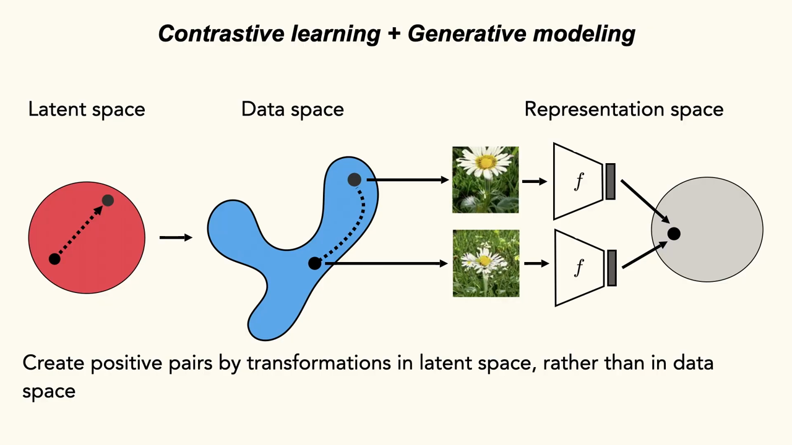
*▲ 강의 슬라이드 [46:31](https://youtu.be/RUdQMHV-7KM?t=2791): 데이터 공간이 아니라 잠재 공간에서의 변환으로 [양성 쌍](00_%EB%94%A5%EB%9F%AC%EB%8B%9D_%EC%9A%A9%EC%96%B4%EC%82%AC%EC%A0%84.md#positive-pair-negative-pair-%EC%96%91%EC%84%B1-%EC%8C%8D%EA%B3%BC-%EC%9D%8C%EC%84%B1-%EC%8C%8D)을 만든다. [잠재 공간](00_%EB%94%A5%EB%9F%AC%EB%8B%9D_%EC%9A%A9%EC%96%B4%EC%82%AC%EC%A0%84.md#latent-space-%EC%9E%A0%EC%9E%AC-%EA%B3%B5%EA%B0%84)의 짧은 직선이 [데이터 다양체](00_%EB%94%A5%EB%9F%AC%EB%8B%9D_%EC%9A%A9%EC%96%B4%EC%82%AC%EC%A0%84.md#data-manifold-%EB%8D%B0%EC%9D%B4%ED%84%B0-%EB%8B%A4%EC%96%91%EC%B2%B4) 위의 길로 옮겨지고, 두 이미지가 인코더 $f$를 거쳐 표현 공간에서 가까워지도록 [학습](00_%EB%94%A5%EB%9F%AC%EB%8B%9D_%EC%9A%A9%EC%96%B4%EC%82%AC%EC%A0%84.md#training-%ED%95%99%EC%8A%B5)한다*

질의응답 정리 [43:50](https://youtu.be/RUdQMHV-7KM?t=2630)

- **2차원 [잠재 공간](00_%EB%94%A5%EB%9F%AC%EB%8B%9D_%EC%9A%A9%EC%96%B4%EC%82%AC%EC%A0%84.md#latent-space-%EC%9E%A0%EC%9E%AC-%EA%B3%B5%EA%B0%84)에서 10범주 분류라면 피자 조각 같은 경계가 반드시 어딘가 있을 텐데, 고차원이라 경계를 넘을 [확률](00_%EB%94%A5%EB%9F%AC%EB%8B%9D_%EC%9A%A9%EC%96%B4%EC%82%AC%EC%A0%84.md#probability-%ED%99%95%EB%A5%A0)이 아주 작다는 확률적 논리인가?** 강사는 더 나아가, 대부분의 경우 경계를 넘지 않는다면 가끔 넘더라도 잡음처럼 상쇄되어 일종의 [규제](00_%EB%94%A5%EB%9F%AC%EB%8B%9D_%EC%9A%A9%EC%96%B4%EC%82%AC%EC%A0%84.md#regularization-%EA%B7%9C%EC%A0%9C)가 된다고 봅니다. 물론 경계가 얼마나 심하게, 얼마나 자주 넘어지는지에 달려 있습니다. "조금 움직여도 범주가 유지되는 영역"과 "경계를 넘는 영역"의 넓이 비가 충분히 크면, 가끔 틀려도 쓸모 있는 것을 배울 것입니다. 보통의 [대조 학습](00_%EB%94%A5%EB%9F%AC%EB%8B%9D_%EC%9A%A9%EC%96%B4%EC%82%AC%EC%A0%84.md#contrastive-learning-%EB%8C%80%EC%A1%B0-%ED%95%99%EC%8A%B5)에서도 한 배치에 개 사진이 둘 있으면 둘이 음성 쌍으로 취급됩니다(거짓 음성). 지도 정보로 이를 없애면 [더 잘 배우지만](00_%EB%94%A5%EB%9F%AC%EB%8B%9D_%EC%9A%A9%EC%96%B4%EC%82%AC%EC%A0%84.md#supervised-contrastive-learning-%EC%A7%80%EB%8F%84-%EB%8C%80%EC%A1%B0-%ED%95%99%EC%8A%B5), 그런 오류가 있어도 쓸모 있는 표현은 배워집니다.

**결과** (ImageNet-1000 선형 전이 top-1 [정확도](00_%EB%94%A5%EB%9F%AC%EB%8B%9D_%EC%9A%A9%EC%96%B4%EC%82%AC%EC%A0%84.md#accuracy-%EC%A0%95%ED%99%95%EB%8F%84), [선형 탐침](00_%EB%94%A5%EB%9F%AC%EB%8B%9D_%EC%9A%A9%EC%96%B4%EC%82%AC%EC%A0%84.md#probe-linear-probe-%ED%83%90%EC%B9%A8%EA%B3%BC-%EC%84%A0%ED%98%95-%ED%83%90%EC%B9%A8))

| [학습 데이터](00_%EB%94%A5%EB%9F%AC%EB%8B%9D_%EC%9A%A9%EC%96%B4%EC%82%AC%EC%A0%84.md#training-data-test-data-%ED%95%99%EC%8A%B5-%EB%8D%B0%EC%9D%B4%ED%84%B0%EC%99%80-%EC%8B%9C%ED%97%98-%EB%8D%B0%EC%9D%B4%ED%84%B0) | top-1 |
|---|---|
| 실제 데이터로 [대조 학습](00_%EB%94%A5%EB%9F%AC%EB%8B%9D_%EC%9A%A9%EC%96%B4%EC%82%AC%EC%A0%84.md#contrastive-learning-%EB%8C%80%EC%A1%B0-%ED%95%99%EC%8A%B5) ([SimCLR](00_%EB%94%A5%EB%9F%AC%EB%8B%9D_%EC%9A%A9%EC%96%B4%EC%82%AC%EC%A0%84.md#simclr-simclr-%EB%8C%80%EC%A1%B0-%ED%95%99%EC%8A%B5) 등) | 43.9% |
| 생성 데이터, 데이터 공간 변환만 | 35.7% |
| 생성 데이터, 잠재 변환 + 데이터 공간 변환 | 42.6% |

- 잠재 변환을 더하면 35.7%에서 42.6%로 **6.9%p** 오릅니다. 그래도 실제 데이터(43.9%)보다 1.3%p 낮습니다. [생성 모델](00_%EB%94%A5%EB%9F%AC%EB%8B%9D_%EC%9A%A9%EC%96%B4%EC%82%AC%EC%A0%84.md#generative-model-%EC%83%9D%EC%84%B1-%EB%AA%A8%EB%8D%B8)이라는 [정보 병목](00_%EB%94%A5%EB%9F%AC%EB%8B%9D_%EC%9A%A9%EC%96%B4%EC%82%AC%EC%A0%84.md#bottleneck-%EB%B3%91%EB%AA%A9)을 거치는 한계가 있지만, [잠재 공간](00_%EB%94%A5%EB%9F%AC%EB%8B%9D_%EC%9A%A9%EC%96%B4%EC%82%AC%EC%A0%84.md#latent-space-%EC%9E%A0%EC%9E%AC-%EA%B3%B5%EA%B0%84)의 변화 요인이 큰 가치를 더한다는 뜻입니다.
- 논문의 결론: 생성 시점(viewpoint 같은 변화 요인)은 표준 [데이터 증강](00_%EB%94%A5%EB%9F%AC%EB%8B%9D_%EC%9A%A9%EC%96%B4%EC%82%AC%EC%A0%84.md#data-augmentation-%EB%8D%B0%EC%9D%B4%ED%84%B0-%EC%A6%9D%EA%B0%95)만 쓸 때보다 [대조 학습](00_%EB%94%A5%EB%9F%AC%EB%8B%9D_%EC%9A%A9%EC%96%B4%EC%82%AC%EC%A0%84.md#contrastive-learning-%EB%8C%80%EC%A1%B0-%ED%95%99%EC%8A%B5)을 개선하고, **[생성 모델](00_%EB%94%A5%EB%9F%AC%EB%8B%9D_%EC%9A%A9%EC%96%B4%EC%82%AC%EC%A0%84.md#generative-model-%EC%83%9D%EC%84%B1-%EB%AA%A8%EB%8D%B8)의 품질이 높으면** 실제 데이터로 배우는 것보다 나을 수도 있다. 다만 흔치 않은 것들에서는 [생성기](00_%EB%94%A5%EB%9F%AC%EB%8B%9D_%EC%9A%A9%EC%96%B4%EC%82%AC%EC%A0%84.md#generator-discriminator-%EC%83%9D%EC%84%B1%EA%B8%B0%EC%99%80-%ED%8C%90%EB%B3%84%EA%B8%B0)의 품질이 높지 않습니다.

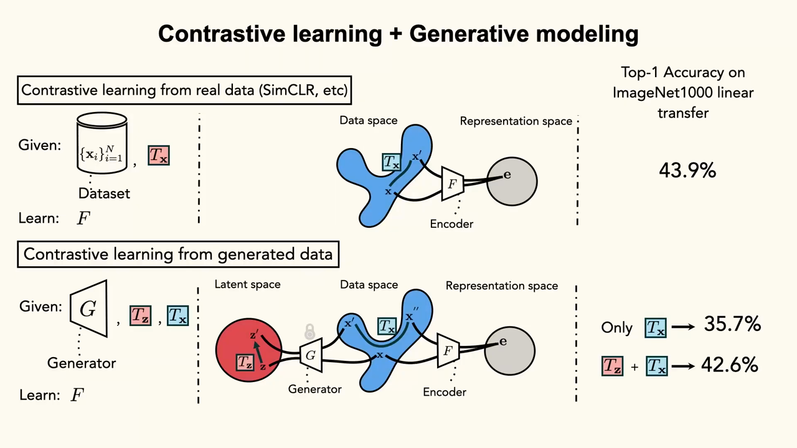
*▲ 강의 슬라이드 [57:10](https://youtu.be/RUdQMHV-7KM?t=3430): 실제 데이터 [대조 학습](00_%EB%94%A5%EB%9F%AC%EB%8B%9D_%EC%9A%A9%EC%96%B4%EC%82%AC%EC%A0%84.md#contrastive-learning-%EB%8C%80%EC%A1%B0-%ED%95%99%EC%8A%B5)(43.9%)과 생성 데이터 [대조 학습](00_%EB%94%A5%EB%9F%AC%EB%8B%9D_%EC%9A%A9%EC%96%B4%EC%82%AC%EC%A0%84.md#contrastive-learning-%EB%8C%80%EC%A1%B0-%ED%95%99%EC%8A%B5)(데이터 변환만 35.7%, 잠재 변환을 더하면 42.6%)*

> [!TIP]
> **🆕 2026 업데이트: 합성 이미지만으로 실제 데이터에 근접**
> - **강의**: 생성 데이터로 배운 표현은 실제 데이터에 아직 못 미친다(ImageNet 선형 전이 42.6% 대 43.9%, ICLR 2022의 작은 설정).
> - **현재**: SynCLR(CVPR 2024)은 대형 [언어 모델](00_%EB%94%A5%EB%9F%AC%EB%8B%9D_%EC%9A%A9%EC%96%B4%EC%82%AC%EC%A0%84.md#language-model-%EC%96%B8%EC%96%B4-%EB%AA%A8%EB%8D%B8)로 이미지 설명 1억 5천만 개를 지어내고, 글→이미지 모델로 설명마다 여러 장, 모두 6억 장의 **[합성 이미지](00_%EB%94%A5%EB%9F%AC%EB%8B%9D_%EC%9A%A9%EC%96%B4%EC%82%AC%EC%A0%84.md#synthetic-data-%ED%95%A9%EC%84%B1-%EB%8D%B0%EC%9D%B4%ED%84%B0)**를 만들어 실제 이미지를 하나도 보지 않고 [대조 학습](00_%EB%94%A5%EB%9F%AC%EB%8B%9D_%EC%9A%A9%EC%96%B4%EC%82%AC%EC%A0%84.md#contrastive-learning-%EB%8C%80%EC%A1%B0-%ED%95%99%EC%8A%B5)했다. 같은 설명에서 나온 이미지끼리를 [양성 쌍](00_%EB%94%A5%EB%9F%AC%EB%8B%9D_%EC%9A%A9%EC%96%B4%EC%82%AC%EC%A0%84.md#positive-pair-negative-pair-%EC%96%91%EC%84%B1-%EC%8C%8D%EA%B3%BC-%EC%9D%8C%EC%84%B1-%EC%8C%8D)으로 쓴다. ImageNet 선형 [탐침](00_%EB%94%A5%EB%9F%AC%EB%8B%9D_%EC%9A%A9%EC%96%B4%EC%82%AC%EC%A0%84.md#probe-linear-probe-%ED%83%90%EC%B9%A8%EA%B3%BC-%EC%84%A0%ED%98%95-%ED%83%90%EC%B9%A8)에서 ViT-L/14가 83.0%로, 실제 이미지-글 쌍으로 배운 [CLIP](00_%EB%94%A5%EB%9F%AC%EB%8B%9D_%EC%9A%A9%EC%96%B4%EC%82%AC%EC%A0%84.md#clip-%ED%81%B4%EB%A6%BD) ViT-L/14(83.9%)에 근접했다(같은 표에서 DINOv2 85.7%). 강의의 "[생성 모델](00_%EB%94%A5%EB%9F%AC%EB%8B%9D_%EC%9A%A9%EC%96%B4%EC%82%AC%EC%A0%84.md#generative-model-%EC%83%9D%EC%84%B1-%EB%AA%A8%EB%8D%B8)의 품질이 높으면"이라는 조건이 대규모로 시험된 셈이다.
> - **출처**: [Tian 등, Learning Vision from Models Rivals Learning Vision from Data (CVPR 2024)](https://arxiv.org/abs/2312.17742)

### 6.3 다양성과 충실도

▶ 영상 [47:08](https://youtu.be/RUdQMHV-7KM?t=2828)

- [학습](00_%EB%94%A5%EB%9F%AC%EB%8B%9D_%EC%9A%A9%EC%96%B4%EC%82%AC%EC%A0%84.md#training-%ED%95%99%EC%8A%B5) 신호로서는 **서로 아주 다른 두 장이 같은 것**이라는 정보가, 거의 똑같은 두 장이 같은 것이라는 정보보다 쓸모 있습니다. 강사가 보여 준 잠재 시점의 아메리카울새 사진들은 자세, 구도, 방향이 거의 같아 다양성이 적습니다. 무작위 뒤집기 같은 증강보다 [학습](00_%EB%94%A5%EB%9F%AC%EB%8B%9D_%EC%9A%A9%EC%96%B4%EC%82%AC%EC%A0%84.md#training-%ED%95%99%EC%8A%B5) 신호가 약할 수도 있습니다.
- [GAN](00_%EB%94%A5%EB%9F%AC%EB%8B%9D_%EC%9A%A9%EC%96%B4%EC%82%AC%EC%A0%84.md#gan-generative-adversarial-network-%EC%83%9D%EC%84%B1%EC%A0%81-%EC%A0%81%EB%8C%80-%EC%8B%A0%EA%B2%BD%EB%A7%9D), [확산 모델](00_%EB%94%A5%EB%9F%AC%EB%8B%9D_%EC%9A%A9%EC%96%B4%EC%82%AC%EC%A0%84.md#diffusion-model-%ED%99%95%EC%82%B0-%EB%AA%A8%EB%8D%B8), 개인화 [생성 모델](00_%EB%94%A5%EB%9F%AC%EB%8B%9D_%EC%9A%A9%EC%96%B4%EC%82%AC%EC%A0%84.md#generative-model-%EC%83%9D%EC%84%B1-%EB%AA%A8%EB%8D%B8) 모두 **[다양성과 충실도](00_%EB%94%A5%EB%9F%AC%EB%8B%9D_%EC%9A%A9%EC%96%B4%EC%82%AC%EC%A0%84.md#diversity-fidelity-tradeoff-%EB%8B%A4%EC%96%91%EC%84%B1-%EC%B6%A9%EC%8B%A4%EB%8F%84-%ED%8A%B8%EB%A0%88%EC%9D%B4%EB%93%9C%EC%98%A4%ED%94%84)** 사이에 일종의 파레토 경계가 있습니다. 장면이나 맥락을 다양하게(다른 자세, 나는 모습) 만들게 하면 더 이상 그 울새 같지 않게 됩니다.

질의응답 정리 [48:52](https://youtu.be/RUdQMHV-7KM?t=2932)

- **[잠재 공간](00_%EB%94%A5%EB%9F%AC%EB%8B%9D_%EC%9A%A9%EC%96%B4%EC%82%AC%EC%A0%84.md#latent-space-%EC%9E%A0%EC%9E%AC-%EA%B3%B5%EA%B0%84)에서 얼마나 멀리 가도 같은 범주인가? 그 거리는 범주마다 같은가? (어떤 범주는 데이터가 훨씬 많을 텐데)** 많은 논문은 이것을 [하이퍼파라미터](00_%EB%94%A5%EB%9F%AC%EB%8B%9D_%EC%9A%A9%EC%96%B4%EC%82%AC%EC%A0%84.md#hyperparameter-%ED%95%98%EC%9D%B4%ED%8D%BC%ED%8C%8C%EB%9D%BC%EB%AF%B8%ED%84%B0)로 둡니다. [코사인 거리](00_%EB%94%A5%EB%9F%AC%EB%8B%9D_%EC%9A%A9%EC%96%B4%EC%82%AC%EC%A0%84.md#cosine-similarity-%EC%BD%94%EC%82%AC%EC%9D%B8-%EC%9C%A0%EC%82%AC%EB%8F%84) 같은 것으로 반지름을 정하고 그 안에서 뽑은 뒤, 여러 반지름을 시험해 [시험 데이터](00_%EB%94%A5%EB%9F%AC%EB%8B%9D_%EC%9A%A9%EC%96%B4%EC%82%AC%EC%A0%84.md#training-data-test-data-%ED%95%99%EC%8A%B5-%EB%8D%B0%EC%9D%B4%ED%84%B0%EC%99%80-%EC%8B%9C%ED%97%98-%EB%8D%B0%EC%9D%B4%ED%84%B0)에서 가장 좋은 것을 고릅니다. 강사는 이것이 아쉽다고 합니다. "경계를 넘기 전까지 얼마나 갈 수 있나"는 정말 흥미로운 질문이기 때문입니다.
- **세 눈의 엄마**: 모델이 실제처럼 보이지만 불가능한 것을 만들 수 있게 되면서 문제가 복잡해집니다. 엄마 사진에 이마 한가운데 눈을 하나 더 그리면 그래도 엄마일까요? [정답](00_%EB%94%A5%EB%9F%AC%EB%8B%9D_%EC%9A%A9%EC%96%B4%EC%82%AC%EC%A0%84.md#label-%EC%A0%95%EB%8B%B5)은 없습니다(강사와 Phil도 이것으로 자주 다툰다고 합니다). 아메리카울새의 붉은 가슴을 회색으로 바꾸면 실제로 없는 새가 됩니다. 범주의 경계를 정하려면 그 범주의 **실제 변화 요인을 모두 담은 대표 데이터**가 있어야 합니다. [퓨샷 학습](00_%EB%94%A5%EB%9F%AC%EB%8B%9D_%EC%9A%A9%EC%96%B4%EC%82%AC%EC%A0%84.md#few-shot-learning-zero-shot-learning-%ED%93%A8%EC%83%B7-%ED%95%99%EC%8A%B5%EA%B3%BC-%EC%A0%9C%EB%A1%9C%EC%83%B7-%ED%95%99%EC%8A%B5)이 어려운 이유도 그것입니다. 어린 새의 사진을 본 적이 없으면 경계를 모릅니다.
- **이것은 [분류](00_%EB%94%A5%EB%9F%AC%EB%8B%9D_%EC%9A%A9%EC%96%B4%EC%82%AC%EC%A0%84.md#regression-classification-%ED%9A%8C%EA%B7%80%EC%99%80-%EB%B6%84%EB%A5%98)라는 목표 자체의 한계 아닌가? 글 설명과 이미지를 가깝게 [임베딩](00_%EB%94%A5%EB%9F%AC%EB%8B%9D_%EC%9A%A9%EC%96%B4%EC%82%AC%EC%A0%84.md#embedding-%EC%9E%84%EB%B2%A0%EB%94%A9)하는 [CLIP](00_%EB%94%A5%EB%9F%AC%EB%8B%9D_%EC%9A%A9%EC%96%B4%EC%82%AC%EC%A0%84.md#clip-%ED%81%B4%EB%A6%BD)이 더 나은 생각 아닌가? (알비노 울새도 사람은 울새로 안다)** 철학에는 "대상을 속성 목록으로 정의할 수 있나"를 두고 오래된 논쟁이 있습니다. 울새를 "검은 얼굴, 붉은 가슴, 노란 발, 둥근 몸, 검은 동공의 노란 눈을 가진 새"로 정의하는 식입니다. 강사는 이것이 어떤 면에서 [CLIP](00_%EB%94%A5%EB%9F%AC%EB%8B%9D_%EC%9A%A9%EC%96%B4%EC%82%AC%EC%A0%84.md#clip-%ED%81%B4%EB%A6%BD)의 접근(글의 의미 개념과 이미지 부분을 잇기)이라고 봅니다. 하지만 고정된 속성 목록으로 범주를 정하면 늘 그것을 깨는 반례를 찾을 수 있습니다. 또 경계를 어디에 그을지는 목적에 달려 있습니다. 초록·빨강 사과와 초록·빨강 피망은 색으로도 종류로도 나눌 수 있습니다. 결국 "표현 공간이 무엇을 해 주기를 원하나"의 문제이고, 알비노 울새는 사람이 잘 [일반화](00_%EB%94%A5%EB%9F%AC%EB%8B%9D_%EC%9A%A9%EC%96%B4%EC%82%AC%EC%A0%84.md#generalization-%EC%9D%BC%EB%B0%98%ED%99%94)하지만 [CLIP](00_%EB%94%A5%EB%9F%AC%EB%8B%9D_%EC%9A%A9%EC%96%B4%EC%82%AC%EC%A0%84.md#clip-%ED%81%B4%EB%A6%BD) 같은 모델은 아직 잘 못 하는 예라고 강사는 말합니다.

### 6.4 생성 모델의 사전 지식은 깨기 어렵다

▶ 영상 [57:54](https://youtu.be/RUdQMHV-7KM?t=3474)

- [생성 모델](00_%EB%94%A5%EB%9F%AC%EB%8B%9D_%EC%9A%A9%EC%96%B4%EC%82%AC%EC%A0%84.md#generative-model-%EC%83%9D%EC%84%B1-%EB%AA%A8%EB%8D%B8)에게 사전 지식(prior)을 벗어나게 해 보면 재미있습니다. "oriole(꾀꼬리)"을 그리라고 하면 야구 선수가 나옵니다(볼티모어 오리올스). 데이터가 의미 사전 지식을 비튼 것입니다. **부리가 짧은 투칸**은 아무리 해도 잘 안 그립니다. "투칸"이라는 개념이 형태 지시를 압도합니다.
- 강사의 관찰: 모델은 **형태보다 질감**을 훨씬 잘 바꿉니다. "털이 난 야구공"은 잘 그리지만 "별 모양 야구공"은 어렵습니다. 범주마다 강한 **형태 사전 지식**을 배운 것으로 보입니다.
- **인스턴스 증강 생성**(ECCV 2024): 실제 장면 구조를 고정하고(장면 전체는 실제 그대로) 물체 하나하나를 마스크로 가린 뒤, 데이터셋의 **다른 인스턴스**(예: 데이터셋 속 다른 개)로 개인화한 [생성기](00_%EB%94%A5%EB%9F%AC%EB%8B%9D_%EC%9A%A9%EC%96%B4%EC%82%AC%EC%A0%84.md#generator-discriminator-%EC%83%9D%EC%84%B1%EA%B8%B0%EC%99%80-%ED%8C%90%EB%B3%84%EA%B8%B0)로 그 자리를 다시 그립니다. 장면 구조와 개별 물체 사이의 상관을 현실적으로 끊어 좋은 결과를 얻었습니다. 그런데 형태 문제가 또 나옵니다. "새"가 한 범주라서, 작고 둥근 새의 자리에 독수리의 질감을 억지로 구겨 넣기도 합니다. 라벨 범주가 더 세밀했다면 생기지 않았을 일로, 사람이 정한 범주 안의 형태 변화에 대한 숨은 가정이 드러난 예입니다.

---

## 7. 정리: 데이터++

▶ 영상 [60:37](https://youtu.be/RUdQMHV-7KM?t=3637)

- [암묵적 생성 모델](00_%EB%94%A5%EB%9F%AC%EB%8B%9D_%EC%9A%A9%EC%96%B4%EC%82%AC%EC%A0%84.md#implicit-generative-model-%EC%95%94%EB%AC%B5%EC%A0%81-%EC%83%9D%EC%84%B1-%EB%AA%A8%EB%8D%B8)([Implicit generative model](00_%EB%94%A5%EB%9F%AC%EB%8B%9D_%EC%9A%A9%EC%96%B4%EC%82%AC%EC%A0%84.md#implicit-generative-model-%EC%95%94%EB%AC%B5%EC%A0%81-%EC%83%9D%EC%84%B1-%EB%AA%A8%EB%8D%B8))에서 뽑은 표본은 **기능이 더 붙은 데이터**(데이터++)처럼 쓸 수 있습니다. [보간](00_%EB%94%A5%EB%9F%AC%EB%8B%9D_%EC%9A%A9%EC%96%B4%EC%82%AC%EC%A0%84.md#interpolation-%EB%B3%B4%EA%B0%84), [외삽](00_%EB%94%A5%EB%9F%AC%EB%8B%9D_%EC%9A%A9%EC%96%B4%EC%82%AC%EC%A0%84.md#extrapolation-%EC%99%B8%EC%82%BD), 조작, 합성, 최적화, 라벨 붙이기 같은 연산을 정의할 수 있습니다.
- "보통 데이터로 할 수 있는 것은 모두 데이터++로도 해 볼 수 있다. 더 잘 될 수도 있다." 다만 그 잠재력을 얻으려면 **적은 데이터로도 배우는 [생성기](00_%EB%94%A5%EB%9F%AC%EB%8B%9D_%EC%9A%A9%EC%96%B4%EC%82%AC%EC%A0%84.md#generator-discriminator-%EC%83%9D%EC%84%B1%EA%B8%B0%EC%99%80-%ED%8C%90%EB%B3%84%EA%B8%B0)**와, 이것들이 어떻게 배워지는지에 대한 더 나은 이해가 필요합니다.

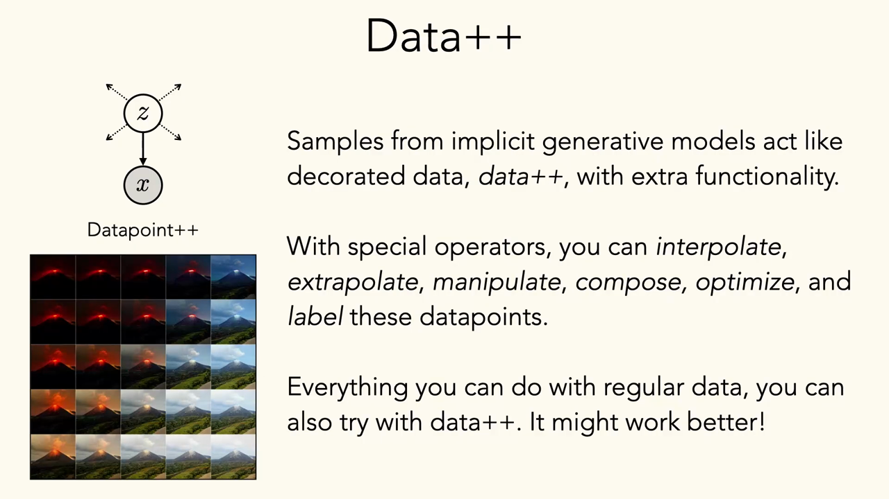
*▲ 강의 슬라이드 [61:40](https://youtu.be/RUdQMHV-7KM?t=3700): 데이터++ 정리. 데이터점 $x$ 대신 $z \to x$를 데이터점으로 보면 [보간](00_%EB%94%A5%EB%9F%AC%EB%8B%9D_%EC%9A%A9%EC%96%B4%EC%82%AC%EC%A0%84.md#interpolation-%EB%B3%B4%EA%B0%84), [외삽](00_%EB%94%A5%EB%9F%AC%EB%8B%9D_%EC%9A%A9%EC%96%B4%EC%82%AC%EC%A0%84.md#extrapolation-%EC%99%B8%EC%82%BD), 조작, 합성, 최적화, 라벨 붙이기를 할 수 있다*

질의응답 정리 [61:48](https://youtu.be/RUdQMHV-7KM?t=3708)

- **데이터가 너무 커서 다 볼 수 없을 때, "어두움 = 화산 분화" 같은 [편향](00_%EB%94%A5%EB%9F%AC%EB%8B%9D_%EC%9A%A9%EC%96%B4%EC%82%AC%EC%A0%84.md#bias-%ED%8E%B8%ED%96%A5)은 어떻게 찾나?** Dataset Interfaces처럼 글로 생성 시스템과 상호작용해, 데이터를 일일이 보지 않고 [편향](00_%EB%94%A5%EB%9F%AC%EB%8B%9D_%EC%9A%A9%EC%96%B4%EC%82%AC%EC%A0%84.md#bias-%ED%8E%B8%ED%96%A5)을 효율적으로 조사하는 방법들이 있습니다.
- **다양성과 충실도 중 무엇을 우선하나? 작은 새 몸에 독수리 특징을 넣은 그림은 불가능한 것까지 배우게 해 [시험 데이터](00_%EB%94%A5%EB%9F%AC%EB%8B%9D_%EC%9A%A9%EC%96%B4%EC%82%AC%EC%A0%84.md#training-data-test-data-%ED%95%99%EC%8A%B5-%EB%8D%B0%EC%9D%B4%ED%84%B0%EC%99%80-%EC%8B%9C%ED%97%98-%EB%8D%B0%EC%9D%B4%ED%84%B0) 성능을 올릴 수도 있지만, 충실도에서는 멀다.** "엄마에게 눈을 하나 더 그렸더니 실제 엄마 사진을 더 잘 알아본다면 그게 문제인가?"와 같은 질문이라고 강사는 말합니다. [분류](00_%EB%94%A5%EB%9F%AC%EB%8B%9D_%EC%9A%A9%EC%96%B4%EC%82%AC%EC%A0%84.md#regression-classification-%ED%9A%8C%EA%B7%80%EC%99%80-%EB%B6%84%EB%A5%98) 모델을 가이던스로 써서 세밀한 새 종도 정확히 생성하는 연구가 있지만, 그러면 그 분류기에 맞춰진 [생성기](00_%EB%94%A5%EB%9F%AC%EB%8B%9D_%EC%9A%A9%EC%96%B4%EC%82%AC%EC%A0%84.md#generator-discriminator-%EC%83%9D%EC%84%B1%EA%B8%B0%EC%99%80-%ED%8C%90%EB%B3%84%EA%B8%B0)가 되어 비현실적인 공간으로 분류기의 경계를 따라가게 됩니다. 예를 들어 까마귀 질감을 입힌 빅풋 그림을 넣었더니 까마귀 성능이 올랐습니다. 고정된 [시험 데이터](00_%EB%94%A5%EB%9F%AC%EB%8B%9D_%EC%9A%A9%EC%96%B4%EC%82%AC%EC%A0%84.md#training-data-test-data-%ED%95%99%EC%8A%B5-%EB%8D%B0%EC%9D%B4%ED%84%B0%EC%99%80-%EC%8B%9C%ED%97%98-%EB%8D%B0%EC%9D%B4%ED%84%B0)에서 지표를 올리는 데는 능숙하지만, 열린 실제 세계에서도 나아질지는 따지기 어렵습니다. 실제로는 작은 독수리처럼 생긴 다른 것을 만날 수도 있기 때문입니다. 무엇이 쓸모 있는 데이터인지는 과제와 목적에 달려 있습니다.
- **이 주제의 최전선이 이미지 분야인가, 설명하기 쉬워서 이미지를 보여 주는 것인가?** 글을 생성해 [데이터 증강](00_%EB%94%A5%EB%9F%AC%EB%8B%9D_%EC%9A%A9%EC%96%B4%EC%82%AC%EC%A0%84.md#data-augmentation-%EB%8D%B0%EC%9D%B4%ED%84%B0-%EC%A6%9D%EA%B0%95)으로 쓰는 연구도 분명히 있지만 글에서는 범주 경계를 정하기가 더 어렵습니다(노래라면 더 모호합니다). 글, 소리 등 많은 모달리티에서 생성 데이터로 학습하는 연구가 있습니다. 고전적으로는 **의료 영상**에서 실제 데이터가 아주 적어 정성껏 만든 합성기가 꽤 효과적이었습니다.

---

## 8. 생성 데이터로 학습할 때의 위험: 모델 붕괴

▶ 영상 [66:19](https://youtu.be/RUdQMHV-7KM?t=3979)

📐 **수학 개념**: [반복 적합과 모델 붕괴](%EC%88%98%ED%95%99%EA%B0%9C%EB%85%90/12_%EA%B0%95%EA%B1%B4%EC%84%B1%EA%B3%BC_%EC%A0%84%EC%9D%B4/MM71_%EB%B0%98%EB%B3%B5_%EC%A0%81%ED%95%A9%EA%B3%BC_%EB%AA%A8%EB%8D%B8_%EB%B6%95%EA%B4%B4.md) · [KL 발산과 최대 우도](%EC%88%98%ED%95%99%EA%B0%9C%EB%85%90/04_%ED%99%95%EB%A5%A0%EA%B3%BC_%EC%A0%95%EB%B3%B4/MM51_KL_%EB%B0%9C%EC%82%B0%EA%B3%BC_%EC%B5%9C%EB%8C%80_%EC%9A%B0%EB%8F%84.md)

- 지금 더 큰 논쟁은 **[모델 붕괴](00_%EB%94%A5%EB%9F%AC%EB%8B%9D_%EC%9A%A9%EC%96%B4%EC%82%AC%EC%A0%84.md#model-collapse-%EB%AA%A8%EB%8D%B8-%EB%B6%95%EA%B4%B4)**(model collapse, manifold collapse)입니다. 인터넷의 글이 점점 생성된 글로 채워지고 있으므로 현실적인 걱정입니다.
- 생성 데이터의 비율이 실제 데이터보다 커지면 **악순환**이 됩니다. 생성 데이터는 [우도](00_%EB%94%A5%EB%9F%AC%EB%8B%9D_%EC%9A%A9%EC%96%B4%EC%82%AC%EC%A0%84.md#likelihood-%EC%9A%B0%EB%8F%84)가 높은(흔한) 쪽으로 치우치므로, 실제 데이터에 있던 분포의 일부(특히 드문 부분)를 잃어 갑니다. "생성 데이터로 학습한 모델은 어떻게 되나, 어떤 실패가 생기나"는 지금 활발한 연구 주제입니다.
- [MM71_반복_적합과_모델_붕괴](%EC%88%98%ED%95%99%EA%B0%9C%EB%85%90/12_%EA%B0%95%EA%B1%B4%EC%84%B1%EA%B3%BC_%EC%A0%84%EC%9D%B4/MM71_%EB%B0%98%EB%B3%B5_%EC%A0%81%ED%95%A9%EA%B3%BC_%EB%AA%A8%EB%8D%B8_%EB%B6%95%EA%B4%B4.md)의 가장 단순한 모형: 10개씩 [정규분포](00_%EB%94%A5%EB%9F%AC%EB%8B%9D_%EC%9A%A9%EC%96%B4%EC%82%AC%EC%A0%84.md#normal-distribution-%EC%A0%95%EA%B7%9C%EB%B6%84%ED%8F%AC)를 맞추고 그 분포에서 뽑아 다시 맞추기를 되풀이하면, [분산](00_%EB%94%A5%EB%9F%AC%EB%8B%9D_%EC%9A%A9%EC%96%B4%EC%82%AC%EC%A0%84.md#variance-%EB%B6%84%EC%82%B0)이 평균적으로 매번 0.9배가 되어 10번 뒤 0.3487이 되고, $|x| > 2$인 드문 사례의 [확률](00_%EB%94%A5%EB%9F%AC%EB%8B%9D_%EC%9A%A9%EC%96%B4%EC%82%AC%EC%A0%84.md#probability-%ED%99%95%EB%A5%A0)은 4.55%에서 0.07%로 줄어듭니다. 실제 데이터를 버리지 않고 생성 데이터를 쌓아 쓰면 0.85 근처에서 멈춥니다.

*▲ 직접 그린 그림: 왼쪽은 생성 데이터로 바꿔 쓰기(빨강)와 쌓아 쓰기(파랑)에서 [분산](00_%EB%94%A5%EB%9F%AC%EB%8B%9D_%EC%9A%A9%EC%96%B4%EC%82%AC%EC%A0%84.md#variance-%EB%B6%84%EC%82%B0)의 변화($n = 10$, 2만 번 평균, 이론 $0.9^k$). 오른쪽은 [분산](00_%EB%94%A5%EB%9F%AC%EB%8B%9D_%EC%9A%A9%EC%96%B4%EC%82%AC%EC%A0%84.md#variance-%EB%B6%84%EC%82%B0) 1과 10번 뒤 0.3487인 분포의 꼬리 $|x| > 2$ ([MM71_반복_적합과_모델_붕괴](%EC%88%98%ED%95%99%EA%B0%9C%EB%85%90/12_%EA%B0%95%EA%B1%B4%EC%84%B1%EA%B3%BC_%EC%A0%84%EC%9D%B4/MM71_%EB%B0%98%EB%B3%B5_%EC%A0%81%ED%95%A9%EA%B3%BC_%EB%AA%A8%EB%8D%B8_%EB%B6%95%EA%B4%B4.md)의 숫자)*

> [!TIP]
> **🆕 2026 업데이트: [모델 붕괴](00_%EB%94%A5%EB%9F%AC%EB%8B%9D_%EC%9A%A9%EC%96%B4%EC%82%AC%EC%A0%84.md#model-collapse-%EB%AA%A8%EB%8D%B8-%EB%B6%95%EA%B4%B4)는 "바꿔 쓰기"에서 생긴다**
> - **강의**: 생성 데이터가 실제 데이터보다 많아지면 악순환으로 분포의 일부를 잃는다는 연구가 있고, 활발히 연구 중이다.
> - **현재**: Shumailov 등(Nature, 2024년 7월)은 모델이 만든 데이터를 가리지 않고 다음 모델 [학습](00_%EB%94%A5%EB%9F%AC%EB%8B%9D_%EC%9A%A9%EC%96%B4%EC%82%AC%EC%A0%84.md#training-%ED%95%99%EC%8A%B5)에 쓰면 원래 분포의 **꼬리가 사라지는** 되돌릴 수 없는 결함이 생긴다는 것을 [언어 모델](00_%EB%94%A5%EB%9F%AC%EB%8B%9D_%EC%9A%A9%EC%96%B4%EC%82%AC%EC%A0%84.md#language-model-%EC%96%B8%EC%96%B4-%EB%AA%A8%EB%8D%B8), [VAE](00_%EB%94%A5%EB%9F%AC%EB%8B%9D_%EC%9A%A9%EC%96%B4%EC%82%AC%EC%A0%84.md#variational-autoencoder-vae-%EB%B3%80%EB%B6%84-%EC%98%A4%ED%86%A0%EC%9D%B8%EC%BD%94%EB%8D%94), [가우스 혼합 모델](00_%EB%94%A5%EB%9F%AC%EB%8B%9D_%EC%9A%A9%EC%96%B4%EC%82%AC%EC%A0%84.md#gaussian-mixture-model-%EA%B0%80%EC%9A%B0%EC%8A%A4-%ED%98%BC%ED%95%A9-%EB%AA%A8%EB%8D%B8)에서 보이고, 사람이 만든 진짜 데이터의 가치가 커진다고 결론지었다. 반면 Gerstgrasser 등(ICML 2024)은 붕괴 실험들이 매 세대 데이터를 **바꿔 쓴다**고 가정한 점을 지적하고, 실제 데이터를 남긴 채 생성 데이터를 **쌓아 가면** [언어 모델](00_%EB%94%A5%EB%9F%AC%EB%8B%9D_%EC%9A%A9%EC%96%B4%EC%82%AC%EC%A0%84.md#language-model-%EC%96%B8%EC%96%B4-%EB%AA%A8%EB%8D%B8), [확산 모델](00_%EB%94%A5%EB%9F%AC%EB%8B%9D_%EC%9A%A9%EC%96%B4%EC%82%AC%EC%A0%84.md#diffusion-model-%ED%99%95%EC%82%B0-%EB%AA%A8%EB%8D%B8), [VAE](00_%EB%94%A5%EB%9F%AC%EB%8B%9D_%EC%9A%A9%EC%96%B4%EC%82%AC%EC%A0%84.md#variational-autoencoder-vae-%EB%B3%80%EB%B6%84-%EC%98%A4%ED%86%A0%EC%9D%B8%EC%BD%94%EB%8D%94)에서 붕괴가 일어나지 않으며 선형 모형에서는 [오차](00_%EB%94%A5%EB%9F%AC%EB%8B%9D_%EC%9A%A9%EC%96%B4%EC%82%AC%EC%A0%84.md#error-%EC%98%A4%EC%B0%A8)가 세대 수와 관계없이 유한하게 묶인다는 것을 보였다. 지금의 합의는 "생성 데이터를 쓰는 것 자체가 아니라, 실제 데이터를 대체하는 것이 위험하다"에 가깝다.
> - **출처**: [Shumailov 등, AI models collapse when trained on recursively generated data (Nature 631, 2024)](https://www.nature.com/articles/s41586-024-07566-y) · [Gerstgrasser 등, Is Model Collapse Inevitable? Breaking the Curse of Recursion by Accumulating Real and Synthetic Data (ICML 2024)](https://arxiv.org/abs/2404.01413)

---

## 9. 배우는 법 배우기: 메타 학습

▶ 영상 [67:25](https://youtu.be/RUdQMHV-7KM?t=4045)

📐 **수학 개념**: [MAML의 안쪽·바깥쪽 경사하강](%EC%88%98%ED%95%99%EA%B0%9C%EB%85%90/12_%EA%B0%95%EA%B1%B4%EC%84%B1%EA%B3%BC_%EC%A0%84%EC%9D%B4/MM70_MAML%EC%9D%98_%EC%95%88%EC%AA%BD_%EB%B0%94%EA%B9%A5%EC%AA%BD_%EA%B2%BD%EC%82%AC%ED%95%98%EA%B0%95.md) · [야코비안과 연쇄법칙](%EC%88%98%ED%95%99%EA%B0%9C%EB%85%90/05_%EC%8B%A0%EA%B2%BD%EB%A7%9D%EC%9D%98_%EA%B3%84%EC%82%B0/MM09_%EC%95%BC%EC%BD%94%EB%B9%84%EC%95%88%EA%B3%BC_%EC%97%B0%EC%87%84%EB%B2%95%EC%B9%99.md) · [SGD와 모멘텀](%EC%88%98%ED%95%99%EA%B0%9C%EB%85%90/05_%EC%8B%A0%EA%B2%BD%EB%A7%9D%EC%9D%98_%EA%B3%84%EC%82%B0/MM08_SGD%EC%99%80_%EB%AA%A8%EB%A9%98%ED%85%80.md)

- 지금까지는 "[전이 학습](00_%EB%94%A5%EB%9F%AC%EB%8B%9D_%EC%9A%A9%EC%96%B4%EC%82%AC%EC%A0%84.md#transfer-learning-%EC%A0%84%EC%9D%B4-%ED%95%99%EC%8A%B5)을 어떻게 하나"였다면, 이제는 **[전이 학습](00_%EB%94%A5%EB%9F%AC%EB%8B%9D_%EC%9A%A9%EC%96%B4%EC%82%AC%EC%A0%84.md#transfer-learning-%EC%A0%84%EC%9D%B4-%ED%95%99%EC%8A%B5)을 잘하는 모델, 빨리 적응하는 모델을 어떻게 배우나**입니다.
- 보통의 [학습](00_%EB%94%A5%EB%9F%AC%EB%8B%9D_%EC%9A%A9%EC%96%B4%EC%82%AC%EC%A0%84.md#training-%ED%95%99%EC%8A%B5): 데이터셋 → 학습기 → [파라미터](00_%EB%94%A5%EB%9F%AC%EB%8B%9D_%EC%9A%A9%EC%96%B4%EC%82%AC%EC%A0%84.md#parameter-%ED%8C%8C%EB%9D%BC%EB%AF%B8%ED%84%B0) $\theta$. 추론: 데이터점 → $f_\theta$ → 예측.
- **[메타 학습](00_%EB%94%A5%EB%9F%AC%EB%8B%9D_%EC%9A%A9%EC%96%B4%EC%82%AC%EC%A0%84.md#meta-learning-%EB%A9%94%ED%83%80-%ED%95%99%EC%8A%B5)**: 그 위에 한 [층](00_%EB%94%A5%EB%9F%AC%EB%8B%9D_%EC%9A%A9%EC%96%B4%EC%82%AC%EC%A0%84.md#layer-%EC%B8%B5)을 더 얹어, **여러 데이터셋**으로 메타 학습기를 학습해 [하이퍼파라미터](00_%EB%94%A5%EB%9F%AC%EB%8B%9D_%EC%9A%A9%EC%96%B4%EC%82%AC%EC%A0%84.md#hyperparameter-%ED%95%98%EC%9D%B4%ED%8D%BC%ED%8C%8C%EB%9D%BC%EB%AF%B8%ED%84%B0) $\psi$(학습기가 어떻게 배울지)를 얻고, 이를 임의의 학습기와 데이터셋에 넘깁니다.

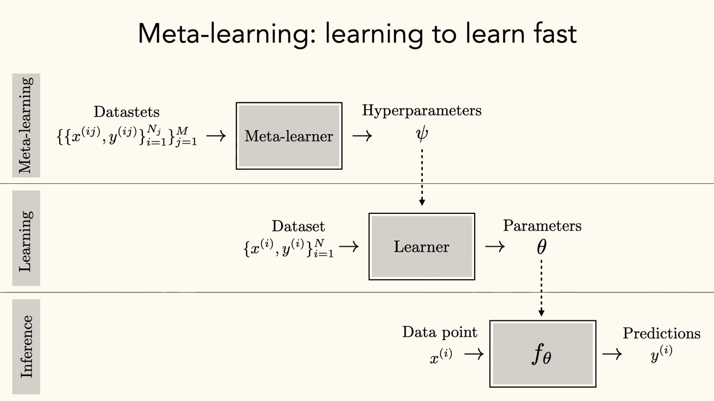
*▲ 강의 슬라이드 [67:50](https://youtu.be/RUdQMHV-7KM?t=4070): [메타 학습](00_%EB%94%A5%EB%9F%AC%EB%8B%9D_%EC%9A%A9%EC%96%B4%EC%82%AC%EC%A0%84.md#meta-learning-%EB%A9%94%ED%83%80-%ED%95%99%EC%8A%B5)(여러 데이터셋 → [하이퍼파라미터](00_%EB%94%A5%EB%9F%AC%EB%8B%9D_%EC%9A%A9%EC%96%B4%EC%82%AC%EC%A0%84.md#hyperparameter-%ED%95%98%EC%9D%B4%ED%8D%BC%ED%8C%8C%EB%9D%BC%EB%AF%B8%ED%84%B0) $\psi$), [학습](00_%EB%94%A5%EB%9F%AC%EB%8B%9D_%EC%9A%A9%EC%96%B4%EC%82%AC%EC%A0%84.md#training-%ED%95%99%EC%8A%B5)(데이터셋 → [파라미터](00_%EB%94%A5%EB%9F%AC%EB%8B%9D_%EC%9A%A9%EC%96%B4%EC%82%AC%EC%A0%84.md#parameter-%ED%8C%8C%EB%9D%BC%EB%AF%B8%ED%84%B0) $\theta$), 추론(데이터점 → 예측)의 세 [층](00_%EB%94%A5%EB%9F%AC%EB%8B%9D_%EC%9A%A9%EC%96%B4%EC%82%AC%EC%A0%84.md#layer-%EC%B8%B5)*

### 9.1 MAML: 잘 적응하는 초기값 배우기

▶ 영상 [68:30](https://youtu.be/RUdQMHV-7KM?t=4110)

- **[MAML](00_%EB%94%A5%EB%9F%AC%EB%8B%9D_%EC%9A%A9%EC%96%B4%EC%82%AC%EC%A0%84.md#maml-model-agnostic-meta-learning-%EB%AA%A8%EB%8D%B8-%EB%AC%B4%EA%B4%80-%EB%A9%94%ED%83%80-%ED%95%99%EC%8A%B5)**(Model-Agnostic Meta-Learning, Finn·Abbeel·Levine 2017): 지금까지의 [전이 학습](00_%EB%94%A5%EB%9F%AC%EB%8B%9D_%EC%9A%A9%EC%96%B4%EC%82%AC%EC%A0%84.md#transfer-learning-%EC%A0%84%EC%9D%B4-%ED%95%99%EC%8A%B5)이 "주어진 사전 모델을 어떻게 빨리 적응시키나"였다면, [MAML](00_%EB%94%A5%EB%9F%AC%EB%8B%9D_%EC%9A%A9%EC%96%B4%EC%82%AC%EC%A0%84.md#maml-model-agnostic-meta-learning-%EB%AA%A8%EB%8D%B8-%EB%AC%B4%EA%B4%80-%EB%A9%94%ED%83%80-%ED%95%99%EC%8A%B5)은 처음으로 "[전이 학습](00_%EB%94%A5%EB%9F%AC%EB%8B%9D_%EC%9A%A9%EC%96%B4%EC%82%AC%EC%A0%84.md#transfer-learning-%EC%A0%84%EC%9D%B4-%ED%95%99%EC%8A%B5)을 잘하도록 배울 수 있나"를 물었습니다.
- [미세 조정](00_%EB%94%A5%EB%9F%AC%EB%8B%9D_%EC%9A%A9%EC%96%B4%EC%82%AC%EC%A0%84.md#fine-tuning-%EB%AF%B8%EC%84%B8-%EC%A1%B0%EC%A0%95)은 어떤 초기값에서 [SGD](00_%EB%94%A5%EB%9F%AC%EB%8B%9D_%EC%9A%A9%EC%96%B4%EC%82%AC%EC%A0%84.md#stochastic-gradient-descent-%ED%99%95%EB%A5%A0%EC%A0%81-%EA%B2%BD%EC%82%AC%ED%95%98%EA%B0%95%EB%B2%95)로 갱신하는 것입니다. [MAML](00_%EB%94%A5%EB%9F%AC%EB%8B%9D_%EC%9A%A9%EC%96%B4%EC%82%AC%EC%A0%84.md#maml-model-agnostic-meta-learning-%EB%AA%A8%EB%8D%B8-%EB%AC%B4%EA%B4%80-%EB%A9%94%ED%83%80-%ED%95%99%EC%8A%B5)은 **SGD 몇 걸음이면 쉽게 적응하는 초기값**을 배웁니다.
- 알고리즘은 **이중 고리**입니다. 과제 묶음을 뽑고, 과제마다 (안쪽) SGD 몇 걸음으로 적응한 뒤 [손실](00_%EB%94%A5%EB%9F%AC%EB%8B%9D_%EC%9A%A9%EC%96%B4%EC%82%AC%EC%A0%84.md#loss-function-%EC%86%90%EC%8B%A4-%ED%95%A8%EC%88%98)을 계산하고, (바깥쪽) 그 [손실](00_%EB%94%A5%EB%9F%AC%EB%8B%9D_%EC%9A%A9%EC%96%B4%EC%82%AC%EC%A0%84.md#loss-function-%EC%86%90%EC%8B%A4-%ED%95%A8%EC%88%98)을 메타 초기값까지 역전파해 초기값을 고칩니다.

$$
\theta'_i = \theta - \alpha\, \nabla_\theta \mathcal{L}_i(\theta), \qquad \theta \leftarrow \theta - \beta\, \nabla_\theta \sum_i \mathcal{L}_i(\theta'_i)
$$

기호 풀이

| 기호 | 읽는 법 | 뜻 | 예제 값 |
| --- | --- | --- | --- |
| $\theta$ | 세타 | 메타 학습하는 초기값 | 0 → 0.2 |
| $\mathcal{L}_i$ | 엘 아이 | 과제 $i$의 [손실](00_%EB%94%A5%EB%9F%AC%EB%8B%9D_%EC%9A%A9%EC%96%B4%EC%82%AC%EC%A0%84.md#loss-function-%EC%86%90%EC%8B%A4-%ED%95%A8%EC%88%98) | $(\theta - 1)^2$, $(\theta - 3)^2$ |
| $\alpha$ | 알파 | 안쪽(적응) [학습률](00_%EB%94%A5%EB%9F%AC%EB%8B%9D_%EC%9A%A9%EC%96%B4%EC%82%AC%EC%A0%84.md#learning-rate-%ED%95%99%EC%8A%B5%EB%A5%A0) | 0.25 |
| $\theta'_i$ | 세타 프라임 아이 | 과제 $i$에 적응한 [파라미터](00_%EB%94%A5%EB%9F%AC%EB%8B%9D_%EC%9A%A9%EC%96%B4%EC%82%AC%EC%A0%84.md#parameter-%ED%8C%8C%EB%9D%BC%EB%AF%B8%ED%84%B0) | 0.5, 1.5 |
| $\beta$ | 베타 | 바깥쪽(메타) [학습률](00_%EB%94%A5%EB%9F%AC%EB%8B%9D_%EC%9A%A9%EC%96%B4%EC%82%AC%EC%A0%84.md#learning-rate-%ED%95%99%EC%8A%B5%EB%A5%A0) | 0.1 |
| $\nabla_\theta \sum_i \mathcal{L}_i(\theta'_i)$ | | 적응한 뒤 [손실](00_%EB%94%A5%EB%9F%AC%EB%8B%9D_%EC%9A%A9%EC%96%B4%EC%82%AC%EC%A0%84.md#loss-function-%EC%86%90%EC%8B%A4-%ED%95%A8%EC%88%98)의 초기값에 대한 [기울기](00_%EB%94%A5%EB%9F%AC%EB%8B%9D_%EC%9A%A9%EC%96%B4%EC%82%AC%EC%A0%84.md#gradient-%EA%B8%B0%EC%9A%B8%EA%B8%B0) ([연쇄법칙](00_%EB%94%A5%EB%9F%AC%EB%8B%9D_%EC%9A%A9%EC%96%B4%EC%82%AC%EC%A0%84.md#chain-rule-%EC%97%B0%EC%87%84%EB%B2%95%EC%B9%99)으로 $\theta'_i$를 거침) | -2 |

예제와 풀이

**문제**: 두 과제의 [손실](00_%EB%94%A5%EB%9F%AC%EB%8B%9D_%EC%9A%A9%EC%96%B4%EC%82%AC%EC%A0%84.md#loss-function-%EC%86%90%EC%8B%A4-%ED%95%A8%EC%88%98)이 $(\theta - 1)^2$, $(\theta - 3)^2$이다. 초기값 0에서 안쪽 [학습률](00_%EB%94%A5%EB%9F%AC%EB%8B%9D_%EC%9A%A9%EC%96%B4%EC%82%AC%EC%A0%84.md#learning-rate-%ED%95%99%EC%8A%B5%EB%A5%A0) 0.25로 한 걸음 적응하고, 메타 [학습률](00_%EB%94%A5%EB%9F%AC%EB%8B%9D_%EC%9A%A9%EC%96%B4%EC%82%AC%EC%A0%84.md#learning-rate-%ED%95%99%EC%8A%B5%EB%A5%A0) 0.1로 초기값을 한 번 고치면?

**주어진 값**
- $\theta = 0$ (초기값)
- $c_1 = 1$, $c_2 = 3$ (과제 [최적값](00_%EB%94%A5%EB%9F%AC%EB%8B%9D_%EC%9A%A9%EC%96%B4%EC%82%AC%EC%A0%84.md#optimal-value-%EC%B5%9C%EC%A0%81%EA%B0%92)). [손실](00_%EB%94%A5%EB%9F%AC%EB%8B%9D_%EC%9A%A9%EC%96%B4%EC%82%AC%EC%A0%84.md#loss-function-%EC%86%90%EC%8B%A4-%ED%95%A8%EC%88%98) $(\theta - c)^2$의 [기울기](00_%EB%94%A5%EB%9F%AC%EB%8B%9D_%EC%9A%A9%EC%96%B4%EC%82%AC%EC%A0%84.md#gradient-%EA%B8%B0%EC%9A%B8%EA%B8%B0)는 $2(\theta - c)$
- $\alpha = 0.25$ (안쪽 [학습률](00_%EB%94%A5%EB%9F%AC%EB%8B%9D_%EC%9A%A9%EC%96%B4%EC%82%AC%EC%A0%84.md#learning-rate-%ED%95%99%EC%8A%B5%EB%A5%A0)), $\beta = 0.1$ (메타 [학습률](00_%EB%94%A5%EB%9F%AC%EB%8B%9D_%EC%9A%A9%EC%96%B4%EC%82%AC%EC%A0%84.md#learning-rate-%ED%95%99%EC%8A%B5%EB%A5%A0))

**풀이**
1. 식을 그대로 쓴다: $\theta'_i = \theta - \alpha\, \nabla_\theta \mathcal{L}_i(\theta)$, $\theta \leftarrow \theta - \beta\, \nabla_\theta \sum_i \mathcal{L}_i(\theta'_i)$
2. 안쪽 식에 값을 대입한다: $\theta'_1 = 0 - 0.25 \times 2(0 - 1)$, $\theta'_2 = 0 - 0.25 \times 2(0 - 3)$
3. [기울기](00_%EB%94%A5%EB%9F%AC%EB%8B%9D_%EC%9A%A9%EC%96%B4%EC%82%AC%EC%A0%84.md#gradient-%EA%B8%B0%EC%9A%B8%EA%B8%B0)를 계산한다: $2 \times (-1) = -2$, $2 \times (-3) = -6$ 이므로 $\theta'_1 = 0 - 0.25 \times (-2)$, $\theta'_2 = 0 - 0.25 \times (-6)$
4. 곱하고 뺀다: $\theta'_1 = 0 + 0.5 = 0.5$, $\theta'_2 = 0 + 1.5 = 1.5$
5. 바깥쪽 [기울기](00_%EB%94%A5%EB%9F%AC%EB%8B%9D_%EC%9A%A9%EC%96%B4%EC%82%AC%EC%A0%84.md#gradient-%EA%B8%B0%EC%9A%B8%EA%B8%B0)의 [연쇄법칙](00_%EB%94%A5%EB%9F%AC%EB%8B%9D_%EC%9A%A9%EC%96%B4%EC%82%AC%EC%A0%84.md#chain-rule-%EC%97%B0%EC%87%84%EB%B2%95%EC%B9%99) 인자를 구한다: $\frac{d\theta'}{d\theta} = 1 - \alpha \times 2 = 1 - 0.5 = 0.5$
6. Σ를 풀어 바깥쪽 식에 대입한다: $\theta \leftarrow 0 - 0.1\,\big(2(0.5 - 1) \times 0.5 + 2(1.5 - 3) \times 0.5\big)$
7. 괄호 안 뺄셈: $0.5 - 1 = -0.5$, $1.5 - 3 = -1.5$
8. 각 항을 곱한다: $2 \times (-0.5) \times 0.5 = -0.5$, $2 \times (-1.5) \times 0.5 = -1.5$ 이므로 $\theta \leftarrow 0 - 0.1 \times (-0.5 - 1.5)$
9. 더한다: $-0.5 - 1.5 = -2$ 이므로 $\theta \leftarrow 0 - 0.1 \times (-2)$
10. 곱하고 뺀다: $0.1 \times (-2) = -0.2$ 이므로 $\theta \leftarrow 0 + 0.2 = 0.2$

**답**: 적응 결과 **0.5, 1.5**, 새 초기값 **0.2**. 5단계의 인자 0.5가 "[역전파](00_%EB%94%A5%EB%9F%AC%EB%8B%9D_%EC%9A%A9%EC%96%B4%EC%82%AC%EC%A0%84.md#backpropagation-%EC%97%AD%EC%A0%84%ED%8C%8C)를 통과하는 [역전파](00_%EB%94%A5%EB%9F%AC%EB%8B%9D_%EC%9A%A9%EC%96%B4%EC%82%AC%EC%A0%84.md#backpropagation-%EC%97%AD%EC%A0%84%ED%8C%8C)"에서 나오는 2차 항이다([MM70_MAML의_안쪽_바깥쪽_경사하강](%EC%88%98%ED%95%99%EA%B0%9C%EB%85%90/12_%EA%B0%95%EA%B1%B4%EC%84%B1%EA%B3%BC_%EC%A0%84%EC%9D%B4/MM70_MAML%EC%9D%98_%EC%95%88%EC%AA%BD_%EB%B0%94%EA%B9%A5%EC%AA%BD_%EA%B2%BD%EC%82%AC%ED%95%98%EA%B0%95.md)).

내 이해

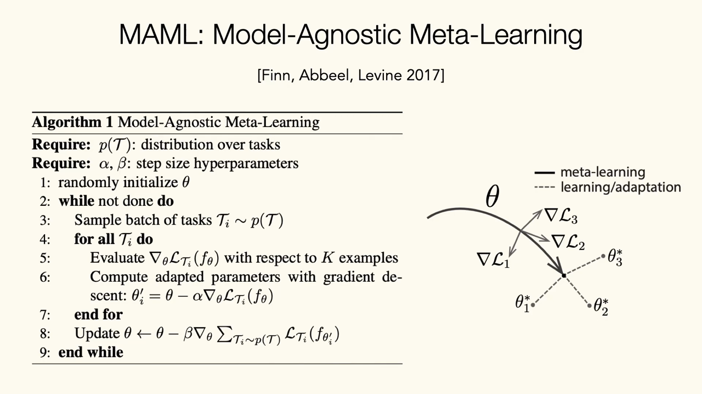
*▲ 강의 슬라이드 [69:10](https://youtu.be/RUdQMHV-7KM?t=4150): [MAML](00_%EB%94%A5%EB%9F%AC%EB%8B%9D_%EC%9A%A9%EC%96%B4%EC%82%AC%EC%A0%84.md#maml-model-agnostic-meta-learning-%EB%AA%A8%EB%8D%B8-%EB%AC%B4%EA%B4%80-%EB%A9%94%ED%83%80-%ED%95%99%EC%8A%B5) 알고리즘. 과제마다 적응한 [파라미터](00_%EB%94%A5%EB%9F%AC%EB%8B%9D_%EC%9A%A9%EC%96%B4%EC%82%AC%EC%A0%84.md#parameter-%ED%8C%8C%EB%9D%BC%EB%AF%B8%ED%84%B0) $\theta'_i$를 구하고(6행), 적응 뒤의 [손실](00_%EB%94%A5%EB%9F%AC%EB%8B%9D_%EC%9A%A9%EC%96%B4%EC%82%AC%EC%A0%84.md#loss-function-%EC%86%90%EC%8B%A4-%ED%95%A8%EC%88%98)로 $\theta$를 갱신한다(8행). 오른쪽 그림은 $\theta$에서 과제별 최적점 $\theta^*_i$로 빨리 갈 수 있는 자리를 찾는 모습*

- **[역전파](00_%EB%94%A5%EB%9F%AC%EB%8B%9D_%EC%9A%A9%EC%96%B4%EC%82%AC%EC%A0%84.md#backpropagation-%EC%97%AD%EC%A0%84%ED%8C%8C)를 통과하는 [역전파](00_%EB%94%A5%EB%9F%AC%EB%8B%9D_%EC%9A%A9%EC%96%B4%EC%82%AC%EC%A0%84.md#backpropagation-%EC%97%AD%EC%A0%84%ED%8C%8C)**: [SGD](00_%EB%94%A5%EB%9F%AC%EB%8B%9D_%EC%9A%A9%EC%96%B4%EC%82%AC%EC%A0%84.md#stochastic-gradient-descent-%ED%99%95%EB%A5%A0%EC%A0%81-%EA%B2%BD%EC%82%AC%ED%95%98%EA%B0%95%EB%B2%95) 한 걸음은 `forward(x, backward(forward(x, θ)) + θ)`, 곧 forward와 backward를 한 줄로 펼친 **하나의 큰 forward 패스**로 볼 수 있습니다([Lec02](Lec02_%EC%8B%A0%EA%B2%BD%EB%A7%9D_%ED%95%99%EC%8A%B5.md)에서 [역전파](00_%EB%94%A5%EB%9F%AC%EB%8B%9D_%EC%9A%A9%EC%96%B4%EC%82%AC%EC%A0%84.md#backpropagation-%EC%97%AD%EC%A0%84%ED%8C%8C)를 펼쳐 본 것과 같은 방식). 두 걸음이면 이것이 중첩됩니다. 펼친 전체에 대해 다시 **메타 [역전파](00_%EB%94%A5%EB%9F%AC%EB%8B%9D_%EC%9A%A9%EC%96%B4%EC%82%AC%EC%A0%84.md#backpropagation-%EC%97%AD%EC%A0%84%ED%8C%8C)**를 하면 됩니다. 가능은 하지만 forward와 backward를 모두 펼쳐 **아주 깊은 망**을 최적화하는 셈이라 **비쌉니다**.

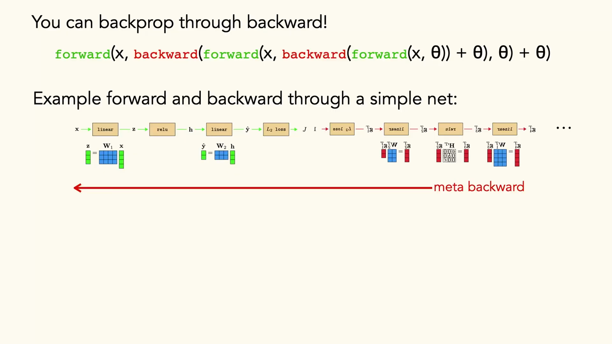
*▲ 강의 슬라이드 [70:50](https://youtu.be/RUdQMHV-7KM?t=4250): [역전파](00_%EB%94%A5%EB%9F%AC%EB%8B%9D_%EC%9A%A9%EC%96%B4%EC%82%AC%EC%A0%84.md#backpropagation-%EC%97%AD%EC%A0%84%ED%8C%8C)를 통과해 역전파할 수 있다. 간단한 망의 forward와 backward를 한 줄로 펼친 뒤 전체를 거슬러 메타 역전파한다*

### 9.2 과제 정보를 넣은 메타 학습

▶ 영상 [71:21](https://youtu.be/RUdQMHV-7KM?t=4281)

- 실제로는 [MAML](00_%EB%94%A5%EB%9F%AC%EB%8B%9D_%EC%9A%A9%EC%96%B4%EC%82%AC%EC%A0%84.md#maml-model-agnostic-meta-learning-%EB%AA%A8%EB%8D%B8-%EB%AC%B4%EA%B4%80-%EB%A9%94%ED%83%80-%ED%95%99%EC%8A%B5) 같은 방법의 이득이 [학습](00_%EB%94%A5%EB%9F%AC%EB%8B%9D_%EC%9A%A9%EC%96%B4%EC%82%AC%EC%A0%84.md#training-%ED%95%99%EC%8A%B5) 때의 추가 계산 비용만큼 크지 않은 경우가 많고, 여러 데이터셋으로 그냥 [사전 학습](00_%EB%94%A5%EB%9F%AC%EB%8B%9D_%EC%9A%A9%EC%96%B4%EC%82%AC%EC%A0%84.md#pre-training-%EC%82%AC%EC%A0%84-%ED%95%99%EC%8A%B5)한 뒤 [미세 조정](00_%EB%94%A5%EB%9F%AC%EB%8B%9D_%EC%9A%A9%EC%96%B4%EC%82%AC%EC%A0%84.md#fine-tuning-%EB%AF%B8%EC%84%B8-%EC%A1%B0%EC%A0%95)하는 것보다 못할 때도 있습니다. 간단한 문제에서는 이론적으로 좋지만 배포하기엔 너무 비싼 경우가 흔합니다.
- 실제 응용 예: Gabi Tseng 등(TIML, 2022)은 [메타 학습](00_%EB%94%A5%EB%9F%AC%EB%8B%9D_%EC%9A%A9%EC%96%B4%EC%82%AC%EC%A0%84.md#meta-learning-%EB%A9%94%ED%83%80-%ED%95%99%EC%8A%B5) 목표 안에 **지리 공간 [임베딩](00_%EB%94%A5%EB%9F%AC%EB%8B%9D_%EC%9A%A9%EC%96%B4%EC%82%AC%EC%A0%84.md#embedding-%EC%9E%84%EB%B2%A0%EB%94%A9)**(과제별 토크나이저 같은 것)을 넣어 과제의 맥락을 담았습니다. 여러 나라의 옥수수 작물 유형 [분류](00_%EB%94%A5%EB%9F%AC%EB%8B%9D_%EC%9A%A9%EC%96%B4%EC%82%AC%EC%A0%84.md#regression-classification-%ED%9A%8C%EA%B7%80%EC%99%80-%EB%B6%84%EB%A5%98)에서, 그냥 [메타 학습](00_%EB%94%A5%EB%9F%AC%EB%8B%9D_%EC%9A%A9%EC%96%B4%EC%82%AC%EC%A0%84.md#meta-learning-%EB%A9%94%ED%83%80-%ED%95%99%EC%8A%B5)이나 [사전 학습](00_%EB%94%A5%EB%9F%AC%EB%8B%9D_%EC%9A%A9%EC%96%B4%EC%82%AC%EC%A0%84.md#pre-training-%EC%82%AC%EC%A0%84-%ED%95%99%EC%8A%B5)은 비슷했지만 **과제 조건**을 준 방법은 특정 나라나 지역에 효과적으로 특화해 좋은 성능을 냈습니다.
- [분포 이동 강의](Lec17_%EB%B6%84%ED%8F%AC_%EB%B0%96_%EC%9D%BC%EB%B0%98%ED%99%94.md)에서 이야기한 **사전 [확률](00_%EB%94%A5%EB%9F%AC%EB%8B%9D_%EC%9A%A9%EC%96%B4%EC%82%AC%EC%A0%84.md#probability-%ED%99%95%EB%A5%A0) 배우기**의 다른 형태로 볼 수 있습니다. 지리적 사전 지식이나 맥락을 배워, 어떤 과제에 어떻게 적응할지에 대한 지식을 모델이 쌓게 하는 것입니다.

### 9.3 시퀀스 모델링으로 메타 학습

▶ 영상 [73:00](https://youtu.be/RUdQMHV-7KM?t=4380)

- **[학습](00_%EB%94%A5%EB%9F%AC%EB%8B%9D_%EC%9A%A9%EC%96%B4%EC%82%AC%EC%A0%84.md#training-%ED%95%99%EC%8A%B5)의 정의**를 다시 쓰면: 입력은 [시퀀스](00_%EB%94%A5%EB%9F%AC%EB%8B%9D_%EC%9A%A9%EC%96%B4%EC%82%AC%EC%A0%84.md#sequence-%EC%8B%9C%ED%80%80%EC%8A%A4) $x_0, y_0, x_1, y_1, x_2, y_2, \dots$이고, 출력은 새 $x$를 넣으면 $y$를 내는 함수 $f$입니다. 그러면 "$x_0, y_0, x_1, y_1, x_2, y_2, x_3, ?$"를 맞히는 것이 곧 [학습](00_%EB%94%A5%EB%9F%AC%EB%8B%9D_%EC%9A%A9%EC%96%B4%EC%82%AC%EC%A0%84.md#training-%ED%95%99%EC%8A%B5)입니다.
- [언어 모델](00_%EB%94%A5%EB%9F%AC%EB%8B%9D_%EC%9A%A9%EC%96%B4%EC%82%AC%EC%A0%84.md#language-model-%EC%96%B8%EC%96%B4-%EB%AA%A8%EB%8D%B8) 강의의 예처럼, 영어 문장과 스페인어 번역 쌍을 몇 개 보여 준 뒤 새 영어 문장을 주면 모델이 번역을 이어 씁니다. 이것이 [시퀀스](00_%EB%94%A5%EB%9F%AC%EB%8B%9D_%EC%9A%A9%EC%96%B4%EC%82%AC%EC%A0%84.md#sequence-%EC%8B%9C%ED%80%80%EC%8A%A4) 기반 **[맥락 내 학습](00_%EB%94%A5%EB%9F%AC%EB%8B%9D_%EC%9A%A9%EC%96%B4%EC%82%AC%EC%A0%84.md#in-context-learning-%EB%A7%A5%EB%9D%BD-%EB%82%B4-%ED%95%99%EC%8A%B5)**입니다.
- [순환 신경망](00_%EB%94%A5%EB%9F%AC%EB%8B%9D_%EC%9A%A9%EC%96%B4%EC%82%AC%EC%A0%84.md#rnn-recurrent-neural-network-%EC%88%9C%ED%99%98-%EC%8B%A0%EA%B2%BD%EB%A7%9D)이라면 **상태 + [파라미터](00_%EB%94%A5%EB%9F%AC%EB%8B%9D_%EC%9A%A9%EC%96%B4%EC%82%AC%EC%A0%84.md#parameter-%ED%8C%8C%EB%9D%BC%EB%AF%B8%ED%84%B0)**가 $f$이고, 그 $f$를 $x_3$에 적용해 다음을 예측합니다. 그래서 [RNN](00_%EB%94%A5%EB%9F%AC%EB%8B%9D_%EC%9A%A9%EC%96%B4%EC%82%AC%EC%A0%84.md#rnn-recurrent-neural-network-%EC%88%9C%ED%99%98-%EC%8B%A0%EA%B2%BD%EB%A7%9D)의 [은닉 상태](00_%EB%94%A5%EB%9F%AC%EB%8B%9D_%EC%9A%A9%EC%96%B4%EC%82%AC%EC%A0%84.md#hidden-state-%EC%9D%80%EB%8B%89-%EC%83%81%ED%83%9C)는 [시퀀스](00_%EB%94%A5%EB%9F%AC%EB%8B%9D_%EC%9A%A9%EC%96%B4%EC%82%AC%EC%A0%84.md#sequence-%EC%8B%9C%ED%80%80%EC%8A%A4)의 통계를 담아 다음을 맞히는, 말하자면 **배우는 법을 배운** 모델입니다.
- 강사는 [GPT](00_%EB%94%A5%EB%9F%AC%EB%8B%9D_%EC%9A%A9%EC%96%B4%EC%82%AC%EC%A0%84.md#gpt-%EC%83%9D%EC%84%B1%ED%98%95-%EC%82%AC%EC%A0%84%ED%95%99%EC%8A%B5-%ED%8A%B8%EB%9E%9C%EC%8A%A4%ED%8F%AC%EB%A8%B8) 같은 [자기회귀 모델](00_%EB%94%A5%EB%9F%AC%EB%8B%9D_%EC%9A%A9%EC%96%B4%EC%82%AC%EC%A0%84.md#autoregressive-model-%EC%9E%90%EA%B8%B0%ED%9A%8C%EA%B7%80-%EB%AA%A8%EB%8D%B8)이 하는 일이 바로 이것, 곧 **대규모 [메타 학습](00_%EB%94%A5%EB%9F%AC%EB%8B%9D_%EC%9A%A9%EC%96%B4%EC%82%AC%EC%A0%84.md#meta-learning-%EB%A9%94%ED%83%80-%ED%95%99%EC%8A%B5)**이라고 봅니다. [학습](00_%EB%94%A5%EB%9F%AC%EB%8B%9D_%EC%9A%A9%EC%96%B4%EC%82%AC%EC%A0%84.md#training-%ED%95%99%EC%8A%B5) 때 아주 많은 과제와 [시퀀스](00_%EB%94%A5%EB%9F%AC%EB%8B%9D_%EC%9A%A9%EC%96%B4%EC%82%AC%EC%A0%84.md#sequence-%EC%8B%9C%ED%80%80%EC%8A%A4)를 보여 주고 새 [시퀀스](00_%EB%94%A5%EB%9F%AC%EB%8B%9D_%EC%9A%A9%EC%96%B4%EC%82%AC%EC%A0%84.md#sequence-%EC%8B%9C%ED%80%80%EC%8A%A4)에서 다음을 빠르고 효율적으로 맞히게 하므로, [맥락 내 학습](00_%EB%94%A5%EB%9F%AC%EB%8B%9D_%EC%9A%A9%EC%96%B4%EC%82%AC%EC%A0%84.md#in-context-learning-%EB%A7%A5%EB%9D%BD-%EB%82%B4-%ED%95%99%EC%8A%B5)은 [메타 학습](00_%EB%94%A5%EB%9F%AC%EB%8B%9D_%EC%9A%A9%EC%96%B4%EC%82%AC%EC%A0%84.md#meta-learning-%EB%A9%94%ED%83%80-%ED%95%99%EC%8A%B5)의 또 다른 메커니즘입니다. 안쪽·바깥쪽 고리로 하는 [메타 학습](00_%EB%94%A5%EB%9F%AC%EB%8B%9D_%EC%9A%A9%EC%96%B4%EC%82%AC%EC%A0%84.md#meta-learning-%EB%A9%94%ED%83%80-%ED%95%99%EC%8A%B5)과 동기는 비슷하지만, 실제 결과는 [시퀀스](00_%EB%94%A5%EB%9F%AC%EB%8B%9D_%EC%9A%A9%EC%96%B4%EC%82%AC%EC%A0%84.md#sequence-%EC%8B%9C%ED%80%80%EC%8A%A4) 모델링 쪽이 훨씬 나을 수 있습니다.

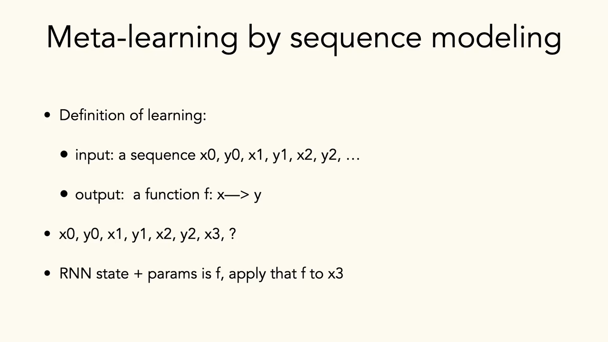
*▲ 강의 슬라이드 [74:00](https://youtu.be/RUdQMHV-7KM?t=4440): [시퀀스](00_%EB%94%A5%EB%9F%AC%EB%8B%9D_%EC%9A%A9%EC%96%B4%EC%82%AC%EC%A0%84.md#sequence-%EC%8B%9C%ED%80%80%EC%8A%A4) 모델링으로 하는 [메타 학습](00_%EB%94%A5%EB%9F%AC%EB%8B%9D_%EC%9A%A9%EC%96%B4%EC%82%AC%EC%A0%84.md#meta-learning-%EB%A9%94%ED%83%80-%ED%95%99%EC%8A%B5). 입력은 [시퀀스](00_%EB%94%A5%EB%9F%AC%EB%8B%9D_%EC%9A%A9%EC%96%B4%EC%82%AC%EC%A0%84.md#sequence-%EC%8B%9C%ED%80%80%EC%8A%A4) $x_0, y_0, x_1, y_1, \dots$, 출력은 함수 $f: x \to y$. [RNN](00_%EB%94%A5%EB%9F%AC%EB%8B%9D_%EC%9A%A9%EC%96%B4%EC%82%AC%EC%A0%84.md#rnn-recurrent-neural-network-%EC%88%9C%ED%99%98-%EC%8B%A0%EA%B2%BD%EB%A7%9D)의 상태와 [파라미터](00_%EB%94%A5%EB%9F%AC%EB%8B%9D_%EC%9A%A9%EC%96%B4%EC%82%AC%EC%A0%84.md#parameter-%ED%8C%8C%EB%9D%BC%EB%AF%B8%ED%84%B0)가 $f$이고 이를 $x_3$에 적용한다*

---

## 10. 정리

▶ 영상 [74:38](https://youtu.be/RUdQMHV-7KM?t=4478)

- 오늘은 **[생성 모델](00_%EB%94%A5%EB%9F%AC%EB%8B%9D_%EC%9A%A9%EC%96%B4%EC%82%AC%EC%A0%84.md#generative-model-%EC%83%9D%EC%84%B1-%EB%AA%A8%EB%8D%B8)을 데이터로 쓰기**(데이터++)의 장단점과, **배우는 법 배우기**([메타 학습](00_%EB%94%A5%EB%9F%AC%EB%8B%9D_%EC%9A%A9%EC%96%B4%EC%82%AC%EC%A0%84.md#meta-learning-%EB%A9%94%ED%83%80-%ED%95%99%EC%8A%B5))를 다뤘습니다.
- [Lec18](Lec18_%EC%A0%84%EC%9D%B4_%ED%95%99%EC%8A%B5_%EB%AA%A8%EB%8D%B8.md)과 합치면 [전이 학습](00_%EB%94%A5%EB%9F%AC%EB%8B%9D_%EC%9A%A9%EC%96%B4%EC%82%AC%EC%A0%84.md#transfer-learning-%EC%A0%84%EC%9D%B4-%ED%95%99%EC%8A%B5)의 세 갈래(사상: [미세 조정](00_%EB%94%A5%EB%9F%AC%EB%8B%9D_%EC%9A%A9%EC%96%B4%EC%82%AC%EC%A0%84.md#fine-tuning-%EB%AF%B8%EC%84%B8-%EC%A1%B0%EC%A0%95)·[도메인 적응](00_%EB%94%A5%EB%9F%AC%EB%8B%9D_%EC%9A%A9%EC%96%B4%EC%82%AC%EC%A0%84.md#domain-adaptation-%EB%8F%84%EB%A9%94%EC%9D%B8-%EC%A0%81%EC%9D%91), 출력: [지식 증류](00_%EB%94%A5%EB%9F%AC%EB%8B%9D_%EC%9A%A9%EC%96%B4%EC%82%AC%EC%A0%84.md#knowledge-distillation-%EC%A7%80%EC%8B%9D-%EC%A6%9D%EB%A5%98), 입력: 데이터++)를 모두 본 셈입니다.
- 강사의 이번 학기 마지막 강의였고, 강의는 박수로 끝납니다.

---

## 11. 용어 정리

용어사전에 있는 용어는 위 본문에 링크를 걸었습니다. 아래는 이번 강의에서 새로 나온 용어입니다.

| 용어 | 뜻 |
|---|---|
| [데이터++](00_%EB%94%A5%EB%9F%AC%EB%8B%9D_%EC%9A%A9%EC%96%B4%EC%82%AC%EC%A0%84.md#data-%EB%8D%B0%EC%9D%B4%ED%84%B0-%ED%94%8C%EB%9F%AC%EC%8A%A4%ED%94%8C%EB%9F%AC%EC%8A%A4)([Data++](00_%EB%94%A5%EB%9F%AC%EB%8B%9D_%EC%9A%A9%EC%96%B4%EC%82%AC%EC%A0%84.md#data-%EB%8D%B0%EC%9D%B4%ED%84%B0-%ED%94%8C%EB%9F%AC%EC%8A%A4%ED%94%8C%EB%9F%AC%EC%8A%A4)) | 잘 학습한 [생성 모델](00_%EB%94%A5%EB%9F%AC%EB%8B%9D_%EC%9A%A9%EC%96%B4%EC%82%AC%EC%A0%84.md#generative-model-%EC%83%9D%EC%84%B1-%EB%AA%A8%EB%8D%B8) $\{x, z, G, G^{-1}\}$을 [보간](00_%EB%94%A5%EB%9F%AC%EB%8B%9D_%EC%9A%A9%EC%96%B4%EC%82%AC%EC%A0%84.md#interpolation-%EB%B3%B4%EA%B0%84), 조작, 합성, 최적화, 라벨 붙이기가 되는 "기능이 더 붙은 데이터"로 보는 관점 |
| [잠재 공간](00_%EB%94%A5%EB%9F%AC%EB%8B%9D_%EC%9A%A9%EC%96%B4%EC%82%AC%EC%A0%84.md#latent-space-%EC%9E%A0%EC%9E%AC-%EA%B3%B5%EA%B0%84)(Latent space) | [생성기](00_%EB%94%A5%EB%9F%AC%EB%8B%9D_%EC%9A%A9%EC%96%B4%EC%82%AC%EC%A0%84.md#generator-discriminator-%EC%83%9D%EC%84%B1%EA%B8%B0%EC%99%80-%ED%8C%90%EB%B3%84%EA%B8%B0)가 받는 [잠재 변수](00_%EB%94%A5%EB%9F%AC%EB%8B%9D_%EC%9A%A9%EC%96%B4%EC%82%AC%EC%A0%84.md#latent-variable-%EC%9E%A0%EC%9E%AC-%EB%B3%80%EC%88%98)들이 사는 공간. 그 안의 움직임이 생성물의 변화를 제어한다 |
| [잠재 방향](00_%EB%94%A5%EB%9F%AC%EB%8B%9D_%EC%9A%A9%EC%96%B4%EC%82%AC%EC%A0%84.md#latent-direction-%EC%9E%A0%EC%9E%AC-%EB%B0%A9%ED%96%A5)(Latent direction) | 낮→밤, 줌인처럼 특정 변화에 대응하는 [잠재 공간](00_%EB%94%A5%EB%9F%AC%EB%8B%9D_%EC%9A%A9%EC%96%B4%EC%82%AC%EC%A0%84.md#latent-space-%EC%9E%A0%EC%9E%AC-%EA%B3%B5%EA%B0%84)의 방향 벡터. 두 잠재 벡터의 차로 찾는다 |
| [데이터 다양체](00_%EB%94%A5%EB%9F%AC%EB%8B%9D_%EC%9A%A9%EC%96%B4%EC%82%AC%EC%A0%84.md#data-manifold-%EB%8D%B0%EC%9D%B4%ED%84%B0-%EB%8B%A4%EC%96%91%EC%B2%B4)([Data manifold](00_%EB%94%A5%EB%9F%AC%EB%8B%9D_%EC%9A%A9%EC%96%B4%EC%82%AC%EC%A0%84.md#data-manifold-%EB%8D%B0%EC%9D%B4%ED%84%B0-%EB%8B%A4%EC%96%91%EC%B2%B4)) | 고차원 공간 안에서 실제 데이터(자연 이미지 등)가 놓인 낮은 차원의 휘어진 면 |
| [StyleGAN](00_%EB%94%A5%EB%9F%AC%EB%8B%9D_%EC%9A%A9%EC%96%B4%EC%82%AC%EC%A0%84.md#stylegan-%EC%8A%A4%ED%83%80%EC%9D%BCgan) | 매핑 망으로 만든 중간 [잠재 공간](00_%EB%94%A5%EB%9F%AC%EB%8B%9D_%EC%9A%A9%EC%96%B4%EC%82%AC%EC%A0%84.md#latent-space-%EC%9E%A0%EC%9E%AC-%EA%B3%B5%EA%B0%84)($w$)을 [층](00_%EB%94%A5%EB%9F%AC%EB%8B%9D_%EC%9A%A9%EC%96%B4%EC%82%AC%EC%A0%84.md#layer-%EC%B8%B5)마다 넣는 [GAN](00_%EB%94%A5%EB%9F%AC%EB%8B%9D_%EC%9A%A9%EC%96%B4%EC%82%AC%EC%A0%84.md#gan-generative-adversarial-network-%EC%83%9D%EC%84%B1%EC%A0%81-%EC%A0%81%EB%8C%80-%EC%8B%A0%EA%B2%BD%EB%A7%9D). $w$ 공간이 $z$보다 잘 풀린 표현이다 |
| [word2vec](00_%EB%94%A5%EB%9F%AC%EB%8B%9D_%EC%9A%A9%EC%96%B4%EC%82%AC%EC%A0%84.md#word2vec-%EC%9B%8C%EB%93%9C%ED%88%AC%EB%B2%A1) | 주변 단어를 예측하며 배운 단어 [임베딩](00_%EB%94%A5%EB%9F%AC%EB%8B%9D_%EC%9A%A9%EC%96%B4%EC%82%AC%EC%A0%84.md#embedding-%EC%9E%84%EB%B2%A0%EB%94%A9). 시제, 성별 같은 관계가 일정한 방향으로 나타난다 |
| [테스트 시점 증강](00_%EB%94%A5%EB%9F%AC%EB%8B%9D_%EC%9A%A9%EC%96%B4%EC%82%AC%EC%A0%84.md#test-time-augmentation-%ED%85%8C%EC%8A%A4%ED%8A%B8-%EC%8B%9C%EC%A0%90-%EC%A6%9D%EA%B0%95)(Test-time augmentation) | 추론 때 입력의 여러 변형을 만들어 예측을 평균하는 것 |
| [반사실 설명](00_%EB%94%A5%EB%9F%AC%EB%8B%9D_%EC%9A%A9%EC%96%B4%EC%82%AC%EC%A0%84.md#counterfactual-explanation-%EB%B0%98%EC%82%AC%EC%8B%A4-%EC%84%A4%EB%AA%85)(Counterfactual explanation) | 입력의 어떤 요인을 바꾸면 예측이 어떻게 달라지는지 보여 주어 모델의 판단 근거를 설명하는 것 (StylEx) |
| [SAM](00_%EB%94%A5%EB%9F%AC%EB%8B%9D_%EC%9A%A9%EC%96%B4%EC%82%AC%EC%A0%84.md#segment-anything-model-sam-%EC%84%B8%EA%B7%B8%EB%A8%BC%ED%8A%B8-%EC%95%A0%EB%8B%88%EC%8B%B1-%EB%AA%A8%EB%8D%B8)([Segment Anything Model](00_%EB%94%A5%EB%9F%AC%EB%8B%9D_%EC%9A%A9%EC%96%B4%EC%82%AC%EC%A0%84.md#segment-anything-model-sam-%EC%84%B8%EA%B7%B8%EB%A8%BC%ED%8A%B8-%EC%95%A0%EB%8B%88%EC%8B%B1-%EB%AA%A8%EB%8D%B8)) | 점, 상자, ([SAM](00_%EB%94%A5%EB%9F%AC%EB%8B%9D_%EC%9A%A9%EC%96%B4%EC%82%AC%EC%A0%84.md#segment-anything-model-sam-%EC%84%B8%EA%B7%B8%EB%A8%BC%ED%8A%B8-%EC%95%A0%EB%8B%88%EC%8B%B1-%EB%AA%A8%EB%8D%B8) 3부터) 짧은 글로 지정한 대상을 분할하는 범용 분할 [기반 모델](00_%EB%94%A5%EB%9F%AC%EB%8B%9D_%EC%9A%A9%EC%96%B4%EC%82%AC%EC%A0%84.md#foundation-model-%EA%B8%B0%EB%B0%98-%EB%AA%A8%EB%8D%B8) |
| [합성 데이터](00_%EB%94%A5%EB%9F%AC%EB%8B%9D_%EC%9A%A9%EC%96%B4%EC%82%AC%EC%A0%84.md#synthetic-data-%ED%95%A9%EC%84%B1-%EB%8D%B0%EC%9D%B4%ED%84%B0)(Synthetic data) | [생성 모델](00_%EB%94%A5%EB%9F%AC%EB%8B%9D_%EC%9A%A9%EC%96%B4%EC%82%AC%EC%A0%84.md#generative-model-%EC%83%9D%EC%84%B1-%EB%AA%A8%EB%8D%B8)이나 시뮬레이터로 만든 [학습](00_%EB%94%A5%EB%9F%AC%EB%8B%9D_%EC%9A%A9%EC%96%B4%EC%82%AC%EC%A0%84.md#training-%ED%95%99%EC%8A%B5)용 데이터 |
| [다양성-충실도 트레이드오프](00_%EB%94%A5%EB%9F%AC%EB%8B%9D_%EC%9A%A9%EC%96%B4%EC%82%AC%EC%A0%84.md#diversity-fidelity-tradeoff-%EB%8B%A4%EC%96%91%EC%84%B1-%EC%B6%A9%EC%8B%A4%EB%8F%84-%ED%8A%B8%EB%A0%88%EC%9D%B4%EB%93%9C%EC%98%A4%ED%94%84)(Diversity-fidelity tradeoff) | 생성물을 다양하게 하면 원본(범주)에 대한 충실도가 떨어지는 맞바꿈 |
| [모델 붕괴](00_%EB%94%A5%EB%9F%AC%EB%8B%9D_%EC%9A%A9%EC%96%B4%EC%82%AC%EC%A0%84.md#model-collapse-%EB%AA%A8%EB%8D%B8-%EB%B6%95%EA%B4%B4)(Model collapse) | 생성 데이터로 다음 모델을 되풀이해 학습하면 분포의 꼬리(드문 것)부터 사라지는 현상 |
| [메타 학습](00_%EB%94%A5%EB%9F%AC%EB%8B%9D_%EC%9A%A9%EC%96%B4%EC%82%AC%EC%A0%84.md#meta-learning-%EB%A9%94%ED%83%80-%ED%95%99%EC%8A%B5)([Meta-learning](00_%EB%94%A5%EB%9F%AC%EB%8B%9D_%EC%9A%A9%EC%96%B4%EC%82%AC%EC%A0%84.md#meta-learning-%EB%A9%94%ED%83%80-%ED%95%99%EC%8A%B5)) | 여러 과제로 "배우는 법"(초기값, [하이퍼파라미터](00_%EB%94%A5%EB%9F%AC%EB%8B%9D_%EC%9A%A9%EC%96%B4%EC%82%AC%EC%A0%84.md#hyperparameter-%ED%95%98%EC%9D%B4%ED%8D%BC%ED%8C%8C%EB%9D%BC%EB%AF%B8%ED%84%B0), [학습](00_%EB%94%A5%EB%9F%AC%EB%8B%9D_%EC%9A%A9%EC%96%B4%EC%82%AC%EC%A0%84.md#training-%ED%95%99%EC%8A%B5) 규칙)을 배워 새 과제에 빨리 적응하게 하는 것 |
| [MAML](00_%EB%94%A5%EB%9F%AC%EB%8B%9D_%EC%9A%A9%EC%96%B4%EC%82%AC%EC%A0%84.md#maml-model-agnostic-meta-learning-%EB%AA%A8%EB%8D%B8-%EB%AC%B4%EA%B4%80-%EB%A9%94%ED%83%80-%ED%95%99%EC%8A%B5)(Model-agnostic meta-learning) | SGD 몇 걸음이면 적응하는 초기값을 안쪽·바깥쪽 이중 고리로 배우는 [메타 학습](00_%EB%94%A5%EB%9F%AC%EB%8B%9D_%EC%9A%A9%EC%96%B4%EC%82%AC%EC%A0%84.md#meta-learning-%EB%A9%94%ED%83%80-%ED%95%99%EC%8A%B5) |
