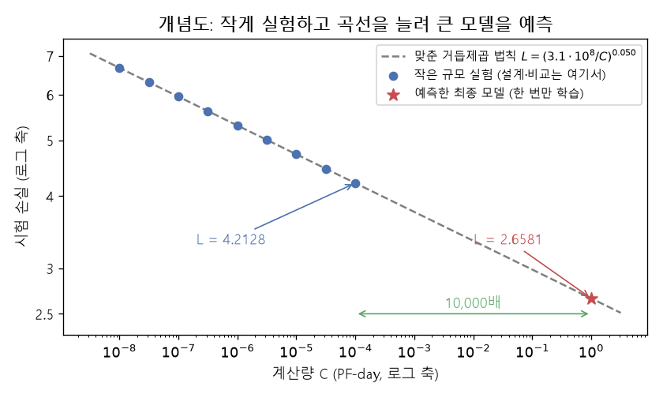
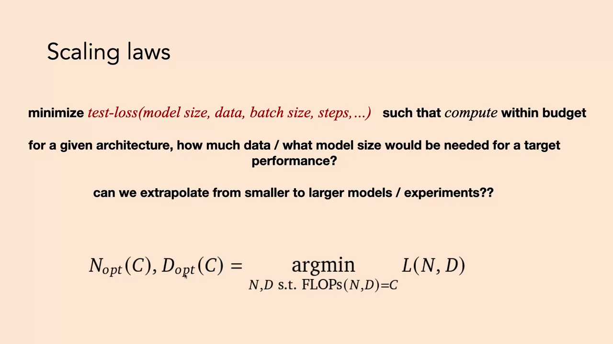
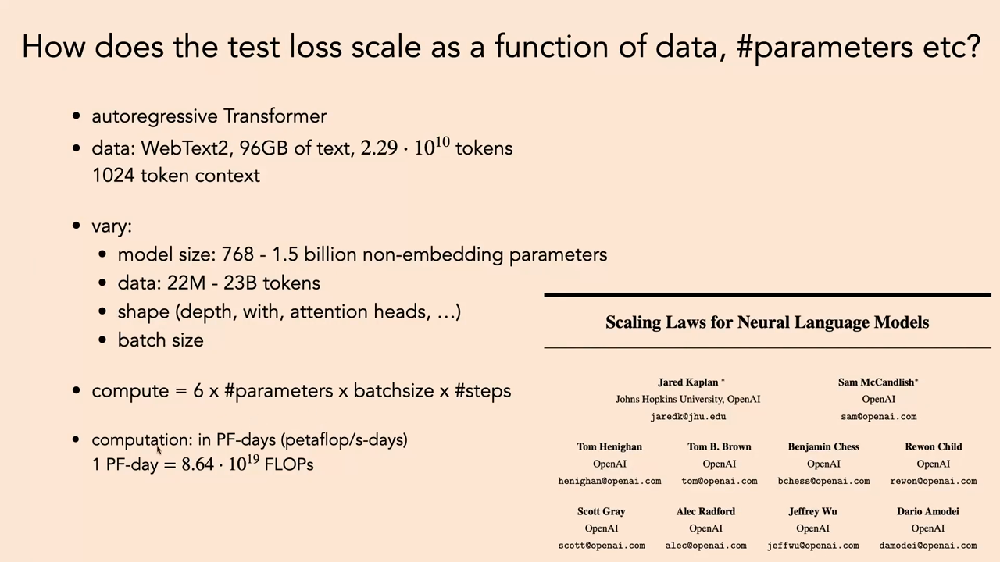
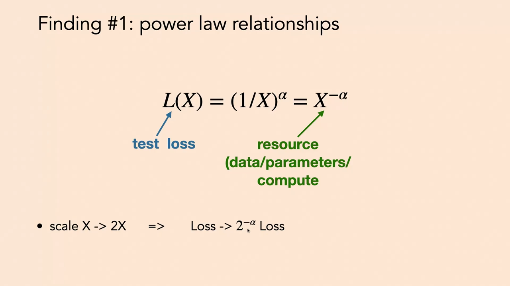
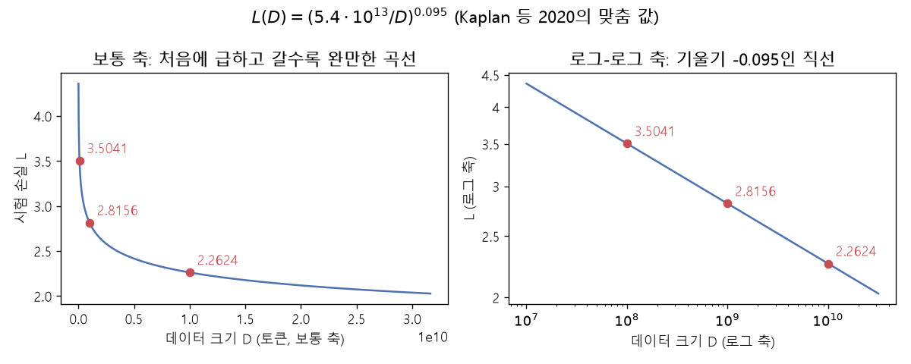
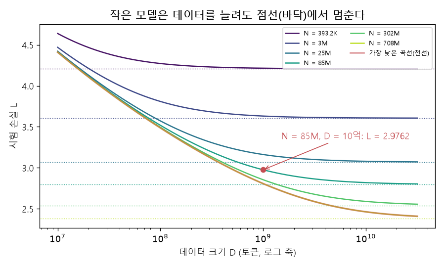
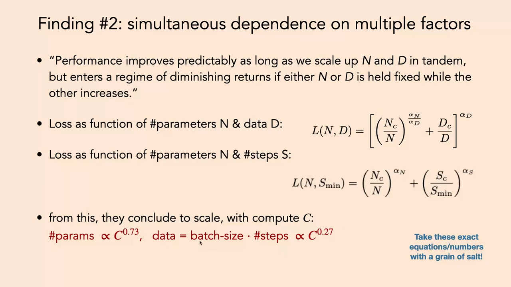

# Lec 20. 스케일링 법칙 (Scaling Laws)

← 이전: [Lec19_전이_학습_데이터](Lec19_%EC%A0%84%EC%9D%B4_%ED%95%99%EC%8A%B5_%EB%8D%B0%EC%9D%B4%ED%84%B0.md) · [목차](00_MIT%EB%94%A5%EB%9F%AC%EB%8B%9D_%EB%AA%A9%EC%B0%A8.md) · 다음: [Lec21_언어_모델](Lec21_%EC%96%B8%EC%96%B4_%EB%AA%A8%EB%8D%B8.md) →

> [!NOTE]
> **강의 정보**
> - **출처**: MIT OpenCourseWare, [Lec 20. Scaling Laws](https://www.youtube.com/watch?v=7hbf4klU3ks) (38분, 2024년 가을 학기). 공개된 영상은 38분 22초에서 문장 중간에 끊긴다. 이 노트는 녹화된 부분만 정리한다.
> - **강사**: Phillip Isola
> - **라이선스**: 원 강의는 CC BY-NC-SA 4.0입니다. 이 노트는 영어 자막을 바탕으로 한국어로 옮겨 정리한 2차 저작물이며, 같은 조건(비영리·출처 표기·동일 조건 공유)을 따릅니다.
> - 각 절 제목 아래의 `▶ 영상` 시간을 누르면 영상의 해당 위치로 갑니다.
> - `📐 수학 개념` 줄은 그 절에 쓰인 수학을 정리한 노트로 연결됩니다. 전체 목록은 [00_MIT딥러닝_목차](00_MIT%EB%94%A5%EB%9F%AC%EB%8B%9D_%EB%AA%A9%EC%B0%A8.md).
> - 슬라이드 캡처는 원 강의(CC BY-NC-SA 4.0)에서 가져왔고, "직접 그린 그림"은 이 노트의 숫자로 새로 그렸습니다. 논문 그림이 대부분인 슬라이드는 캡처하지 않고 숫자만 옮겼습니다.
> - `🆕 2026 업데이트` 칸은 강의(2024년 가을) 이후 바뀐 내용을 덧붙인 것입니다.

## 한눈에 보기

| 구분 | 내용 |
|---|---|
| 핵심 질문 | 계산 예산이 정해져 있을 때, 모델을 얼마나 크게 하고 데이터를 얼마나 넣어야 시험 [손실](00_%EB%94%A5%EB%9F%AC%EB%8B%9D_%EC%9A%A9%EC%96%B4%EC%82%AC%EC%A0%84.md#loss-function-%EC%86%90%EC%8B%A4-%ED%95%A8%EC%88%98)이 가장 작을까? 작은 실험으로 큰 모델의 성능을 미리 알 수 있을까? |
| 왜 중요한가 | 딥러닝은 규모가 클 때 잘 된다. 큰 모델은 한 번 [학습](00_%EB%94%A5%EB%9F%AC%EB%8B%9D_%EC%9A%A9%EC%96%B4%EC%82%AC%EC%A0%84.md#training-%ED%95%99%EC%8A%B5)에 큰돈이 드니, **작은 규모에서 설계하고 곡선을 늘려([외삽](00_%EB%94%A5%EB%9F%AC%EB%8B%9D_%EC%9A%A9%EC%96%B4%EC%82%AC%EC%A0%84.md#extrapolation-%EC%99%B8%EC%82%BD)) 큰 규모를 예측**한 뒤 한 번만 학습한다 ([GPT](00_%EB%94%A5%EB%9F%AC%EB%8B%9D_%EC%9A%A9%EC%96%B4%EC%82%AC%EC%A0%84.md#gpt-%EC%83%9D%EC%84%B1%ED%98%95-%EC%82%AC%EC%A0%84%ED%95%99%EC%8A%B5-%ED%8A%B8%EB%9E%9C%EC%8A%A4%ED%8F%AC%EB%A8%B8)-4가 이렇게 했다) |
| 발견 1 | 시험 [손실](00_%EB%94%A5%EB%9F%AC%EB%8B%9D_%EC%9A%A9%EC%96%B4%EC%82%AC%EC%A0%84.md#loss-function-%EC%86%90%EC%8B%A4-%ED%95%A8%EC%88%98)은 자원(데이터 $D$, [파라미터](00_%EB%94%A5%EB%9F%AC%EB%8B%9D_%EC%9A%A9%EC%96%B4%EC%82%AC%EC%A0%84.md#parameter-%ED%8C%8C%EB%9D%BC%EB%AF%B8%ED%84%B0) $N$, 계산량 $C$)의 **[거듭제곱 법칙](00_%EB%94%A5%EB%9F%AC%EB%8B%9D_%EC%9A%A9%EC%96%B4%EC%82%AC%EC%A0%84.md#power-law-%EA%B1%B0%EB%93%AD%EC%A0%9C%EA%B3%B1-%EB%B2%95%EC%B9%99)**을 따른다: $L = (X_c / X)^{\alpha}$. [로그-로그 그래프](00_%EB%94%A5%EB%9F%AC%EB%8B%9D_%EC%9A%A9%EC%96%B4%EC%82%AC%EC%A0%84.md#log-log-plot-%EB%A1%9C%EA%B7%B8-%EB%A1%9C%EA%B7%B8-%EA%B7%B8%EB%9E%98%ED%94%84)에서 직선. Kaplan 등(2020): $\alpha_D \approx 0.095$, $\alpha_N \approx 0.076$, $\alpha_C \approx 0.050$ |
| 발견 2 | 법칙은 **다른 요인을 최적으로 맞췄을 때의 전선**에서만 보인다. $N$과 $D$를 함께 키워야 하고, 하나만 키우면 바닥에 닿는다. Kaplan의 결론: $N \propto C^{0.73}$, $D \propto C^{0.27}$ (큰 모델, 적은 데이터) |
| 계산량 | $C \approx 6ND$ ([토큰](00_%EB%94%A5%EB%9F%AC%EB%8B%9D_%EC%9A%A9%EC%96%B4%EC%82%AC%EC%A0%84.md#token-%ED%86%A0%ED%81%B0) 하나에 [순전파](00_%EB%94%A5%EB%9F%AC%EB%8B%9D_%EC%9A%A9%EC%96%B4%EC%82%AC%EC%A0%84.md#feed-forward-%EC%88%9C%EC%A0%84%ED%8C%8C) $2N$ + [역전파](00_%EB%94%A5%EB%9F%AC%EB%8B%9D_%EC%9A%A9%EC%96%B4%EC%82%AC%EC%A0%84.md#backpropagation-%EC%97%AD%EC%A0%84%ED%8C%8C) $4N$ FLOP). 단위 [PF-day](00_%EB%94%A5%EB%9F%AC%EB%8B%9D_%EC%9A%A9%EC%96%B4%EC%82%AC%EC%A0%84.md#flops-pf-day-%EB%B6%80%EB%8F%99%EC%86%8C%EC%88%98%EC%A0%90-%EC%97%B0%EC%82%B0-%EC%88%98%EC%99%80-%ED%8E%98%ED%83%80%ED%94%8C%EB%A1%AD-%EC%9D%BC) $= 8.64 \times 10^{19}$ FLOP |
| 다른 분야 | 비전·언어 모두에서 비슷한 법칙(Rosenfeld 등 2020). 작은 규모에서 맞춘 식이 큰 규모의 따로 둔 실험을 잘 예측한다 |
| 그 뒤 | 친칠라(2022)는 $N$과 $D$를 **같은 비율**로([토큰](00_%EB%94%A5%EB%9F%AC%EB%8B%9D_%EC%9A%A9%EC%96%B4%EC%82%AC%EC%A0%84.md#token-%ED%86%A0%ED%81%B0)/[파라미터](00_%EB%94%A5%EB%9F%AC%EB%8B%9D_%EC%9A%A9%EC%96%B4%EC%82%AC%EC%A0%84.md#parameter-%ED%8C%8C%EB%9D%BC%EB%AF%B8%ED%84%B0) 약 20) 키우라고 고쳤다. 지금은 추론 비용 때문에 그보다 훨씬 오래 학습하고, 데이터 고갈과 [테스트 시점 계산](00_%EB%94%A5%EB%9F%AC%EB%8B%9D_%EC%9A%A9%EC%96%B4%EC%82%AC%EC%A0%84.md#test-time-compute-%ED%85%8C%EC%8A%A4%ED%8A%B8-%EC%8B%9C%EC%A0%90-%EA%B3%84%EC%82%B0)이 새 축이 됐다 |
| 이전·다음 강의 | Lec19 → Lec21. 관련: [Lec03 11](Lec03_%EA%B7%BC%EC%82%AC_%EC%9D%B4%EB%A1%A0.md#11-%EC%8B%A4%EC%A0%9C%EB%A1%9C%EB%8A%94-%EC%8A%A4%EC%BC%80%EC%9D%BC%EB%A7%81-%EB%B2%95%EC%B9%99%EA%B3%BC-%EA%B5%90%EB%9E%80-%EB%B3%80%EC%88%98) (Kaplan과 친칠라), [Lec07](Lec07_%EC%B5%9C%EC%A0%81%ED%99%94%EC%9D%98_%EC%8A%A4%EC%BC%80%EC%9D%BC%EB%A7%81_%EA%B7%9C%EC%B9%99.md) (최적화의 스케일링 규칙), [Lec13](Lec13_%ED%91%9C%ED%98%84_%ED%95%99%EC%8A%B5_%EC%9D%B4%EB%A1%A0.md) (μP) |

---

## 1. 왜 스케일을 보나

▶ 영상 [00:00](https://youtu.be/7hbf4klU3ks?t=0)

강사는 이번 강의부터 남은 몇 주가 "아직 진행 중인 과학"이라고 말합니다. 최근 논문의 경험적 결과들이라 시간이 지나도 맞을지는 모릅니다.

딥러닝은 **규모가 클 때** 이기는 방법입니다. 데이터, 계산량(FLOP), [파라미터](00_%EB%94%A5%EB%9F%AC%EB%8B%9D_%EC%9A%A9%EC%96%B4%EC%82%AC%EC%A0%84.md#parameter-%ED%8C%8C%EB%9D%BC%EB%AF%B8%ED%84%B0)가 많은 큰 모델을 큰 기계에서 돌릴 때 잘 됩니다. 그래서 딥러닝 이야기의 큰 부분은 "가진 자원을 어떻게 효율적으로 키워 쓰나"입니다. 놀랍게도 모델이 커질 때의 행동은 꽤 **예측 가능**합니다. "계산량을 두 배로 하면? 모델을 두 배로 하면?"에 답하는 법칙을 **[스케일링 법칙](00_%EB%94%A5%EB%9F%AC%EB%8B%9D_%EC%9A%A9%EC%96%B4%EC%82%AC%EC%A0%84.md#scaling-laws-%EC%8A%A4%EC%BC%80%EC%9D%BC%EB%A7%81-%EB%B2%95%EC%B9%99)(Scaling laws)**이라고 합니다. 이런 법칙이 있으면 자원 계획을 세우고 "내년 모델은 얼마나 잘할까"를 예측할 수 있습니다.

### 1.1 계산량은 해마다 늘어난다

▶ 영상 [01:43](https://youtu.be/7hbf4klU3ks?t=103)

- OpenAI 블로그(2018)의 도표: 가로축은 연도, 세로축은 모델 [학습](00_%EB%94%A5%EB%9F%AC%EB%8B%9D_%EC%9A%A9%EC%96%B4%EC%82%AC%EC%A0%84.md#training-%ED%95%99%EC%8A%B5)에 쓴 계산량([로그](00_%EB%94%A5%EB%9F%AC%EB%8B%9D_%EC%9A%A9%EC%96%B4%EC%82%AC%EC%A0%84.md#log-ln-%EB%A1%9C%EA%B7%B8) 축). 해가 갈수록 계산량이 지수적으로(어쩌면 거듭제곱으로) 늘어납니다.
- **[무어의 법칙](00_%EB%94%A5%EB%9F%AC%EB%8B%9D_%EC%9A%A9%EC%96%B4%EC%82%AC%EC%A0%84.md#moores-law-%EB%AC%B4%EC%96%B4%EC%9D%98-%EB%B2%95%EC%B9%99)([Moore's law](00_%EB%94%A5%EB%9F%AC%EB%8B%9D_%EC%9A%A9%EC%96%B4%EC%82%AC%EC%A0%84.md#moores-law-%EB%AC%B4%EC%96%B4%EC%9D%98-%EB%B2%95%EC%B9%99))**이 트랜지스터 수가 약 2년마다 두 배가 된다고 했다면, 이 도표는 [학습](00_%EB%94%A5%EB%9F%AC%EB%8B%9D_%EC%9A%A9%EC%96%B4%EC%82%AC%EC%A0%84.md#training-%ED%95%99%EC%8A%B5) 계산량이 **약 3개월마다** 두 배가 된다고 말합니다(원 블로그 값은 3.4개월). 도표는 2018년에서 끝나고, 강사는 그 뒤로 [기울기](00_%EB%94%A5%EB%9F%AC%EB%8B%9D_%EC%9A%A9%EC%96%B4%EC%82%AC%EC%A0%84.md#gradient-%EA%B8%B0%EC%9A%B8%EA%B8%B0)가 더 가팔라졌을 수 있다고 말합니다. 2018년 이후의 실제 추세(1년에 4~5배)는 [Lec18 7.2](Lec18_%EC%A0%84%EC%9D%B4_%ED%95%99%EC%8A%B5_%EB%AA%A8%EB%8D%B8.md#72-%EA%B7%9C%EB%AA%A8%EC%99%80-%EB%B9%84%EC%9A%A9)의 업데이트 칸에 정리했습니다.

### 1.2 쓴 교훈

▶ 영상 [03:22](https://youtu.be/7hbf4klU3ks?t=202)

Rich Sutton의 한 쪽짜리 글 **"[쓴 교훈](00_%EB%94%A5%EB%9F%AC%EB%8B%9D_%EC%9A%A9%EC%96%B4%EC%82%AC%EC%A0%84.md#bitter-lesson-%EC%93%B4-%EA%B5%90%ED%9B%88)(The Bitter Lesson)"**(2019)도 스케일을 진지하게 보게 만든 계기입니다. 70년 AI 연구를 돌아보면 영리한 아이디어와 알고리즘은 대부분 오래가지 못했고, **계산이 늘수록 잘 커지는 단순한 방법**만 꾸준히 이겼다는 관찰입니다. 지금 어느 모델이 더 좋은지는 중요하지 않고, 어느 쪽이 **더 잘 커지는지**가 중요하다는 뜻입니다. 시간이 지나면 잘 커지는 쪽이 결국 이기기 때문입니다. 나온 당시 싫어한 사람도 많았지만 강사는 단서를 붙이더라도 진실이 많이 담겼다고 봅니다([Lec09 12](Lec09_%ED%95%B4%EC%BB%A4%EC%9D%98_%EB%94%A5%EB%9F%AC%EB%8B%9D_%EA%B0%80%EC%9D%B4%EB%93%9C.md#12-%EC%8A%A4%EC%BC%80%EC%9D%BC%EA%B3%BC-%EB%8D%9C%EC%96%B4%EB%82%B4%EA%B8%B0)에서도 다뤘다).

### 1.3 점근 분석도 스케일링 법칙이다

▶ 영상 [05:01](https://youtu.be/7hbf4klU3ks?t=301)

자원에 따라 알고리즘이 어떻게 커지는지 보는 생각은 새로운 것이 아닙니다. 알고리즘 수업의 **[점근 분석](00_%EB%94%A5%EB%9F%AC%EB%8B%9D_%EC%9A%A9%EC%96%B4%EC%82%AC%EC%A0%84.md#asymptotic-analysis-big-o-notation-%EC%A0%90%EA%B7%BC-%EB%B6%84%EC%84%9D%EA%B3%BC-%EB%B9%85%EC%98%A4-%ED%91%9C%EA%B8%B0)**(빅오 표기)이 바로 [스케일링 법칙](00_%EB%94%A5%EB%9F%AC%EB%8B%9D_%EC%9A%A9%EC%96%B4%EC%82%AC%EC%A0%84.md#scaling-laws-%EC%8A%A4%EC%BC%80%EC%9D%BC%EB%A7%81-%EB%B2%95%EC%B9%99)입니다. 그래프의 노드 수가 늘 때 최단 경로를 찾는 시간이 어떻게 늘어나는지 묻는 것처럼, 입력의 어떤 크기가 커질 때 알고리즘의 성질이 어떻게 변하는지를 봅니다. 자원은 언젠가 [포화](00_%EB%94%A5%EB%9F%AC%EB%8B%9D_%EC%9A%A9%EC%96%B4%EC%82%AC%EC%A0%84.md#saturation-%ED%8F%AC%ED%99%94)하겠지만 아직 그 근처도 아니므로, 커질 때의 행동을 예측할 수 있어야 합니다.

---

## 2. 작게 설계하고 크게 한 번 학습하기

▶ 영상 [06:06](https://youtu.be/7hbf4klU3ks?t=366)

📐 **수학 개념**: [argmin과 argmax](%EC%88%98%ED%95%99%EA%B0%9C%EB%85%90/02_%EB%AF%B8%EB%B6%84/MM01_argmin%EA%B3%BC_argmax.md) · [거듭제곱 법칙과 로그-로그 그래프](%EC%88%98%ED%95%99%EA%B0%9C%EB%85%90/01_%EC%88%98%EC%99%80_%ED%95%A8%EC%88%98/MM72_%EA%B1%B0%EB%93%AD%EC%A0%9C%EA%B3%B1_%EB%B2%95%EC%B9%99%EA%B3%BC_%EB%A1%9C%EA%B7%B8_%EB%A1%9C%EA%B7%B8_%EA%B7%B8%EB%9E%98%ED%94%84.md) · [계산 예산과 계산 최적 배분](%EC%88%98%ED%95%99%EA%B0%9C%EB%85%90/09_%EC%B5%9C%EC%A0%81%ED%99%94%EC%9D%98_%EA%B8%B0%ED%95%98/MM73_%EA%B3%84%EC%82%B0_%EC%98%88%EC%82%B0%EA%B3%BC_%EA%B3%84%EC%82%B0_%EC%B5%9C%EC%A0%81_%EB%B0%B0%EB%B6%84.md)

[스케일링 법칙](00_%EB%94%A5%EB%9F%AC%EB%8B%9D_%EC%9A%A9%EC%96%B4%EC%82%AC%EC%A0%84.md#scaling-laws-%EC%8A%A4%EC%BC%80%EC%9D%BC%EB%A7%81-%EB%B2%95%EC%B9%99)의 근본 질문: **계산(또는 하드웨어) 예산이 주어졌을 때 어떻게 나눠 쓰나?** 어떤 모델을, 얼마나 많은 데이터로 학습해야 예산을 가장 잘 쓰는가.

### 2.1 GPT-4의 예측 곡선

▶ 영상 [06:41](https://youtu.be/7hbf4klU3ks?t=401)

- OpenAI가 [GPT](00_%EB%94%A5%EB%9F%AC%EB%8B%9D_%EC%9A%A9%EC%96%B4%EC%82%AC%EC%A0%84.md#gpt-%EC%83%9D%EC%84%B1%ED%98%95-%EC%82%AC%EC%A0%84%ED%95%99%EC%8A%B5-%ED%8A%B8%EB%9E%9C%EC%8A%A4%ED%8F%AC%EB%A8%B8)-4를 학습할 때 쓴 스케일링 곡선: 가로축은 계산량, 세로축은 **[단어당 비트](00_%EB%94%A5%EB%9F%AC%EB%8B%9D_%EC%9A%A9%EC%96%B4%EC%82%AC%EC%A0%84.md#bits-per-word-%EB%8B%A8%EC%96%B4%EB%8B%B9-%EB%B9%84%ED%8A%B8)(bits per word)**. 다음 단어 예측의 [교차 엔트로피](00_%EB%94%A5%EB%9F%AC%EB%8B%9D_%EC%9A%A9%EC%96%B4%EC%82%AC%EC%A0%84.md#cross-entropy-%EA%B5%90%EC%B0%A8-%EC%97%94%ED%8A%B8%EB%A1%9C%ED%94%BC)와 관련된 값으로, 낮을수록 예측이 정확합니다.
- 계산량은 그냥 하드웨어의 **[FLOP](00_%EB%94%A5%EB%9F%AC%EB%8B%9D_%EC%9A%A9%EC%96%B4%EC%82%AC%EC%A0%84.md#flops-pf-day-%EB%B6%80%EB%8F%99%EC%86%8C%EC%88%98%EC%A0%90-%EC%97%B0%EC%82%B0-%EC%88%98%EC%99%80-%ED%8E%98%ED%83%80%ED%94%8C%EB%A1%AD-%EC%9D%BC)**([부동소수점 연산 수](00_%EB%94%A5%EB%9F%AC%EB%8B%9D_%EC%9A%A9%EC%96%B4%EC%82%AC%EC%A0%84.md#flops-pf-day-%EB%B6%80%EB%8F%99%EC%86%8C%EC%88%98%EC%A0%90-%EC%97%B0%EC%82%B0-%EC%88%98%EC%99%80-%ED%8E%98%ED%83%80%ED%94%8C%EB%A1%AD-%EC%9D%BC))으로 셉니다. 본 [토큰](00_%EB%94%A5%EB%9F%AC%EB%8B%9D_%EC%9A%A9%EC%96%B4%EC%82%AC%EC%A0%84.md#token-%ED%86%A0%ED%81%B0) 수, [트랜스포머](00_%EB%94%A5%EB%9F%AC%EB%8B%9D_%EC%9A%A9%EC%96%B4%EC%82%AC%EC%A0%84.md#transformer-%ED%8A%B8%EB%9E%9C%EC%8A%A4%ED%8F%AC%EB%A8%B8)의 깊이 같은 것이 복잡하게 얽혀 계산량을 정하지만, 모두 "몇 번 연산했나"로 납작하게 셉니다.
- **오해**: 최종 [학습](00_%EB%94%A5%EB%9F%AC%EB%8B%9D_%EC%9A%A9%EC%96%B4%EC%82%AC%EC%A0%84.md#training-%ED%95%99%EC%8A%B5) 한 번에 큰돈이 들었다면, [하이퍼파라미터](00_%EB%94%A5%EB%9F%AC%EB%8B%9D_%EC%9A%A9%EC%96%B4%EC%82%AC%EC%A0%84.md#hyperparameter-%ED%95%98%EC%9D%B4%ED%8D%BC%ED%8C%8C%EB%9D%BC%EB%AF%B8%ED%84%B0) 탐색과 여러 변형 시험에는 그 100배쯤 들었겠다고 생각하기 쉽습니다. 실제로는 그렇지 않습니다.
- **요령**: 설계, [하이퍼파라미터](00_%EB%94%A5%EB%9F%AC%EB%8B%9D_%EC%9A%A9%EC%96%B4%EC%82%AC%EC%A0%84.md#hyperparameter-%ED%95%98%EC%9D%B4%ED%8D%BC%ED%8C%8C%EB%9D%BC%EB%AF%B8%ED%84%B0) 탐색, 덜어내기 실험, 모델 비교를 모두 **최종 규모의 1/1,000~1/10,000**에서, 여러 작은 규모로 합니다. 그 점들로 "계산량에 따른 성능" 곡선을 맞추고, 최종 규모까지 **[외삽](00_%EB%94%A5%EB%9F%AC%EB%8B%9D_%EC%9A%A9%EC%96%B4%EC%82%AC%EC%A0%84.md#extrapolation-%EC%99%B8%EC%82%BD)**합니다. 여러 변형마다 곡선을 그려, 목표 규모에서 [손실](00_%EB%94%A5%EB%9F%AC%EB%8B%9D_%EC%9A%A9%EC%96%B4%EC%82%AC%EC%A0%84.md#loss-function-%EC%86%90%EC%8B%A4-%ED%95%A8%EC%88%98)이 가장 낮을 것으로 예측되는 변형을 고르고, 큰 규모에서는 **딱 한 번만** 학습합니다. 지금 많은 회사가 쓰는 전략입니다. 작은 모델의 [하이퍼파라미터](00_%EB%94%A5%EB%9F%AC%EB%8B%9D_%EC%9A%A9%EC%96%B4%EC%82%AC%EC%A0%84.md#hyperparameter-%ED%95%98%EC%9D%B4%ED%8D%BC%ED%8C%8C%EB%9D%BC%EB%AF%B8%ED%84%B0)를 큰 모델로 옮기는 [하이퍼파라미터 전이](00_%EB%94%A5%EB%9F%AC%EB%8B%9D_%EC%9A%A9%EC%96%B4%EC%82%AC%EC%A0%84.md#hyperparameter-transfer-%ED%95%98%EC%9D%B4%ED%8D%BC%ED%8C%8C%EB%9D%BC%EB%AF%B8%ED%84%B0-%EC%A0%84%EC%9D%B4)([Lec07 2](Lec07_%EC%B5%9C%EC%A0%81%ED%99%94%EC%9D%98_%EC%8A%A4%EC%BC%80%EC%9D%BC%EB%A7%81_%EA%B7%9C%EC%B9%99.md#2-%EA%B7%9C%EB%AA%A8%EB%A5%BC-%ED%82%A4%EC%9A%B8-%EB%95%8C-%EC%83%9D%EA%B8%B0%EB%8A%94-%EB%AC%B8%EC%A0%9C), [μP](00_%EB%94%A5%EB%9F%AC%EB%8B%9D_%EC%9A%A9%EC%96%B4%EC%82%AC%EC%A0%84.md#maximal-update-parameterization-%CE%BCp-%EC%B5%9C%EB%8C%80-%EC%97%85%EB%8D%B0%EC%9D%B4%ED%8A%B8-%EB%A7%A4%EA%B0%9C%EB%B3%80%EC%88%98%ED%99%94))가 이 전략을 받쳐 줍니다.

*▲ 직접 그린 그림: 개념도. 4.3절의 Kaplan 계산량 법칙 $L = (3.1 \cdot 10^8 / C)^{0.050}$ 위에서 $10^{-8}$~$10^{-4}$ [PF-day](00_%EB%94%A5%EB%9F%AC%EB%8B%9D_%EC%9A%A9%EC%96%B4%EC%82%AC%EC%A0%84.md#flops-pf-day-%EB%B6%80%EB%8F%99%EC%86%8C%EC%88%98%EC%A0%90-%EC%97%B0%EC%82%B0-%EC%88%98%EC%99%80-%ED%8E%98%ED%83%80%ED%94%8C%EB%A1%AD-%EC%9D%BC)의 작은 실험(파랑)으로 곡선을 맞추고, 10,000배 큰 1 [PF-day](00_%EB%94%A5%EB%9F%AC%EB%8B%9D_%EC%9A%A9%EC%96%B4%EC%82%AC%EC%A0%84.md#flops-pf-day-%EB%B6%80%EB%8F%99%EC%86%8C%EC%88%98%EC%A0%90-%EC%97%B0%EC%82%B0-%EC%88%98%EC%99%80-%ED%8E%98%ED%83%80%ED%94%8C%EB%A1%AD-%EC%9D%BC)의 [손실](00_%EB%94%A5%EB%9F%AC%EB%8B%9D_%EC%9A%A9%EC%96%B4%EC%82%AC%EC%A0%84.md#loss-function-%EC%86%90%EC%8B%A4-%ED%95%A8%EC%88%98) 2.6581(빨강)을 예측한다*

질의응답 정리 [09:30](https://youtu.be/7hbf4klU3ks?t=570)

- **계산량은 시간에 비례하나?** 아니다. 계산량은 모든 연산을 FLOP으로 납작하게 센 것이라, 두 배의 계산량은 두 배의 시간일 수도, 두 배의 [GPU](00_%EB%94%A5%EB%9F%AC%EB%8B%9D_%EC%9A%A9%EC%96%B4%EC%82%AC%EC%A0%84.md#device-gpu-%EC%9E%A5%EC%B9%98%EC%99%80-gpu)를 병렬로 쓴 것일 수도 있다.
- **이 그래프는 데이터 양이 고정인가?** 이 그래프는 모르지만, 보통 [스케일링 법칙](00_%EB%94%A5%EB%9F%AC%EB%8B%9D_%EC%9A%A9%EC%96%B4%EC%82%AC%EC%A0%84.md#scaling-laws-%EC%8A%A4%EC%BC%80%EC%9D%BC%EB%A7%81-%EB%B2%95%EC%B9%99)은 각 계산량에서 **데이터 양 등 다른 요인을 모두 최적으로 맞췄을 때**의 성능을 그린다(5.1절).

### 2.2 손실 말고 실제 성능도 예측된다

▶ 영상 [10:33](https://youtu.be/7hbf4klU3ks?t=633)

[단어당 비트](00_%EB%94%A5%EB%9F%AC%EB%8B%9D_%EC%9A%A9%EC%96%B4%EC%82%AC%EC%A0%84.md#bits-per-word-%EB%8B%A8%EC%96%B4%EB%8B%B9-%EB%B9%84%ED%8A%B8)는 다음 문자 예측 [손실](00_%EB%94%A5%EB%9F%AC%EB%8B%9D_%EC%9A%A9%EC%96%B4%EC%82%AC%EC%A0%84.md#loss-function-%EC%86%90%EC%8B%A4-%ED%95%A8%EC%88%98)과 거의 같은 것(다음 단어에 대한 불확실성을 비트로 잰 것)입니다. 수학 시험이나 벤치마크에서 몇 문제를 맞히는지 같은 **더 의미 있는 성능**도 예측될까? [GPT](00_%EB%94%A5%EB%9F%AC%EB%8B%9D_%EC%9A%A9%EC%96%B4%EC%82%AC%EC%A0%84.md#gpt-%EC%83%9D%EC%84%B1%ED%98%95-%EC%82%AC%EC%A0%84%ED%95%99%EC%8A%B5-%ED%8A%B8%EB%9E%9C%EC%8A%A4%ED%8F%AC%EB%A8%B8)-4 보고서는 23개 코딩 문제의 능력에서도 매끈한 곡선을 보였습니다. 연구 대부분은 [학습](00_%EB%94%A5%EB%9F%AC%EB%8B%9D_%EC%9A%A9%EC%96%B4%EC%82%AC%EC%A0%84.md#training-%ED%95%99%EC%8A%B5) [손실](00_%EB%94%A5%EB%9F%AC%EB%8B%9D_%EC%9A%A9%EC%96%B4%EC%82%AC%EC%A0%84.md#loss-function-%EC%86%90%EC%8B%A4-%ED%95%A8%EC%88%98)을 예측하지만, 시험 성능이나 실제 과제 성능에 대한 법칙도 만들 수 있습니다. 그리고 이 곡선들은 자원에 대한 **[거듭제곱 법칙](00_%EB%94%A5%EB%9F%AC%EB%8B%9D_%EC%9A%A9%EC%96%B4%EC%82%AC%EC%A0%84.md#power-law-%EA%B1%B0%EB%93%AD%EC%A0%9C%EA%B3%B1-%EB%B2%95%EC%B9%99)**으로 드러납니다.

### 2.3 최적화 문제로 쓰기

▶ 영상 [11:44](https://youtu.be/7hbf4klU3ks?t=704)

[스케일링 법칙](00_%EB%94%A5%EB%9F%AC%EB%8B%9D_%EC%9A%A9%EC%96%B4%EC%82%AC%EC%A0%84.md#scaling-laws-%EC%8A%A4%EC%BC%80%EC%9D%BC%EB%A7%81-%EB%B2%95%EC%B9%99)은 관심 있는 값(보통 시험 [손실](00_%EB%94%A5%EB%9F%AC%EB%8B%9D_%EC%9A%A9%EC%96%B4%EC%82%AC%EC%A0%84.md#loss-function-%EC%86%90%EC%8B%A4-%ED%95%A8%EC%88%98))을 핵심 자원, 곧 [학습 데이터](00_%EB%94%A5%EB%9F%AC%EB%8B%9D_%EC%9A%A9%EC%96%B4%EC%82%AC%EC%A0%84.md#training-data-test-data-%ED%95%99%EC%8A%B5-%EB%8D%B0%EC%9D%B4%ED%84%B0%EC%99%80-%EC%8B%9C%ED%97%98-%EB%8D%B0%EC%9D%B4%ED%84%B0) 양, 계산량, 모델 [파라미터](00_%EB%94%A5%EB%9F%AC%EB%8B%9D_%EC%9A%A9%EC%96%B4%EC%82%AC%EC%A0%84.md#parameter-%ED%8C%8C%EB%9D%BC%EB%AF%B8%ED%84%B0) 수의 함수로 예측하려는 것입니다. 쓸모는 두 가지입니다.

- **계획**: 정해진 구조에서 목표 성능(예: 자율주행 평가 99% [정확도](00_%EB%94%A5%EB%9F%AC%EB%8B%9D_%EC%9A%A9%EC%96%B4%EC%82%AC%EC%A0%84.md#accuracy-%EC%A0%95%ED%99%95%EB%8F%84))에 닿으려면 데이터와 모델이 얼마나 필요한가. [규제](00_%EB%94%A5%EB%9F%AC%EB%8B%9D_%EC%9A%A9%EC%96%B4%EC%82%AC%EC%A0%84.md#regularization-%EA%B7%9C%EC%A0%9C) 기관에 "2025년에 99%가 나온다"고 미리 알려 줄 수 있다면 유용합니다.
- **선택**: 큰 규모에서 [손실](00_%EB%94%A5%EB%9F%AC%EB%8B%9D_%EC%9A%A9%EC%96%B4%EC%82%AC%EC%A0%84.md#loss-function-%EC%86%90%EC%8B%A4-%ED%95%A8%EC%88%98)을 가장 낮추는 배치 크기 등의 설정을 고릅니다.

여기서 $N$은 [파라미터](00_%EB%94%A5%EB%9F%AC%EB%8B%9D_%EC%9A%A9%EC%96%B4%EC%82%AC%EC%A0%84.md#parameter-%ED%8C%8C%EB%9D%BC%EB%AF%B8%ED%84%B0) 수, $D$는 **데이터 점([토큰](00_%EB%94%A5%EB%9F%AC%EB%8B%9D_%EC%9A%A9%EC%96%B4%EC%82%AC%EC%A0%84.md#token-%ED%86%A0%ED%81%B0)) 수**입니다(이 강의의 $D$는 차원도 깊이도 아니다). $C$는 크기 $N$인 모델을 크기 $D$인 데이터로 학습하는 데 드는 FLOP입니다. 대략 $C \approx N \times D$입니다. 데이터 점 하나를 더하면 그만큼, [파라미터](00_%EB%94%A5%EB%9F%AC%EB%8B%9D_%EC%9A%A9%EC%96%B4%EC%82%AC%EC%A0%84.md#parameter-%ED%8C%8C%EB%9D%BC%EB%AF%B8%ED%84%B0) 하나를 더하면 그만큼 연산이 늘기 때문입니다. 같은 비용으로 아주 큰 모델을 적은 데이터로(1조 [파라미터](00_%EB%94%A5%EB%9F%AC%EB%8B%9D_%EC%9A%A9%EC%96%B4%EC%82%AC%EC%A0%84.md#parameter-%ED%8C%8C%EB%9D%BC%EB%AF%B8%ED%84%B0) [트랜스포머](00_%EB%94%A5%EB%9F%AC%EB%8B%9D_%EC%9A%A9%EC%96%B4%EC%82%AC%EC%A0%84.md#transformer-%ED%8A%B8%EB%9E%9C%EC%8A%A4%ED%8F%AC%EB%A8%B8)를 데이터 10개로) 학습할 수도, 작은 모델을 많은 데이터로(10억 [파라미터](00_%EB%94%A5%EB%9F%AC%EB%8B%9D_%EC%9A%A9%EC%96%B4%EC%82%AC%EC%A0%84.md#parameter-%ED%8C%8C%EB%9D%BC%EB%AF%B8%ED%84%B0)를 데이터 100만 개로) 학습할 수도 있습니다. 어느 쪽이 나을까요?

*▲ 강의 슬라이드 [14:20](https://youtu.be/7hbf4klU3ks?t=860): 계산 예산 안에서 시험 [손실](00_%EB%94%A5%EB%9F%AC%EB%8B%9D_%EC%9A%A9%EC%96%B4%EC%82%AC%EC%A0%84.md#loss-function-%EC%86%90%EC%8B%A4-%ED%95%A8%EC%88%98)을 최소로. 목표 성능에 필요한 데이터·모델 크기는? 작은 실험에서 큰 실험으로 외삽할 수 있나?*

$$
N_{opt}(C),\ D_{opt}(C) = \underset{N,\,D \ \text{s.t.}\ \text{FLOPs}(N,\,D) = C}{\arg\min}\ L(N, D)
$$

기호 풀이

| 기호 | 읽는 법 | 뜻 | 예제 값 |
| --- | --- | --- | --- |
| $C$ | 씨 | 계산 예산 (FLOP) | 100 (장난감 단위) |
| $N$ | 엔 | 모델의 [파라미터](00_%EB%94%A5%EB%9F%AC%EB%8B%9D_%EC%9A%A9%EC%96%B4%EC%82%AC%EC%A0%84.md#parameter-%ED%8C%8C%EB%9D%BC%EB%AF%B8%ED%84%B0) 수 | 5, 10, 20 |
| $D$ | 디 | [학습 데이터](00_%EB%94%A5%EB%9F%AC%EB%8B%9D_%EC%9A%A9%EC%96%B4%EC%82%AC%EC%A0%84.md#training-data-test-data-%ED%95%99%EC%8A%B5-%EB%8D%B0%EC%9D%B4%ED%84%B0%EC%99%80-%EC%8B%9C%ED%97%98-%EB%8D%B0%EC%9D%B4%ED%84%B0) 점([토큰](00_%EB%94%A5%EB%9F%AC%EB%8B%9D_%EC%9A%A9%EC%96%B4%EC%82%AC%EC%A0%84.md#token-%ED%86%A0%ED%81%B0)) 수 | 20, 10, 5 |
| $\text{FLOPs}(N, D)$ | 플롭스 | $N$, $D$로 학습할 때 드는 연산 수 (대략 $N \times D$) | 100 |
| $L(N, D)$ | 엘 | 그렇게 학습한 모델의 시험 [손실](00_%EB%94%A5%EB%9F%AC%EB%8B%9D_%EC%9A%A9%EC%96%B4%EC%82%AC%EC%A0%84.md#loss-function-%EC%86%90%EC%8B%A4-%ED%95%A8%EC%88%98) | 0.4, 0.5, 0.85 |
| s.t. | 서치 댓 | "~라는 조건 아래에서" | |
| $\arg\min$ | 아그민 | 값을 가장 작게 만드는 입력 ([MM01](%EC%88%98%ED%95%99%EA%B0%9C%EB%85%90/02_%EB%AF%B8%EB%B6%84/MM01_argmin%EA%B3%BC_argmax.md)) | (5, 20) |
| $N_{opt}, D_{opt}$ | 엔 옵트, 디 옵트 | 예산 $C$에서 가장 좋은 모델 크기와 데이터 양 | 5, 20 |

예제와 풀이

**문제**: [손실](00_%EB%94%A5%EB%9F%AC%EB%8B%9D_%EC%9A%A9%EC%96%B4%EC%82%AC%EC%A0%84.md#loss-function-%EC%86%90%EC%8B%A4-%ED%95%A8%EC%88%98)이 $L(N, D) = \frac{1}{N} + \frac{4}{D}$인 장난감 모형이 있다. 계산 예산은 $N \times D = 100$이다. 후보 (5, 20), (10, 10), (20, 5) 중 어느 것이 [손실](00_%EB%94%A5%EB%9F%AC%EB%8B%9D_%EC%9A%A9%EC%96%B4%EC%82%AC%EC%A0%84.md#loss-function-%EC%86%90%EC%8B%A4-%ED%95%A8%EC%88%98)이 가장 작은가?

**주어진 값**
- $L(N, D) = 1/N + 4/D$ (장난감 [손실](00_%EB%94%A5%EB%9F%AC%EB%8B%9D_%EC%9A%A9%EC%96%B4%EC%82%AC%EC%A0%84.md#loss-function-%EC%86%90%EC%8B%A4-%ED%95%A8%EC%88%98): 모델이 작아도, 데이터가 적어도 [손실](00_%EB%94%A5%EB%9F%AC%EB%8B%9D_%EC%9A%A9%EC%96%B4%EC%82%AC%EC%A0%84.md#loss-function-%EC%86%90%EC%8B%A4-%ED%95%A8%EC%88%98)이 커진다)
- $N \times D = 100$ (계산 예산, 강의의 대략식 $C \approx ND$)
- 후보 $(N, D)$ = (5, 20), (10, 10), (20, 5) (모두 $N \times D = 100$)

**풀이**
1. 식을 그대로 쓴다: $N_{opt}, D_{opt} = \arg\min_{ND = 100} L(N, D)$, $L(N, D) = \frac{1}{N} + \frac{4}{D}$
2. 첫 후보를 대입한다: $L(5, 20) = \frac{1}{5} + \frac{4}{20}$
3. 나눗셈을 한다: $1/5 = 0.2$, $4/20 = 0.2$ 이므로 $L = 0.2 + 0.2 = 0.4$
4. 둘째 후보를 대입한다: $L(10, 10) = \frac{1}{10} + \frac{4}{10} = 0.1 + 0.4 = 0.5$
5. 셋째 후보를 대입한다: $L(20, 5) = \frac{1}{20} + \frac{4}{5} = 0.05 + 0.8 = 0.85$
6. 셋을 비교한다: $0.4 < 0.5 < 0.85$ 이므로 가장 작은 것은 (5, 20)

**답**: $N_{opt} = $ **5**, $D_{opt} = $ **20** ([손실](00_%EB%94%A5%EB%9F%AC%EB%8B%9D_%EC%9A%A9%EC%96%B4%EC%82%AC%EC%A0%84.md#loss-function-%EC%86%90%EC%8B%A4-%ED%95%A8%EC%88%98) 0.4). 같은 예산이라도 나누는 방법에 따라 [손실](00_%EB%94%A5%EB%9F%AC%EB%8B%9D_%EC%9A%A9%EC%96%B4%EC%82%AC%EC%A0%84.md#loss-function-%EC%86%90%EC%8B%A4-%ED%95%A8%EC%88%98)이 두 배 넘게 달라진다. 이 모형에서는 데이터 쪽 계수(4)가 커서 데이터에 더 많이 쓰는 편이 낫다.

내 이해

---

## 3. Kaplan 등(2020)의 실험

▶ 영상 [14:12](https://youtu.be/7hbf4klU3ks?t=852)

📐 **수학 개념**: [계산 예산과 계산 최적 배분](%EC%88%98%ED%95%99%EA%B0%9C%EB%85%90/09_%EC%B5%9C%EC%A0%81%ED%99%94%EC%9D%98_%EA%B8%B0%ED%95%98/MM73_%EA%B3%84%EC%82%B0_%EC%98%88%EC%82%B0%EA%B3%BC_%EA%B3%84%EC%82%B0_%EC%B5%9C%EC%A0%81_%EB%B0%B0%EB%B6%84.md)

신경망 [스케일링 법칙](00_%EB%94%A5%EB%9F%AC%EB%8B%9D_%EC%9A%A9%EC%96%B4%EC%82%AC%EC%A0%84.md#scaling-laws-%EC%8A%A4%EC%BC%80%EC%9D%BC%EB%A7%81-%EB%B2%95%EC%B9%99)을 소개하고 널리 알린 논문은 Jared Kaplan, Sam McCandlish 등 OpenAI 팀의 "Scaling Laws for Neural Language Models"(2020)입니다(강의에서는 "2020년쯤, 아니면 2018년"이라고 했지만 2020년 1월 공개다). 이 팀의 일부는 나중에 OpenAI를 떠나 Anthropic을 세웠고, 강사는 두 회사의 철학과 성공에 [스케일링 법칙](00_%EB%94%A5%EB%9F%AC%EB%8B%9D_%EC%9A%A9%EC%96%B4%EC%82%AC%EC%A0%84.md#scaling-laws-%EC%8A%A4%EC%BC%80%EC%9D%BC%EB%A7%81-%EB%B2%95%EC%B9%99)이 큰 몫을 했다고 봅니다. 강사가 읽기 과제로 낸 논문으로, 그 뒤 더 나은 맞춤으로 고쳐진 결과도 많지만 이런 연구를 하는 법을 배우기에 좋은 과학이라고 평합니다.

- **모델**: [자기회귀](00_%EB%94%A5%EB%9F%AC%EB%8B%9D_%EC%9A%A9%EC%96%B4%EC%82%AC%EC%A0%84.md#autoregressive-model-%EC%9E%90%EA%B8%B0%ED%9A%8C%EA%B7%80-%EB%AA%A8%EB%8D%B8) [트랜스포머](00_%EB%94%A5%EB%9F%AC%EB%8B%9D_%EC%9A%A9%EC%96%B4%EC%82%AC%EC%A0%84.md#transformer-%ED%8A%B8%EB%9E%9C%EC%8A%A4%ED%8F%AC%EB%A8%B8) [언어 모델](00_%EB%94%A5%EB%9F%AC%EB%8B%9D_%EC%9A%A9%EC%96%B4%EC%82%AC%EC%A0%84.md#language-model-%EC%96%B8%EC%96%B4-%EB%AA%A8%EB%8D%B8), 다음 [토큰](00_%EB%94%A5%EB%9F%AC%EB%8B%9D_%EC%9A%A9%EC%96%B4%EC%82%AC%EC%A0%84.md#token-%ED%86%A0%ED%81%B0) 예측
- **데이터**: WebText2, 텍스트 96 GB, $2.29 \times 10^{10}$ [토큰](00_%EB%94%A5%EB%9F%AC%EB%8B%9D_%EC%9A%A9%EC%96%B4%EC%82%AC%EC%A0%84.md#token-%ED%86%A0%ED%81%B0), 맥락 길이 1024 [토큰](00_%EB%94%A5%EB%9F%AC%EB%8B%9D_%EC%9A%A9%EC%96%B4%EC%82%AC%EC%A0%84.md#token-%ED%86%A0%ED%81%B0)
- **바꾼 것**: 모델 크기([임베딩](00_%EB%94%A5%EB%9F%AC%EB%8B%9D_%EC%9A%A9%EC%96%B4%EC%82%AC%EC%A0%84.md#embedding-%EC%9E%84%EB%B2%A0%EB%94%A9)을 뺀 [파라미터](00_%EB%94%A5%EB%9F%AC%EB%8B%9D_%EC%9A%A9%EC%96%B4%EC%82%AC%EC%A0%84.md#parameter-%ED%8C%8C%EB%9D%BC%EB%AF%B8%ED%84%B0) 768개 ~ 15억 개), 데이터 크기(2,200만 ~ 230억 [토큰](00_%EB%94%A5%EB%9F%AC%EB%8B%9D_%EC%9A%A9%EC%96%B4%EC%82%AC%EC%A0%84.md#token-%ED%86%A0%ED%81%B0)), 모양(깊이, 너비, [어텐션](00_%EB%94%A5%EB%9F%AC%EB%8B%9D_%EC%9A%A9%EC%96%B4%EC%82%AC%EC%A0%84.md#attention-%EC%96%B4%ED%85%90%EC%85%98) 헤드 수 등의 비율), 배치 크기
- **계산량 단위**: [PF-day](00_%EB%94%A5%EB%9F%AC%EB%8B%9D_%EC%9A%A9%EC%96%B4%EC%82%AC%EC%A0%84.md#flops-pf-day-%EB%B6%80%EB%8F%99%EC%86%8C%EC%88%98%EC%A0%90-%EC%97%B0%EC%82%B0-%EC%88%98%EC%99%80-%ED%8E%98%ED%83%80%ED%94%8C%EB%A1%AD-%EC%9D%BC)(1페타플롭/초로 하루 동안 한 연산) $= 10^{15} \times 86{,}400 = 8.64 \times 10^{19}$ FLOP

*▲ 강의 슬라이드 [17:42](https://youtu.be/7hbf4klU3ks?t=1062): Kaplan 등(2020)의 실험 설정. 계산량 = 6 × [파라미터](00_%EB%94%A5%EB%9F%AC%EB%8B%9D_%EC%9A%A9%EC%96%B4%EC%82%AC%EC%A0%84.md#parameter-%ED%8C%8C%EB%9D%BC%EB%AF%B8%ED%84%B0) 수 × 배치 크기 × 단계 수, 단위는 [PF-day](00_%EB%94%A5%EB%9F%AC%EB%8B%9D_%EC%9A%A9%EC%96%B4%EC%82%AC%EC%A0%84.md#flops-pf-day-%EB%B6%80%EB%8F%99%EC%86%8C%EC%88%98%EC%A0%90-%EC%97%B0%EC%82%B0-%EC%88%98%EC%99%80-%ED%8E%98%ED%83%80%ED%94%8C%EB%A1%AD-%EC%9D%BC)*

계산량은 이렇게 어림합니다.

$$
C \approx 6 \times N \times B \times S = 6\,N D, \qquad D = B \times S
$$

기호 풀이

| 기호 | 읽는 법 | 뜻 | 예제 값 |
| --- | --- | --- | --- |
| $C$ | 씨 | [학습](00_%EB%94%A5%EB%9F%AC%EB%8B%9D_%EC%9A%A9%EC%96%B4%EC%82%AC%EC%A0%84.md#training-%ED%95%99%EC%8A%B5) 계산량 (FLOP) | $6 \times 10^{19}$ |
| $N$ | 엔 | [임베딩](00_%EB%94%A5%EB%9F%AC%EB%8B%9D_%EC%9A%A9%EC%96%B4%EC%82%AC%EC%A0%84.md#embedding-%EC%9E%84%EB%B2%A0%EB%94%A9)을 뺀 [파라미터](00_%EB%94%A5%EB%9F%AC%EB%8B%9D_%EC%9A%A9%EC%96%B4%EC%82%AC%EC%A0%84.md#parameter-%ED%8C%8C%EB%9D%BC%EB%AF%B8%ED%84%B0) 수 | $10^9$ |
| $B$ | 비 | 배치 크기 (한 번 갱신에 보는 [토큰](00_%EB%94%A5%EB%9F%AC%EB%8B%9D_%EC%9A%A9%EC%96%B4%EC%82%AC%EC%A0%84.md#token-%ED%86%A0%ED%81%B0) 수) | $5 \times 10^5$ |
| $S$ | 에스 | [경사하강](00_%EB%94%A5%EB%9F%AC%EB%8B%9D_%EC%9A%A9%EC%96%B4%EC%82%AC%EC%A0%84.md#gradient-descent-%EA%B2%BD%EC%82%AC%ED%95%98%EA%B0%95%EB%B2%95) 단계 수 | $2 \times 10^4$ |
| $D$ | 디 | 본 [토큰](00_%EB%94%A5%EB%9F%AC%EB%8B%9D_%EC%9A%A9%EC%96%B4%EC%82%AC%EC%A0%84.md#token-%ED%86%A0%ED%81%B0) 수 = 배치 크기 × 단계 수 | $10^{10}$ |
| $6$ | 육 | [토큰](00_%EB%94%A5%EB%9F%AC%EB%8B%9D_%EC%9A%A9%EC%96%B4%EC%82%AC%EC%A0%84.md#token-%ED%86%A0%ED%81%B0) 하나, [파라미터](00_%EB%94%A5%EB%9F%AC%EB%8B%9D_%EC%9A%A9%EC%96%B4%EC%82%AC%EC%A0%84.md#parameter-%ED%8C%8C%EB%9D%BC%EB%AF%B8%ED%84%B0) 하나당 연산 수 ([순전파](00_%EB%94%A5%EB%9F%AC%EB%8B%9D_%EC%9A%A9%EC%96%B4%EC%82%AC%EC%A0%84.md#feed-forward-%EC%88%9C%EC%A0%84%ED%8C%8C) 2 + [역전파](00_%EB%94%A5%EB%9F%AC%EB%8B%9D_%EC%9A%A9%EC%96%B4%EC%82%AC%EC%A0%84.md#backpropagation-%EC%97%AD%EC%A0%84%ED%8C%8C) 4) | 6 |

예제와 풀이

**문제**: [파라미터](00_%EB%94%A5%EB%9F%AC%EB%8B%9D_%EC%9A%A9%EC%96%B4%EC%82%AC%EC%A0%84.md#parameter-%ED%8C%8C%EB%9D%BC%EB%AF%B8%ED%84%B0) 10억 개짜리 모델을 배치 크기 50만 [토큰](00_%EB%94%A5%EB%9F%AC%EB%8B%9D_%EC%9A%A9%EC%96%B4%EC%82%AC%EC%A0%84.md#token-%ED%86%A0%ED%81%B0)으로 2만 단계 학습했다. 계산량은 몇 FLOP이고 몇 [PF-day](00_%EB%94%A5%EB%9F%AC%EB%8B%9D_%EC%9A%A9%EC%96%B4%EC%82%AC%EC%A0%84.md#flops-pf-day-%EB%B6%80%EB%8F%99%EC%86%8C%EC%88%98%EC%A0%90-%EC%97%B0%EC%82%B0-%EC%88%98%EC%99%80-%ED%8E%98%ED%83%80%ED%94%8C%EB%A1%AD-%EC%9D%BC)인가?

**주어진 값**
- $N = 10^9$ ([파라미터](00_%EB%94%A5%EB%9F%AC%EB%8B%9D_%EC%9A%A9%EC%96%B4%EC%82%AC%EC%A0%84.md#parameter-%ED%8C%8C%EB%9D%BC%EB%AF%B8%ED%84%B0) 수)
- $B = 5 \times 10^5$ (배치 크기, [토큰](00_%EB%94%A5%EB%9F%AC%EB%8B%9D_%EC%9A%A9%EC%96%B4%EC%82%AC%EC%A0%84.md#token-%ED%86%A0%ED%81%B0))
- $S = 2 \times 10^4$ (단계 수)
- 1 [PF-day](00_%EB%94%A5%EB%9F%AC%EB%8B%9D_%EC%9A%A9%EC%96%B4%EC%82%AC%EC%A0%84.md#flops-pf-day-%EB%B6%80%EB%8F%99%EC%86%8C%EC%88%98%EC%A0%90-%EC%97%B0%EC%82%B0-%EC%88%98%EC%99%80-%ED%8E%98%ED%83%80%ED%94%8C%EB%A1%AD-%EC%9D%BC) $= 8.64 \times 10^{19}$ FLOP

**풀이**
1. 식을 그대로 쓴다: $C \approx 6 \times N \times B \times S$
2. 값을 대입한다: $C \approx 6 \times 10^9 \times (5 \times 10^5) \times (2 \times 10^4)$
3. 배치 크기와 단계 수를 먼저 곱한다(본 [토큰](00_%EB%94%A5%EB%9F%AC%EB%8B%9D_%EC%9A%A9%EC%96%B4%EC%82%AC%EC%A0%84.md#token-%ED%86%A0%ED%81%B0) 수 $D$): $5 \times 10^5 \times 2 \times 10^4 = 10 \times 10^9 = 10^{10}$ 이므로 $C \approx 6 \times 10^9 \times 10^{10}$
4. 10의 거듭제곱끼리 곱한다([지수](00_%EB%94%A5%EB%9F%AC%EB%8B%9D_%EC%9A%A9%EC%96%B4%EC%82%AC%EC%A0%84.md#e-exponent-e%EC%99%80-%EC%A7%80%EC%88%98)를 더한다): $10^9 \times 10^{10} = 10^{19}$ 이므로 $C \approx 6 \times 10^{19}$ FLOP
5. [PF-day](00_%EB%94%A5%EB%9F%AC%EB%8B%9D_%EC%9A%A9%EC%96%B4%EC%82%AC%EC%A0%84.md#flops-pf-day-%EB%B6%80%EB%8F%99%EC%86%8C%EC%88%98%EC%A0%90-%EC%97%B0%EC%82%B0-%EC%88%98%EC%99%80-%ED%8E%98%ED%83%80%ED%94%8C%EB%A1%AD-%EC%9D%BC)로 바꾼다(나눈다): $6 \times 10^{19} / (8.64 \times 10^{19}) = 6 / 8.64 = 0.6944$

**답**: 약 **$6 \times 10^{19}$ FLOP = 0.6944 [PF-day](00_%EB%94%A5%EB%9F%AC%EB%8B%9D_%EC%9A%A9%EC%96%B4%EC%82%AC%EC%A0%84.md#flops-pf-day-%EB%B6%80%EB%8F%99%EC%86%8C%EC%88%98%EC%A0%90-%EC%97%B0%EC%82%B0-%EC%88%98%EC%99%80-%ED%8E%98%ED%83%80%ED%94%8C%EB%A1%AD-%EC%9D%BC)**. 같은 식으로 Kaplan의 가장 큰 모델(15억 [파라미터](00_%EB%94%A5%EB%9F%AC%EB%8B%9D_%EC%9A%A9%EC%96%B4%EC%82%AC%EC%A0%84.md#parameter-%ED%8C%8C%EB%9D%BC%EB%AF%B8%ED%84%B0))이 데이터 전체($2.29 \times 10^{10}$ [토큰](00_%EB%94%A5%EB%9F%AC%EB%8B%9D_%EC%9A%A9%EC%96%B4%EC%82%AC%EC%A0%84.md#token-%ED%86%A0%ED%81%B0))를 한 번 보면 $2.061 \times 10^{20}$ FLOP = 2.3854 [PF-day](00_%EB%94%A5%EB%9F%AC%EB%8B%9D_%EC%9A%A9%EC%96%B4%EC%82%AC%EC%A0%84.md#flops-pf-day-%EB%B6%80%EB%8F%99%EC%86%8C%EC%88%98%EC%A0%90-%EC%97%B0%EC%82%B0-%EC%88%98%EC%99%80-%ED%8E%98%ED%83%80%ED%94%8C%EB%A1%AD-%EC%9D%BC)다.

내 이해

- **왜 6인가**: 강사는 "왜 6인지는 잘 모르겠다, 단위를 FLOP으로 바꾸는 상수"라고 넘어갔습니다(논문 설명: [토큰](00_%EB%94%A5%EB%9F%AC%EB%8B%9D_%EC%9A%A9%EC%96%B4%EC%82%AC%EC%A0%84.md#token-%ED%86%A0%ED%81%B0) 하나를 순전파할 때 [파라미터](00_%EB%94%A5%EB%9F%AC%EB%8B%9D_%EC%9A%A9%EC%96%B4%EC%82%AC%EC%A0%84.md#parameter-%ED%8C%8C%EB%9D%BC%EB%AF%B8%ED%84%B0) 하나당 곱셈 1번과 덧셈 1번으로 약 $2N$ FLOP, [역전파](00_%EB%94%A5%EB%9F%AC%EB%8B%9D_%EC%9A%A9%EC%96%B4%EC%82%AC%EC%A0%84.md#backpropagation-%EC%97%AD%EC%A0%84%ED%8C%8C)는 그 두 배인 약 $4N$ FLOP이라 합쳐서 $6N$이다).
- 실제 [GPU](00_%EB%94%A5%EB%9F%AC%EB%8B%9D_%EC%9A%A9%EC%96%B4%EC%82%AC%EC%A0%84.md#device-gpu-%EC%9E%A5%EC%B9%98%EC%99%80-gpu)에서 걸리는 연산은 수의 정밀도(16비트인가) 같은 세부에 따라 달라지므로 어디까지나 어림입니다.

---

## 4. 발견 1: 거듭제곱 법칙

▶ 영상 [17:44](https://youtu.be/7hbf4klU3ks?t=1064)

📐 **수학 개념**: [거듭제곱 법칙과 로그-로그 그래프](%EC%88%98%ED%95%99%EA%B0%9C%EB%85%90/01_%EC%88%98%EC%99%80_%ED%95%A8%EC%88%98/MM72_%EA%B1%B0%EB%93%AD%EC%A0%9C%EA%B3%B1_%EB%B2%95%EC%B9%99%EA%B3%BC_%EB%A1%9C%EA%B7%B8_%EB%A1%9C%EA%B7%B8_%EA%B7%B8%EB%9E%98%ED%94%84.md) · [지수와 e](%EC%88%98%ED%95%99%EA%B0%9C%EB%85%90/01_%EC%88%98%EC%99%80_%ED%95%A8%EC%88%98/M06_%EC%A7%80%EC%88%98%EC%99%80_e.md) · [로그](%EC%88%98%ED%95%99%EA%B0%9C%EB%85%90/01_%EC%88%98%EC%99%80_%ED%95%A8%EC%88%98/M07_%EB%A1%9C%EA%B7%B8.md) · [직사각형 근사와 차원의 저주](%EC%88%98%ED%95%99%EA%B0%9C%EB%85%90/06_%EA%B7%BC%EC%82%AC_%EC%9D%B4%EB%A1%A0/MM12_%EC%A7%81%EC%82%AC%EA%B0%81%ED%98%95_%EA%B7%BC%EC%82%AC%EC%99%80_%EC%B0%A8%EC%9B%90%EC%9D%98_%EC%A0%80%EC%A3%BC.md)

### 4.1 거듭제곱 법칙이란

▶ 영상 [17:44](https://youtu.be/7hbf4klU3ks?t=1064)

논문의 주된 발견은 시험 [손실](00_%EB%94%A5%EB%9F%AC%EB%8B%9D_%EC%9A%A9%EC%96%B4%EC%82%AC%EC%A0%84.md#loss-function-%EC%86%90%EC%8B%A4-%ED%95%A8%EC%88%98)과 자원(데이터, [파라미터](00_%EB%94%A5%EB%9F%AC%EB%8B%9D_%EC%9A%A9%EC%96%B4%EC%82%AC%EC%A0%84.md#parameter-%ED%8C%8C%EB%9D%BC%EB%AF%B8%ED%84%B0), 계산량) 사이에 **[거듭제곱 법칙](00_%EB%94%A5%EB%9F%AC%EB%8B%9D_%EC%9A%A9%EC%96%B4%EC%82%AC%EC%A0%84.md#power-law-%EA%B1%B0%EB%93%AD%EC%A0%9C%EA%B3%B1-%EB%B2%95%EC%B9%99)(power law)**이 있다는 것입니다. [지수](00_%EB%94%A5%EB%9F%AC%EB%8B%9D_%EC%9A%A9%EC%96%B4%EC%82%AC%EC%A0%84.md#e-exponent-e%EC%99%80-%EC%A7%80%EC%88%98) $\alpha$는 데이터, 세계, 과제, 구조의 성질에 따라 정해지는 상수로, "[트랜스포머](00_%EB%94%A5%EB%9F%AC%EB%8B%9D_%EC%9A%A9%EC%96%B4%EC%82%AC%EC%A0%84.md#transformer-%ED%8A%B8%EB%9E%9C%EC%8A%A4%ED%8F%AC%EB%A8%B8)로 하는 언어 모델링"처럼 한 설정을 정하면 실험으로 추정할 수 있습니다.

*▲ 강의 슬라이드 [19:12](https://youtu.be/7hbf4klU3ks?t=1152): 발견 1. 시험 [손실](00_%EB%94%A5%EB%9F%AC%EB%8B%9D_%EC%9A%A9%EC%96%B4%EC%82%AC%EC%A0%84.md#loss-function-%EC%86%90%EC%8B%A4-%ED%95%A8%EC%88%98) $L$과 자원 $X$(데이터/[파라미터](00_%EB%94%A5%EB%9F%AC%EB%8B%9D_%EC%9A%A9%EC%96%B4%EC%82%AC%EC%A0%84.md#parameter-%ED%8C%8C%EB%9D%BC%EB%AF%B8%ED%84%B0)/계산량)의 거듭제곱 관계. $X$를 두 배로 하면 [손실](00_%EB%94%A5%EB%9F%AC%EB%8B%9D_%EC%9A%A9%EC%96%B4%EC%82%AC%EC%A0%84.md#loss-function-%EC%86%90%EC%8B%A4-%ED%95%A8%EC%88%98)은 $2^{-\alpha}$배*

$$
L(X) = \left(\frac{1}{X}\right)^{\alpha} = X^{-\alpha}, \qquad X \to 2X \ \Longrightarrow\ L \to 2^{-\alpha} L
$$

기호 풀이

| 기호 | 읽는 법 | 뜻 | 예제 값 |
| --- | --- | --- | --- |
| $X$ | 엑스 | 자원 (데이터 크기, [파라미터](00_%EB%94%A5%EB%9F%AC%EB%8B%9D_%EC%9A%A9%EC%96%B4%EC%82%AC%EC%A0%84.md#parameter-%ED%8C%8C%EB%9D%BC%EB%AF%B8%ED%84%B0) 수, 계산량) | 두 배로 키움 |
| $L(X)$ | 엘 | 시험 [손실](00_%EB%94%A5%EB%9F%AC%EB%8B%9D_%EC%9A%A9%EC%96%B4%EC%82%AC%EC%A0%84.md#loss-function-%EC%86%90%EC%8B%A4-%ED%95%A8%EC%88%98) | 3.0 → 2.8088 |
| $\alpha$ | 알파 | [거듭제곱 법칙](00_%EB%94%A5%EB%9F%AC%EB%8B%9D_%EC%9A%A9%EC%96%B4%EC%82%AC%EC%A0%84.md#power-law-%EA%B1%B0%EB%93%AD%EC%A0%9C%EA%B3%B1-%EB%B2%95%EC%B9%99)의 [지수](00_%EB%94%A5%EB%9F%AC%EB%8B%9D_%EC%9A%A9%EC%96%B4%EC%82%AC%EC%A0%84.md#e-exponent-e%EC%99%80-%EC%A7%80%EC%88%98) (곡선의 모양) | 0.095 |
| $X^{-\alpha}$ | 엑스의 마이너스 알파 제곱 | $1 / X^{\alpha}$ | |
| $2^{-\alpha}$ | 2의 마이너스 알파 제곱 | 자원을 두 배로 할 때 [손실](00_%EB%94%A5%EB%9F%AC%EB%8B%9D_%EC%9A%A9%EC%96%B4%EC%82%AC%EC%A0%84.md#loss-function-%EC%86%90%EC%8B%A4-%ED%95%A8%EC%88%98)에 곱해지는 배수 | 0.93627 |

예제와 풀이

**문제**: 데이터에 대한 [지수](00_%EB%94%A5%EB%9F%AC%EB%8B%9D_%EC%9A%A9%EC%96%B4%EC%82%AC%EC%A0%84.md#e-exponent-e%EC%99%80-%EC%A7%80%EC%88%98)가 $\alpha = 0.095$(Kaplan 등의 값)이고 지금 [손실](00_%EB%94%A5%EB%9F%AC%EB%8B%9D_%EC%9A%A9%EC%96%B4%EC%82%AC%EC%A0%84.md#loss-function-%EC%86%90%EC%8B%A4-%ED%95%A8%EC%88%98)이 3.0이다. 데이터를 두 배로 늘리면 [손실](00_%EB%94%A5%EB%9F%AC%EB%8B%9D_%EC%9A%A9%EC%96%B4%EC%82%AC%EC%A0%84.md#loss-function-%EC%86%90%EC%8B%A4-%ED%95%A8%EC%88%98)은 얼마가 되나? 비교로 $\alpha = 1$이면?

**주어진 값**
- $\alpha = 0.095$ (데이터에 대한 [지수](00_%EB%94%A5%EB%9F%AC%EB%8B%9D_%EC%9A%A9%EC%96%B4%EC%82%AC%EC%A0%84.md#e-exponent-e%EC%99%80-%EC%A7%80%EC%88%98))
- $L = 3.0$ (지금 [손실](00_%EB%94%A5%EB%9F%AC%EB%8B%9D_%EC%9A%A9%EC%96%B4%EC%82%AC%EC%A0%84.md#loss-function-%EC%86%90%EC%8B%A4-%ED%95%A8%EC%88%98))
- 자원 배수 2 (데이터 두 배)

**풀이**
1. 식을 그대로 쓴다: $L \to 2^{-\alpha} L$
2. 값을 대입한다: $L \to 2^{-0.095} \times 3.0$
3. 음수 [지수](00_%EB%94%A5%EB%9F%AC%EB%8B%9D_%EC%9A%A9%EC%96%B4%EC%82%AC%EC%A0%84.md#e-exponent-e%EC%99%80-%EC%A7%80%EC%88%98)를 나눗셈으로 바꾼다: $2^{-0.095} = 1 / 2^{0.095}$
4. 소수 [지수](00_%EB%94%A5%EB%9F%AC%EB%8B%9D_%EC%9A%A9%EC%96%B4%EC%82%AC%EC%A0%84.md#e-exponent-e%EC%99%80-%EC%A7%80%EC%88%98)를 계산한다. $e$는 약 2.718인 수이고 $\ln$은 "e를 몇 번 곱해야 그 수가 되나"(자연로그)이며, $a^b = e^{b \ln a}$로 계산한다: $\ln 2 = 0.693147$ 이므로 $0.095 \times 0.693147 = 0.065849$
5. $e$의 거듭제곱을 계산한다(계산기의 exp): $e^{0.065849} = 1.06807$ 이므로 $2^{0.095} = 1.06807$
6. 나눈다: $1 / 1.06807 = 0.93627$
7. 곱한다: $0.93627 \times 3.0 = 2.80882$
8. 비교로 $\alpha = 1$을 대입한다: $2^{-1} \times 3.0 = 0.5 \times 3.0 = 1.5$

**답**: $\alpha = 0.095$면 [손실](00_%EB%94%A5%EB%9F%AC%EB%8B%9D_%EC%9A%A9%EC%96%B4%EC%82%AC%EC%A0%84.md#loss-function-%EC%86%90%EC%8B%A4-%ED%95%A8%EC%88%98)은 **2.8088**(약 6.4% 감소), $\alpha = 1$이면 **1.5**(절반). 실제 [지수](00_%EB%94%A5%EB%9F%AC%EB%8B%9D_%EC%9A%A9%EC%96%B4%EC%82%AC%EC%A0%84.md#e-exponent-e%EC%99%80-%EC%A7%80%EC%88%98)는 아주 작아서 자원을 두 배로 해도 [손실](00_%EB%94%A5%EB%9F%AC%EB%8B%9D_%EC%9A%A9%EC%96%B4%EC%82%AC%EC%A0%84.md#loss-function-%EC%86%90%EC%8B%A4-%ED%95%A8%EC%88%98)은 조금씩만 준다.

내 이해

강사의 설명: $\alpha = 1$이면 데이터를 두 배로 하면 [손실](00_%EB%94%A5%EB%9F%AC%EB%8B%9D_%EC%9A%A9%EC%96%B4%EC%82%AC%EC%A0%84.md#loss-function-%EC%86%90%EC%8B%A4-%ED%95%A8%EC%88%98)이 절반, 네 배로 하면 1/4이 됩니다. $\alpha = 2$이면 두 배로 해도 [손실](00_%EB%94%A5%EB%9F%AC%EB%8B%9D_%EC%9A%A9%EC%96%B4%EC%82%AC%EC%A0%84.md#loss-function-%EC%86%90%EC%8B%A4-%ED%95%A8%EC%88%98)이 $2^{-2} = 1/4$이 됩니다. 자원을 몇 배로 하면 [손실](00_%EB%94%A5%EB%9F%AC%EB%8B%9D_%EC%9A%A9%EC%96%B4%EC%82%AC%EC%A0%84.md#loss-function-%EC%86%90%EC%8B%A4-%ED%95%A8%EC%88%98)도 정해진 배수로 줄어드는 것이 [거듭제곱 법칙](00_%EB%94%A5%EB%9F%AC%EB%8B%9D_%EC%9A%A9%EC%96%B4%EC%82%AC%EC%A0%84.md#power-law-%EA%B1%B0%EB%93%AD%EC%A0%9C%EA%B3%B1-%EB%B2%95%EC%B9%99)입니다.

### 4.2 데이터 크기에 대한 법칙

▶ 영상 [19:38](https://youtu.be/7hbf4klU3ks?t=1178)

- 첫 실험: 세로축은 시험 [손실](00_%EB%94%A5%EB%9F%AC%EB%8B%9D_%EC%9A%A9%EC%96%B4%EC%82%AC%EC%A0%84.md#loss-function-%EC%86%90%EC%8B%A4-%ED%95%A8%EC%88%98), 가로축은 학습한 [토큰](00_%EB%94%A5%EB%9F%AC%EB%8B%9D_%EC%9A%A9%EC%96%B4%EC%82%AC%EC%A0%84.md#token-%ED%86%A0%ED%81%B0) 수(데이터 크기). [파라미터](00_%EB%94%A5%EB%9F%AC%EB%8B%9D_%EC%9A%A9%EC%96%B4%EC%82%AC%EC%A0%84.md#parameter-%ED%8C%8C%EB%9D%BC%EB%AF%B8%ED%84%B0)와 계산량은 "무한"(충분히 크게) 둡니다.
- **한 [에폭](00_%EB%94%A5%EB%9F%AC%EB%8B%9D_%EC%9A%A9%EC%96%B4%EC%82%AC%EC%A0%84.md#epoch-%EC%97%90%ED%8F%AD)만**: 데이터를 여러 번 다시 보면 "[토큰](00_%EB%94%A5%EB%9F%AC%EB%8B%9D_%EC%9A%A9%EC%96%B4%EC%82%AC%EC%A0%84.md#token-%ED%86%A0%ED%81%B0) 수"를 어떻게 셀지 애매해집니다. 이 실험은 모든 데이터를 정확히 한 번씩만 봐서, 처리한 [토큰](00_%EB%94%A5%EB%9F%AC%EB%8B%9D_%EC%9A%A9%EC%96%B4%EC%82%AC%EC%A0%84.md#token-%ED%86%A0%ED%81%B0) 수 = 데이터셋의 [토큰](00_%EB%94%A5%EB%9F%AC%EB%8B%9D_%EC%9A%A9%EC%96%B4%EC%82%AC%EC%A0%84.md#token-%ED%86%A0%ED%81%B0) 수입니다.
- **[로그-로그 그래프](00_%EB%94%A5%EB%9F%AC%EB%8B%9D_%EC%9A%A9%EC%96%B4%EC%82%AC%EC%A0%84.md#log-log-plot-%EB%A1%9C%EA%B7%B8-%EB%A1%9C%EA%B7%B8-%EA%B7%B8%EB%9E%98%ED%94%84)**: 두 축 모두 [로그](00_%EB%94%A5%EB%9F%AC%EB%8B%9D_%EC%9A%A9%EC%96%B4%EC%82%AC%EC%A0%84.md#log-ln-%EB%A1%9C%EA%B7%B8) 눈금입니다. [거듭제곱 법칙](00_%EB%94%A5%EB%9F%AC%EB%8B%9D_%EC%9A%A9%EC%96%B4%EC%82%AC%EC%A0%84.md#power-law-%EA%B1%B0%EB%93%AD%EC%A0%9C%EA%B3%B1-%EB%B2%95%EC%B9%99)은 [로그-로그 그래프](00_%EB%94%A5%EB%9F%AC%EB%8B%9D_%EC%9A%A9%EC%96%B4%EC%82%AC%EC%A0%84.md#log-log-plot-%EB%A1%9C%EA%B7%B8-%EB%A1%9C%EA%B7%B8-%EA%B7%B8%EB%9E%98%ED%94%84)에서 **직선**이 되고, 그 [기울기](00_%EB%94%A5%EB%9F%AC%EB%8B%9D_%EC%9A%A9%EC%96%B4%EC%82%AC%EC%A0%84.md#gradient-%EA%B8%B0%EC%9A%B8%EA%B8%B0)가 [지수](00_%EB%94%A5%EB%9F%AC%EB%8B%9D_%EC%9A%A9%EC%96%B4%EC%82%AC%EC%A0%84.md#e-exponent-e%EC%99%80-%EC%A7%80%EC%88%98)($-\alpha$)입니다. 점들이 직선에 아주 잘 맞습니다.

$$
L(D) = \left(\frac{D_c}{D}\right)^{\alpha_D}, \qquad \alpha_D \approx 0.095, \quad D_c \approx 5.4 \times 10^{13}\ \text{토큰}
$$

기호 풀이

| 기호 | 읽는 법 | 뜻 | 예제 값 |
| --- | --- | --- | --- |
| $D$ | 디 | [학습 데이터](00_%EB%94%A5%EB%9F%AC%EB%8B%9D_%EC%9A%A9%EC%96%B4%EC%82%AC%EC%A0%84.md#training-data-test-data-%ED%95%99%EC%8A%B5-%EB%8D%B0%EC%9D%B4%ED%84%B0%EC%99%80-%EC%8B%9C%ED%97%98-%EB%8D%B0%EC%9D%B4%ED%84%B0) 크기 ([토큰](00_%EB%94%A5%EB%9F%AC%EB%8B%9D_%EC%9A%A9%EC%96%B4%EC%82%AC%EC%A0%84.md#token-%ED%86%A0%ED%81%B0) 수) | $10^9$ |
| $D_c$ | 디 씨 | 맞춤으로 정한 상수. [로그](00_%EB%94%A5%EB%9F%AC%EB%8B%9D_%EC%9A%A9%EC%96%B4%EC%82%AC%EC%A0%84.md#log-ln-%EB%A1%9C%EA%B7%B8)-로그 직선의 위아래 위치(절편)를 정한다 | $5.4 \times 10^{13}$ |
| $\alpha_D$ | 알파 디 | 데이터에 대한 [지수](00_%EB%94%A5%EB%9F%AC%EB%8B%9D_%EC%9A%A9%EC%96%B4%EC%82%AC%EC%A0%84.md#e-exponent-e%EC%99%80-%EC%A7%80%EC%88%98) (직선 [기울기](00_%EB%94%A5%EB%9F%AC%EB%8B%9D_%EC%9A%A9%EC%96%B4%EC%82%AC%EC%A0%84.md#gradient-%EA%B8%B0%EC%9A%B8%EA%B8%B0)의 크기) | 0.095 |
| $L(D)$ | 엘 디 | 시험 [손실](00_%EB%94%A5%EB%9F%AC%EB%8B%9D_%EC%9A%A9%EC%96%B4%EC%82%AC%EC%A0%84.md#loss-function-%EC%86%90%EC%8B%A4-%ED%95%A8%EC%88%98) (nats/[토큰](00_%EB%94%A5%EB%9F%AC%EB%8B%9D_%EC%9A%A9%EC%96%B4%EC%82%AC%EC%A0%84.md#token-%ED%86%A0%ED%81%B0)) | 2.81564 |

예제와 풀이

**문제**: Kaplan 등의 데이터 법칙으로, [토큰](00_%EB%94%A5%EB%9F%AC%EB%8B%9D_%EC%9A%A9%EC%96%B4%EC%82%AC%EC%A0%84.md#token-%ED%86%A0%ED%81%B0) 10억 개($10^9$)로 학습한 모델의 시험 [손실](00_%EB%94%A5%EB%9F%AC%EB%8B%9D_%EC%9A%A9%EC%96%B4%EC%82%AC%EC%A0%84.md#loss-function-%EC%86%90%EC%8B%A4-%ED%95%A8%EC%88%98)을 예측하라.

**주어진 값**
- $D = 10^9$ ([학습](00_%EB%94%A5%EB%9F%AC%EB%8B%9D_%EC%9A%A9%EC%96%B4%EC%82%AC%EC%A0%84.md#training-%ED%95%99%EC%8A%B5) [토큰](00_%EB%94%A5%EB%9F%AC%EB%8B%9D_%EC%9A%A9%EC%96%B4%EC%82%AC%EC%A0%84.md#token-%ED%86%A0%ED%81%B0) 수)
- $D_c = 5.4 \times 10^{13}$ (맞춤 상수)
- $\alpha_D = 0.095$ ([지수](00_%EB%94%A5%EB%9F%AC%EB%8B%9D_%EC%9A%A9%EC%96%B4%EC%82%AC%EC%A0%84.md#e-exponent-e%EC%99%80-%EC%A7%80%EC%88%98))

**풀이**
1. 식을 그대로 쓴다: $L(D) = \left(\dfrac{D_c}{D}\right)^{\alpha_D}$
2. 값을 대입한다: $L = \left(\dfrac{5.4 \times 10^{13}}{10^9}\right)^{0.095}$
3. 괄호 안을 나눈다: $5.4 \times 10^{13} / 10^9 = 5.4 \times 10^4 = 54{,}000$ 이므로 $L = 54{,}000^{0.095}$
4. 소수 [지수](00_%EB%94%A5%EB%9F%AC%EB%8B%9D_%EC%9A%A9%EC%96%B4%EC%82%AC%EC%A0%84.md#e-exponent-e%EC%99%80-%EC%A7%80%EC%88%98)는 $a^b = e^{b \ln a}$로 계산한다. 자연로그를 구한다: $\ln 54{,}000 = 10.8967$
5. [지수](00_%EB%94%A5%EB%9F%AC%EB%8B%9D_%EC%9A%A9%EC%96%B4%EC%82%AC%EC%A0%84.md#e-exponent-e%EC%99%80-%EC%A7%80%EC%88%98)를 곱한다: $0.095 \times 10.8967 = 1.03519$ 이므로 $L = e^{1.03519}$
6. $e$의 거듭제곱을 계산한다: $e^{1.03519} = 2.81564$

**답**: $L \approx$ **2.8156**. 데이터를 $10^8$로 줄이면 3.5041, $10^{10}$으로 늘리면 2.2624가 된다(아래 그림의 세 점).

내 이해

*▲ 직접 그린 그림: 같은 법칙 $L(D) = (5.4 \cdot 10^{13} / D)^{0.095}$를 보통 축(왼쪽)과 [로그](00_%EB%94%A5%EB%9F%AC%EB%8B%9D_%EC%9A%A9%EC%96%B4%EC%82%AC%EC%A0%84.md#log-ln-%EB%A1%9C%EA%B7%B8)-로그 축(오른쪽)에 그렸다. 세 점은 $D = 10^8, 10^9, 10^{10}$에서 3.5041, 2.8156, 2.2624*

- **$D_c$의 뜻**: 양변에 [로그](00_%EB%94%A5%EB%9F%AC%EB%8B%9D_%EC%9A%A9%EC%96%B4%EC%82%AC%EC%A0%84.md#log-ln-%EB%A1%9C%EA%B7%B8)를 취하면 $\log L = \alpha_D \log D_c - \alpha_D \log D$입니다. $\alpha_D$는 [기울기](00_%EB%94%A5%EB%9F%AC%EB%8B%9D_%EC%9A%A9%EC%96%B4%EC%82%AC%EC%A0%84.md#gradient-%EA%B8%B0%EC%9A%B8%EA%B8%B0), $\alpha_D \log D_c$는 y절편(위아래 위치)입니다. 자세한 풀이는 [MM72_거듭제곱_법칙과_로그_로그_그래프](%EC%88%98%ED%95%99%EA%B0%9C%EB%85%90/01_%EC%88%98%EC%99%80_%ED%95%A8%EC%88%98/MM72_%EA%B1%B0%EB%93%AD%EC%A0%9C%EA%B3%B1_%EB%B2%95%EC%B9%99%EA%B3%BC_%EB%A1%9C%EA%B7%B8_%EB%A1%9C%EA%B7%B8_%EA%B7%B8%EB%9E%98%ED%94%84.md).

> [!TIP]
> **🆕 2026 업데이트: "한 [에폭](00_%EB%94%A5%EB%9F%AC%EB%8B%9D_%EC%9A%A9%EC%96%B4%EC%82%AC%EC%A0%84.md#epoch-%EC%97%90%ED%8F%AD)만"이라는 가정과 데이터 고갈**
> - **강의**: Kaplan의 실험은 모든 데이터를 한 번만 보는 설정이라 처리한 [토큰](00_%EB%94%A5%EB%9F%AC%EB%8B%9D_%EC%9A%A9%EC%96%B4%EC%82%AC%EC%A0%84.md#token-%ED%86%A0%ED%81%B0) 수가 곧 데이터 크기였다.
> - **현재**: 모델이 커지면서 **쓸 수 있는 데이터 자체가 한계**가 됐다. Muennighoff 등(NeurIPS 2023)은 같은 데이터를 **4 [에폭](00_%EB%94%A5%EB%9F%AC%EB%8B%9D_%EC%9A%A9%EC%96%B4%EC%82%AC%EC%A0%84.md#epoch-%EC%97%90%ED%8F%AD)까지** 반복해도 새 데이터와 [손실](00_%EB%94%A5%EB%9F%AC%EB%8B%9D_%EC%9A%A9%EC%96%B4%EC%82%AC%EC%A0%84.md#loss-function-%EC%86%90%EC%8B%A4-%ED%95%A8%EC%88%98)이 거의 같고, 그보다 더 반복하면 계산을 더 써도 얻는 이득이 점점 줄어 0에 가까워진다고 보고하고, 반복을 넣은 [스케일링 법칙](00_%EB%94%A5%EB%9F%AC%EB%8B%9D_%EC%9A%A9%EC%96%B4%EC%82%AC%EC%A0%84.md#scaling-laws-%EC%8A%A4%EC%BC%80%EC%9D%BC%EB%A7%81-%EB%B2%95%EC%B9%99)을 제안했다. Epoch AI의 Villalobos 등(2024)은 사람이 쓴 공개 텍스트의 실질 재고를 약 **300조 [토큰](00_%EB%94%A5%EB%9F%AC%EB%8B%9D_%EC%9A%A9%EC%96%B4%EC%82%AC%EC%A0%84.md#token-%ED%86%A0%ED%81%B0)**(90% 구간 100조~1,000조)으로 추정하고, 지금 추세라면 **2026~2032년 사이**에 그만한 크기의 데이터로 학습하게 된다고 전망했다. 그래서 반복 [학습](00_%EB%94%A5%EB%9F%AC%EB%8B%9D_%EC%9A%A9%EC%96%B4%EC%82%AC%EC%A0%84.md#training-%ED%95%99%EC%8A%B5), [합성 데이터](00_%EB%94%A5%EB%9F%AC%EB%8B%9D_%EC%9A%A9%EC%96%B4%EC%82%AC%EC%A0%84.md#synthetic-data-%ED%95%A9%EC%84%B1-%EB%8D%B0%EC%9D%B4%ED%84%B0), 데이터 효율이 새 연구 축이 됐다.
> - **출처**: [Muennighoff et al., "Scaling Data-Constrained Language Models", NeurIPS 2023](https://arxiv.org/abs/2305.16264) · [Villalobos et al., "Will we run out of data? Limits of LLM scaling based on human-generated data", Epoch AI 2024](https://epoch.ai/blog/will-we-run-out-of-data-limits-of-llm-scaling-based-on-human-generated-data)

질의응답 정리 [21:52](https://youtu.be/7hbf4klU3ks?t=1312)

- **[손실 함수](00_%EB%94%A5%EB%9F%AC%EB%8B%9D_%EC%9A%A9%EC%96%B4%EC%82%AC%EC%A0%84.md#loss-function-%EC%86%90%EC%8B%A4-%ED%95%A8%EC%88%98)의 꼴이 중요한가?** 중요하다. [교차 엔트로피](00_%EB%94%A5%EB%9F%AC%EB%8B%9D_%EC%9A%A9%EC%96%B4%EC%82%AC%EC%A0%84.md#cross-entropy-%EA%B5%90%EC%B0%A8-%EC%97%94%ED%8A%B8%EB%A1%9C%ED%94%BC)와 [평균 제곱 오차](00_%EB%94%A5%EB%9F%AC%EB%8B%9D_%EC%9A%A9%EC%96%B4%EC%82%AC%EC%A0%84.md#mse-mean-squared-error-%ED%8F%89%EA%B7%A0-%EC%A0%9C%EA%B3%B1-%EC%98%A4%EC%B0%A8) 모두에서 [거듭제곱 법칙](00_%EB%94%A5%EB%9F%AC%EB%8B%9D_%EC%9A%A9%EC%96%B4%EC%82%AC%EC%A0%84.md#power-law-%EA%B1%B0%EB%93%AD%EC%A0%9C%EA%B3%B1-%EB%B2%95%EC%B9%99)이 관찰됐지만, [손실](00_%EB%94%A5%EB%9F%AC%EB%8B%9D_%EC%9A%A9%EC%96%B4%EC%82%AC%EC%A0%84.md#loss-function-%EC%86%90%EC%8B%A4-%ED%95%A8%EC%88%98)이 다르면 법칙([지수](00_%EB%94%A5%EB%9F%AC%EB%8B%9D_%EC%9A%A9%EC%96%B4%EC%82%AC%EC%A0%84.md#e-exponent-e%EC%99%80-%EC%A7%80%EC%88%98))도 다르다. 여기서는 다음 단어 예측의 [교차 엔트로피](00_%EB%94%A5%EB%9F%AC%EB%8B%9D_%EC%9A%A9%EC%96%B4%EC%82%AC%EC%A0%84.md#cross-entropy-%EA%B5%90%EC%B0%A8-%EC%97%94%ED%8A%B8%EB%A1%9C%ED%94%BC)다.
- **[어텐션](00_%EB%94%A5%EB%9F%AC%EB%8B%9D_%EC%9A%A9%EC%96%B4%EC%82%AC%EC%A0%84.md#attention-%EC%96%B4%ED%85%90%EC%85%98) 길이(맥락 길이)는?** 이 그림에는 나오지 않는다. 비교하는 모델들에 같은 [맥락 길이](00_%EB%94%A5%EB%9F%AC%EB%8B%9D_%EC%9A%A9%EC%96%B4%EC%82%AC%EC%A0%84.md#context-window-%EB%A7%A5%EB%9D%BD-%EC%B0%BD)를 쓴 것으로 보인다. 맥락 길이에 대한 [스케일링 법칙](00_%EB%94%A5%EB%9F%AC%EB%8B%9D_%EC%9A%A9%EC%96%B4%EC%82%AC%EC%A0%84.md#scaling-laws-%EC%8A%A4%EC%BC%80%EC%9D%BC%EB%A7%81-%EB%B2%95%EC%B9%99)도 만들 수 있다. 이런 법칙은 모두 단순화다. "이 맥락 길이, 이 [손실](00_%EB%94%A5%EB%9F%AC%EB%8B%9D_%EC%9A%A9%EC%96%B4%EC%82%AC%EC%A0%84.md#loss-function-%EC%86%90%EC%8B%A4-%ED%95%A8%EC%88%98)의 [트랜스포머](00_%EB%94%A5%EB%9F%AC%EB%8B%9D_%EC%9A%A9%EC%96%B4%EC%82%AC%EC%A0%84.md#transformer-%ED%8A%B8%EB%9E%9C%EC%8A%A4%ED%8F%AC%EB%A8%B8)"라는 한 집안을 특징지은 것이고, [MSE](00_%EB%94%A5%EB%9F%AC%EB%8B%9D_%EC%9A%A9%EC%96%B4%EC%82%AC%EC%A0%84.md#mse-mean-squared-error-%ED%8F%89%EA%B7%A0-%EC%A0%9C%EA%B3%B1-%EC%98%A4%EC%B0%A8) [손실](00_%EB%94%A5%EB%9F%AC%EB%8B%9D_%EC%9A%A9%EC%96%B4%EC%82%AC%EC%A0%84.md#loss-function-%EC%86%90%EC%8B%A4-%ED%95%A8%EC%88%98)의 [RNN](00_%EB%94%A5%EB%9F%AC%EB%8B%9D_%EC%9A%A9%EC%96%B4%EC%82%AC%EC%A0%84.md#rnn-recurrent-neural-network-%EC%88%9C%ED%99%98-%EC%8B%A0%EA%B2%BD%EB%A7%9D)에서도 맞을지는 모른다.
- **$D_c$에 의미가 있나?** 자유 [파라미터](00_%EB%94%A5%EB%9F%AC%EB%8B%9D_%EC%9A%A9%EC%96%B4%EC%82%AC%EC%A0%84.md#parameter-%ED%8C%8C%EB%9D%BC%EB%AF%B8%ED%84%B0) 둘([기울기](00_%EB%94%A5%EB%9F%AC%EB%8B%9D_%EC%9A%A9%EC%96%B4%EC%82%AC%EC%A0%84.md#gradient-%EA%B8%B0%EC%9A%B8%EA%B8%B0)와 절편)로 점들을 설명했을 뿐이라, 절편에 깔끔한 해석이 있는지는 강사도 확신하지 못한다.
- **그림 위와 아래 식의 순서가 다르다?** 하나는 $D / D_c$, 하나는 $D_c / D$지만 [지수](00_%EB%94%A5%EB%9F%AC%EB%8B%9D_%EC%9A%A9%EC%96%B4%EC%82%AC%EC%A0%84.md#e-exponent-e%EC%99%80-%EC%A7%80%EC%88%98)에 음수 부호가 있어 같은 식이다.
- **왜 [지수](00_%EB%94%A5%EB%9F%AC%EB%8B%9D_%EC%9A%A9%EC%96%B4%EC%82%AC%EC%A0%84.md#e-exponent-e%EC%99%80-%EC%A7%80%EC%88%98) 감소가 아니라 거듭제곱인가?** 경험적으로 거듭제곱이 데이터에 더 잘 맞는다. 4.4절의 이론이 있지만 강사는 그 이론을 얼마나 믿을지 아직 모르겠다고 한다.

### 4.3 파라미터 수와 계산량에 대한 법칙

▶ 영상 [26:15](https://youtu.be/7hbf4klU3ks?t=1575)

- **[파라미터](00_%EB%94%A5%EB%9F%AC%EB%8B%9D_%EC%9A%A9%EC%96%B4%EC%82%AC%EC%A0%84.md#parameter-%ED%8C%8C%EB%9D%BC%EB%AF%B8%ED%84%B0) 수**: 모델의 [가중치](00_%EB%94%A5%EB%9F%AC%EB%8B%9D_%EC%9A%A9%EC%96%B4%EC%82%AC%EC%A0%84.md#weight-%EA%B0%80%EC%A4%91%EC%B9%98) 수를 늘려도 시험 [손실](00_%EB%94%A5%EB%9F%AC%EB%8B%9D_%EC%9A%A9%EC%96%B4%EC%82%AC%EC%A0%84.md#loss-function-%EC%86%90%EC%8B%A4-%ED%95%A8%EC%88%98)은 [거듭제곱 법칙](00_%EB%94%A5%EB%9F%AC%EB%8B%9D_%EC%9A%A9%EC%96%B4%EC%82%AC%EC%A0%84.md#power-law-%EA%B1%B0%EB%93%AD%EC%A0%9C%EA%B3%B1-%EB%B2%95%EC%B9%99)을 따릅니다. $L(N) = (N_c / N)^{\alpha_N}$, $\alpha_N \approx 0.076$, $N_c \approx 8.8 \times 10^{13}$ ([임베딩](00_%EB%94%A5%EB%9F%AC%EB%8B%9D_%EC%9A%A9%EC%96%B4%EC%82%AC%EC%A0%84.md#embedding-%EC%9E%84%EB%B2%A0%EB%94%A9)을 뺀 [파라미터](00_%EB%94%A5%EB%9F%AC%EB%8B%9D_%EC%9A%A9%EC%96%B4%EC%82%AC%EC%A0%84.md#parameter-%ED%8C%8C%EB%9D%BC%EB%AF%B8%ED%84%B0)). 예: $N = 10^8$이면 2.83, $10^9$이면 2.3756.
- **계산량**: $L(C_{min}) = (C_c^{min} / C_{min})^{\alpha_C^{min}}$, $\alpha_C^{min} \approx 0.050$, $C_c^{min} \approx 3.1 \times 10^8$ [PF-day](00_%EB%94%A5%EB%9F%AC%EB%8B%9D_%EC%9A%A9%EC%96%B4%EC%82%AC%EC%A0%84.md#flops-pf-day-%EB%B6%80%EB%8F%99%EC%86%8C%EC%88%98%EC%A0%90-%EC%97%B0%EC%82%B0-%EC%88%98%EC%99%80-%ED%8E%98%ED%83%80%ED%94%8C%EB%A1%AD-%EC%9D%BC). 2.1절 그림의 곡선이 이 식입니다(슬라이드 그림 범례에는 $2.3 \cdot 10^8$로 적혀 있어 두 값이 조금 다르다).
- **물리 법칙이 아니라 관찰**: 점(측정값)을 찍어 보니 [로그-로그 그래프](00_%EB%94%A5%EB%9F%AC%EB%8B%9D_%EC%9A%A9%EC%96%B4%EC%82%AC%EC%A0%84.md#log-log-plot-%EB%A1%9C%EA%B7%B8-%EB%A1%9C%EA%B7%B8-%EA%B7%B8%EB%9E%98%ED%94%84)에서 직선이 나왔을 뿐, 원리에서 끌어낸 법칙이 아닙니다. 포물선이나 이상한 모양이 나올 수도 있었습니다.
- 세 법칙은 **[기울기](00_%EB%94%A5%EB%9F%AC%EB%8B%9D_%EC%9A%A9%EC%96%B4%EC%82%AC%EC%A0%84.md#gradient-%EA%B8%B0%EC%9A%B8%EA%B8%B0)와 절편이 서로 다릅니다**. 이 차이가 자원을 어떻게 나눠야 하는지에 영향을 줍니다(5.4절). 질문 "데이터를 늘리는 게 나은가, [파라미터](00_%EB%94%A5%EB%9F%AC%EB%8B%9D_%EC%9A%A9%EC%96%B4%EC%82%AC%EC%A0%84.md#parameter-%ED%8C%8C%EB%9D%BC%EB%AF%B8%ED%84%B0)를 늘리는 게 나은가?"에 강사는 "곧 슬라이드로 보여 주겠다"며 답을 미뤘습니다.

### 4.4 왜 거듭제곱인가

▶ 영상 [25:08](https://youtu.be/7hbf4klU3ks?t=1508)

강사가 뒤에서 다루겠다고 한 이론(녹화가 그 전에 끝난다)은 **고차원 통계**에서 나옵니다. 고차원 공간에서 함수를 맞출 때 차원에 대한 의존성이 생기고, 그것이 $\alpha$가 된다는 설명입니다. 그래서 특정 데이터 분포보다는 고차원 통계 자체의 성질에 가깝고, 실제로 [거듭제곱 법칙](00_%EB%94%A5%EB%9F%AC%EB%8B%9D_%EC%9A%A9%EC%96%B4%EC%82%AC%EC%A0%84.md#power-law-%EA%B1%B0%EB%93%AD%EC%A0%9C%EA%B3%B1-%EB%B2%95%EC%B9%99)은 온갖 데이터 분포에서 나타납니다.

이 노트의 앞선 내용으로 느낌을 잡을 수 있습니다. [MM12](%EC%88%98%ED%95%99%EA%B0%9C%EB%85%90/06_%EA%B7%BC%EC%82%AC_%EC%9D%B4%EB%A1%A0/MM12_%EC%A7%81%EC%82%AC%EA%B0%81%ED%98%95_%EA%B7%BC%EC%82%AC%EC%99%80_%EC%B0%A8%EC%9B%90%EC%9D%98_%EC%A0%80%EC%A3%BC.md)에서 $d$차원 [립시츠](00_%EB%94%A5%EB%9F%AC%EB%8B%9D_%EC%9A%A9%EC%96%B4%EC%82%AC%EC%A0%84.md#lipschitz-continuity-%EB%A6%BD%EC%8B%9C%EC%B8%A0-%EC%97%B0%EC%86%8D) 함수를 상자 $N$개로 근사하면 [오차](00_%EB%94%A5%EB%9F%AC%EB%8B%9D_%EC%9A%A9%EC%96%B4%EC%82%AC%EC%A0%84.md#error-%EC%98%A4%EC%B0%A8)가 $L / N^{1/d}$ 이하였습니다. 조각 수 $N$에 대한 **[거듭제곱 법칙](00_%EB%94%A5%EB%9F%AC%EB%8B%9D_%EC%9A%A9%EC%96%B4%EC%82%AC%EC%A0%84.md#power-law-%EA%B1%B0%EB%93%AD%EC%A0%9C%EA%B3%B1-%EB%B2%95%EC%B9%99)**이고, [지수](00_%EB%94%A5%EB%9F%AC%EB%8B%9D_%EC%9A%A9%EC%96%B4%EC%82%AC%EC%A0%84.md#e-exponent-e%EC%99%80-%EC%A7%80%EC%88%98) $1/d$가 차원에 달려 있습니다([차원의 저주](00_%EB%94%A5%EB%9F%AC%EB%8B%9D_%EC%9A%A9%EC%96%B4%EC%82%AC%EC%A0%84.md#curse-of-dimensionality-%EC%B0%A8%EC%9B%90%EC%9D%98-%EC%A0%80%EC%A3%BC)). Sharma와 Kaplan(2020)은 이런 논리로 데이터가 놓인 **다양체의 차원** $d$가 [지수](00_%EB%94%A5%EB%9F%AC%EB%8B%9D_%EC%9A%A9%EC%96%B4%EC%82%AC%EC%A0%84.md#e-exponent-e%EC%99%80-%EC%A7%80%EC%88%98)를 정한다고 보고 $\alpha \approx 4/d$를 예측했습니다(강의 밖 보충).

---

## 5. 발견 2: 여러 요인에 함께 의존한다

▶ 영상 [27:54](https://youtu.be/7hbf4klU3ks?t=1674)

📐 **수학 개념**: [거듭제곱 법칙과 로그-로그 그래프](%EC%88%98%ED%95%99%EA%B0%9C%EB%85%90/01_%EC%88%98%EC%99%80_%ED%95%A8%EC%88%98/MM72_%EA%B1%B0%EB%93%AD%EC%A0%9C%EA%B3%B1_%EB%B2%95%EC%B9%99%EA%B3%BC_%EB%A1%9C%EA%B7%B8_%EB%A1%9C%EA%B7%B8_%EA%B7%B8%EB%9E%98%ED%94%84.md) · [계산 예산과 계산 최적 배분](%EC%88%98%ED%95%99%EA%B0%9C%EB%85%90/09_%EC%B5%9C%EC%A0%81%ED%99%94%EC%9D%98_%EA%B8%B0%ED%95%98/MM73_%EA%B3%84%EC%82%B0_%EC%98%88%EC%82%B0%EA%B3%BC_%EA%B3%84%EC%82%B0_%EC%B5%9C%EC%A0%81_%EB%B0%B0%EB%B6%84.md)

### 5.1 파레토 전선

▶ 영상 [27:54](https://youtu.be/7hbf4klU3ks?t=1674)

- 계산량 그래프의 연한 파란 곡선 하나하나는 **크기가 정해진 모델 하나를 크기가 정해진 데이터셋 하나로** 학습하면서 계산량([학습](00_%EB%94%A5%EB%9F%AC%EB%8B%9D_%EC%9A%A9%EC%96%B4%EC%82%AC%EC%A0%84.md#training-%ED%95%99%EC%8A%B5) 단계)을 늘린 것입니다. 계산을 더 쓰면 [손실](00_%EB%94%A5%EB%9F%AC%EB%8B%9D_%EC%9A%A9%EC%96%B4%EC%82%AC%EC%A0%84.md#loss-function-%EC%86%90%EC%8B%A4-%ED%95%A8%EC%88%98)이 줄다가 평평해집니다([과적합](00_%EB%94%A5%EB%9F%AC%EB%8B%9D_%EC%9A%A9%EC%96%B4%EC%82%AC%EC%A0%84.md#overfitting-%EA%B3%BC%EC%A0%81%ED%95%A9)해서 조금 오를 수도 있지만 여기서는 거의 평평해지는 정도).
- [거듭제곱 법칙](00_%EB%94%A5%EB%9F%AC%EB%8B%9D_%EC%9A%A9%EC%96%B4%EC%82%AC%EC%A0%84.md#power-law-%EA%B1%B0%EB%93%AD%EC%A0%9C%EA%B3%B1-%EB%B2%95%EC%B9%99)은 이 곡선들 전체의 **[파레토 전선](00_%EB%94%A5%EB%9F%AC%EB%8B%9D_%EC%9A%A9%EC%96%B4%EC%82%AC%EC%A0%84.md#pareto-frontier-%ED%8C%8C%EB%A0%88%ED%86%A0-%EC%A0%84%EC%84%A0)(Pareto front)**, 곧 가장 아래 테두리에서 나타납니다. 각 계산량에서 모델 크기와 데이터 양을 **최적으로** 골랐을 때 닿는 [손실](00_%EB%94%A5%EB%9F%AC%EB%8B%9D_%EC%9A%A9%EC%96%B4%EC%82%AC%EC%A0%84.md#loss-function-%EC%86%90%EC%8B%A4-%ED%95%A8%EC%88%98)입니다.
- 그래서 구조 하나를 정해 계산량만 늘리면 [거듭제곱 법칙](00_%EB%94%A5%EB%9F%AC%EB%8B%9D_%EC%9A%A9%EC%96%B4%EC%82%AC%EC%A0%84.md#power-law-%EA%B1%B0%EB%93%AD%EC%A0%9C%EA%B3%B1-%EB%B2%95%EC%B9%99)이 보이지 않고 파란 곡선 하나가 보입니다. **계산량마다 데이터 크기와 [파라미터](00_%EB%94%A5%EB%9F%AC%EB%8B%9D_%EC%9A%A9%EC%96%B4%EC%82%AC%EC%A0%84.md#parameter-%ED%8C%8C%EB%9D%BC%EB%AF%B8%ED%84%B0) 수를 맞춰야** 전선이 [거듭제곱 법칙](00_%EB%94%A5%EB%9F%AC%EB%8B%9D_%EC%9A%A9%EC%96%B4%EC%82%AC%EC%A0%84.md#power-law-%EA%B1%B0%EB%93%AD%EC%A0%9C%EA%B3%B1-%EB%B2%95%EC%B9%99)으로 드러납니다.
- 정리: **발견 1**은 다른 요인을 모두 최적으로 맞췄을 때 각 자원과 성능 사이에 거듭제곱 관계가 있다는 것, **발견 2**는 가장 좋은 성능을 내는 [파라미터](00_%EB%94%A5%EB%9F%AC%EB%8B%9D_%EC%9A%A9%EC%96%B4%EC%82%AC%EC%A0%84.md#parameter-%ED%8C%8C%EB%9D%BC%EB%AF%B8%ED%84%B0) 수, 계산량, 데이터 크기 사이의 관계를 알 수 있다는 것입니다.

### 5.2 모델 크기와 데이터 크기를 함께

▶ 영상 [30:09](https://youtu.be/7hbf4klU3ks?t=1809)

- 가로축이 [토큰](00_%EB%94%A5%EB%9F%AC%EB%8B%9D_%EC%9A%A9%EC%96%B4%EC%82%AC%EC%A0%84.md#token-%ED%86%A0%ED%81%B0) 수이고 곡선마다 모델 크기가 다른 그래프에서, 모델이 **충분히 크면** [거듭제곱 법칙](00_%EB%94%A5%EB%9F%AC%EB%8B%9D_%EC%9A%A9%EC%96%B4%EC%82%AC%EC%A0%84.md#power-law-%EA%B1%B0%EB%93%AD%EC%A0%9C%EA%B3%B1-%EB%B2%95%EC%B9%99)이 보이지만 모델이 작으면 [토큰](00_%EB%94%A5%EB%9F%AC%EB%8B%9D_%EC%9A%A9%EC%96%B4%EC%82%AC%EC%A0%84.md#token-%ED%86%A0%ED%81%B0)을 더 넣어도 나아지지 않습니다. 작은 모델은 그 [토큰](00_%EB%94%A5%EB%9F%AC%EB%8B%9D_%EC%9A%A9%EC%96%B4%EC%82%AC%EC%A0%84.md#token-%ED%86%A0%ED%81%B0)을 다 담을 **[용량](00_%EB%94%A5%EB%9F%AC%EB%8B%9D_%EC%9A%A9%EC%96%B4%EC%82%AC%EC%A0%84.md#capacity-%EC%9A%A9%EB%9F%89)**이 없습니다(선형 모델은 선형 맞춤밖에 못 하듯).
- 논문의 요약(의역): **$N$과 $D$를 함께 키우는 한 성능은 예측 가능하게 오르지만, 하나를 고정하고 다른 하나만 키우면 수확이 줄어든다.**
- 그래서 시험 [손실](00_%EB%94%A5%EB%9F%AC%EB%8B%9D_%EC%9A%A9%EC%96%B4%EC%82%AC%EC%A0%84.md#loss-function-%EC%86%90%EC%8B%A4-%ED%95%A8%EC%88%98)을 $N$과 $D$ 둘의 함수로 맞춥니다. 이론에서 나온 식이 아니라 데이터를 잘 설명하는 간단한 식을 찾은 것입니다.

$$
L(N, D) = \left[\left(\frac{N_c}{N}\right)^{\frac{\alpha_N}{\alpha_D}} + \frac{D_c}{D}\right]^{\alpha_D}
$$

기호 풀이

| 기호 | 읽는 법 | 뜻 | 예제 값 |
| --- | --- | --- | --- |
| $N$ | 엔 | [임베딩](00_%EB%94%A5%EB%9F%AC%EB%8B%9D_%EC%9A%A9%EC%96%B4%EC%82%AC%EC%A0%84.md#embedding-%EC%9E%84%EB%B2%A0%EB%94%A9)을 뺀 [파라미터](00_%EB%94%A5%EB%9F%AC%EB%8B%9D_%EC%9A%A9%EC%96%B4%EC%82%AC%EC%A0%84.md#parameter-%ED%8C%8C%EB%9D%BC%EB%AF%B8%ED%84%B0) 수 | $8.5 \times 10^7$ (85M) |
| $D$ | 디 | 데이터 크기 ([토큰](00_%EB%94%A5%EB%9F%AC%EB%8B%9D_%EC%9A%A9%EC%96%B4%EC%82%AC%EC%A0%84.md#token-%ED%86%A0%ED%81%B0)) | $10^9$ |
| $N_c$, $D_c$ | 엔 씨, 디 씨 | 맞춤 상수 | $6.4 \times 10^{13}$, $1.8 \times 10^{13}$ |
| $\alpha_N$, $\alpha_D$ | 알파 엔, 알파 디 | 맞춤 [지수](00_%EB%94%A5%EB%9F%AC%EB%8B%9D_%EC%9A%A9%EC%96%B4%EC%82%AC%EC%A0%84.md#e-exponent-e%EC%99%80-%EC%A7%80%EC%88%98) | 0.076, 0.103 |
| $\alpha_N / \alpha_D$ | | 안쪽 [지수](00_%EB%94%A5%EB%9F%AC%EB%8B%9D_%EC%9A%A9%EC%96%B4%EC%82%AC%EC%A0%84.md#e-exponent-e%EC%99%80-%EC%A7%80%EC%88%98) | 0.737864 |
| $L(N, D)$ | 엘 엔 디 | 시험 [손실](00_%EB%94%A5%EB%9F%AC%EB%8B%9D_%EC%9A%A9%EC%96%B4%EC%82%AC%EC%A0%84.md#loss-function-%EC%86%90%EC%8B%A4-%ED%95%A8%EC%88%98) | 2.97621 |

예제와 풀이

**문제**: [파라미터](00_%EB%94%A5%EB%9F%AC%EB%8B%9D_%EC%9A%A9%EC%96%B4%EC%82%AC%EC%A0%84.md#parameter-%ED%8C%8C%EB%9D%BC%EB%AF%B8%ED%84%B0) 8,500만 개(85M) 모델을 [토큰](00_%EB%94%A5%EB%9F%AC%EB%8B%9D_%EC%9A%A9%EC%96%B4%EC%82%AC%EC%A0%84.md#token-%ED%86%A0%ED%81%B0) 10억 개로 학습하면 시험 [손실](00_%EB%94%A5%EB%9F%AC%EB%8B%9D_%EC%9A%A9%EC%96%B4%EC%82%AC%EC%A0%84.md#loss-function-%EC%86%90%EC%8B%A4-%ED%95%A8%EC%88%98)은 얼마로 예측되나? (Kaplan 등의 맞춤 값)

**주어진 값**
- $N = 8.5 \times 10^7$ ([파라미터](00_%EB%94%A5%EB%9F%AC%EB%8B%9D_%EC%9A%A9%EC%96%B4%EC%82%AC%EC%A0%84.md#parameter-%ED%8C%8C%EB%9D%BC%EB%AF%B8%ED%84%B0) 수)
- $D = 10^9$ ([토큰](00_%EB%94%A5%EB%9F%AC%EB%8B%9D_%EC%9A%A9%EC%96%B4%EC%82%AC%EC%A0%84.md#token-%ED%86%A0%ED%81%B0) 수)
- $N_c = 6.4 \times 10^{13}$, $D_c = 1.8 \times 10^{13}$ (맞춤 상수)
- $\alpha_N = 0.076$, $\alpha_D = 0.103$ (맞춤 [지수](00_%EB%94%A5%EB%9F%AC%EB%8B%9D_%EC%9A%A9%EC%96%B4%EC%82%AC%EC%A0%84.md#e-exponent-e%EC%99%80-%EC%A7%80%EC%88%98))

**풀이**
1. 식을 그대로 쓴다: $L(N, D) = \left[\left(\dfrac{N_c}{N}\right)^{\alpha_N / \alpha_D} + \dfrac{D_c}{D}\right]^{\alpha_D}$
2. 값을 대입한다: $L = \left[\left(\dfrac{6.4 \times 10^{13}}{8.5 \times 10^7}\right)^{0.076 / 0.103} + \dfrac{1.8 \times 10^{13}}{10^9}\right]^{0.103}$
3. 안쪽 [지수](00_%EB%94%A5%EB%9F%AC%EB%8B%9D_%EC%9A%A9%EC%96%B4%EC%82%AC%EC%A0%84.md#e-exponent-e%EC%99%80-%EC%A7%80%EC%88%98)를 나눈다: $0.076 / 0.103 = 0.737864$
4. 첫 괄호 안을 나눈다: $6.4 \times 10^{13} / 8.5 \times 10^7 = 752{,}941$
5. 둘째 항을 나눈다: $1.8 \times 10^{13} / 10^9 = 18{,}000$ 이므로 $L = [752{,}941^{0.737864} + 18{,}000]^{0.103}$
6. 소수 [지수](00_%EB%94%A5%EB%9F%AC%EB%8B%9D_%EC%9A%A9%EC%96%B4%EC%82%AC%EC%A0%84.md#e-exponent-e%EC%99%80-%EC%A7%80%EC%88%98)는 $a^b = e^{b \ln a}$로 계산한다($\ln$은 자연로그): $\ln 752{,}941 = 13.5317$
7. [지수](00_%EB%94%A5%EB%9F%AC%EB%8B%9D_%EC%9A%A9%EC%96%B4%EC%82%AC%EC%A0%84.md#e-exponent-e%EC%99%80-%EC%A7%80%EC%88%98)를 곱한다: $0.737864 \times 13.5317 = 9.98459$
8. $e$의 거듭제곱을 계산한다: $e^{9.98459} = 21{,}689.6$ 이므로 $L = [21{,}689.6 + 18{,}000]^{0.103}$
9. 괄호 안을 더한다: $21{,}689.6 + 18{,}000 = 39{,}689.6$ 이므로 $L = 39{,}689.6^{0.103}$
10. 자연로그를 구한다: $\ln 39{,}689.6 = 10.5888$
11. [지수](00_%EB%94%A5%EB%9F%AC%EB%8B%9D_%EC%9A%A9%EC%96%B4%EC%82%AC%EC%A0%84.md#e-exponent-e%EC%99%80-%EC%A7%80%EC%88%98)를 곱한다: $0.103 \times 10.5888 = 1.09065$
12. $e$의 거듭제곱을 계산한다: $e^{1.09065} = 2.97621$

**답**: $L \approx$ **2.9762**. 같은 모델에 데이터를 230억 [토큰](00_%EB%94%A5%EB%9F%AC%EB%8B%9D_%EC%9A%A9%EC%96%B4%EC%82%AC%EC%A0%84.md#token-%ED%86%A0%ED%81%B0)으로 늘려도 2.8069이고, 데이터를 무한히 늘린 바닥 $(N_c/N)^{\alpha_N} = 2.7966$ 아래로는 못 내려간다.

내 이해

*▲ 직접 그린 그림: 위 식(Kaplan 등의 맞춤 값)을 모델 크기 6가지(슬라이드 범례와 같은 393.2K~708M)에 대해 그렸다. 점선은 데이터를 무한히 늘렸을 때의 바닥 $(N_c/N)^{\alpha_N}$. 빨간 점이 예제의 2.9762*

*▲ 강의 슬라이드 [35:48](https://youtu.be/7hbf4klU3ks?t=2148): 발견 2. $N$과 $D$를 함께 키워야 한다. $L(N, D)$와 $L(N, S_{min})$, 그리고 결론 $N \propto C^{0.73}$, 데이터 $\propto C^{0.27}$. "이 식과 숫자는 걸러서 들으라"*

- **코끼리**: 강사는 "[파라미터](00_%EB%94%A5%EB%9F%AC%EB%8B%9D_%EC%9A%A9%EC%96%B4%EC%82%AC%EC%A0%84.md#parameter-%ED%8C%8C%EB%9D%BC%EB%AF%B8%ED%84%B0) 다섯 개면 코끼리도 맞출 수 있다"는 물리학자의 농담을 꺼냅니다. 위 식의 자유 상수는 $N_c$, $D_c$, $\alpha_N$, $\alpha_D$로 넷이고($N$, $D$는 입력), 다섯 개쯤이면 복잡한 모양도 맞출 수 있으니 찻잎 점치기처럼 과하게 읽지 말라는 경고입니다. 다른 식도 똑같이 잘 맞을 수 있습니다. (강의에서는 폰 노이만인지 청중이 말한 앤더슨인지 헷갈려 했다. Freeman Dyson이 전한 일화에서 Enrico Fermi가 폰 노이만의 말로 "네 개로 코끼리를, 다섯 개로 코를 흔들게 할 수 있다"고 인용했다: [Dyson, "A meeting with Enrico Fermi", Nature 2004](https://www.nature.com/articles/427297a))

### 5.3 모델 크기와 학습 단계 수

▶ 영상 [32:57](https://youtu.be/7hbf4klU3ks?t=1977)

세 근본 자원은 모델 크기, 데이터 크기, 계산량(단계 수)입니다. 단계 수 × 배치 크기가 계산량과 이어지므로, 이번에는 모델 크기와 [경사하강](00_%EB%94%A5%EB%9F%AC%EB%8B%9D_%EC%9A%A9%EC%96%B4%EC%82%AC%EC%A0%84.md#gradient-descent-%EA%B2%BD%EC%82%AC%ED%95%98%EA%B0%95%EB%B2%95) 단계 수로 [손실](00_%EB%94%A5%EB%9F%AC%EB%8B%9D_%EC%9A%A9%EC%96%B4%EC%82%AC%EC%A0%84.md#loss-function-%EC%86%90%EC%8B%A4-%ED%95%A8%EC%88%98)을 맞춥니다. 이번 식은 더 단순한 **두 [거듭제곱 법칙](00_%EB%94%A5%EB%9F%AC%EB%8B%9D_%EC%9A%A9%EC%96%B4%EC%82%AC%EC%A0%84.md#power-law-%EA%B1%B0%EB%93%AD%EC%A0%9C%EA%B3%B1-%EB%B2%95%EC%B9%99)의 합**입니다. [파라미터](00_%EB%94%A5%EB%9F%AC%EB%8B%9D_%EC%9A%A9%EC%96%B4%EC%82%AC%EC%A0%84.md#parameter-%ED%8C%8C%EB%9D%BC%EB%AF%B8%ED%84%B0)를 충분히 늘리면 단계 수에 대한 [거듭제곱 법칙](00_%EB%94%A5%EB%9F%AC%EB%8B%9D_%EC%9A%A9%EC%96%B4%EC%82%AC%EC%A0%84.md#power-law-%EA%B1%B0%EB%93%AD%EC%A0%9C%EA%B3%B1-%EB%B2%95%EC%B9%99) 모양의 전선에 닿습니다.

$$
L(N, S_{min}) = \left(\frac{N_c}{N}\right)^{\alpha_N} + \left(\frac{S_c}{S_{min}}\right)^{\alpha_S}
$$

기호 풀이

| 기호 | 읽는 법 | 뜻 | 예제 값 |
| --- | --- | --- | --- |
| $N$ | 엔 | [파라미터](00_%EB%94%A5%EB%9F%AC%EB%8B%9D_%EC%9A%A9%EC%96%B4%EC%82%AC%EC%A0%84.md#parameter-%ED%8C%8C%EB%9D%BC%EB%AF%B8%ED%84%B0) 수 | $10^8$ |
| $S_{min}$ | 에스 민 | 아주 큰 배치로 학습했다고 쳤을 때 필요한 최소 단계 수 | $10^4$ |
| $N_c$, $S_c$ | 엔 씨, 에스 씨 | 맞춤 상수 (논문 표 3) | $6.5 \times 10^{13}$, $2.1 \times 10^3$ |
| $\alpha_N$, $\alpha_S$ | 알파 엔, 알파 에스 | 맞춤 [지수](00_%EB%94%A5%EB%9F%AC%EB%8B%9D_%EC%9A%A9%EC%96%B4%EC%82%AC%EC%A0%84.md#e-exponent-e%EC%99%80-%EC%A7%80%EC%88%98) (논문 표 3) | 0.077, 0.76 |
| $L(N, S_{min})$ | 엘 | 시험 [손실](00_%EB%94%A5%EB%9F%AC%EB%8B%9D_%EC%9A%A9%EC%96%B4%EC%82%AC%EC%A0%84.md#loss-function-%EC%86%90%EC%8B%A4-%ED%95%A8%EC%88%98) | 3.10823 |

예제와 풀이

**문제**: [파라미터](00_%EB%94%A5%EB%9F%AC%EB%8B%9D_%EC%9A%A9%EC%96%B4%EC%82%AC%EC%A0%84.md#parameter-%ED%8C%8C%EB%9D%BC%EB%AF%B8%ED%84%B0) 1억 개 모델을 $S_{min} = 10^4$ 단계 학습하면 [손실](00_%EB%94%A5%EB%9F%AC%EB%8B%9D_%EC%9A%A9%EC%96%B4%EC%82%AC%EC%A0%84.md#loss-function-%EC%86%90%EC%8B%A4-%ED%95%A8%EC%88%98)은? 두 항 중 어느 쪽이 큰가?

**주어진 값**
- $N = 10^8$ ([파라미터](00_%EB%94%A5%EB%9F%AC%EB%8B%9D_%EC%9A%A9%EC%96%B4%EC%82%AC%EC%A0%84.md#parameter-%ED%8C%8C%EB%9D%BC%EB%AF%B8%ED%84%B0) 수)
- $S_{min} = 10^4$ (단계 수)
- $N_c = 6.5 \times 10^{13}$, $\alpha_N = 0.077$ (모델 크기 쪽 맞춤 값)
- $S_c = 2.1 \times 10^3$, $\alpha_S = 0.76$ (단계 수 쪽 맞춤 값)

**풀이**
1. 식을 그대로 쓴다: $L = \left(\dfrac{N_c}{N}\right)^{\alpha_N} + \left(\dfrac{S_c}{S_{min}}\right)^{\alpha_S}$
2. 값을 대입한다: $L = \left(\dfrac{6.5 \times 10^{13}}{10^8}\right)^{0.077} + \left(\dfrac{2.1 \times 10^3}{10^4}\right)^{0.76}$
3. 괄호 안을 나눈다: $6.5 \times 10^{13} / 10^8 = 650{,}000$, $2.1 \times 10^3 / 10^4 = 0.21$ 이므로 $L = 650{,}000^{0.077} + 0.21^{0.76}$
4. 첫 항의 자연로그를 구한다($a^b = e^{b \ln a}$): $\ln 650{,}000 = 13.3847$
5. [지수](00_%EB%94%A5%EB%9F%AC%EB%8B%9D_%EC%9A%A9%EC%96%B4%EC%82%AC%EC%A0%84.md#e-exponent-e%EC%99%80-%EC%A7%80%EC%88%98)를 곱한다: $0.077 \times 13.3847 = 1.03062$
6. $e$의 거듭제곱을 계산한다: $e^{1.03062} = 2.80281$
7. 둘째 항의 자연로그를 구한다(1보다 작은 수의 [로그](00_%EB%94%A5%EB%9F%AC%EB%8B%9D_%EC%9A%A9%EC%96%B4%EC%82%AC%EC%A0%84.md#log-ln-%EB%A1%9C%EA%B7%B8)는 음수): $\ln 0.21 = -1.56065$
8. [지수](00_%EB%94%A5%EB%9F%AC%EB%8B%9D_%EC%9A%A9%EC%96%B4%EC%82%AC%EC%A0%84.md#e-exponent-e%EC%99%80-%EC%A7%80%EC%88%98)를 곱한다: $0.76 \times (-1.56065) = -1.18609$
9. $e$의 거듭제곱을 계산한다: $e^{-1.18609} = 0.305412$ 이므로 $L = 2.80281 + 0.305412$
10. 더한다: $2.80281 + 0.305412 = 3.10823$

**답**: $L \approx$ **3.1082**. 모델 크기 항(2.8028)이 단계 수 항(0.3054)보다 훨씬 크다. 이 모델은 더 오래 학습하기보다 모델을 키울 때 [손실](00_%EB%94%A5%EB%9F%AC%EB%8B%9D_%EC%9A%A9%EC%96%B4%EC%82%AC%EC%A0%84.md#loss-function-%EC%86%90%EC%8B%A4-%ED%95%A8%EC%88%98)이 더 많이 준다.

내 이해

### 5.4 계산량을 어떻게 나눌까

▶ 영상 [34:35](https://youtu.be/7hbf4klU3ks?t=2075)

이렇게 맞춘 [지수](00_%EB%94%A5%EB%9F%AC%EB%8B%9D_%EC%9A%A9%EC%96%B4%EC%82%AC%EC%A0%84.md#e-exponent-e%EC%99%80-%EC%A7%80%EC%88%98)와 상수로부터 논문은 계산 예산 $C$를 늘릴 때 무엇을 얼마나 키워야 하는지 끌어냈습니다.

$$
N_{opt} \propto C^{0.73}, \qquad D_{opt} = B \cdot S \propto C^{0.27}
$$

기호 풀이

| 기호 | 읽는 법 | 뜻 | 예제 값 |
| --- | --- | --- | --- |
| $C$ | 씨 | 계산 예산 | 10배로 늘림 |
| $N_{opt}$ | 엔 옵트 | 그 예산에서 가장 좋은 [파라미터](00_%EB%94%A5%EB%9F%AC%EB%8B%9D_%EC%9A%A9%EC%96%B4%EC%82%AC%EC%A0%84.md#parameter-%ED%8C%8C%EB%9D%BC%EB%AF%B8%ED%84%B0) 수 | 5.37032배 |
| $D_{opt}$ | 디 옵트 | 가장 좋은 데이터 양 (배치 크기 × 단계 수) | 1.86209배 |
| $\propto$ | 비례 | 상수배를 빼면 같은 모양으로 늘어난다 | |
| $0.73$, $0.27$ | | Kaplan 등이 얻은 [지수](00_%EB%94%A5%EB%9F%AC%EB%8B%9D_%EC%9A%A9%EC%96%B4%EC%82%AC%EC%A0%84.md#e-exponent-e%EC%99%80-%EC%A7%80%EC%88%98) (합이 1) | |

예제와 풀이

**문제**: 계산 예산을 10배로 늘렸다. Kaplan의 규칙대로라면 모델 크기와 데이터 양은 각각 몇 배로 늘려야 하나?

**주어진 값**
- 계산량 배수 $10$ ($C \to 10C$)
- [지수](00_%EB%94%A5%EB%9F%AC%EB%8B%9D_%EC%9A%A9%EC%96%B4%EC%82%AC%EC%A0%84.md#e-exponent-e%EC%99%80-%EC%A7%80%EC%88%98) $0.73$ (모델 크기), $0.27$ (데이터 양)

**풀이**
1. 식을 그대로 쓴다: $N_{opt} \propto C^{0.73}$, $D_{opt} \propto C^{0.27}$
2. 값을 대입한다: $N$의 배수 $= 10^{0.73}$, $D$의 배수 $= 10^{0.27}$
3. 소수 [지수](00_%EB%94%A5%EB%9F%AC%EB%8B%9D_%EC%9A%A9%EC%96%B4%EC%82%AC%EC%A0%84.md#e-exponent-e%EC%99%80-%EC%A7%80%EC%88%98)는 $a^b = e^{b \ln a}$로 계산한다. 자연로그를 구한다: $\ln 10 = 2.30259$
4. 모델 쪽 [지수](00_%EB%94%A5%EB%9F%AC%EB%8B%9D_%EC%9A%A9%EC%96%B4%EC%82%AC%EC%A0%84.md#e-exponent-e%EC%99%80-%EC%A7%80%EC%88%98)를 곱한다: $0.73 \times 2.30259 = 1.68089$
5. $e$의 거듭제곱을 계산한다: $e^{1.68089} = 5.37032$
6. 데이터 쪽 [지수](00_%EB%94%A5%EB%9F%AC%EB%8B%9D_%EC%9A%A9%EC%96%B4%EC%82%AC%EC%A0%84.md#e-exponent-e%EC%99%80-%EC%A7%80%EC%88%98)를 곱한다: $0.27 \times 2.30259 = 0.621698$
7. $e$의 거듭제곱을 계산한다: $e^{0.621698} = 1.86209$
8. 확인으로 둘을 곱한다($C \approx 6ND$라서 곱이 10배여야 한다): $5.37032 \times 1.86209 = 10.0$

**답**: 모델은 **약 5.37배**, 데이터는 **약 1.86배**. 늘어난 예산의 대부분을 모델 크기에 쓰라는 결론이다.

내 이해

- **해석**: [파라미터](00_%EB%94%A5%EB%9F%AC%EB%8B%9D_%EC%9A%A9%EC%96%B4%EC%82%AC%EC%A0%84.md#parameter-%ED%8C%8C%EB%9D%BC%EB%AF%B8%ED%84%B0) 수를 데이터보다 훨씬 큰 비율로 키우라, 곧 **비교적 큰 모델을 비교적 적은 데이터로** 학습하라는 것입니다. 데이터는 배치 크기($\propto C^{0.24}$)와 단계 수($\propto C^{0.03}$)로 나뉘는데, 거의 배치 크기를 키우는 몫입니다(논문 값).
- 강사는 "이 숫자들은 모델과 시대에 따라 바뀌니 걸러서 들으라"고 여러 번 강조합니다(강의 중에는 0.7과 0.27로 말했다). 실제로 바로 아래처럼 크게 바뀌었습니다.

> [!TIP]
> **🆕 2026 업데이트: 친칠라 이후, 모델과 데이터는 같은 비율로**
> - **강의**: Kaplan 등(2020)의 결론 $N \propto C^{0.73}$, $D \propto C^{0.27}$, 곧 큰 모델을 적은 데이터로.
> - **현재**: DeepMind의 Hoffmann 등(2022, "친칠라" 논문)은 모델 크기와 [토큰](00_%EB%94%A5%EB%9F%AC%EB%8B%9D_%EC%9A%A9%EC%96%B4%EC%82%AC%EC%A0%84.md#token-%ED%86%A0%ED%81%B0) 수를 **같은 비율로**(둘 다 약 $C^{0.5}$) 키우라고 결론지었다. 모델 크기를 두 배로 하면 [토큰](00_%EB%94%A5%EB%9F%AC%EB%8B%9D_%EC%9A%A9%EC%96%B4%EC%82%AC%EC%A0%84.md#token-%ED%86%A0%ED%81%B0)도 두 배로. 이 규칙으로 만든 Chinchilla(700억 [파라미터](00_%EB%94%A5%EB%9F%AC%EB%8B%9D_%EC%9A%A9%EC%96%B4%EC%82%AC%EC%A0%84.md#parameter-%ED%8C%8C%EB%9D%BC%EB%AF%B8%ED%84%B0), 1.4조 [토큰](00_%EB%94%A5%EB%9F%AC%EB%8B%9D_%EC%9A%A9%EC%96%B4%EC%82%AC%EC%A0%84.md#token-%ED%86%A0%ED%81%B0), [토큰](00_%EB%94%A5%EB%9F%AC%EB%8B%9D_%EC%9A%A9%EC%96%B4%EC%82%AC%EC%A0%84.md#token-%ED%86%A0%ED%81%B0)/[파라미터](00_%EB%94%A5%EB%9F%AC%EB%8B%9D_%EC%9A%A9%EC%96%B4%EC%82%AC%EC%A0%84.md#parameter-%ED%8C%8C%EB%9D%BC%EB%AF%B8%ED%84%B0) = 20)는 같은 계산량의 Gopher(2,800억)를 거의 모든 과제에서 앞섰고 MMLU에서 67.5%로 Gopher보다 7점 넘게 높았다. 이 "[친칠라 법칙](00_%EB%94%A5%EB%9F%AC%EB%8B%9D_%EC%9A%A9%EC%96%B4%EC%82%AC%EC%A0%84.md#chinchilla-scaling-law-%EC%B9%9C%EC%B9%A0%EB%9D%BC-%EC%8A%A4%EC%BC%80%EC%9D%BC%EB%A7%81-%EB%B2%95%EC%B9%99)"이 지금의 기준이다. 차이의 원인은 [Lec03 11](Lec03_%EA%B7%BC%EC%82%AC_%EC%9D%B4%EB%A1%A0.md#11-%EC%8B%A4%EC%A0%9C%EB%A1%9C%EB%8A%94-%EC%8A%A4%EC%BC%80%EC%9D%BC%EB%A7%81-%EB%B2%95%EC%B9%99%EA%B3%BC-%EA%B5%90%EB%9E%80-%EB%B3%80%EC%88%98)의 업데이트(Porian 등 2024: 마지막 [층](00_%EB%94%A5%EB%9F%AC%EB%8B%9D_%EC%9A%A9%EC%96%B4%EC%82%AC%EC%A0%84.md#layer-%EC%B8%B5) 계산량, 워밍업, [옵티마이저](00_%EB%94%A5%EB%9F%AC%EB%8B%9D_%EC%9A%A9%EC%96%B4%EC%82%AC%EC%A0%84.md#optimizer-%EC%98%B5%ED%8B%B0%EB%A7%88%EC%9D%B4%EC%A0%80) 조정)를 보라. 또 Epoch AI의 Besiroglu 등(2024)은 친칠라 논문의 세 방법 중 [손실](00_%EB%94%A5%EB%9F%AC%EB%8B%9D_%EC%9A%A9%EC%96%B4%EC%82%AC%EC%A0%84.md#loss-function-%EC%86%90%EC%8B%A4-%ED%95%A8%EC%88%98) 식을 맞춘 방법 3의 값이 다른 두 방법과 어긋남을 찾아 다시 맞췄고($E = 1.82$, $A = 482.01$, $B = 2085.43$, $\alpha = 0.3478$, $\beta = 0.3658$), 그 결과는 **[토큰](00_%EB%94%A5%EB%9F%AC%EB%8B%9D_%EC%9A%A9%EC%96%B4%EC%82%AC%EC%A0%84.md#token-%ED%86%A0%ED%81%B0)/[파라미터](00_%EB%94%A5%EB%9F%AC%EB%8B%9D_%EC%9A%A9%EC%96%B4%EC%82%AC%EC%A0%84.md#parameter-%ED%8C%8C%EB%9D%BC%EB%AF%B8%ED%84%B0) 약 20**으로 친칠라의 실제 [학습](00_%EB%94%A5%EB%9F%AC%EB%8B%9D_%EC%9A%A9%EC%96%B4%EC%82%AC%EC%A0%84.md#training-%ED%95%99%EC%8A%B5) 비율과 맞았다. 이 식으로 직접 계산해 보는 것은 [MM73_계산_예산과_계산_최적_배분](%EC%88%98%ED%95%99%EA%B0%9C%EB%85%90/09_%EC%B5%9C%EC%A0%81%ED%99%94%EC%9D%98_%EA%B8%B0%ED%95%98/MM73_%EA%B3%84%EC%82%B0_%EC%98%88%EC%82%B0%EA%B3%BC_%EA%B3%84%EC%82%B0_%EC%B5%9C%EC%A0%81_%EB%B0%B0%EB%B6%84.md).
> - **출처**: [Hoffmann et al., "Training Compute-Optimal Large Language Models", NeurIPS 2022](https://arxiv.org/abs/2203.15556) · [Besiroglu et al., "Chinchilla Scaling: A replication attempt", arXiv 2024](https://arxiv.org/abs/2404.10102)

> [!TIP]
> **🆕 2026 업데이트: 추론 비용까지 따지면 "계산 최적"보다 훨씬 오래 학습한다**
> - **강의**: [스케일링 법칙](00_%EB%94%A5%EB%9F%AC%EB%8B%9D_%EC%9A%A9%EC%96%B4%EC%82%AC%EC%A0%84.md#scaling-laws-%EC%8A%A4%EC%BC%80%EC%9D%BC%EB%A7%81-%EB%B2%95%EC%B9%99)은 정해진 [학습](00_%EB%94%A5%EB%9F%AC%EB%8B%9D_%EC%9A%A9%EC%96%B4%EC%82%AC%EC%A0%84.md#training-%ED%95%99%EC%8A%B5) 계산량에서 [손실](00_%EB%94%A5%EB%9F%AC%EB%8B%9D_%EC%9A%A9%EC%96%B4%EC%82%AC%EC%A0%84.md#loss-function-%EC%86%90%EC%8B%A4-%ED%95%A8%EC%88%98)을 최소로 하는 배분을 묻는다.
> - **현재**: [학습](00_%EB%94%A5%EB%9F%AC%EB%8B%9D_%EC%9A%A9%EC%96%B4%EC%82%AC%EC%A0%84.md#training-%ED%95%99%EC%8A%B5) 비용만 보는 계산 최적점은 모델을 많이 쓸 때의 **추론 비용**을 무시한다. Sardana 등(ICML 2024)은 추론 수요를 넣어 법칙을 고쳤고, 약 10억 건의 요청을 예상한다면 친칠라 최적보다 **더 작은 모델을 더 많은 [토큰](00_%EB%94%A5%EB%9F%AC%EB%8B%9D_%EC%9A%A9%EC%96%B4%EC%82%AC%EC%A0%84.md#token-%ED%86%A0%ED%81%B0)으로** 학습해야 하며, [토큰](00_%EB%94%A5%EB%9F%AC%EB%8B%9D_%EC%9A%A9%EC%96%B4%EC%82%AC%EC%A0%84.md#token-%ED%86%A0%ED%81%B0)/[파라미터](00_%EB%94%A5%EB%9F%AC%EB%8B%9D_%EC%9A%A9%EC%96%B4%EC%82%AC%EC%A0%84.md#parameter-%ED%8C%8C%EB%9D%BC%EB%AF%B8%ED%84%B0) 비율이 10,000에 이르러도 품질이 계속 오른다고 보고했다. 실제로 Meta의 Llama 3 8B는 15조 [토큰](00_%EB%94%A5%EB%9F%AC%EB%8B%9D_%EC%9A%A9%EC%96%B4%EC%82%AC%EC%A0%84.md#token-%ED%86%A0%ED%81%B0)([토큰](00_%EB%94%A5%EB%9F%AC%EB%8B%9D_%EC%9A%A9%EC%96%B4%EC%82%AC%EC%A0%84.md#token-%ED%86%A0%ED%81%B0)/[파라미터](00_%EB%94%A5%EB%9F%AC%EB%8B%9D_%EC%9A%A9%EC%96%B4%EC%82%AC%EC%A0%84.md#parameter-%ED%8C%8C%EB%9D%BC%EB%AF%B8%ED%84%B0) 1,875)까지 학습했다([Lec03 11](Lec03_%EA%B7%BC%EC%82%AC_%EC%9D%B4%EB%A1%A0.md#11-%EC%8B%A4%EC%A0%9C%EB%A1%9C%EB%8A%94-%EC%8A%A4%EC%BC%80%EC%9D%BC%EB%A7%81-%EB%B2%95%EC%B9%99%EA%B3%BC-%EA%B5%90%EB%9E%80-%EB%B3%80%EC%88%98) 업데이트). 계산 최적은 "[학습](00_%EB%94%A5%EB%9F%AC%EB%8B%9D_%EC%9A%A9%EC%96%B4%EC%82%AC%EC%A0%84.md#training-%ED%95%99%EC%8A%B5) 비용만 볼 때의 균형점"일 뿐 멈출 곳이 아니다.
> - **출처**: [Sardana et al., "Beyond Chinchilla-Optimal: Accounting for Inference in Language Model Scaling Laws", ICML 2024](https://arxiv.org/abs/2401.00448) · [Meta AI, "Introducing Meta Llama 3", 2024](https://ai.meta.com/blog/meta-llama-3/)

---

## 6. 다른 분야의 거듭제곱 법칙과 외삽 검증

▶ 영상 [35:43](https://youtu.be/7hbf4klU3ks?t=2143)

- [거듭제곱 법칙](00_%EB%94%A5%EB%9F%AC%EB%8B%9D_%EC%9A%A9%EC%96%B4%EC%82%AC%EC%A0%84.md#power-law-%EA%B1%B0%EB%93%AD%EC%A0%9C%EA%B3%B1-%EB%B2%95%EC%B9%99)은 자기회귀 트랜스포머만의 이야기가 아닙니다. 컴퓨터 비전, [강화 학습](00_%EB%94%A5%EB%9F%AC%EB%8B%9D_%EC%9A%A9%EC%96%B4%EC%82%AC%EC%A0%84.md#reinforcement-learning-%EA%B0%95%ED%99%94-%ED%95%99%EC%8A%B5) 등 여러 분야에서 나타났습니다.
- **Rosenfeld 등(2020)**: 비전(CIFAR-10 등)과 언어(WikiText-103)에서 [손실](00_%EB%94%A5%EB%9F%AC%EB%8B%9D_%EC%9A%A9%EC%96%B4%EC%82%AC%EC%A0%84.md#loss-function-%EC%86%90%EC%8B%A4-%ED%95%A8%EC%88%98)을 데이터 크기와 모델 크기 두 축 위의 곡면으로 그렸습니다. 두 방향 모두 [거듭제곱 법칙](00_%EB%94%A5%EB%9F%AC%EB%8B%9D_%EC%9A%A9%EC%96%B4%EC%82%AC%EC%A0%84.md#power-law-%EA%B1%B0%EB%93%AD%EC%A0%9C%EA%B3%B1-%EB%B2%95%EC%B9%99)이지만 둘이 묘하게 얽혀 있어 직관적으로 그리기는 어렵습니다. 그래도 맞춘 식은 언어 모델에서처럼 **두 [거듭제곱 법칙](00_%EB%94%A5%EB%9F%AC%EB%8B%9D_%EC%9A%A9%EC%96%B4%EC%82%AC%EC%A0%84.md#power-law-%EA%B1%B0%EB%93%AD%EC%A0%9C%EA%B3%B1-%EB%B2%95%EC%B9%99)의 합**에 상수를 더한 간단한 꼴입니다(슬라이드: $L(N, D) \approx \frac{a(N)}{D^{\alpha_1(N)}} + \frac{b(N)}{N^{-\alpha_2(D)}} + c_\infty$. 원 논문의 꼴은 $\epsilon(m, n) \approx a(m)\, n^{-\alpha(m)} + b(n)\, m^{-\beta(n)} + c_\infty$로, 둘째 항의 계수는 데이터 크기의 함수이고 [지수](00_%EB%94%A5%EB%9F%AC%EB%8B%9D_%EC%9A%A9%EC%96%B4%EC%82%AC%EC%A0%84.md#e-exponent-e%EC%99%80-%EC%A7%80%EC%88%98)에는 음수 부호가 붙는다). 끝의 $c_\infty$는 자원을 아무리 늘려도 남는 [줄일 수 없는 손실](00_%EB%94%A5%EB%9F%AC%EB%8B%9D_%EC%9A%A9%EC%96%B4%EC%82%AC%EC%A0%84.md#irreducible-loss-%EC%A4%84%EC%9D%BC-%EC%88%98-%EC%97%86%EB%8A%94-%EC%86%90%EC%8B%A4)입니다.
- **[외삽](00_%EB%94%A5%EB%9F%AC%EB%8B%9D_%EC%9A%A9%EC%96%B4%EC%82%AC%EC%A0%84.md#extrapolation-%EC%99%B8%EC%82%BD)이 정말 되나?** 찻잎 점치기라는 걱정에 대한 답입니다. 이 논문은 일부 규모(초록 점)에서만 식을 맞추고, 따로 둔 다른 규모(빨간 점)의 성능을 예측해 보았습니다(강사는 "더 크게든 작게든"이라고 했는데, 논문은 작은 쪽에서 맞추고 더 큰 쪽을 예측했다). 예측과 측정이 대각선에 잘 붙었습니다. 논문 값으로, 모델 1/16·데이터 1/8 이하에서 맞추고 더 큰 설정을 예측했을 때 상대 [오차](00_%EB%94%A5%EB%9F%AC%EB%8B%9D_%EC%9A%A9%EC%96%B4%EC%82%AC%EC%A0%84.md#error-%EC%98%A4%EC%B0%A8)가 ImageNet에서 평균 4.5%(표준편차 4.7%), WikiText-103에서 평균 0.5%(표준편차 1.7%)였습니다. 일종의 **교차 [검증](00_%EB%94%A5%EB%9F%AC%EB%8B%9D_%EC%9A%A9%EC%96%B4%EC%82%AC%EC%A0%84.md#validation-data-%EA%B2%80%EC%A6%9D-%EB%8D%B0%EC%9D%B4%ED%84%B0)**이 가능하다는 뜻이고, 강사는 "그냥 찻잎을 읽는 것이 아니다, 이 그림이 말하는 것은 그게 전부"라고 정리합니다.

---

## 7. 녹화가 끝난 부분

▶ 영상 [37:56](https://youtu.be/7hbf4klU3ks?t=2276)

강사가 "발견 1은 자원과 성능의 거듭제곱 관계, 발견 2는…"이라고 정리하던 중 영상이 끝납니다. 강의 중에 뒤에서 다루겠다고 한 것은 (1) [거듭제곱 법칙](00_%EB%94%A5%EB%9F%AC%EB%8B%9D_%EC%9A%A9%EC%96%B4%EC%82%AC%EC%A0%84.md#power-law-%EA%B1%B0%EB%93%AD%EC%A0%9C%EA%B3%B1-%EB%B2%95%EC%B9%99)이 나오는 이론적 모형(고차원 통계, 4.4절), (2) 배치 크기에 대한 결과(Kaplan 논문의 임계 배치 크기)였지만 녹화되지 않았습니다.

> [!TIP]
> **🆕 2026 업데이트: 새 스케일링 축, [테스트 시점 계산](00_%EB%94%A5%EB%9F%AC%EB%8B%9D_%EC%9A%A9%EC%96%B4%EC%82%AC%EC%A0%84.md#test-time-compute-%ED%85%8C%EC%8A%A4%ED%8A%B8-%EC%8B%9C%EC%A0%90-%EA%B3%84%EC%82%B0)**
> - **강의**: [스케일링 법칙](00_%EB%94%A5%EB%9F%AC%EB%8B%9D_%EC%9A%A9%EC%96%B4%EC%82%AC%EC%A0%84.md#scaling-laws-%EC%8A%A4%EC%BC%80%EC%9D%BC%EB%A7%81-%EB%B2%95%EC%B9%99)의 자원은 [학습](00_%EB%94%A5%EB%9F%AC%EB%8B%9D_%EC%9A%A9%EC%96%B4%EC%82%AC%EC%A0%84.md#training-%ED%95%99%EC%8A%B5) 때의 데이터, [파라미터](00_%EB%94%A5%EB%9F%AC%EB%8B%9D_%EC%9A%A9%EC%96%B4%EC%82%AC%EC%A0%84.md#parameter-%ED%8C%8C%EB%9D%BC%EB%AF%B8%ED%84%B0), 계산량이었다.
> - **현재**: 2024년 가을부터 **답할 때 쓰는 계산**([테스트 시점 계산](00_%EB%94%A5%EB%9F%AC%EB%8B%9D_%EC%9A%A9%EC%96%B4%EC%82%AC%EC%A0%84.md#test-time-compute-%ED%85%8C%EC%8A%A4%ED%8A%B8-%EC%8B%9C%EC%A0%90-%EA%B3%84%EC%82%B0))이 셋째 축이 됐다. OpenAI는 o1(2024년 9월)의 성능이 [학습](00_%EB%94%A5%EB%9F%AC%EB%8B%9D_%EC%9A%A9%EC%96%B4%EC%82%AC%EC%A0%84.md#training-%ED%95%99%EC%8A%B5) 계산량과 테스트 시점 계산량(모델이 오래 생각하는 양) 모두에 대해 [로그](00_%EB%94%A5%EB%9F%AC%EB%8B%9D_%EC%9A%A9%EC%96%B4%EC%82%AC%EC%A0%84.md#log-ln-%EB%A1%9C%EA%B7%B8) 눈금에서 꾸준히 오른다고 발표했다. Snell 등(2024)은 문제마다 [테스트 시점 계산](00_%EB%94%A5%EB%9F%AC%EB%8B%9D_%EC%9A%A9%EC%96%B4%EC%82%AC%EC%A0%84.md#test-time-compute-%ED%85%8C%EC%8A%A4%ED%8A%B8-%EC%8B%9C%EC%A0%90-%EA%B3%84%EC%82%B0)을 알맞게 나누는 전략이 best-of-N보다 4배 넘게 효율적이고, 같은 FLOP이라면 작은 모델이 14배 큰 모델을 이기는 경우도 있다고 보고했다. 지금은 "[학습](00_%EB%94%A5%EB%9F%AC%EB%8B%9D_%EC%9A%A9%EC%96%B4%EC%82%AC%EC%A0%84.md#training-%ED%95%99%EC%8A%B5)에 쓸 계산과 추론에 쓸 계산을 어떻게 나눌까"도 [스케일링 법칙](00_%EB%94%A5%EB%9F%AC%EB%8B%9D_%EC%9A%A9%EC%96%B4%EC%82%AC%EC%A0%84.md#scaling-laws-%EC%8A%A4%EC%BC%80%EC%9D%BC%EB%A7%81-%EB%B2%95%EC%B9%99)의 질문이다.
> - **출처**: [OpenAI, "Learning to reason with LLMs", 2024](https://openai.com/index/learning-to-reason-with-llms/) · [Snell et al., "Scaling LLM Test-Time Compute Optimally can be More Effective than Scaling Model Parameters", arXiv 2024](https://arxiv.org/abs/2408.03314)

---

## 8. 용어 정리

| 용어 | 뜻 |
|---|---|
| [스케일링 법칙](00_%EB%94%A5%EB%9F%AC%EB%8B%9D_%EC%9A%A9%EC%96%B4%EC%82%AC%EC%A0%84.md#scaling-laws-%EC%8A%A4%EC%BC%80%EC%9D%BC%EB%A7%81-%EB%B2%95%EC%B9%99)(Scaling laws) | 데이터, 모델 크기, 계산량을 키울 때 시험 [손실](00_%EB%94%A5%EB%9F%AC%EB%8B%9D_%EC%9A%A9%EC%96%B4%EC%82%AC%EC%A0%84.md#loss-function-%EC%86%90%EC%8B%A4-%ED%95%A8%EC%88%98)이 어떻게 변하는지에 대한 경험 법칙 |
| [거듭제곱 법칙](00_%EB%94%A5%EB%9F%AC%EB%8B%9D_%EC%9A%A9%EC%96%B4%EC%82%AC%EC%A0%84.md#power-law-%EA%B1%B0%EB%93%AD%EC%A0%9C%EA%B3%B1-%EB%B2%95%EC%B9%99)(Power law) | $L = (X_c / X)^{\alpha}$. 자원을 몇 배로 하면 [손실](00_%EB%94%A5%EB%9F%AC%EB%8B%9D_%EC%9A%A9%EC%96%B4%EC%82%AC%EC%A0%84.md#loss-function-%EC%86%90%EC%8B%A4-%ED%95%A8%EC%88%98)도 정해진 배수($k^{-\alpha}$)로 준다 |
| [로그-로그 그래프](00_%EB%94%A5%EB%9F%AC%EB%8B%9D_%EC%9A%A9%EC%96%B4%EC%82%AC%EC%A0%84.md#log-log-plot-%EB%A1%9C%EA%B7%B8-%EB%A1%9C%EA%B7%B8-%EA%B7%B8%EB%9E%98%ED%94%84)([Log-log plot](00_%EB%94%A5%EB%9F%AC%EB%8B%9D_%EC%9A%A9%EC%96%B4%EC%82%AC%EC%A0%84.md#log-log-plot-%EB%A1%9C%EA%B7%B8-%EB%A1%9C%EA%B7%B8-%EA%B7%B8%EB%9E%98%ED%94%84)) | 두 축 모두 [로그](00_%EB%94%A5%EB%9F%AC%EB%8B%9D_%EC%9A%A9%EC%96%B4%EC%82%AC%EC%A0%84.md#log-ln-%EB%A1%9C%EA%B7%B8) 눈금인 그래프. [거듭제곱 법칙](00_%EB%94%A5%EB%9F%AC%EB%8B%9D_%EC%9A%A9%EC%96%B4%EC%82%AC%EC%A0%84.md#power-law-%EA%B1%B0%EB%93%AD%EC%A0%9C%EA%B3%B1-%EB%B2%95%EC%B9%99)이 [기울기](00_%EB%94%A5%EB%9F%AC%EB%8B%9D_%EC%9A%A9%EC%96%B4%EC%82%AC%EC%A0%84.md#gradient-%EA%B8%B0%EC%9A%B8%EA%B8%B0) $-\alpha$인 직선이 된다 |
| [FLOP, PF-day](00_%EB%94%A5%EB%9F%AC%EB%8B%9D_%EC%9A%A9%EC%96%B4%EC%82%AC%EC%A0%84.md#flops-pf-day-%EB%B6%80%EB%8F%99%EC%86%8C%EC%88%98%EC%A0%90-%EC%97%B0%EC%82%B0-%EC%88%98%EC%99%80-%ED%8E%98%ED%83%80%ED%94%8C%EB%A1%AD-%EC%9D%BC) | [부동소수점 연산 수](00_%EB%94%A5%EB%9F%AC%EB%8B%9D_%EC%9A%A9%EC%96%B4%EC%82%AC%EC%A0%84.md#flops-pf-day-%EB%B6%80%EB%8F%99%EC%86%8C%EC%88%98%EC%A0%90-%EC%97%B0%EC%82%B0-%EC%88%98%EC%99%80-%ED%8E%98%ED%83%80%ED%94%8C%EB%A1%AD-%EC%9D%BC)와 그 큰 단위(1 [PF-day](00_%EB%94%A5%EB%9F%AC%EB%8B%9D_%EC%9A%A9%EC%96%B4%EC%82%AC%EC%A0%84.md#flops-pf-day-%EB%B6%80%EB%8F%99%EC%86%8C%EC%88%98%EC%A0%90-%EC%97%B0%EC%82%B0-%EC%88%98%EC%99%80-%ED%8E%98%ED%83%80%ED%94%8C%EB%A1%AD-%EC%9D%BC) $= 8.64 \times 10^{19}$ FLOP). [학습](00_%EB%94%A5%EB%9F%AC%EB%8B%9D_%EC%9A%A9%EC%96%B4%EC%82%AC%EC%A0%84.md#training-%ED%95%99%EC%8A%B5) 계산량 $C \approx 6ND$ |
| [계산 최적 학습](00_%EB%94%A5%EB%9F%AC%EB%8B%9D_%EC%9A%A9%EC%96%B4%EC%82%AC%EC%A0%84.md#compute-optimal-training-%EA%B3%84%EC%82%B0-%EC%B5%9C%EC%A0%81-%ED%95%99%EC%8A%B5)(Compute-optimal training) | 정해진 계산 예산에서 시험 [손실](00_%EB%94%A5%EB%9F%AC%EB%8B%9D_%EC%9A%A9%EC%96%B4%EC%82%AC%EC%A0%84.md#loss-function-%EC%86%90%EC%8B%A4-%ED%95%A8%EC%88%98)이 가장 낮도록 모델 크기와 데이터 양을 나누는 것 |
| [파레토 전선](00_%EB%94%A5%EB%9F%AC%EB%8B%9D_%EC%9A%A9%EC%96%B4%EC%82%AC%EC%A0%84.md#pareto-frontier-%ED%8C%8C%EB%A0%88%ED%86%A0-%EC%A0%84%EC%84%A0)(Pareto frontier) | 여러 설정의 곡선 중 각 계산량에서 가장 낮은 [손실](00_%EB%94%A5%EB%9F%AC%EB%8B%9D_%EC%9A%A9%EC%96%B4%EC%82%AC%EC%A0%84.md#loss-function-%EC%86%90%EC%8B%A4-%ED%95%A8%EC%88%98)을 이은 테두리. [스케일링 법칙](00_%EB%94%A5%EB%9F%AC%EB%8B%9D_%EC%9A%A9%EC%96%B4%EC%82%AC%EC%A0%84.md#scaling-laws-%EC%8A%A4%EC%BC%80%EC%9D%BC%EB%A7%81-%EB%B2%95%EC%B9%99)은 이 전선에서 보인다 |
| [외삽](00_%EB%94%A5%EB%9F%AC%EB%8B%9D_%EC%9A%A9%EC%96%B4%EC%82%AC%EC%A0%84.md#extrapolation-%EC%99%B8%EC%82%BD)([Extrapolation](00_%EB%94%A5%EB%9F%AC%EB%8B%9D_%EC%9A%A9%EC%96%B4%EC%82%AC%EC%A0%84.md#extrapolation-%EC%99%B8%EC%82%BD)) | 관찰한 범위 밖(더 큰 규모)의 값을 맞춘 식으로 예측하는 것 |
| [단어당 비트](00_%EB%94%A5%EB%9F%AC%EB%8B%9D_%EC%9A%A9%EC%96%B4%EC%82%AC%EC%A0%84.md#bits-per-word-%EB%8B%A8%EC%96%B4%EB%8B%B9-%EB%B9%84%ED%8A%B8)([Bits per word](00_%EB%94%A5%EB%9F%AC%EB%8B%9D_%EC%9A%A9%EC%96%B4%EC%82%AC%EC%A0%84.md#bits-per-word-%EB%8B%A8%EC%96%B4%EB%8B%B9-%EB%B9%84%ED%8A%B8)) | 다음 단어 예측의 [교차 엔트로피](00_%EB%94%A5%EB%9F%AC%EB%8B%9D_%EC%9A%A9%EC%96%B4%EC%82%AC%EC%A0%84.md#cross-entropy-%EA%B5%90%EC%B0%A8-%EC%97%94%ED%8A%B8%EB%A1%9C%ED%94%BC)를 밑 2로 잰 값. 낮을수록 좋다 |
| [무어의 법칙](00_%EB%94%A5%EB%9F%AC%EB%8B%9D_%EC%9A%A9%EC%96%B4%EC%82%AC%EC%A0%84.md#moores-law-%EB%AC%B4%EC%96%B4%EC%9D%98-%EB%B2%95%EC%B9%99)([Moore's law](00_%EB%94%A5%EB%9F%AC%EB%8B%9D_%EC%9A%A9%EC%96%B4%EC%82%AC%EC%A0%84.md#moores-law-%EB%AC%B4%EC%96%B4%EC%9D%98-%EB%B2%95%EC%B9%99)) | 칩의 트랜지스터 수가 약 2년마다 두 배가 된다는 관찰 |
| [점근 분석](00_%EB%94%A5%EB%9F%AC%EB%8B%9D_%EC%9A%A9%EC%96%B4%EC%82%AC%EC%A0%84.md#asymptotic-analysis-big-o-notation-%EC%A0%90%EA%B7%BC-%EB%B6%84%EC%84%9D%EA%B3%BC-%EB%B9%85%EC%98%A4-%ED%91%9C%EA%B8%B0)(Asymptotic analysis) | 입력 크기가 커질 때 알고리즘의 시간·자원이 어떻게 늘어나는지 보는 분석 |
| [줄일 수 없는 손실](00_%EB%94%A5%EB%9F%AC%EB%8B%9D_%EC%9A%A9%EC%96%B4%EC%82%AC%EC%A0%84.md#irreducible-loss-%EC%A4%84%EC%9D%BC-%EC%88%98-%EC%97%86%EB%8A%94-%EC%86%90%EC%8B%A4)(Irreducible loss) | 모델과 데이터를 아무리 키워도 남는 [손실](00_%EB%94%A5%EB%9F%AC%EB%8B%9D_%EC%9A%A9%EC%96%B4%EC%82%AC%EC%A0%84.md#loss-function-%EC%86%90%EC%8B%A4-%ED%95%A8%EC%88%98) 바닥 ($c_\infty$, $E$) |
| [친칠라 스케일링 법칙](00_%EB%94%A5%EB%9F%AC%EB%8B%9D_%EC%9A%A9%EC%96%B4%EC%82%AC%EC%A0%84.md#chinchilla-scaling-law-%EC%B9%9C%EC%B9%A0%EB%9D%BC-%EC%8A%A4%EC%BC%80%EC%9D%BC%EB%A7%81-%EB%B2%95%EC%B9%99)(Chinchilla scaling law) | [계산 최적 학습](00_%EB%94%A5%EB%9F%AC%EB%8B%9D_%EC%9A%A9%EC%96%B4%EC%82%AC%EC%A0%84.md#compute-optimal-training-%EA%B3%84%EC%82%B0-%EC%B5%9C%EC%A0%81-%ED%95%99%EC%8A%B5)에서 모델 크기와 [토큰](00_%EB%94%A5%EB%9F%AC%EB%8B%9D_%EC%9A%A9%EC%96%B4%EC%82%AC%EC%A0%84.md#token-%ED%86%A0%ED%81%B0) 수를 같은 비율로 키우라는 법칙 ([토큰](00_%EB%94%A5%EB%9F%AC%EB%8B%9D_%EC%9A%A9%EC%96%B4%EC%82%AC%EC%A0%84.md#token-%ED%86%A0%ED%81%B0)/[파라미터](00_%EB%94%A5%EB%9F%AC%EB%8B%9D_%EC%9A%A9%EC%96%B4%EC%82%AC%EC%A0%84.md#parameter-%ED%8C%8C%EB%9D%BC%EB%AF%B8%ED%84%B0) 약 20) |
