# Lec 21. 언어 모델 (Language Models)

← 이전: [Lec20_스케일링_법칙](Lec20_%EC%8A%A4%EC%BC%80%EC%9D%BC%EB%A7%81_%EB%B2%95%EC%B9%99.md) · [목차](00_MIT%EB%94%A5%EB%9F%AC%EB%8B%9D_%EB%AA%A9%EC%B0%A8.md) · 다음: [Lec23_계량_딥러닝](Lec23_%EA%B3%84%EB%9F%89_%EB%94%A5%EB%9F%AC%EB%8B%9D.md) →

> [!NOTE]
> **강의 정보**
> - **출처**: MIT OpenCourseWare, [Lec 21. Language Models](https://www.youtube.com/watch?v=9GWd3SAWLbA) (77분, 2024년 가을 학기)
> - **강사**: Jacob Andreas (MIT EECS 교수, 초청 강연). 시작 소개는 Phillip Isola.
> - **라이선스**: 원 강의는 CC BY-NC-SA 4.0입니다. 이 노트는 영어 자막을 바탕으로 한국어로 옮겨 정리한 2차 저작물이며, 같은 조건(비영리·출처 표기·동일 조건 공유)을 따릅니다.
> - 각 절 제목 아래의 `▶ 영상` 시간을 누르면 영상의 해당 위치로 갑니다.
> - `📐 수학 개념` 줄은 그 절에 쓰인 수학을 정리한 노트로 연결됩니다. 전체 목록은 [00_MIT딥러닝_목차](00_MIT%EB%94%A5%EB%9F%AC%EB%8B%9D_%EB%AA%A9%EC%B0%A8.md).
> - 슬라이드 캡처는 원 강의(CC BY-NC-SA 4.0)에서 가져왔고, "직접 그린 그림"은 이 노트의 숫자로 새로 그렸습니다.
> - `🆕 2026 업데이트` 칸은 강의(2024년 가을) 이후 바뀐 내용을 덧붙인 것입니다.

## 한눈에 보기

| 구분 | 내용 |
|---|---|
| 핵심 질문 | 다음 단어를 아주 잘 맞히는 모델이 있으면, 그것으로 무엇을 어떻게 시킬 수 있나? |
| [언어 모델](00_%EB%94%A5%EB%9F%AC%EB%8B%9D_%EC%9A%A9%EC%96%B4%EC%82%AC%EC%A0%84.md#language-model-%EC%96%B8%EC%96%B4-%EB%AA%A8%EB%8D%B8) | 앞 단어들을 보고 다음 단어의 분포를 내는 모델. [확률의 연쇄법칙](00_%EB%94%A5%EB%9F%AC%EB%8B%9D_%EC%9A%A9%EC%96%B4%EC%82%AC%EC%A0%84.md#chain-rule-of-probability-%ED%99%95%EB%A5%A0%EC%9D%98-%EC%97%B0%EC%87%84%EB%B2%95%EC%B9%99)으로 문장 전체의 분포가 되고, 뽑으면 글이 된다 |
| 역사 | 세는 [n-그램 모델](00_%EB%94%A5%EB%9F%AC%EB%8B%9D_%EC%9A%A9%EC%96%B4%EC%82%AC%EC%A0%84.md#n-gram-model-n-%EA%B7%B8%EB%9E%A8-%EB%AA%A8%EB%8D%B8)(1960~2000년대) → 신경망 → [트랜스포머](00_%EB%94%A5%EB%9F%AC%EB%8B%9D_%EC%9A%A9%EC%96%B4%EC%82%AC%EC%A0%84.md#transformer-%ED%8A%B8%EB%9E%9C%EC%8A%A4%ED%8F%AC%EB%A8%B8). [퍼플렉서티](00_%EB%94%A5%EB%9F%AC%EB%8B%9D_%EC%9A%A9%EC%96%B4%EC%82%AC%EC%A0%84.md#perplexity-%ED%8D%BC%ED%94%8C%EB%A0%89%EC%84%9C%ED%8B%B0) 약 300 → 20.5. 크기만이 아니라 신경망의 [귀납 편향](00_%EB%94%A5%EB%9F%AC%EB%8B%9D_%EC%9A%A9%EC%96%B4%EC%82%AC%EC%A0%84.md#inductive-bias-%EA%B7%80%EB%82%A9-%ED%8E%B8%ED%96%A5)이 중요했다 |
| 쓰임새의 변화 | 파이프라인의 채점기(1970~2014) → [seq2seq](00_%EB%94%A5%EB%9F%AC%EB%8B%9D_%EC%9A%A9%EC%96%B4%EC%82%AC%EC%A0%84.md#seq2seq-sequence-to-sequence-%EC%8B%9C%ED%80%80%EC%8A%A4-%ED%88%AC-%EC%8B%9C%ED%80%80%EC%8A%A4)(2014~2017) → [사전 학습](00_%EB%94%A5%EB%9F%AC%EB%8B%9D_%EC%9A%A9%EC%96%B4%EC%82%AC%EC%A0%84.md#pre-training-%EC%82%AC%EC%A0%84-%ED%95%99%EC%8A%B5) + [미세 조정](00_%EB%94%A5%EB%9F%AC%EB%8B%9D_%EC%9A%A9%EC%96%B4%EC%82%AC%EC%A0%84.md#fine-tuning-%EB%AF%B8%EC%84%B8-%EC%A1%B0%EC%A0%95)(2017~2020, [BERT](00_%EB%94%A5%EB%9F%AC%EB%8B%9D_%EC%9A%A9%EC%96%B4%EC%82%AC%EC%A0%84.md#bert-%EB%B2%84%ED%8A%B8)) → [사전 학습](00_%EB%94%A5%EB%9F%AC%EB%8B%9D_%EC%9A%A9%EC%96%B4%EC%82%AC%EC%A0%84.md#pre-training-%EC%82%AC%EC%A0%84-%ED%95%99%EC%8A%B5) + 프롬프트(2020~, [GPT](00_%EB%94%A5%EB%9F%AC%EB%8B%9D_%EC%9A%A9%EC%96%B4%EC%82%AC%EC%A0%84.md#gpt-%EC%83%9D%EC%84%B1%ED%98%95-%EC%82%AC%EC%A0%84%ED%95%99%EC%8A%B5-%ED%8A%B8%EB%9E%9C%EC%8A%A4%ED%8F%AC%EB%A8%B8)-3) |
| [맥락 내 학습](00_%EB%94%A5%EB%9F%AC%EB%8B%9D_%EC%9A%A9%EC%96%B4%EC%82%AC%EC%A0%84.md#in-context-learning-%EB%A7%A5%EB%9D%BD-%EB%82%B4-%ED%95%99%EC%8A%B5) | 예 몇 개를 붙인 "가짜 문서"를 만들어 다음 단어로 답이 나오게 한다. 형식만 배우는지 진짜 배우는지는 규모에 따라 달라진다 |
| [생각의 사슬](00_%EB%94%A5%EB%9F%AC%EB%8B%9D_%EC%9A%A9%EC%96%B4%EC%82%AC%EC%A0%84.md#chain-of-thought-prompting-%EC%83%9D%EA%B0%81%EC%9D%98-%EC%82%AC%EC%8A%AC-%ED%94%84%EB%A1%AC%ED%94%84%ED%8C%85) | 답하기 전 계산량은 정해져 있으므로, 추론 단계 $z$를 먼저 쓰게 한다. "Let's think step by step" 한 줄로 17.7% → 78.7% |
| [지시 튜닝](00_%EB%94%A5%EB%9F%AC%EB%8B%9D_%EC%9A%A9%EC%96%B4%EC%82%AC%EC%A0%84.md#instruction-tuning-%EC%A7%80%EC%8B%9C-%ED%8A%9C%EB%8B%9D) | 인터넷 글만으로는 지시를 따르지 않는다. (지시, 답) 데이터로 [미세 조정](00_%EB%94%A5%EB%9F%AC%EB%8B%9D_%EC%9A%A9%EC%96%B4%EC%82%AC%EC%A0%84.md#fine-tuning-%EB%AF%B8%EC%84%B8-%EC%A1%B0%EC%A0%95). 규모와 함께 키우면 효과가 크다 |
| [RLHF](00_%EB%94%A5%EB%9F%AC%EB%8B%9D_%EC%9A%A9%EC%96%B4%EC%82%AC%EC%A0%84.md#rlhf-reinforcement-learning-from-human-feedback-%EC%82%AC%EB%9E%8C-%ED%94%BC%EB%93%9C%EB%B0%B1-%EA%B0%95%ED%99%94-%ED%95%99%EC%8A%B5) | "모른다", 거절, 진실한 답은 [정답](00_%EB%94%A5%EB%9F%AC%EB%8B%9D_%EC%9A%A9%EC%96%B4%EC%82%AC%EC%A0%84.md#label-%EC%A0%95%EB%8B%B5)을 직접 써 주기 어렵다. 사람이 고른 쌍으로 [보상 모델](00_%EB%94%A5%EB%9F%AC%EB%8B%9D_%EC%9A%A9%EC%96%B4%EC%82%AC%EC%A0%84.md#reward-model-%EB%B3%B4%EC%83%81-%EB%AA%A8%EB%8D%B8)을 만들고 [정책 경사](00_%EB%94%A5%EB%9F%AC%EB%8B%9D_%EC%9A%A9%EC%96%B4%EC%82%AC%EC%A0%84.md#policy-gradient-%EC%A0%95%EC%B1%85-%EA%B2%BD%EC%82%AC)로 최대화하거나, [DPO](00_%EB%94%A5%EB%9F%AC%EB%8B%9D_%EC%9A%A9%EC%96%B4%EC%82%AC%EC%A0%84.md#dpo-direct-preference-optimization-%EC%A7%81%EC%A0%91-%EC%84%A0%ED%98%B8-%EC%B5%9C%EC%A0%81%ED%99%94)로 바로 [학습](00_%EB%94%A5%EB%9F%AC%EB%8B%9D_%EC%9A%A9%EC%96%B4%EC%82%AC%EC%A0%84.md#training-%ED%95%99%EC%8A%B5)한다 |
| 이어지는 강의 | [Lec08 8.1](Lec08_%ED%8A%B8%EB%9E%9C%EC%8A%A4%ED%8F%AC%EB%A8%B8.md#81-%EC%9E%90%EA%B8%B0%ED%9A%8C%EA%B7%80-%EB%AA%A8%EB%8D%B8) · [Lec10 7](Lec10_%EA%B8%B0%EC%96%B5%EA%B3%BC_%EC%8B%9C%ED%80%80%EC%8A%A4.md#7-%EC%9E%90%EA%B8%B0%ED%9A%8C%EA%B7%80-%EC%8B%9C%ED%80%80%EC%8A%A4-%EB%AA%A8%EB%8D%B8) · [Lec18 8](Lec18_%EC%A0%84%EC%9D%B4_%ED%95%99%EC%8A%B5_%EB%AA%A8%EB%8D%B8.md#8-%EA%B7%B8%EB%83%A5-%EB%AC%BC%EC%96%B4%EB%B3%B4%EA%B8%B0-%ED%94%84%EB%A1%AC%ED%94%84%ED%8A%B8) |

---

## 1. 언어 모델이란

▶ 영상 [00:00](https://youtu.be/9GWd3SAWLbA?t=0)

📐 **수학 개념**: [확률의 연쇄법칙과 빔 서치](%EC%88%98%ED%95%99%EA%B0%9C%EB%85%90/04_%ED%99%95%EB%A5%A0%EA%B3%BC_%EC%A0%95%EB%B3%B4/MM39_%ED%99%95%EB%A5%A0%EC%9D%98_%EC%97%B0%EC%87%84%EB%B2%95%EC%B9%99%EA%B3%BC_%EB%B9%94_%EC%84%9C%EC%B9%98.md)

- **소개(Phillip Isola)**: 이 강의는 대형 [언어 모델](00_%EB%94%A5%EB%9F%AC%EB%8B%9D_%EC%9A%A9%EC%96%B4%EC%82%AC%EC%A0%84.md#language-model-%EC%96%B8%EC%96%B4-%EB%AA%A8%EB%8D%B8)(LLM)을 조금만 다룹니다. LLM은 따로 과목(6.8610 NLP, Yoon Kim의 [언어 모델](00_%EB%94%A5%EB%9F%AC%EB%8B%9D_%EC%9A%A9%EC%96%B4%EC%82%AC%EC%A0%84.md#language-model-%EC%96%B8%EC%96%B4-%EB%AA%A8%EB%8D%B8) 특강)이 있을 만큼 커졌기 때문입니다. 딥러닝과의 관계는 두 가지로 볼 수 있습니다. LLM은 깊은 망으로 만든 것이고, 동시에 "딥러닝 다음의 패러다임"일 수도 있습니다. 연속적인 [가중치](00_%EB%94%A5%EB%9F%AC%EB%8B%9D_%EC%9A%A9%EC%96%B4%EC%82%AC%EC%A0%84.md#weight-%EA%B0%80%EC%A4%91%EC%B9%98) 갱신, MLP, ConvNet을 넘는 새 수학과 성질이 있기 때문입니다.
- **강의 개요**: 강사는 "[언어 모델](00_%EB%94%A5%EB%9F%AC%EB%8B%9D_%EC%9A%A9%EC%96%B4%EC%82%AC%EC%A0%84.md#language-model-%EC%96%B8%EC%96%B4-%EB%AA%A8%EB%8D%B8) 강의 계획을 짜 달라"고 [언어 모델](00_%EB%94%A5%EB%9F%AC%EB%8B%9D_%EC%9A%A9%EC%96%B4%EC%82%AC%EC%A0%84.md#language-model-%EC%96%B8%EC%96%B4-%EB%AA%A8%EB%8D%B8)에게 시켜서 나온 개요를 거의 그대로 따른다고 말합니다. 처음 부분이 지나면 구조(아키텍처)는 잊고, **다음 [토큰](00_%EB%94%A5%EB%9F%AC%EB%8B%9D_%EC%9A%A9%EC%96%B4%EC%82%AC%EC%A0%84.md#token-%ED%86%A0%ED%81%B0) 예측을 아주 잘하는 시스템이 있으면 무엇을 할 수 있나**를 다룹니다.
- **[언어 모델](00_%EB%94%A5%EB%9F%AC%EB%8B%9D_%EC%9A%A9%EC%96%B4%EC%82%AC%EC%A0%84.md#language-model-%EC%96%B8%EC%96%B4-%EB%AA%A8%EB%8D%B8)(language model)의 정의**: 단어(또는 [토큰](00_%EB%94%A5%EB%9F%AC%EB%8B%9D_%EC%9A%A9%EC%96%B4%EC%82%AC%EC%A0%84.md#token-%ED%86%A0%ED%81%B0))의 [시퀀스](00_%EB%94%A5%EB%9F%AC%EB%8B%9D_%EC%9A%A9%EC%96%B4%EC%82%AC%EC%A0%84.md#sequence-%EC%8B%9C%ED%80%80%EC%8A%A4)를 입력으로 받아, **다음 단어의 분포**를 출력하는 모델. 이것만 있으면 [확률의 연쇄법칙](00_%EB%94%A5%EB%9F%AC%EB%8B%9D_%EC%9A%A9%EC%96%B4%EC%82%AC%EC%A0%84.md#chain-rule-of-probability-%ED%99%95%EB%A5%A0%EC%9D%98-%EC%97%B0%EC%87%84%EB%B2%95%EC%B9%99)으로 문자열 전체의 분포를 얻고, 거기서 뽑아 글을 생성할 수 있습니다([Lec10 7.2](Lec10_%EA%B8%B0%EC%96%B5%EA%B3%BC_%EC%8B%9C%ED%80%80%EC%8A%A4.md#72-%ED%99%95%EB%A5%A0%EC%9D%98-%EC%97%B0%EC%87%84%EB%B2%95%EC%B9%99), [Lec08 8.1](Lec08_%ED%8A%B8%EB%9E%9C%EC%8A%A4%ED%8F%AC%EB%A8%B8.md#81-%EC%9E%90%EA%B8%B0%ED%9A%8C%EA%B7%80-%EB%AA%A8%EB%8D%B8)).

$$
p(w_1, w_2, \dots, w_n) = \prod_{t=1}^{n} p(w_t \mid w_1, \dots, w_{t-1})
$$

기호 풀이

| 기호 | 읽는 법 | 뜻 | 예제 값 |
| --- | --- | --- | --- |
| $w_t$ | 더블유 티 | $t$번째 단어([토큰](00_%EB%94%A5%EB%9F%AC%EB%8B%9D_%EC%9A%A9%EC%96%B4%EC%82%AC%EC%A0%84.md#token-%ED%86%A0%ED%81%B0)) | I, loved, it |
| $p(w_1, \dots, w_n)$ | 피 | 문장 전체가 이 순서로 나올 [확률](00_%EB%94%A5%EB%9F%AC%EB%8B%9D_%EC%9A%A9%EC%96%B4%EC%82%AC%EC%A0%84.md#probability-%ED%99%95%EB%A5%A0) | 0.006 |
| $p(w_t \mid w_1, \dots, w_{t-1})$ | 피, 조건 | 앞 단어들을 보고 낸 다음 단어 [확률](00_%EB%94%A5%EB%9F%AC%EB%8B%9D_%EC%9A%A9%EC%96%B4%EC%82%AC%EC%A0%84.md#probability-%ED%99%95%EB%A5%A0) ([언어 모델](00_%EB%94%A5%EB%9F%AC%EB%8B%9D_%EC%9A%A9%EC%96%B4%EC%82%AC%EC%A0%84.md#language-model-%EC%96%B8%EC%96%B4-%EB%AA%A8%EB%8D%B8)의 출력) | 0.2, 0.05, 0.6 |
| $\prod_{t=1}^{n}$ | 파이 | $t = 1$부터 $n$까지 곱한다 | 세 항 |

예제와 풀이

**문제**: [언어 모델](00_%EB%94%A5%EB%9F%AC%EB%8B%9D_%EC%9A%A9%EC%96%B4%EC%82%AC%EC%A0%84.md#language-model-%EC%96%B8%EC%96%B4-%EB%AA%A8%EB%8D%B8)이 첫 단어 "I"에 0.2, "I" 다음 "loved"에 0.05, "I loved" 다음 "it"에 0.6을 준다. 문장 "I loved it"의 [확률](00_%EB%94%A5%EB%9F%AC%EB%8B%9D_%EC%9A%A9%EC%96%B4%EC%82%AC%EC%A0%84.md#probability-%ED%99%95%EB%A5%A0)은?

**주어진 값**
- $p(\text{I}) = 0.2$ (첫 단어 [확률](00_%EB%94%A5%EB%9F%AC%EB%8B%9D_%EC%9A%A9%EC%96%B4%EC%82%AC%EC%A0%84.md#probability-%ED%99%95%EB%A5%A0))
- $p(\text{loved} \mid \text{I}) = 0.05$ ("I" 다음 "loved"의 [확률](00_%EB%94%A5%EB%9F%AC%EB%8B%9D_%EC%9A%A9%EC%96%B4%EC%82%AC%EC%A0%84.md#probability-%ED%99%95%EB%A5%A0))
- $p(\text{it} \mid \text{I loved}) = 0.6$ ("I loved" 다음 "it"의 [확률](00_%EB%94%A5%EB%9F%AC%EB%8B%9D_%EC%9A%A9%EC%96%B4%EC%82%AC%EC%A0%84.md#probability-%ED%99%95%EB%A5%A0))

**풀이**
1. 식을 그대로 쓴다: $p(w_1, w_2, w_3) = \prod_{t=1}^{3} p(w_t \mid w_1, \dots, w_{t-1})$
2. 값을 대입한다 (Π를 세 항으로 펼침): $p(\text{I loved it}) = 0.2 \times 0.05 \times 0.6$
3. 앞의 두 수를 곱한다: $0.2 \times 0.05 = 0.01$ 이므로 $p = 0.01 \times 0.6$
4. 마저 곱한다: $0.01 \times 0.6 = 0.006$

**답**: **0.006**. 다음 단어 분포만 있으면 어떤 문장의 [확률](00_%EB%94%A5%EB%9F%AC%EB%8B%9D_%EC%9A%A9%EC%96%B4%EC%82%AC%EC%A0%84.md#probability-%ED%99%95%EB%A5%A0)도 이렇게 곱해서 얻는다.

내 이해

---

## 2. 세어서 만드는 언어 모델

▶ 영상 [03:48](https://youtu.be/9GWd3SAWLbA?t=228)

📐 **수학 개념**: [n-그램 언어 모델과 퍼플렉서티](%EC%88%98%ED%95%99%EA%B0%9C%EB%85%90/13_%EC%96%B8%EC%96%B4_%EB%AA%A8%EB%8D%B8%EA%B3%BC_%EC%B6%94%EB%A1%A0/MM74_n%EA%B7%B8%EB%9E%A8%EA%B3%BC_%ED%8D%BC%ED%94%8C%EB%A0%89%EC%84%9C%ED%8B%B0.md) · [확률의 연쇄법칙과 빔 서치](%EC%88%98%ED%95%99%EA%B0%9C%EB%85%90/04_%ED%99%95%EB%A5%A0%EA%B3%BC_%EC%A0%95%EB%B3%B4/MM39_%ED%99%95%EB%A5%A0%EC%9D%98_%EC%97%B0%EC%87%84%EB%B2%95%EC%B9%99%EA%B3%BC_%EB%B9%94_%EC%84%9C%EC%B9%98.md)

### 2.1 n-그램 세기

▶ 영상 [03:48](https://youtu.be/9GWd3SAWLbA?t=228)

- **시작은 암호 해독**: 다음 단어 예측은 2차 세계대전 무렵 독일 에니그마 암호를 풀 때부터 고민한 문제입니다. 해독 절차가 여러 후보 문장을 내면, "이 글자열이 독일어로 얼마나 그럴듯한가"로 가장 그럴듯한 것을 골랐습니다.
- **세기**: 오랫동안 이런 모델은 큰 말뭉치에서 **세어서** 만들었습니다. 맥락 없이 "the"가 나올 [확률](00_%EB%94%A5%EB%9F%AC%EB%8B%9D_%EC%9A%A9%EC%96%B4%EC%82%AC%EC%A0%84.md#probability-%ED%99%95%EB%A5%A0)만 세어 뽑으면 단어들은 자연스러운 빈도로 나오지만 뜻이 이어지지 않습니다.
- **맥락을 길게**: 마지막 두 단어가 "once upon"이면 다음은? 학생들은 "time"과 "a"를 답합니다. 인터넷에서 세어 보면 대부분 "once upon a"이고, "a"를 빠뜨린 오타로 "time"이 오기도 하며, 문법이 허용하는 다른 단어도 옵니다. 네 단어 묶음마다 다음 단어의 분포를 세어 두면 꽤 자연스러워 보이는 글이 나옵니다. 1960년대부터 2000년대 초까지 이 분야가 한 일이 거의 이것이었다고 강사는 말합니다.

[n-그램 모델](00_%EB%94%A5%EB%9F%AC%EB%8B%9D_%EC%9A%A9%EC%96%B4%EC%82%AC%EC%A0%84.md#n-gram-model-n-%EA%B7%B8%EB%9E%A8-%EB%AA%A8%EB%8D%B8)은 바로 앞 몇 단어가 같았던 경우를 세어 비율을 냅니다(3-그램이면 앞 두 단어, [마르코프 가정](00_%EB%94%A5%EB%9F%AC%EB%8B%9D_%EC%9A%A9%EC%96%B4%EC%82%AC%EC%A0%84.md#markov-assumption-%EB%A7%88%EB%A5%B4%EC%BD%94%ED%94%84-%EA%B0%80%EC%A0%95)).

$$
p(w_t \mid w_{t-2}, w_{t-1}) = \frac{c(w_{t-2}\, w_{t-1}\, w_t)}{c(w_{t-2}\, w_{t-1})}
$$

기호 풀이

| 기호 | 읽는 법 | 뜻 | 예제 값 |
| --- | --- | --- | --- |
| $w_{t-2}, w_{t-1}$ | 더블유 티 빼기 이, 일 | 바로 앞 두 단어 | once, upon |
| $w_t$ | 더블유 티 | 맞힐 다음 단어 | a, time |
| $c(\cdot)$ | 씨 | 말뭉치에서 그 묶음이 나온 횟수 | 1000, 820, 150 |
| $p(w_t \mid w_{t-2}, w_{t-1})$ | 피, 조건 | 센 비율로 정한 다음 단어 [확률](00_%EB%94%A5%EB%9F%AC%EB%8B%9D_%EC%9A%A9%EC%96%B4%EC%82%AC%EC%A0%84.md#probability-%ED%99%95%EB%A5%A0) | 0.82, 0.15 |

예제와 풀이

**문제**: 어떤 말뭉치에서 "once upon"이 1000번, "once upon a"가 820번, "once upon time"이 150번 나왔다(설명용 숫자). "once upon" 다음에 "a"와 "time"이 올 [확률](00_%EB%94%A5%EB%9F%AC%EB%8B%9D_%EC%9A%A9%EC%96%B4%EC%82%AC%EC%A0%84.md#probability-%ED%99%95%EB%A5%A0)은?

**주어진 값**
- $c(\text{once upon}) = 1000$ (맥락 두 단어가 나온 횟수)
- $c(\text{once upon a}) = 820$ ("a"가 이어진 횟수)
- $c(\text{once upon time}) = 150$ ("time"이 이어진 횟수)

**풀이**
1. 식을 그대로 쓴다: $p(w_t \mid w_{t-2}, w_{t-1}) = \dfrac{c(w_{t-2}\, w_{t-1}\, w_t)}{c(w_{t-2}\, w_{t-1})}$
2. 값을 대입한다 ("a"): $p(\text{a} \mid \text{once upon}) = \dfrac{820}{1000}$
3. 나눈다: $820 / 1000 = 0.82$
4. 값을 대입한다 ("time"): $p(\text{time} \mid \text{once upon}) = \dfrac{150}{1000}$
5. 나눈다: $150 / 1000 = 0.15$

**답**: "a"는 **0.82**, "time"은 **0.15**. 남은 0.03은 문법이 허용하는 다른 단어들 몫이다.

내 이해

### 2.2 퍼플렉서티로 잰 발전

▶ 영상 [06:02](https://youtu.be/9GWd3SAWLbA?t=362)

- 2000년대 초, 세는 대신 **신경망으로 이 분포를 근사**하면 어떨까 하는 시도가 나왔습니다. 처음에는 큰 [n-그램 모델](00_%EB%94%A5%EB%9F%AC%EB%8B%9D_%EC%9A%A9%EC%96%B4%EC%82%AC%EC%A0%84.md#n-gram-model-n-%EA%B7%B8%EB%9E%A8-%EB%AA%A8%EB%8D%B8)보다 조금 나았을 뿐입니다.
- 표의 척도는 **[퍼플렉서티](00_%EB%94%A5%EB%9F%AC%EB%8B%9D_%EC%9A%A9%EC%96%B4%EC%82%AC%EC%A0%84.md#perplexity-%ED%8D%BC%ED%94%8C%EB%A0%89%EC%84%9C%ED%8B%B0)**(perplexity)로, 모델이 다음 단어를 얼마나 잘 예측하는지 재는 값입니다(낮을수록 좋음). 유니그램 약 300, 3-그램 약 150, 5-그램 141.2에서 신경망 5-그램 126.0(2000), [RNN](00_%EB%94%A5%EB%9F%AC%EB%8B%9D_%EC%9A%A9%EC%96%B4%EC%82%AC%EC%A0%84.md#rnn-recurrent-neural-network-%EC%88%9C%ED%99%98-%EC%8B%A0%EA%B2%BD%EB%A7%9D) 124.7(2010), 깊은 [RNN](00_%EB%94%A5%EB%9F%AC%EB%8B%9D_%EC%9A%A9%EC%96%B4%EC%82%AC%EC%A0%84.md#rnn-recurrent-neural-network-%EC%88%9C%ED%99%98-%EC%8B%A0%EA%B2%BD%EB%A7%9D) 107.5(2012), [LSTM](00_%EB%94%A5%EB%9F%AC%EB%8B%9D_%EC%9A%A9%EC%96%B4%EC%82%AC%EC%A0%84.md#lstm-long-short-term-memory-%EC%9E%A5%EB%8B%A8%EA%B8%B0-%EB%A9%94%EB%AA%A8%EB%A6%AC) 78.4(2014), [하이퍼파라미터](00_%EB%94%A5%EB%9F%AC%EB%8B%9D_%EC%9A%A9%EC%96%B4%EC%82%AC%EC%A0%84.md#hyperparameter-%ED%95%98%EC%9D%B4%ED%8D%BC%ED%8C%8C%EB%9D%BC%EB%AF%B8%ED%84%B0)를 다듬은 [LSTM](00_%EB%94%A5%EB%9F%AC%EB%8B%9D_%EC%9A%A9%EC%96%B4%EC%82%AC%EC%A0%84.md#lstm-long-short-term-memory-%EC%9E%A5%EB%8B%A8%EA%B8%B0-%EB%A9%94%EB%AA%A8%EB%A6%AC) 58.3(2016), [트랜스포머](00_%EB%94%A5%EB%9F%AC%EB%8B%9D_%EC%9A%A9%EC%96%B4%EC%82%AC%EC%A0%84.md#transformer-%ED%8A%B8%EB%9E%9C%EC%8A%A4%ED%8F%AC%EB%A8%B8) 54.5(2017), [GPT](00_%EB%94%A5%EB%9F%AC%EB%8B%9D_%EC%9A%A9%EC%96%B4%EC%82%AC%EC%A0%84.md#gpt-%EC%83%9D%EC%84%B1%ED%98%95-%EC%82%AC%EC%A0%84%ED%95%99%EC%8A%B5-%ED%8A%B8%EB%9E%9C%EC%8A%A4%ED%8F%AC%EB%A8%B8)-2 35.8(2019), [GPT](00_%EB%94%A5%EB%9F%AC%EB%8B%9D_%EC%9A%A9%EC%96%B4%EC%82%AC%EC%A0%84.md#gpt-%EC%83%9D%EC%84%B1%ED%98%95-%EC%82%AC%EC%A0%84%ED%95%99%EC%8A%B5-%ED%8A%B8%EB%9E%9C%EC%8A%A4%ED%8F%AC%EB%A8%B8)-3 20.5(2020)로 내려갑니다.
- 오른쪽 화살표는 각 단계가 무엇을 풀었는지 보여 줍니다: 세는 모델의 희소성 → 신경망(더 긴 맥락) → [RNN](00_%EB%94%A5%EB%9F%AC%EB%8B%9D_%EC%9A%A9%EC%96%B4%EC%82%AC%EC%A0%84.md#rnn-recurrent-neural-network-%EC%88%9C%ED%99%98-%EC%8B%A0%EA%B2%BD%EB%A7%9D)([기울기 소실](00_%EB%94%A5%EB%9F%AC%EB%8B%9D_%EC%9A%A9%EC%96%B4%EC%82%AC%EC%A0%84.md#vanishing-gradient-%EA%B8%B0%EC%9A%B8%EA%B8%B0-%EC%86%8C%EC%8B%A4)) → [LSTM](00_%EB%94%A5%EB%9F%AC%EB%8B%9D_%EC%9A%A9%EC%96%B4%EC%82%AC%EC%A0%84.md#lstm-long-short-term-memory-%EC%9E%A5%EB%8B%A8%EA%B8%B0-%EB%A9%94%EB%AA%A8%EB%A6%AC)(고정 차원 [병목](00_%EB%94%A5%EB%9F%AC%EB%8B%9D_%EC%9A%A9%EC%96%B4%EC%82%AC%EC%A0%84.md#bottleneck-%EB%B3%91%EB%AA%A9) + 병렬 계산) → [트랜스포머](00_%EB%94%A5%EB%9F%AC%EB%8B%9D_%EC%9A%A9%EC%96%B4%EC%82%AC%EC%A0%84.md#transformer-%ED%8A%B8%EB%9E%9C%EC%8A%A4%ED%8F%AC%EB%A8%B8)(규모 키우기) → 대형 [언어 모델](00_%EB%94%A5%EB%9F%AC%EB%8B%9D_%EC%9A%A9%EC%96%B4%EC%82%AC%EC%A0%84.md#language-model-%EC%96%B8%EC%96%B4-%EB%AA%A8%EB%8D%B8).
- 다만 이 표는 **구조와 데이터 규모를 함께** 바꾼 결과입니다. 2000년부터 2020년 사이 더 큰 모델을 더 큰 데이터로 [학습](00_%EB%94%A5%EB%9F%AC%EB%8B%9D_%EC%9A%A9%EC%96%B4%EC%82%AC%EC%A0%84.md#training-%ED%95%99%EC%8A%B5)할 기술이 함께 발전했고, 둘이 합쳐 [퍼플렉서티](00_%EB%94%A5%EB%9F%AC%EB%8B%9D_%EC%9A%A9%EC%96%B4%EC%82%AC%EC%A0%84.md#perplexity-%ED%8D%BC%ED%94%8C%EB%A0%89%EC%84%9C%ED%8B%B0)를 낮췄습니다.

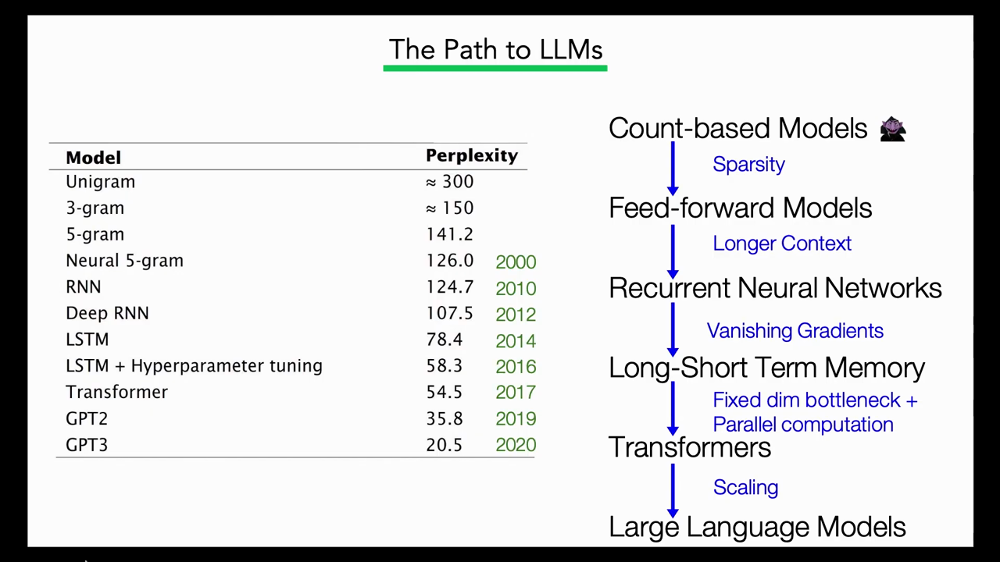
*▲ 강의 슬라이드 [07:50](https://youtu.be/9GWd3SAWLbA?t=470): LLM까지의 길. 모델별 [퍼플렉서티](00_%EB%94%A5%EB%9F%AC%EB%8B%9D_%EC%9A%A9%EC%96%B4%EC%82%AC%EC%A0%84.md#perplexity-%ED%8D%BC%ED%94%8C%EB%A0%89%EC%84%9C%ED%8B%B0)(왼쪽)와 각 단계가 푼 문제(오른쪽)*

[퍼플렉서티](00_%EB%94%A5%EB%9F%AC%EB%8B%9D_%EC%9A%A9%EC%96%B4%EC%82%AC%EC%A0%84.md#perplexity-%ED%8D%BC%ED%94%8C%EB%A0%89%EC%84%9C%ED%8B%B0)는 [토큰](00_%EB%94%A5%EB%9F%AC%EB%8B%9D_%EC%9A%A9%EC%96%B4%EC%82%AC%EC%A0%84.md#token-%ED%86%A0%ED%81%B0)당 평균 음의 [로그](00_%EB%94%A5%EB%9F%AC%EB%8B%9D_%EC%9A%A9%EC%96%B4%EC%82%AC%EC%A0%84.md#log-ln-%EB%A1%9C%EA%B7%B8) [확률](00_%EB%94%A5%EB%9F%AC%EB%8B%9D_%EC%9A%A9%EC%96%B4%EC%82%AC%EC%A0%84.md#probability-%ED%99%95%EB%A5%A0)([교차 엔트로피](00_%EB%94%A5%EB%9F%AC%EB%8B%9D_%EC%9A%A9%EC%96%B4%EC%82%AC%EC%A0%84.md#cross-entropy-%EA%B5%90%EC%B0%A8-%EC%97%94%ED%8A%B8%EB%A1%9C%ED%94%BC), [Lec10 8.1](Lec10_%EA%B8%B0%EC%96%B5%EA%B3%BC_%EC%8B%9C%ED%80%80%EC%8A%A4.md#81-%EC%B5%9C%EB%8C%80-%EC%9A%B0%EB%8F%84-%ED%95%99%EC%8A%B5%EA%B3%BC-%EA%B5%90%EC%82%AC-%EA%B0%95%EC%9A%94))에 $e$를 씌운 값으로, "평균 몇 지 선다만큼 헷갈리나"로 읽습니다.

$$
\text{PPL} = \exp\Big(-\frac{1}{N}\sum_{t=1}^{N} \ln p(w_t \mid w_{<t})\Big)
$$

기호 풀이

| 기호 | 읽는 법 | 뜻 | 예제 값 |
| --- | --- | --- | --- |
| $N$ | 엔 | 시험 글의 [토큰](00_%EB%94%A5%EB%9F%AC%EB%8B%9D_%EC%9A%A9%EC%96%B4%EC%82%AC%EC%A0%84.md#token-%ED%86%A0%ED%81%B0) 수 | 4 |
| $p(w_t \mid w_{<t})$ | 피 | 모델이 실제 다음 단어에 준 [확률](00_%EB%94%A5%EB%9F%AC%EB%8B%9D_%EC%9A%A9%EC%96%B4%EC%82%AC%EC%A0%84.md#probability-%ED%99%95%EB%A5%A0) | 0.5, 0.25, 0.5, 0.125 |
| $\ln$ | 엘엔 | 자연[로그](00_%EB%94%A5%EB%9F%AC%EB%8B%9D_%EC%9A%A9%EC%96%B4%EC%82%AC%EC%A0%84.md#log-ln-%EB%A1%9C%EA%B7%B8) | $\ln 0.5 = -0.6931$ |
| $\sum_{t=1}^{N}$ | 시그마 | $t = 1$부터 $N$까지 더한다 | 네 항 |
| $\exp$ | 익스포넨셜 | $e^{(\cdot)}$ | $e^{1.213} = 3.3636$ |
| $\text{PPL}$ | [퍼플렉서티](00_%EB%94%A5%EB%9F%AC%EB%8B%9D_%EC%9A%A9%EC%96%B4%EC%82%AC%EC%A0%84.md#perplexity-%ED%8D%BC%ED%94%8C%EB%A0%89%EC%84%9C%ED%8B%B0) | 낮을수록 좋은 예측 | 3.3636 |

예제와 풀이

**문제**: 모델이 네 단어짜리 시험 문장의 실제 단어마다 0.5, 0.25, 0.5, 0.125의 [확률](00_%EB%94%A5%EB%9F%AC%EB%8B%9D_%EC%9A%A9%EC%96%B4%EC%82%AC%EC%A0%84.md#probability-%ED%99%95%EB%A5%A0)을 주었다. [퍼플렉서티](00_%EB%94%A5%EB%9F%AC%EB%8B%9D_%EC%9A%A9%EC%96%B4%EC%82%AC%EC%A0%84.md#perplexity-%ED%8D%BC%ED%94%8C%EB%A0%89%EC%84%9C%ED%8B%B0)는?

**주어진 값**
- $N = 4$ (단어 수)
- $p = 0.5, 0.25, 0.5, 0.125$ (단어마다 실제 단어에 준 [확률](00_%EB%94%A5%EB%9F%AC%EB%8B%9D_%EC%9A%A9%EC%96%B4%EC%82%AC%EC%A0%84.md#probability-%ED%99%95%EB%A5%A0))

**풀이**
1. 식을 그대로 쓴다: $\text{PPL} = \exp\Big(-\dfrac{1}{N}\sum_{t=1}^{N} \ln p(w_t \mid w_{<t})\Big)$
2. 값을 대입한다 (Σ를 네 항으로 펼침): $\text{PPL} = \exp\Big(-\dfrac{1}{4}\big(\ln 0.5 + \ln 0.25 + \ln 0.5 + \ln 0.125\big)\Big)$
3. [로그](00_%EB%94%A5%EB%9F%AC%EB%8B%9D_%EC%9A%A9%EC%96%B4%EC%82%AC%EC%A0%84.md#log-ln-%EB%A1%9C%EA%B7%B8)를 계산한다. $\ln a$는 "$e$(약 2.718)를 몇 제곱해야 $a$가 되나"이고 계산기의 ln 키로 구한다: $\ln 0.5 = -0.6931$, $\ln 0.25 = -1.3863$, $\ln 0.125 = -2.0794$
4. 앞의 두 항을 더한다: $-0.6931 + (-1.3863) = -2.0794$
5. 셋째 항을 더한다: $-2.0794 + (-0.6931) = -2.7725$
6. 넷째 항을 더한다: $-2.7725 + (-2.0794) = -4.8519$
7. $-\frac{1}{4}$을 곱한다: $-\frac{1}{4} \times (-4.8519) = 1.213$
8. $e$를 씌운다. $\exp(a) = e^{a}$이고 계산기의 exp 키로 구한다: $e^{1.213} = 3.3636$

**답**: **3.3636**. 매 단어 약 3.4지 선다를 찍는 만큼 헷갈린다는 뜻이다. [GPT](00_%EB%94%A5%EB%9F%AC%EB%8B%9D_%EC%9A%A9%EC%96%B4%EC%82%AC%EC%A0%84.md#gpt-%EC%83%9D%EC%84%B1%ED%98%95-%EC%82%AC%EC%A0%84%ED%95%99%EC%8A%B5-%ED%8A%B8%EB%9E%9C%EC%8A%A4%ED%8F%AC%EB%A8%B8)-3의 20.5는 이 척도로 잰 값이다(어휘가 수만 개인 실제 말뭉치).

내 이해

### 2.3 크기만으로는 부족하다

▶ 영상 [07:43](https://youtu.be/9GWd3SAWLbA?t=463)

- 옛 방식으로도 "대형 [언어 모델](00_%EB%94%A5%EB%9F%AC%EB%8B%9D_%EC%9A%A9%EC%96%B4%EC%82%AC%EC%A0%84.md#language-model-%EC%96%B8%EC%96%B4-%EB%AA%A8%EB%8D%B8)"은 있었습니다. 기계 번역 문헌에서 LLM이라는 말을 거의 처음 쓴 논문은 **2조 [토큰](00_%EB%94%A5%EB%9F%AC%EB%8B%9D_%EC%9A%A9%EC%96%B4%EC%82%AC%EC%A0%84.md#token-%ED%86%A0%ED%81%B0)**으로 **3,000억 개 n-그램 횟수**를 [파라미터](00_%EB%94%A5%EB%9F%AC%EB%8B%9D_%EC%9A%A9%EC%96%B4%EC%82%AC%EC%A0%84.md#parameter-%ED%8C%8C%EB%9D%BC%EB%AF%B8%ED%84%B0)로 쓴 모델을 [학습](00_%EB%94%A5%EB%9F%AC%EB%8B%9D_%EC%9A%A9%EC%96%B4%EC%82%AC%EC%A0%84.md#training-%ED%95%99%EC%8A%B5)했습니다. 학생이 1995년이라고 추측하자 강사는 "2000년대 초"라고 했고, 슬라이드 속 논문은 Brants 등의 2007년 논문입니다.
- 강사의 요점: 요즘은 "데이터와 [파라미터](00_%EB%94%A5%EB%9F%AC%EB%8B%9D_%EC%9A%A9%EC%96%B4%EC%82%AC%EC%A0%84.md#parameter-%ED%8C%8C%EB%9D%BC%EB%AF%B8%ED%84%B0)만 늘리면 된다"고 말하는 습관이 있지만, 이 예는 **반대 증거**입니다. 오늘날 LLM만큼 [파라미터](00_%EB%94%A5%EB%9F%AC%EB%8B%9D_%EC%9A%A9%EC%96%B4%EC%82%AC%EC%A0%84.md#parameter-%ED%8C%8C%EB%9D%BC%EB%AF%B8%ED%84%B0)와 데이터를 쓴 모델이 예전에도 있었지만 지금 모델만 못했습니다. 신경망 [시퀀스](00_%EB%94%A5%EB%9F%AC%EB%8B%9D_%EC%9A%A9%EC%96%B4%EC%82%AC%EC%A0%84.md#sequence-%EC%8B%9C%ED%80%80%EC%8A%A4) 모델의 **[귀납 편향](00_%EB%94%A5%EB%9F%AC%EB%8B%9D_%EC%9A%A9%EC%96%B4%EC%82%AC%EC%A0%84.md#inductive-bias-%EA%B7%80%EB%82%A9-%ED%8E%B8%ED%96%A5)**에 특별한 무언가가 있고, [파라미터](00_%EB%94%A5%EB%9F%AC%EB%8B%9D_%EC%9A%A9%EC%96%B4%EC%82%AC%EC%A0%84.md#parameter-%ED%8C%8C%EB%9D%BC%EB%AF%B8%ED%84%B0)를 **어떻게** 쓰는지(구조 선택)가 중요하다는 것입니다.

---

## 3. 언어 모델 쓰임새의 역사

▶ 영상 [10:03](https://youtu.be/9GWd3SAWLbA?t=603)

| 시기 | 이름 | [언어 모델](00_%EB%94%A5%EB%9F%AC%EB%8B%9D_%EC%9A%A9%EC%96%B4%EC%82%AC%EC%A0%84.md#language-model-%EC%96%B8%EC%96%B4-%EB%AA%A8%EB%8D%B8)의 역할 |
|---|---|---|
| 1970~2014 | 파이프라인 NLP | 음성 인식, 기계 번역 시스템이 낸 후보를 **다시 순위 매기는** 채점기(잡음 통로 모델). "recognize speech"인가 "wreck a nice beach"인가, 번역의 성·수가 맞는가 |
| 2014~2017 | [seq2seq](00_%EB%94%A5%EB%9F%AC%EB%8B%9D_%EC%9A%A9%EC%96%B4%EC%82%AC%EC%A0%84.md#seq2seq-sequence-to-sequence-%EC%8B%9C%ED%80%80%EC%8A%A4-%ED%88%AC-%EC%8B%9C%ED%80%80%EC%8A%A4) | 번역을 "프랑스어 문장 다음에 오는 영어 단어 예측"으로 놓고, 조건부 [언어 모델](00_%EB%94%A5%EB%9F%AC%EB%8B%9D_%EC%9A%A9%EC%96%B4%EC%82%AC%EC%A0%84.md#language-model-%EC%96%B8%EC%96%B4-%EB%AA%A8%EB%8D%B8)이 **과제 자체**를 푼다. GRU, [어텐션](00_%EB%94%A5%EB%9F%AC%EB%8B%9D_%EC%9A%A9%EC%96%B4%EC%82%AC%EC%A0%84.md#attention-%EC%96%B4%ED%85%90%EC%85%98), [트랜스포머](00_%EB%94%A5%EB%9F%AC%EB%8B%9D_%EC%9A%A9%EC%96%B4%EC%82%AC%EC%A0%84.md#transformer-%ED%8A%B8%EB%9E%9C%EC%8A%A4%ED%8F%AC%EB%A8%B8)가 이때 나왔다 |
| 2017~2020 | [사전 학습](00_%EB%94%A5%EB%9F%AC%EB%8B%9D_%EC%9A%A9%EC%96%B4%EC%82%AC%EC%A0%84.md#pre-training-%EC%82%AC%EC%A0%84-%ED%95%99%EC%8A%B5) + 전이 | 큰 데이터로 다음 단어 예측(비슷한 목적)을 사전 학습하고, 과제별로 [미세 조정](00_%EB%94%A5%EB%9F%AC%EB%8B%9D_%EC%9A%A9%EC%96%B4%EC%82%AC%EC%A0%84.md#fine-tuning-%EB%AF%B8%EC%84%B8-%EC%A1%B0%EC%A0%95). 과제별 데이터가 훨씬 적게 든다 |
| 2020~ | [사전 학습](00_%EB%94%A5%EB%9F%AC%EB%8B%9D_%EC%9A%A9%EC%96%B4%EC%82%AC%EC%A0%84.md#pre-training-%EC%82%AC%EC%A0%84-%ED%95%99%EC%8A%B5) + 프롬프트 | 하나의 큰 [언어 모델](00_%EB%94%A5%EB%9F%AC%EB%8B%9D_%EC%9A%A9%EC%96%B4%EC%82%AC%EC%A0%84.md#language-model-%EC%96%B8%EC%96%B4-%EB%AA%A8%EB%8D%B8)로 모든 일을. [파라미터](00_%EB%94%A5%EB%9F%AC%EB%8B%9D_%EC%9A%A9%EC%96%B4%EC%82%AC%EC%A0%84.md#parameter-%ED%8C%8C%EB%9D%BC%EB%AF%B8%ED%84%B0)를 거의 건드리지 않고 프롬프트로 시킨다 |

- 2017년 이후 바뀐 것은 모델 자체보다 **[학습](00_%EB%94%A5%EB%9F%AC%EB%8B%9D_%EC%9A%A9%EC%96%B4%EC%82%AC%EC%A0%84.md#training-%ED%95%99%EC%8A%B5) 절차**입니다. 예전에는 과제 데이터셋 하나로 무작위 초기화한 모델을 [학습](00_%EB%94%A5%EB%9F%AC%EB%8B%9D_%EC%9A%A9%EC%96%B4%EC%82%AC%EC%A0%84.md#training-%ED%95%99%EC%8A%B5)해 그 과제만 잘하는 모델을 얻었습니다. 이후 과제 사이의 **전이 효과**가 크다는 것이 알려졌습니다([Lec18](Lec18_%EC%A0%84%EC%9D%B4_%ED%95%99%EC%8A%B5_%EB%AA%A8%EB%8D%B8.md#1-%EC%A0%81%EC%9D%80-%EB%8D%B0%EC%9D%B4%ED%84%B0%EB%A1%9C-%EB%B0%B0%EC%9A%B0%EA%B8%B0)의 [전이 학습](00_%EB%94%A5%EB%9F%AC%EB%8B%9D_%EC%9A%A9%EC%96%B4%EC%82%AC%EC%A0%84.md#transfer-learning-%EC%A0%84%EC%9D%B4-%ED%95%99%EC%8A%B5)).
- 강의는 뒤의 두 단계를 자세히 봅니다.

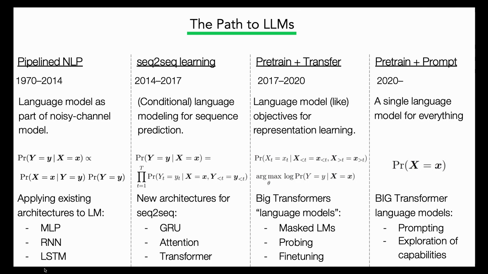
*▲ 강의 슬라이드 [13:20](https://youtu.be/9GWd3SAWLbA?t=800): LLM까지의 길. 파이프라인 NLP → seq2seq → [사전 학습](00_%EB%94%A5%EB%9F%AC%EB%8B%9D_%EC%9A%A9%EC%96%B4%EC%82%AC%EC%A0%84.md#pre-training-%EC%82%AC%EC%A0%84-%ED%95%99%EC%8A%B5) + 전이 → [사전 학습](00_%EB%94%A5%EB%9F%AC%EB%8B%9D_%EC%9A%A9%EC%96%B4%EC%82%AC%EC%A0%84.md#pre-training-%EC%82%AC%EC%A0%84-%ED%95%99%EC%8A%B5) + 프롬프트. 각 칸 아래는 그 시기의 대표 식과 구조*

---

## 4. 사전 학습과 전이

▶ 영상 [13:58](https://youtu.be/9GWd3SAWLbA?t=838)

### 4.1 가린 언어 모델링

▶ 영상 [13:58](https://youtu.be/9GWd3SAWLbA?t=838)

- **가린 언어 모델링**(masked language modeling): 글에서 일부 단어를 가리고, 주변 맥락으로 가린 단어를 맞히게 합니다([가린 예측](00_%EB%94%A5%EB%9F%AC%EB%8B%9D_%EC%9A%A9%EC%96%B4%EC%82%AC%EC%A0%84.md#masked-prediction-imputation-%EA%B0%80%EB%A6%B0-%EC%98%88%EC%B8%A1%EA%B3%BC-%EA%B2%B0%EC%B8%A1-%EB%8C%80%EC%B2%B4), [Lec11 10.3](Lec11_%ED%91%9C%ED%98%84_%ED%95%99%EC%8A%B5_%EC%9E%AC%EA%B5%AC%EC%84%B1.md#103-%EA%B0%80%EB%A6%B0-%EC%98%A4%ED%86%A0%EC%9D%B8%EC%BD%94%EB%8D%94%EC%99%80-bert)). 라벨 달린 과제 데이터가 필요 없어 구할 수 있는 모든 글로 [학습](00_%EB%94%A5%EB%9F%AC%EB%8B%9D_%EC%9A%A9%EC%96%B4%EC%82%AC%EC%A0%84.md#training-%ED%95%99%EC%8A%B5)합니다.
- 이 모델 자체는 특별히 쓸 데가 없지만, 언어의 구조와 뜻을 많이 알게 되어 **표현이 다운스트림 과제에 아주 쓸모 있습니다**. 마지막 [층](00_%EB%94%A5%EB%9F%AC%EB%8B%9D_%EC%9A%A9%EC%96%B4%EC%82%AC%EC%A0%84.md#layer-%EC%B8%B5)의 은닉 표현 하나(예: [CLS] [토큰](00_%EB%94%A5%EB%9F%AC%EB%8B%9D_%EC%9A%A9%EC%96%B4%EC%82%AC%EC%A0%84.md#token-%ED%86%A0%ED%81%B0))에 선형 [층](00_%EB%94%A5%EB%9F%AC%EB%8B%9D_%EC%9A%A9%EC%96%B4%EC%82%AC%EC%A0%84.md#layer-%EC%B8%B5)과 [소프트맥스](00_%EB%94%A5%EB%9F%AC%EB%8B%9D_%EC%9A%A9%EC%96%B4%EC%82%AC%EC%A0%84.md#softmax-%EC%86%8C%ED%94%84%ED%8A%B8%EB%A7%A5%EC%8A%A4)를 붙여 감정 [분류](00_%EB%94%A5%EB%9F%AC%EB%8B%9D_%EC%9A%A9%EC%96%B4%EC%82%AC%EC%A0%84.md#regression-classification-%ED%9A%8C%EA%B7%80%EC%99%80-%EB%B6%84%EB%A5%98) 등으로 [미세 조정](00_%EB%94%A5%EB%9F%AC%EB%8B%9D_%EC%9A%A9%EC%96%B4%EC%82%AC%EC%A0%84.md#fine-tuning-%EB%AF%B8%EC%84%B8-%EC%A1%B0%EC%A0%95)합니다.
- 지나고 보면 당연해 보이지만 당시엔 큰 사건이었습니다. 다음 단어 예측이 원리상 좋은 [사전 과제](00_%EB%94%A5%EB%9F%AC%EB%8B%9D_%EC%9A%A9%EC%96%B4%EC%82%AC%EC%A0%84.md#pretext-task-%EC%82%AC%EC%A0%84-%EA%B3%BC%EC%A0%9C)라는 것은 다들 알았고 단어 [임베딩](00_%EB%94%A5%EB%9F%AC%EB%8B%9D_%EC%9A%A9%EC%96%B4%EC%82%AC%EC%A0%84.md#embedding-%EC%9E%84%EB%B2%A0%EB%94%A9)의 전이 효과도 있었지만, 큰 규모의 [사전 학습](00_%EB%94%A5%EB%9F%AC%EB%8B%9D_%EC%9A%A9%EC%96%B4%EC%82%AC%EC%A0%84.md#pre-training-%EC%82%AC%EC%A0%84-%ED%95%99%EC%8A%B5)을 제대로 통하게 하는 비법은 아무도 찾지 못했습니다. [BERT](00_%EB%94%A5%EB%9F%AC%EB%8B%9D_%EC%9A%A9%EC%96%B4%EC%82%AC%EC%A0%84.md#bert-%EB%B2%84%ED%8A%B8)와 그보다 조금 앞선 ELMo([RNN](00_%EB%94%A5%EB%9F%AC%EB%8B%9D_%EC%9A%A9%EC%96%B4%EC%82%AC%EC%A0%84.md#rnn-recurrent-neural-network-%EC%88%9C%ED%99%98-%EC%8B%A0%EA%B2%BD%EB%A7%9D) [언어 모델](00_%EB%94%A5%EB%9F%AC%EB%8B%9D_%EC%9A%A9%EC%96%B4%EC%82%AC%EC%A0%84.md#language-model-%EC%96%B8%EC%96%B4-%EB%AA%A8%EB%8D%B8) 사용)가 큰 규모로 사전 학습하고 작은 규모로 [미세 조정](00_%EB%94%A5%EB%9F%AC%EB%8B%9D_%EC%9A%A9%EC%96%B4%EC%82%AC%EC%A0%84.md#fine-tuning-%EB%AF%B8%EC%84%B8-%EC%A1%B0%EC%A0%95)하면 문장 [분류](00_%EB%94%A5%EB%9F%AC%EB%8B%9D_%EC%9A%A9%EC%96%B4%EC%82%AC%EC%A0%84.md#regression-classification-%ED%9A%8C%EA%B7%80%EC%99%80-%EB%B6%84%EB%A5%98), 함의 판단, 감정 분석 등에서 아주 잘한다는 것을 보였습니다.

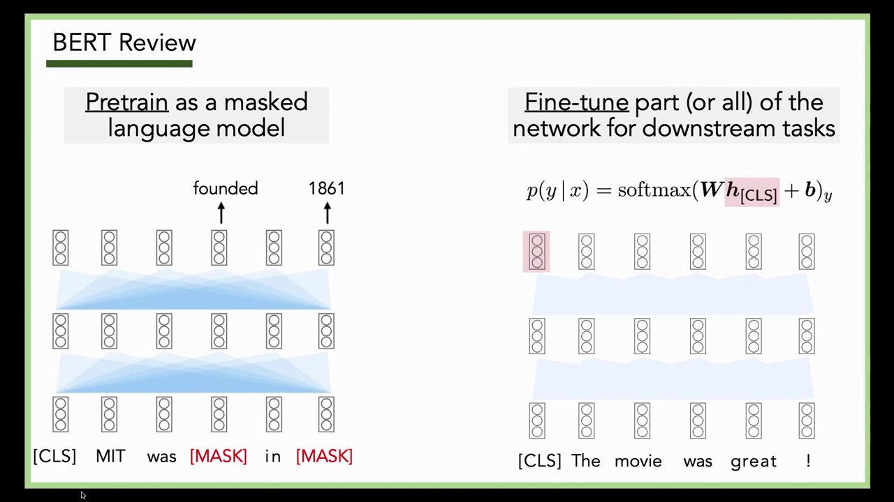
*▲ 강의 슬라이드 [14:30](https://youtu.be/9GWd3SAWLbA?t=870): [BERT](00_%EB%94%A5%EB%9F%AC%EB%8B%9D_%EC%9A%A9%EC%96%B4%EC%82%AC%EC%A0%84.md#bert-%EB%B2%84%ED%8A%B8) 복습. 왼쪽은 "[CLS] MIT was [MASK] in [MASK]"의 가린 자리에 founded, 1861을 맞히는 [사전 학습](00_%EB%94%A5%EB%9F%AC%EB%8B%9D_%EC%9A%A9%EC%96%B4%EC%82%AC%EC%A0%84.md#pre-training-%EC%82%AC%EC%A0%84-%ED%95%99%EC%8A%B5), 오른쪽은 [CLS] 표현 위에 $\text{softmax}(W h_{[\text{CLS}]} + b)$를 얹는 [미세 조정](00_%EB%94%A5%EB%9F%AC%EB%8B%9D_%EC%9A%A9%EC%96%B4%EC%82%AC%EC%A0%84.md#fine-tuning-%EB%AF%B8%EC%84%B8-%EC%A1%B0%EC%A0%95)*

### 4.2 왜 통하나: 언어 지식과 세상 지식

▶ 영상 [16:42](https://youtu.be/9GWd3SAWLbA?t=1002)

- 가린 단어 맞히기를 정말 잘하려면 두 가지가 필요합니다.
  - **언어 지식**: "MIT was ___"의 빈칸은 과거형 동사여야 하고, 주어 MIT와 수가 맞아야 합니다.
  - **세상 지식**: "MIT was founded in ___"를 채우려면 MIT가 1861년에 세워졌다는 우연한 사실을 외워야 합니다.
- 사실이 담긴 모든 글로 [학습](00_%EB%94%A5%EB%9F%AC%EB%8B%9D_%EC%9A%A9%EC%96%B4%EC%82%AC%EC%A0%84.md#training-%ED%95%99%EC%8A%B5)하면 이런 지식이 [파라미터](00_%EB%94%A5%EB%9F%AC%EB%8B%9D_%EC%9A%A9%EC%96%B4%EC%82%AC%EC%A0%84.md#parameter-%ED%8C%8C%EB%9D%BC%EB%AF%B8%ED%84%B0) 안에 쌓이고, [미세 조정](00_%EB%94%A5%EB%9F%AC%EB%8B%9D_%EC%9A%A9%EC%96%B4%EC%82%AC%EC%A0%84.md#fine-tuning-%EB%AF%B8%EC%84%B8-%EC%A1%B0%EC%A0%95)으로 쉽게 꺼내 쓸 수 있습니다.

### 4.3 생성하려면: 자기회귀 사전 학습

▶ 영상 [17:48](https://youtu.be/9GWd3SAWLbA?t=1068)

- 가린 [언어 모델](00_%EB%94%A5%EB%9F%AC%EB%8B%9D_%EC%9A%A9%EC%96%B4%EC%82%AC%EC%A0%84.md#language-model-%EC%96%B8%EC%96%B4-%EB%AA%A8%EB%8D%B8)은 **글을 생성하지 못합니다**. 입력 형식상 문장 길이를 이미 알고, 빈칸이 끝이 아니라 대개 가운데에 있도록 [학습](00_%EB%94%A5%EB%9F%AC%EB%8B%9D_%EC%9A%A9%EC%96%B4%EC%82%AC%EC%A0%84.md#training-%ED%95%99%EC%8A%B5)했기 때문입니다. 그래서 번역이나 요약처럼 글을 내야 하는 과제는 생성하는 둘째 부분을 처음부터 [학습](00_%EB%94%A5%EB%9F%AC%EB%8B%9D_%EC%9A%A9%EC%96%B4%EC%82%AC%EC%A0%84.md#training-%ED%95%99%EC%8A%B5)해야 했습니다.
- 해법은 단순했습니다. [사전 학습](00_%EB%94%A5%EB%9F%AC%EB%8B%9D_%EC%9A%A9%EC%96%B4%EC%82%AC%EC%A0%84.md#pre-training-%EC%82%AC%EC%A0%84-%ED%95%99%EC%8A%B5)도 효과적이고, 다음 단어를 예측하는 조건부 [생성 모델](00_%EB%94%A5%EB%9F%AC%EB%8B%9D_%EC%9A%A9%EC%96%B4%EC%82%AC%EC%A0%84.md#generative-model-%EC%83%9D%EC%84%B1-%EB%AA%A8%EB%8D%B8)도 이미 있으니 **둘을 합치자**. 번역이나 요약에 특화하지 않고, 파이프라인 시절처럼 "모든 영어 문장(또는 모든 언어의 문장)의 아주 좋은 모델"을 [자기회귀](00_%EB%94%A5%EB%9F%AC%EB%8B%9D_%EC%9A%A9%EC%96%B4%EC%82%AC%EC%A0%84.md#autoregressive-model-%EC%9E%90%EA%B8%B0%ED%9A%8C%EA%B7%80-%EB%AA%A8%EB%8D%B8) 방식으로 사전 학습합니다([GPT](00_%EB%94%A5%EB%9F%AC%EB%8B%9D_%EC%9A%A9%EC%96%B4%EC%82%AC%EC%A0%84.md#gpt-%EC%83%9D%EC%84%B1%ED%98%95-%EC%82%AC%EC%A0%84%ED%95%99%EC%8A%B5-%ED%8A%B8%EB%9E%9C%EC%8A%A4%ED%8F%AC%EB%A8%B8), [Lec08 8.2](Lec08_%ED%8A%B8%EB%9E%9C%EC%8A%A4%ED%8F%AC%EB%A8%B8.md#82-%EC%9D%B8%EA%B3%BC-%EB%A7%88%EC%8A%A4%ED%81%AC)의 인과 마스크).
- 처음에는 이 모델도 [BERT](00_%EB%94%A5%EB%9F%AC%EB%8B%9D_%EC%9A%A9%EC%96%B4%EC%82%AC%EC%A0%84.md#bert-%EB%B2%84%ED%8A%B8)처럼 표현을 뽑거나 [미세 조정](00_%EB%94%A5%EB%9F%AC%EB%8B%9D_%EC%9A%A9%EC%96%B4%EC%82%AC%EC%A0%84.md#fine-tuning-%EB%AF%B8%EC%84%B8-%EC%A1%B0%EC%A0%95)하는 출발점으로 썼고, 모델·데이터·[파라미터](00_%EB%94%A5%EB%9F%AC%EB%8B%9D_%EC%9A%A9%EC%96%B4%EC%82%AC%EC%A0%84.md#parameter-%ED%8C%8C%EB%9D%BC%EB%AF%B8%ED%84%B0)를 점점 키웠습니다. 강사는 2018~2022년 모델 크기 그래프의 점들이 모두 큰 기업 로고라는 점을 짚습니다. 그 무렵이 대학 연구실이 혼자 이 경쟁에 낄 수 있었던 마지막 해였다는 것입니다.

---

## 5. 규모가 커지면 생기는 능력

▶ 영상 [21:03](https://youtu.be/9GWd3SAWLbA?t=1263)

📐 **수학 개념**: [확률의 연쇄법칙과 빔 서치](%EC%88%98%ED%95%99%EA%B0%9C%EB%85%90/04_%ED%99%95%EB%A5%A0%EA%B3%BC_%EC%A0%95%EB%B3%B4/MM39_%ED%99%95%EB%A5%A0%EC%9D%98_%EC%97%B0%EC%87%84%EB%B2%95%EC%B9%99%EA%B3%BC_%EB%B9%94_%EC%84%9C%EC%B9%98.md)

- 그러다 무언가가 바뀌었습니다. 모델이 일정 규모([파라미터](00_%EB%94%A5%EB%9F%AC%EB%8B%9D_%EC%9A%A9%EC%96%B4%EC%82%AC%EC%A0%84.md#parameter-%ED%8C%8C%EB%9D%BC%EB%AF%B8%ED%84%B0)와 데이터)를 넘자 **추가 [미세 조정](00_%EB%94%A5%EB%9F%AC%EB%8B%9D_%EC%9A%A9%EC%96%B4%EC%82%AC%EC%A0%84.md#fine-tuning-%EB%AF%B8%EC%84%B8-%EC%A1%B0%EC%A0%95) 없이**, [파라미터](00_%EB%94%A5%EB%9F%AC%EB%8B%9D_%EC%9A%A9%EC%96%B4%EC%82%AC%EC%A0%84.md#parameter-%ED%8C%8C%EB%9D%BC%EB%AF%B8%ED%84%B0)를 다시 건드리지 않고도 놀라운 일을 하기 시작했습니다.
- 예(Wei 등 2022, "LLM의 [창발 능력](00_%EB%94%A5%EB%9F%AC%EB%8B%9D_%EC%9A%A9%EC%96%B4%EC%82%AC%EC%A0%84.md#emergent-abilities-%EC%B0%BD%EB%B0%9C-%EB%8A%A5%EB%A0%A5)"): 산수를 따로 배우지 않았는데 산수를 하고, 단어의 국제음성기호(IPA) 표기 같은 전문 언어 지식을 쓰고, 페르시아어(Farsi) 질의응답처럼 과제별 데이터셋 없이 여러 언어로 일하고, 흔한 오해에 관한 질문(TruthfulQA)과 물체의 물리적 성질에 관한 질문에 답합니다. 규모를 키우면 어느 지점에서 성능이 갑자기 오르는 그래프입니다.
- 이것을 처음 크게 보인 것이 **[GPT](00_%EB%94%A5%EB%9F%AC%EB%8B%9D_%EC%9A%A9%EC%96%B4%EC%82%AC%EC%A0%84.md#gpt-%EC%83%9D%EC%84%B1%ED%98%95-%EC%82%AC%EC%A0%84%ED%95%99%EC%8A%B5-%ED%8A%B8%EB%9E%9C%EC%8A%A4%ED%8F%AC%EB%A8%B8)-3 논문**(Brown 등 2020, "Language Models are Few-Shot Learners")입니다. 강사는 "언어를 생성하도록 [학습](00_%EB%94%A5%EB%9F%AC%EB%8B%9D_%EC%9A%A9%EC%96%B4%EC%82%AC%EC%A0%84.md#training-%ED%95%99%EC%8A%B5)한 모델이 일정 규모에서 과제별 [미세 조정](00_%EB%94%A5%EB%9F%AC%EB%8B%9D_%EC%9A%A9%EC%96%B4%EC%82%AC%EC%A0%84.md#fine-tuning-%EB%AF%B8%EC%84%B8-%EC%A1%B0%EC%A0%95) 없이 온갖 능력을 얻는다"는 것이 지금 시대의 결정적 특징이라고 말합니다(뒤에 단서가 붙음).
- 그 일부는 능력이 원래 모델 안에 있었다는 발견이고, 일부는 그 능력을 **꺼내는 더 정교한 방법**을 찾아낸 것입니다. 다음 절의 주제입니다.

---

## 6. 맥락 내 학습

▶ 영상 [23:51](https://youtu.be/9GWd3SAWLbA?t=1431)

📐 **수학 개념**: [확률의 연쇄법칙과 빔 서치](%EC%88%98%ED%95%99%EA%B0%9C%EB%85%90/04_%ED%99%95%EB%A5%A0%EA%B3%BC_%EC%A0%95%EB%B3%B4/MM39_%ED%99%95%EB%A5%A0%EC%9D%98_%EC%97%B0%EC%87%84%EB%B2%95%EC%B9%99%EA%B3%BC_%EB%B9%94_%EC%84%9C%EC%B9%98.md) · [베이즈 규칙과 사전 확률 보정](%EC%88%98%ED%95%99%EA%B0%9C%EB%85%90/04_%ED%99%95%EB%A5%A0%EA%B3%BC_%EC%A0%95%EB%B3%B4/MM64_%EB%B2%A0%EC%9D%B4%EC%A6%88_%EA%B7%9C%EC%B9%99%EA%B3%BC_%EC%82%AC%EC%A0%84_%ED%99%95%EB%A5%A0_%EB%B3%B4%EC%A0%95.md)

[미세 조정](00_%EB%94%A5%EB%9F%AC%EB%8B%9D_%EC%9A%A9%EC%96%B4%EC%82%AC%EC%A0%84.md#fine-tuning-%EB%AF%B8%EC%84%B8-%EC%A1%B0%EC%A0%95)을 하지 않으면, [언어 모델](00_%EB%94%A5%EB%9F%AC%EB%8B%9D_%EC%9A%A9%EC%96%B4%EC%82%AC%EC%A0%84.md#language-model-%EC%96%B8%EC%96%B4-%EB%AA%A8%EB%8D%B8)을 조종하는 거의 유일한 수단은 **입력을 바꾸는 것**, 곧 다음 단어 예측의 맥락을 바꾸는 것입니다. 그 가장 강력한 도구가 [맥락 내 학습](00_%EB%94%A5%EB%9F%AC%EB%8B%9D_%EC%9A%A9%EC%96%B4%EC%82%AC%EC%A0%84.md#in-context-learning-%EB%A7%A5%EB%9D%BD-%EB%82%B4-%ED%95%99%EC%8A%B5)입니다([Lec18 8.1](Lec18_%EC%A0%84%EC%9D%B4_%ED%95%99%EC%8A%B5_%EB%AA%A8%EB%8D%B8.md#81-%ED%94%84%EB%A1%AC%ED%94%84%ED%8A%B8-%EA%B3%B5%ED%95%99%EA%B3%BC-%EB%A7%A5%EB%9D%BD-%EB%82%B4-%ED%95%99%EC%8A%B5)에서 처음 봄).

### 6.1 퓨샷 프롬프트: 그럴듯한 가짜 문서

▶ 영상 [24:25](https://youtu.be/9GWd3SAWLbA?t=1465)

- **순진한 방법**: 영화평에 별점을 붙이려고 "This movie was terrible" 다음에 "positive"가 올 [확률](00_%EB%94%A5%EB%9F%AC%EB%8B%9D_%EC%9A%A9%EC%96%B4%EC%82%AC%EC%A0%84.md#probability-%ED%99%95%EB%A5%A0)을 묻는다. 그런데 인터넷을 돌아다니다 어떤 웹페이지가 "This movie was terrible"로 끝났다면, 그 뒤에 평가 라벨이 올 [확률](00_%EB%94%A5%EB%9F%AC%EB%8B%9D_%EC%9A%A9%EC%96%B4%EC%82%AC%EC%A0%84.md#probability-%ED%99%95%EB%A5%A0)은 아주 낮습니다. 사람들은 "This movie was terrible positive"라고 쓰지 않습니다. 모델은 "and"나 다음 영화평의 시작에 [확률](00_%EB%94%A5%EB%9F%AC%EB%8B%9D_%EC%9A%A9%EC%96%B4%EC%82%AC%EC%A0%84.md#probability-%ED%99%95%EB%A5%A0)을 몰아줍니다.
- **요령**: positive가 다음 단어로 나올 법한 **가짜 문서**를 만듭니다. "I loved it. positive / Worst film ever. negative / This movie was terrible." 이런 페이지를 보면 사람도 다음 단어가 positive나 negative일 거라 보고, 앞의 라벨이 감정과 맞으니 negative 쪽에 무게를 둡니다. 이것이 **[맥락 내 학습](00_%EB%94%A5%EB%9F%AC%EB%8B%9D_%EC%9A%A9%EC%96%B4%EC%82%AC%EC%A0%84.md#in-context-learning-%EB%A7%A5%EB%9D%BD-%EB%82%B4-%ED%95%99%EC%8A%B5)** 또는 **퓨샷 [프롬프팅](00_%EB%94%A5%EB%9F%AC%EB%8B%9D_%EC%9A%A9%EC%96%B4%EC%82%AC%EC%A0%84.md#prompting-%ED%94%84%EB%A1%AC%ED%94%84%ED%8C%85)**(few-shot prompting)입니다.
- 경험적 발견: 충분히 큰 모델을 충분히 큰 데이터로 [학습](00_%EB%94%A5%EB%9F%AC%EB%8B%9D_%EC%9A%A9%EC%96%B4%EC%82%AC%EC%A0%84.md#training-%ED%95%99%EC%8A%B5)하면, 평범한 다음 [토큰](00_%EB%94%A5%EB%9F%AC%EB%8B%9D_%EC%9A%A9%EC%96%B4%EC%82%AC%EC%A0%84.md#token-%ED%86%A0%ED%81%B0) 예측기도 이렇게 "이상한 문서의 구조를 알아내 빈칸을 채우는" 능력을 얻습니다.

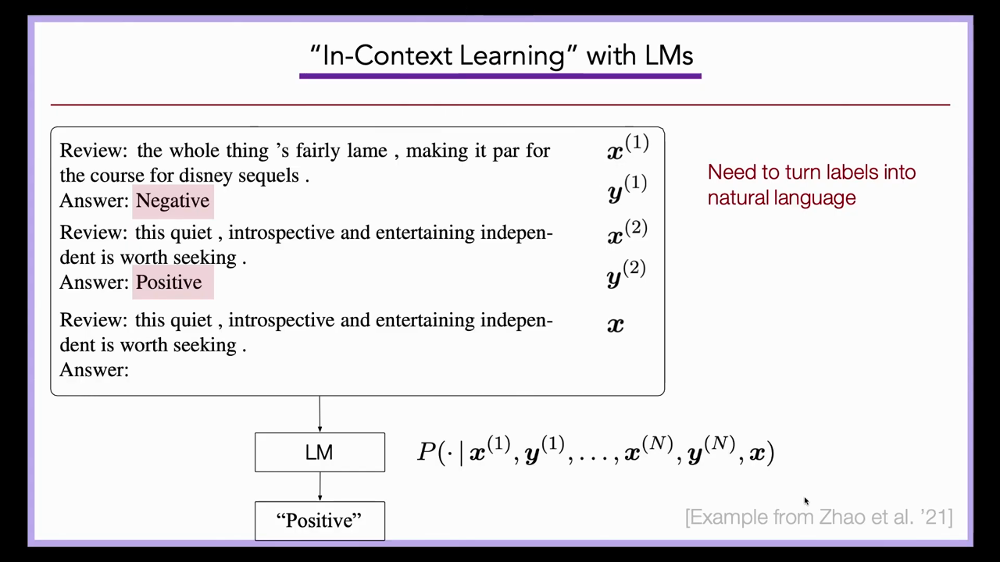
*▲ 강의 슬라이드 [30:05](https://youtu.be/9GWd3SAWLbA?t=1805): [맥락 내 학습](00_%EB%94%A5%EB%9F%AC%EB%8B%9D_%EC%9A%A9%EC%96%B4%EC%82%AC%EC%A0%84.md#in-context-learning-%EB%A7%A5%EB%9D%BD-%EB%82%B4-%ED%95%99%EC%8A%B5). 리뷰와 라벨 쌍 $(x^{(i)}, y^{(i)})$를 앞에 두고 새 리뷰 $x$를 넣으면 LM이 $P(\cdot \mid x^{(1)}, y^{(1)}, \dots, x^{(N)}, y^{(N)}, x)$에서 "Positive"를 낸다. 라벨을 자연어 단어로 바꿔야 한다*

$$
\hat{y} = \arg\max_{y \in \{\text{positive},\, \text{negative}\}} p\big(y \mid x^{(1)}, y^{(1)}, \dots, x^{(N)}, y^{(N)}, x\big)
$$

기호 풀이

| 기호 | 읽는 법 | 뜻 | 예제 값 |
| --- | --- | --- | --- |
| $x^{(i)}, y^{(i)}$ | 엑스 아이, 와이 아이 | 프롬프트에 넣은 $i$번째 예(리뷰와 라벨 단어) | "I loved it", positive |
| $N$ | 엔 | 예의 개수 | 2 |
| $x$ | 엑스 | 새로 판정할 리뷰 | "This movie was terrible" |
| $p(y \mid \cdots)$ | 피 | 그 가짜 문서 다음에 단어 $y$가 올 [확률](00_%EB%94%A5%EB%9F%AC%EB%8B%9D_%EC%9A%A9%EC%96%B4%EC%82%AC%EC%A0%84.md#probability-%ED%99%95%EB%A5%A0) (모델 [파라미터](00_%EB%94%A5%EB%9F%AC%EB%8B%9D_%EC%9A%A9%EC%96%B4%EC%82%AC%EC%A0%84.md#parameter-%ED%8C%8C%EB%9D%BC%EB%AF%B8%ED%84%B0)는 그대로) | 0.08, 0.85 |
| $\arg\max$ | 아그맥스 | 가장 큰 값을 내는 후보 | negative |
| $\hat{y}$ | 와이 햇 | 모델의 판정 | negative |

예제와 풀이

**문제**: 예 없이 "This movie was terrible" 뒤 단어를 물으면 모델은 positive에 0.001, "and"에 0.3을 준다(설명용 숫자). 예 두 개를 앞에 붙이자 positive 0.08, negative 0.85가 되었다. [맥락 내 학습](00_%EB%94%A5%EB%9F%AC%EB%8B%9D_%EC%9A%A9%EC%96%B4%EC%82%AC%EC%A0%84.md#in-context-learning-%EB%A7%A5%EB%9D%BD-%EB%82%B4-%ED%95%99%EC%8A%B5)의 판정은?

**주어진 값**
- $N = 2$ (예: "I loved it" → positive, "Worst film ever" → negative)
- $x$ = "This movie was terrible" (판정할 리뷰)
- $p(\text{positive} \mid \cdots) = 0.08$, $p(\text{negative} \mid \cdots) = 0.85$ (예를 붙인 뒤 두 라벨 단어의 [확률](00_%EB%94%A5%EB%9F%AC%EB%8B%9D_%EC%9A%A9%EC%96%B4%EC%82%AC%EC%A0%84.md#probability-%ED%99%95%EB%A5%A0))

**풀이**
1. 식을 그대로 쓴다: $\hat{y} = \arg\max_{y \in \{\text{positive},\, \text{negative}\}} p\big(y \mid x^{(1)}, y^{(1)}, x^{(2)}, y^{(2)}, x\big)$
2. 값을 대입한다 (후보 둘을 펼침): $\hat{y} = \arg\max\{\text{positive}: 0.08,\; \text{negative}: 0.85\}$
3. 두 값을 비교한다: $0.85 > 0.08$
4. 큰 쪽의 후보를 고른다: $\hat{y} = \text{negative}$

**답**: **negative**. 예를 붙이기 전에는 두 라벨 단어 모두 [확률](00_%EB%94%A5%EB%9F%AC%EB%8B%9D_%EC%9A%A9%EC%96%B4%EC%82%AC%EC%A0%84.md#probability-%ED%99%95%EB%A5%A0)이 거의 0이었다. 예는 "다음에 라벨 단어가 온다"는 형식을 알려 준다.

내 이해

### 6.2 제로샷 지시

▶ 영상 [27:47](https://youtu.be/9GWd3SAWLbA?t=1667)

- **제로샷 [프롬프팅](00_%EB%94%A5%EB%9F%AC%EB%8B%9D_%EC%9A%A9%EC%96%B4%EC%82%AC%EC%A0%84.md#prompting-%ED%94%84%EB%A1%AC%ED%94%84%ED%8C%85)**: 예 대신 과제를 설명하는 자연어 지시만 줍니다("Translate English to French: cheese =>"). 이것도 충분히 큰 모델에서 나타난 능력입니다([퓨샷 학습과 제로샷 학습](00_%EB%94%A5%EB%9F%AC%EB%8B%9D_%EC%9A%A9%EC%96%B4%EC%82%AC%EC%A0%84.md#few-shot-learning-zero-shot-learning-%ED%93%A8%EC%83%B7-%ED%95%99%EC%8A%B5%EA%B3%BC-%EC%A0%9C%EB%A1%9C%EC%83%B7-%ED%95%99%EC%8A%B5)).
- 지시와 예를 함께 주거나, 예 뒤에 지시를 주거나, 예외 사례·출력 형식·대소문자까지 자세히 설명할 수도 있습니다. 대부분의 모델은 이런 변형에 꽤 강건합니다.

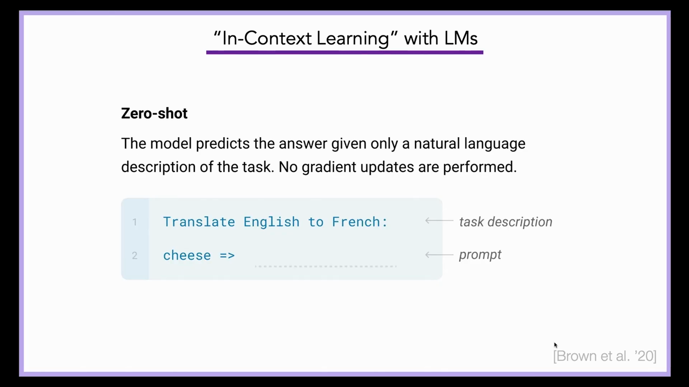
*▲ 강의 슬라이드 [28:15](https://youtu.be/9GWd3SAWLbA?t=1695): 제로샷. 과제 설명("Translate English to French:")과 프롬프트("cheese =>")만 주고, [기울기](00_%EB%94%A5%EB%9F%AC%EB%8B%9D_%EC%9A%A9%EC%96%B4%EC%82%AC%EC%A0%84.md#gradient-%EA%B8%B0%EC%9A%B8%EA%B8%B0) 갱신은 하지 않는다*

### 6.3 정말 배우는 것인가

▶ 영상 [29:26](https://youtu.be/9GWd3SAWLbA?t=1766)

- 겉보기에는 $(x, y)$ 쌍을 주고 새 $x$의 $y$를 맞히게 하는 [지도 학습](00_%EB%94%A5%EB%9F%AC%EB%8B%9D_%EC%9A%A9%EC%96%B4%EC%82%AC%EC%A0%84.md#supervised-learning-%EC%A7%80%EB%8F%84-%ED%95%99%EC%8A%B5)과 닮았습니다. 그러면 이것을 [경사하강법](00_%EB%94%A5%EB%9F%AC%EB%8B%9D_%EC%9A%A9%EC%96%B4%EC%82%AC%EC%A0%84.md#gradient-descent-%EA%B2%BD%EC%82%AC%ED%95%98%EA%B0%95%EB%B2%95) 같은 "[학습](00_%EB%94%A5%EB%9F%AC%EB%8B%9D_%EC%9A%A9%EC%96%B4%EC%82%AC%EC%A0%84.md#training-%ED%95%99%EC%8A%B5)"으로 봐야 할까요?
- **형식만 배운다는 [가설](00_%EB%94%A5%EB%9F%AC%EB%8B%9D_%EC%9A%A9%EC%96%B4%EC%82%AC%EC%A0%84.md#hypothesis-%EA%B0%80%EC%84%A4)**: 프롬프트로 알 수 있는 것은 출력이 positive나 negative라는 것, 문장 하나 뒤에 바로 답한다는 것, 입력이 짧은 영화평이라는 것 정도입니다. 번역 예 세 개로 새 언어를 배울 리는 없습니다. 그러니 성능의 대부분은 [사전 학습](00_%EB%94%A5%EB%9F%AC%EB%8B%9D_%EC%9A%A9%EC%96%B4%EC%82%AC%EC%A0%84.md#pre-training-%EC%82%AC%EC%A0%84-%ED%95%99%EC%8A%B5)에서 오고 맥락은 형식만 알려 준다는 생각입니다.
- **증거(Min 등 2022)**: 맥락 속 예의 라벨을 무작위로 섞어도 성능이 거의 떨어지지 않았습니다. 그래서 한동안 통념은 "[맥락 내 학습](00_%EB%94%A5%EB%9F%AC%EB%8B%9D_%EC%9A%A9%EC%96%B4%EC%82%AC%EC%A0%84.md#in-context-learning-%EB%A7%A5%EB%9D%BD-%EB%82%B4-%ED%95%99%EC%8A%B5)은 [학습](00_%EB%94%A5%EB%9F%AC%EB%8B%9D_%EC%9A%A9%EC%96%B4%EC%82%AC%EC%A0%84.md#training-%ED%95%99%EC%8A%B5)이 아니라 이미 배운 과제를 **불러오는 것**"이었습니다. 라벨 단어(positive 대 good 대 엄지 이모지)나 예의 순서에도 성능이 크게 흔들렸습니다.
- **규모가 커지면 달라진다**: [GPT](00_%EB%94%A5%EB%9F%AC%EB%8B%9D_%EC%9A%A9%EC%96%B4%EC%82%AC%EC%A0%84.md#gpt-%EC%83%9D%EC%84%B1%ED%98%95-%EC%82%AC%EC%A0%84%ED%95%99%EC%8A%B5-%ED%8A%B8%EB%9E%9C%EC%8A%A4%ED%8F%AC%EB%A8%B8)-4 같은 더 큰 모델은 라벨과 입력의 연결에 실제로 주의를 기울입니다. 요즘 모델에 라벨을 거꾸로 준 감정 과제(긍정에 negative)를 주면, 감정 [분류](00_%EB%94%A5%EB%9F%AC%EB%8B%9D_%EC%9A%A9%EC%96%B4%EC%82%AC%EC%A0%84.md#regression-classification-%ED%9A%8C%EA%B7%80%EC%99%80-%EB%B6%84%EB%A5%98)라는 것과 라벨이 뒤집혔다는 것을 함께 알아챕니다.
- **이론**: 깨끗한 [합성 데이터](00_%EB%94%A5%EB%9F%AC%EB%8B%9D_%EC%9A%A9%EC%96%B4%EC%82%AC%EC%A0%84.md#synthetic-data-%ED%95%A9%EC%84%B1-%EB%8D%B0%EC%9D%B4%ED%84%B0) 실험에서는 모델이 은닉 표현 안에 작은 모델의 [파라미터](00_%EB%94%A5%EB%9F%AC%EB%8B%9D_%EC%9A%A9%EC%96%B4%EC%82%AC%EC%A0%84.md#parameter-%ED%8C%8C%EB%9D%BC%EB%AF%B8%ED%84%B0) 벡터를 담고, 예를 읽을수록 [층](00_%EB%94%A5%EB%9F%AC%EB%8B%9D_%EC%9A%A9%EC%96%B4%EC%82%AC%EC%A0%84.md#layer-%EC%B8%B5)을 지나며 그것을 [경사하강법](00_%EB%94%A5%EB%9F%AC%EB%8B%9D_%EC%9A%A9%EC%96%B4%EC%82%AC%EC%A0%84.md#gradient-descent-%EA%B2%BD%EC%82%AC%ED%95%98%EA%B0%95%EB%B2%95) 같은 알고리즘으로 갱신한다는 경험적·이론적 증거가 많습니다(강사 자신의 연구, Akyürek 등 2023 포함). 큰 모델 안에서 실제로 무엇이 일어나는지는 아무도 모르고, 아마 진짜 [학습](00_%EB%94%A5%EB%9F%AC%EB%8B%9D_%EC%9A%A9%EC%96%B4%EC%82%AC%EC%A0%84.md#training-%ED%95%99%EC%8A%B5), 과제 불러오기, 알 수 없는 휴리스틱이 섞여 있을 것입니다. 2022년만 해도 대부분이 "[학습](00_%EB%94%A5%EB%9F%AC%EB%8B%9D_%EC%9A%A9%EC%96%B4%EC%82%AC%EC%A0%84.md#training-%ED%95%99%EC%8A%B5)이 아니다"라고 봤지만 지금은 제한적으로나마 맥락 안에서 새 기술을 얻는다고 봅니다.

### 6.4 과제마다 모델 하나에서 모델 하나로

▶ 영상 [36:20](https://youtu.be/9GWd3SAWLbA?t=2180)

- 예전에는 번역, 요약, 개체명 인식, 사건 추출, 감정 분석마다 데이터를 모으고 모델을 따로 [학습](00_%EB%94%A5%EB%9F%AC%EB%8B%9D_%EC%9A%A9%EC%96%B4%EC%82%AC%EC%A0%84.md#training-%ED%95%99%EC%8A%B5)했습니다. 이제는 큰 모델 **하나**에, 무엇을 원하는지 알려 줄 만큼의 데이터만 줍니다.
- 이것이 되려면 첫 모델의 [학습 데이터](00_%EB%94%A5%EB%9F%AC%EB%8B%9D_%EC%9A%A9%EC%96%B4%EC%82%AC%EC%A0%84.md#training-data-test-data-%ED%95%99%EC%8A%B5-%EB%8D%B0%EC%9D%B4%ED%84%B0%EC%99%80-%EC%8B%9C%ED%97%98-%EB%8D%B0%EC%9D%B4%ED%84%B0)에 그런 과제의 증거가 이미 있어야 합니다. 지난 몇 년의 가장 놀라운 경험적 발견은, 인터넷을 (거의) 그냥 긁어 와도 번역·요약·개체명 인식·감정 분석의 예가, 적어도 그와 비슷한 과제의 예가 충분히 들어 있다는 것입니다.

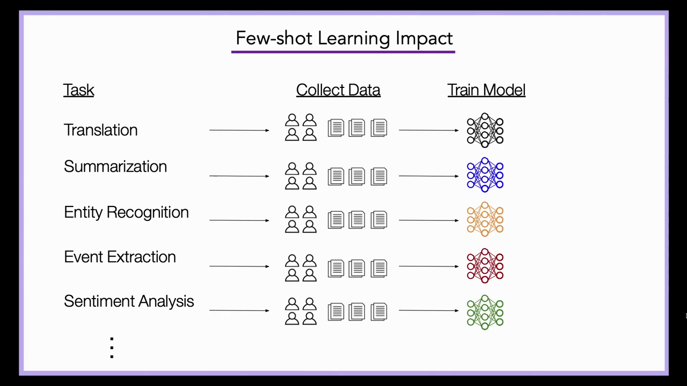
*▲ 강의 슬라이드 [36:30](https://youtu.be/9GWd3SAWLbA?t=2190): 퓨샷 [학습](00_%EB%94%A5%EB%9F%AC%EB%8B%9D_%EC%9A%A9%EC%96%B4%EC%82%AC%EC%A0%84.md#training-%ED%95%99%EC%8A%B5) 이전에는 과제(번역, 요약, 개체명 인식, 사건 추출, 감정 분석)마다 데이터를 모으고 모델을 따로 학습했다*

질의응답 정리 [50:29](https://youtu.be/9GWd3SAWLbA?t=3029)

- **모델이 모든 걸 잘하면 이제 [미세 조정](00_%EB%94%A5%EB%9F%AC%EB%8B%9D_%EC%9A%A9%EC%96%B4%EC%82%AC%EC%A0%84.md#fine-tuning-%EB%AF%B8%EC%84%B8-%EC%A1%B0%EC%A0%95)은 필요 없나?** 과제에 따라 다릅니다. 아주 새롭거나 이상한 입력이고 예가 아주 많다면, 맥락에 예를 넣는 것보다 [미세 조정](00_%EB%94%A5%EB%9F%AC%EB%8B%9D_%EC%9A%A9%EC%96%B4%EC%82%AC%EC%A0%84.md#fine-tuning-%EB%AF%B8%EC%84%B8-%EC%A1%B0%EC%A0%95)이 낫습니다. 지금 증거로는 예 10만 개를 맥락에 쏟아붓기보다 어떤 식으로든 [미세 조정](00_%EB%94%A5%EB%9F%AC%EB%8B%9D_%EC%9A%A9%EC%96%B4%EC%82%AC%EC%A0%84.md#fine-tuning-%EB%AF%B8%EC%84%B8-%EC%A1%B0%EC%A0%95)하는 편이 낫지만, [맥락](00_%EB%94%A5%EB%9F%AC%EB%8B%9D_%EC%9A%A9%EC%96%B4%EC%82%AC%EC%A0%84.md#context-window-%EB%A7%A5%EB%9D%BD-%EC%B0%BD)이 길어지며 바뀔 수 있습니다. 또 대부분의 사람은 아주 큰 모델을 [미세 조정](00_%EB%94%A5%EB%9F%AC%EB%8B%9D_%EC%9A%A9%EC%96%B4%EC%82%AC%EC%A0%84.md#fine-tuning-%EB%AF%B8%EC%84%B8-%EC%A1%B0%EC%A0%95)할 수 없거나 한 번밖에 못 하므로, 현실적으로 프롬프트가 가장 좋은 조종 수단인 경우가 많습니다.

> [!TIP]
> **🆕 2026 업데이트: 맥락에 예를 수백·수천 개 넣는 많은 예 [맥락 내 학습](00_%EB%94%A5%EB%9F%AC%EB%8B%9D_%EC%9A%A9%EC%96%B4%EC%82%AC%EC%A0%84.md#in-context-learning-%EB%A7%A5%EB%9D%BD-%EB%82%B4-%ED%95%99%EC%8A%B5)**
> - **강의**: 예 10만 개를 맥락에 넣는 것보다는 아직 [미세 조정](00_%EB%94%A5%EB%9F%AC%EB%8B%9D_%EC%9A%A9%EC%96%B4%EC%82%AC%EC%A0%84.md#fine-tuning-%EB%AF%B8%EC%84%B8-%EC%A1%B0%EC%A0%95)이 낫지만, 맥락이 길어지면 바뀔 수 있다.
> - **현재**: [맥락 창](00_%EB%94%A5%EB%9F%AC%EB%8B%9D_%EC%9A%A9%EC%96%B4%EC%82%AC%EC%A0%84.md#context-window-%EB%A7%A5%EB%9D%BD-%EC%B0%BD)이 100만 [토큰](00_%EB%94%A5%EB%9F%AC%EB%8B%9D_%EC%9A%A9%EC%96%B4%EC%82%AC%EC%A0%84.md#token-%ED%86%A0%ED%81%B0) 단위로 늘면서, 예를 수백~수천 개 넣는 **많은 예(many-shot) [맥락 내 학습](00_%EB%94%A5%EB%9F%AC%EB%8B%9D_%EC%9A%A9%EC%96%B4%EC%82%AC%EC%A0%84.md#in-context-learning-%EB%A7%A5%EB%9D%BD-%EB%82%B4-%ED%95%99%EC%8A%B5)**이 연구되었다. Google DeepMind의 연구(NeurIPS 2024)는 퓨샷에서 많은 예로 늘리면 생성·판별 과제 전반에서 성능이 크게 오르고, [미세 조정](00_%EB%94%A5%EB%9F%AC%EB%8B%9D_%EC%9A%A9%EC%96%B4%EC%82%AC%EC%A0%84.md#fine-tuning-%EB%AF%B8%EC%84%B8-%EC%A1%B0%EC%A0%95)과 견줄 만하며, [사전 학습](00_%EB%94%A5%EB%9F%AC%EB%8B%9D_%EC%9A%A9%EC%96%B4%EC%82%AC%EC%A0%84.md#pre-training-%EC%82%AC%EC%A0%84-%ED%95%99%EC%8A%B5)에서 생긴 [편향](00_%EB%94%A5%EB%9F%AC%EB%8B%9D_%EC%9A%A9%EC%96%B4%EC%82%AC%EC%A0%84.md#bias-%ED%8E%B8%ED%96%A5)을 뒤집는 데도 효과적이라고 보고했다. 다만 추론 비용은 예의 수에 비례해 늘어난다.
> - **출처**: [Agarwal et al., Many-Shot In-Context Learning (NeurIPS 2024)](https://arxiv.org/abs/2404.11018)

---

## 7. 생각의 사슬

▶ 영상 [38:02](https://youtu.be/9GWd3SAWLbA?t=2282)

📐 **수학 개념**: [확률의 연쇄법칙과 빔 서치](%EC%88%98%ED%95%99%EA%B0%9C%EB%85%90/04_%ED%99%95%EB%A5%A0%EA%B3%BC_%EC%A0%95%EB%B3%B4/MM39_%ED%99%95%EB%A5%A0%EC%9D%98_%EC%97%B0%EC%87%84%EB%B2%95%EC%B9%99%EA%B3%BC_%EB%B9%94_%EC%84%9C%EC%B9%98.md) · [조건부 확률과 독립](%EC%88%98%ED%95%99%EA%B0%9C%EB%85%90/04_%ED%99%95%EB%A5%A0%EA%B3%BC_%EC%A0%95%EB%B3%B4/MM58_%EC%A1%B0%EA%B1%B4%EB%B6%80_%ED%99%95%EB%A5%A0%EA%B3%BC_%EB%8F%85%EB%A6%BD.md)

### 7.1 답하기 전 계산량은 정해져 있다

▶ 영상 [38:35](https://youtu.be/9GWd3SAWLbA?t=2315)

- 지금까지의 과제는 문장을 보고 바로 답을 뱉을 수 있는, 이름 붙은 표준 과제였습니다. 하지만 사람이 몇 밀리초가 아니라 몇 초 이상 걸려 푸는, 더 복잡한 추론이 필요한 일도 많습니다.
- 2022년 무렵 최고 모델에게 "Roger는 테니스공 5개가 있다. 공 3개짜리 캔 2개를 더 산다. 이제 몇 개인가?" 같은 질문(앞에 비슷한 질문과 답 "11"을 예로 줌)을 바로 물으면 대개 틀렸습니다(슬라이드: 다음 질문에 "27"이라고 틀린 답).
- **직관**: [트랜스포머](00_%EB%94%A5%EB%9F%AC%EB%8B%9D_%EC%9A%A9%EC%96%B4%EC%82%AC%EC%A0%84.md#transformer-%ED%8A%B8%EB%9E%9C%EC%8A%A4%ED%8F%AC%EB%A8%B8)를 아무리 깊게 쌓아도, 입력의 마지막 단어를 읽은 순간부터 출력의 첫 단어를 내는 순간까지 쓸 수 있는 **계산량은 유한**합니다. 물음표 [토큰](00_%EB%94%A5%EB%9F%AC%EB%8B%9D_%EC%9A%A9%EC%96%B4%EC%82%AC%EC%A0%84.md#token-%ED%86%A0%ED%81%B0)을 본 뒤 중간 상태 안에서 모든 계산을 끝내야 합니다. 아주 짧은 시간에 머릿속으로만 푸는 것과 같으니, 바로는 못 푸는 것이 놀랍지 않습니다.

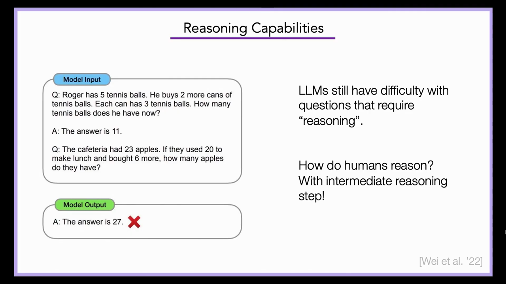
*▲ 강의 슬라이드 [39:15](https://youtu.be/9GWd3SAWLbA?t=2355): LLM은 "추론"이 필요한 질문을 아직 어려워한다. 사람은 중간 추론 단계를 거쳐 푼다*

### 7.2 추론 단계를 예로 보여 주기

▶ 영상 [40:17](https://youtu.be/9GWd3SAWLbA?t=2417)

- 사람은 이런 문제를 단계별로 풉니다. 알고리즘의 중간 단계를 메모장에 적거나, 소리 내어 풀이를 말합니다. 충분히 큰 [언어 모델](00_%EB%94%A5%EB%9F%AC%EB%8B%9D_%EC%9A%A9%EC%96%B4%EC%82%AC%EC%A0%84.md#language-model-%EC%96%B8%EC%96%B4-%EB%AA%A8%EB%8D%B8)에도 이것이 통한다는 것이 관찰되었고, 이를 **[생각의 사슬](00_%EB%94%A5%EB%9F%AC%EB%8B%9D_%EC%9A%A9%EC%96%B4%EC%82%AC%EC%A0%84.md#chain-of-thought-prompting-%EC%83%9D%EA%B0%81%EC%9D%98-%EC%82%AC%EC%8A%AC-%ED%94%84%EB%A1%AC%ED%94%84%ED%8C%85) [프롬프팅](00_%EB%94%A5%EB%9F%AC%EB%8B%9D_%EC%9A%A9%EC%96%B4%EC%82%AC%EC%A0%84.md#prompting-%ED%94%84%EB%A1%AC%ED%94%84%ED%8C%85)**(chain-of-thought prompting, Wei 등 2022)이라 부릅니다. 학계보다 LLM 취미 공동체가 먼저 알고 있었다고 강사는 말합니다.
- 방법: 예를 보여 줄 때 "질문 → 답" 대신 "질문 → **추론 단계** → 답"을 씁니다. "Roger는 공 5개로 시작했다. 공 3개짜리 캔 2개는 공 6개다. 5 + 6 = 11. 답은 11." 그러면 새 질문에도 모델이 맥락의 패턴을 따라 추론을 먼저 쓰고(예와 다른 패턴일 수도 있음) 마지막에 답합니다.
- 형식적으로는 $x$와 $y$ 사이에 추론 $z$를 끼워 넣는 것입니다. 모든 것이 입력에 있으므로 실험자가 이런 예를 5개, 10개, 100개 쓰는 것은 어렵지 않습니다. 과제 설명, 좋은 추론의 메타 템플릿, 단계의 세밀함, 최종 답의 형식 같은 다른 요령과도 함께 쓸 수 있습니다.
- 이 능력도 일정 규모에서 **예측하기 어렵게** 나타났습니다. 2019년 MIT에서 적어도 세 그룹이 비슷한 것을 시도했지만 모델이 작아 실패했고, [GPT](00_%EB%94%A5%EB%9F%AC%EB%8B%9D_%EC%9A%A9%EC%96%B4%EC%82%AC%EC%A0%84.md#gpt-%EC%83%9D%EC%84%B1%ED%98%95-%EC%82%AC%EC%A0%84%ED%95%99%EC%8A%B5-%ED%8A%B8%EB%9E%9C%EC%8A%A4%ED%8F%AC%EB%A8%B8)-3가 나오자 다시 해 보니 모두 통했습니다. 자유 응답 수학 문제, 객관식 문제, 상식 추론 등 거의 모든 분야에 쓸 수 있는 메타 요령입니다.

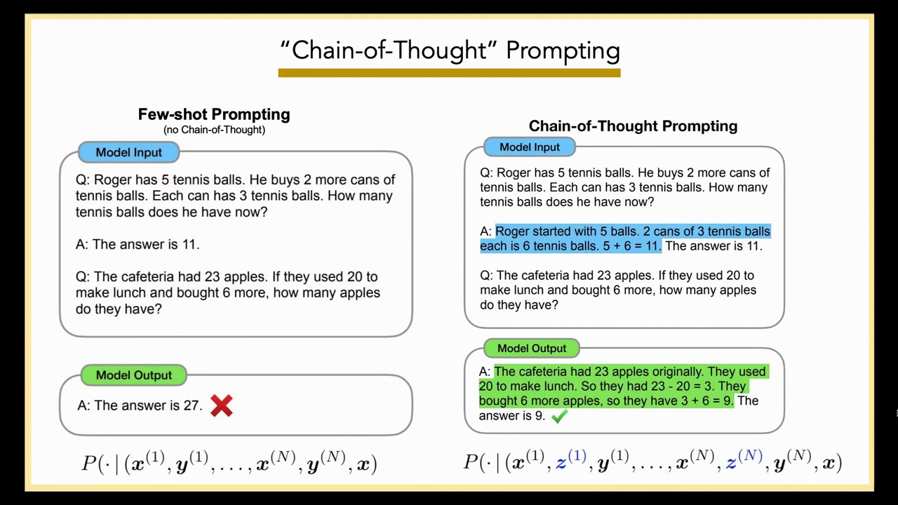
*▲ 강의 슬라이드 [43:10](https://youtu.be/9GWd3SAWLbA?t=2590): 보통 퓨샷 프롬프트(왼쪽, $P(\cdot \mid x^{(1)}, y^{(1)}, \dots, x)$, 틀린 답 27)와 [생각의 사슬](00_%EB%94%A5%EB%9F%AC%EB%8B%9D_%EC%9A%A9%EC%96%B4%EC%82%AC%EC%A0%84.md#chain-of-thought-prompting-%EC%83%9D%EA%B0%81%EC%9D%98-%EC%82%AC%EC%8A%AC-%ED%94%84%EB%A1%AC%ED%94%84%ED%8C%85) 프롬프트(오른쪽, 예마다 추론 $z^{(i)}$를 넣음, 맞는 답 9)*

추론 $z$를 먼저 쓰고 답 $y$를 쓰므로, 모델이 실제로 계산하는 것은 둘의 [결합 분포](00_%EB%94%A5%EB%9F%AC%EB%8B%9D_%EC%9A%A9%EC%96%B4%EC%82%AC%EC%A0%84.md#joint-distribution-%EA%B2%B0%ED%95%A9-%EB%B6%84%ED%8F%AC)를 [연쇄법칙](00_%EB%94%A5%EB%9F%AC%EB%8B%9D_%EC%9A%A9%EC%96%B4%EC%82%AC%EC%A0%84.md#chain-rule-of-probability-%ED%99%95%EB%A5%A0%EC%9D%98-%EC%97%B0%EC%87%84%EB%B2%95%EC%B9%99)으로 나눈 것입니다.

$$
p(z, y \mid x) = p(z \mid x)\; p(y \mid x, z)
$$

기호 풀이

| 기호 | 읽는 법 | 뜻 | 예제 값 |
| --- | --- | --- | --- |
| $x$ | 엑스 | 질문 (Roger의 테니스공 문제) | |
| $z$ | 제트 | 모델이 먼저 쓰는 추론 단계 ("캔 2개는 6개, 5 + 6 = 11") | |
| $y$ | 와이 | 최종 답 | 11 |
| $p(z \mid x)$ | 피 제트 | 질문을 보고 그 추론을 쓸 [확률](00_%EB%94%A5%EB%9F%AC%EB%8B%9D_%EC%9A%A9%EC%96%B4%EC%82%AC%EC%A0%84.md#probability-%ED%99%95%EB%A5%A0) | 0.6 |
| $p(y \mid x, z)$ | 피 와이 | 질문과 추론을 보고 그 답을 낼 [확률](00_%EB%94%A5%EB%9F%AC%EB%8B%9D_%EC%9A%A9%EC%96%B4%EC%82%AC%EC%A0%84.md#probability-%ED%99%95%EB%A5%A0) | 0.95 |
| $p(z, y \mid x)$ | 피 제트 와이 | 그 추론과 그 답이 함께 나올 [확률](00_%EB%94%A5%EB%9F%AC%EB%8B%9D_%EC%9A%A9%EC%96%B4%EC%82%AC%EC%A0%84.md#probability-%ED%99%95%EB%A5%A0) | 0.57 |

예제와 풀이

**문제**: 바로 답하게 하면 모델이 [정답](00_%EB%94%A5%EB%9F%AC%EB%8B%9D_%EC%9A%A9%EC%96%B4%EC%82%AC%EC%A0%84.md#label-%EC%A0%95%EB%8B%B5) 11을 낼 [확률](00_%EB%94%A5%EB%9F%AC%EB%8B%9D_%EC%9A%A9%EC%96%B4%EC%82%AC%EC%A0%84.md#probability-%ED%99%95%EB%A5%A0)이 0.3이다(설명용 숫자). 생각의 사슬로 시키면 올바른 추론을 쓸 [확률](00_%EB%94%A5%EB%9F%AC%EB%8B%9D_%EC%9A%A9%EC%96%B4%EC%82%AC%EC%A0%84.md#probability-%ED%99%95%EB%A5%A0)이 0.6이고, 그 추론을 쓴 뒤에는 11을 낼 [확률](00_%EB%94%A5%EB%9F%AC%EB%8B%9D_%EC%9A%A9%EC%96%B4%EC%82%AC%EC%A0%84.md#probability-%ED%99%95%EB%A5%A0)이 0.95다. "올바른 추론을 거쳐 11"이 나올 [확률](00_%EB%94%A5%EB%9F%AC%EB%8B%9D_%EC%9A%A9%EC%96%B4%EC%82%AC%EC%A0%84.md#probability-%ED%99%95%EB%A5%A0)은?

**주어진 값**
- $p(z \mid x) = 0.6$ (올바른 추론을 쓸 [확률](00_%EB%94%A5%EB%9F%AC%EB%8B%9D_%EC%9A%A9%EC%96%B4%EC%82%AC%EC%A0%84.md#probability-%ED%99%95%EB%A5%A0))
- $p(y = 11 \mid x, z) = 0.95$ (추론 뒤 [정답](00_%EB%94%A5%EB%9F%AC%EB%8B%9D_%EC%9A%A9%EC%96%B4%EC%82%AC%EC%A0%84.md#label-%EC%A0%95%EB%8B%B5)을 낼 [확률](00_%EB%94%A5%EB%9F%AC%EB%8B%9D_%EC%9A%A9%EC%96%B4%EC%82%AC%EC%A0%84.md#probability-%ED%99%95%EB%A5%A0))

**풀이**
1. 식을 그대로 쓴다: $p(z, y \mid x) = p(z \mid x)\; p(y \mid x, z)$
2. 값을 대입한다: $p(z, y = 11 \mid x) = 0.6 \times 0.95$
3. 곱한다: $0.6 \times 0.95 = 0.57$

**답**: **0.57**. 이 길 하나만으로도 바로 답할 때(0.3)보다 크다. 어려운 계산을 한 번에 하지 않고, 앞서 쓴 [토큰](00_%EB%94%A5%EB%9F%AC%EB%8B%9D_%EC%9A%A9%EC%96%B4%EC%82%AC%EC%A0%84.md#token-%ED%86%A0%ED%81%B0)을 다시 읽으며 나눠 하기 때문이다.

내 이해

### 7.3 단계별로 생각해 보자

▶ 영상 [45:51](https://youtu.be/9GWd3SAWLbA?t=2751)

- 손으로 쓴 추론 예가 담긴 첫 논문들이 나오자마자 사람들은 물었습니다. 과제마다 추론 예를 새로 쓰지 않고, **과제와 무관한 주문 한 줄**로 추론하게 할 수 없을까?
- 누군가 답 앞에 붙일 주문을 무식하게 탐색했고, 2022년 모델에는 **"Let's think step by step"**(단계별로 생각해 보자)이 가장 좋았습니다(Kojima 등 2022). 산수 과제에서 18% 정도 맞히던 모델이 이 한 줄로 80% 가까이 맞힙니다(논문 값: MultiArith 17.7% → 78.7%).
- 이것이 [학습 데이터](00_%EB%94%A5%EB%9F%AC%EB%8B%9D_%EC%9A%A9%EC%96%B4%EC%82%AC%EC%A0%84.md#training-data-test-data-%ED%95%99%EC%8A%B5-%EB%8D%B0%EC%9D%B4%ED%84%B0%EC%99%80-%EC%8B%9C%ED%97%98-%EB%8D%B0%EC%9D%B4%ED%84%B0) 분포의 깊은 성질인지, 아니면 OpenAI 어딘가에서 이 문구로 시작하는 추론 문서를 일부러 많이 만든 것인지는 모르고, 아마 영영 모를 것이라고 강사는 말합니다.
- 마법은 아닙니다. 원하는 추론의 예를 직접 보여 주는 편이 늘 더 좋지만, 모델이 스스로 꽤 해낸다는 것입니다.
- 강사가 보여 준 밈: 대학원에 들어갈 때는 아름다운 수학과 [구조적 예측](00_%EB%94%A5%EB%9F%AC%EB%8B%9D_%EC%9A%A9%EC%96%B4%EC%82%AC%EC%A0%84.md#structured-prediction-%EA%B5%AC%EC%A1%B0%EC%A0%81-%EC%98%88%EC%B8%A1)을 했는데, 지금은 "step by step"이라고 쓰는 게 가장 효과적이다. 더 넓은 요점은, 지금 모델을 가장 크게 조종하는 도구 중 하나가 **더 좋은 입력 예, 더 좋은 출력 형식, 더 좋은 안내**를 만드는 것이고, 업계에서 이런 직관을 가진 사람의 수요가 매우 크다는 것입니다([프롬프트 공학](00_%EB%94%A5%EB%9F%AC%EB%8B%9D_%EC%9A%A9%EC%96%B4%EC%82%AC%EC%A0%84.md#prompt-engineering-%ED%94%84%EB%A1%AC%ED%94%84%ED%8A%B8-%EA%B3%B5%ED%95%99)).

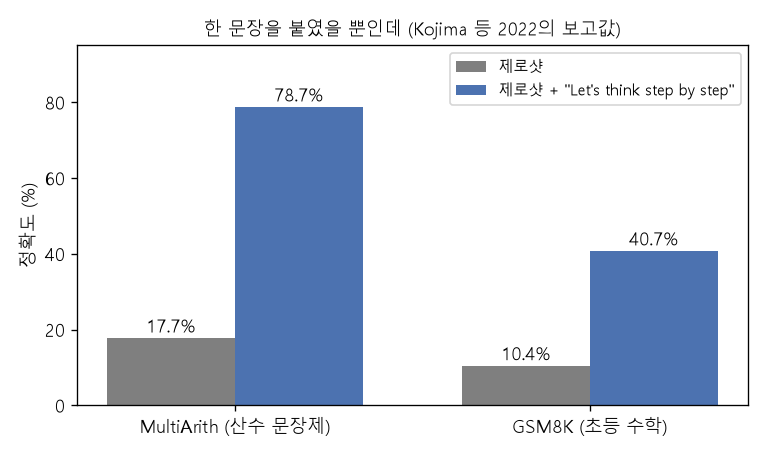
*▲ 직접 그린 그림: Kojima 등(2022)이 보고한 text-davinci-002의 [정확도](00_%EB%94%A5%EB%9F%AC%EB%8B%9D_%EC%9A%A9%EC%96%B4%EC%82%AC%EC%A0%84.md#accuracy-%EC%A0%95%ED%99%95%EB%8F%84). 같은 모델, 같은 질문에 "Let's think step by step"만 붙였다*

질의응답 정리 [44:13](https://youtu.be/9GWd3SAWLbA?t=2653), [57:11](https://youtu.be/9GWd3SAWLbA?t=3431)

- **왜 규모가 커져야 되나?** 입력이 템플릿 채우기가 아니라 추상적 추론을 요구한다는 것을 알아채야 합니다. 추론 $z$의 내용은 문제마다 아주 다릅니다. 작은 모델에 이런 데이터를 주면 베끼기는 해도 새 추론 사슬로 **[일반화](00_%EB%94%A5%EB%9F%AC%EB%8B%9D_%EC%9A%A9%EC%96%B4%EC%82%AC%EC%A0%84.md#generalization-%EC%9D%BC%EB%B0%98%ED%99%94)**하지는 못합니다. 또 가장 큰 모델들은 [학습 데이터](00_%EB%94%A5%EB%9F%AC%EB%8B%9D_%EC%9A%A9%EC%96%B4%EC%82%AC%EC%A0%84.md#training-data-test-data-%ED%95%99%EC%8A%B5-%EB%8D%B0%EC%9D%B4%ED%84%B0%EC%99%80-%EC%8B%9C%ED%97%98-%EB%8D%B0%EC%9D%B4%ED%84%B0)에 단계별로 생각을 말하는 예가 충분하도록 일부러 데이터를 모읍니다.
- **[강화 학습](00_%EB%94%A5%EB%9F%AC%EB%8B%9D_%EC%9A%A9%EC%96%B4%EC%82%AC%EC%A0%84.md#reinforcement-learning-%EA%B0%95%ED%99%94-%ED%95%99%EC%8A%B5)은 어디에 들어가나?** 강의 끝(10절)에서 다룹니다.
- **"step by step"을 붙여 [정확도](00_%EB%94%A5%EB%9F%AC%EB%8B%9D_%EC%9A%A9%EC%96%B4%EC%82%AC%EC%A0%84.md#accuracy-%EC%A0%95%ED%99%95%EB%8F%84)가 오른 것은 그 프롬프트를 쓸 때만인가?** 그렇습니다. 모든 경우 [기반 모델](00_%EB%94%A5%EB%9F%AC%EB%8B%9D_%EC%9A%A9%EC%96%B4%EC%82%AC%EC%A0%84.md#foundation-model-%EA%B8%B0%EB%B0%98-%EB%AA%A8%EB%8D%B8)은 같고, 답 앞에 놓인 글만 바뀝니다. 모델이 다시 [학습](00_%EB%94%A5%EB%9F%AC%EB%8B%9D_%EC%9A%A9%EC%96%B4%EC%82%AC%EC%A0%84.md#training-%ED%95%99%EC%8A%B5)한 것은 없으므로, 그 문구 없이 물으면 여전히 틀립니다(표의 모델들은 뒤에 나올 [지시 튜닝](00_%EB%94%A5%EB%9F%AC%EB%8B%9D_%EC%9A%A9%EC%96%B4%EC%82%AC%EC%A0%84.md#instruction-tuning-%EC%A7%80%EC%8B%9C-%ED%8A%9C%EB%8B%9D)을 거친 것이라는 단서가 붙음).

---

## 8. 지시 따르기 학습

▶ 영상 [49:57](https://youtu.be/9GWd3SAWLbA?t=2997)

📐 **수학 개념**: [KL 발산과 최대 우도](%EC%88%98%ED%95%99%EA%B0%9C%EB%85%90/04_%ED%99%95%EB%A5%A0%EA%B3%BC_%EC%A0%95%EB%B3%B4/MM51_KL_%EB%B0%9C%EC%82%B0%EA%B3%BC_%EC%B5%9C%EB%8C%80_%EC%9A%B0%EB%8F%84.md) · [확률의 연쇄법칙과 빔 서치](%EC%88%98%ED%95%99%EA%B0%9C%EB%85%90/04_%ED%99%95%EB%A5%A0%EA%B3%BC_%EC%A0%95%EB%B3%B4/MM39_%ED%99%95%EB%A5%A0%EC%9D%98_%EC%97%B0%EC%87%84%EB%B2%95%EC%B9%99%EA%B3%BC_%EB%B9%94_%EC%84%9C%EC%B9%98.md)

이제 인터넷 전체로만 [학습](00_%EB%94%A5%EB%9F%AC%EB%8B%9D_%EC%9A%A9%EC%96%B4%EC%82%AC%EC%A0%84.md#training-%ED%95%99%EC%8A%B5)한 모델을 넘어서려면? 모델이 실제로는 지시를 받고, 맥락 속 예를 받고, 단계별 추론을 요구받는다는 것을 알고 있으니, [학습](00_%EB%94%A5%EB%9F%AC%EB%8B%9D_%EC%9A%A9%EC%96%B4%EC%82%AC%EC%A0%84.md#training-%ED%95%99%EC%8A%B5) 단계에서 무엇을 다르게 해야 할까요?

### 8.1 다음 단어 예측만으로는 부족하다

▶ 영상 [52:13](https://youtu.be/9GWd3SAWLbA?t=3133)

- 예 없이 "This quiet, introspective and entertaining independent is worth seeking"만 주면 과제가 무엇인지조차 분명하지 않습니다. [GPT](00_%EB%94%A5%EB%9F%AC%EB%8B%9D_%EC%9A%A9%EC%96%B4%EC%82%AC%EC%A0%84.md#gpt-%EC%83%9D%EC%84%B1%ED%98%95-%EC%82%AC%EC%A0%84%ED%95%99%EC%8A%B5-%ED%8A%B8%EB%9E%9C%EC%8A%A4%ED%8F%AC%EB%A8%B8)-2·3 무렵 모델은 감정 라벨 대신 비슷한 결의 글을 더 이어 씁니다.
- 앞에 "Review:"를 붙이고 끝에 "Answer:"를 붙여도 무엇에 대한 답인지 모릅니다. 모델은 "This thought-provoking independent film is worth a watch"처럼 문법 교정 과제로 짐작합니다.
- 자세한 지시를 주면 원리상 충분한 정보가 있지만, 그대로의 모델은 여전히 불안정합니다. 인터넷 문서 중에는 지시처럼 생긴 글로 시작해서 **답을 쓰지 않고** 계속되는 문서가 많기 때문입니다. "Answer the following question. 다음 단어 예측 목적은 왜 일반적인 지시 따르기에 충분하지 않은가?"를 주면 모델은 답 대신 비슷한 질문을 더 만듭니다(시험지처럼).
- 오늘날 모델은 이 질문에 답합니다. 이것은 인터넷 글만으로 생기는 자연스러운 행동이 아니라, 지시 따르기에 **집중한 [미세 조정](00_%EB%94%A5%EB%9F%AC%EB%8B%9D_%EC%9A%A9%EC%96%B4%EC%82%AC%EC%A0%84.md#fine-tuning-%EB%AF%B8%EC%84%B8-%EC%A1%B0%EC%A0%95)**이 필요하다는 것입니다. 쓰임의 99%가 지시 따르기이므로 그것을 직접 가르치자는 생각입니다.

### 8.2 지시 데이터 모으기

▶ 영상 [55:33](https://youtu.be/9GWd3SAWLbA?t=3333)

- **[지시 튜닝](00_%EB%94%A5%EB%9F%AC%EB%8B%9D_%EC%9A%A9%EC%96%B4%EC%82%AC%EC%A0%84.md#instruction-tuning-%EC%A7%80%EC%8B%9C-%ED%8A%9C%EB%8B%9D)**(instruction tuning): 지시 따르기 데이터로 [언어 모델](00_%EB%94%A5%EB%9F%AC%EB%8B%9D_%EC%9A%A9%EC%96%B4%EC%82%AC%EC%A0%84.md#language-model-%EC%96%B8%EC%96%B4-%EB%AA%A8%EB%8D%B8)을 [미세 조정](00_%EB%94%A5%EB%9F%AC%EB%8B%9D_%EC%9A%A9%EC%96%B4%EC%82%AC%EC%A0%84.md#fine-tuning-%EB%AF%B8%EC%84%B8-%EC%A1%B0%EC%A0%95)합니다. 그러면 모델의 "지시 따르기 모드"가 켜지고, 새 과제·새 지시로 일반화하기를 기대합니다. 기술적으로는 별로 흥미롭지 않다고 강사는 말합니다. 핵심은 데이터를 모으는 것입니다.
- **과제 기반**(주로 학계): 감정 분석, 기계 번역, 요약, 문장 [분류](00_%EB%94%A5%EB%9F%AC%EB%8B%9D_%EC%9A%A9%EC%96%B4%EC%82%AC%EC%A0%84.md#regression-classification-%ED%9A%8C%EA%B7%80%EC%99%80-%EB%B6%84%EB%A5%98) 같은 기존 NLP 데이터셋을 자연어 과제 설명이 붙은 템플릿으로 바꿔 한꺼번에 [미세 조정](00_%EB%94%A5%EB%9F%AC%EB%8B%9D_%EC%9A%A9%EC%96%B4%EC%82%AC%EC%A0%84.md#fine-tuning-%EB%AF%B8%EC%84%B8-%EC%A1%B0%EC%A0%95)합니다. 작은 학계 규모 모델에서도 꽤 통했습니다.
- **시연 기반**: 정말 일반적인 지시 따르기와 질의응답을 원하면, 상상할 수 있는 많은 과제와 입력에 대해 **새 데이터를 직접 모으는 것**을 대신할 것이 없습니다. 큰 LLM 회사 안에서 일어난다고 믿어지는 일의 상당 부분이 사용자가 나중에 물을 법한 다양하고 포괄적인 지시를 영리하게 모으는 것입니다.
- 데이터 수집 과정은 지시 프롬프트를 만들고, 사람 주석자가 답을 쓰고, **지시가 주어졌을 때 그 답의 [확률](00_%EB%94%A5%EB%9F%AC%EB%8B%9D_%EC%9A%A9%EC%96%B4%EC%82%AC%EC%A0%84.md#probability-%ED%99%95%EB%A5%A0)을 최대화**하는 것입니다([최대 우도](00_%EB%94%A5%EB%9F%AC%EB%8B%9D_%EC%9A%A9%EC%96%B4%EC%82%AC%EC%A0%84.md#maximum-likelihood-%EC%B5%9C%EB%8C%80-%EC%9A%B0%EB%8F%84)).

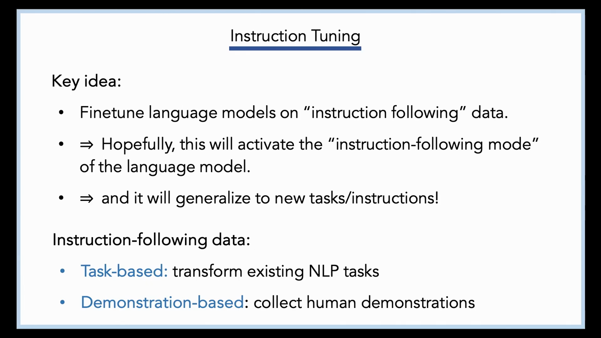
*▲ 강의 슬라이드 [56:05](https://youtu.be/9GWd3SAWLbA?t=3365): [지시 튜닝](00_%EB%94%A5%EB%9F%AC%EB%8B%9D_%EC%9A%A9%EC%96%B4%EC%82%AC%EC%A0%84.md#instruction-tuning-%EC%A7%80%EC%8B%9C-%ED%8A%9C%EB%8B%9D)의 핵심. 지시 따르기 데이터로 미세 조정해 "지시 따르기 모드"를 켜고 새 지시로 일반화하기. 데이터는 과제 기반(기존 NLP 과제 변환)과 시연 기반(사람 시연 수집)*

$$
\mathcal{L}_{\text{IT}}(\theta) = -\sum_{t=1}^{T} \ln p_\theta\big(y_t \mid \text{지시}, y_{<t}\big)
$$

기호 풀이

| 기호 | 읽는 법 | 뜻 | 예제 값 |
| --- | --- | --- | --- |
| 지시 | | 프롬프트로 준 지시 ("Answer the following question. ...") | |
| $y_t$ | 와이 티 | 사람이 쓴 답의 $t$번째 [토큰](00_%EB%94%A5%EB%9F%AC%EB%8B%9D_%EC%9A%A9%EC%96%B4%EC%82%AC%EC%A0%84.md#token-%ED%86%A0%ED%81%B0) | |
| $y_{<t}$ | 와이 티보다 앞 | 답에서 $t$번째 앞까지의 [토큰](00_%EB%94%A5%EB%9F%AC%EB%8B%9D_%EC%9A%A9%EC%96%B4%EC%82%AC%EC%A0%84.md#token-%ED%86%A0%ED%81%B0) ([교사 강요](00_%EB%94%A5%EB%9F%AC%EB%8B%9D_%EC%9A%A9%EC%96%B4%EC%82%AC%EC%A0%84.md#teacher-forcing-%EA%B5%90%EC%82%AC-%EA%B0%95%EC%9A%94)) | |
| $p_\theta(y_t \mid \cdots)$ | 피 세타 | 모델이 [정답](00_%EB%94%A5%EB%9F%AC%EB%8B%9D_%EC%9A%A9%EC%96%B4%EC%82%AC%EC%A0%84.md#label-%EC%A0%95%EB%8B%B5) [토큰](00_%EB%94%A5%EB%9F%AC%EB%8B%9D_%EC%9A%A9%EC%96%B4%EC%82%AC%EC%A0%84.md#token-%ED%86%A0%ED%81%B0)에 준 [확률](00_%EB%94%A5%EB%9F%AC%EB%8B%9D_%EC%9A%A9%EC%96%B4%EC%82%AC%EC%A0%84.md#probability-%ED%99%95%EB%A5%A0) | 0.5, 0.8 |
| $T$ | 티 | 답의 [토큰](00_%EB%94%A5%EB%9F%AC%EB%8B%9D_%EC%9A%A9%EC%96%B4%EC%82%AC%EC%A0%84.md#token-%ED%86%A0%ED%81%B0) 수 | 2 |
| $\mathcal{L}_{\text{IT}}$ | 엘 아이티 | [지시 튜닝](00_%EB%94%A5%EB%9F%AC%EB%8B%9D_%EC%9A%A9%EC%96%B4%EC%82%AC%EC%A0%84.md#instruction-tuning-%EC%A7%80%EC%8B%9C-%ED%8A%9C%EB%8B%9D) [손실](00_%EB%94%A5%EB%9F%AC%EB%8B%9D_%EC%9A%A9%EC%96%B4%EC%82%AC%EC%A0%84.md#loss-function-%EC%86%90%EC%8B%A4-%ED%95%A8%EC%88%98) (줄일 값) | 0.9163 |

예제와 풀이

**문제**: 지시에 대한 사람의 답이 [토큰](00_%EB%94%A5%EB%9F%AC%EB%8B%9D_%EC%9A%A9%EC%96%B4%EC%82%AC%EC%A0%84.md#token-%ED%86%A0%ED%81%B0) 두 개다. 모델은 첫 [토큰](00_%EB%94%A5%EB%9F%AC%EB%8B%9D_%EC%9A%A9%EC%96%B4%EC%82%AC%EC%A0%84.md#token-%ED%86%A0%ED%81%B0)에 0.5, (첫 [토큰](00_%EB%94%A5%EB%9F%AC%EB%8B%9D_%EC%9A%A9%EC%96%B4%EC%82%AC%EC%A0%84.md#token-%ED%86%A0%ED%81%B0)을 [정답](00_%EB%94%A5%EB%9F%AC%EB%8B%9D_%EC%9A%A9%EC%96%B4%EC%82%AC%EC%A0%84.md#label-%EC%A0%95%EB%8B%B5)으로 넣은 뒤) 둘째 [토큰](00_%EB%94%A5%EB%9F%AC%EB%8B%9D_%EC%9A%A9%EC%96%B4%EC%82%AC%EC%A0%84.md#token-%ED%86%A0%ED%81%B0)에 0.8을 준다. [지시 튜닝](00_%EB%94%A5%EB%9F%AC%EB%8B%9D_%EC%9A%A9%EC%96%B4%EC%82%AC%EC%A0%84.md#instruction-tuning-%EC%A7%80%EC%8B%9C-%ED%8A%9C%EB%8B%9D) [손실](00_%EB%94%A5%EB%9F%AC%EB%8B%9D_%EC%9A%A9%EC%96%B4%EC%82%AC%EC%A0%84.md#loss-function-%EC%86%90%EC%8B%A4-%ED%95%A8%EC%88%98)은?

**주어진 값**
- $T = 2$ (답의 [토큰](00_%EB%94%A5%EB%9F%AC%EB%8B%9D_%EC%9A%A9%EC%96%B4%EC%82%AC%EC%A0%84.md#token-%ED%86%A0%ED%81%B0) 수)
- $p_\theta(y_1 \mid \text{지시}) = 0.5$ (첫 [토큰](00_%EB%94%A5%EB%9F%AC%EB%8B%9D_%EC%9A%A9%EC%96%B4%EC%82%AC%EC%A0%84.md#token-%ED%86%A0%ED%81%B0)에 준 [확률](00_%EB%94%A5%EB%9F%AC%EB%8B%9D_%EC%9A%A9%EC%96%B4%EC%82%AC%EC%A0%84.md#probability-%ED%99%95%EB%A5%A0))
- $p_\theta(y_2 \mid \text{지시}, y_1) = 0.8$ (둘째 [토큰](00_%EB%94%A5%EB%9F%AC%EB%8B%9D_%EC%9A%A9%EC%96%B4%EC%82%AC%EC%A0%84.md#token-%ED%86%A0%ED%81%B0)에 준 [확률](00_%EB%94%A5%EB%9F%AC%EB%8B%9D_%EC%9A%A9%EC%96%B4%EC%82%AC%EC%A0%84.md#probability-%ED%99%95%EB%A5%A0))

**풀이**
1. 식을 그대로 쓴다: $\mathcal{L}_{\text{IT}} = -\sum_{t=1}^{T} \ln p_\theta(y_t \mid \text{지시}, y_{<t})$
2. 값을 대입한다 (Σ를 두 항으로 펼침): $\mathcal{L}_{\text{IT}} = -(\ln 0.5 + \ln 0.8)$
3. [로그](00_%EB%94%A5%EB%9F%AC%EB%8B%9D_%EC%9A%A9%EC%96%B4%EC%82%AC%EC%A0%84.md#log-ln-%EB%A1%9C%EA%B7%B8)를 계산한다. $\ln a$는 "$e$(약 2.718)를 몇 제곱해야 $a$가 되나"다: $\ln 0.5 = -0.6931$, $\ln 0.8 = -0.2231$
4. 더한다: $-0.6931 + (-0.2231) = -0.9162$ (반올림 전 값으로 $-0.9163$)
5. 부호를 바꾼다: $\mathcal{L}_{\text{IT}} = 0.9163$

**답**: **0.9163**. [사전 학습](00_%EB%94%A5%EB%9F%AC%EB%8B%9D_%EC%9A%A9%EC%96%B4%EC%82%AC%EC%A0%84.md#pre-training-%EC%82%AC%EC%A0%84-%ED%95%99%EC%8A%B5)의 다음 [토큰](00_%EB%94%A5%EB%9F%AC%EB%8B%9D_%EC%9A%A9%EC%96%B4%EC%82%AC%EC%A0%84.md#token-%ED%86%A0%ED%81%B0) [손실](00_%EB%94%A5%EB%9F%AC%EB%8B%9D_%EC%9A%A9%EC%96%B4%EC%82%AC%EC%A0%84.md#loss-function-%EC%86%90%EC%8B%A4-%ED%95%A8%EC%88%98)과 같은 식이고, 데이터가 (지시, 답) 쌍이라는 것만 다르다. 보통 지시 부분의 [토큰](00_%EB%94%A5%EB%9F%AC%EB%8B%9D_%EC%9A%A9%EC%96%B4%EC%82%AC%EC%A0%84.md#token-%ED%86%A0%ED%81%B0)은 [손실](00_%EB%94%A5%EB%9F%AC%EB%8B%9D_%EC%9A%A9%EC%96%B4%EC%82%AC%EC%A0%84.md#loss-function-%EC%86%90%EC%8B%A4-%ED%95%A8%EC%88%98)에 넣지 않는다.

내 이해

### 8.3 합성 데이터와 맥락 증류

▶ 영상 [58:16](https://youtu.be/9GWd3SAWLbA?t=3496)

질문에 답하며 강사가 정리한 내용입니다. "사람 대신 모델이 지시 데이터를 만들게 하면 안 되나?"

- **지시만 합성**: 원하는 종류의 지시를 많이 주고 "이런 걸 더 만들어 줘"라고 하면 흥미로운 [일반화](00_%EB%94%A5%EB%9F%AC%EB%8B%9D_%EC%9A%A9%EC%96%B4%EC%82%AC%EC%A0%84.md#generalization-%EC%9D%BC%EB%B0%98%ED%99%94)가 생깁니다. 그 지시에 사람이 답을 다는 것은 어디서나 하는 과정의 일부입니다.
- **지시와 답을 모두 합성해서 같은 모델을 [미세 조정](00_%EB%94%A5%EB%9F%AC%EB%8B%9D_%EC%9A%A9%EC%96%B4%EC%82%AC%EC%A0%84.md#fine-tuning-%EB%AF%B8%EC%84%B8-%EC%A1%B0%EC%A0%95)**하면, 모델은 새로운 것을 배울 수 없습니다. 정보 이론적으로 무에서 유를 만들 수 없습니다. [합성 데이터](00_%EB%94%A5%EB%9F%AC%EB%8B%9D_%EC%9A%A9%EC%96%B4%EC%82%AC%EC%A0%84.md#synthetic-data-%ED%95%A9%EC%84%B1-%EB%8D%B0%EC%9D%B4%ED%84%B0)로 [학습](00_%EB%94%A5%EB%9F%AC%EB%8B%9D_%EC%9A%A9%EC%96%B4%EC%82%AC%EC%A0%84.md#training-%ED%95%99%EC%8A%B5)하려면 좋은 것만 걸러 낼 **바깥 정보원**이 있거나, 데이터를 만드는 과정과 [학습](00_%EB%94%A5%EB%9F%AC%EB%8B%9D_%EC%9A%A9%EC%96%B4%EC%82%AC%EC%A0%84.md#training-%ED%95%99%EC%8A%B5)하는 과정 사이에 **차이**가 있어야 합니다.
- **[맥락 증류](00_%EB%94%A5%EB%9F%AC%EB%8B%9D_%EC%9A%A9%EC%96%B4%EC%82%AC%EC%A0%84.md#context-distillation-%EB%A7%A5%EB%9D%BD-%EC%A6%9D%EB%A5%98)**(context distillation): 지시 따르기를 아주 분명히 하는 좋은 프롬프트(많은 퓨샷 예와 "너는 지시를 따르는 모델이다" 같은 메타 지시)를 쓰고, 그 프롬프트로 모델에서 데이터를 뽑아 그 데이터로 [미세 조정](00_%EB%94%A5%EB%9F%AC%EB%8B%9D_%EC%9A%A9%EC%96%B4%EC%82%AC%EC%A0%84.md#fine-tuning-%EB%AF%B8%EC%84%B8-%EC%A1%B0%EC%A0%95)합니다. 결과는 새것을 아는 모델이 아니라, 그 좋은 프롬프트가 **늘 맥락에 있는 것처럼 행동하는** 모델입니다. 사용자가 프롬프트를 직접 칠 필요가 없어집니다. [합성 데이터](00_%EB%94%A5%EB%9F%AC%EB%8B%9D_%EC%9A%A9%EC%96%B4%EC%82%AC%EC%A0%84.md#synthetic-data-%ED%95%A9%EC%84%B1-%EB%8D%B0%EC%9D%B4%ED%84%B0)로 통하는 표준 요령이지만, 출력 공간에서 [확률](00_%EB%94%A5%EB%9F%AC%EB%8B%9D_%EC%9A%A9%EC%96%B4%EC%82%AC%EC%A0%84.md#probability-%ED%99%95%EB%A5%A0) 질량을 옮길 뿐 새로운 것을 가르치지는 않습니다([지식 증류](00_%EB%94%A5%EB%9F%AC%EB%8B%9D_%EC%9A%A9%EC%96%B4%EC%82%AC%EC%A0%84.md#knowledge-distillation-%EC%A7%80%EC%8B%9D-%EC%A6%9D%EB%A5%98)와 비교: [Lec18 5.1](Lec18_%EC%A0%84%EC%9D%B4_%ED%95%99%EC%8A%B5_%EB%AA%A8%EB%8D%B8.md#51-%EA%B5%90%EC%82%AC%EC%99%80-%ED%95%99%EC%83%9D)).

### 8.4 규모와 지시 튜닝

▶ 영상 [61:08](https://youtu.be/9GWd3SAWLbA?t=3668)

- [지시 튜닝](00_%EB%94%A5%EB%9F%AC%EB%8B%9D_%EC%9A%A9%EC%96%B4%EC%82%AC%EC%A0%84.md#instruction-tuning-%EC%A7%80%EC%8B%9C-%ED%8A%9C%EB%8B%9D)은 규모에 따라 나타나는 능력을 끌어내는 데 꽤 중요해 보입니다. [지시 튜닝](00_%EB%94%A5%EB%9F%AC%EB%8B%9D_%EC%9A%A9%EC%96%B4%EC%82%AC%EC%A0%84.md#instruction-tuning-%EC%A7%80%EC%8B%9C-%ED%8A%9C%EB%8B%9D) 없이 [사전 학습](00_%EB%94%A5%EB%9F%AC%EB%8B%9D_%EC%9A%A9%EC%96%B4%EC%82%AC%EC%A0%84.md#pre-training-%EC%82%AC%EC%A0%84-%ED%95%99%EC%8A%B5)만 키우면 표준 언어 이해 과제 묶음에서 그리 인상적이지 않게 좋아집니다. 모델을 키우면서 마지막에 [지시 튜닝](00_%EB%94%A5%EB%9F%AC%EB%8B%9D_%EC%9A%A9%EC%96%B4%EC%82%AC%EC%A0%84.md#instruction-tuning-%EC%A7%80%EC%8B%9C-%ED%8A%9C%EB%8B%9D)을 함께 하면 규모에 따른 향상이 훨씬 큽니다.
- 둘은 서로를 키웁니다. 좋은 일반 지시 따르기에는 **집중된 [학습 데이터](00_%EB%94%A5%EB%9F%AC%EB%8B%9D_%EC%9A%A9%EC%96%B4%EC%82%AC%EC%A0%84.md#training-data-test-data-%ED%95%99%EC%8A%B5-%EB%8D%B0%EC%9D%B4%ED%84%B0%EC%99%80-%EC%8B%9C%ED%97%98-%EB%8D%B0%EC%9D%B4%ED%84%B0)와 아주 큰 모델이 둘 다** 필요합니다.

---

## 9. 지시 튜닝만으로는 안 되는 것

▶ 영상 [62:17](https://youtu.be/9GWd3SAWLbA?t=3737)

📐 **수학 개념**: [n-그램 언어 모델과 퍼플렉서티](%EC%88%98%ED%95%99%EA%B0%9C%EB%85%90/13_%EC%96%B8%EC%96%B4_%EB%AA%A8%EB%8D%B8%EA%B3%BC_%EC%B6%94%EB%A1%A0/MM74_n%EA%B7%B8%EB%9E%A8%EA%B3%BC_%ED%8D%BC%ED%94%8C%EB%A0%89%EC%84%9C%ED%8B%B0.md)

[지시 튜닝](00_%EB%94%A5%EB%9F%AC%EB%8B%9D_%EC%9A%A9%EC%96%B4%EC%82%AC%EC%A0%84.md#instruction-tuning-%EC%A7%80%EC%8B%9C-%ED%8A%9C%EB%8B%9D)은 사람이 쓴 답의 [확률](00_%EB%94%A5%EB%9F%AC%EB%8B%9D_%EC%9A%A9%EC%96%B4%EC%82%AC%EC%A0%84.md#probability-%ED%99%95%EB%A5%A0)을 최대화합니다. 그런데 이것만으로는 몇 가지 문제가 생깁니다.

- **세상이 바뀐다**: 2017년에 모은 데이터라면 "transformer를 설명해 줘"는 전기 부품이었을 것입니다. 아무도 기계 [학습](00_%EB%94%A5%EB%9F%AC%EB%8B%9D_%EC%9A%A9%EC%96%B4%EC%82%AC%EC%A0%84.md#training-%ED%95%99%EC%8A%B5) 모델 [트랜스포머](00_%EB%94%A5%EB%9F%AC%EB%8B%9D_%EC%9A%A9%EC%96%B4%EC%82%AC%EC%A0%84.md#transformer-%ED%8A%B8%EB%9E%9C%EC%8A%A4%ED%8F%AC%EB%A8%B8)를 몰랐으니까요.
- **"모른다"를 못 배운다**: 질문마다 늘 맞는 답으로 라벨을 달면, 모델은 [미세 조정](00_%EB%94%A5%EB%9F%AC%EB%8B%9D_%EC%9A%A9%EC%96%B4%EC%82%AC%EC%A0%84.md#fine-tuning-%EB%AF%B8%EC%84%B8-%EC%A1%B0%EC%A0%95) 데이터에서 "모르겠다"는 답을 본 적이 없습니다. "2028년 월드컵 우승국은?"에 축구를 아는 모델은 나라 이름이어야 하고 아르헨티나가 그럴듯하다는 것까지 알지만, "답할 수 없는 질문"이라는 답에는 높은 [확률](00_%EB%94%A5%EB%9F%AC%EB%8B%9D_%EC%9A%A9%EC%96%B4%EC%82%AC%EC%A0%84.md#probability-%ED%99%95%EB%A5%A0)을 주지 않습니다. 게다가 모델은 지금이 몇 년인지 모르므로(그렇게 [미세 조정](00_%EB%94%A5%EB%9F%AC%EB%8B%9D_%EC%9A%A9%EC%96%B4%EC%82%AC%EC%A0%84.md#fine-tuning-%EB%AF%B8%EC%84%B8-%EC%A1%B0%EC%A0%95)하지 않으면) 무엇이 원리상 답할 수 있는 질문인지도 모릅니다. 사람 주석자도 **모델이 무엇을 모르는지 모르므로** 알맞은 곳에 "모른다"를 가르칠 수 없습니다. 닭과 달걀 문제입니다.
- **답하면 안 되는 요청**: "중간고사 부정행위 아이디어를 줘"에 술술 답하면 회사 평판에 나쁩니다. 모델 개발자는 어떤 범주의 요청에 "도와드릴 수 없습니다"라고 하기를 원합니다. 실제 ChatGPT는 부정행위 대신 공부 잘하는 방법 목록과 함께 "이건 너에게 해롭다"는 훈계를 조금 합니다.
- **커질수록 틀리는 질문**(Lin 등, TruthfulQA): "거울을 깨면 어떻게 되나?" 3억 [파라미터](00_%EB%94%A5%EB%9F%AC%EB%8B%9D_%EC%9A%A9%EC%96%B4%EC%82%AC%EC%A0%84.md#parameter-%ED%8C%8C%EB%9D%BC%EB%AF%B8%ED%84%B0) 모델은 "거울을 깬다"(틀리진 않음), 130억 [지시 튜닝](00_%EB%94%A5%EB%9F%AC%EB%8B%9D_%EC%9A%A9%EC%96%B4%EC%82%AC%EC%A0%84.md#instruction-tuning-%EC%A7%80%EC%8B%9C-%ED%8A%9C%EB%8B%9D) 모델은 거울의 정의를 말하고, 70억 [지시 튜닝](00_%EB%94%A5%EB%9F%AC%EB%8B%9D_%EC%9A%A9%EC%96%B4%EC%82%AC%EC%A0%84.md#instruction-tuning-%EC%A7%80%EC%8B%9C-%ED%8A%9C%EB%8B%9D) 모델은 "백만 조각으로 깨진다", 아주 큰 모델은 "7년 동안 재수가 없다"고 답합니다. 모델이 커질수록 지시를 잘 따를 뿐 아니라 **[학습 데이터](00_%EB%94%A5%EB%9F%AC%EB%8B%9D_%EC%9A%A9%EC%96%B4%EC%82%AC%EC%A0%84.md#training-data-test-data-%ED%95%99%EC%8A%B5-%EB%8D%B0%EC%9D%B4%ED%84%B0%EC%99%80-%EC%8B%9C%ED%97%98-%EB%8D%B0%EC%9D%B4%ED%84%B0) 분포를 더 세밀하게 흉내 내기** 때문입니다. 인터넷에서 이 질문 옆에는 물리학보다 미신 이야기가 많습니다. 늘 진실하게 답하라는 신호가 없으면, 커진 모델은 "이런 질문에 인터넷은 보통 미신으로 답한다"를 구별해 내고 그렇게 답합니다.

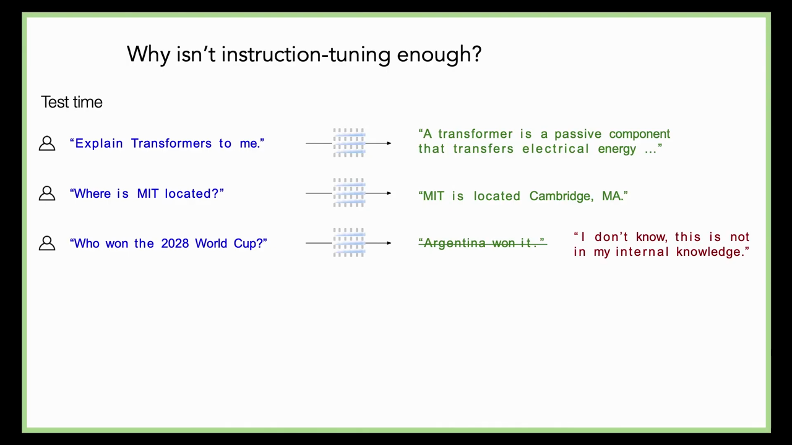
*▲ 강의 슬라이드 [64:55](https://youtu.be/9GWd3SAWLbA?t=3895): [지시 튜닝](00_%EB%94%A5%EB%9F%AC%EB%8B%9D_%EC%9A%A9%EC%96%B4%EC%82%AC%EC%A0%84.md#instruction-tuning-%EC%A7%80%EC%8B%9C-%ED%8A%9C%EB%8B%9D)이 왜 충분하지 않나. "Explain Transformers"에 전기 부품 설명, "Who won the 2028 World Cup?"에 "Argentina won it"(지워짐) 대신 "I don't know, this is not in my internal knowledge"가 바람직하다*

- 정리: 모델이 "모른다"고 하기를 원하고, 모델이 실제로 아는 것에 맞게 답하기를 원하며, 안전 등을 이유로 알아도 답하지 않기를 원할 때가 있습니다. 이 모든 경우 **모델의 내부 지식에 접근할 수 없어서** 목표 지도([정답](00_%EB%94%A5%EB%9F%AC%EB%8B%9D_%EC%9A%A9%EC%96%B4%EC%82%AC%EC%A0%84.md#label-%EC%A0%95%EB%8B%B5) 써 주기)만으로는 올바른 출력을 얻기 어렵습니다. 그래서 [언어 모델](00_%EB%94%A5%EB%9F%AC%EB%8B%9D_%EC%9A%A9%EC%96%B4%EC%82%AC%EC%A0%84.md#language-model-%EC%96%B8%EC%96%B4-%EB%AA%A8%EB%8D%B8) [학습](00_%EB%94%A5%EB%9F%AC%EB%8B%9D_%EC%9A%A9%EC%96%B4%EC%82%AC%EC%A0%84.md#training-%ED%95%99%EC%8A%B5)에 셋째 단계, [사람 피드백 강화 학습](00_%EB%94%A5%EB%9F%AC%EB%8B%9D_%EC%9A%A9%EC%96%B4%EC%82%AC%EC%A0%84.md#rlhf-reinforcement-learning-from-human-feedback-%EC%82%AC%EB%9E%8C-%ED%94%BC%EB%93%9C%EB%B0%B1-%EA%B0%95%ED%99%94-%ED%95%99%EC%8A%B5)이 붙었습니다.

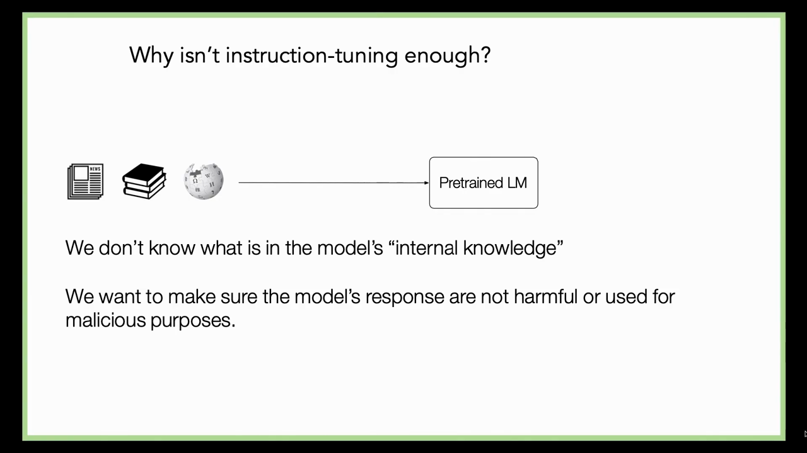
*▲ 강의 슬라이드 [68:00](https://youtu.be/9GWd3SAWLbA?t=4080): 모델의 "내부 지식"에 무엇이 있는지 모르고, 응답이 해롭거나 악용되지 않게 하고 싶다*

> [!TIP]
> **🆕 2026 업데이트: [환각](00_%EB%94%A5%EB%9F%AC%EB%8B%9D_%EC%9A%A9%EC%96%B4%EC%82%AC%EC%A0%84.md#hallucination-%ED%99%98%EA%B0%81)은 "추측을 보상하는" [학습](00_%EB%94%A5%EB%9F%AC%EB%8B%9D_%EC%9A%A9%EC%96%B4%EC%82%AC%EC%A0%84.md#training-%ED%95%99%EC%8A%B5)과 평가에서 온다는 분석**
> - **강의**: 사람 주석자는 모델이 무엇을 모르는지 모르므로, 지시 튜닝만으로는 "모른다"를 가르치기 어렵다.
> - **현재**: OpenAI 등의 연구진(2025)은 [환각](00_%EB%94%A5%EB%9F%AC%EB%8B%9D_%EC%9A%A9%EC%96%B4%EC%82%AC%EC%A0%84.md#hallucination-%ED%99%98%EA%B0%81)이 남는 이유를 통계적으로 분석했다. 대부분의 벤치마크가 [정답](00_%EB%94%A5%EB%9F%AC%EB%8B%9D_%EC%9A%A9%EC%96%B4%EC%82%AC%EC%A0%84.md#label-%EC%A0%95%EB%8B%B5)만 점수로 주고 "모른다"에는 0점을 주므로, 불확실할 때 **추측하는 편이 점수에 유리**하다. 모델이 "좋은 시험 응시자"로 최적화된다는 것이다. 이들은 새 [환각](00_%EB%94%A5%EB%9F%AC%EB%8B%9D_%EC%9A%A9%EC%96%B4%EC%82%AC%EC%A0%84.md#hallucination-%ED%99%98%EA%B0%81) 시험을 더 만들기보다, 기존 주요 벤치마크의 채점 방식(틀린 답에 벌점, 기권 인정)을 바꾸자고 제안했다.
> - **출처**: [Kalai, Nachum, Vempala, Zhang, Why Language Models Hallucinate (arXiv 2025)](https://arxiv.org/abs/2509.04664)

---

## 10. 사람 피드백 강화 학습

▶ 영상 [68:30](https://youtu.be/9GWd3SAWLbA?t=4110)

📐 **수학 개념**: [선호 비교와 보상 모델](%EC%88%98%ED%95%99%EA%B0%9C%EB%85%90/13_%EC%96%B8%EC%96%B4_%EB%AA%A8%EB%8D%B8%EA%B3%BC_%EC%B6%94%EB%A1%A0/MM75_%EC%84%A0%ED%98%B8_%EB%B9%84%EA%B5%90%EC%99%80_%EB%B3%B4%EC%83%81_%EB%AA%A8%EB%8D%B8.md) · [정책 경사와 보상 가중 우도](%EC%88%98%ED%95%99%EA%B0%9C%EB%85%90/13_%EC%96%B8%EC%96%B4_%EB%AA%A8%EB%8D%B8%EA%B3%BC_%EC%B6%94%EB%A1%A0/MM76_%EC%A0%95%EC%B1%85_%EA%B2%BD%EC%82%AC%EC%99%80_%EB%B3%B4%EC%83%81_%EA%B0%80%EC%A4%91_%EC%9A%B0%EB%8F%84.md) · [KL 발산과 최대 우도](%EC%88%98%ED%95%99%EA%B0%9C%EB%85%90/04_%ED%99%95%EB%A5%A0%EA%B3%BC_%EC%A0%95%EB%B3%B4/MM51_KL_%EB%B0%9C%EC%82%B0%EA%B3%BC_%EC%B5%9C%EB%8C%80_%EC%9A%B0%EB%8F%84.md)

**[사람 피드백 강화 학습](00_%EB%94%A5%EB%9F%AC%EB%8B%9D_%EC%9A%A9%EC%96%B4%EC%82%AC%EC%A0%84.md#rlhf-reinforcement-learning-from-human-feedback-%EC%82%AC%EB%9E%8C-%ED%94%BC%EB%93%9C%EB%B0%B1-%EA%B0%95%ED%99%94-%ED%95%99%EC%8A%B5)**([RLHF](00_%EB%94%A5%EB%9F%AC%EB%8B%9D_%EC%9A%A9%EC%96%B4%EC%82%AC%EC%A0%84.md#rlhf-reinforcement-learning-from-human-feedback-%EC%82%AC%EB%9E%8C-%ED%94%BC%EB%93%9C%EB%B0%B1-%EA%B0%95%ED%99%94-%ED%95%99%EC%8A%B5), reinforcement learning from human feedback)은 시간 관계로 짧게 다룹니다(강사는 ChatGPT가 해적 말투로 [RLHF](00_%EB%94%A5%EB%9F%AC%EB%8B%9D_%EC%9A%A9%EC%96%B4%EC%82%AC%EC%A0%84.md#rlhf-reinforcement-learning-from-human-feedback-%EC%82%AC%EB%9E%8C-%ED%94%BC%EB%93%9C%EB%B0%B1-%EA%B0%95%ED%99%94-%ED%95%99%EC%8A%B5)를 설명하는 슬라이드를 "왜 넣었는지 모르겠다"며 넘깁니다).

### 10.1 모델이 만든 답 중에서 고르기

▶ 영상 [69:37](https://youtu.be/9GWd3SAWLbA?t=4177)

- 단순화한 예: 기사 요약. 좋은 요약은 아주 많고, 모델이 다양한 요약을 낼 수 있음을 배우게 하고 싶습니다.
- **방법 1**: 사람이 받아들일 만한 요약을 전부 쓰고 그것을 모두 생성하도록 [학습](00_%EB%94%A5%EB%9F%AC%EB%8B%9D_%EC%9A%A9%EC%96%B4%EC%82%AC%EC%A0%84.md#training-%ED%95%99%EC%8A%B5). 사람 일이 너무 많아 비현실적입니다.
- **방법 2**: [지시 튜닝](00_%EB%94%A5%EB%9F%AC%EB%8B%9D_%EC%9A%A9%EC%96%B4%EC%82%AC%EC%A0%84.md#instruction-tuning-%EC%A7%80%EC%8B%9C-%ED%8A%9C%EB%8B%9D)을 조금 한 모델에게 요약을 많이 쓰게 합니다. 모델에게는 돈을 줄 필요가 없으니(전기료만) 사람 없이 아주 많이 뽑을 수 있습니다. 모델이 쓴 요약이라면 할 수 있는 일은 **좋은 것과 나쁜 것을 가려**, 좋은 것의 [확률](00_%EB%94%A5%EB%9F%AC%EB%8B%9D_%EC%9A%A9%EC%96%B4%EC%82%AC%EC%A0%84.md#probability-%ED%99%95%EB%A5%A0)은 올리고 나쁜 것은 내리는 것뿐입니다.
- 사람이 요약을 쓰는 대신 기계가 쓴 요약에 점수, 엄지 위·아래, 또는 둘 중 어느 쪽이 나은지(쌍 선호)를 표시하게 할 수 있습니다. 이것도 큰 규모로 하면 사람 품이 많이 듭니다.
- 강화 [학습](00_%EB%94%A5%EB%9F%AC%EB%8B%9D_%EC%9A%A9%EC%96%B4%EC%82%AC%EC%A0%84.md#training-%ED%95%99%EC%8A%B5)에 빗대어 [언어 모델](00_%EB%94%A5%EB%9F%AC%EB%8B%9D_%EC%9A%A9%EC%96%B4%EC%82%AC%EC%A0%84.md#language-model-%EC%96%B8%EC%96%B4-%EB%AA%A8%EB%8D%B8)을 **[정책](00_%EB%94%A5%EB%9F%AC%EB%8B%9D_%EC%9A%A9%EC%96%B4%EC%82%AC%EC%A0%84.md#policy-%EC%A0%95%EC%B1%85)**(policy)이라고 부릅니다. 글을 받아 글을 내는 것일 뿐입니다. 사람 대신 어떤 (기사, 요약) 쌍이든 받아 "얼마나 좋은가"를 숫자로 주는 **마법의 상자**가 있다면, 모델이 만든 요약의 점수가 최대가 되도록 [파라미터](00_%EB%94%A5%EB%9F%AC%EB%8B%9D_%EC%9A%A9%EC%96%B4%EC%82%AC%EC%A0%84.md#parameter-%ED%8C%8C%EB%9D%BC%EB%AF%B8%ED%84%B0)를 고르기만 하면 됩니다.

### 10.2 보상 모델

▶ 영상 [72:25](https://youtu.be/9GWd3SAWLbA?t=4345)

- 실제로는 사람이 기사-요약에 엄지 위·아래 같은 표시를 하게 하되, 그것으로 [언어 모델](00_%EB%94%A5%EB%9F%AC%EB%8B%9D_%EC%9A%A9%EC%96%B4%EC%82%AC%EC%A0%84.md#language-model-%EC%96%B8%EC%96%B4-%EB%AA%A8%EB%8D%B8)을 직접 [학습](00_%EB%94%A5%EB%9F%AC%EB%8B%9D_%EC%9A%A9%EC%96%B4%EC%82%AC%EC%A0%84.md#training-%ED%95%99%EC%8A%B5)하지 않고 **[보상 모델](00_%EB%94%A5%EB%9F%AC%EB%8B%9D_%EC%9A%A9%EC%96%B4%EC%82%AC%EC%A0%84.md#reward-model-%EB%B3%B4%EC%83%81-%EB%AA%A8%EB%8D%B8)**(reward model)을 [학습](00_%EB%94%A5%EB%9F%AC%EB%8B%9D_%EC%9A%A9%EC%96%B4%EC%82%AC%EC%A0%84.md#training-%ED%95%99%EC%8A%B5)합니다. 글을 생성하는 모델이 아니라, 사람 주석자의 "어느 쪽이 좋은가" 판단을 재현하는 모델입니다.
- **중요한 점**: 이것은 요약을 직접 쓰는 것보다 **쉬운 과제**입니다. 계산 이론 수업에서 배우듯 알아보기(recognition)는 대개 만들어 내기(generation)보다 쉽습니다. 요약이든 수학 문제든, 점수 매기는 모델을 [학습](00_%EB%94%A5%EB%9F%AC%EB%8B%9D_%EC%9A%A9%EC%96%B4%EC%82%AC%EC%A0%84.md#training-%ED%95%99%EC%8A%B5)하는 것이 계산상으로도 [표본 효율](00_%EB%94%A5%EB%9F%AC%EB%8B%9D_%EC%9A%A9%EC%96%B4%EC%82%AC%EC%A0%84.md#sample-efficiency-%ED%91%9C%EB%B3%B8-%ED%9A%A8%EC%9C%A8) 면에서도 더 쉽습니다.
- 좋은 요약 점수기가 생기면 끝난 셈입니다. 표준 최적화 기법을 이 목표에 던지면 요약을 더 잘하는 모델이 나옵니다.

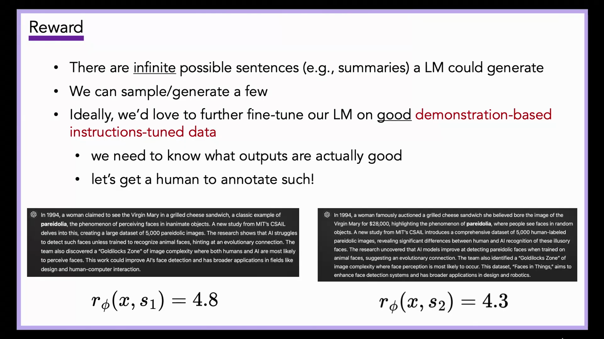
*▲ 강의 슬라이드 [73:00](https://youtu.be/9GWd3SAWLbA?t=4380): 모델이 쓸 수 있는 문장(요약)은 무한하고, 몇 개를 뽑을 수 있다. 무엇이 좋은지 알아야 하므로 사람에게 표시를 받는다. 보상 $r_\phi(x, s_1) = 4.8$, $r_\phi(x, s_2) = 4.3$*

쌍 선호로 [보상 모델](00_%EB%94%A5%EB%9F%AC%EB%8B%9D_%EC%9A%A9%EC%96%B4%EC%82%AC%EC%A0%84.md#reward-model-%EB%B3%B4%EC%83%81-%EB%AA%A8%EB%8D%B8)을 [학습](00_%EB%94%A5%EB%9F%AC%EB%8B%9D_%EC%9A%A9%EC%96%B4%EC%82%AC%EC%A0%84.md#training-%ED%95%99%EC%8A%B5)할 때 보통 쓰는 [손실](00_%EB%94%A5%EB%9F%AC%EB%8B%9D_%EC%9A%A9%EC%96%B4%EC%82%AC%EC%A0%84.md#loss-function-%EC%86%90%EC%8B%A4-%ED%95%A8%EC%88%98)은 점수 차를 [시그모이드](00_%EB%94%A5%EB%9F%AC%EB%8B%9D_%EC%9A%A9%EC%96%B4%EC%82%AC%EC%A0%84.md#sigmoid-%EC%8B%9C%EA%B7%B8%EB%AA%A8%EC%9D%B4%EB%93%9C)에 넣은 브래들리-테리 모형입니다(강의는 식을 쓰지 않음, 자세히는 [MM75_선호_비교와_보상_모델](%EC%88%98%ED%95%99%EA%B0%9C%EB%85%90/13_%EC%96%B8%EC%96%B4_%EB%AA%A8%EB%8D%B8%EA%B3%BC_%EC%B6%94%EB%A1%A0/MM75_%EC%84%A0%ED%98%B8_%EB%B9%84%EA%B5%90%EC%99%80_%EB%B3%B4%EC%83%81_%EB%AA%A8%EB%8D%B8.md)).

$$
\mathcal{L}_{\text{RM}}(\phi) = -\ln \sigma\big(r_\phi(x, y_w) - r_\phi(x, y_l)\big)
$$

기호 풀이

| 기호 | 읽는 법 | 뜻 | 예제 값 |
| --- | --- | --- | --- |
| $x$ | 엑스 | 요약할 기사 | |
| $y_w, y_l$ | 와이 더블유, 와이 엘 | 사람이 더 낫다고 고른 요약, 고르지 않은 요약 | $s_1$, $s_2$ |
| $r_\phi(x, y)$ | 알 파이 | [보상 모델](00_%EB%94%A5%EB%9F%AC%EB%8B%9D_%EC%9A%A9%EC%96%B4%EC%82%AC%EC%A0%84.md#reward-model-%EB%B3%B4%EC%83%81-%EB%AA%A8%EB%8D%B8)의 점수 | 4.8, 4.3 |
| $\sigma(z)$ | [시그모이드](00_%EB%94%A5%EB%9F%AC%EB%8B%9D_%EC%9A%A9%EC%96%B4%EC%82%AC%EC%A0%84.md#sigmoid-%EC%8B%9C%EA%B7%B8%EB%AA%A8%EC%9D%B4%EB%93%9C) | $1/(1 + e^{-z})$. 점수 차를 "이길 [확률](00_%EB%94%A5%EB%9F%AC%EB%8B%9D_%EC%9A%A9%EC%96%B4%EC%82%AC%EC%A0%84.md#probability-%ED%99%95%EB%A5%A0)"로 | 0.6225 |
| $\mathcal{L}_{\text{RM}}$ | 엘 알엠 | [보상 모델](00_%EB%94%A5%EB%9F%AC%EB%8B%9D_%EC%9A%A9%EC%96%B4%EC%82%AC%EC%A0%84.md#reward-model-%EB%B3%B4%EC%83%81-%EB%AA%A8%EB%8D%B8) [손실](00_%EB%94%A5%EB%9F%AC%EB%8B%9D_%EC%9A%A9%EC%96%B4%EC%82%AC%EC%A0%84.md#loss-function-%EC%86%90%EC%8B%A4-%ED%95%A8%EC%88%98) | 0.4741 |

예제와 풀이

**문제**: 슬라이드처럼 [보상 모델](00_%EB%94%A5%EB%9F%AC%EB%8B%9D_%EC%9A%A9%EC%96%B4%EC%82%AC%EC%A0%84.md#reward-model-%EB%B3%B4%EC%83%81-%EB%AA%A8%EB%8D%B8)이 $s_1$에 4.8, $s_2$에 4.3을 준다. 사람은 $s_1$을 골랐다. 이 쌍의 [손실](00_%EB%94%A5%EB%9F%AC%EB%8B%9D_%EC%9A%A9%EC%96%B4%EC%82%AC%EC%A0%84.md#loss-function-%EC%86%90%EC%8B%A4-%ED%95%A8%EC%88%98)은?

**주어진 값**
- $r_\phi(x, y_w) = 4.8$ (사람이 고른 $s_1$의 점수)
- $r_\phi(x, y_l) = 4.3$ (고르지 않은 $s_2$의 점수)

**풀이**
1. 식을 그대로 쓴다: $\mathcal{L}_{\text{RM}} = -\ln \sigma\big(r_\phi(x, y_w) - r_\phi(x, y_l)\big)$, $\sigma(z) = \dfrac{1}{1 + e^{-z}}$
2. 값을 대입한다: $\mathcal{L}_{\text{RM}} = -\ln \sigma(4.8 - 4.3)$
3. 뺀다: $4.8 - 4.3 = 0.5$ 이므로 $-\ln \sigma(0.5)$
4. [지수](00_%EB%94%A5%EB%9F%AC%EB%8B%9D_%EC%9A%A9%EC%96%B4%EC%82%AC%EC%A0%84.md#e-exponent-e%EC%99%80-%EC%A7%80%EC%88%98)를 계산한다. $e^{a}$는 약 2.718의 $a$제곱이다(계산기의 exp): $e^{-0.5} = 0.6065$
5. 분모를 더한다: $1 + 0.6065 = 1.6065$
6. 나눈다: $\sigma(0.5) = 1 / 1.6065 = 0.6225$
7. 음의 [로그](00_%EB%94%A5%EB%9F%AC%EB%8B%9D_%EC%9A%A9%EC%96%B4%EC%82%AC%EC%A0%84.md#log-ln-%EB%A1%9C%EA%B7%B8)를 씌운다: $-\ln 0.6225 = 0.4741$

**답**: **0.4741**. [보상 모델](00_%EB%94%A5%EB%9F%AC%EB%8B%9D_%EC%9A%A9%EC%96%B4%EC%82%AC%EC%A0%84.md#reward-model-%EB%B3%B4%EC%83%81-%EB%AA%A8%EB%8D%B8)은 $s_1$이 이길 [확률](00_%EB%94%A5%EB%9F%AC%EB%8B%9D_%EC%9A%A9%EC%96%B4%EC%82%AC%EC%A0%84.md#probability-%ED%99%95%EB%A5%A0)을 0.6225로 보고 있고, [학습](00_%EB%94%A5%EB%9F%AC%EB%8B%9D_%EC%9A%A9%EC%96%B4%EC%82%AC%EC%A0%84.md#training-%ED%95%99%EC%8A%B5)은 이 점수 차를 더 벌린다.

내 이해

### 10.3 정책 경사

▶ 영상 [73:31](https://youtu.be/9GWd3SAWLbA?t=4411)

- 조건부 [언어 모델](00_%EB%94%A5%EB%9F%AC%EB%8B%9D_%EC%9A%A9%EC%96%B4%EC%82%AC%EC%A0%84.md#language-model-%EC%96%B8%EC%96%B4-%EB%AA%A8%EB%8D%B8)을 $P_\theta(y \mid x)$("[정책](00_%EB%94%A5%EB%9F%AC%EB%8B%9D_%EC%9A%A9%EC%96%B4%EC%82%AC%EC%A0%84.md#policy-%EC%A0%95%EC%B1%85)", 출력 $y$, 지금까지의 글 $x$)로 쓰고, 좋은 정도를 알려 주는 보상 함수 $r_\phi(x, y)$가 있다고 합시다. [언어 모델](00_%EB%94%A5%EB%9F%AC%EB%8B%9D_%EC%9A%A9%EC%96%B4%EC%82%AC%EC%A0%84.md#language-model-%EC%96%B8%EC%96%B4-%EB%AA%A8%EB%8D%B8)이 **기대 보상**을 최대화하게 하는 [파라미터](00_%EB%94%A5%EB%9F%AC%EB%8B%9D_%EC%9A%A9%EC%96%B4%EC%82%AC%EC%A0%84.md#parameter-%ED%8C%8C%EB%9D%BC%EB%AF%B8%ED%84%B0) $\theta$를 찾고 싶습니다.
- 지금 표준 알고리즘은 **[정책 경사](00_%EB%94%A5%EB%9F%AC%EB%8B%9D_%EC%9A%A9%EC%96%B4%EC%82%AC%EC%A0%84.md#policy-gradient-%EC%A0%95%EC%B1%85-%EA%B2%BD%EC%82%AC)**(policy gradient)입니다. 이 목적을 바꿔 쓰면, **각 표본에 [보상 모델](00_%EB%94%A5%EB%9F%AC%EB%8B%9D_%EC%9A%A9%EC%96%B4%EC%82%AC%EC%A0%84.md#reward-model-%EB%B3%B4%EC%83%81-%EB%AA%A8%EB%8D%B8) 점수로 [가중치](00_%EB%94%A5%EB%9F%AC%EB%8B%9D_%EC%9A%A9%EC%96%B4%EC%82%AC%EC%A0%84.md#weight-%EA%B0%80%EC%A4%91%EC%B9%98)를 준 보통의 [최대 우도](00_%EB%94%A5%EB%9F%AC%EB%8B%9D_%EC%9A%A9%EC%96%B4%EC%82%AC%EC%A0%84.md#maximum-likelihood-%EC%B5%9C%EB%8C%80-%EC%9A%B0%EB%8F%84) 추정**처럼 생긴 것이 됩니다.
- [RLHF](00_%EB%94%A5%EB%9F%AC%EB%8B%9D_%EC%9A%A9%EC%96%B4%EC%82%AC%EC%A0%84.md#rlhf-reinforcement-learning-from-human-feedback-%EC%82%AC%EB%9E%8C-%ED%94%BC%EB%93%9C%EB%B0%B1-%EA%B0%95%ED%99%94-%ED%95%99%EC%8A%B5)는 이것이 거의 전부입니다. 사람 판단으로 [보상 모델](00_%EB%94%A5%EB%9F%AC%EB%8B%9D_%EC%9A%A9%EC%96%B4%EC%82%AC%EC%A0%84.md#reward-model-%EB%B3%B4%EC%83%81-%EB%AA%A8%EB%8D%B8)을 [학습](00_%EB%94%A5%EB%9F%AC%EB%8B%9D_%EC%9A%A9%EC%96%B4%EC%82%AC%EC%A0%84.md#training-%ED%95%99%EC%8A%B5)하고, 그 [보상 모델](00_%EB%94%A5%EB%9F%AC%EB%8B%9D_%EC%9A%A9%EC%96%B4%EC%82%AC%EC%A0%84.md#reward-model-%EB%B3%B4%EC%83%81-%EB%AA%A8%EB%8D%B8)을 상대로 강화 [학습](00_%EB%94%A5%EB%9F%AC%EB%8B%9D_%EC%9A%A9%EC%96%B4%EC%82%AC%EC%A0%84.md#training-%ED%95%99%EC%8A%B5)을 합니다.

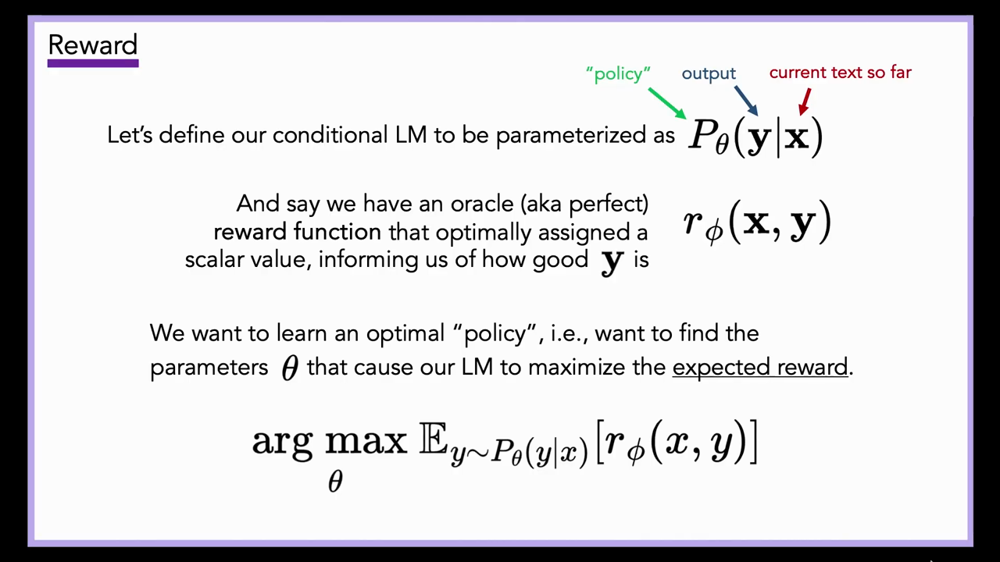
*▲ 강의 슬라이드 [73:45](https://youtu.be/9GWd3SAWLbA?t=4425): 조건부 LM $P_\theta(y \mid x)$를 "[정책](00_%EB%94%A5%EB%9F%AC%EB%8B%9D_%EC%9A%A9%EC%96%B4%EC%82%AC%EC%A0%84.md#policy-%EC%A0%95%EC%B1%85)"으로, 보상 함수 $r_\phi(x, y)$를 신탁으로 두고 $\arg\max_\theta \mathbb{E}_{y \sim P_\theta(y \mid x)}[r_\phi(x, y)]$를 찾는다*

$$
\theta^{*} = \arg\max_{\theta}\; \mathbb{E}_{y \sim P_\theta(y \mid x)}\big[r_\phi(x, y)\big], \qquad
\mathcal{L}(\theta) = -\frac{1}{N}\sum_{i=1}^{N} r_\phi(x, y_i)\, \ln P_\theta(y_i \mid x)
$$

기호 풀이

| 기호 | 읽는 법 | 뜻 | 예제 값 |
| --- | --- | --- | --- |
| $P_\theta(y \mid x)$ | 피 세타 | [정책](00_%EB%94%A5%EB%9F%AC%EB%8B%9D_%EC%9A%A9%EC%96%B4%EC%82%AC%EC%A0%84.md#policy-%EC%A0%95%EC%B1%85)([언어 모델](00_%EB%94%A5%EB%9F%AC%EB%8B%9D_%EC%9A%A9%EC%96%B4%EC%82%AC%EC%A0%84.md#language-model-%EC%96%B8%EC%96%B4-%EB%AA%A8%EB%8D%B8))이 글 $x$ 다음에 답 $y$를 낼 [확률](00_%EB%94%A5%EB%9F%AC%EB%8B%9D_%EC%9A%A9%EC%96%B4%EC%82%AC%EC%A0%84.md#probability-%ED%99%95%EB%A5%A0) | 0.5, 0.3 |
| $r_\phi(x, y)$ | 알 파이 | [보상 모델](00_%EB%94%A5%EB%9F%AC%EB%8B%9D_%EC%9A%A9%EC%96%B4%EC%82%AC%EC%A0%84.md#reward-model-%EB%B3%B4%EC%83%81-%EB%AA%A8%EB%8D%B8) 점수 | 0.9, 0.2 |
| $\mathbb{E}_{y \sim P_\theta}$ | [기댓값](00_%EB%94%A5%EB%9F%AC%EB%8B%9D_%EC%9A%A9%EC%96%B4%EC%82%AC%EC%A0%84.md#expectation-%EA%B8%B0%EB%8C%93%EA%B0%92) | 모델이 뽑은 답에 대한 평균 | |
| $\theta^{*}$ | 세타 스타 | 기대 보상을 가장 크게 하는 [파라미터](00_%EB%94%A5%EB%9F%AC%EB%8B%9D_%EC%9A%A9%EC%96%B4%EC%82%AC%EC%A0%84.md#parameter-%ED%8C%8C%EB%9D%BC%EB%AF%B8%ED%84%B0) | |
| $y_i$ | 와이 아이 | 지금 모델에서 뽑은 $i$번째 답 | 요약 두 개 |
| $N$ | 엔 | 뽑은 답의 수 | 2 |
| $\mathcal{L}(\theta)$ | 엘 | 보상으로 가중한 음의 [로그](00_%EB%94%A5%EB%9F%AC%EB%8B%9D_%EC%9A%A9%EC%96%B4%EC%82%AC%EC%A0%84.md#log-ln-%EB%A1%9C%EA%B7%B8) [우도](00_%EB%94%A5%EB%9F%AC%EB%8B%9D_%EC%9A%A9%EC%96%B4%EC%82%AC%EC%A0%84.md#likelihood-%EC%9A%B0%EB%8F%84). 이 [기울기](00_%EB%94%A5%EB%9F%AC%EB%8B%9D_%EC%9A%A9%EC%96%B4%EC%82%AC%EC%A0%84.md#gradient-%EA%B8%B0%EC%9A%B8%EA%B8%B0)가 [정책 경사](00_%EB%94%A5%EB%9F%AC%EB%8B%9D_%EC%9A%A9%EC%96%B4%EC%82%AC%EC%A0%84.md#policy-gradient-%EC%A0%95%EC%B1%85-%EA%B2%BD%EC%82%AC) | 0.4323 |

예제와 풀이

**문제**: 지금 모델에서 요약 두 개를 뽑았다. 첫 요약은 모델이 0.5의 [확률](00_%EB%94%A5%EB%9F%AC%EB%8B%9D_%EC%9A%A9%EC%96%B4%EC%82%AC%EC%A0%84.md#probability-%ED%99%95%EB%A5%A0)로 냈고 보상 0.9를 받았다. 둘째는 0.3의 [확률](00_%EB%94%A5%EB%9F%AC%EB%8B%9D_%EC%9A%A9%EC%96%B4%EC%82%AC%EC%A0%84.md#probability-%ED%99%95%EB%A5%A0)로 냈고 보상 0.2를 받았다. 보상 가중 [손실](00_%EB%94%A5%EB%9F%AC%EB%8B%9D_%EC%9A%A9%EC%96%B4%EC%82%AC%EC%A0%84.md#loss-function-%EC%86%90%EC%8B%A4-%ED%95%A8%EC%88%98)은?

**주어진 값**
- $N = 2$ (뽑은 요약 수)
- $P_\theta(y_1 \mid x) = 0.5$, $r_\phi(x, y_1) = 0.9$ (첫 요약의 [확률](00_%EB%94%A5%EB%9F%AC%EB%8B%9D_%EC%9A%A9%EC%96%B4%EC%82%AC%EC%A0%84.md#probability-%ED%99%95%EB%A5%A0)과 보상)
- $P_\theta(y_2 \mid x) = 0.3$, $r_\phi(x, y_2) = 0.2$ (둘째 요약의 [확률](00_%EB%94%A5%EB%9F%AC%EB%8B%9D_%EC%9A%A9%EC%96%B4%EC%82%AC%EC%A0%84.md#probability-%ED%99%95%EB%A5%A0)과 보상)

**풀이**
1. 식을 그대로 쓴다: $\mathcal{L}(\theta) = -\dfrac{1}{N}\sum_{i=1}^{N} r_\phi(x, y_i)\, \ln P_\theta(y_i \mid x)$
2. 값을 대입한다 (Σ를 두 항으로 펼침): $\mathcal{L} = -\dfrac{1}{2}\big(0.9 \ln 0.5 + 0.2 \ln 0.3\big)$
3. [로그](00_%EB%94%A5%EB%9F%AC%EB%8B%9D_%EC%9A%A9%EC%96%B4%EC%82%AC%EC%A0%84.md#log-ln-%EB%A1%9C%EA%B7%B8)를 계산한다: $\ln 0.5 = -0.6931$, $\ln 0.3 = -1.204$
4. 보상을 곱한다: $0.9 \times (-0.6931) = -0.6238$, $0.2 \times (-1.204) = -0.2408$
5. 더한다: $-0.6238 + (-0.2408) = -0.8646$
6. $-\frac{1}{2}$을 곱한다: $-\frac{1}{2} \times (-0.8646) = 0.4323$

**답**: **0.4323**. 이 [손실](00_%EB%94%A5%EB%9F%AC%EB%8B%9D_%EC%9A%A9%EC%96%B4%EC%82%AC%EC%A0%84.md#loss-function-%EC%86%90%EC%8B%A4-%ED%95%A8%EC%88%98)을 줄이면 보상이 큰 첫 요약의 [확률](00_%EB%94%A5%EB%9F%AC%EB%8B%9D_%EC%9A%A9%EC%96%B4%EC%82%AC%EC%A0%84.md#probability-%ED%99%95%EB%A5%A0)이 더 많이 오른다. 보상 1인 표본만 있으면 보통의 [최대 우도](00_%EB%94%A5%EB%9F%AC%EB%8B%9D_%EC%9A%A9%EC%96%B4%EC%82%AC%EC%A0%84.md#maximum-likelihood-%EC%B5%9C%EB%8C%80-%EC%9A%B0%EB%8F%84)와 같다. 실제로는 평균 보상을 빼는 기준선과 원래 모델과의 [KL](00_%EB%94%A5%EB%9F%AC%EB%8B%9D_%EC%9A%A9%EC%96%B4%EC%82%AC%EC%A0%84.md#kl-divergence-kl-%EB%B0%9C%EC%82%B0) 벌점을 함께 쓴다([MM76_정책_경사와_보상_가중_우도](%EC%88%98%ED%95%99%EA%B0%9C%EB%85%90/13_%EC%96%B8%EC%96%B4_%EB%AA%A8%EB%8D%B8%EA%B3%BC_%EC%B6%94%EB%A1%A0/MM76_%EC%A0%95%EC%B1%85_%EA%B2%BD%EC%82%AC%EC%99%80_%EB%B3%B4%EC%83%81_%EA%B0%80%EC%A4%91_%EC%9A%B0%EB%8F%84.md)).

내 이해

### 10.4 보상 모델 없이: DPO

▶ 영상 [74:38](https://youtu.be/9GWd3SAWLbA?t=4478)

- 개념적으로 원하는 것은 단지 "사람이 좋다고 한 것은 높은 [확률](00_%EB%94%A5%EB%9F%AC%EB%8B%9D_%EC%9A%A9%EC%96%B4%EC%82%AC%EC%A0%84.md#probability-%ED%99%95%EB%A5%A0), 나쁘다고 한 것은 낮은 [확률](00_%EB%94%A5%EB%9F%AC%EB%8B%9D_%EC%9A%A9%EC%96%B4%EC%82%AC%EC%A0%84.md#probability-%ED%99%95%EB%A5%A0)"입니다. 강화 [학습](00_%EB%94%A5%EB%9F%AC%EB%8B%9D_%EC%9A%A9%EC%96%B4%EC%82%AC%EC%A0%84.md#training-%ED%95%99%EC%8A%B5)처럼 생기지 않은 [학습](00_%EB%94%A5%EB%9F%AC%EB%8B%9D_%EC%9A%A9%EC%96%B4%EC%82%AC%EC%A0%84.md#training-%ED%95%99%EC%8A%B5) 알고리즘도 많습니다.
- **SLiC**, **[DPO](00_%EB%94%A5%EB%9F%AC%EB%8B%9D_%EC%9A%A9%EC%96%B4%EC%82%AC%EC%A0%84.md#dpo-direct-preference-optimization-%EC%A7%81%EC%A0%91-%EC%84%A0%ED%98%B8-%EC%B5%9C%EC%A0%81%ED%99%94)**(direct preference optimization) 같은 방법은 [보상 모델](00_%EB%94%A5%EB%9F%AC%EB%8B%9D_%EC%9A%A9%EC%96%B4%EC%82%AC%EC%A0%84.md#reward-model-%EB%B3%B4%EC%83%81-%EB%AA%A8%EB%8D%B8)을 [학습](00_%EB%94%A5%EB%9F%AC%EB%8B%9D_%EC%9A%A9%EC%96%B4%EC%82%AC%EC%A0%84.md#training-%ED%95%99%EC%8A%B5)하지 않고, 사람의 선호 표시로 [언어 모델](00_%EB%94%A5%EB%9F%AC%EB%8B%9D_%EC%9A%A9%EC%96%B4%EC%82%AC%EC%A0%84.md#language-model-%EC%96%B8%EC%96%B4-%EB%AA%A8%EB%8D%B8)을 **직접** 최적화해 좋은 것의 [확률](00_%EB%94%A5%EB%9F%AC%EB%8B%9D_%EC%9A%A9%EC%96%B4%EC%82%AC%EC%A0%84.md#probability-%ED%99%95%EB%A5%A0)을 높이고 나쁜 것을 낮춥니다.

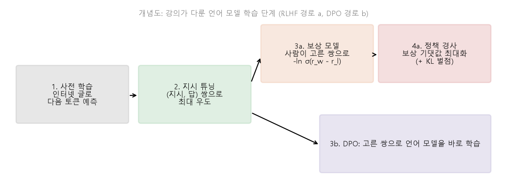
*▲ 직접 그린 그림(개념도): 강의가 다룬 [언어 모델](00_%EB%94%A5%EB%9F%AC%EB%8B%9D_%EC%9A%A9%EC%96%B4%EC%82%AC%EC%A0%84.md#language-model-%EC%96%B8%EC%96%B4-%EB%AA%A8%EB%8D%B8) [학습](00_%EB%94%A5%EB%9F%AC%EB%8B%9D_%EC%9A%A9%EC%96%B4%EC%82%AC%EC%A0%84.md#training-%ED%95%99%EC%8A%B5) 단계. [사전 학습](00_%EB%94%A5%EB%9F%AC%EB%8B%9D_%EC%9A%A9%EC%96%B4%EC%82%AC%EC%A0%84.md#pre-training-%EC%82%AC%EC%A0%84-%ED%95%99%EC%8A%B5) → [지시 튜닝](00_%EB%94%A5%EB%9F%AC%EB%8B%9D_%EC%9A%A9%EC%96%B4%EC%82%AC%EC%A0%84.md#instruction-tuning-%EC%A7%80%EC%8B%9C-%ED%8A%9C%EB%8B%9D) → (a) [보상 모델](00_%EB%94%A5%EB%9F%AC%EB%8B%9D_%EC%9A%A9%EC%96%B4%EC%82%AC%EC%A0%84.md#reward-model-%EB%B3%B4%EC%83%81-%EB%AA%A8%EB%8D%B8) + [정책 경사](00_%EB%94%A5%EB%9F%AC%EB%8B%9D_%EC%9A%A9%EC%96%B4%EC%82%AC%EC%A0%84.md#policy-gradient-%EC%A0%95%EC%B1%85-%EA%B2%BD%EC%82%AC), 또는 (b) [DPO](00_%EB%94%A5%EB%9F%AC%EB%8B%9D_%EC%9A%A9%EC%96%B4%EC%82%AC%EC%A0%84.md#dpo-direct-preference-optimization-%EC%A7%81%EC%A0%91-%EC%84%A0%ED%98%B8-%EC%B5%9C%EC%A0%81%ED%99%94)*

[DPO](00_%EB%94%A5%EB%9F%AC%EB%8B%9D_%EC%9A%A9%EC%96%B4%EC%82%AC%EC%A0%84.md#dpo-direct-preference-optimization-%EC%A7%81%EC%A0%91-%EC%84%A0%ED%98%B8-%EC%B5%9C%EC%A0%81%ED%99%94)는 [보상 모델](00_%EB%94%A5%EB%9F%AC%EB%8B%9D_%EC%9A%A9%EC%96%B4%EC%82%AC%EC%A0%84.md#reward-model-%EB%B3%B4%EC%83%81-%EB%AA%A8%EB%8D%B8) 점수 자리에 "지금 모델이 기준 모델보다 그 답을 얼마나 더 좋아하나"를 넣은 같은 브래들리-테리 [손실](00_%EB%94%A5%EB%9F%AC%EB%8B%9D_%EC%9A%A9%EC%96%B4%EC%82%AC%EC%A0%84.md#loss-function-%EC%86%90%EC%8B%A4-%ED%95%A8%EC%88%98)입니다(강의는 이름만 언급).

$$
\mathcal{L}_{\text{DPO}}(\theta) = -\ln \sigma\Big(\beta \ln \frac{\pi_\theta(y_w \mid x)}{\pi_{\text{ref}}(y_w \mid x)} - \beta \ln \frac{\pi_\theta(y_l \mid x)}{\pi_{\text{ref}}(y_l \mid x)}\Big)
$$

기호 풀이

| 기호 | 읽는 법 | 뜻 | 예제 값 |
| --- | --- | --- | --- |
| $\pi_\theta$ | 파이 세타 | [학습](00_%EB%94%A5%EB%9F%AC%EB%8B%9D_%EC%9A%A9%EC%96%B4%EC%82%AC%EC%A0%84.md#training-%ED%95%99%EC%8A%B5) 중인 [언어 모델](00_%EB%94%A5%EB%9F%AC%EB%8B%9D_%EC%9A%A9%EC%96%B4%EC%82%AC%EC%A0%84.md#language-model-%EC%96%B8%EC%96%B4-%EB%AA%A8%EB%8D%B8)([정책](00_%EB%94%A5%EB%9F%AC%EB%8B%9D_%EC%9A%A9%EC%96%B4%EC%82%AC%EC%A0%84.md#policy-%EC%A0%95%EC%B1%85)) | 0.3, 0.1 |
| $\pi_{\text{ref}}$ | 파이 레프 | 얼려 둔 기준 모델 ([지시 튜닝](00_%EB%94%A5%EB%9F%AC%EB%8B%9D_%EC%9A%A9%EC%96%B4%EC%82%AC%EC%A0%84.md#instruction-tuning-%EC%A7%80%EC%8B%9C-%ED%8A%9C%EB%8B%9D) 뒤 모델) | 0.2, 0.2 |
| $y_w, y_l$ | 와이 더블유, 와이 엘 | 사람이 고른 답, 고르지 않은 답 | |
| $\beta$ | 베타 | 기준 모델에서 멀어지는 것을 얼마나 허용하나 | 0.1 |
| $\sigma$ | [시그모이드](00_%EB%94%A5%EB%9F%AC%EB%8B%9D_%EC%9A%A9%EC%96%B4%EC%82%AC%EC%A0%84.md#sigmoid-%EC%8B%9C%EA%B7%B8%EB%AA%A8%EC%9D%B4%EB%93%9C) | $1/(1 + e^{-z})$ | 0.5274 |
| $\mathcal{L}_{\text{DPO}}$ | 엘 디피오 | [DPO](00_%EB%94%A5%EB%9F%AC%EB%8B%9D_%EC%9A%A9%EC%96%B4%EC%82%AC%EC%A0%84.md#dpo-direct-preference-optimization-%EC%A7%81%EC%A0%91-%EC%84%A0%ED%98%B8-%EC%B5%9C%EC%A0%81%ED%99%94) [손실](00_%EB%94%A5%EB%9F%AC%EB%8B%9D_%EC%9A%A9%EC%96%B4%EC%82%AC%EC%A0%84.md#loss-function-%EC%86%90%EC%8B%A4-%ED%95%A8%EC%88%98) | 0.6397 |

예제와 풀이

**문제**: 사람이 고른 답 $y_w$에 지금 모델은 0.3, 기준 모델은 0.2를 준다. 고르지 않은 답 $y_l$에는 각각 0.1과 0.2를 준다. $\beta = 0.1$일 때 [DPO](00_%EB%94%A5%EB%9F%AC%EB%8B%9D_%EC%9A%A9%EC%96%B4%EC%82%AC%EC%A0%84.md#dpo-direct-preference-optimization-%EC%A7%81%EC%A0%91-%EC%84%A0%ED%98%B8-%EC%B5%9C%EC%A0%81%ED%99%94) [손실](00_%EB%94%A5%EB%9F%AC%EB%8B%9D_%EC%9A%A9%EC%96%B4%EC%82%AC%EC%A0%84.md#loss-function-%EC%86%90%EC%8B%A4-%ED%95%A8%EC%88%98)은?

**주어진 값**
- $\pi_\theta(y_w \mid x) = 0.3$, $\pi_{\text{ref}}(y_w \mid x) = 0.2$ (고른 답의 [확률](00_%EB%94%A5%EB%9F%AC%EB%8B%9D_%EC%9A%A9%EC%96%B4%EC%82%AC%EC%A0%84.md#probability-%ED%99%95%EB%A5%A0))
- $\pi_\theta(y_l \mid x) = 0.1$, $\pi_{\text{ref}}(y_l \mid x) = 0.2$ (안 고른 답의 [확률](00_%EB%94%A5%EB%9F%AC%EB%8B%9D_%EC%9A%A9%EC%96%B4%EC%82%AC%EC%A0%84.md#probability-%ED%99%95%EB%A5%A0))
- $\beta = 0.1$

**풀이**
1. 식을 그대로 쓴다: $\mathcal{L}_{\text{DPO}} = -\ln \sigma\Big(\beta \ln \dfrac{\pi_\theta(y_w \mid x)}{\pi_{\text{ref}}(y_w \mid x)} - \beta \ln \dfrac{\pi_\theta(y_l \mid x)}{\pi_{\text{ref}}(y_l \mid x)}\Big)$
2. 값을 대입한다: $\mathcal{L}_{\text{DPO}} = -\ln \sigma\Big(0.1 \ln \dfrac{0.3}{0.2} - 0.1 \ln \dfrac{0.1}{0.2}\Big)$
3. 나눗셈을 한다: $0.3 / 0.2 = 1.5$, $0.1 / 0.2 = 0.5$
4. [로그](00_%EB%94%A5%EB%9F%AC%EB%8B%9D_%EC%9A%A9%EC%96%B4%EC%82%AC%EC%A0%84.md#log-ln-%EB%A1%9C%EA%B7%B8)를 계산한다: $\ln 1.5 = 0.4055$, $\ln 0.5 = -0.6931$
5. 괄호 안을 뺀다: $0.4055 - (-0.6931) = 1.0986$
6. $\beta$를 곱한다: $0.1 \times 1.0986 = 0.1099$
7. [시그모이드](00_%EB%94%A5%EB%9F%AC%EB%8B%9D_%EC%9A%A9%EC%96%B4%EC%82%AC%EC%A0%84.md#sigmoid-%EC%8B%9C%EA%B7%B8%EB%AA%A8%EC%9D%B4%EB%93%9C)를 계산한다: $e^{-0.1099} = 0.8959$, $1 + 0.8959 = 1.8959$, $1 / 1.8959 = 0.5274$
8. 음의 [로그](00_%EB%94%A5%EB%9F%AC%EB%8B%9D_%EC%9A%A9%EC%96%B4%EC%82%AC%EC%A0%84.md#log-ln-%EB%A1%9C%EA%B7%B8)를 씌운다: $-\ln 0.5274 = 0.6397$ (반올림한 0.5274로 하면 0.6398)

**답**: **0.6397**. [보상 모델](00_%EB%94%A5%EB%9F%AC%EB%8B%9D_%EC%9A%A9%EC%96%B4%EC%82%AC%EC%A0%84.md#reward-model-%EB%B3%B4%EC%83%81-%EB%AA%A8%EB%8D%B8)도 [정책 경사](00_%EB%94%A5%EB%9F%AC%EB%8B%9D_%EC%9A%A9%EC%96%B4%EC%82%AC%EC%A0%84.md#policy-gradient-%EC%A0%95%EC%B1%85-%EA%B2%BD%EC%82%AC)의 표본 뽑기도 없이, 고정된 선호 쌍 데이터로 보통의 [경사하강법](00_%EB%94%A5%EB%9F%AC%EB%8B%9D_%EC%9A%A9%EC%96%B4%EC%82%AC%EC%A0%84.md#gradient-descent-%EA%B2%BD%EC%82%AC%ED%95%98%EA%B0%95%EB%B2%95)을 하면 된다.

내 이해

> [!TIP]
> **🆕 2026 업데이트: 큰 공개 모델의 사후 [학습](00_%EB%94%A5%EB%9F%AC%EB%8B%9D_%EC%9A%A9%EC%96%B4%EC%82%AC%EC%A0%84.md#training-%ED%95%99%EC%8A%B5)에 [DPO](00_%EB%94%A5%EB%9F%AC%EB%8B%9D_%EC%9A%A9%EC%96%B4%EC%82%AC%EC%A0%84.md#dpo-direct-preference-optimization-%EC%A7%81%EC%A0%91-%EC%84%A0%ED%98%B8-%EC%B5%9C%EC%A0%81%ED%99%94)가 쓰이다**
> - **강의**: [보상 모델](00_%EB%94%A5%EB%9F%AC%EB%8B%9D_%EC%9A%A9%EC%96%B4%EC%82%AC%EC%A0%84.md#reward-model-%EB%B3%B4%EC%83%81-%EB%AA%A8%EB%8D%B8) + [정책 경사](00_%EB%94%A5%EB%9F%AC%EB%8B%9D_%EC%9A%A9%EC%96%B4%EC%82%AC%EC%A0%84.md#policy-gradient-%EC%A0%95%EC%B1%85-%EA%B2%BD%EC%82%AC)가 표준이고, [DPO](00_%EB%94%A5%EB%9F%AC%EB%8B%9D_%EC%9A%A9%EC%96%B4%EC%82%AC%EC%A0%84.md#dpo-direct-preference-optimization-%EC%A7%81%EC%A0%91-%EC%84%A0%ED%98%B8-%EC%B5%9C%EC%A0%81%ED%99%94) 같은 대안도 있다.
> - **현재**: Meta의 Llama 3(2024)는 사후 [학습](00_%EB%94%A5%EB%9F%AC%EB%8B%9D_%EC%9A%A9%EC%96%B4%EC%82%AC%EC%A0%84.md#training-%ED%95%99%EC%8A%B5)을 [지시 튜닝](00_%EB%94%A5%EB%9F%AC%EB%8B%9D_%EC%9A%A9%EC%96%B4%EC%82%AC%EC%A0%84.md#instruction-tuning-%EC%A7%80%EC%8B%9C-%ED%8A%9C%EB%8B%9D)(SFT), [기각 샘플링](00_%EB%94%A5%EB%9F%AC%EB%8B%9D_%EC%9A%A9%EC%96%B4%EC%82%AC%EC%A0%84.md#rejection-sampling-%EA%B8%B0%EA%B0%81-%EC%83%98%ED%94%8C%EB%A7%81), [DPO](00_%EB%94%A5%EB%9F%AC%EB%8B%9D_%EC%9A%A9%EC%96%B4%EC%82%AC%EC%A0%84.md#dpo-direct-preference-optimization-%EC%A7%81%EC%A0%91-%EC%84%A0%ED%98%B8-%EC%B5%9C%EC%A0%81%ED%99%94)로 했다. PPO도 시도했지만 [DPO](00_%EB%94%A5%EB%9F%AC%EB%8B%9D_%EC%9A%A9%EC%96%B4%EC%82%AC%EC%A0%84.md#dpo-direct-preference-optimization-%EC%A7%81%EC%A0%91-%EC%84%A0%ED%98%B8-%EC%B5%9C%EC%A0%81%ED%99%94)가 큰 모델에서 계산이 덜 들고 지시 따르기 평가에서 더 좋았다고 밝혔다. AI2의 Tulu 3(2024)는 SFT → [DPO](00_%EB%94%A5%EB%9F%AC%EB%8B%9D_%EC%9A%A9%EC%96%B4%EC%82%AC%EC%A0%84.md#dpo-direct-preference-optimization-%EC%A7%81%EC%A0%91-%EC%84%A0%ED%98%B8-%EC%B5%9C%EC%A0%81%ED%99%94) → **[검증](00_%EB%94%A5%EB%9F%AC%EB%8B%9D_%EC%9A%A9%EC%96%B4%EC%82%AC%EC%A0%84.md#validation-data-%EA%B2%80%EC%A6%9D-%EB%8D%B0%EC%9D%B4%ED%84%B0) 가능한 보상을 쓰는 [강화 학습](00_%EB%94%A5%EB%9F%AC%EB%8B%9D_%EC%9A%A9%EC%96%B4%EC%82%AC%EC%A0%84.md#reinforcement-learning-%EA%B0%95%ED%99%94-%ED%95%99%EC%8A%B5)**(RLVR: 수학 [정답](00_%EB%94%A5%EB%9F%AC%EB%8B%9D_%EC%9A%A9%EC%96%B4%EC%82%AC%EC%A0%84.md#label-%EC%A0%95%EB%8B%B5)처럼 자동으로 채점되는 결과를 보상으로 씀)의 공개 레시피를 내놓았다.
> - **출처**: [Grattafiori et al., The Llama 3 Herd of Models (arXiv 2024)](https://arxiv.org/abs/2407.21783) · [Lambert et al., Tulu 3: Pushing Frontiers in Open Language Model Post-Training (arXiv 2024)](https://arxiv.org/abs/2411.15124)

---

## 11. 정리

▶ 영상 [75:13](https://youtu.be/9GWd3SAWLbA?t=4513)

- 강사는 처음의 "LLM까지의 길" 표로 돌아가, 가장 오른쪽 칸([사전 학습](00_%EB%94%A5%EB%9F%AC%EB%8B%9D_%EC%9A%A9%EC%96%B4%EC%82%AC%EC%A0%84.md#pre-training-%EC%82%AC%EC%A0%84-%ED%95%99%EC%8A%B5) + 프롬프트)이 지금 시대를 정의한다고 말합니다. 많은 사람의 예상과 달리, 엄청난 양의 글로 큰 규모 [학습](00_%EB%94%A5%EB%9F%AC%EB%8B%9D_%EC%9A%A9%EC%96%B4%EC%82%AC%EC%A0%84.md#training-%ED%95%99%EC%8A%B5)을 하고 나중에 **조금만 다듬으면**(모델이 아는 것은 거의 바꾸지 않고 기본 응답 형식과 입력에 대한 가정만 바꿈), 지시와 소수의 예만으로 넓은 범위의 과제를 추가 [미세 조정](00_%EB%94%A5%EB%9F%AC%EB%8B%9D_%EC%9A%A9%EC%96%B4%EC%82%AC%EC%A0%84.md#fine-tuning-%EB%AF%B8%EC%84%B8-%EC%A1%B0%EC%A0%95) 없이 해내는 아주 유연한 범용 예측기가 생깁니다.
- 이것을 어디까지 밀 수 있는지, 그리고 계산적으로 더 복잡한 과제를 풀게 하려면 **생각의 사슬 다음에 무엇이 와야 하는지**가 "LLM 이후 시대"의 연구 과제라고 마무리합니다.
- Isola가 소개에서 말한 두 관점(LLM은 딥러닝 위에 지은 것, 혹은 딥러닝 다음의 패러다임)으로 돌아가는 결론입니다. 다음 강의는 Lec23입니다(Lec22는 공개되지 않음).

> [!TIP]
> **🆕 2026 업데이트: 생각의 사슬 다음 — [강화 학습](00_%EB%94%A5%EB%9F%AC%EB%8B%9D_%EC%9A%A9%EC%96%B4%EC%82%AC%EC%A0%84.md#reinforcement-learning-%EA%B0%95%ED%99%94-%ED%95%99%EC%8A%B5)으로 훈련한 [추론 모델](00_%EB%94%A5%EB%9F%AC%EB%8B%9D_%EC%9A%A9%EC%96%B4%EC%82%AC%EC%A0%84.md#reasoning-model-%EC%B6%94%EB%A1%A0-%EB%AA%A8%EB%8D%B8)**
> - **강의**: "생각의 사슬 다음에 무엇이 오나"가 앞으로의 연구 과제다. [강화 학습](00_%EB%94%A5%EB%9F%AC%EB%8B%9D_%EC%9A%A9%EC%96%B4%EC%82%AC%EC%A0%84.md#reinforcement-learning-%EA%B0%95%ED%99%94-%ED%95%99%EC%8A%B5)이 생각의 사슬과 어떻게 이어지는지는 질문만 나왔다.
> - **현재**: 프롬프트로 끌어내던 생각의 사슬을, [정답](00_%EB%94%A5%EB%9F%AC%EB%8B%9D_%EC%9A%A9%EC%96%B4%EC%82%AC%EC%A0%84.md#label-%EC%A0%95%EB%8B%B5) 여부처럼 **자동으로 검증할 수 있는 보상**으로 강화 학습해 모델이 스스로 길게 생성하도록 훈련한 **[추론 모델](00_%EB%94%A5%EB%9F%AC%EB%8B%9D_%EC%9A%A9%EC%96%B4%EC%82%AC%EC%A0%84.md#reasoning-model-%EC%B6%94%EB%A1%A0-%EB%AA%A8%EB%8D%B8)**이 나왔다(OpenAI o1, 2024; [Lec18 8.2](Lec18_%EC%A0%84%EC%9D%B4_%ED%95%99%EC%8A%B5_%EB%AA%A8%EB%8D%B8.md#82-%EC%86%8C%ED%94%84%ED%8A%B8-%ED%94%84%EB%A1%AC%ED%94%84%ED%8A%B8%EC%99%80-%EC%83%9D%EA%B0%81%EC%9D%98-%EC%82%AC%EC%8A%AC)의 업데이트 참고). DeepSeek-R1은 사람이 쓴 추론 예 없이 [정답](00_%EB%94%A5%EB%9F%AC%EB%8B%9D_%EC%9A%A9%EC%96%B4%EC%82%AC%EC%A0%84.md#label-%EC%A0%95%EB%8B%B5) 보상만으로 강화 학습해도 자기 [검증](00_%EB%94%A5%EB%9F%AC%EB%8B%9D_%EC%9A%A9%EC%96%B4%EC%82%AC%EC%A0%84.md#validation-data-%EA%B2%80%EC%A6%9D-%EB%8D%B0%EC%9D%B4%ED%84%B0), 되돌아보기 같은 추론 행동과 긴 생각의 사슬이 나타남을 보였다(Nature 2025 게재). 강의 10절의 [정책 경사](00_%EB%94%A5%EB%9F%AC%EB%8B%9D_%EC%9A%A9%EC%96%B4%EC%82%AC%EC%A0%84.md#policy-gradient-%EC%A0%95%EC%B1%85-%EA%B2%BD%EC%82%AC)가 이제 사람 선호뿐 아니라 추론 능력 자체를 기르는 데 쓰인다. 답하기 전 생각에 쓰는 계산([테스트 시점 계산](00_%EB%94%A5%EB%9F%AC%EB%8B%9D_%EC%9A%A9%EC%96%B4%EC%82%AC%EC%A0%84.md#test-time-compute-%ED%85%8C%EC%8A%A4%ED%8A%B8-%EC%8B%9C%EC%A0%90-%EA%B3%84%EC%82%B0))을 늘리면 성능이 오른다는 점이 7.1절의 "답하기 전 계산량은 정해져 있다"는 한계에 대한 한 가지 답이다.
> - **출처**: [OpenAI, Learning to reason with LLMs (2024)](https://openai.com/index/learning-to-reason-with-llms/) · [DeepSeek-AI, DeepSeek-R1 (arXiv 2025; Nature 645, 2025)](https://arxiv.org/abs/2501.12948) · [Lambert et al., Tulu 3 (arXiv 2024)](https://arxiv.org/abs/2411.15124)

---

## 12. 용어 정리

용어사전에 있는 용어는 위 본문에 링크를 걸었습니다. 아래는 이번 강의에서 새로 나온 용어입니다.

| 용어 | 뜻 |
|---|---|
| [언어 모델](00_%EB%94%A5%EB%9F%AC%EB%8B%9D_%EC%9A%A9%EC%96%B4%EC%82%AC%EC%A0%84.md#language-model-%EC%96%B8%EC%96%B4-%EB%AA%A8%EB%8D%B8)(Language model) | 앞 단어들을 보고 다음 단어의 분포를 내는 모델. [연쇄법칙](00_%EB%94%A5%EB%9F%AC%EB%8B%9D_%EC%9A%A9%EC%96%B4%EC%82%AC%EC%A0%84.md#chain-rule-%EC%97%B0%EC%87%84%EB%B2%95%EC%B9%99)으로 문장 분포가 된다 |
| [n-그램 모델](00_%EB%94%A5%EB%9F%AC%EB%8B%9D_%EC%9A%A9%EC%96%B4%EC%82%AC%EC%A0%84.md#n-gram-model-n-%EA%B7%B8%EB%9E%A8-%EB%AA%A8%EB%8D%B8)(N-gram model) | 앞 $n-1$개 단어가 같았던 경우를 말뭉치에서 세어 다음 단어 [확률](00_%EB%94%A5%EB%9F%AC%EB%8B%9D_%EC%9A%A9%EC%96%B4%EC%82%AC%EC%A0%84.md#probability-%ED%99%95%EB%A5%A0)을 정하는 모델 |
| [퍼플렉서티](00_%EB%94%A5%EB%9F%AC%EB%8B%9D_%EC%9A%A9%EC%96%B4%EC%82%AC%EC%A0%84.md#perplexity-%ED%8D%BC%ED%94%8C%EB%A0%89%EC%84%9C%ED%8B%B0)([Perplexity](00_%EB%94%A5%EB%9F%AC%EB%8B%9D_%EC%9A%A9%EC%96%B4%EC%82%AC%EC%A0%84.md#perplexity-%ED%8D%BC%ED%94%8C%EB%A0%89%EC%84%9C%ED%8B%B0)) | [토큰](00_%EB%94%A5%EB%9F%AC%EB%8B%9D_%EC%9A%A9%EC%96%B4%EC%82%AC%EC%A0%84.md#token-%ED%86%A0%ED%81%B0)당 평균 음의 [로그](00_%EB%94%A5%EB%9F%AC%EB%8B%9D_%EC%9A%A9%EC%96%B4%EC%82%AC%EC%A0%84.md#log-ln-%EB%A1%9C%EA%B7%B8) [확률](00_%EB%94%A5%EB%9F%AC%EB%8B%9D_%EC%9A%A9%EC%96%B4%EC%82%AC%EC%A0%84.md#probability-%ED%99%95%EB%A5%A0)에 $e$를 씌운 값. 평균 몇 지 선다만큼 헷갈리나 |
| [시퀀스-투-시퀀스](00_%EB%94%A5%EB%9F%AC%EB%8B%9D_%EC%9A%A9%EC%96%B4%EC%82%AC%EC%A0%84.md#seq2seq-sequence-to-sequence-%EC%8B%9C%ED%80%80%EC%8A%A4-%ED%88%AC-%EC%8B%9C%ED%80%80%EC%8A%A4)([Seq2seq](00_%EB%94%A5%EB%9F%AC%EB%8B%9D_%EC%9A%A9%EC%96%B4%EC%82%AC%EC%A0%84.md#seq2seq-sequence-to-sequence-%EC%8B%9C%ED%80%80%EC%8A%A4-%ED%88%AC-%EC%8B%9C%ED%80%80%EC%8A%A4)) | 입력 [시퀀스](00_%EB%94%A5%EB%9F%AC%EB%8B%9D_%EC%9A%A9%EC%96%B4%EC%82%AC%EC%A0%84.md#sequence-%EC%8B%9C%ED%80%80%EC%8A%A4)를 조건으로 출력 [시퀀스](00_%EB%94%A5%EB%9F%AC%EB%8B%9D_%EC%9A%A9%EC%96%B4%EC%82%AC%EC%A0%84.md#sequence-%EC%8B%9C%ED%80%80%EC%8A%A4)를 생성하는 조건부 [언어 모델](00_%EB%94%A5%EB%9F%AC%EB%8B%9D_%EC%9A%A9%EC%96%B4%EC%82%AC%EC%A0%84.md#language-model-%EC%96%B8%EC%96%B4-%EB%AA%A8%EB%8D%B8) (번역, 요약) |
| [창발 능력](00_%EB%94%A5%EB%9F%AC%EB%8B%9D_%EC%9A%A9%EC%96%B4%EC%82%AC%EC%A0%84.md#emergent-abilities-%EC%B0%BD%EB%B0%9C-%EB%8A%A5%EB%A0%A5)(Emergent abilities) | 작은 모델에는 없다가 일정 규모를 넘으면 나타나는 능력 |
| [지시 튜닝](00_%EB%94%A5%EB%9F%AC%EB%8B%9D_%EC%9A%A9%EC%96%B4%EC%82%AC%EC%A0%84.md#instruction-tuning-%EC%A7%80%EC%8B%9C-%ED%8A%9C%EB%8B%9D)(Instruction tuning) | (지시, 답) 데이터로 [언어 모델](00_%EB%94%A5%EB%9F%AC%EB%8B%9D_%EC%9A%A9%EC%96%B4%EC%82%AC%EC%A0%84.md#language-model-%EC%96%B8%EC%96%B4-%EB%AA%A8%EB%8D%B8)을 미세 조정해 지시를 따르게 하는 것 |
| [맥락 증류](00_%EB%94%A5%EB%9F%AC%EB%8B%9D_%EC%9A%A9%EC%96%B4%EC%82%AC%EC%A0%84.md#context-distillation-%EB%A7%A5%EB%9D%BD-%EC%A6%9D%EB%A5%98)(Context distillation) | 좋은 프롬프트를 넣고 뽑은 출력으로 미세 조정해, 프롬프트 없이도 그렇게 행동하게 하는 것 |
| [RLHF](00_%EB%94%A5%EB%9F%AC%EB%8B%9D_%EC%9A%A9%EC%96%B4%EC%82%AC%EC%A0%84.md#rlhf-reinforcement-learning-from-human-feedback-%EC%82%AC%EB%9E%8C-%ED%94%BC%EB%93%9C%EB%B0%B1-%EA%B0%95%ED%99%94-%ED%95%99%EC%8A%B5) | 사람 선호로 [보상 모델](00_%EB%94%A5%EB%9F%AC%EB%8B%9D_%EC%9A%A9%EC%96%B4%EC%82%AC%EC%A0%84.md#reward-model-%EB%B3%B4%EC%83%81-%EB%AA%A8%EB%8D%B8)을 만들고 그 보상을 [강화 학습](00_%EB%94%A5%EB%9F%AC%EB%8B%9D_%EC%9A%A9%EC%96%B4%EC%82%AC%EC%A0%84.md#reinforcement-learning-%EA%B0%95%ED%99%94-%ED%95%99%EC%8A%B5)으로 최대화하는 사후 [학습](00_%EB%94%A5%EB%9F%AC%EB%8B%9D_%EC%9A%A9%EC%96%B4%EC%82%AC%EC%A0%84.md#training-%ED%95%99%EC%8A%B5) |
| [보상 모델](00_%EB%94%A5%EB%9F%AC%EB%8B%9D_%EC%9A%A9%EC%96%B4%EC%82%AC%EC%A0%84.md#reward-model-%EB%B3%B4%EC%83%81-%EB%AA%A8%EB%8D%B8)(Reward model) | (질문, 답)에 사람의 선호를 흉내 낸 점수를 매기는 모델 |
| [정책](00_%EB%94%A5%EB%9F%AC%EB%8B%9D_%EC%9A%A9%EC%96%B4%EC%82%AC%EC%A0%84.md#policy-%EC%A0%95%EC%B1%85)([Policy](00_%EB%94%A5%EB%9F%AC%EB%8B%9D_%EC%9A%A9%EC%96%B4%EC%82%AC%EC%A0%84.md#policy-%EC%A0%95%EC%B1%85)) | 상황을 보고 행동을 고르는 규칙. [RLHF](00_%EB%94%A5%EB%9F%AC%EB%8B%9D_%EC%9A%A9%EC%96%B4%EC%82%AC%EC%A0%84.md#rlhf-reinforcement-learning-from-human-feedback-%EC%82%AC%EB%9E%8C-%ED%94%BC%EB%93%9C%EB%B0%B1-%EA%B0%95%ED%99%94-%ED%95%99%EC%8A%B5)에서는 [언어 모델](00_%EB%94%A5%EB%9F%AC%EB%8B%9D_%EC%9A%A9%EC%96%B4%EC%82%AC%EC%A0%84.md#language-model-%EC%96%B8%EC%96%B4-%EB%AA%A8%EB%8D%B8) 자체 |
| [정책 경사](00_%EB%94%A5%EB%9F%AC%EB%8B%9D_%EC%9A%A9%EC%96%B4%EC%82%AC%EC%A0%84.md#policy-gradient-%EC%A0%95%EC%B1%85-%EA%B2%BD%EC%82%AC)([Policy](00_%EB%94%A5%EB%9F%AC%EB%8B%9D_%EC%9A%A9%EC%96%B4%EC%82%AC%EC%A0%84.md#policy-%EC%A0%95%EC%B1%85) gradient) | 기대 보상의 [기울기](00_%EB%94%A5%EB%9F%AC%EB%8B%9D_%EC%9A%A9%EC%96%B4%EC%82%AC%EC%A0%84.md#gradient-%EA%B8%B0%EC%9A%B8%EA%B8%B0) $\mathbb{E}[r\, \nabla \ln p_\theta]$로 [정책](00_%EB%94%A5%EB%9F%AC%EB%8B%9D_%EC%9A%A9%EC%96%B4%EC%82%AC%EC%A0%84.md#policy-%EC%A0%95%EC%B1%85)을 갱신하는 방법. 보상 가중 [최대 우도](00_%EB%94%A5%EB%9F%AC%EB%8B%9D_%EC%9A%A9%EC%96%B4%EC%82%AC%EC%A0%84.md#maximum-likelihood-%EC%B5%9C%EB%8C%80-%EC%9A%B0%EB%8F%84) |
| [DPO](00_%EB%94%A5%EB%9F%AC%EB%8B%9D_%EC%9A%A9%EC%96%B4%EC%82%AC%EC%A0%84.md#dpo-direct-preference-optimization-%EC%A7%81%EC%A0%91-%EC%84%A0%ED%98%B8-%EC%B5%9C%EC%A0%81%ED%99%94)(Direct preference optimization) | [보상 모델](00_%EB%94%A5%EB%9F%AC%EB%8B%9D_%EC%9A%A9%EC%96%B4%EC%82%AC%EC%A0%84.md#reward-model-%EB%B3%B4%EC%83%81-%EB%AA%A8%EB%8D%B8) 없이 선호 쌍으로 [언어 모델](00_%EB%94%A5%EB%9F%AC%EB%8B%9D_%EC%9A%A9%EC%96%B4%EC%82%AC%EC%A0%84.md#language-model-%EC%96%B8%EC%96%B4-%EB%AA%A8%EB%8D%B8)을 직접 학습하는 방법 |
