# Lec 23. 계량 딥러닝 (Metrized Deep Learning)

← 이전: [Lec21_언어_모델](Lec21_%EC%96%B8%EC%96%B4_%EB%AA%A8%EB%8D%B8.md) · [목차](00_MIT%EB%94%A5%EB%9F%AC%EB%8B%9D_%EB%AA%A9%EC%B0%A8.md) · 다음: [Lec24_추론_방법](Lec24_%EC%B6%94%EB%A1%A0_%EB%B0%A9%EB%B2%95.md) →

> [!NOTE]
> **강의 정보**
> - **출처**: MIT OpenCourseWare, [Lec 23. Metrized Deep Learning](https://www.youtube.com/watch?v=zBvsoxC6tAo) (68분, 2024년 가을 학기)
> - **강사**: Jeremy Bernstein
> - **라이선스**: 원 강의는 CC BY-NC-SA 4.0입니다. 이 노트는 영어 자막을 바탕으로 한국어로 옮겨 정리한 2차 저작물이며, 같은 조건(비영리·출처 표기·동일 조건 공유)을 따릅니다.
> - 각 절 제목 아래의 `▶ 영상` 시간을 누르면 영상의 해당 위치로 갑니다.
> - `📐 수학 개념` 줄은 그 절에 쓰인 수학을 정리한 노트로 연결됩니다. 전체 목록은 [00_MIT딥러닝_목차](00_MIT%EB%94%A5%EB%9F%AC%EB%8B%9D_%EB%AA%A9%EC%B0%A8.md).
> - 슬라이드 캡처는 원 강의(CC BY-NC-SA 4.0)에서 가져왔고, "직접 그린 그림"은 이 노트의 숫자로 새로 그렸습니다.
> - `🆕 2026 업데이트` 칸은 강의(2024년 가을) 이후 바뀐 내용을 덧붙인 것입니다.

## 한눈에 보기

| 구분 | 내용 |
|---|---|
| 핵심 질문 | 신경망을 레고처럼 조립하듯, 그 **이론**([가중치](00_%EB%94%A5%EB%9F%AC%EB%8B%9D_%EC%9A%A9%EC%96%B4%EC%82%AC%EC%A0%84.md#weight-%EA%B0%80%EC%A4%91%EC%B9%98)·입력을 바꾸면 출력이 얼마나 바뀌나)도 부품 이론을 조립해 만들 수 있나? |
| 출발점 | [최급강하법](00_%EB%94%A5%EB%9F%AC%EB%8B%9D_%EC%9A%A9%EC%96%B4%EC%82%AC%EC%A0%84.md#steepest-descent-%EC%B5%9C%EA%B8%89%EA%B0%95%ED%95%98%EB%B2%95)에는 [손실](00_%EB%94%A5%EB%9F%AC%EB%8B%9D_%EC%9A%A9%EC%96%B4%EC%82%AC%EC%A0%84.md#loss-function-%EC%86%90%EC%8B%A4-%ED%95%A8%EC%88%98)의 2차 항을 누르는 [노름](00_%EB%94%A5%EB%9F%AC%EB%8B%9D_%EC%9A%A9%EC%96%B4%EC%82%AC%EC%A0%84.md#norm-%EB%85%B8%EB%A6%84)과 [날카로움](00_%EB%94%A5%EB%9F%AC%EB%8B%9D_%EC%9A%A9%EC%96%B4%EC%82%AC%EC%A0%84.md#sharpness-%EB%82%A0%EC%B9%B4%EB%A1%9C%EC%9B%80) $\lambda$가 필요하다. [가우스-뉴턴](00_%EB%94%A5%EB%9F%AC%EB%8B%9D_%EC%9A%A9%EC%96%B4%EC%82%AC%EC%A0%84.md#gauss-newton-method-%EA%B0%80%EC%9A%B0%EC%8A%A4-%EB%89%B4%ED%84%B4-%EB%B0%A9%EB%B2%95) 분해로 이 문제를 "신경망이 [가중치](00_%EB%94%A5%EB%9F%AC%EB%8B%9D_%EC%9A%A9%EC%96%B4%EC%82%AC%EC%A0%84.md#weight-%EA%B0%80%EC%A4%91%EC%B9%98)에 대해 [립시츠 연속](00_%EB%94%A5%EB%9F%AC%EB%8B%9D_%EC%9A%A9%EC%96%B4%EC%82%AC%EC%A0%84.md#lipschitz-continuity-%EB%A6%BD%EC%8B%9C%EC%B8%A0-%EC%97%B0%EC%86%8D)·립시츠 매끄러운 [노름](00_%EB%94%A5%EB%9F%AC%EB%8B%9D_%EC%9A%A9%EC%96%B4%EC%82%AC%EC%A0%84.md#norm-%EB%85%B8%EB%A6%84) 찾기"로 바꾼다 |
| 모듈 이론 | 모듈 = forward, **질량**, **민감도**, **[노름](00_%EB%94%A5%EB%9F%AC%EB%8B%9D_%EC%9A%A9%EC%96%B4%EC%82%AC%EC%A0%84.md#norm-%EB%85%B8%EB%A6%84)**. 합성(직렬)·연결(병렬) 규칙으로 [노름](00_%EB%94%A5%EB%9F%AC%EB%8B%9D_%EC%9A%A9%EC%96%B4%EC%82%AC%EC%A0%84.md#norm-%EB%85%B8%EB%A6%84)을 자동으로 합쳐 **[모듈러 노름](00_%EB%94%A5%EB%9F%AC%EB%8B%9D_%EC%9A%A9%EC%96%B4%EC%82%AC%EC%A0%84.md#module-modular-norm-%EB%AA%A8%EB%93%88%EA%B3%BC-%EB%AA%A8%EB%93%88%EB%9F%AC-%EB%85%B8%EB%A6%84)**을 만들고, "[노름](00_%EB%94%A5%EB%9F%AC%EB%8B%9D_%EC%9A%A9%EC%96%B4%EC%82%AC%EC%A0%84.md#norm-%EB%85%B8%EB%A6%84)이 잘 맞음"이 조합 뒤에도 유지된다 |
| 스케일링 | 너비·깊이와 상관없는(무차원) 딱 맞는 립시츠 상수 + 그 [노름](00_%EB%94%A5%EB%9F%AC%EB%8B%9D_%EC%9A%A9%EC%96%B4%EC%82%AC%EC%A0%84.md#norm-%EB%85%B8%EB%A6%84)으로 업데이트 [정규화](00_%EB%94%A5%EB%9F%AC%EB%8B%9D_%EC%9A%A9%EC%96%B4%EC%82%AC%EC%A0%84.md#normalization-%EC%A0%95%EA%B7%9C%ED%99%94) → [학습률](00_%EB%94%A5%EB%9F%AC%EB%8B%9D_%EC%9A%A9%EC%96%B4%EC%82%AC%EC%A0%84.md#learning-rate-%ED%95%99%EC%8A%B5%EB%A5%A0)이 너비·깊이를 건너 옮겨진다 (Modula 실험) |
| 모듈러 쌍대성 | [기울기](00_%EB%94%A5%EB%9F%AC%EB%8B%9D_%EC%9A%A9%EC%96%B4%EC%82%AC%EC%A0%84.md#gradient-%EA%B8%B0%EC%9A%B8%EA%B8%B0)는 쌍대 벡터라 그대로 빼면 "타입이 안 맞는다". [층](00_%EB%94%A5%EB%9F%AC%EB%8B%9D_%EC%9A%A9%EC%96%B4%EC%82%AC%EC%A0%84.md#layer-%EC%B8%B5)마다 쌍대 사상을 풀고 재귀로 합친다. [선형층](00_%EB%94%A5%EB%9F%AC%EB%8B%9D_%EC%9A%A9%EC%96%B4%EC%82%AC%EC%A0%84.md#linear-layer-%EC%84%A0%ED%98%95%EC%B8%B5)은 $UV^\top$(특잇값을 모두 1로) |
| 실제 성과 | [Shampoo](00_%EB%94%A5%EB%9F%AC%EB%8B%9D_%EC%9A%A9%EC%96%B4%EC%82%AC%EC%A0%84.md#shampoo-%EC%83%B4%ED%91%B8-%EC%98%B5%ED%8B%B0%EB%A7%88%EC%9D%B4%EC%A0%80)의 핵심 연산이 바로 이것. Keller Jordan이 [뉴턴-슐츠 반복](00_%EB%94%A5%EB%9F%AC%EB%8B%9D_%EC%9A%A9%EC%96%B4%EC%82%AC%EC%A0%84.md#newton-schulz-iteration-%EB%89%B4%ED%84%B4-%EC%8A%90%EC%B8%A0-%EB%B0%98%EB%B3%B5)으로 빠르게 구현해 NanoGPT [학습](00_%EB%94%A5%EB%9F%AC%EB%8B%9D_%EC%9A%A9%EC%96%B4%EC%82%AC%EC%A0%84.md#training-%ED%95%99%EC%8A%B5) 속도 기록 |
| 이전·다음 강의 | [Lec07](Lec07_%EC%B5%9C%EC%A0%81%ED%99%94%EC%9D%98_%EC%8A%A4%EC%BC%80%EC%9D%BC%EB%A7%81_%EA%B7%9C%EC%B9%99.md)([최급강하법](00_%EB%94%A5%EB%9F%AC%EB%8B%9D_%EC%9A%A9%EC%96%B4%EC%82%AC%EC%A0%84.md#steepest-descent-%EC%B5%9C%EA%B8%89%EA%B0%95%ED%95%98%EB%B2%95), RMS 연산자 [노름](00_%EB%94%A5%EB%9F%AC%EB%8B%9D_%EC%9A%A9%EC%96%B4%EC%82%AC%EC%A0%84.md#norm-%EB%85%B8%EB%A6%84), 모듈 이론 예고) · [Lec13](Lec13_%ED%91%9C%ED%98%84_%ED%95%99%EC%8A%B5_%EC%9D%B4%EB%A1%A0.md)([스펙트럼 노름](00_%EB%94%A5%EB%9F%AC%EB%8B%9D_%EC%9A%A9%EC%96%B4%EC%82%AC%EC%A0%84.md#spectral-norm-%EC%8A%A4%ED%8E%99%ED%8A%B8%EB%9F%BC-%EB%85%B8%EB%A6%84) 최급강하)에서 이어짐 |

---

## 1. 레고처럼 쌓는 신경망 이론

▶ 영상 [00:00](https://youtu.be/zBvsoxC6tAo?t=0)

강사는 오늘 자기 연구를 소개한다며 "회의적으로 들어도 좋다"고 먼저 말합니다.

- **비유**: 우리는 신경망을 레고처럼 만듭니다. 작은 부품을 이어 [트랜스포머](00_%EB%94%A5%EB%9F%AC%EB%8B%9D_%EC%9A%A9%EC%96%B4%EC%82%AC%EC%A0%84.md#transformer-%ED%8A%B8%EB%9E%9C%EC%8A%A4%ED%8F%AC%EB%A8%B8)를 만들 수도, 전혀 다른 것을 만들 수도 있습니다. 그렇다면 **이론도 같은 방식으로** 쌓아야 실제로 쓰이는 온갖 신경망에 들어맞을 것입니다.
- **방법**: 부품 하나([층](00_%EB%94%A5%EB%9F%AC%EB%8B%9D_%EC%9A%A9%EC%96%B4%EC%82%AC%EC%A0%84.md#layer-%EC%B8%B5) 하나)는 단순하니 그 이론을 완전히 알 수 있다고 가정합니다. 그리고 부품을 합치는 두 연산, **직렬**(위에 쌓기)과 **병렬**(옆에 붙이기)을 생각합니다.
- **무엇을 알고 싶나**: [층](00_%EB%94%A5%EB%9F%AC%EB%8B%9D_%EC%9A%A9%EC%96%B4%EC%82%AC%EC%A0%84.md#layer-%EC%B8%B5)은 입력, [가중치](00_%EB%94%A5%EB%9F%AC%EB%8B%9D_%EC%9A%A9%EC%96%B4%EC%82%AC%EC%A0%84.md#weight-%EA%B0%80%EC%A4%91%EC%B9%98), 출력을 가집니다. 알고 싶은 것은 **입력을 흔들거나 [가중치](00_%EB%94%A5%EB%9F%AC%EB%8B%9D_%EC%9A%A9%EC%96%B4%EC%82%AC%EC%A0%84.md#weight-%EA%B0%80%EC%A4%91%EC%B9%98)를 흔들 때 출력이 얼마나 바뀌나**(민감도)입니다. 강사는 이렇게 기본적인 질문인데 아무도 제대로 이해하지 못하고 가르치지도 않는다고 말합니다.
- **왜 중요한가**: [학습](00_%EB%94%A5%EB%9F%AC%EB%8B%9D_%EC%9A%A9%EC%96%B4%EC%82%AC%EC%A0%84.md#training-%ED%95%99%EC%8A%B5)은 모든 [층](00_%EB%94%A5%EB%9F%AC%EB%8B%9D_%EC%9A%A9%EC%96%B4%EC%82%AC%EC%A0%84.md#layer-%EC%B8%B5)의 [가중치](00_%EB%94%A5%EB%9F%AC%EB%8B%9D_%EC%9A%A9%EC%96%B4%EC%82%AC%EC%A0%84.md#weight-%EA%B0%80%EC%A4%91%EC%B9%98)를 바꾸는 일이라 최적화와 직결됩니다. 입력을 조금 바꿔 출력이 크게 바뀌는 [적대적 예제](00_%EB%94%A5%EB%9F%AC%EB%8B%9D_%EC%9A%A9%EC%96%B4%EC%82%AC%EC%A0%84.md#adversarial-example-%EC%A0%81%EB%8C%80%EC%A0%81-%EC%98%88%EC%A0%9C) 같은 강건성 문제도 같은 질문입니다.
- **결국**: [PyTorch](00_%EB%94%A5%EB%9F%AC%EB%8B%9D_%EC%9A%A9%EC%96%B4%EC%82%AC%EC%A0%84.md#pytorch-%ED%8C%8C%EC%9D%B4%ED%86%A0%EC%B9%98)나 JAX 같은 라이브러리를 레고 세트로 보고, [층](00_%EB%94%A5%EB%9F%AC%EB%8B%9D_%EC%9A%A9%EC%96%B4%EC%82%AC%EC%A0%84.md#layer-%EC%B8%B5)마다 이론적 설명을 붙이고, [층](00_%EB%94%A5%EB%9F%AC%EB%8B%9D_%EC%9A%A9%EC%96%B4%EC%82%AC%EC%A0%84.md#layer-%EC%B8%B5)을 합칠 때 그 설명이 어떻게 바뀌는지 규칙을 정해 두면, 무엇을 조립하든 그 이론이 자동으로 따라 나옵니다. 직렬은 두 [가중치](00_%EB%94%A5%EB%9F%AC%EB%8B%9D_%EC%9A%A9%EC%96%B4%EC%82%AC%EC%A0%84.md#weight-%EA%B0%80%EC%A4%91%EC%B9%98) 공간이 더 강하게 얽히고(앞 [층](00_%EB%94%A5%EB%9F%AC%EB%8B%9D_%EC%9A%A9%EC%96%B4%EC%82%AC%EC%A0%84.md#layer-%EC%B8%B5) 변화가 뒤 [층](00_%EB%94%A5%EB%9F%AC%EB%8B%9D_%EC%9A%A9%EC%96%B4%EC%82%AC%EC%A0%84.md#layer-%EC%B8%B5)을 지나감), 병렬은 덜 얽힙니다.

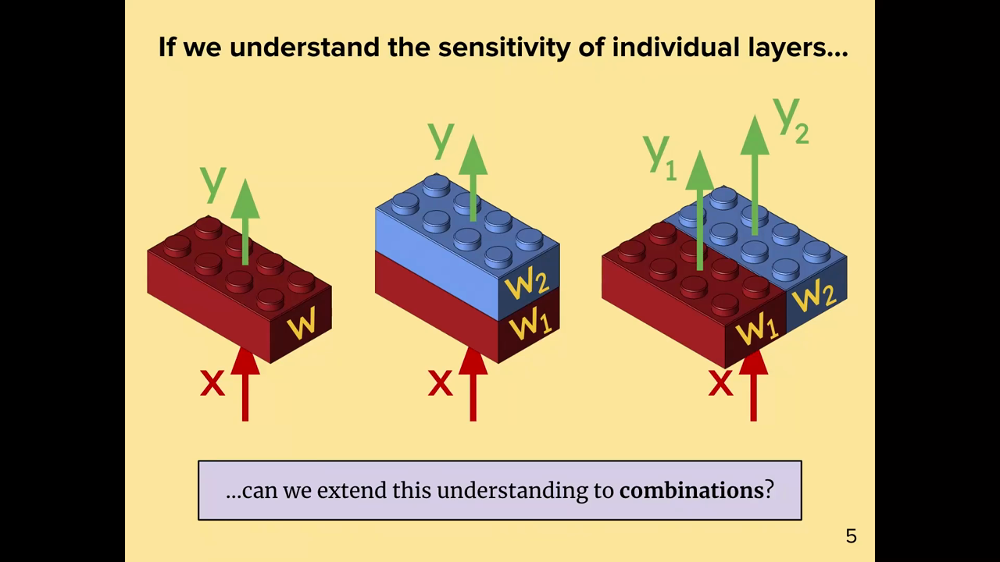
*▲ 강의 슬라이드 [05:30](https://youtu.be/zBvsoxC6tAo?t=330): [층](00_%EB%94%A5%EB%9F%AC%EB%8B%9D_%EC%9A%A9%EC%96%B4%EC%82%AC%EC%A0%84.md#layer-%EC%B8%B5) 하나(입력 $x$, [가중치](00_%EB%94%A5%EB%9F%AC%EB%8B%9D_%EC%9A%A9%EC%96%B4%EC%82%AC%EC%A0%84.md#weight-%EA%B0%80%EC%A4%91%EC%B9%98) $w$, 출력 $y$)의 민감도를 알면, 직렬(가운데)과 병렬(오른쪽) 조합으로 넓힐 수 있을까?*

---

## 2. 지금까지의 실제 이득

▶ 영상 [06:02](https://youtu.be/zBvsoxC6tAo?t=362)

강사는 "들을 가치가 있는지" 판단할 수 있게 실제 성과 두 가지를 먼저 보여 줍니다.

- **스케일링 문제 고치기**: [Lec07 2절](Lec07_%EC%B5%9C%EC%A0%81%ED%99%94%EC%9D%98_%EC%8A%A4%EC%BC%80%EC%9D%BC%EB%A7%81_%EA%B7%9C%EC%B9%99.md#2-%EA%B7%9C%EB%AA%A8%EB%A5%BC-%ED%82%A4%EC%9A%B8-%EB%95%8C-%EC%83%9D%EA%B8%B0%EB%8A%94-%EB%AC%B8%EC%A0%9C)에서 본 것처럼 너비를 키우면 성능은 좋아지지만 **최적 [학습률](00_%EB%94%A5%EB%9F%AC%EB%8B%9D_%EC%9A%A9%EC%96%B4%EC%82%AC%EC%A0%84.md#learning-rate-%ED%95%99%EC%8A%B5%EB%A5%A0)이 옮겨 갑니다**. 이 관점으로 쉽게 고칠 수 있습니다(8절).
- **NanoGPT 속도 기록**: 최근 몇 달 사이 다른 사람들이 이 아이디어([노름](00_%EB%94%A5%EB%9F%AC%EB%8B%9D_%EC%9A%A9%EC%96%B4%EC%82%AC%EC%A0%84.md#norm-%EB%85%B8%EB%A6%84)에 기반한 [최급강하법](00_%EB%94%A5%EB%9F%AC%EB%8B%9D_%EC%9A%A9%EC%96%B4%EC%82%AC%EC%A0%84.md#steepest-descent-%EC%B5%9C%EA%B8%89%EA%B0%95%ED%95%98%EB%B2%95), 스펙트럼 하강)를 다른 기법과 묶어, Karpathy의 고성능 C 구현 llm.c보다 훨씬 빠르게 [GPT](00_%EB%94%A5%EB%9F%AC%EB%8B%9D_%EC%9A%A9%EC%96%B4%EC%82%AC%EC%A0%84.md#gpt-%EC%83%9D%EC%84%B1%ED%98%95-%EC%82%AC%EC%A0%84%ED%95%99%EC%8A%B5-%ED%8A%B8%EB%9E%9C%EC%8A%A4%ED%8F%AC%EB%A8%B8)를 학습했습니다(10절). 숙제의 최급강하 문제와 이어진 내용입니다.

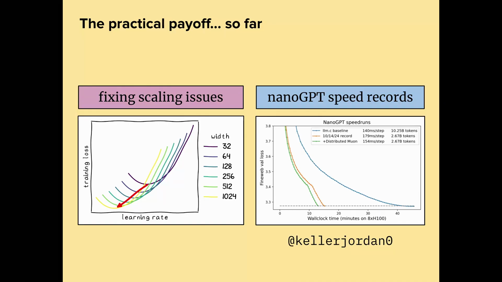
*▲ 강의 슬라이드 [08:45](https://youtu.be/zBvsoxC6tAo?t=525): 지금까지의 이득. 왼쪽은 너비별 [학습률](00_%EB%94%A5%EB%9F%AC%EB%8B%9D_%EC%9A%A9%EC%96%B4%EC%82%AC%EC%A0%84.md#learning-rate-%ED%95%99%EC%8A%B5%EB%A5%A0)-[손실](00_%EB%94%A5%EB%9F%AC%EB%8B%9D_%EC%9A%A9%EC%96%B4%EC%82%AC%EC%A0%84.md#loss-function-%EC%86%90%EC%8B%A4-%ED%95%A8%EC%88%98) 곡선, 오른쪽은 NanoGPT 속도 기록 곡선(@kellerjordan0)*

질의응답 정리 [07:49](https://youtu.be/zBvsoxC6tAo?t=469)

- **왜 그렇게 빠른지 아나?** 일부는 압니다. 빠른 곡선은 [스펙트럼 노름](00_%EB%94%A5%EB%9F%AC%EB%8B%9D_%EC%9A%A9%EC%96%B4%EC%82%AC%EC%A0%84.md#spectral-norm-%EC%8A%A4%ED%8E%99%ED%8A%B8%EB%9F%BC-%EB%85%B8%EB%A6%84) 아래의 최급강하(스펙트럼 하강)를 쓰는데, [선형층](00_%EB%94%A5%EB%9F%AC%EB%8B%9D_%EC%9A%A9%EC%96%B4%EC%82%AC%EC%A0%84.md#linear-layer-%EC%84%A0%ED%98%95%EC%B8%B5)의 기하가 [스펙트럼 노름](00_%EB%94%A5%EB%9F%AC%EB%8B%9D_%EC%9A%A9%EC%96%B4%EC%82%AC%EC%A0%84.md#spectral-norm-%EC%8A%A4%ED%8E%99%ED%8A%B8%EB%9F%BC-%EB%85%B8%EB%A6%84)으로 잘 설명된다고 믿으면 그 이유가 설명됩니다.

> [!TIP]
> **🆕 2026 업데이트: NanoGPT 스피드런 기록은 40초까지**
> - **강의**: 스펙트럼 하강을 쓴 구현이 llm.c(45분)보다 훨씬 빨리 NanoGPT를 학습했다(강의 무렵인 2024년 12월 초 기록은 4분대).
> - **현재**: 같은 과제(8×H100에서 FineWeb [검증](00_%EB%94%A5%EB%9F%AC%EB%8B%9D_%EC%9A%A9%EC%96%B4%EC%82%AC%EC%A0%84.md#validation-data-%EA%B2%80%EC%A6%9D-%EB%8D%B0%EC%9D%B4%ED%84%B0) [손실](00_%EB%94%A5%EB%9F%AC%EB%8B%9D_%EC%9A%A9%EC%96%B4%EC%82%AC%EC%A0%84.md#loss-function-%EC%86%90%EC%8B%A4-%ED%95%A8%EC%88%98) 3.28까지)의 기록은 2026년 8월 30일 기준 **0.665분(약 40초)**입니다. 2024년 12월 4일 기록은 4.41분이었습니다. [Muon](00_%EB%94%A5%EB%9F%AC%EB%8B%9D_%EC%9A%A9%EC%96%B4%EC%82%AC%EC%A0%84.md#muon-%EB%AE%A4%EC%98%A8-%EC%98%B5%ED%8B%B0%EB%A7%88%EC%9D%B4%EC%A0%80)은 2024년 10월 기록부터 쓰였고, 저장소 설명에도 [뉴턴-슐츠 반복](00_%EB%94%A5%EB%9F%AC%EB%8B%9D_%EC%9A%A9%EC%96%B4%EC%82%AC%EC%A0%84.md#newton-schulz-iteration-%EB%89%B4%ED%84%B4-%EC%8A%90%EC%B8%A0-%EB%B0%98%EB%B3%B5)이 SVD 대신 $UV^\top$를 근사한다고 적혀 있습니다. 그 뒤 기록은 FP8 연산, 주의 구조 변경, 새 [옵티마이저](00_%EB%94%A5%EB%9F%AC%EB%8B%9D_%EC%9A%A9%EC%96%B4%EC%82%AC%EC%A0%84.md#optimizer-%EC%98%B5%ED%8B%B0%EB%A7%88%EC%9D%B4%EC%A0%80) 묶음 등 여러 기법이 더해진 결과입니다.
> - **출처**: [KellerJordan/modded-nanogpt, GitHub README의 기록 표 (2024–2026)](https://github.com/KellerJordan/modded-nanogpt)

---

## 3. 최적화 이론과 노름

▶ 영상 [08:59](https://youtu.be/zBvsoxC6tAo?t=539)

📐 **수학 개념**: [테일러 전개](%EC%88%98%ED%95%99%EA%B0%9C%EB%85%90/09_%EC%B5%9C%EC%A0%81%ED%99%94%EC%9D%98_%EA%B8%B0%ED%95%98/MM26_%ED%85%8C%EC%9D%BC%EB%9F%AC_%EC%A0%84%EA%B0%9C%EC%99%80_%EB%89%B4%ED%84%B4_%EB%B0%A9%EB%B2%95.md) · [노름에 따른 최급강하법](%EC%88%98%ED%95%99%EA%B0%9C%EB%85%90/09_%EC%B5%9C%EC%A0%81%ED%99%94%EC%9D%98_%EA%B8%B0%ED%95%98/MM27_%EB%85%B8%EB%A6%84%EC%97%90_%EB%94%B0%EB%A5%B8_%EC%B5%9C%EA%B8%89%EA%B0%95%ED%95%98%EB%B2%95.md) · [코시-슈바르츠와 립시츠 매끄러움](%EC%88%98%ED%95%99%EA%B0%9C%EB%85%90/09_%EC%B5%9C%EC%A0%81%ED%99%94%EC%9D%98_%EA%B8%B0%ED%95%98/MM77_%EC%BD%94%EC%8B%9C_%EC%8A%88%EB%B0%94%EB%A5%B4%EC%B8%A0%EC%99%80_%EB%A6%BD%EC%8B%9C%EC%B8%A0_%EB%A7%A4%EB%81%84%EB%9F%AC%EC%9B%80.md) · [립시츠 연속과 노름](%EC%88%98%ED%95%99%EA%B0%9C%EB%85%90/03_%EC%84%A0%ED%98%95%EB%8C%80%EC%88%98/MM11_%EB%A6%BD%EC%8B%9C%EC%B8%A0_%EC%97%B0%EC%86%8D%EA%B3%BC_%EB%85%B8%EB%A6%84.md)

### 3.1 최급강하법 복습

▶ 영상 [09:00](https://youtu.be/zBvsoxC6tAo?t=540)

[Lec07 6절](Lec07_%EC%B5%9C%EC%A0%81%ED%99%94%EC%9D%98_%EC%8A%A4%EC%BC%80%EC%9D%BC%EB%A7%81_%EA%B7%9C%EC%B9%99.md#6-%EC%B5%9C%EA%B8%89%EA%B0%95%ED%95%98%EB%B2%95)의 내용을 다시 꺼냅니다. [손실](00_%EB%94%A5%EB%9F%AC%EB%8B%9D_%EC%9A%A9%EC%96%B4%EC%82%AC%EC%A0%84.md#loss-function-%EC%86%90%EC%8B%A4-%ED%95%A8%EC%88%98) $\mathcal{L}: \mathbb{R}^n \to \mathbb{R}$을 [테일러 전개](00_%EB%94%A5%EB%9F%AC%EB%8B%9D_%EC%9A%A9%EC%96%B4%EC%82%AC%EC%A0%84.md#taylor-expansion-%ED%85%8C%EC%9D%BC%EB%9F%AC-%EC%A0%84%EA%B0%9C)하면 1차 항, [헤세 행렬](00_%EB%94%A5%EB%9F%AC%EB%8B%9D_%EC%9A%A9%EC%96%B4%EC%82%AC%EC%A0%84.md#hessian-%ED%97%A4%EC%84%B8-%ED%96%89%EB%A0%AC) 항, 더 높은 항이 나옵니다. 만약 어떤 [노름](00_%EB%94%A5%EB%9F%AC%EB%8B%9D_%EC%9A%A9%EC%96%B4%EC%82%AC%EC%A0%84.md#norm-%EB%85%B8%EB%A6%84)과 **[날카로움](00_%EB%94%A5%EB%9F%AC%EB%8B%9D_%EC%9A%A9%EC%96%B4%EC%82%AC%EC%A0%84.md#sharpness-%EB%82%A0%EC%B9%B4%EB%A1%9C%EC%9B%80)**(sharpness) $\lambda$로 2차 항을 위에서 누를 수 있고, 그 상한이 **딱 맞으면**(tight) 상한 자체를 [손실](00_%EB%94%A5%EB%9F%AC%EB%8B%9D_%EC%9A%A9%EC%96%B4%EC%82%AC%EC%A0%84.md#loss-function-%EC%86%90%EC%8B%A4-%ED%95%A8%EC%88%98)의 설명으로 쓸 수 있습니다. 그리고 "1차 항 + 벌점"을 최소로 만드는 걸음이 그 [노름](00_%EB%94%A5%EB%9F%AC%EB%8B%9D_%EC%9A%A9%EC%96%B4%EC%82%AC%EC%A0%84.md#norm-%EB%85%B8%EB%A6%84) 아래의 [최급강하법](00_%EB%94%A5%EB%9F%AC%EB%8B%9D_%EC%9A%A9%EC%96%B4%EC%82%AC%EC%A0%84.md#steepest-descent-%EC%B5%9C%EA%B8%89%EA%B0%95%ED%95%98%EB%B2%95)입니다. [노름](00_%EB%94%A5%EB%9F%AC%EB%8B%9D_%EC%9A%A9%EC%96%B4%EC%82%AC%EC%A0%84.md#norm-%EB%85%B8%EB%A6%84)을 바꾸면 알고리즘이 바뀝니다.

그러면 질문은 하나로 모입니다. **신경망에 좋은 [노름](00_%EB%94%A5%EB%9F%AC%EB%8B%9D_%EC%9A%A9%EC%96%B4%EC%82%AC%EC%A0%84.md#norm-%EB%85%B8%EB%A6%84)은 무엇이고, 왜 그 노름이어야 하나?**

$$
\mathcal{L}(w + \Delta w) \le \mathcal{L}(w) + \nabla_w \mathcal{L}^\top \Delta w + \frac{\lambda}{2}\, \lVert \Delta w \rVert^2
$$

기호 풀이

| 기호 | 읽는 법 | 뜻 | 예제 값 |
| --- | --- | --- | --- |
| $\mathcal{L}(w)$ | 엘 오브 더블유 | 지금 [손실](00_%EB%94%A5%EB%9F%AC%EB%8B%9D_%EC%9A%A9%EC%96%B4%EC%82%AC%EC%A0%84.md#loss-function-%EC%86%90%EC%8B%A4-%ED%95%A8%EC%88%98) | 2.0 |
| $\Delta w$ | 델타 더블유 | [가중치](00_%EB%94%A5%EB%9F%AC%EB%8B%9D_%EC%9A%A9%EC%96%B4%EC%82%AC%EC%A0%84.md#weight-%EA%B0%80%EC%A4%91%EC%B9%98) 변화 (걸음) | −0.5 |
| $\nabla_w \mathcal{L}$ | 나블라 엘 | [손실](00_%EB%94%A5%EB%9F%AC%EB%8B%9D_%EC%9A%A9%EC%96%B4%EC%82%AC%EC%A0%84.md#loss-function-%EC%86%90%EC%8B%A4-%ED%95%A8%EC%88%98)의 [기울기](00_%EB%94%A5%EB%9F%AC%EB%8B%9D_%EC%9A%A9%EC%96%B4%EC%82%AC%EC%A0%84.md#gradient-%EA%B8%B0%EC%9A%B8%EA%B8%B0) | 3 |
| $\nabla_w \mathcal{L}^\top \Delta w$ | 1차 항 | [기울기](00_%EB%94%A5%EB%9F%AC%EB%8B%9D_%EC%9A%A9%EC%96%B4%EC%82%AC%EC%A0%84.md#gradient-%EA%B8%B0%EC%9A%B8%EA%B8%B0) × 걸음 (선형 근사의 변화) | −1.5 |
| $\lambda$ | 람다 | [날카로움](00_%EB%94%A5%EB%9F%AC%EB%8B%9D_%EC%9A%A9%EC%96%B4%EC%82%AC%EC%A0%84.md#sharpness-%EB%82%A0%EC%B9%B4%EB%A1%9C%EC%9B%80): 2차 항을 누르는 상수 | 4 |
| $\lVert \Delta w \rVert$ | 걸음의 [노름](00_%EB%94%A5%EB%9F%AC%EB%8B%9D_%EC%9A%A9%EC%96%B4%EC%82%AC%EC%A0%84.md#norm-%EB%85%B8%EB%A6%84) | 걸음 크기를 재는 자 | 0.5 |

예제와 풀이

**문제**: 지금 [손실](00_%EB%94%A5%EB%9F%AC%EB%8B%9D_%EC%9A%A9%EC%96%B4%EC%82%AC%EC%A0%84.md#loss-function-%EC%86%90%EC%8B%A4-%ED%95%A8%EC%88%98)이 2.0, [기울기](00_%EB%94%A5%EB%9F%AC%EB%8B%9D_%EC%9A%A9%EC%96%B4%EC%82%AC%EC%A0%84.md#gradient-%EA%B8%B0%EC%9A%B8%EA%B8%B0)가 3, [날카로움](00_%EB%94%A5%EB%9F%AC%EB%8B%9D_%EC%9A%A9%EC%96%B4%EC%82%AC%EC%A0%84.md#sharpness-%EB%82%A0%EC%B9%B4%EB%A1%9C%EC%9B%80)이 4인 1차원 [손실](00_%EB%94%A5%EB%9F%AC%EB%8B%9D_%EC%9A%A9%EC%96%B4%EC%82%AC%EC%A0%84.md#loss-function-%EC%86%90%EC%8B%A4-%ED%95%A8%EC%88%98)에서 $\Delta w = -0.5$만큼 움직이면 [손실](00_%EB%94%A5%EB%9F%AC%EB%8B%9D_%EC%9A%A9%EC%96%B4%EC%82%AC%EC%A0%84.md#loss-function-%EC%86%90%EC%8B%A4-%ED%95%A8%EC%88%98)은 최대 얼마인가?

**주어진 값**
- $\mathcal{L}(w) = 2.0$ (지금 [손실](00_%EB%94%A5%EB%9F%AC%EB%8B%9D_%EC%9A%A9%EC%96%B4%EC%82%AC%EC%A0%84.md#loss-function-%EC%86%90%EC%8B%A4-%ED%95%A8%EC%88%98))
- $\nabla_w \mathcal{L} = 3$ ([기울기](00_%EB%94%A5%EB%9F%AC%EB%8B%9D_%EC%9A%A9%EC%96%B4%EC%82%AC%EC%A0%84.md#gradient-%EA%B8%B0%EC%9A%B8%EA%B8%B0))
- $\lambda = 4$ ([날카로움](00_%EB%94%A5%EB%9F%AC%EB%8B%9D_%EC%9A%A9%EC%96%B4%EC%82%AC%EC%A0%84.md#sharpness-%EB%82%A0%EC%B9%B4%EB%A1%9C%EC%9B%80))
- $\Delta w = -0.5$ (걸음, 1차원이라 [노름](00_%EB%94%A5%EB%9F%AC%EB%8B%9D_%EC%9A%A9%EC%96%B4%EC%82%AC%EC%A0%84.md#norm-%EB%85%B8%EB%A6%84)은 절댓값 0.5)

**풀이**
1. 식을 그대로 쓴다: $\mathcal{L}(w + \Delta w) \le \mathcal{L}(w) + \nabla_w \mathcal{L}^\top \Delta w + \frac{\lambda}{2}\lVert \Delta w \rVert^2$
2. 값을 대입한다: $\mathcal{L}(w + \Delta w) \le 2.0 + 3 \times (-0.5) + \frac{4}{2} \times 0.5^2$
3. 1차 항 곱셈을 한다: $3 \times (-0.5) = -1.5$ 이므로 $2.0 - 1.5 + \frac{4}{2} \times 0.5^2$
4. 나눗셈을 한다: $4 \div 2 = 2$ 이므로 $2.0 - 1.5 + 2 \times 0.5^2$
5. 제곱을 한다: $0.5^2 = 0.25$ 이므로 $2.0 - 1.5 + 2 \times 0.25$
6. 곱셈을 한다: $2 \times 0.25 = 0.5$ 이므로 $2.0 - 1.5 + 0.5$
7. 앞에서부터 계산한다: $2.0 - 1.5 = 0.5$, $0.5 + 0.5 = 1.0$

**답**: [손실](00_%EB%94%A5%EB%9F%AC%EB%8B%9D_%EC%9A%A9%EC%96%B4%EC%82%AC%EC%A0%84.md#loss-function-%EC%86%90%EC%8B%A4-%ED%95%A8%EC%88%98)은 많아야 **1.0**. 1차 항이 1.5만큼 줄여 주지만 2차 벌점이 0.5를 되돌린다.

내 이해

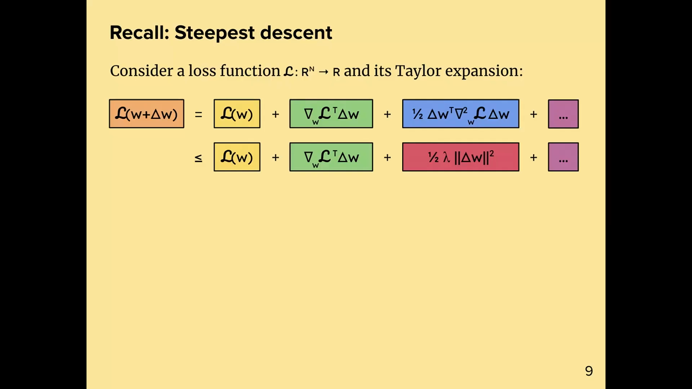
*▲ 강의 슬라이드 [10:00](https://youtu.be/zBvsoxC6tAo?t=600): [최급강하법](00_%EB%94%A5%EB%9F%AC%EB%8B%9D_%EC%9A%A9%EC%96%B4%EC%82%AC%EC%A0%84.md#steepest-descent-%EC%B5%9C%EA%B8%89%EA%B0%95%ED%95%98%EB%B2%95) 복습. [테일러 전개](00_%EB%94%A5%EB%9F%AC%EB%8B%9D_%EC%9A%A9%EC%96%B4%EC%82%AC%EC%A0%84.md#taylor-expansion-%ED%85%8C%EC%9D%BC%EB%9F%AC-%EC%A0%84%EA%B0%9C)의 2차 항(파랑)을 $\frac12\lambda\lVert\Delta w\rVert^2$(빨강)로 누른다*

### 3.2 가우스-뉴턴 분해로 상한 잡기

▶ 영상 [11:21](https://youtu.be/zBvsoxC6tAo?t=681)

📐 **수학 개념**: [코시-슈바르츠와 립시츠 매끄러움](%EC%88%98%ED%95%99%EA%B0%9C%EB%85%90/09_%EC%B5%9C%EC%A0%81%ED%99%94%EC%9D%98_%EA%B8%B0%ED%95%98/MM77_%EC%BD%94%EC%8B%9C_%EC%8A%88%EB%B0%94%EB%A5%B4%EC%B8%A0%EC%99%80_%EB%A6%BD%EC%8B%9C%EC%B8%A0_%EB%A7%A4%EB%81%84%EB%9F%AC%EC%9B%80.md) · [야코비안과 연쇄법칙](%EC%88%98%ED%95%99%EA%B0%9C%EB%85%90/05_%EC%8B%A0%EA%B2%BD%EB%A7%9D%EC%9D%98_%EA%B3%84%EC%82%B0/MM09_%EC%95%BC%EC%BD%94%EB%B9%84%EC%95%88%EA%B3%BC_%EC%97%B0%EC%87%84%EB%B2%95%EC%B9%99.md)

세 단계로 상한을 만듭니다.

1. **합성 [손실](00_%EB%94%A5%EB%9F%AC%EB%8B%9D_%EC%9A%A9%EC%96%B4%EC%82%AC%EC%A0%84.md#loss-function-%EC%86%90%EC%8B%A4-%ED%95%A8%EC%88%98)**: 딥러닝의 [손실](00_%EB%94%A5%EB%9F%AC%EB%8B%9D_%EC%9A%A9%EC%96%B4%EC%82%AC%EC%A0%84.md#loss-function-%EC%86%90%EC%8B%A4-%ED%95%A8%EC%88%98)은 [오차](00_%EB%94%A5%EB%9F%AC%EB%8B%9D_%EC%9A%A9%EC%96%B4%EC%82%AC%EC%A0%84.md#error-%EC%98%A4%EC%B0%A8) 척도 $\ell$과 신경망 $f$의 합성 $\mathcal{L} = \ell \circ f$입니다. 두 부분이 [미분](00_%EB%94%A5%EB%9F%AC%EB%8B%9D_%EC%9A%A9%EC%96%B4%EC%82%AC%EC%A0%84.md#derivative-%EB%AF%B8%EB%B6%84) 가능하면 2차 항을 **[가우스-뉴턴](00_%EB%94%A5%EB%9F%AC%EB%8B%9D_%EC%9A%A9%EC%96%B4%EC%82%AC%EC%A0%84.md#gauss-newton-method-%EA%B0%80%EC%9A%B0%EC%8A%A4-%EB%89%B4%ED%84%B4-%EB%B0%A9%EB%B2%95) 분해**로 두 조각으로 나눌 수 있습니다([Lec07 5절](Lec07_%EC%B5%9C%EC%A0%81%ED%99%94%EC%9D%98_%EC%8A%A4%EC%BC%80%EC%9D%BC%EB%A7%81_%EA%B7%9C%EC%B9%99.md#5-%EA%B0%80%EC%9A%B0%EC%8A%A4-%EB%89%B4%ED%84%B4-%EB%B0%A9%EB%B2%95)). 한 조각은 **신경망의 휘어짐**, 다른 조각은 **[오차](00_%EB%94%A5%EB%9F%AC%EB%8B%9D_%EC%9A%A9%EC%96%B4%EC%82%AC%EC%A0%84.md#error-%EC%98%A4%EC%B0%A8) 척도의 휘어짐**을 담습니다.
2. **출력 [노름](00_%EB%94%A5%EB%9F%AC%EB%8B%9D_%EC%9A%A9%EC%96%B4%EC%82%AC%EC%A0%84.md#norm-%EB%85%B8%EB%A6%84)**: 신경망 출력은 보통 벡터나 실수라 좋은 [노름](00_%EB%94%A5%EB%9F%AC%EB%8B%9D_%EC%9A%A9%EC%96%B4%EC%82%AC%EC%A0%84.md#norm-%EB%85%B8%EB%A6%84)을 고르기 쉽습니다($L_2$, $L_\infty$, $L_1$, RMS 정도). 출력 [노름](00_%EB%94%A5%EB%9F%AC%EB%8B%9D_%EC%9A%A9%EC%96%B4%EC%82%AC%EC%A0%84.md#norm-%EB%85%B8%EB%A6%84)이 있으면 두 조각을 위에서 누를 수 있습니다. 주황 조각은 "모델의 휘어짐"과 "[오차](00_%EB%94%A5%EB%9F%AC%EB%8B%9D_%EC%9A%A9%EC%96%B4%EC%82%AC%EC%A0%84.md#error-%EC%98%A4%EC%B0%A8) 척도의 [기울기](00_%EB%94%A5%EB%9F%AC%EB%8B%9D_%EC%9A%A9%EC%96%B4%EC%82%AC%EC%A0%84.md#gradient-%EA%B8%B0%EC%9A%B8%EA%B8%B0)"의 **[내적](00_%EB%94%A5%EB%9F%AC%EB%8B%9D_%EC%9A%A9%EC%96%B4%EC%82%AC%EC%A0%84.md#dot-product-%EB%82%B4%EC%A0%81)**이라 **[코시-슈바르츠 부등식](00_%EB%94%A5%EB%9F%AC%EB%8B%9D_%EC%9A%A9%EC%96%B4%EC%82%AC%EC%A0%84.md#cauchy-schwarz-inequality-%EC%BD%94%EC%8B%9C-%EC%8A%88%EB%B0%94%EB%A5%B4%EC%B8%A0-%EB%B6%80%EB%93%B1%EC%8B%9D)**을 쓰는데, [오차](00_%EB%94%A5%EB%9F%AC%EB%8B%9D_%EC%9A%A9%EC%96%B4%EC%82%AC%EC%A0%84.md#error-%EC%98%A4%EC%B0%A8) 척도의 [기울기](00_%EB%94%A5%EB%9F%AC%EB%8B%9D_%EC%9A%A9%EC%96%B4%EC%82%AC%EC%A0%84.md#gradient-%EA%B8%B0%EC%9A%B8%EA%B8%B0)는 출력 [노름](00_%EB%94%A5%EB%9F%AC%EB%8B%9D_%EC%9A%A9%EC%96%B4%EC%82%AC%EC%A0%84.md#norm-%EB%85%B8%EB%A6%84)의 **[쌍대 노름](00_%EB%94%A5%EB%9F%AC%EB%8B%9D_%EC%9A%A9%EC%96%B4%EC%82%AC%EC%A0%84.md#dual-norm-%EC%8C%8D%EB%8C%80-%EB%85%B8%EB%A6%84)**으로 잽니다. 보라 조각은 "벡터 · 행렬 · 벡터"라 연산자 [노름](00_%EB%94%A5%EB%9F%AC%EB%8B%9D_%EC%9A%A9%EC%96%B4%EC%82%AC%EC%A0%84.md#norm-%EB%85%B8%EB%A6%84)으로 누릅니다. 근사가 아니라 **상한**입니다.
3. **문제 바꾸기**: 이제 [가중치](00_%EB%94%A5%EB%9F%AC%EB%8B%9D_%EC%9A%A9%EC%96%B4%EC%82%AC%EC%A0%84.md#weight-%EA%B0%80%EC%A4%91%EC%B9%98)에 [노름](00_%EB%94%A5%EB%9F%AC%EB%8B%9D_%EC%9A%A9%EC%96%B4%EC%82%AC%EC%A0%84.md#norm-%EB%85%B8%EB%A6%84)을 하나 만들어 주황 조각 안의 $\lVert \Delta w\, \nabla_w^2 f\, \Delta w \rVert$와 보라 조각 안의 $\lVert \nabla_w f\, \Delta w \rVert^2$을 누를 수 있으면, 그것들을 꽂아 전체 [손실](00_%EB%94%A5%EB%9F%AC%EB%8B%9D_%EC%9A%A9%EC%96%B4%EC%82%AC%EC%A0%84.md#loss-function-%EC%86%90%EC%8B%A4-%ED%95%A8%EC%88%98)의 휘어짐 상한을 얻습니다. 풀 줄 모르던 문제를 다른 문제로 바꾼 것입니다.

$$
\Delta w^\top \nabla_w^2 \mathcal{L}\, \Delta w = \underbrace{(\Delta w\, \nabla_w^2 f\, \Delta w)\, \nabla_f \ell}_{\text{모델의 휘어짐}} + \underbrace{(\nabla_w f\, \Delta w)^\top \nabla_f^2 \ell\, (\nabla_w f\, \Delta w)}_{\text{오차 척도의 휘어짐}} \le \lVert \Delta w\, \nabla_w^2 f\, \Delta w \rVert\, \lVert \nabla_f \ell \rVert_\ast + \lVert \nabla_f^2 \ell \rVert\, \lVert \nabla_w f\, \Delta w \rVert^2
$$

기호 풀이

| 기호 | 읽는 법 | 뜻 | 예제 값 ($f = \tanh w$, $w = 0.2$, $y = 0.5$, $\Delta w = 1$) |
| --- | --- | --- | --- |
| $\nabla_w^2 \mathcal{L}$ | [손실](00_%EB%94%A5%EB%9F%AC%EB%8B%9D_%EC%9A%A9%EC%96%B4%EC%82%AC%EC%A0%84.md#loss-function-%EC%86%90%EC%8B%A4-%ED%95%A8%EC%88%98)의 헤세 | 전체 [손실](00_%EB%94%A5%EB%9F%AC%EB%8B%9D_%EC%9A%A9%EC%96%B4%EC%82%AC%EC%A0%84.md#loss-function-%EC%86%90%EC%8B%A4-%ED%95%A8%EC%88%98)의 휘어짐 | 1.0384 |
| $\nabla_w f\, \Delta w$ | 모델의 1차 변화 | [가중치](00_%EB%94%A5%EB%9F%AC%EB%8B%9D_%EC%9A%A9%EC%96%B4%EC%82%AC%EC%A0%84.md#weight-%EA%B0%80%EC%A4%91%EC%B9%98) 변화가 출력을 바꾸는 양([야코비안](00_%EB%94%A5%EB%9F%AC%EB%8B%9D_%EC%9A%A9%EC%96%B4%EC%82%AC%EC%A0%84.md#jacobian-%EC%95%BC%EC%BD%94%EB%B9%84%EC%95%88) × 걸음) | 0.96104 |
| $\Delta w\, \nabla_w^2 f\, \Delta w$ | 모델의 2차 변화 | 신경망 자체의 휘어짐 | −0.37937 |
| $\nabla_f \ell$ | [오차](00_%EB%94%A5%EB%9F%AC%EB%8B%9D_%EC%9A%A9%EC%96%B4%EC%82%AC%EC%A0%84.md#error-%EC%98%A4%EC%B0%A8) 척도의 [기울기](00_%EB%94%A5%EB%9F%AC%EB%8B%9D_%EC%9A%A9%EC%96%B4%EC%82%AC%EC%A0%84.md#gradient-%EA%B8%B0%EC%9A%B8%EA%B8%B0) | 제곱 [오차](00_%EB%94%A5%EB%9F%AC%EB%8B%9D_%EC%9A%A9%EC%96%B4%EC%82%AC%EC%A0%84.md#error-%EC%98%A4%EC%B0%A8)면 $f - y$ | −0.30263 |
| $\nabla_f^2 \ell$ | [오차](00_%EB%94%A5%EB%9F%AC%EB%8B%9D_%EC%9A%A9%EC%96%B4%EC%82%AC%EC%A0%84.md#error-%EC%98%A4%EC%B0%A8) 척도의 휘어짐 | 제곱 [오차](00_%EB%94%A5%EB%9F%AC%EB%8B%9D_%EC%9A%A9%EC%96%B4%EC%82%AC%EC%A0%84.md#error-%EC%98%A4%EC%B0%A8)면 1 | 1 |
| $\lVert \cdot \rVert_\ast$ | [쌍대 노름](00_%EB%94%A5%EB%9F%AC%EB%8B%9D_%EC%9A%A9%EC%96%B4%EC%82%AC%EC%A0%84.md#dual-norm-%EC%8C%8D%EB%8C%80-%EB%85%B8%EB%A6%84) | 출력 [노름](00_%EB%94%A5%EB%9F%AC%EB%8B%9D_%EC%9A%A9%EC%96%B4%EC%82%AC%EC%A0%84.md#norm-%EB%85%B8%EB%A6%84)과 짝인 자 (1차원이면 절댓값) | 0.30263 |

예제와 풀이

**문제**: [Lec07 5절](Lec07_%EC%B5%9C%EC%A0%81%ED%99%94%EC%9D%98_%EC%8A%A4%EC%BC%80%EC%9D%BC%EB%A7%81_%EA%B7%9C%EC%B9%99.md#5-%EA%B0%80%EC%9A%B0%EC%8A%A4-%EB%89%B4%ED%84%B4-%EB%B0%A9%EB%B2%95)의 예 $f = \tanh(w)$, 제곱 [오차](00_%EB%94%A5%EB%9F%AC%EB%8B%9D_%EC%9A%A9%EC%96%B4%EC%82%AC%EC%A0%84.md#error-%EC%98%A4%EC%B0%A8), [정답](00_%EB%94%A5%EB%9F%AC%EB%8B%9D_%EC%9A%A9%EC%96%B4%EC%82%AC%EC%A0%84.md#label-%EC%A0%95%EB%8B%B5) $y = 0.5$, $w = 0.2$에서 $\Delta w = 1$로 두 조각의 상한을 구하고 실제 휘어짐 1.0384와 비교하라.

**주어진 값**
- $\nabla_w f\, \Delta w = 0.96104$ (모델의 1차 변화, $1 - \tanh^2 0.2$)
- $\Delta w\, \nabla_w^2 f\, \Delta w = -0.37937$ (모델의 2차 변화, $-2\tanh 0.2\,(1 - \tanh^2 0.2)$)
- $\nabla_f \ell = -0.30263$ ([오차](00_%EB%94%A5%EB%9F%AC%EB%8B%9D_%EC%9A%A9%EC%96%B4%EC%82%AC%EC%A0%84.md#error-%EC%98%A4%EC%B0%A8) 척도의 [기울기](00_%EB%94%A5%EB%9F%AC%EB%8B%9D_%EC%9A%A9%EC%96%B4%EC%82%AC%EC%A0%84.md#gradient-%EA%B8%B0%EC%9A%B8%EA%B8%B0), $0.19737 - 0.5$)
- $\nabla_f^2 \ell = 1$ (제곱 [오차](00_%EB%94%A5%EB%9F%AC%EB%8B%9D_%EC%9A%A9%EC%96%B4%EC%82%AC%EC%A0%84.md#error-%EC%98%A4%EC%B0%A8)의 휘어짐)

**풀이**
1. 식을 그대로 쓴다: 상한 $= \lVert \Delta w\, \nabla_w^2 f\, \Delta w \rVert\, \lVert \nabla_f \ell \rVert_\ast + \lVert \nabla_f^2 \ell \rVert\, \lVert \nabla_w f\, \Delta w \rVert^2$
2. 값을 대입한다: 상한 $= |-0.37937| \times |-0.30263| + 1 \times 0.96104^2$
3. 절댓값을 취한다: $0.37937 \times 0.30263 + 1 \times 0.96104^2$
4. 첫 곱셈을 한다: $0.37937 \times 0.30263 = 0.11481$ 이므로 $0.11481 + 1 \times 0.96104^2$
5. 제곱을 한다: $0.96104^2 = 0.92360$ 이므로 $0.11481 + 1 \times 0.92360$
6. 곱셈을 한다: $1 \times 0.92360 = 0.92360$ 이므로 $0.11481 + 0.92360$
7. 더한다: $0.11481 + 0.92360 = 1.03841$
8. 실제 값과 비교한다: 실제 휘어짐 $= (-0.37937) \times (-0.30263) + 0.92360 = 1.03841$, 반올림하면 1.0384

**답**: 상한 **1.0384** = 실제 1.0384. 1차원이고 두 조각이 모두 양수라 상한이 정확히 맞았다. 차원이 많아지면 보통 상한이 더 크다.

내 이해

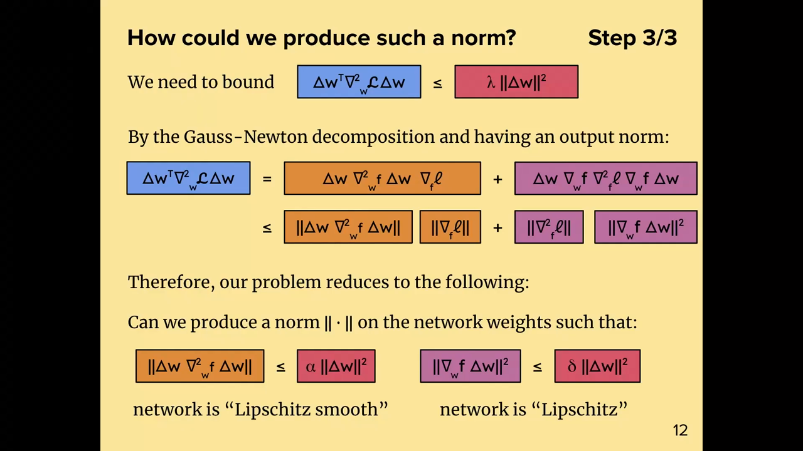
*▲ 강의 슬라이드 [16:30](https://youtu.be/zBvsoxC6tAo?t=990): 3단계 정리. 가우스-뉴턴 분해의 두 조각을 출력 [노름](00_%EB%94%A5%EB%9F%AC%EB%8B%9D_%EC%9A%A9%EC%96%B4%EC%82%AC%EC%A0%84.md#norm-%EB%85%B8%EB%A6%84)으로 누르고, 문제를 "[가중치](00_%EB%94%A5%EB%9F%AC%EB%8B%9D_%EC%9A%A9%EC%96%B4%EC%82%AC%EC%A0%84.md#weight-%EA%B0%80%EC%A4%91%EC%B9%98) [노름](00_%EB%94%A5%EB%9F%AC%EB%8B%9D_%EC%9A%A9%EC%96%B4%EC%82%AC%EC%A0%84.md#norm-%EB%85%B8%EB%A6%84)으로 신경망의 1차·2차 변화를 누르기"로 바꾼다*

질의응답 정리 [12:30](https://youtu.be/zBvsoxC6tAo?t=750)

- **[노름](00_%EB%94%A5%EB%9F%AC%EB%8B%9D_%EC%9A%A9%EC%96%B4%EC%82%AC%EC%A0%84.md#norm-%EB%85%B8%EB%A6%84)이 "나쁘다"는 건 무슨 뜻인가?** 출력처럼 특별한 구조가 없는 벡터에는 떠올릴 [노름](00_%EB%94%A5%EB%9F%AC%EB%8B%9D_%EC%9A%A9%EC%96%B4%EC%82%AC%EC%A0%84.md#norm-%EB%85%B8%EB%A6%84)이 $L_p$ 정도로 몇 개 없습니다. 하지만 신경망 전체 [가중치](00_%EB%94%A5%EB%9F%AC%EB%8B%9D_%EC%9A%A9%EC%96%B4%EC%82%AC%EC%A0%84.md#weight-%EA%B0%80%EC%A4%91%EC%B9%98)처럼 복잡한 대상에는 [노름](00_%EB%94%A5%EB%9F%AC%EB%8B%9D_%EC%9A%A9%EC%96%B4%EC%82%AC%EC%A0%84.md#norm-%EB%85%B8%EB%A6%84)이 동물원처럼 많아서 고르기가 어렵다는 뜻입니다.

### 3.3 신경망의 립시츠 조건

▶ 영상 [15:25](https://youtu.be/zBvsoxC6tAo?t=925)

📐 **수학 개념**: [립시츠 매끄러움](%EC%88%98%ED%95%99%EA%B0%9C%EB%85%90/09_%EC%B5%9C%EC%A0%81%ED%99%94%EC%9D%98_%EA%B8%B0%ED%95%98/MM77_%EC%BD%94%EC%8B%9C_%EC%8A%88%EB%B0%94%EB%A5%B4%EC%B8%A0%EC%99%80_%EB%A6%BD%EC%8B%9C%EC%B8%A0_%EB%A7%A4%EB%81%84%EB%9F%AC%EC%9B%80.md) · [립시츠 연속과 노름](%EC%88%98%ED%95%99%EA%B0%9C%EB%85%90/03_%EC%84%A0%ED%98%95%EB%8C%80%EC%88%98/MM11_%EB%A6%BD%EC%8B%9C%EC%B8%A0_%EC%97%B0%EC%86%8D%EA%B3%BC_%EB%85%B8%EB%A6%84.md)

바뀐 문제를 말로 하면 이렇습니다. [가중치](00_%EB%94%A5%EB%9F%AC%EB%8B%9D_%EC%9A%A9%EC%96%B4%EC%82%AC%EC%A0%84.md#weight-%EA%B0%80%EC%A4%91%EC%B9%98) 공간에 [노름](00_%EB%94%A5%EB%9F%AC%EB%8B%9D_%EC%9A%A9%EC%96%B4%EC%82%AC%EC%A0%84.md#norm-%EB%85%B8%EB%A6%84)을 하나 만들어,

- 신경망이 [가중치](00_%EB%94%A5%EB%9F%AC%EB%8B%9D_%EC%9A%A9%EC%96%B4%EC%82%AC%EC%A0%84.md#weight-%EA%B0%80%EC%A4%91%EC%B9%98)에 대해 **[립시츠 매끄러움](00_%EB%94%A5%EB%9F%AC%EB%8B%9D_%EC%9A%A9%EC%96%B4%EC%82%AC%EC%A0%84.md#lipschitz-smoothness-%EB%A6%BD%EC%8B%9C%EC%B8%A0-%EB%A7%A4%EB%81%84%EB%9F%AC%EC%9B%80)**(Lipschitz smooth): 2차 변화 $\le \alpha \lVert \Delta w \rVert^2$
- 신경망이 [가중치](00_%EB%94%A5%EB%9F%AC%EB%8B%9D_%EC%9A%A9%EC%96%B4%EC%82%AC%EC%A0%84.md#weight-%EA%B0%80%EC%A4%91%EC%B9%98)에 대해 **[립시츠 연속](00_%EB%94%A5%EB%9F%AC%EB%8B%9D_%EC%9A%A9%EC%96%B4%EC%82%AC%EC%A0%84.md#lipschitz-continuity-%EB%A6%BD%EC%8B%9C%EC%B8%A0-%EC%97%B0%EC%86%8D)**(Lipschitz): 1차 변화의 제곱 $\le \delta \lVert \Delta w \rVert^2$

이 되게 하는 것입니다. 이것은 **[손실](00_%EB%94%A5%EB%9F%AC%EB%8B%9D_%EC%9A%A9%EC%96%B4%EC%82%AC%EC%A0%84.md#loss-function-%EC%86%90%EC%8B%A4-%ED%95%A8%EC%88%98)이 아니라 신경망 자체를** [가중치](00_%EB%94%A5%EB%9F%AC%EB%8B%9D_%EC%9A%A9%EC%96%B4%EC%82%AC%EC%A0%84.md#weight-%EA%B0%80%EC%A4%91%EC%B9%98)에 대해 테일러 전개한 항들의 상한입니다. 최적화를 잊고 봐도 이런 [노름](00_%EB%94%A5%EB%9F%AC%EB%8B%9D_%EC%9A%A9%EC%96%B4%EC%82%AC%EC%A0%84.md#norm-%EB%85%B8%EB%A6%84)이 있으면 좋습니다. [가중치](00_%EB%94%A5%EB%9F%AC%EB%8B%9D_%EC%9A%A9%EC%96%B4%EC%82%AC%EC%A0%84.md#weight-%EA%B0%80%EC%A4%91%EC%B9%98)를 바꿀 때 출력이 1차·2차까지 얼마나 바뀔지 **미리 예측**할 수 있기 때문입니다. 최적화 이론은 그 쓸모 가운데 하나일 뿐입니다.

$$
\lVert \Delta w\, \nabla_w^2 f\, \Delta w \rVert \le \alpha\, \lVert \Delta w \rVert^2, \qquad \lVert \nabla_w f\, \Delta w \rVert^2 \le \delta\, \lVert \Delta w \rVert^2 \quad \Longrightarrow \quad \lambda = \alpha\, \lVert \nabla_f \ell \rVert_\ast + \delta\, \lVert \nabla_f^2 \ell \rVert
$$

기호 풀이

| 기호 | 읽는 법 | 뜻 | 예제 값 ($f = \tanh w$) |
| --- | --- | --- | --- |
| $\alpha$ | 알파 | [립시츠 매끄러움](00_%EB%94%A5%EB%9F%AC%EB%8B%9D_%EC%9A%A9%EC%96%B4%EC%82%AC%EC%A0%84.md#lipschitz-smoothness-%EB%A6%BD%EC%8B%9C%EC%B8%A0-%EB%A7%A4%EB%81%84%EB%9F%AC%EC%9B%80) 상수 (2차 변화의 최대 배율) | 0.7698 |
| $\delta$ | 델타 | [립시츠 연속](00_%EB%94%A5%EB%9F%AC%EB%8B%9D_%EC%9A%A9%EC%96%B4%EC%82%AC%EC%A0%84.md#lipschitz-continuity-%EB%A6%BD%EC%8B%9C%EC%B8%A0-%EC%97%B0%EC%86%8D) 상수 (1차 변화 제곱의 최대 배율) | 1 |
| $\lVert \Delta w \rVert$ | [가중치](00_%EB%94%A5%EB%9F%AC%EB%8B%9D_%EC%9A%A9%EC%96%B4%EC%82%AC%EC%A0%84.md#weight-%EA%B0%80%EC%A4%91%EC%B9%98) [노름](00_%EB%94%A5%EB%9F%AC%EB%8B%9D_%EC%9A%A9%EC%96%B4%EC%82%AC%EC%A0%84.md#norm-%EB%85%B8%EB%A6%84) | 찾으려는 [가중치](00_%EB%94%A5%EB%9F%AC%EB%8B%9D_%EC%9A%A9%EC%96%B4%EC%82%AC%EC%A0%84.md#weight-%EA%B0%80%EC%A4%91%EC%B9%98) 공간의 자 | 1 |
| $\lVert \nabla_f \ell \rVert_\ast$ | [오차](00_%EB%94%A5%EB%9F%AC%EB%8B%9D_%EC%9A%A9%EC%96%B4%EC%82%AC%EC%A0%84.md#error-%EC%98%A4%EC%B0%A8) 척도 [기울기](00_%EB%94%A5%EB%9F%AC%EB%8B%9D_%EC%9A%A9%EC%96%B4%EC%82%AC%EC%A0%84.md#gradient-%EA%B8%B0%EC%9A%B8%EA%B8%B0)의 [쌍대 노름](00_%EB%94%A5%EB%9F%AC%EB%8B%9D_%EC%9A%A9%EC%96%B4%EC%82%AC%EC%A0%84.md#dual-norm-%EC%8C%8D%EB%8C%80-%EB%85%B8%EB%A6%84) | $|f - y|$ | 0.3026 |
| $\lVert \nabla_f^2 \ell \rVert$ | [오차](00_%EB%94%A5%EB%9F%AC%EB%8B%9D_%EC%9A%A9%EC%96%B4%EC%82%AC%EC%A0%84.md#error-%EC%98%A4%EC%B0%A8) 척도의 휘어짐 | 제곱 [오차](00_%EB%94%A5%EB%9F%AC%EB%8B%9D_%EC%9A%A9%EC%96%B4%EC%82%AC%EC%A0%84.md#error-%EC%98%A4%EC%B0%A8)면 1 | 1 |
| $\lambda$ | 람다 | [손실](00_%EB%94%A5%EB%9F%AC%EB%8B%9D_%EC%9A%A9%EC%96%B4%EC%82%AC%EC%A0%84.md#loss-function-%EC%86%90%EC%8B%A4-%ED%95%A8%EC%88%98)의 [날카로움](00_%EB%94%A5%EB%9F%AC%EB%8B%9D_%EC%9A%A9%EC%96%B4%EC%82%AC%EC%A0%84.md#sharpness-%EB%82%A0%EC%B9%B4%EB%A1%9C%EC%9B%80) 상한 | 1.233 |

예제와 풀이

**문제**: $f = \tanh(w)$는 어디서나 $|f''| \le 0.7698$, $(f')^2 \le 1$이다. 제곱 [오차](00_%EB%94%A5%EB%9F%AC%EB%8B%9D_%EC%9A%A9%EC%96%B4%EC%82%AC%EC%A0%84.md#error-%EC%98%A4%EC%B0%A8), $|f - y| = 0.3026$일 때 [날카로움](00_%EB%94%A5%EB%9F%AC%EB%8B%9D_%EC%9A%A9%EC%96%B4%EC%82%AC%EC%A0%84.md#sharpness-%EB%82%A0%EC%B9%B4%EB%A1%9C%EC%9B%80) 상한 $\lambda$는?

**주어진 값**
- $\alpha = 0.7698$ ($\tanh$의 2차 [미분](00_%EB%94%A5%EB%9F%AC%EB%8B%9D_%EC%9A%A9%EC%96%B4%EC%82%AC%EC%A0%84.md#derivative-%EB%AF%B8%EB%B6%84) 최대 크기, 코드로 구함)
- $\delta = 1$ ($\tanh$의 1차 [미분](00_%EB%94%A5%EB%9F%AC%EB%8B%9D_%EC%9A%A9%EC%96%B4%EC%82%AC%EC%A0%84.md#derivative-%EB%AF%B8%EB%B6%84) 제곱의 최대, $w = 0$에서)
- $\lVert \nabla_f \ell \rVert_\ast = 0.3026$ ([오차](00_%EB%94%A5%EB%9F%AC%EB%8B%9D_%EC%9A%A9%EC%96%B4%EC%82%AC%EC%A0%84.md#error-%EC%98%A4%EC%B0%A8) 척도의 [기울기](00_%EB%94%A5%EB%9F%AC%EB%8B%9D_%EC%9A%A9%EC%96%B4%EC%82%AC%EC%A0%84.md#gradient-%EA%B8%B0%EC%9A%B8%EA%B8%B0) 크기)
- $\lVert \nabla_f^2 \ell \rVert = 1$ (제곱 [오차](00_%EB%94%A5%EB%9F%AC%EB%8B%9D_%EC%9A%A9%EC%96%B4%EC%82%AC%EC%A0%84.md#error-%EC%98%A4%EC%B0%A8)의 휘어짐)

**풀이**
1. 식을 그대로 쓴다: $\lambda = \alpha\, \lVert \nabla_f \ell \rVert_\ast + \delta\, \lVert \nabla_f^2 \ell \rVert$
2. 값을 대입한다: $\lambda = 0.7698 \times 0.3026 + 1 \times 1$
3. 첫 곱셈을 한다: $0.7698 \times 0.3026 = 0.233$ 이므로 $\lambda = 0.233 + 1 \times 1$
4. 둘째 곱셈을 한다: $1 \times 1 = 1$ 이므로 $\lambda = 0.233 + 1$
5. 더한다: $0.233 + 1 = 1.233$

**답**: $\lambda$ = **1.233**. 3.2의 실제 휘어짐 1.0384보다 크므로 어디서나 쓸 수 있는 상한이다(아래 그림).

내 이해

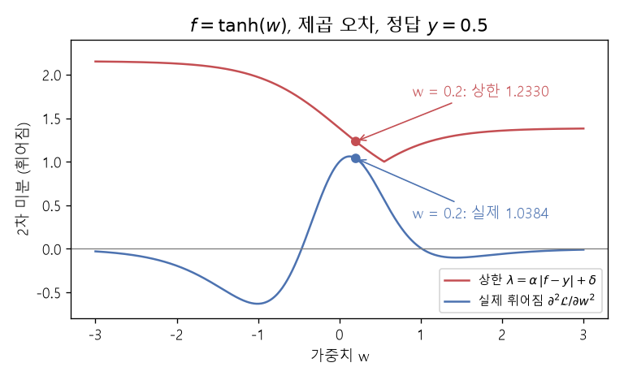
*▲ 직접 그린 그림: $f = \tanh(w)$, 제곱 [오차](00_%EB%94%A5%EB%9F%AC%EB%8B%9D_%EC%9A%A9%EC%96%B4%EC%82%AC%EC%A0%84.md#error-%EC%98%A4%EC%B0%A8), $y = 0.5$. 모든 $w$에서 실제 휘어짐(파랑)이 상한 $\alpha|f - y| + \delta$(빨강) 아래에 있다. $w = 0.2$에서 1.0384 ≤ 1.2330*

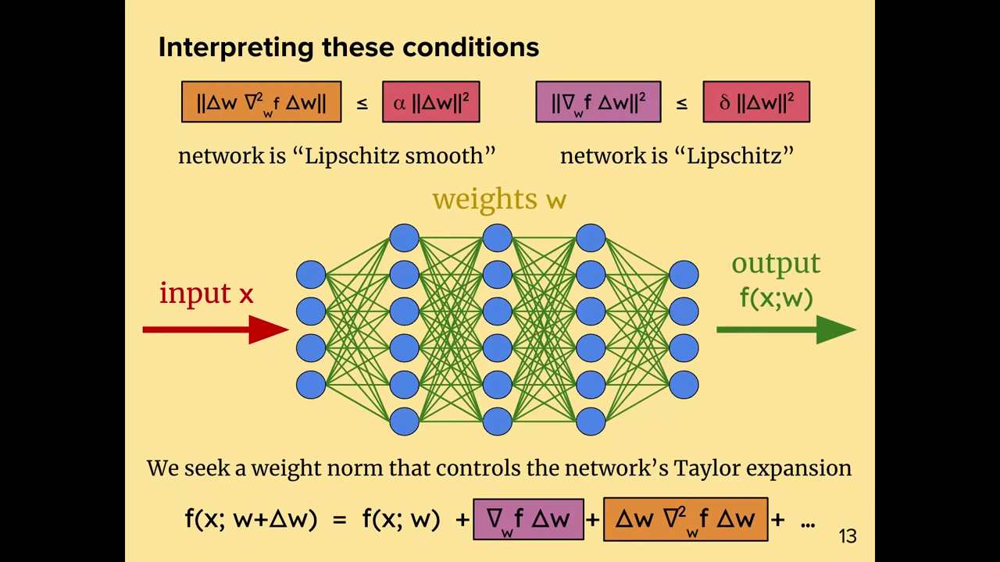
*▲ 강의 슬라이드 [20:02](https://youtu.be/zBvsoxC6tAo?t=1202): 두 조건의 해석. 신경망 $f(x; w)$를 [가중치](00_%EB%94%A5%EB%9F%AC%EB%8B%9D_%EC%9A%A9%EC%96%B4%EC%82%AC%EC%A0%84.md#weight-%EA%B0%80%EC%A4%91%EC%B9%98)에 대해 테일러 전개한 1차 항(보라)과 2차 항(주황)을 누르는 [가중치](00_%EB%94%A5%EB%9F%AC%EB%8B%9D_%EC%9A%A9%EC%96%B4%EC%82%AC%EC%A0%84.md#weight-%EA%B0%80%EC%A4%91%EC%B9%98) [노름](00_%EB%94%A5%EB%9F%AC%EB%8B%9D_%EC%9A%A9%EC%96%B4%EC%82%AC%EC%A0%84.md#norm-%EB%85%B8%EB%A6%84)을 찾는다*

질의응답 정리 [17:12](https://youtu.be/zBvsoxC6tAo?t=1032)

- **립시츠 매끄럽고 연속이면 그런 $\alpha$, $\delta$가 있다는 뜻인가? 아무 노름에서나?** 이 식들을 정의로 봐도 됩니다. 유한 차원에서는 모든 [노름](00_%EB%94%A5%EB%9F%AC%EB%8B%9D_%EC%9A%A9%EC%96%B4%EC%82%AC%EC%A0%84.md#norm-%EB%85%B8%EB%A6%84)이 서로 동등해서 한 [노름](00_%EB%94%A5%EB%9F%AC%EB%8B%9D_%EC%9A%A9%EC%96%B4%EC%82%AC%EC%A0%84.md#norm-%EB%85%B8%EB%A6%84)에서 성립하면 다른 [노름](00_%EB%94%A5%EB%9F%AC%EB%8B%9D_%EC%9A%A9%EC%96%B4%EC%82%AC%EC%A0%84.md#norm-%EB%85%B8%EB%A6%84)에서도 성립합니다. 하지만 **어떤 [노름](00_%EB%94%A5%EB%9F%AC%EB%8B%9D_%EC%9A%A9%EC%96%B4%EC%82%AC%EC%A0%84.md#norm-%EB%85%B8%EB%A6%84)에서는 훨씬 딱 맞고** 어떤 [노름](00_%EB%94%A5%EB%9F%AC%EB%8B%9D_%EC%9A%A9%EC%96%B4%EC%82%AC%EC%A0%84.md#norm-%EB%85%B8%EB%A6%84)에서는 헐겁습니다. 우리가 원하는 것은 아주 딱 맞는 [노름](00_%EB%94%A5%EB%9F%AC%EB%8B%9D_%EC%9A%A9%EC%96%B4%EC%82%AC%EC%A0%84.md#norm-%EB%85%B8%EB%A6%84)입니다.
- **다른 문제에서도 이렇게 근사를 찾아 왔나?** 고전 최적화의 상당 부분이 "문제에 맞는 거리 척도 찾기"이고, 좋은 거리 척도가 있으면 영리한 알고리즘을 설계할 수 있습니다(합성 최적화 이론 논문이 많습니다). 딥러닝에서도 이 생각은 많았지만 아직 열매를 맺지 못했다고 봅니다. $L_1$, $L_2$처럼 [노름](00_%EB%94%A5%EB%9F%AC%EB%8B%9D_%EC%9A%A9%EC%96%B4%EC%82%AC%EC%A0%84.md#norm-%EB%85%B8%EB%A6%84)이 여러 개 있는 이유 자체가 서로 다른 문제의 구조를 나타내기 위해서입니다.

---

## 4. 가중치 공간의 노름을 단계별로 만들기

▶ 영상 [21:43](https://youtu.be/zBvsoxC6tAo?t=1303)

📐 **수학 개념**: [스펙트럼 노름과 RMS 연산자 노름](%EC%88%98%ED%95%99%EA%B0%9C%EB%85%90/09_%EC%B5%9C%EC%A0%81%ED%99%94%EC%9D%98_%EA%B8%B0%ED%95%98/MM28_%EC%8A%A4%ED%8E%99%ED%8A%B8%EB%9F%BC_%EB%85%B8%EB%A6%84%EA%B3%BC_RMS_%EC%97%B0%EC%82%B0%EC%9E%90_%EB%85%B8%EB%A6%84.md) · [모듈러 노름의 조합 규칙](%EC%88%98%ED%95%99%EA%B0%9C%EB%85%90/09_%EC%B5%9C%EC%A0%81%ED%99%94%EC%9D%98_%EA%B8%B0%ED%95%98/MM78_%EB%AA%A8%EB%93%88%EB%9F%AC_%EB%85%B8%EB%A6%84%EC%9D%98_%EC%A1%B0%ED%95%A9_%EA%B7%9C%EC%B9%99.md)

신경망 전체 [가중치](00_%EB%94%A5%EB%9F%AC%EB%8B%9D_%EC%9A%A9%EC%96%B4%EC%82%AC%EC%A0%84.md#weight-%EA%B0%80%EC%A4%91%EC%B9%98) 공간의 [노름](00_%EB%94%A5%EB%9F%AC%EB%8B%9D_%EC%9A%A9%EC%96%B4%EC%82%AC%EC%A0%84.md#norm-%EB%85%B8%EB%A6%84)을 한 번에 만들기는 어렵습니다. 그래서 단계로 나눕니다.

1. **활성값 공간**(특징 벡터): 단순한 벡터라 고를 [노름](00_%EB%94%A5%EB%9F%AC%EB%8B%9D_%EC%9A%A9%EC%96%B4%EC%82%AC%EC%A0%84.md#norm-%EB%85%B8%EB%A6%84)이 적습니다($L_2$, $L_\infty$, $L_1$, [RMS](00_%EB%94%A5%EB%9F%AC%EB%8B%9D_%EC%9A%A9%EC%96%B4%EC%82%AC%EC%A0%84.md#rms-norm-rms-%EB%85%B8%EB%A6%84)).
2. **[텐서](00_%EB%94%A5%EB%9F%AC%EB%8B%9D_%EC%9A%A9%EC%96%B4%EC%82%AC%EC%A0%84.md#tensor-%ED%85%90%EC%84%9C)(행렬) 공간**: 선형 연산자의 입력과 출력 [노름](00_%EB%94%A5%EB%9F%AC%EB%8B%9D_%EC%9A%A9%EC%96%B4%EC%82%AC%EC%A0%84.md#norm-%EB%85%B8%EB%A6%84)을 정하면 **[유도 연산자 노름](00_%EB%94%A5%EB%9F%AC%EB%8B%9D_%EC%9A%A9%EC%96%B4%EC%82%AC%EC%A0%84.md#induced-operator-norm-%EC%9C%A0%EB%8F%84-%EC%97%B0%EC%82%B0%EC%9E%90-%EB%85%B8%EB%A6%84)**이 정해집니다([Lec07 8절](Lec07_%EC%B5%9C%EC%A0%81%ED%99%94%EC%9D%98_%EC%8A%A4%EC%BC%80%EC%9D%BC%EB%A7%81_%EA%B7%9C%EC%B9%99.md#8-rms-%EC%97%B0%EC%82%B0%EC%9E%90-%EB%85%B8%EB%A6%84%EA%B3%BC-%EB%84%88%EB%B9%84-%EC%8A%A4%EC%BC%80%EC%9D%BC%EB%A7%81)).
3. **전체 [가중치](00_%EB%94%A5%EB%9F%AC%EB%8B%9D_%EC%9A%A9%EC%96%B4%EC%82%AC%EC%A0%84.md#weight-%EA%B0%80%EC%A4%91%EC%B9%98) 공간**: 층마다의 [노름](00_%EB%94%A5%EB%9F%AC%EB%8B%9D_%EC%9A%A9%EC%96%B4%EC%82%AC%EC%A0%84.md#norm-%EB%85%B8%EB%A6%84)을 합쳐 하나의 "메가 [노름](00_%EB%94%A5%EB%9F%AC%EB%8B%9D_%EC%9A%A9%EC%96%B4%EC%82%AC%EC%A0%84.md#norm-%EB%85%B8%EB%A6%84)"을 만드는 절차가 필요합니다. 아주 잘게 쪼갠 [노름](00_%EB%94%A5%EB%9F%AC%EB%8B%9D_%EC%9A%A9%EC%96%B4%EC%82%AC%EC%A0%84.md#norm-%EB%85%B8%EB%A6%84)에서 시작해 합쳐 나가는 것, 이것이 2부 모듈 이론의 목표입니다.

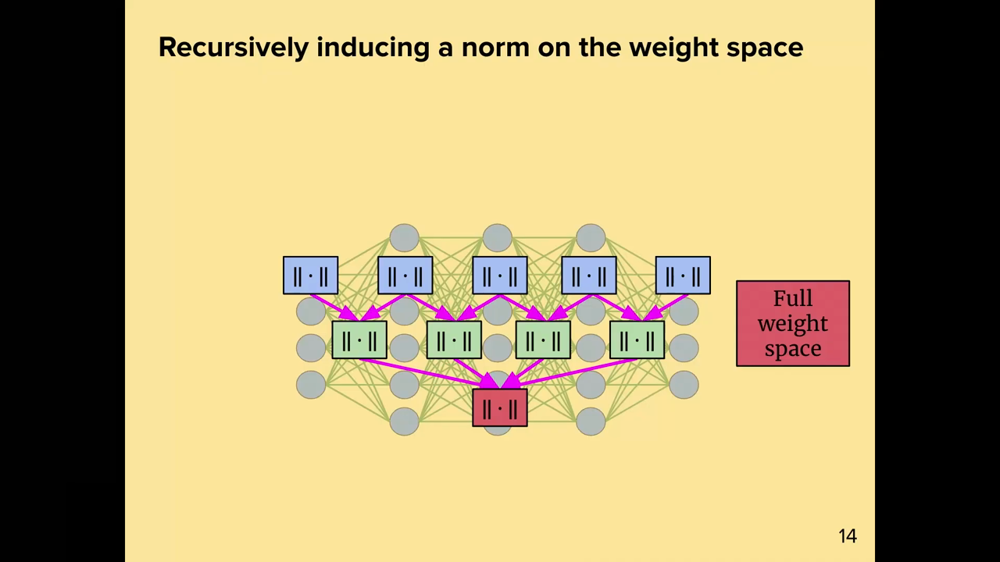
*▲ 강의 슬라이드 [23:55](https://youtu.be/zBvsoxC6tAo?t=1435): 층마다의 [노름](00_%EB%94%A5%EB%9F%AC%EB%8B%9D_%EC%9A%A9%EC%96%B4%EC%82%AC%EC%A0%84.md#norm-%EB%85%B8%EB%A6%84)(작은 상자)을 재귀적으로 합쳐 전체 [가중치](00_%EB%94%A5%EB%9F%AC%EB%8B%9D_%EC%9A%A9%EC%96%B4%EC%82%AC%EC%A0%84.md#weight-%EA%B0%80%EC%A4%91%EC%B9%98) 공간의 [노름](00_%EB%94%A5%EB%9F%AC%EB%8B%9D_%EC%9A%A9%EC%96%B4%EC%82%AC%EC%A0%84.md#norm-%EB%85%B8%EB%A6%84)(빨간 상자)을 만든다*

질의응답 정리 [22:16](https://youtu.be/zBvsoxC6tAo?t=1336)

- **[활성화 함수](00_%EB%94%A5%EB%9F%AC%EB%8B%9D_%EC%9A%A9%EC%96%B4%EC%82%AC%EC%A0%84.md#activation-function-%ED%99%9C%EC%84%B1%ED%99%94-%ED%95%A8%EC%88%98)에는 [가중치](00_%EB%94%A5%EB%9F%AC%EB%8B%9D_%EC%9A%A9%EC%96%B4%EC%82%AC%EC%A0%84.md#weight-%EA%B0%80%EC%A4%91%EC%B9%98)가 없는데 무엇에 [노름](00_%EB%94%A5%EB%9F%AC%EB%8B%9D_%EC%9A%A9%EC%96%B4%EC%82%AC%EC%A0%84.md#norm-%EB%85%B8%EB%A6%84)을 주나?** "활성값"은 특징 벡터를 말한 것입니다. [ReLU](00_%EB%94%A5%EB%9F%AC%EB%8B%9D_%EC%9A%A9%EC%96%B4%EC%82%AC%EC%A0%84.md#relu-%EB%A0%90%EB%A3%A8) 같은 [비선형성](00_%EB%94%A5%EB%9F%AC%EB%8B%9D_%EC%9A%A9%EC%96%B4%EC%82%AC%EC%A0%84.md#nonlinearity-%EB%B9%84%EC%84%A0%ED%98%95%EC%84%B1)도 레고 블록으로 볼 수 있는데, 그 [가중치](00_%EB%94%A5%EB%9F%AC%EB%8B%9D_%EC%9A%A9%EC%96%B4%EC%82%AC%EC%A0%84.md#weight-%EA%B0%80%EC%A4%91%EC%B9%98) 공간은 0차원(자명한 공간)일 뿐입니다.

---

## 5. 모듈 이론

▶ 영상 [23:57](https://youtu.be/zBvsoxC6tAo?t=1437)

### 5.1 조합자 패턴과 기본 회로

▶ 영상 [24:00](https://youtu.be/zBvsoxC6tAo?t=1440)

프로그래밍의 **[조합자 패턴](00_%EB%94%A5%EB%9F%AC%EB%8B%9D_%EC%9A%A9%EC%96%B4%EC%82%AC%EC%A0%84.md#combinator-pattern-%EC%A1%B0%ED%95%A9%EC%9E%90-%ED%8C%A8%ED%84%B4)**(combinator pattern)에서 이름을 따왔습니다. 추상 타입 하나를 정하고, 그 타입의 아주 단순한 원소(원시 부품)와 원소들을 합쳐 다시 같은 타입을 만드는 "조합자"를 정의해 복잡한 구조를 쌓는 방식입니다.

- 여기서 추상 타입은 **[모듈](00_%EB%94%A5%EB%9F%AC%EB%8B%9D_%EC%9A%A9%EC%96%B4%EC%82%AC%EC%A0%84.md#module-modular-norm-%EB%AA%A8%EB%93%88%EA%B3%BC-%EB%AA%A8%EB%93%88%EB%9F%AC-%EB%85%B8%EB%A6%84)**: 입력, [가중치](00_%EB%94%A5%EB%9F%AC%EB%8B%9D_%EC%9A%A9%EC%96%B4%EC%82%AC%EC%A0%84.md#weight-%EA%B0%80%EC%A4%91%EC%B9%98), 출력을 가진 것. [층](00_%EB%94%A5%EB%9F%AC%EB%8B%9D_%EC%9A%A9%EC%96%B4%EC%82%AC%EC%A0%84.md#layer-%EC%B8%B5) 하나도, 신경망 전체도 모듈입니다.
- 조합자는 두 개: **합성**(composition, 직렬)과 **연결**(concatenation, 병렬). [모듈 합성과 모듈 연결](00_%EB%94%A5%EB%9F%AC%EB%8B%9D_%EC%9A%A9%EC%96%B4%EC%82%AC%EC%A0%84.md#module-composition-module-concatenation-%EB%AA%A8%EB%93%88-%ED%95%A9%EC%84%B1%EA%B3%BC-%EB%AA%A8%EB%93%88-%EC%97%B0%EA%B2%B0)
- **회로로 보기**: 두 모듈을 병렬로 둔 뒤 Add 모듈과 합성하면 **덧셈** $M_1 + M_2$, 모듈을 스칼라 곱 모듈 Mul과 합성하면 **스칼라 곱** $a * M$입니다. 이 둘로 **잔차 블록** $a * \text{Identity} + b * M$을 만들고, 그것을 여러 번 합성하면 잔차 신경망([잔차 연결](00_%EB%94%A5%EB%9F%AC%EB%8B%9D_%EC%9A%A9%EC%96%B4%EC%82%AC%EC%A0%84.md#residual-connection-%EC%9E%94%EC%B0%A8-%EC%97%B0%EA%B2%B0))이 됩니다. 단순한 이항 조합 규칙만으로 원하는 신경망을 다 만들 수 있다는 뜻입니다.

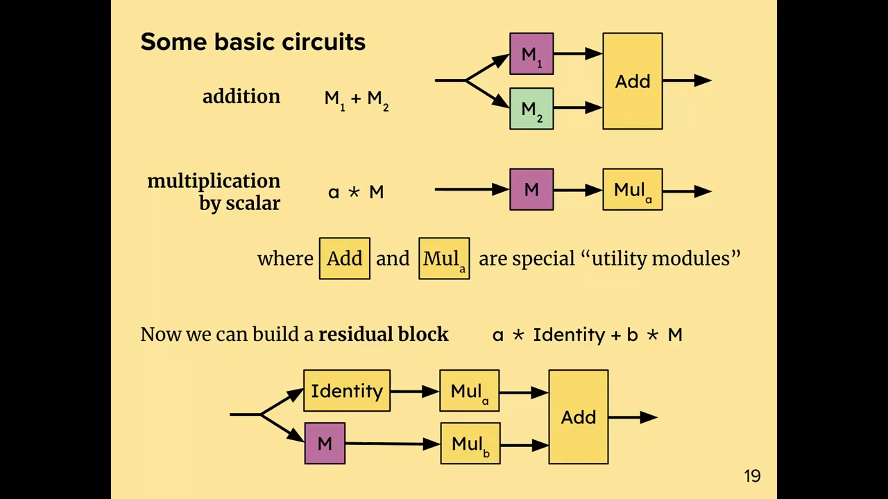
*▲ 강의 슬라이드 [26:05](https://youtu.be/zBvsoxC6tAo?t=1565): 기본 회로. 덧셈, 스칼라 곱, 그리고 이 둘로 만든 잔차 블록 $a * \text{Identity} + b * M$*

질의응답 정리 [26:22](https://youtu.be/zBvsoxC6tAo?t=1582)

- **덧셈처럼 입력이 둘인 모듈은?** 입력 공간을 튜플 하나로 봅니다. 입력 공간은 (추상적인 의미의) 벡터 공간이기만 하면 어떤 구조든 됩니다.

### 5.2 원자, 결합, 화합물

▶ 영상 [26:59](https://youtu.be/zBvsoxC6tAo?t=1619)

모듈을 세 종류로 나눕니다. [원자·결합·화합물 모듈](00_%EB%94%A5%EB%9F%AC%EB%8B%9D_%EC%9A%A9%EC%96%B4%EC%82%AC%EC%A0%84.md#atomic-module-bond-module-compound-module-%EC%9B%90%EC%9E%90-%EB%AA%A8%EB%93%88-%EA%B2%B0%ED%95%A9-%EB%AA%A8%EB%93%88-%ED%99%94%ED%95%A9%EB%AC%BC-%EB%AA%A8%EB%93%88)

| 종류 | 뜻 | 예 |
|---|---|---|
| **원자**(atom) | 손으로 직접 쓰는 단순한 [층](00_%EB%94%A5%EB%9F%AC%EB%8B%9D_%EC%9A%A9%EC%96%B4%EC%82%AC%EC%A0%84.md#layer-%EC%B8%B5) | [선형층](00_%EB%94%A5%EB%9F%AC%EB%8B%9D_%EC%9A%A9%EC%96%B4%EC%82%AC%EC%A0%84.md#linear-layer-%EC%84%A0%ED%98%95%EC%B8%B5), [합성곱](00_%EB%94%A5%EB%9F%AC%EB%8B%9D_%EC%9A%A9%EC%96%B4%EC%82%AC%EC%A0%84.md#convolution-%ED%95%A9%EC%84%B1%EA%B3%B1)[층](00_%EB%94%A5%EB%9F%AC%EB%8B%9D_%EC%9A%A9%EC%96%B4%EC%82%AC%EC%A0%84.md#layer-%EC%B8%B5), [임베딩](00_%EB%94%A5%EB%9F%AC%EB%8B%9D_%EC%9A%A9%EC%96%B4%EC%82%AC%EC%A0%84.md#embedding-%EC%9E%84%EB%B2%A0%EB%94%A9)[층](00_%EB%94%A5%EB%9F%AC%EB%8B%9D_%EC%9A%A9%EC%96%B4%EC%82%AC%EC%A0%84.md#layer-%EC%B8%B5) |
| **결합**(bond) | [가중치](00_%EB%94%A5%EB%9F%AC%EB%8B%9D_%EC%9A%A9%EC%96%B4%EC%82%AC%EC%A0%84.md#weight-%EA%B0%80%EC%A4%91%EC%B9%98) 공간이 자명한([가중치](00_%EB%94%A5%EB%9F%AC%EB%8B%9D_%EC%9A%A9%EC%96%B4%EC%82%AC%EC%A0%84.md#weight-%EA%B0%80%EC%A4%91%EC%B9%98) 없는) 모듈 | [비선형성](00_%EB%94%A5%EB%9F%AC%EB%8B%9D_%EC%9A%A9%EC%96%B4%EC%82%AC%EC%A0%84.md#nonlinearity-%EB%B9%84%EC%84%A0%ED%98%95%EC%84%B1), [가중치](00_%EB%94%A5%EB%9F%AC%EB%8B%9D_%EC%9A%A9%EC%96%B4%EC%82%AC%EC%A0%84.md#weight-%EA%B0%80%EC%A4%91%EC%B9%98)를 뺀 "함수형 [어텐션](00_%EB%94%A5%EB%9F%AC%EB%8B%9D_%EC%9A%A9%EC%96%B4%EC%82%AC%EC%A0%84.md#attention-%EC%96%B4%ED%85%90%EC%85%98)" |
| **화합물**(compound) | 조합 규칙으로 만든 모든 것 | 함수형 [어텐션](00_%EB%94%A5%EB%9F%AC%EB%8B%9D_%EC%9A%A9%EC%96%B4%EC%82%AC%EC%A0%84.md#attention-%EC%96%B4%ED%85%90%EC%85%98) + 선형 모듈 = [어텐션](00_%EB%94%A5%EB%9F%AC%EB%8B%9D_%EC%9A%A9%EC%96%B4%EC%82%AC%EC%A0%84.md#attention-%EC%96%B4%ED%85%90%EC%85%98) 모듈, MLP, [트랜스포머](00_%EB%94%A5%EB%9F%AC%EB%8B%9D_%EC%9A%A9%EC%96%B4%EC%82%AC%EC%A0%84.md#transformer-%ED%8A%B8%EB%9E%9C%EC%8A%A4%ED%8F%AC%EB%A8%B8) |

알고 싶은 것은 처음과 같습니다. 기본 부품의 민감도 정보를 안다고 할 때, **레고 세트로 만든 어떤 화합물에 대해서도** 입력과 [가중치](00_%EB%94%A5%EB%9F%AC%EB%8B%9D_%EC%9A%A9%EC%96%B4%EC%82%AC%EC%A0%84.md#weight-%EA%B0%80%EC%A4%91%EC%B9%98) 변화로 출력 변화를 예측할 수 있을까?

---

## 6. 모듈의 정의와 좋은 노름

▶ 영상 [28:07](https://youtu.be/zBvsoxC6tAo?t=1687)

📐 **수학 개념**: [모듈러 노름의 조합 규칙](%EC%88%98%ED%95%99%EA%B0%9C%EB%85%90/09_%EC%B5%9C%EC%A0%81%ED%99%94%EC%9D%98_%EA%B8%B0%ED%95%98/MM78_%EB%AA%A8%EB%93%88%EB%9F%AC_%EB%85%B8%EB%A6%84%EC%9D%98_%EC%A1%B0%ED%95%A9_%EA%B7%9C%EC%B9%99.md) · [스펙트럼 노름과 RMS 연산자 노름](%EC%88%98%ED%95%99%EA%B0%9C%EB%85%90/09_%EC%B5%9C%EC%A0%81%ED%99%94%EC%9D%98_%EA%B8%B0%ED%95%98/MM28_%EC%8A%A4%ED%8E%99%ED%8A%B8%EB%9F%BC_%EB%85%B8%EB%A6%84%EA%B3%BC_RMS_%EC%97%B0%EC%82%B0%EC%9E%90_%EB%85%B8%EB%A6%84.md) · [립시츠 연속과 노름](%EC%88%98%ED%95%99%EA%B0%9C%EB%85%90/03_%EC%84%A0%ED%98%95%EB%8C%80%EC%88%98/MM11_%EB%A6%BD%EC%8B%9C%EC%B8%A0_%EC%97%B0%EC%86%8D%EA%B3%BC_%EB%85%B8%EB%A6%84.md)

### 6.1 모듈의 네 가지 속성

▶ 영상 [28:42](https://youtu.be/zBvsoxC6tAo?t=1722)

강사는 순수 수학자와 함께 아주 형식적인 정의를 만들었다고 말합니다. 모듈은 입력 공간 $\mathcal{X}$, [가중치](00_%EB%94%A5%EB%9F%AC%EB%8B%9D_%EC%9A%A9%EC%96%B4%EC%82%AC%EC%A0%84.md#weight-%EA%B0%80%EC%A4%91%EC%B9%98) 공간 $\mathcal{W}$, 출력 공간 $\mathcal{Y}$와 네 가지 속성을 가집니다.

| 속성 | 뜻 |
|---|---|
| forward | 함수 $\mathcal{W} \times \mathcal{X} \to \mathcal{Y}$ |
| **민감도**(sensitivity) | 입력→출력 민감도를 재는 수. 립시츠 상수의 하나 |
| **질량**(mass) | 이 모듈이 다른 모듈에 비해 얼마나 중요한지, [학습](00_%EB%94%A5%EB%9F%AC%EB%8B%9D_%EC%9A%A9%EC%96%B4%EC%82%AC%EC%A0%84.md#training-%ED%95%99%EC%8A%B5)에 얼마나 기여할지 정하는 [하이퍼파라미터](00_%EB%94%A5%EB%9F%AC%EB%8B%9D_%EC%9A%A9%EC%96%B4%EC%82%AC%EC%A0%84.md#hyperparameter-%ED%95%98%EC%9D%B4%ED%8D%BC%ED%8C%8C%EB%9D%BC%EB%AF%B8%ED%84%B0) |
| norm | [가중치](00_%EB%94%A5%EB%9F%AC%EB%8B%9D_%EC%9A%A9%EC%96%B4%EC%82%AC%EC%A0%84.md#weight-%EA%B0%80%EC%A4%91%EC%B9%98) 공간의 [노름](00_%EB%94%A5%EB%9F%AC%EB%8B%9D_%EC%9A%A9%EC%96%B4%EC%82%AC%EC%A0%84.md#norm-%EB%85%B8%EB%A6%84) $\mathcal{W} \to \mathbb{R}$ |

[모듈 질량과 모듈 민감도](00_%EB%94%A5%EB%9F%AC%EB%8B%9D_%EC%9A%A9%EC%96%B4%EC%82%AC%EC%A0%84.md#module-mass-module-sensitivity-%EB%AA%A8%EB%93%88-%EC%A7%88%EB%9F%89%EA%B3%BC-%EB%AA%A8%EB%93%88-%EB%AF%BC%EA%B0%90%EB%8F%84)

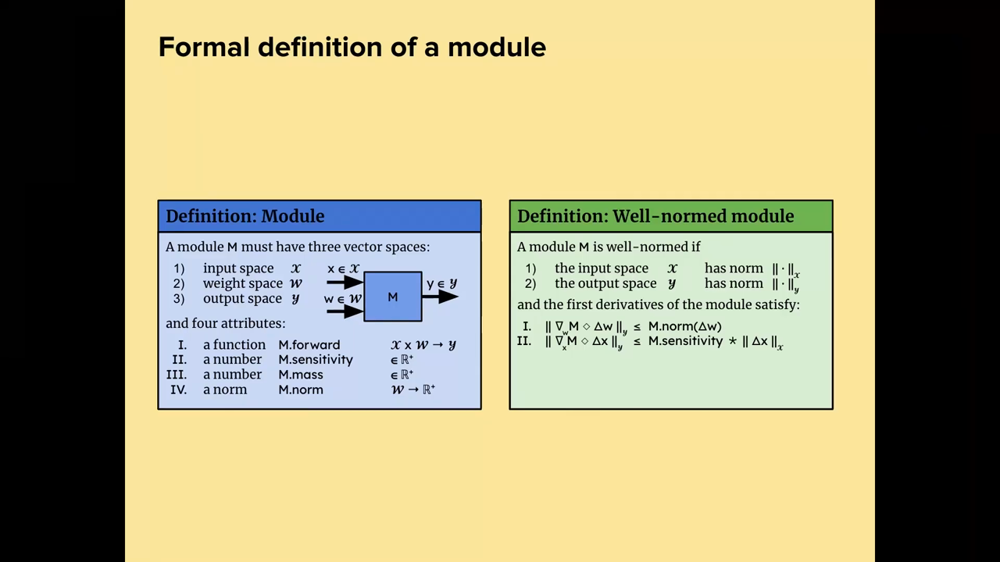
*▲ 강의 슬라이드 [30:20](https://youtu.be/zBvsoxC6tAo?t=1820): 모듈의 정식 정의(왼쪽, 세 공간과 네 속성)와 [노름이 잘 맞는 모듈](00_%EB%94%A5%EB%9F%AC%EB%8B%9D_%EC%9A%A9%EC%96%B4%EC%82%AC%EC%A0%84.md#well-normed-module-%EB%85%B8%EB%A6%84%EC%9D%B4-%EC%9E%98-%EB%A7%9E%EB%8A%94-%EB%AA%A8%EB%93%88)의 정의(오른쪽)*

### 6.2 노름이 잘 맞는 모듈

▶ 영상 [29:19](https://youtu.be/zBvsoxC6tAo?t=1759)

이 속성을 가진 것은 모두 모듈이지만, 라이브러리에는 "좋은" 모듈만 넣고 싶습니다. 그래서 둘째 정의 **[노름이 잘 맞는 모듈](00_%EB%94%A5%EB%9F%AC%EB%8B%9D_%EC%9A%A9%EC%96%B4%EC%82%AC%EC%A0%84.md#well-normed-module-%EB%85%B8%EB%A6%84%EC%9D%B4-%EC%9E%98-%EB%A7%9E%EB%8A%94-%EB%AA%A8%EB%93%88)**(well-normed module)을 둡니다. 입력 공간과 출력 공간에도 [노름](00_%EB%94%A5%EB%9F%AC%EB%8B%9D_%EC%9A%A9%EC%96%B4%EC%82%AC%EC%A0%84.md#norm-%EB%85%B8%EB%A6%84)을 주고(입력·출력이 어떻게 행동하길 원하는지), 모듈이

- [가중치](00_%EB%94%A5%EB%9F%AC%EB%8B%9D_%EC%9A%A9%EC%96%B4%EC%82%AC%EC%A0%84.md#weight-%EA%B0%80%EC%A4%91%EC%B9%98)에 대해 **1-립시츠**: [가중치](00_%EB%94%A5%EB%9F%AC%EB%8B%9D_%EC%9A%A9%EC%96%B4%EC%82%AC%EC%A0%84.md#weight-%EA%B0%80%EC%A4%91%EC%B9%98) 변화가 출력을 그 [노름](00_%EB%94%A5%EB%9F%AC%EB%8B%9D_%EC%9A%A9%EC%96%B4%EC%82%AC%EC%A0%84.md#norm-%EB%85%B8%EB%A6%84) 이상으로 바꾸지 않고,
- 입력에 대해 **민감도-립시츠**: 입력 변화가 출력을 민감도 × 입력 변화 이상으로 바꾸지 않으면

[노름](00_%EB%94%A5%EB%9F%AC%EB%8B%9D_%EC%9A%A9%EC%96%B4%EC%82%AC%EC%A0%84.md#norm-%EB%85%B8%EB%A6%84)이 잘 맞는다고 합니다. 레고 블록에 "이론이 있다"는 말은 이 속성들이 있다는 뜻이고, 둘째 정의는 속성들이 서로 맞물려야 한다는 조건입니다. 맞으면 라이브러리에 넣고, 아니면 버립니다.

$$
\lVert \nabla_w M(w, x) \diamond \Delta w \rVert_{\mathcal{Y}} \le M.\mathrm{norm}(\Delta w), \qquad \lVert \nabla_x M(w, x) \diamond \Delta x \rVert_{\mathcal{Y}} \le M.\mathrm{sensitivity} \times \lVert \Delta x \rVert_{\mathcal{X}}
$$

기호 풀이

| 기호 | 읽는 법 | 뜻 | 예제 값 (선형 모듈 $W = \mathrm{diag}(0.6, 0.3)$, $x = (1, 1)$) |
| --- | --- | --- | --- |
| $M(w, x)$ | 모듈의 forward | [가중치](00_%EB%94%A5%EB%9F%AC%EB%8B%9D_%EC%9A%A9%EC%96%B4%EC%82%AC%EC%A0%84.md#weight-%EA%B0%80%EC%A4%91%EC%B9%98) $w$, 입력 $x$로 낸 출력 | $Wx = (0.6, 0.3)$ |
| $\nabla_w M \diamond \Delta w$ | [가중치](00_%EB%94%A5%EB%9F%AC%EB%8B%9D_%EC%9A%A9%EC%96%B4%EC%82%AC%EC%A0%84.md#weight-%EA%B0%80%EC%A4%91%EC%B9%98) 쪽 1차 변화 | [가중치](00_%EB%94%A5%EB%9F%AC%EB%8B%9D_%EC%9A%A9%EC%96%B4%EC%82%AC%EC%A0%84.md#weight-%EA%B0%80%EC%A4%91%EC%B9%98)를 $\Delta w$만큼 바꿀 때 출력 변화 | $\Delta W x = (0.1, 0.2)$ |
| $\nabla_x M \diamond \Delta x$ | 입력 쪽 1차 변화 | 입력을 $\Delta x$만큼 바꿀 때 출력 변화 | $W\Delta x = (0.6, -0.3)$ |
| $\diamond$ | 다이아몬드 | 공유하는 [텐서](00_%EB%94%A5%EB%9F%AC%EB%8B%9D_%EC%9A%A9%EC%96%B4%EC%82%AC%EC%A0%84.md#tensor-%ED%85%90%EC%84%9C) 첨자끼리 축약 (벡터면 [내적](00_%EB%94%A5%EB%9F%AC%EB%8B%9D_%EC%9A%A9%EC%96%B4%EC%82%AC%EC%A0%84.md#dot-product-%EB%82%B4%EC%A0%81), 행렬·벡터면 [행렬 곱](00_%EB%94%A5%EB%9F%AC%EB%8B%9D_%EC%9A%A9%EC%96%B4%EC%82%AC%EC%A0%84.md#matrix-multiplication-%ED%96%89%EB%A0%AC-%EA%B3%B1)) | |
| $\lVert \cdot \rVert_{\mathcal{Y}}$, $\lVert \cdot \rVert_{\mathcal{X}}$ | 출력·입력 [노름](00_%EB%94%A5%EB%9F%AC%EB%8B%9D_%EC%9A%A9%EC%96%B4%EC%82%AC%EC%A0%84.md#norm-%EB%85%B8%EB%A6%84) | 여기서는 [RMS 노름](00_%EB%94%A5%EB%9F%AC%EB%8B%9D_%EC%9A%A9%EC%96%B4%EC%82%AC%EC%A0%84.md#rms-norm-rms-%EB%85%B8%EB%A6%84) | 0.1581, 1 |
| $M.\mathrm{norm}(\Delta w)$ | [가중치](00_%EB%94%A5%EB%9F%AC%EB%8B%9D_%EC%9A%A9%EC%96%B4%EC%82%AC%EC%A0%84.md#weight-%EA%B0%80%EC%A4%91%EC%B9%98) 변화의 [노름](00_%EB%94%A5%EB%9F%AC%EB%8B%9D_%EC%9A%A9%EC%96%B4%EC%82%AC%EC%A0%84.md#norm-%EB%85%B8%EB%A6%84) | 정사각 행렬이라 [스펙트럼 노름](00_%EB%94%A5%EB%9F%AC%EB%8B%9D_%EC%9A%A9%EC%96%B4%EC%82%AC%EC%A0%84.md#spectral-norm-%EC%8A%A4%ED%8E%99%ED%8A%B8%EB%9F%BC-%EB%85%B8%EB%A6%84) | 0.2 |
| $M.\mathrm{sensitivity}$ | 민감도 | 선형 모듈은 1 | 1 |

예제와 풀이

**문제**: 선형 모듈 $W = \mathrm{diag}(0.6, 0.3)$([노름](00_%EB%94%A5%EB%9F%AC%EB%8B%9D_%EC%9A%A9%EC%96%B4%EC%82%AC%EC%A0%84.md#norm-%EB%85%B8%EB%A6%84) 0.6 ≤ 1), 입력 $x = (1, 1)$(RMS 1)에서 [가중치](00_%EB%94%A5%EB%9F%AC%EB%8B%9D_%EC%9A%A9%EC%96%B4%EC%82%AC%EC%A0%84.md#weight-%EA%B0%80%EC%A4%91%EC%B9%98) 변화 $\Delta W = \mathrm{diag}(0.1, 0.2)$가 첫째 조건을 지키는지 확인하라.

**주어진 값**
- $x = (1, 1)$ (입력, RMS $= \sqrt{(1 + 1)/2} = 1$)
- $\Delta W = \mathrm{diag}(0.1, 0.2)$ ([가중치](00_%EB%94%A5%EB%9F%AC%EB%8B%9D_%EC%9A%A9%EC%96%B4%EC%82%AC%EC%A0%84.md#weight-%EA%B0%80%EC%A4%91%EC%B9%98) 변화. 대각 행렬의 [스펙트럼 노름](00_%EB%94%A5%EB%9F%AC%EB%8B%9D_%EC%9A%A9%EC%96%B4%EC%82%AC%EC%A0%84.md#spectral-norm-%EC%8A%A4%ED%8E%99%ED%8A%B8%EB%9F%BC-%EB%85%B8%EB%A6%84)은 대각 성분 절댓값의 최댓값 $0.2$)

**풀이**
1. 식을 그대로 쓴다: $\lVert \Delta W x \rVert_{\mathrm{RMS}} \le \lVert \Delta W \rVert$
2. 값을 대입한다: $\lVert \mathrm{diag}(0.1, 0.2)\,(1, 1) \rVert_{\mathrm{RMS}} \le 0.2$
3. [행렬 곱](00_%EB%94%A5%EB%9F%AC%EB%8B%9D_%EC%9A%A9%EC%96%B4%EC%82%AC%EC%A0%84.md#matrix-multiplication-%ED%96%89%EB%A0%AC-%EA%B3%B1)을 펼친다: 첫 성분 $0.1 \times 1 = 0.1$, 둘째 성분 $0.2 \times 1 = 0.2$ 이므로 $\lVert (0.1, 0.2) \rVert_{\mathrm{RMS}}$
4. 제곱한다: $0.1^2 = 0.01$, $0.2^2 = 0.04$
5. 더한다: $0.01 + 0.04 = 0.05$
6. 성분 수 2로 나눈다: $0.05 \div 2 = 0.025$
7. 제곱근을 구한다: $\sqrt{0.025} = 0.1581$
8. 비교한다: $0.1581 \le 0.2$

**답**: 출력 변화 RMS **0.1581** ≤ [가중치](00_%EB%94%A5%EB%9F%AC%EB%8B%9D_%EC%9A%A9%EC%96%B4%EC%82%AC%EC%A0%84.md#weight-%EA%B0%80%EC%A4%91%EC%B9%98) [노름](00_%EB%94%A5%EB%9F%AC%EB%8B%9D_%EC%9A%A9%EC%96%B4%EC%82%AC%EC%A0%84.md#norm-%EB%85%B8%EB%A6%84) **0.2**. 조건을 지킨다(입력 쪽도 $\Delta x = (1, -1)$이면 $W\Delta x = (0.6, -0.3)$, RMS $0.4743 \le 1 \times 1$).

내 이해

### 6.3 선형 모듈과 임베딩 모듈

▶ 영상 [30:31](https://youtu.be/zBvsoxC6tAo?t=1831)

- **선형 모듈**: forward는 [행렬-벡터 곱](00_%EB%94%A5%EB%9F%AC%EB%8B%9D_%EC%9A%A9%EC%96%B4%EC%82%AC%EC%A0%84.md#matrix-multiplication-%ED%96%89%EB%A0%AC-%EA%B3%B1) $Wx$, 민감도 1, 질량 1, [노름](00_%EB%94%A5%EB%9F%AC%EB%8B%9D_%EC%9A%A9%EC%96%B4%EC%82%AC%EC%A0%84.md#norm-%EB%85%B8%EB%A6%84)은 **크기를 다시 맞춘 [스펙트럼 노름](00_%EB%94%A5%EB%9F%AC%EB%8B%9D_%EC%9A%A9%EC%96%B4%EC%82%AC%EC%A0%84.md#spectral-norm-%EC%8A%A4%ED%8E%99%ED%8A%B8%EB%9F%BC-%EB%85%B8%EB%A6%84)** $\lVert W \rVert_{\text{spectral}} \times \sqrt{\text{fan-in}/\text{fan-out}}$입니다([RMS→RMS 노름](%EC%88%98%ED%95%99%EA%B0%9C%EB%85%90/09_%EC%B5%9C%EC%A0%81%ED%99%94%EC%9D%98_%EA%B8%B0%ED%95%98/MM28_%EC%8A%A4%ED%8E%99%ED%8A%B8%EB%9F%BC_%EB%85%B8%EB%A6%84%EA%B3%BC_RMS_%EC%97%B0%EC%82%B0%EC%9E%90_%EB%85%B8%EB%A6%84.md)과 같은 것). 입력·출력에 [RMS 노름](00_%EB%94%A5%EB%9F%AC%EB%8B%9D_%EC%9A%A9%EC%96%B4%EC%82%AC%EC%A0%84.md#rms-norm-rms-%EB%85%B8%EB%A6%84)을 주면, **입력이 유계**($\lVert x \rVert \le 1$)이고 **[가중치](00_%EB%94%A5%EB%9F%AC%EB%8B%9D_%EC%9A%A9%EC%96%B4%EC%82%AC%EC%A0%84.md#weight-%EA%B0%80%EC%A4%91%EC%B9%98)가 유계**($\mathrm{norm}(W) \le 1$)일 때 [노름](00_%EB%94%A5%EB%9F%AC%EB%8B%9D_%EC%9A%A9%EC%96%B4%EC%82%AC%EC%A0%84.md#norm-%EB%85%B8%EB%A6%84)이 잘 맞습니다.
- 강사의 관찰: 실제 신경망은 특징 벡터를 곳곳에서 명시적으로 [정규화](00_%EB%94%A5%EB%9F%AC%EB%8B%9D_%EC%9A%A9%EC%96%B4%EC%82%AC%EC%A0%84.md#normalization-%EC%A0%95%EA%B7%9C%ED%99%94)합니다. 사람들은 "안정적이고 폭발을 막아서" 정도로만 이유를 압니다. 이 이론은 선형 모듈에 립시츠 보장을 주려면 **입력과 [가중치](00_%EB%94%A5%EB%9F%AC%EB%8B%9D_%EC%9A%A9%EC%96%B4%EC%82%AC%EC%A0%84.md#weight-%EA%B0%80%EC%A4%91%EC%B9%98)가 유계여야 한다**고 말해 줍니다. 아니면 민감도가 끝없이 커질 수 있습니다.
- **[임베딩](00_%EB%94%A5%EB%9F%AC%EB%8B%9D_%EC%9A%A9%EC%96%B4%EC%82%AC%EC%A0%84.md#embedding-%EC%9E%84%EB%B2%A0%EB%94%A9) 모듈**: 겉으로는 똑같이 $Wx$지만 의미가 다릅니다. [원-핫](00_%EB%94%A5%EB%9F%AC%EB%8B%9D_%EC%9A%A9%EC%96%B4%EC%82%AC%EC%A0%84.md#one-hot-encoding-%EC%9B%90-%ED%95%AB-%EC%9D%B8%EC%BD%94%EB%94%A9) 벡터를 넣어 행렬의 **열 하나**(그 [토큰](00_%EB%94%A5%EB%9F%AC%EB%8B%9D_%EC%9A%A9%EC%96%B4%EC%82%AC%EC%A0%84.md#token-%ED%86%A0%ED%81%B0)의 [임베딩](00_%EB%94%A5%EB%9F%AC%EB%8B%9D_%EC%9A%A9%EC%96%B4%EC%82%AC%EC%A0%84.md#embedding-%EC%9E%84%EB%B2%A0%EB%94%A9))를 고릅니다. 그래서 [가중치](00_%EB%94%A5%EB%9F%AC%EB%8B%9D_%EC%9A%A9%EC%96%B4%EC%82%AC%EC%A0%84.md#weight-%EA%B0%80%EC%A4%91%EC%B9%98) [노름](00_%EB%94%A5%EB%9F%AC%EB%8B%9D_%EC%9A%A9%EC%96%B4%EC%82%AC%EC%A0%84.md#norm-%EB%85%B8%EB%A6%84)을 **열 [RMS 노름](00_%EB%94%A5%EB%9F%AC%EB%8B%9D_%EC%9A%A9%EC%96%B4%EC%82%AC%EC%A0%84.md#rms-norm-rms-%EB%85%B8%EB%A6%84)의 최댓값** $\max_i \lVert \text{column}_i(W) \rVert_{\mathrm{RMS}}$로, 입력 [노름](00_%EB%94%A5%EB%9F%AC%EB%8B%9D_%EC%9A%A9%EC%96%B4%EC%82%AC%EC%A0%84.md#norm-%EB%85%B8%EB%A6%84)을 ([확률](00_%EB%94%A5%EB%9F%AC%EB%8B%9D_%EC%9A%A9%EC%96%B4%EC%82%AC%EC%A0%84.md#probability-%ED%99%95%EB%A5%A0) 벡터처럼) **$L_1$ [노름](00_%EB%94%A5%EB%9F%AC%EB%8B%9D_%EC%9A%A9%EC%96%B4%EC%82%AC%EC%A0%84.md#norm-%EB%85%B8%EB%A6%84)**으로 줍니다. 같은 조건(입력·[가중치](00_%EB%94%A5%EB%9F%AC%EB%8B%9D_%EC%9A%A9%EC%96%B4%EC%82%AC%EC%A0%84.md#weight-%EA%B0%80%EC%A4%91%EC%B9%98) 유계)에서 [노름](00_%EB%94%A5%EB%9F%AC%EB%8B%9D_%EC%9A%A9%EC%96%B4%EC%82%AC%EC%A0%84.md#norm-%EB%85%B8%EB%A6%84)이 잘 맞습니다.

$$
\begin{aligned}
L.\mathrm{norm}(W) &= \lVert W \rVert_{\text{spectral}} \times \sqrt{\frac{\text{fan-in}}{\text{fan-out}}} \qquad (\text{입력·출력 RMS})\\
E.\mathrm{norm}(W) &= \max_i\, \lVert \text{column}_i(W) \rVert_{\mathrm{RMS}} \qquad (\text{입력 } L_1,\ \text{출력 RMS})
\end{aligned}
$$

기호 풀이

| 기호 | 읽는 법 | 뜻 | 예제 값 |
| --- | --- | --- | --- |
| $L.\mathrm{norm}$ | 선형 모듈 [노름](00_%EB%94%A5%EB%9F%AC%EB%8B%9D_%EC%9A%A9%EC%96%B4%EC%82%AC%EC%A0%84.md#norm-%EB%85%B8%EB%A6%84) | RMS→RMS [유도 연산자 노름](00_%EB%94%A5%EB%9F%AC%EB%8B%9D_%EC%9A%A9%EC%96%B4%EC%82%AC%EC%A0%84.md#induced-operator-norm-%EC%9C%A0%EB%8F%84-%EC%97%B0%EC%82%B0%EC%9E%90-%EB%85%B8%EB%A6%84) | 2.0 |
| $\lVert W \rVert_{\text{spectral}}$ | [스펙트럼 노름](00_%EB%94%A5%EB%9F%AC%EB%8B%9D_%EC%9A%A9%EC%96%B4%EC%82%AC%EC%A0%84.md#spectral-norm-%EC%8A%A4%ED%8E%99%ED%8A%B8%EB%9F%BC-%EB%85%B8%EB%A6%84) | 가장 큰 특잇값 | 1.4142 |
| fan-in, fan-out | 팬인, 팬아웃 | 입력 차원(열 수), 출력 차원(행 수) | 4, 2 |
| $E.\mathrm{norm}$ | [임베딩](00_%EB%94%A5%EB%9F%AC%EB%8B%9D_%EC%9A%A9%EC%96%B4%EC%82%AC%EC%A0%84.md#embedding-%EC%9E%84%EB%B2%A0%EB%94%A9) 모듈 [노름](00_%EB%94%A5%EB%9F%AC%EB%8B%9D_%EC%9A%A9%EC%96%B4%EC%82%AC%EC%A0%84.md#norm-%EB%85%B8%EB%A6%84) | 열([토큰](00_%EB%94%A5%EB%9F%AC%EB%8B%9D_%EC%9A%A9%EC%96%B4%EC%82%AC%EC%A0%84.md#token-%ED%86%A0%ED%81%B0) [임베딩](00_%EB%94%A5%EB%9F%AC%EB%8B%9D_%EC%9A%A9%EC%96%B4%EC%82%AC%EC%A0%84.md#embedding-%EC%9E%84%EB%B2%A0%EB%94%A9))마다 RMS를 재서 가장 큰 값 | 1.0 |
| $\text{column}_i(W)$ | 아이번째 열 | [토큰](00_%EB%94%A5%EB%9F%AC%EB%8B%9D_%EC%9A%A9%EC%96%B4%EC%82%AC%EC%A0%84.md#token-%ED%86%A0%ED%81%B0) $i$의 [임베딩](00_%EB%94%A5%EB%9F%AC%EB%8B%9D_%EC%9A%A9%EC%96%B4%EC%82%AC%EC%A0%84.md#embedding-%EC%9E%84%EB%B2%A0%EB%94%A9) 벡터 | (1.0, 1.0) |
| $\lVert \cdot \rVert_{\mathrm{RMS}}$ | [RMS 노름](00_%EB%94%A5%EB%9F%AC%EB%8B%9D_%EC%9A%A9%EC%96%B4%EC%82%AC%EC%A0%84.md#rms-norm-rms-%EB%85%B8%EB%A6%84) | $\sqrt{\text{제곱 평균}}$ | 0.4472, 1.0, 0.4 |

예제와 풀이

**문제**: (가) 성분이 모두 0.5인 2×4 선형 [가중치](00_%EB%94%A5%EB%9F%AC%EB%8B%9D_%EC%9A%A9%EC%96%B4%EC%82%AC%EC%A0%84.md#weight-%EA%B0%80%EC%A4%91%EC%B9%98)([스펙트럼 노름](00_%EB%94%A5%EB%9F%AC%EB%8B%9D_%EC%9A%A9%EC%96%B4%EC%82%AC%EC%A0%84.md#spectral-norm-%EC%8A%A4%ED%8E%99%ED%8A%B8%EB%9F%BC-%EB%85%B8%EB%A6%84) 1.4142)의 선형 모듈 [노름](00_%EB%94%A5%EB%9F%AC%EB%8B%9D_%EC%9A%A9%EC%96%B4%EC%82%AC%EC%A0%84.md#norm-%EB%85%B8%EB%A6%84)과, (나) [임베딩](00_%EB%94%A5%EB%9F%AC%EB%8B%9D_%EC%9A%A9%EC%96%B4%EC%82%AC%EC%A0%84.md#embedding-%EC%9E%84%EB%B2%A0%EB%94%A9) 행렬 $E = \begin{pmatrix}0.2&1.0&0.4\\0.6&1.0&-0.4\end{pmatrix}$의 [임베딩](00_%EB%94%A5%EB%9F%AC%EB%8B%9D_%EC%9A%A9%EC%96%B4%EC%82%AC%EC%A0%84.md#embedding-%EC%9E%84%EB%B2%A0%EB%94%A9) 모듈 [노름](00_%EB%94%A5%EB%9F%AC%EB%8B%9D_%EC%9A%A9%EC%96%B4%EC%82%AC%EC%A0%84.md#norm-%EB%85%B8%EB%A6%84)을 구하라.

**주어진 값**
- $\lVert W \rVert_{\text{spectral}} = 1.4142$ (가장 큰 특잇값, `np.linalg.svd`로 구함)
- fan-in $= 4$ (입력 차원), fan-out $= 2$ (출력 차원)
- $E$의 세 열 $(0.2, 0.6)$, $(1.0, 1.0)$, $(0.4, -0.4)$ ([토큰](00_%EB%94%A5%EB%9F%AC%EB%8B%9D_%EC%9A%A9%EC%96%B4%EC%82%AC%EC%A0%84.md#token-%ED%86%A0%ED%81%B0) 세 개의 [임베딩](00_%EB%94%A5%EB%9F%AC%EB%8B%9D_%EC%9A%A9%EC%96%B4%EC%82%AC%EC%A0%84.md#embedding-%EC%9E%84%EB%B2%A0%EB%94%A9), 차원 2)

**풀이**
1. 식을 그대로 쓴다: $L.\mathrm{norm}(W) = \lVert W \rVert_{\text{spectral}} \times \sqrt{\text{fan-in}/\text{fan-out}}$
2. 값을 대입한다: $L.\mathrm{norm}(W) = 1.4142 \times \sqrt{4/2}$
3. 나눗셈을 한다: $4 \div 2 = 2$ 이므로 $1.4142 \times \sqrt{2}$
4. 제곱근을 구한다: $\sqrt2 = 1.4142$ 이므로 $1.4142 \times 1.4142$
5. 곱한다: $1.4142 \times 1.4142 = 2.0$
6. 식을 그대로 쓴다: $E.\mathrm{norm}(E) = \max_i \lVert \text{column}_i(E) \rVert_{\mathrm{RMS}}$
7. 첫 열 RMS: $\sqrt{(0.2^2 + 0.6^2)/2} = \sqrt{(0.04 + 0.36)/2} = \sqrt{0.2} = 0.4472$
8. 둘째 열 RMS: $\sqrt{(1.0^2 + 1.0^2)/2} = \sqrt{2/2} = 1.0$
9. 셋째 열 RMS: $\sqrt{(0.4^2 + 0.4^2)/2} = \sqrt{0.32/2} = \sqrt{0.16} = 0.4$
10. 최댓값을 고른다: $\max(0.4472, 1.0, 0.4) = 1.0$

**답**: (가) 선형 모듈 [노름](00_%EB%94%A5%EB%9F%AC%EB%8B%9D_%EC%9A%A9%EC%96%B4%EC%82%AC%EC%A0%84.md#norm-%EB%85%B8%EB%A6%84) **2.0** (> 1이라 [노름](00_%EB%94%A5%EB%9F%AC%EB%8B%9D_%EC%9A%A9%EC%96%B4%EC%82%AC%EC%A0%84.md#norm-%EB%85%B8%EB%A6%84)이 잘 맞는 조건을 넘는다), (나) [임베딩](00_%EB%94%A5%EB%9F%AC%EB%8B%9D_%EC%9A%A9%EC%96%B4%EC%82%AC%EC%A0%84.md#embedding-%EC%9E%84%EB%B2%A0%EB%94%A9) 모듈 [노름](00_%EB%94%A5%EB%9F%AC%EB%8B%9D_%EC%9A%A9%EC%96%B4%EC%82%AC%EC%A0%84.md#norm-%EB%85%B8%EB%A6%84) **1.0**. [원-핫](00_%EB%94%A5%EB%9F%AC%EB%8B%9D_%EC%9A%A9%EC%96%B4%EC%82%AC%EC%A0%84.md#one-hot-encoding-%EC%9B%90-%ED%95%AB-%EC%9D%B8%EC%BD%94%EB%94%A9) 입력 (0, 1, 0)은 $L_1$ [노름](00_%EB%94%A5%EB%9F%AC%EB%8B%9D_%EC%9A%A9%EC%96%B4%EC%82%AC%EC%A0%84.md#norm-%EB%85%B8%EB%A6%84) 1이고 출력은 둘째 열 (1.0, 1.0), RMS 1.0이다.

내 이해

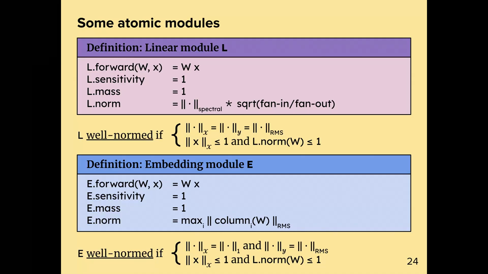
*▲ 강의 슬라이드 [33:57](https://youtu.be/zBvsoxC6tAo?t=2037): 원자 모듈 두 가지. 선형 모듈은 RMS 입출력과 스펙트럼 × √(fan-in/fan-out) [노름](00_%EB%94%A5%EB%9F%AC%EB%8B%9D_%EC%9A%A9%EC%96%B4%EC%82%AC%EC%A0%84.md#norm-%EB%85%B8%EB%A6%84), [임베딩](00_%EB%94%A5%EB%9F%AC%EB%8B%9D_%EC%9A%A9%EC%96%B4%EC%82%AC%EC%A0%84.md#embedding-%EC%9E%84%EB%B2%A0%EB%94%A9) 모듈은 $L_1$ 입력과 열 RMS 최댓값 [노름](00_%EB%94%A5%EB%9F%AC%EB%8B%9D_%EC%9A%A9%EC%96%B4%EC%82%AC%EC%A0%84.md#norm-%EB%85%B8%EB%A6%84)*

질의응답 정리 [33:29](https://youtu.be/zBvsoxC6tAo?t=2009)

- **정의의 마름모($\diamond$)는 무엇인가?** 공유하는 [텐서](00_%EB%94%A5%EB%9F%AC%EB%8B%9D_%EC%9A%A9%EC%96%B4%EC%82%AC%EC%A0%84.md#tensor-%ED%85%90%EC%84%9C) 첨자끼리 축약하라는 뜻입니다([텐서 축약](00_%EB%94%A5%EB%9F%AC%EB%8B%9D_%EC%9A%A9%EC%96%B4%EC%82%AC%EC%A0%84.md#tensor-contraction-%ED%85%90%EC%84%9C-%EC%B6%95%EC%95%BD)). 벡터 둘이면 [내적](00_%EB%94%A5%EB%9F%AC%EB%8B%9D_%EC%9A%A9%EC%96%B4%EC%82%AC%EC%A0%84.md#dot-product-%EB%82%B4%EC%A0%81), 행렬과 벡터면 행렬-벡터 곱, 첨자가 같은 행렬 둘이면 그 첨자로 합. 신경망의 대상들은 모양이 제각각이라 "알맞은 곱셈을 하라"는 줄임 표기입니다.
- **입력 [노름](00_%EB%94%A5%EB%9F%AC%EB%8B%9D_%EC%9A%A9%EC%96%B4%EC%82%AC%EC%A0%84.md#norm-%EB%85%B8%EB%A6%84) ≤ 1 경계에 있는데 [기울기](00_%EB%94%A5%EB%9F%AC%EB%8B%9D_%EC%9A%A9%EC%96%B4%EC%82%AC%EC%A0%84.md#gradient-%EA%B8%B0%EC%9A%B8%EA%B8%B0)가 경계 밖으로 밀면?** 아직 이 부분은 충실하게 구현하지 않아서, 지금은 그냥 경계 밖으로 나가게 둡니다. 원래는 [가중치](00_%EB%94%A5%EB%9F%AC%EB%8B%9D_%EC%9A%A9%EC%96%B4%EC%82%AC%EC%A0%84.md#weight-%EA%B0%80%EC%A4%91%EC%B9%98)가 "[노름](00_%EB%94%A5%EB%9F%AC%EB%8B%9D_%EC%9A%A9%EC%96%B4%EC%82%AC%EC%A0%84.md#norm-%EB%85%B8%EB%A6%84)이 잘 맞는 다양체" 위에 머무는 **다양체 최적화** 알고리즘을 설계하려고 합니다. 그러면 출력에 대한 보장이 다음 [층](00_%EB%94%A5%EB%9F%AC%EB%8B%9D_%EC%9A%A9%EC%96%B4%EC%82%AC%EC%A0%84.md#layer-%EC%B8%B5)의 입력 보장이 되어 전체가 일관됩니다. 아직 모든 것이 실제로 일관된 완전한 버전은 없습니다.

> [!TIP]
> **🆕 2026 업데이트: "[노름](00_%EB%94%A5%EB%9F%AC%EB%8B%9D_%EC%9A%A9%EC%96%B4%EC%82%AC%EC%A0%84.md#norm-%EB%85%B8%EB%A6%84)이 잘 맞는 다양체" 위의 최적화가 나오다**
> - **강의**: [가중치](00_%EB%94%A5%EB%9F%AC%EB%8B%9D_%EC%9A%A9%EC%96%B4%EC%82%AC%EC%A0%84.md#weight-%EA%B0%80%EC%A4%91%EC%B9%98)가 경계 안에 머무는 다양체 최적화를 하고 싶지만 아직 구현하지 못했다.
> - **현재**: 강사는 2025년 9월 Thinking Machines Lab 블로그 글 "Modular Manifolds"에서 [가중치](00_%EB%94%A5%EB%9F%AC%EB%8B%9D_%EC%9A%A9%EC%96%B4%EC%82%AC%EC%A0%84.md#weight-%EA%B0%80%EC%A4%91%EC%B9%98) 행렬을 **슈티펠 다양체**(특잇값이 모두 1인 행렬들)에 묶어 두는 **다양체 [Muon](00_%EB%94%A5%EB%9F%AC%EB%8B%9D_%EC%9A%A9%EC%96%B4%EC%82%AC%EC%A0%84.md#muon-%EB%AE%A4%EC%98%A8-%EC%98%B5%ED%8B%B0%EB%A7%88%EC%9D%B4%EC%A0%80)**을 제안했습니다. 업데이트는 볼록 문제를 쌍대 상승으로 풀어 구하고, 행렬 부호 함수로 다양체 위로 되돌립니다. 층마다의 다양체를 곱으로 묶고 [노름](00_%EB%94%A5%EB%9F%AC%EB%8B%9D_%EC%9A%A9%EC%96%B4%EC%82%AC%EC%A0%84.md#norm-%EB%85%B8%EB%A6%84)을 계수로 합쳐 [학습률](00_%EB%94%A5%EB%9F%AC%EB%8B%9D_%EC%9A%A9%EC%96%B4%EC%82%AC%EC%A0%84.md#learning-rate-%ED%95%99%EC%8A%B5%EB%A5%A0)을 나누는 "모듈러 다양체"도 제안해, 이 강의의 질량·민감도 생각을 이어 갑니다. 작은 CIFAR-10 MLP 실험에서는 AdamW보다 [정확도](00_%EB%94%A5%EB%9F%AC%EB%8B%9D_%EC%9A%A9%EC%96%B4%EC%82%AC%EC%A0%84.md#accuracy-%EC%A0%95%ED%99%95%EB%8F%84)가 높았지만 걸음당 시간은 더 들었습니다.
> - **출처**: [Jeremy Bernstein, "Modular Manifolds", Thinking Machines Lab: Connectionism (2025)](https://thinkingmachines.ai/blog/modular-manifolds/)

---

## 7. 조합 규칙

▶ 영상 [35:46](https://youtu.be/zBvsoxC6tAo?t=2146)

📐 **수학 개념**: [모듈러 노름의 조합 규칙](%EC%88%98%ED%95%99%EA%B0%9C%EB%85%90/09_%EC%B5%9C%EC%A0%81%ED%99%94%EC%9D%98_%EA%B8%B0%ED%95%98/MM78_%EB%AA%A8%EB%93%88%EB%9F%AC_%EB%85%B8%EB%A6%84%EC%9D%98_%EC%A1%B0%ED%95%A9_%EA%B7%9C%EC%B9%99.md)

추상적인 정의를 세운 이유는 **성질을 자동으로 지키는 조합 규칙**을 원해서입니다. 라이브러리의 [노름이 잘 맞는 모듈](00_%EB%94%A5%EB%9F%AC%EB%8B%9D_%EC%9A%A9%EC%96%B4%EC%82%AC%EC%A0%84.md#well-normed-module-%EB%85%B8%EB%A6%84%EC%9D%B4-%EC%9E%98-%EB%A7%9E%EB%8A%94-%EB%AA%A8%EB%93%88) 둘을 합성하면 그 결과도 저절로 [노름](00_%EB%94%A5%EB%9F%AC%EB%8B%9D_%EC%9A%A9%EC%96%B4%EC%82%AC%EC%A0%84.md#norm-%EB%85%B8%EB%A6%84)이 잘 맞아야 합니다. 원하는 성질은 (1) 조합 규칙이 **결합 법칙**을 따를 것(합성 사슬을 어떤 순서로 묶든 같은 대상), (2) [노름이 잘 맞는 모듈](00_%EB%94%A5%EB%9F%AC%EB%8B%9D_%EC%9A%A9%EC%96%B4%EC%82%AC%EC%A0%84.md#well-normed-module-%EB%85%B8%EB%A6%84%EC%9D%B4-%EC%9E%98-%EB%A7%9E%EB%8A%94-%EB%AA%A8%EB%93%88)의 공간이 조합에 대해 **닫혀 있을 것**, (3) 질량으로 모듈끼리의 기여(층별 [학습률](00_%EB%94%A5%EB%9F%AC%EB%8B%9D_%EC%9A%A9%EC%96%B4%EC%82%AC%EC%A0%84.md#learning-rate-%ED%95%99%EC%8A%B5%EB%A5%A0))를 조정할 수 있을 것. 강사는 "이런 일은 아주 영리한 정의를 찾는 게 어려운 부분이고, 나머지는 쉽다"고 말합니다.

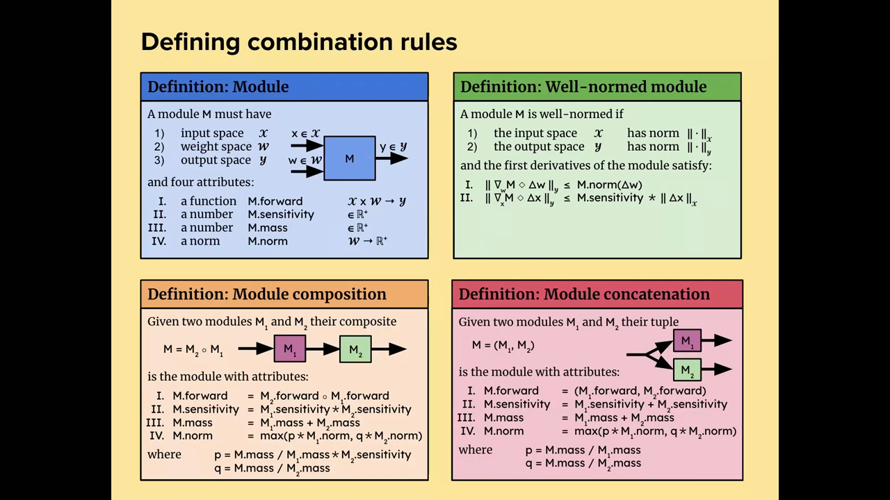
*▲ 강의 슬라이드 [42:28](https://youtu.be/zBvsoxC6tAo?t=2548): 조합 규칙 정리. 모듈(파랑), [노름이 잘 맞는 모듈](00_%EB%94%A5%EB%9F%AC%EB%8B%9D_%EC%9A%A9%EC%96%B4%EC%82%AC%EC%A0%84.md#well-normed-module-%EB%85%B8%EB%A6%84%EC%9D%B4-%EC%9E%98-%EB%A7%9E%EB%8A%94-%EB%AA%A8%EB%93%88)(초록), 모듈 합성(주황), 모듈 연결(빨강)*

### 7.1 합성

▶ 영상 [36:53](https://youtu.be/zBvsoxC6tAo?t=2213)

모듈을 직렬로 놓는 합성 $M = M_2 \circ M_1$에서

- forward는 함수 합성으로 (자연스럽게),
- 민감도는 **곱**합니다(합성하면 립시츠 상수가 곱해지듯이),
- 질량은 **더**하고(생각이 좀 필요합니다),
- [노름](00_%EB%94%A5%EB%9F%AC%EB%8B%9D_%EC%9A%A9%EC%96%B4%EC%82%AC%EC%A0%84.md#norm-%EB%85%B8%EB%A6%84)은 계수를 붙인 **최댓값(max) [노름](00_%EB%94%A5%EB%9F%AC%EB%8B%9D_%EC%9A%A9%EC%96%B4%EC%82%AC%EC%A0%84.md#norm-%EB%85%B8%EB%A6%84)**으로 정합니다. 계수 $p$, $q$는 질량 비율에 달려 있고, $p$에는 **뒤 모듈의 민감도**도 들어갑니다. 뒤 모듈이 입력에 아주 민감하다면 앞 모듈의 [가중치](00_%EB%94%A5%EB%9F%AC%EB%8B%9D_%EC%9A%A9%EC%96%B4%EC%82%AC%EC%A0%84.md#weight-%EA%B0%80%EC%A4%91%EC%B9%98)를 바꿀 때 그 사실을 알아야 하기 때문입니다.

$$
M.\mathrm{mass} = m_1 + m_2, \quad M.\mathrm{sensitivity} = s_1\, s_2, \quad M.\mathrm{norm}(w_1, w_2) = \max\big(p\, \lVert w_1 \rVert_{M_1},\ q\, \lVert w_2 \rVert_{M_2}\big), \quad p = \frac{M.\mathrm{mass}}{m_1}\, s_2,\ \ q = \frac{M.\mathrm{mass}}{m_2}
$$

기호 풀이

| 기호 | 읽는 법 | 뜻 | 예제 값 |
| --- | --- | --- | --- |
| $M_1, M_2$ | 엠 원, 엠 투 | 앞 모듈, 뒤 모듈 | 선형 모듈 두 개 |
| $m_1, m_2$ | 질량 | 각 모듈의 질량 | 1, 1 |
| $s_1, s_2$ | 민감도 | 각 모듈의 입력→출력 배율 | 1, 1 |
| $\lVert w_1 \rVert_{M_1}$, $\lVert w_2 \rVert_{M_2}$ | 모듈 [노름](00_%EB%94%A5%EB%9F%AC%EB%8B%9D_%EC%9A%A9%EC%96%B4%EC%82%AC%EC%A0%84.md#norm-%EB%85%B8%EB%A6%84) | 각 모듈 [가중치](00_%EB%94%A5%EB%9F%AC%EB%8B%9D_%EC%9A%A9%EC%96%B4%EC%82%AC%EC%A0%84.md#weight-%EA%B0%80%EC%A4%91%EC%B9%98)(변화)의 크기 | 0.5, 0.2 |
| $p, q$ | 피, 큐 | [노름](00_%EB%94%A5%EB%9F%AC%EB%8B%9D_%EC%9A%A9%EC%96%B4%EC%82%AC%EC%A0%84.md#norm-%EB%85%B8%EB%A6%84) 앞 계수 | 2, 2 |
| $M.\mathrm{norm}$ | [모듈러 노름](00_%EB%94%A5%EB%9F%AC%EB%8B%9D_%EC%9A%A9%EC%96%B4%EC%82%AC%EC%A0%84.md#module-modular-norm-%EB%AA%A8%EB%93%88%EA%B3%BC-%EB%AA%A8%EB%93%88%EB%9F%AC-%EB%85%B8%EB%A6%84) | 합성 모듈 전체 [가중치](00_%EB%94%A5%EB%9F%AC%EB%8B%9D_%EC%9A%A9%EC%96%B4%EC%82%AC%EC%A0%84.md#weight-%EA%B0%80%EC%A4%91%EC%B9%98)의 크기 | 1.0 |

예제와 풀이

**문제**: 질량 1, 민감도 1인 선형 모듈 두 개를 합성한다. 앞 모듈 [가중치](00_%EB%94%A5%EB%9F%AC%EB%8B%9D_%EC%9A%A9%EC%96%B4%EC%82%AC%EC%A0%84.md#weight-%EA%B0%80%EC%A4%91%EC%B9%98) 변화의 [노름](00_%EB%94%A5%EB%9F%AC%EB%8B%9D_%EC%9A%A9%EC%96%B4%EC%82%AC%EC%A0%84.md#norm-%EB%85%B8%EB%A6%84)이 0.5, 뒤 모듈이 0.2일 때 합성 모듈의 질량, 민감도, [노름](00_%EB%94%A5%EB%9F%AC%EB%8B%9D_%EC%9A%A9%EC%96%B4%EC%82%AC%EC%A0%84.md#norm-%EB%85%B8%EB%A6%84)은?

**주어진 값**
- $m_1 = m_2 = 1$ (질량)
- $s_1 = s_2 = 1$ (민감도)
- $\lVert w_1 \rVert = 0.5$, $\lVert w_2 \rVert = 0.2$ (각 모듈 [노름](00_%EB%94%A5%EB%9F%AC%EB%8B%9D_%EC%9A%A9%EC%96%B4%EC%82%AC%EC%A0%84.md#norm-%EB%85%B8%EB%A6%84))

**풀이**
1. 식을 그대로 쓴다: $M.\mathrm{mass} = m_1 + m_2$, $M.\mathrm{sensitivity} = s_1 s_2$, $M.\mathrm{norm} = \max\big(\frac{M.\mathrm{mass}}{m_1} s_2 \lVert w_1 \rVert,\ \frac{M.\mathrm{mass}}{m_2}\lVert w_2 \rVert\big)$
2. 질량에 대입한다: $1 + 1 = 2$
3. 민감도에 대입한다: $1 \times 1 = 1$
4. [노름](00_%EB%94%A5%EB%9F%AC%EB%8B%9D_%EC%9A%A9%EC%96%B4%EC%82%AC%EC%A0%84.md#norm-%EB%85%B8%EB%A6%84)에 대입한다: $\max\big(\frac{2}{1} \times 1 \times 0.5,\ \frac{2}{1} \times 0.2\big)$
5. 나눗셈을 한다: $2 \div 1 = 2$ 이므로 $\max(2 \times 1 \times 0.5,\ 2 \times 0.2)$
6. 곱셈을 한다: $2 \times 1 \times 0.5 = 1.0$, $2 \times 0.2 = 0.4$ 이므로 $\max(1.0, 0.4)$
7. 큰 쪽을 고른다: $1.0$

**답**: 질량 **2**, 민감도 **1**, [노름](00_%EB%94%A5%EB%9F%AC%EB%8B%9D_%EC%9A%A9%EC%96%B4%EC%82%AC%EC%A0%84.md#norm-%EB%85%B8%EB%A6%84) **1.0**.

내 이해

### 7.2 질량의 뜻

▶ 영상 [38:29](https://youtu.be/zBvsoxC6tAo?t=2309)

[트랜스포머](00_%EB%94%A5%EB%9F%AC%EB%8B%9D_%EC%9A%A9%EC%96%B4%EC%82%AC%EC%A0%84.md#transformer-%ED%8A%B8%EB%9E%9C%EC%8A%A4%ED%8F%AC%EB%A8%B8)를 떠올려 봅니다. 몸통은 잔차 블록들이고, 앞에 [임베딩](00_%EB%94%A5%EB%9F%AC%EB%8B%9D_%EC%9A%A9%EC%96%B4%EC%82%AC%EC%A0%84.md#embedding-%EC%9E%84%EB%B2%A0%EB%94%A9) [층](00_%EB%94%A5%EB%9F%AC%EB%8B%9D_%EC%9A%A9%EC%96%B4%EC%82%AC%EC%A0%84.md#layer-%EC%B8%B5) 하나, 뒤에 출력 [선형층](00_%EB%94%A5%EB%9F%AC%EB%8B%9D_%EC%9A%A9%EC%96%B4%EC%82%AC%EC%A0%84.md#linear-layer-%EC%84%A0%ED%98%95%EC%B8%B5) 하나가 있습니다. 블록 수를 수백만 개로 늘리면 [임베딩](00_%EB%94%A5%EB%9F%AC%EB%8B%9D_%EC%9A%A9%EC%96%B4%EC%82%AC%EC%A0%84.md#embedding-%EC%9E%84%EB%B2%A0%EB%94%A9)과 출력 [층](00_%EB%94%A5%EB%9F%AC%EB%8B%9D_%EC%9A%A9%EC%96%B4%EC%82%AC%EC%A0%84.md#layer-%EC%B8%B5)은 계속 학습해야 할까, 아니면 [학습](00_%EB%94%A5%EB%9F%AC%EB%8B%9D_%EC%9A%A9%EC%96%B4%EC%82%AC%EC%A0%84.md#training-%ED%95%99%EC%8A%B5)은 몸통에서 일어나니 무시해도 될까? [임베딩](00_%EB%94%A5%EB%9F%AC%EB%8B%9D_%EC%9A%A9%EC%96%B4%EC%82%AC%EC%A0%84.md#embedding-%EC%9E%84%EB%B2%A0%EB%94%A9)은 블록과 기능이 달라 계속 학습해야 할 수도 있습니다. 강사도 답을 모르겠다며, 그래서 **[임베딩](00_%EB%94%A5%EB%9F%AC%EB%8B%9D_%EC%9A%A9%EC%96%B4%EC%82%AC%EC%A0%84.md#embedding-%EC%9E%84%EB%B2%A0%EB%94%A9)이 블록에 비해 얼마나 중요한지 조정하는 자유도**로 질량을 둡니다.

- 실험에서는 블록 전체에 질량 $m$ 하나를 주고 블록 $L$개가 $m/L$씩 나눠 가졌습니다. [입력층](00_%EB%94%A5%EB%9F%AC%EB%8B%9D_%EC%9A%A9%EC%96%B4%EC%82%AC%EC%A0%84.md#input-layer-%EC%9E%85%EB%A0%A5%EC%B8%B5)과 [출력층](00_%EB%94%A5%EB%9F%AC%EB%8B%9D_%EC%9A%A9%EC%96%B4%EC%82%AC%EC%A0%84.md#output-layer-%EC%B6%9C%EB%A0%A5%EC%B8%B5)은 질량 1로 고정했습니다. 선형 블록과 [합성곱](00_%EB%94%A5%EB%9F%AC%EB%8B%9D_%EC%9A%A9%EC%96%B4%EC%82%AC%EC%A0%84.md#convolution-%ED%95%A9%EC%84%B1%EA%B3%B1) 블록도 같은 질량을 줍니다(단순하게 하려고. 따로 조정하면 더 나을 수도 있습니다).
- 모든 모듈의 질량을 똑같이 2배로 하면 아무것도 바뀌지 않습니다. 일부만 2배로 하면 그 모듈의 [학습](00_%EB%94%A5%EB%9F%AC%EB%8B%9D_%EC%9A%A9%EC%96%B4%EC%82%AC%EC%A0%84.md#training-%ED%95%99%EC%8A%B5) 기여가 2배가 됩니다.

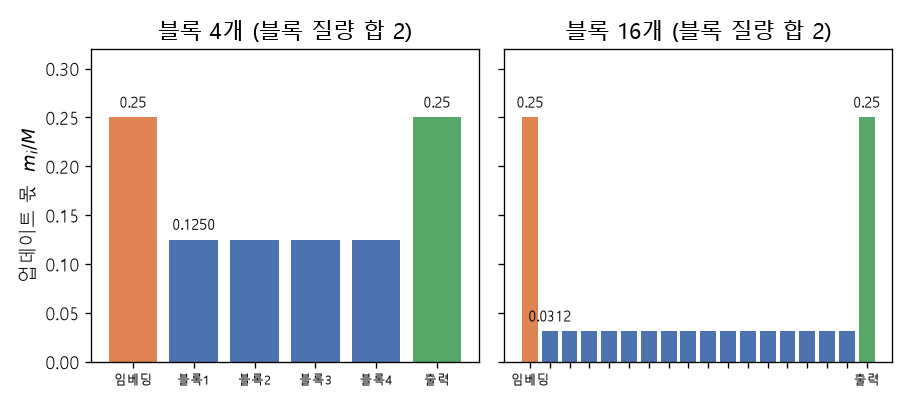
*▲ 직접 그린 그림: [임베딩](00_%EB%94%A5%EB%9F%AC%EB%8B%9D_%EC%9A%A9%EC%96%B4%EC%82%AC%EC%A0%84.md#embedding-%EC%9E%84%EB%B2%A0%EB%94%A9) 1, 블록 질량 합 2, 출력 1일 때 전체 업데이트에서 각 모듈이 받는 몫 $m_i / M$. 블록 4개면 0.125씩, 16개면 0.03125씩이고 [임베딩](00_%EB%94%A5%EB%9F%AC%EB%8B%9D_%EC%9A%A9%EC%96%B4%EC%82%AC%EC%A0%84.md#embedding-%EC%9E%84%EB%B2%A0%EB%94%A9)·출력의 0.25는 그대로다*

질의응답 정리 [40:43](https://youtu.be/zBvsoxC6tAo?t=2443)

- **질량은 어떻게 정하나? 블록의 [표현력](00_%EB%94%A5%EB%9F%AC%EB%8B%9D_%EC%9A%A9%EC%96%B4%EC%82%AC%EC%A0%84.md#representational-power-%ED%91%9C%ED%98%84%EB%A0%A5) 같은 것을 뜻하나?** 질량은 [학습](00_%EB%94%A5%EB%9F%AC%EB%8B%9D_%EC%9A%A9%EC%96%B4%EC%82%AC%EC%A0%84.md#training-%ED%95%99%EC%8A%B5) 중 그 블록이 자기가 속한 상위 모듈의 특징에 얼마나 영향을 주는지 정합니다. 이론적으로 없앨 방법을 찾지 못한 자유도라 조정해야 합니다.

### 7.3 연결

▶ 영상 [41:51](https://youtu.be/zBvsoxC6tAo?t=2511)

병렬로 놓는 연결 $M = (M_1, M_2)$는 비슷하지만 서로를 지나가지 않으므로 민감도 결합이 없어 더 단순합니다. 이 정의들의 요점은 **[노름](00_%EB%94%A5%EB%9F%AC%EB%8B%9D_%EC%9A%A9%EC%96%B4%EC%82%AC%EC%A0%84.md#norm-%EB%85%B8%EB%A6%84)이 잘 맞는 두 모듈을 합성(또는 연결)하면 결과도 [노름](00_%EB%94%A5%EB%9F%AC%EB%8B%9D_%EC%9A%A9%EC%96%B4%EC%82%AC%EC%A0%84.md#norm-%EB%85%B8%EB%A6%84)이 잘 맞는다**는 것을 증명할 수 있다는 데 있습니다.

$$
M.\mathrm{mass} = m_1 + m_2, \quad M.\mathrm{sensitivity} = s_1 + s_2, \quad M.\mathrm{norm}(w_1, w_2) = \max\Big(\frac{M.\mathrm{mass}}{m_1}\lVert w_1 \rVert_{M_1},\ \frac{M.\mathrm{mass}}{m_2}\lVert w_2 \rVert_{M_2}\Big)
$$

기호 풀이

| 기호 | 읽는 법 | 뜻 | 예제 값 |
| --- | --- | --- | --- |
| $(M_1, M_2)$ | 튜플 | 같은 입력을 받아 나란히 출력하는 두 모듈 | |
| $m_1, m_2$ | 질량 | 각 모듈의 질량 | 1, 3 |
| $s_1 + s_2$ | 민감도 합 | 흔들림이 두 갈래로 나간다 | 1 + 1 = 2 |
| $M.\mathrm{mass}/m_i$ | 질량 비율 | [노름](00_%EB%94%A5%EB%9F%AC%EB%8B%9D_%EC%9A%A9%EC%96%B4%EC%82%AC%EC%A0%84.md#norm-%EB%85%B8%EB%A6%84) 앞 계수 | 4, 1.3333 |
| $M.\mathrm{norm}$ | 모듈러 [노름](00_%EB%94%A5%EB%9F%AC%EB%8B%9D_%EC%9A%A9%EC%96%B4%EC%82%AC%EC%A0%84.md#norm-%EB%85%B8%EB%A6%84) | 연결 모듈 전체 [가중치](00_%EB%94%A5%EB%9F%AC%EB%8B%9D_%EC%9A%A9%EC%96%B4%EC%82%AC%EC%A0%84.md#weight-%EA%B0%80%EC%A4%91%EC%B9%98)의 크기 | 1.6 |

예제와 풀이

**문제**: 질량 1([노름](00_%EB%94%A5%EB%9F%AC%EB%8B%9D_%EC%9A%A9%EC%96%B4%EC%82%AC%EC%A0%84.md#norm-%EB%85%B8%EB%A6%84) 0.4)과 질량 3([노름](00_%EB%94%A5%EB%9F%AC%EB%8B%9D_%EC%9A%A9%EC%96%B4%EC%82%AC%EC%A0%84.md#norm-%EB%85%B8%EB%A6%84) 0.3)인 두 모듈(민감도 모두 1)을 병렬로 연결하면 질량, 민감도, [노름](00_%EB%94%A5%EB%9F%AC%EB%8B%9D_%EC%9A%A9%EC%96%B4%EC%82%AC%EC%A0%84.md#norm-%EB%85%B8%EB%A6%84)은?

**주어진 값**
- $m_1 = 1$, $m_2 = 3$ (질량)
- $s_1 = s_2 = 1$ (민감도)
- $\lVert w_1 \rVert = 0.4$, $\lVert w_2 \rVert = 0.3$ ([노름](00_%EB%94%A5%EB%9F%AC%EB%8B%9D_%EC%9A%A9%EC%96%B4%EC%82%AC%EC%A0%84.md#norm-%EB%85%B8%EB%A6%84))

**풀이**
1. 식을 그대로 쓴다: $M.\mathrm{mass} = m_1 + m_2$, $M.\mathrm{sensitivity} = s_1 + s_2$, $M.\mathrm{norm} = \max\big(\frac{M.\mathrm{mass}}{m_1}\lVert w_1 \rVert,\ \frac{M.\mathrm{mass}}{m_2}\lVert w_2 \rVert\big)$
2. 질량에 대입한다: $1 + 3 = 4$
3. 민감도에 대입한다: $1 + 1 = 2$
4. [노름](00_%EB%94%A5%EB%9F%AC%EB%8B%9D_%EC%9A%A9%EC%96%B4%EC%82%AC%EC%A0%84.md#norm-%EB%85%B8%EB%A6%84)에 대입한다: $\max\big(\frac{4}{1} \times 0.4,\ \frac{4}{3} \times 0.3\big)$
5. 나눗셈을 한다: $4 \div 1 = 4$, $4 \div 3 = 1.3333$ 이므로 $\max(4 \times 0.4,\ 1.3333 \times 0.3)$
6. 곱셈을 한다: $4 \times 0.4 = 1.6$, $1.3333 \times 0.3 = 0.4$ 이므로 $\max(1.6, 0.4)$
7. 큰 쪽을 고른다: $1.6$

**답**: 질량 **4**, 민감도 **2**, [노름](00_%EB%94%A5%EB%9F%AC%EB%8B%9D_%EC%9A%A9%EC%96%B4%EC%82%AC%EC%A0%84.md#norm-%EB%85%B8%EB%A6%84) **1.6**.

내 이해

### 7.4 2차까지: 날카로움

▶ 영상 [42:24](https://youtu.be/zBvsoxC6tAo?t=2544)

이 이론은 2차까지 확장됩니다. 모듈의 2차 [미분](00_%EB%94%A5%EB%9F%AC%EB%8B%9D_%EC%9A%A9%EC%96%B4%EC%82%AC%EC%A0%84.md#derivative-%EB%AF%B8%EB%B6%84)이 [가중치](00_%EB%94%A5%EB%9F%AC%EB%8B%9D_%EC%9A%A9%EC%96%B4%EC%82%AC%EC%A0%84.md#weight-%EA%B0%80%EC%A4%91%EC%B9%98) [노름](00_%EB%94%A5%EB%9F%AC%EB%8B%9D_%EC%9A%A9%EC%96%B4%EC%82%AC%EC%A0%84.md#norm-%EB%85%B8%EB%A6%84)·입력 [노름](00_%EB%94%A5%EB%9F%AC%EB%8B%9D_%EC%9A%A9%EC%96%B4%EC%82%AC%EC%A0%84.md#norm-%EB%85%B8%EB%A6%84)에 대해 유계이면 모듈이 **$(\alpha, \beta, \gamma)$-날카롭다**고 합니다. 모듈은 인자가 둘([가중치](00_%EB%94%A5%EB%9F%AC%EB%8B%9D_%EC%9A%A9%EC%96%B4%EC%82%AC%EC%A0%84.md#weight-%EA%B0%80%EC%A4%91%EC%B9%98), 입력)이라 [날카로움](00_%EB%94%A5%EB%9F%AC%EB%8B%9D_%EC%9A%A9%EC%96%B4%EC%82%AC%EC%A0%84.md#sharpness-%EB%82%A0%EC%B9%B4%EB%A1%9C%EC%9B%80) 계수가 셋입니다: [가중치](00_%EB%94%A5%EB%9F%AC%EB%8B%9D_%EC%9A%A9%EC%96%B4%EC%82%AC%EC%A0%84.md#weight-%EA%B0%80%EC%A4%91%EC%B9%98)만 바꿀 때($\alpha$), [가중치](00_%EB%94%A5%EB%9F%AC%EB%8B%9D_%EC%9A%A9%EC%96%B4%EC%82%AC%EC%A0%84.md#weight-%EA%B0%80%EC%A4%91%EC%B9%98)와 입력을 함께 바꿀 때($\beta$), 입력만 바꿀 때($\gamma$).

- 이것은 "일반화된 최대 [고윳값](00_%EB%94%A5%EB%9F%AC%EB%8B%9D_%EC%9A%A9%EC%96%B4%EC%82%AC%EC%A0%84.md#eigenvector-eigenvalue-%EA%B3%A0%EC%9C%A0%EB%B2%A1%ED%84%B0%EC%99%80-%EA%B3%A0%EC%9C%B3%EA%B0%92)"입니다. 딥러닝에서 흔히 말하는 [헤세 행렬](00_%EB%94%A5%EB%9F%AC%EB%8B%9D_%EC%9A%A9%EC%96%B4%EC%82%AC%EC%A0%84.md#hessian-%ED%97%A4%EC%84%B8-%ED%96%89%EB%A0%AC)의 [날카로움](00_%EB%94%A5%EB%9F%AC%EB%8B%9D_%EC%9A%A9%EC%96%B4%EC%82%AC%EC%A0%84.md#sharpness-%EB%82%A0%EC%B9%B4%EB%A1%9C%EC%9B%80)은 가장 큰 고윳값인데, 그것은 **유클리드** 상수입니다. [가중치](00_%EB%94%A5%EB%9F%AC%EB%8B%9D_%EC%9A%A9%EC%96%B4%EC%82%AC%EC%A0%84.md#weight-%EA%B0%80%EC%A4%91%EC%B9%98) 공간의 기하가 유클리드라고 믿지 않으면 최대 [고윳값](00_%EB%94%A5%EB%9F%AC%EB%8B%9D_%EC%9A%A9%EC%96%B4%EC%82%AC%EC%A0%84.md#eigenvector-eigenvalue-%EA%B3%A0%EC%9C%A0%EB%B2%A1%ED%84%B0%EC%99%80-%EA%B3%A0%EC%9C%B3%EA%B0%92)에 신경 쓸 이유도 없고, 일반화된 개념이 필요합니다. [날카로움](00_%EB%94%A5%EB%9F%AC%EB%8B%9D_%EC%9A%A9%EC%96%B4%EC%82%AC%EC%A0%84.md#sharpness-%EB%82%A0%EC%B9%B4%EB%A1%9C%EC%9B%80)
- [노름](00_%EB%94%A5%EB%9F%AC%EB%8B%9D_%EC%9A%A9%EC%96%B4%EC%82%AC%EC%A0%84.md#norm-%EB%85%B8%EB%A6%84)이 잘 맞고 [날카로움](00_%EB%94%A5%EB%9F%AC%EB%8B%9D_%EC%9A%A9%EC%96%B4%EC%82%AC%EC%A0%84.md#sharpness-%EB%82%A0%EC%B9%B4%EB%A1%9C%EC%9B%80) 계수를 가진 모듈을 합성·연결하면 새 계수가 자동으로 정해지고, 이것으로 전체 [손실](00_%EB%94%A5%EB%9F%AC%EB%8B%9D_%EC%9A%A9%EC%96%B4%EC%82%AC%EC%A0%84.md#loss-function-%EC%86%90%EC%8B%A4-%ED%95%A8%EC%88%98)이 모듈러 [노름](00_%EB%94%A5%EB%9F%AC%EB%8B%9D_%EC%9A%A9%EC%96%B4%EC%82%AC%EC%A0%84.md#norm-%EB%85%B8%EB%A6%84)에서 립시츠 매끄럽다는 것을 보일 수 있습니다(립시츠 상수도 무차원).

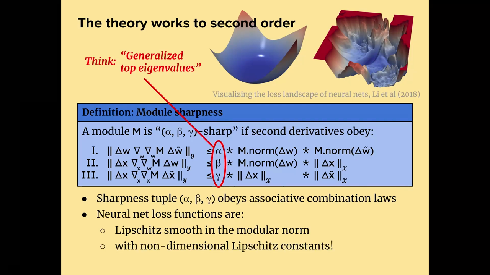
*▲ 강의 슬라이드 [44:10](https://youtu.be/zBvsoxC6tAo?t=2650): 모듈 [날카로움](00_%EB%94%A5%EB%9F%AC%EB%8B%9D_%EC%9A%A9%EC%96%B4%EC%82%AC%EC%A0%84.md#sharpness-%EB%82%A0%EC%B9%B4%EB%A1%9C%EC%9B%80)의 정의. [가중치](00_%EB%94%A5%EB%9F%AC%EB%8B%9D_%EC%9A%A9%EC%96%B4%EC%82%AC%EC%A0%84.md#weight-%EA%B0%80%EC%A4%91%EC%B9%98)-가중치($\alpha$), [가중치](00_%EB%94%A5%EB%9F%AC%EB%8B%9D_%EC%9A%A9%EC%96%B4%EC%82%AC%EC%A0%84.md#weight-%EA%B0%80%EC%A4%91%EC%B9%98)-입력($\beta$), 입력-입력($\gamma$) 세 계수가 조합 법칙을 따르고, [손실](00_%EB%94%A5%EB%9F%AC%EB%8B%9D_%EC%9A%A9%EC%96%B4%EC%82%AC%EC%A0%84.md#loss-function-%EC%86%90%EC%8B%A4-%ED%95%A8%EC%88%98)은 모듈러 [노름](00_%EB%94%A5%EB%9F%AC%EB%8B%9D_%EC%9A%A9%EC%96%B4%EC%82%AC%EC%A0%84.md#norm-%EB%85%B8%EB%A6%84)에서 무차원 상수로 립시츠 매끄럽다*

---

## 8. 스케일링에 적용하기

▶ 영상 [44:05](https://youtu.be/zBvsoxC6tAo?t=2645)

📐 **수학 개념**: [스펙트럼 노름과 RMS 연산자 노름](%EC%88%98%ED%95%99%EA%B0%9C%EB%85%90/09_%EC%B5%9C%EC%A0%81%ED%99%94%EC%9D%98_%EA%B8%B0%ED%95%98/MM28_%EC%8A%A4%ED%8E%99%ED%8A%B8%EB%9F%BC_%EB%85%B8%EB%A6%84%EA%B3%BC_RMS_%EC%97%B0%EC%82%B0%EC%9E%90_%EB%85%B8%EB%A6%84.md) · [곱의 극한과 잔차 배율](%EC%88%98%ED%95%99%EA%B0%9C%EB%85%90/09_%EC%B5%9C%EC%A0%81%ED%99%94%EC%9D%98_%EA%B8%B0%ED%95%98/MM29_%EA%B3%B1%EC%9D%98_%EA%B7%B9%ED%95%9C%EA%B3%BC_%EC%9E%94%EC%B0%A8_%EB%B0%B0%EC%9C%A8.md) · [모듈러 노름의 조합 규칙](%EC%88%98%ED%95%99%EA%B0%9C%EB%85%90/09_%EC%B5%9C%EC%A0%81%ED%99%94%EC%9D%98_%EA%B8%B0%ED%95%98/MM78_%EB%AA%A8%EB%93%88%EB%9F%AC_%EB%85%B8%EB%A6%84%EC%9D%98_%EC%A1%B0%ED%95%A9_%EA%B7%9C%EC%B9%99.md)

### 8.1 좋은 스케일링에 대한 주장

▶ 영상 [44:42](https://youtu.be/zBvsoxC6tAo?t=2682)

큰 슈퍼컴퓨터로 모든 데이터를 긁어 아주 큰 [트랜스포머](00_%EB%94%A5%EB%9F%AC%EB%8B%9D_%EC%9A%A9%EC%96%B4%EC%82%AC%EC%A0%84.md#transformer-%ED%8A%B8%EB%9E%9C%EC%8A%A4%ED%8F%AC%EB%A8%B8)를 학습하는 것이 지금의 처방입니다(위키백과에 따르면 뉴런이 가장 많은 동물은 아프리카코끼리라는 농담과 함께). 그런데 규모를 키우면 [학습](00_%EB%94%A5%EB%9F%AC%EB%8B%9D_%EC%9A%A9%EC%96%B4%EC%82%AC%EC%A0%84.md#training-%ED%95%99%EC%8A%B5) 성질이 표류합니다. 너비를 키우면 성능은 좋아지지만 최적 걸음 크기가 옮겨 가고, 깊이를 잘못 키우면 성능이 오히려 나빠지기도 합니다.

강사 팀의 **주장**(정리가 아니라 "우리 생각"이라 thesis라고 부름):

> 신경망의 립시츠 상수가 (1) **무차원**(너비, 깊이 등 규모를 바꿔도 일정)이고 (2) **딱 맞으며**(헐거운 쓸모없는 상한이 아님, 그리고 그 딱 맞는 정도가 규모와 상관없음), 그 [노름](00_%EB%94%A5%EB%9F%AC%EB%8B%9D_%EC%9A%A9%EC%96%B4%EC%82%AC%EC%A0%84.md#norm-%EB%85%B8%EB%A6%84)으로 업데이트를 정규화하면 좋은 스케일링([학습률 전이](00_%EB%94%A5%EB%9F%AC%EB%8B%9D_%EC%9A%A9%EC%96%B4%EC%82%AC%EC%A0%84.md#hyperparameter-transfer-%ED%95%98%EC%9D%B4%ED%8D%BC%ED%8C%8C%EB%9D%BC%EB%AF%B8%ED%84%B0-%EC%A0%84%EC%9D%B4))을 얻는다.

예를 들어 신경망이 **1-립시츠**면(1은 대표적인 무차원 수), [가중치](00_%EB%94%A5%EB%9F%AC%EB%8B%9D_%EC%9A%A9%EC%96%B4%EC%82%AC%EC%A0%84.md#weight-%EA%B0%80%EC%A4%91%EC%B9%98) 업데이트의 [노름](00_%EB%94%A5%EB%9F%AC%EB%8B%9D_%EC%9A%A9%EC%96%B4%EC%82%AC%EC%A0%84.md#norm-%EB%85%B8%EB%A6%84)을 조절하는 것만으로 출력 변화의 [노름](00_%EB%94%A5%EB%9F%AC%EB%8B%9D_%EC%9A%A9%EC%96%B4%EC%82%AC%EC%A0%84.md#norm-%EB%85%B8%EB%A6%84)을 예측할 수 있습니다. 강사는 좋은 스케일링 자체는 어렵지 않고, 사람들이 립시츠 성질을 잘 이해하지 못하는 것이 문제라고 말합니다.

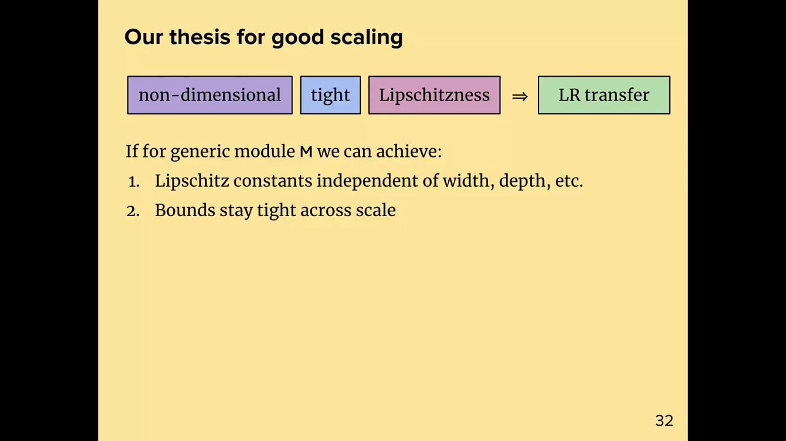
*▲ 강의 슬라이드 [47:10](https://youtu.be/zBvsoxC6tAo?t=2830): 좋은 스케일링에 대한 주장. 무차원 + 딱 맞는 + 립시츠 → [학습률](00_%EB%94%A5%EB%9F%AC%EB%8B%9D_%EC%9A%A9%EC%96%B4%EC%82%AC%EC%A0%84.md#learning-rate-%ED%95%99%EC%8A%B5%EB%A5%A0) 전이*

### 8.2 Modula 패키지와 실험

▶ 영상 [48:04](https://youtu.be/zBvsoxC6tAo?t=2884)

문제를 두 조각으로 나눴습니다. [층](00_%EB%94%A5%EB%9F%AC%EB%8B%9D_%EC%9A%A9%EC%96%B4%EC%82%AC%EC%A0%84.md#layer-%EC%B8%B5) 하나의 좋은 성질은 무엇인가(숙제의 크기를 맞춘 [스펙트럼 노름](00_%EB%94%A5%EB%9F%AC%EB%8B%9D_%EC%9A%A9%EC%96%B4%EC%82%AC%EC%A0%84.md#spectral-norm-%EC%8A%A4%ED%8E%99%ED%8A%B8%EB%9F%BC-%EB%85%B8%EB%A6%84)), 그리고 그 성질을 합성·연결에서 어떻게 지키나(모듈러 [노름](00_%EB%94%A5%EB%9F%AC%EB%8B%9D_%EC%9A%A9%EC%96%B4%EC%82%AC%EC%A0%84.md#norm-%EB%85%B8%EB%A6%84) 논문, Large·Liu·Huh·Bahng·Isola·Bernstein 2024).

- 이 규칙들은 모두 프로그래밍할 수 있어서 **Modula** 패키지(아직 만드는 중)로 구현했습니다. [층](00_%EB%94%A5%EB%9F%AC%EB%8B%9D_%EC%9A%A9%EC%96%B4%EC%82%AC%EC%A0%84.md#layer-%EC%B8%B5)과 [비선형성](00_%EB%94%A5%EB%9F%AC%EB%8B%9D_%EC%9A%A9%EC%96%B4%EC%82%AC%EC%A0%84.md#nonlinearity-%EB%B9%84%EC%84%A0%ED%98%95%EC%84%B1)을 조합해 MLP를 만들면 그것이 화합물 모듈이 되고, forward와 함께 **[가중치](00_%EB%94%A5%EB%9F%AC%EB%8B%9D_%EC%9A%A9%EC%96%B4%EC%82%AC%EC%A0%84.md#weight-%EA%B0%80%EC%A4%91%EC%B9%98) 공간의 [노름](00_%EB%94%A5%EB%9F%AC%EB%8B%9D_%EC%9A%A9%EC%96%B4%EC%82%AC%EC%A0%84.md#norm-%EB%85%B8%EB%A6%84)과 [정규화](00_%EB%94%A5%EB%9F%AC%EB%8B%9D_%EC%9A%A9%EC%96%B4%EC%82%AC%EC%A0%84.md#normalization-%EC%A0%95%EA%B7%9C%ED%99%94) 함수**가 자동으로 생깁니다. [PyTorch](00_%EB%94%A5%EB%9F%AC%EB%8B%9D_%EC%9A%A9%EC%96%B4%EC%82%AC%EC%A0%84.md#pytorch-%ED%8C%8C%EC%9D%B4%ED%86%A0%EC%B9%98), JAX, NumPy 위에 얹을 수 있습니다.
- **너비 실험**(OpenWebText로 [GPT](00_%EB%94%A5%EB%9F%AC%EB%8B%9D_%EC%9A%A9%EC%96%B4%EC%82%AC%EC%A0%84.md#gpt-%EC%83%9D%EC%84%B1%ED%98%95-%EC%82%AC%EC%A0%84%ED%95%99%EC%8A%B5-%ED%8A%B8%EB%9E%9C%EC%8A%A4%ED%8F%AC%EB%A8%B8)를 1만 걸음 [학습](00_%EB%94%A5%EB%9F%AC%EB%8B%9D_%EC%9A%A9%EC%96%B4%EC%82%AC%EC%A0%84.md#training-%ED%95%99%EC%8A%B5), 기본 [옵티마이저](00_%EB%94%A5%EB%9F%AC%EB%8B%9D_%EC%9A%A9%EC%96%B4%EC%82%AC%EC%A0%84.md#optimizer-%EC%98%B5%ED%8B%B0%EB%A7%88%EC%9D%B4%EC%A0%80)는 [Adam](00_%EB%94%A5%EB%9F%AC%EB%8B%9D_%EC%9A%A9%EC%96%B4%EC%82%AC%EC%A0%84.md#adam-%EC%95%84%EB%8B%B4-%EC%98%B5%ED%8B%B0%EB%A7%88%EC%9D%B4%EC%A0%80)): 왼쪽 nanoGPT 그대로는 너비를 바꾸면 최적 [학습률](00_%EB%94%A5%EB%9F%AC%EB%8B%9D_%EC%9A%A9%EC%96%B4%EC%82%AC%EC%A0%84.md#learning-rate-%ED%95%99%EC%8A%B5%EB%A5%A0)이 표류합니다. 가운데는 립시츠가 되도록 구조를 조금 고친 자체 [트랜스포머](00_%EB%94%A5%EB%9F%AC%EB%8B%9D_%EC%9A%A9%EC%96%B4%EC%82%AC%EC%A0%84.md#transformer-%ED%8A%B8%EB%9E%9C%EC%8A%A4%ED%8F%AC%EB%A8%B8), 오른쪽은 거기에 모듈러 [노름](00_%EB%94%A5%EB%9F%AC%EB%8B%9D_%EC%9A%A9%EC%96%B4%EC%82%AC%EC%A0%84.md#norm-%EB%85%B8%EB%A6%84) [정규화](00_%EB%94%A5%EB%9F%AC%EB%8B%9D_%EC%9A%A9%EC%96%B4%EC%82%AC%EC%A0%84.md#normalization-%EC%A0%95%EA%B7%9C%ED%99%94)를 더한 것으로, **표류가 고쳐집니다**.
- **깊이 실험**: nanoGPT도 깊이에는 그럭저럭 괜찮지만 조금 지저분합니다. [정규화](00_%EB%94%A5%EB%9F%AC%EB%8B%9D_%EC%9A%A9%EC%96%B4%EC%82%AC%EC%A0%84.md#normalization-%EC%A0%95%EA%B7%9C%ED%99%94) 없이도 [Adam](00_%EB%94%A5%EB%9F%AC%EB%8B%9D_%EC%9A%A9%EC%96%B4%EC%82%AC%EC%A0%84.md#adam-%EC%95%84%EB%8B%B4-%EC%98%B5%ED%8B%B0%EB%A7%88%EC%9D%B4%EC%A0%80)이 우연히 깊이 스케일링을 꽤 잘하고, [정규화](00_%EB%94%A5%EB%9F%AC%EB%8B%9D_%EC%9A%A9%EC%96%B4%EC%82%AC%EC%A0%84.md#normalization-%EC%A0%95%EA%B7%9C%ED%99%94)를 더해도 거의 그대로입니다. 강사는 직관으로 알던 스케일링 방법을 이론으로 만든 것이라 잘될 줄 알았다고 말합니다([Lec07 9절](Lec07_%EC%B5%9C%EC%A0%81%ED%99%94%EC%9D%98_%EC%8A%A4%EC%BC%80%EC%9D%BC%EB%A7%81_%EA%B7%9C%EC%B9%99.md#9-%EA%B9%8A%EC%9D%B4-%EC%8A%A4%EC%BC%80%EC%9D%BC%EB%A7%81)의 [블록 배율](00_%EB%94%A5%EB%9F%AC%EB%8B%9D_%EC%9A%A9%EC%96%B4%EC%82%AC%EC%A0%84.md#block-multiplier-%EB%B8%94%EB%A1%9D-%EB%B0%B0%EC%9C%A8)과 [μP](00_%EB%94%A5%EB%9F%AC%EB%8B%9D_%EC%9A%A9%EC%96%B4%EC%82%AC%EC%A0%84.md#maximal-update-parameterization-%CE%BCp-%EC%B5%9C%EB%8C%80-%EC%97%85%EB%8D%B0%EC%9D%B4%ED%8A%B8-%EB%A7%A4%EA%B0%9C%EB%B3%80%EC%88%98%ED%99%94)도 같은 문제를 다룸).

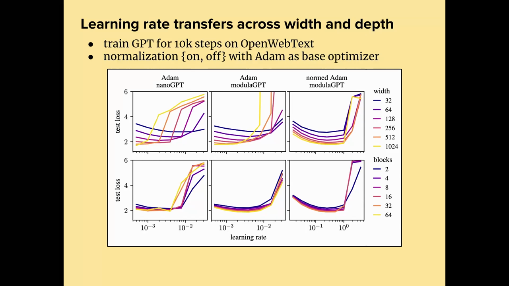
*▲ 강의 슬라이드 [52:50](https://youtu.be/zBvsoxC6tAo?t=3170): 너비(위)와 깊이(아래)를 건너는 [학습률](00_%EB%94%A5%EB%9F%AC%EB%8B%9D_%EC%9A%A9%EC%96%B4%EC%82%AC%EC%A0%84.md#learning-rate-%ED%95%99%EC%8A%B5%EB%A5%A0) 전이. 왼쪽 [Adam](00_%EB%94%A5%EB%9F%AC%EB%8B%9D_%EC%9A%A9%EC%96%B4%EC%82%AC%EC%A0%84.md#adam-%EC%95%84%EB%8B%B4-%EC%98%B5%ED%8B%B0%EB%A7%88%EC%9D%B4%EC%A0%80) + nanoGPT, 가운데 [Adam](00_%EB%94%A5%EB%9F%AC%EB%8B%9D_%EC%9A%A9%EC%96%B4%EC%82%AC%EC%A0%84.md#adam-%EC%95%84%EB%8B%B4-%EC%98%B5%ED%8B%B0%EB%A7%88%EC%9D%B4%EC%A0%80) + modulaGPT, 오른쪽 정규화한 [Adam](00_%EB%94%A5%EB%9F%AC%EB%8B%9D_%EC%9A%A9%EC%96%B4%EC%82%AC%EC%A0%84.md#adam-%EC%95%84%EB%8B%B4-%EC%98%B5%ED%8B%B0%EB%A7%88%EC%9D%B4%EC%A0%80) + modulaGPT*

질의응답 정리 [50:57](https://youtu.be/zBvsoxC6tAo?t=3057)

- **[정규화](00_%EB%94%A5%EB%9F%AC%EB%8B%9D_%EC%9A%A9%EC%96%B4%EC%82%AC%EC%A0%84.md#normalization-%EC%A0%95%EA%B7%9C%ED%99%94)는 결국 [학습률](00_%EB%94%A5%EB%9F%AC%EB%8B%9D_%EC%9A%A9%EC%96%B4%EC%82%AC%EC%A0%84.md#learning-rate-%ED%95%99%EC%8A%B5%EB%A5%A0)을 바꾸는 것 아닌가?** 그렇게 볼 수 있습니다. 다만 [기울기](00_%EB%94%A5%EB%9F%AC%EB%8B%9D_%EC%9A%A9%EC%96%B4%EC%82%AC%EC%A0%84.md#gradient-%EA%B8%B0%EC%9A%B8%EA%B8%B0) 자체에 따라, 그리고 **아키텍처에 따라** [학습률](00_%EB%94%A5%EB%9F%AC%EB%8B%9D_%EC%9A%A9%EC%96%B4%EC%82%AC%EC%A0%84.md#learning-rate-%ED%95%99%EC%8A%B5%EB%A5%A0)을 바꿉니다. [층](00_%EB%94%A5%EB%9F%AC%EB%8B%9D_%EC%9A%A9%EC%96%B4%EC%82%AC%EC%A0%84.md#layer-%EC%B8%B5)마다 [기울기](00_%EB%94%A5%EB%9F%AC%EB%8B%9D_%EC%9A%A9%EC%96%B4%EC%82%AC%EC%A0%84.md#gradient-%EA%B8%B0%EC%9A%B8%EA%B8%B0)가 다른 배율로 조정됩니다. [학습률](00_%EB%94%A5%EB%9F%AC%EB%8B%9D_%EC%9A%A9%EC%96%B4%EC%82%AC%EC%A0%84.md#learning-rate-%ED%95%99%EC%8A%B5%EB%A5%A0)은 그 전체 과정의 배율입니다.

---

## 9. 모듈러 쌍대성

▶ 영상 [52:43](https://youtu.be/zBvsoxC6tAo?t=3163)

📐 **수학 개념**: [노름에 따른 최급강하법](%EC%88%98%ED%95%99%EA%B0%9C%EB%85%90/09_%EC%B5%9C%EC%A0%81%ED%99%94%EC%9D%98_%EA%B8%B0%ED%95%98/MM27_%EB%85%B8%EB%A6%84%EC%97%90_%EB%94%B0%EB%A5%B8_%EC%B5%9C%EA%B8%89%EA%B0%95%ED%95%98%EB%B2%95.md) · [뉴턴-슐츠 반복과 직교화](%EC%88%98%ED%95%99%EA%B0%9C%EB%85%90/09_%EC%B5%9C%EC%A0%81%ED%99%94%EC%9D%98_%EA%B8%B0%ED%95%98/MM79_%EB%89%B4%ED%84%B4_%EC%8A%90%EC%B8%A0_%EB%B0%98%EB%B3%B5%EA%B3%BC_%EC%A7%81%EA%B5%90%ED%99%94.md) · [코시-슈바르츠와 립시츠 매끄러움](%EC%88%98%ED%95%99%EA%B0%9C%EB%85%90/09_%EC%B5%9C%EC%A0%81%ED%99%94%EC%9D%98_%EA%B8%B0%ED%95%98/MM77_%EC%BD%94%EC%8B%9C_%EC%8A%88%EB%B0%94%EB%A5%B4%EC%B8%A0%EC%99%80_%EB%A6%BD%EC%8B%9C%EC%B8%A0_%EB%A7%A4%EB%81%84%EB%9F%AC%EC%9B%80.md)

### 9.1 걸음 크기와 쌍대 사상

▶ 영상 [53:22](https://youtu.be/zBvsoxC6tAo?t=3202)

강사가 지금 가장 흥미를 느끼는 주제이고, 큰 [학습](00_%EB%94%A5%EB%9F%AC%EB%8B%9D_%EC%9A%A9%EC%96%B4%EC%82%AC%EC%A0%84.md#training-%ED%95%99%EC%8A%B5) 속도 향상으로 이어진 아이디어입니다. 목적 함수의 선형화 [오차](00_%EB%94%A5%EB%9F%AC%EB%8B%9D_%EC%9A%A9%EC%96%B4%EC%82%AC%EC%A0%84.md#error-%EC%98%A4%EC%B0%A8)를 위에서 누르는 [노름](00_%EB%94%A5%EB%9F%AC%EB%8B%9D_%EC%9A%A9%EC%96%B4%EC%82%AC%EC%A0%84.md#norm-%EB%85%B8%EB%A6%84)이 있다면, 숙제에서 했듯이 최급강하 걸음은 [argmin](00_%EB%94%A5%EB%9F%AC%EB%8B%9D_%EC%9A%A9%EC%96%B4%EC%82%AC%EC%A0%84.md#argmin-%EC%B5%9C%EC%86%9F%EA%B0%92-%EC%9C%84%EC%B9%98) 문제의 해이고, 그 해는 두 조각으로 나뉩니다.

- **걸음 크기**: [쌍대 노름](00_%EB%94%A5%EB%9F%AC%EB%8B%9D_%EC%9A%A9%EC%96%B4%EC%82%AC%EC%A0%84.md#dual-norm-%EC%8C%8D%EB%8C%80-%EB%85%B8%EB%A6%84) $\lVert \nabla_w \mathcal{L} \rVert_\ast / \lambda$
- **[쌍대 사상](00_%EB%94%A5%EB%9F%AC%EB%8B%9D_%EC%9A%A9%EC%96%B4%EC%82%AC%EC%A0%84.md#duality-map-modular-dualization-%EC%8C%8D%EB%8C%80-%EC%82%AC%EC%83%81%EA%B3%BC-%EB%AA%A8%EB%93%88%EB%9F%AC-%EC%8C%8D%EB%8C%80%ED%99%94)**(duality map): 단위 [노름](00_%EB%94%A5%EB%9F%AC%EB%8B%9D_%EC%9A%A9%EC%96%B4%EC%82%AC%EC%A0%84.md#norm-%EB%85%B8%EB%A6%84) 벡터 가운데 선형 개선을 가장 크게 하는 것, $\arg\max_{\lVert \Delta w \rVert = 1} \nabla_w \mathcal{L}^\top \Delta w$

$$
\underset{\Delta w}{\arg\min}\ \Big[\nabla_w \mathcal{L}^\top \Delta w + \frac{\lambda}{2}\lVert \Delta w \rVert^2\Big] = -\frac{\lVert \nabla_w \mathcal{L} \rVert_\ast}{\lambda} \times \underset{\lVert \Delta w \rVert = 1}{\arg\max}\ \nabla_w \mathcal{L}^\top \Delta w
$$

기호 풀이

| 기호 | 읽는 법 | 뜻 | 예제 값 ($G$ = `[[0, 2], [1, 0]]`, [스펙트럼 노름](00_%EB%94%A5%EB%9F%AC%EB%8B%9D_%EC%9A%A9%EC%96%B4%EC%82%AC%EC%A0%84.md#spectral-norm-%EC%8A%A4%ED%8E%99%ED%8A%B8%EB%9F%BC-%EB%85%B8%EB%A6%84)) |
| --- | --- | --- | --- |
| $\nabla_w \mathcal{L}$ | [기울기](00_%EB%94%A5%EB%9F%AC%EB%8B%9D_%EC%9A%A9%EC%96%B4%EC%82%AC%EC%A0%84.md#gradient-%EA%B8%B0%EC%9A%B8%EA%B8%B0) | [가중치](00_%EB%94%A5%EB%9F%AC%EB%8B%9D_%EC%9A%A9%EC%96%B4%EC%82%AC%EC%A0%84.md#weight-%EA%B0%80%EC%A4%91%EC%B9%98) 행렬의 [기울기](00_%EB%94%A5%EB%9F%AC%EB%8B%9D_%EC%9A%A9%EC%96%B4%EC%82%AC%EC%A0%84.md#gradient-%EA%B8%B0%EC%9A%B8%EA%B8%B0) $G$ | `[[0, 2], [1, 0]]` |
| $\lambda$ | 람다 | [날카로움](00_%EB%94%A5%EB%9F%AC%EB%8B%9D_%EC%9A%A9%EC%96%B4%EC%82%AC%EC%A0%84.md#sharpness-%EB%82%A0%EC%B9%B4%EB%A1%9C%EC%9B%80) | 3 |
| $\lVert \nabla_w \mathcal{L} \rVert_\ast$ | [쌍대 노름](00_%EB%94%A5%EB%9F%AC%EB%8B%9D_%EC%9A%A9%EC%96%B4%EC%82%AC%EC%A0%84.md#dual-norm-%EC%8C%8D%EB%8C%80-%EB%85%B8%EB%A6%84) | [스펙트럼 노름](00_%EB%94%A5%EB%9F%AC%EB%8B%9D_%EC%9A%A9%EC%96%B4%EC%82%AC%EC%A0%84.md#spectral-norm-%EC%8A%A4%ED%8E%99%ED%8A%B8%EB%9F%BC-%EB%85%B8%EB%A6%84)의 쌍대 = 특잇값 합(핵 [노름](00_%EB%94%A5%EB%9F%AC%EB%8B%9D_%EC%9A%A9%EC%96%B4%EC%82%AC%EC%A0%84.md#norm-%EB%85%B8%EB%A6%84)) | 2 + 1 = 3 |
| $\lVert \nabla_w \mathcal{L} \rVert_\ast / \lambda$ | 걸음 크기 | 얼마나 멀리 가나 (슬라이드의 보라 상자) | 1 |
| $\arg\max_{\lVert \Delta w \rVert = 1}$ | 쌍대 사상 | 어느 방향으로 가나 = $UV^\top$ | `[[0, 1], [1, 0]]` |
| 왼쪽 [argmin](00_%EB%94%A5%EB%9F%AC%EB%8B%9D_%EC%9A%A9%EC%96%B4%EC%82%AC%EC%A0%84.md#argmin-%EC%B5%9C%EC%86%9F%EA%B0%92-%EC%9C%84%EC%B9%98) | 최급강하 걸음 | 두 조각의 곱에 − | [[0, −1], [−1, 0]] |

예제와 풀이

**문제**: [기울기](00_%EB%94%A5%EB%9F%AC%EB%8B%9D_%EC%9A%A9%EC%96%B4%EC%82%AC%EC%A0%84.md#gradient-%EA%B8%B0%EC%9A%B8%EA%B8%B0) $G = \begin{pmatrix}0&2\\1&0\end{pmatrix}$(특잇값 2, 1), [날카로움](00_%EB%94%A5%EB%9F%AC%EB%8B%9D_%EC%9A%A9%EC%96%B4%EC%82%AC%EC%A0%84.md#sharpness-%EB%82%A0%EC%B9%B4%EB%A1%9C%EC%9B%80) $\lambda = 3$일 때 [스펙트럼 노름](00_%EB%94%A5%EB%9F%AC%EB%8B%9D_%EC%9A%A9%EC%96%B4%EC%82%AC%EC%A0%84.md#spectral-norm-%EC%8A%A4%ED%8E%99%ED%8A%B8%EB%9F%BC-%EB%85%B8%EB%A6%84) 아래 최급강하 걸음은?

**주어진 값**
- $G = \begin{pmatrix}0&2\\1&0\end{pmatrix}$ ([기울기](00_%EB%94%A5%EB%9F%AC%EB%8B%9D_%EC%9A%A9%EC%96%B4%EC%82%AC%EC%A0%84.md#gradient-%EA%B8%B0%EC%9A%B8%EA%B8%B0), 특잇값 2와 1)
- $\lambda = 3$ ([날카로움](00_%EB%94%A5%EB%9F%AC%EB%8B%9D_%EC%9A%A9%EC%96%B4%EC%82%AC%EC%A0%84.md#sharpness-%EB%82%A0%EC%B9%B4%EB%A1%9C%EC%9B%80))
- [스펙트럼 노름](00_%EB%94%A5%EB%9F%AC%EB%8B%9D_%EC%9A%A9%EC%96%B4%EC%82%AC%EC%A0%84.md#spectral-norm-%EC%8A%A4%ED%8E%99%ED%8A%B8%EB%9F%BC-%EB%85%B8%EB%A6%84)의 [쌍대 노름](00_%EB%94%A5%EB%9F%AC%EB%8B%9D_%EC%9A%A9%EC%96%B4%EC%82%AC%EC%A0%84.md#dual-norm-%EC%8C%8D%EB%8C%80-%EB%85%B8%EB%A6%84) = 특잇값 합, 쌍대 사상 = $UV^\top = \begin{pmatrix}0&1\\1&0\end{pmatrix}$ ([MM79_뉴턴_슐츠_반복과_직교화](%EC%88%98%ED%95%99%EA%B0%9C%EB%85%90/09_%EC%B5%9C%EC%A0%81%ED%99%94%EC%9D%98_%EA%B8%B0%ED%95%98/MM79_%EB%89%B4%ED%84%B4_%EC%8A%90%EC%B8%A0_%EB%B0%98%EB%B3%B5%EA%B3%BC_%EC%A7%81%EA%B5%90%ED%99%94.md))

**풀이**
1. 식을 그대로 쓴다: $\Delta w = -\dfrac{\lVert G \rVert_\ast}{\lambda} \times UV^\top$
2. 값을 대입한다: $\Delta w = -\dfrac{2 + 1}{3} \times \begin{pmatrix}0&1\\1&0\end{pmatrix}$
3. 특잇값을 더한다: $2 + 1 = 3$ 이므로 $-\frac{3}{3} \times \begin{pmatrix}0&1\\1&0\end{pmatrix}$
4. 나눗셈을 한다: $3 \div 3 = 1$ 이므로 $-1 \times \begin{pmatrix}0&1\\1&0\end{pmatrix}$
5. 성분마다 −1을 곱한다: $\begin{pmatrix}0&-1\\-1&0\end{pmatrix}$

**답**: $\Delta w = \begin{pmatrix}0&-1\\-1&0\end{pmatrix}$. [기울기](00_%EB%94%A5%EB%9F%AC%EB%8B%9D_%EC%9A%A9%EC%96%B4%EC%82%AC%EC%A0%84.md#gradient-%EA%B8%B0%EC%9A%B8%EA%B8%B0) 그대로라면 두 방향을 2와 1로 다르게 움직였을 것을, 쌍대 사상은 둘 다 1로 움직인다.

내 이해

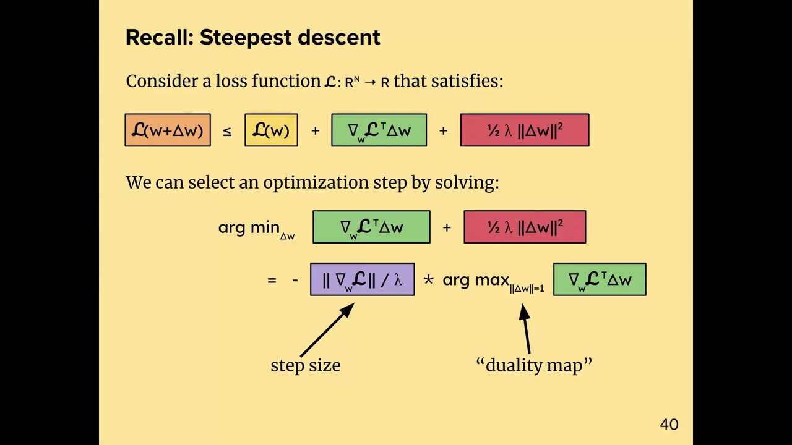
*▲ 강의 슬라이드 [54:50](https://youtu.be/zBvsoxC6tAo?t=3290): 최급강하 걸음 = 걸음 크기([쌍대 노름](00_%EB%94%A5%EB%9F%AC%EB%8B%9D_%EC%9A%A9%EC%96%B4%EC%82%AC%EC%A0%84.md#dual-norm-%EC%8C%8D%EB%8C%80-%EB%85%B8%EB%A6%84) / λ) × 쌍대 사상([argmax](00_%EB%94%A5%EB%9F%AC%EB%8B%9D_%EC%9A%A9%EC%96%B4%EC%82%AC%EC%A0%84.md#argmax-%EC%B5%9C%EB%8C%93%EA%B0%92-%EC%9C%84%EC%B9%98))*

### 9.2 기울기는 타입이 다르다

▶ 영상 [54:37](https://youtu.be/zBvsoxC6tAo?t=3277)

고전 최적화 이론에는 **[기울기](00_%EB%94%A5%EB%9F%AC%EB%8B%9D_%EC%9A%A9%EC%96%B4%EC%82%AC%EC%A0%84.md#gradient-%EA%B8%B0%EC%9A%B8%EA%B8%B0)는 쌍대 벡터, [가중치](00_%EB%94%A5%EB%9F%AC%EB%8B%9D_%EC%9A%A9%EC%96%B4%EC%82%AC%EC%A0%84.md#weight-%EA%B0%80%EC%A4%91%EC%B9%98)는 보통(원시) 벡터**라는 생각이 있습니다. 쌍대 벡터는 보통 벡터를 받아 실수를 내는 선형 사상입니다. [기울기](00_%EB%94%A5%EB%9F%AC%EB%8B%9D_%EC%9A%A9%EC%96%B4%EC%82%AC%EC%A0%84.md#gradient-%EA%B8%B0%EC%9A%B8%EA%B8%B0)가 정말 잘하는 일은 [가중치](00_%EB%94%A5%EB%9F%AC%EB%8B%9D_%EC%9A%A9%EC%96%B4%EC%82%AC%EC%A0%84.md#weight-%EA%B0%80%EC%A4%91%EC%B9%98) 변화와 내적해 **함수의 선형화**를 알려 주는 것뿐이고, 그것만 믿어야 합니다.

- [기울기](00_%EB%94%A5%EB%9F%AC%EB%8B%9D_%EC%9A%A9%EC%96%B4%EC%82%AC%EC%A0%84.md#gradient-%EA%B8%B0%EC%9A%B8%EA%B8%B0)와 [가중치](00_%EB%94%A5%EB%9F%AC%EB%8B%9D_%EC%9A%A9%EC%96%B4%EC%82%AC%EC%A0%84.md#weight-%EA%B0%80%EC%A4%91%EC%B9%98)는 차원이 같아 기술적으로는 더하고 뺄 수 있지만, 그렇게 하는 것은 **타입 검사를 통과하지 못하는** 나쁜 생각입니다. "[가중치](00_%EB%94%A5%EB%9F%AC%EB%8B%9D_%EC%9A%A9%EC%96%B4%EC%82%AC%EC%A0%84.md#weight-%EA%B0%80%EC%A4%91%EC%B9%98) − [학습률](00_%EB%94%A5%EB%9F%AC%EB%8B%9D_%EC%9A%A9%EC%96%B4%EC%82%AC%EC%A0%84.md#learning-rate-%ED%95%99%EC%8A%B5%EB%A5%A0) × [기울기](00_%EB%94%A5%EB%9F%AC%EB%8B%9D_%EC%9A%A9%EC%96%B4%EC%82%AC%EC%A0%84.md#gradient-%EA%B8%B0%EC%9A%B8%EA%B8%B0)"(✗) 대신 "[가중치](00_%EB%94%A5%EB%9F%AC%EB%8B%9D_%EC%9A%A9%EC%96%B4%EC%82%AC%EC%A0%84.md#weight-%EA%B0%80%EC%A4%91%EC%B9%98) − [학습률](00_%EB%94%A5%EB%9F%AC%EB%8B%9D_%EC%9A%A9%EC%96%B4%EC%82%AC%EC%A0%84.md#learning-rate-%ED%95%99%EC%8A%B5%EB%A5%A0) × **dualize**([기울기](00_%EB%94%A5%EB%9F%AC%EB%8B%9D_%EC%9A%A9%EC%96%B4%EC%82%AC%EC%A0%84.md#gradient-%EA%B8%B0%EC%9A%B8%EA%B8%B0))"를 써야 합니다.
- [기울기](00_%EB%94%A5%EB%9F%AC%EB%8B%9D_%EC%9A%A9%EC%96%B4%EC%82%AC%EC%A0%84.md#gradient-%EA%B8%B0%EC%9A%B8%EA%B8%B0) 방향으로 가는 것은 [노름](00_%EB%94%A5%EB%9F%AC%EB%8B%9D_%EC%9A%A9%EC%96%B4%EC%82%AC%EC%A0%84.md#norm-%EB%85%B8%EB%A6%84)이 **유클리드**라고 가정한 것과 같습니다. 신경망의 최적화 공간이 유클리드 구조일 가능성은 낮습니다. [기울기](00_%EB%94%A5%EB%9F%AC%EB%8B%9D_%EC%9A%A9%EC%96%B4%EC%82%AC%EC%A0%84.md#gradient-%EA%B8%B0%EC%9A%B8%EA%B8%B0) 공간은 [가중치](00_%EB%94%A5%EB%9F%AC%EB%8B%9D_%EC%9A%A9%EC%96%B4%EC%82%AC%EC%A0%84.md#weight-%EA%B0%80%EC%A4%91%EC%B9%98) 공간을 늘이고 일그러뜨린 것처럼 볼 수 있어, 빼기 전에 일그러짐을 펴는 절차가 필요합니다.
- 놀랄 일도 아닙니다. 모두 "그냥 [Adam](00_%EB%94%A5%EB%9F%AC%EB%8B%9D_%EC%9A%A9%EC%96%B4%EC%82%AC%EC%A0%84.md#adam-%EC%95%84%EB%8B%B4-%EC%98%B5%ED%8B%B0%EB%A7%88%EC%9D%B4%EC%A0%80)을 쓰라"고 하지 평범한 [경사하강법](00_%EB%94%A5%EB%9F%AC%EB%8B%9D_%EC%9A%A9%EC%96%B4%EC%82%AC%EC%A0%84.md#gradient-descent-%EA%B2%BD%EC%82%AC%ED%95%98%EA%B0%95%EB%B2%95)을 권하지 않습니다. 평범한 [경사하강법](00_%EB%94%A5%EB%9F%AC%EB%8B%9D_%EC%9A%A9%EC%96%B4%EC%82%AC%EC%A0%84.md#gradient-descent-%EA%B2%BD%EC%82%AC%ED%95%98%EA%B0%95%EB%B2%95)에 무언가 문제가 있다는 것은 직관적으로 다 알지만, 정확히 무엇인지 몰랐을 뿐입니다.

질의응답 정리 [56:23](https://youtu.be/zBvsoxC6tAo?t=3383)

- **비선형 최적화라 [기울기](00_%EB%94%A5%EB%9F%AC%EB%8B%9D_%EC%9A%A9%EC%96%B4%EC%82%AC%EC%A0%84.md#gradient-%EA%B8%B0%EC%9A%B8%EA%B8%B0) 걸음이 개선을 보장하지 않아서 문제인가?** 걸음이 충분히 작으면 개선은 됩니다. 다만 아주 **최적이 아닐** 수 있습니다. [argmax](00_%EB%94%A5%EB%9F%AC%EB%8B%9D_%EC%9A%A9%EC%96%B4%EC%82%AC%EC%A0%84.md#argmax-%EC%B5%9C%EB%8C%93%EA%B0%92-%EC%9C%84%EC%B9%98)가 있는 최적화 문제를 푸는 것이라 쌍대 사상은 어떤 최적성 기준을 만족하고, [노름](00_%EB%94%A5%EB%9F%AC%EB%8B%9D_%EC%9A%A9%EC%96%B4%EC%82%AC%EC%A0%84.md#norm-%EB%85%B8%EB%A6%84)을 잘 고르면 그 기준은 우리가 정말 원하는 것이 됩니다.

### 9.3 재귀적 쌍대화

▶ 영상 [58:44](https://youtu.be/zBvsoxC6tAo?t=3524)

신경망 전체의 쌍대 사상은 어떻게 만들까요? [노름](00_%EB%94%A5%EB%9F%AC%EB%8B%9D_%EC%9A%A9%EC%96%B4%EC%82%AC%EC%A0%84.md#norm-%EB%85%B8%EB%A6%84)을 재귀적으로 유도했듯이 **쌍대 사상도 재귀적으로** 만들 수 있습니다. **모듈러 쌍대화**(modular dualization)입니다.

1. [층](00_%EB%94%A5%EB%9F%AC%EB%8B%9D_%EC%9A%A9%EC%96%B4%EC%82%AC%EC%A0%84.md#layer-%EC%B8%B5)마다 쌍대 사상을 풉니다. 숙제에서 [선형층](00_%EB%94%A5%EB%9F%AC%EB%8B%9D_%EC%9A%A9%EC%96%B4%EC%82%AC%EC%A0%84.md#linear-layer-%EC%84%A0%ED%98%95%EC%B8%B5)에 [스펙트럼 노름](00_%EB%94%A5%EB%9F%AC%EB%8B%9D_%EC%9A%A9%EC%96%B4%EC%82%AC%EC%A0%84.md#spectral-norm-%EC%8A%A4%ED%8E%99%ED%8A%B8%EB%9F%BC-%EB%85%B8%EB%A6%84)을 주고 그 쌍대 사상을 푼 것이 바로 이것입니다.
2. 층별 쌍대 사상을 아키텍처 전체의 쌍대 사상으로 합치는 올바른 재귀 절차가 있습니다(슬라이드에는 적지 않았고 "재미있게 생각해 볼 문제"라고 남김). [쌍대 노름](00_%EB%94%A5%EB%9F%AC%EB%8B%9D_%EC%9A%A9%EC%96%B4%EC%82%AC%EC%A0%84.md#dual-norm-%EC%8C%8D%EB%8C%80-%EB%85%B8%EB%A6%84)도 재귀로 계산할 수 있습니다.

직관적으로는 이렇습니다. 립시츠 보장과 [립시츠 매끄러움](00_%EB%94%A5%EB%9F%AC%EB%8B%9D_%EC%9A%A9%EC%96%B4%EC%82%AC%EC%A0%84.md#lipschitz-smoothness-%EB%A6%BD%EC%8B%9C%EC%B8%A0-%EB%A7%A4%EB%81%84%EB%9F%AC%EC%9B%80) 보장은 [가중치](00_%EB%94%A5%EB%9F%AC%EB%8B%9D_%EC%9A%A9%EC%96%B4%EC%82%AC%EC%A0%84.md#weight-%EA%B0%80%EC%A4%91%EC%B9%98)를 바꿀 때 출력이 1차·2차로 얼마나 바뀔지 알려 줍니다. 그러니 **2차 효과가 1차 효과를 압도하지 않는 범위에서 선형화로부터 최대한 많이 짜내는** 걸음을 가는 것이 합리적입니다. [기울기](00_%EB%94%A5%EB%9F%AC%EB%8B%9D_%EC%9A%A9%EC%96%B4%EC%82%AC%EC%A0%84.md#gradient-%EA%B8%B0%EC%9A%B8%EA%B8%B0)는 1차 효과만 말해 주니까요. [4절](#4-%EA%B0%80%EC%A4%91%EC%B9%98-%EA%B3%B5%EA%B0%84%EC%9D%98-%EB%85%B8%EB%A6%84%EC%9D%84-%EB%8B%A8%EA%B3%84%EB%B3%84%EB%A1%9C-%EB%A7%8C%EB%93%A4%EA%B8%B0)의 그림에서 [노름](00_%EB%94%A5%EB%9F%AC%EB%8B%9D_%EC%9A%A9%EC%96%B4%EC%82%AC%EC%A0%84.md#norm-%EB%85%B8%EB%A6%84)을 합쳐 올라가던 같은 길로 쌍대 사상도 합쳐 올라간다고 보면 됩니다.

질의응답 정리 [59:55](https://youtu.be/zBvsoxC6tAo?t=3595)

- **그러면 dualize(g)의 [노름](00_%EB%94%A5%EB%9F%AC%EB%8B%9D_%EC%9A%A9%EC%96%B4%EC%82%AC%EC%A0%84.md#norm-%EB%85%B8%EB%A6%84)은 늘 1인가?** 그렇습니다. 문제를 "단위 벡터 위의 [argmax](00_%EB%94%A5%EB%9F%AC%EB%8B%9D_%EC%9A%A9%EC%96%B4%EC%82%AC%EC%A0%84.md#argmax-%EC%B5%9C%EB%8C%93%EA%B0%92-%EC%9C%84%EC%B9%98)"와 "[쌍대 노름](00_%EB%94%A5%EB%9F%AC%EB%8B%9D_%EC%9A%A9%EC%96%B4%EC%82%AC%EC%A0%84.md#dual-norm-%EC%8C%8D%EB%8C%80-%EB%85%B8%EB%A6%84) 곱하기"로 나눴기 때문입니다.
- **[기울기](00_%EB%94%A5%EB%9F%AC%EB%8B%9D_%EC%9A%A9%EC%96%B4%EC%82%AC%EC%A0%84.md#gradient-%EA%B8%B0%EC%9A%B8%EA%B8%B0)를 어떤 공간에 사영하는 것으로 보면 되나?** 꼭 사영일 필요는 없지만, [노름](00_%EB%94%A5%EB%9F%AC%EB%8B%9D_%EC%9A%A9%EC%96%B4%EC%82%AC%EC%A0%84.md#norm-%EB%85%B8%EB%A6%84)에서는 대개 그렇게 볼 수 있을 것 같고 숙제의 것은 확실히 사영이었다고 답합니다. [기울기](00_%EB%94%A5%EB%9F%AC%EB%8B%9D_%EC%9A%A9%EC%96%B4%EC%82%AC%EC%A0%84.md#gradient-%EA%B8%B0%EC%9A%B8%EA%B8%B0)를 단위 [노름](00_%EB%94%A5%EB%9F%AC%EB%8B%9D_%EC%9A%A9%EC%96%B4%EC%82%AC%EC%A0%84.md#norm-%EB%85%B8%EB%A6%84) 공에 사영하면서 방향도 일그러뜨리는 것으로 생각할 수 있습니다.

> [!TIP]
> **🆕 2026 업데이트: 모듈러 쌍대화 논문과 Modula 갱신**
> - **강의**: 쌍대 사상을 재귀로 합치는 절차가 있지만 슬라이드에는 없고, Modula 패키지도 아직 "[정규화](00_%EB%94%A5%EB%9F%AC%EB%8B%9D_%EC%9A%A9%EC%96%B4%EC%82%AC%EC%A0%84.md#normalization-%EC%A0%95%EA%B7%9C%ED%99%94)"만 하고 쌍대화는 하지 않아 고쳐야 한다(10.2).
> - **현재**: 강사와 Laker Newhouse의 논문 "Modular Duality in Deep Learning"(2024년 10월 공개, 12월 개정)이 그 절차를 정리했습니다. [층](00_%EB%94%A5%EB%9F%AC%EB%8B%9D_%EC%9A%A9%EC%96%B4%EC%82%AC%EC%A0%84.md#layer-%EC%B8%B5)마다 역할에 맞는 연산자 [노름](00_%EB%94%A5%EB%9F%AC%EB%8B%9D_%EC%9A%A9%EC%96%B4%EC%82%AC%EC%A0%84.md#norm-%EB%85%B8%EB%A6%84)을 주고, 그것으로 전체 [가중치](00_%EB%94%A5%EB%9F%AC%EB%8B%9D_%EC%9A%A9%EC%96%B4%EC%82%AC%EC%A0%84.md#weight-%EA%B0%80%EC%A4%91%EC%B9%98) 공간의 쌍대 사상을 재귀로 유도합니다. Embed, Linear, [Conv2D](00_%EB%94%A5%EB%9F%AC%EB%8B%9D_%EC%9A%A9%EC%96%B4%EC%82%AC%EC%A0%84.md#conv2d-2%EC%B0%A8%EC%9B%90-%ED%95%A9%EC%84%B1%EA%B3%B1-%EC%B8%B5) [층](00_%EB%94%A5%EB%9F%AC%EB%8B%9D_%EC%9A%A9%EC%96%B4%EC%82%AC%EC%A0%84.md#layer-%EC%B8%B5)의 [GPU](00_%EB%94%A5%EB%9F%AC%EB%8B%9D_%EC%9A%A9%EC%96%B4%EC%82%AC%EC%A0%84.md#device-gpu-%EC%9E%A5%EC%B9%98%EC%99%80-gpu) 친화적 업데이트 규칙을 내놓았고, Linear와 [Conv2D](00_%EB%94%A5%EB%9F%AC%EB%8B%9D_%EC%9A%A9%EC%96%B4%EC%82%AC%EC%A0%84.md#conv2d-2%EC%B0%A8%EC%9B%90-%ED%95%A9%EC%84%B1%EA%B3%B1-%EC%B8%B5)는 직사각 [뉴턴-슐츠 반복](00_%EB%94%A5%EB%9F%AC%EB%8B%9D_%EC%9A%A9%EC%96%B4%EC%82%AC%EC%A0%84.md#newton-schulz-iteration-%EB%89%B4%ED%84%B4-%EC%8A%90%EC%B8%A0-%EB%B0%98%EB%B3%B5)을 씁니다. Modula 저장소는 이 논문과 모듈러 [노름](00_%EB%94%A5%EB%9F%AC%EB%8B%9D_%EC%9A%A9%EC%96%B4%EC%82%AC%EC%A0%84.md#norm-%EB%85%B8%EB%A6%84) 논문(NeurIPS 2024)을 바탕으로 합니다.
> - **출처**: [Bernstein & Newhouse, "Modular Duality in Deep Learning", arXiv:2410.21265 (2024)](https://arxiv.org/abs/2410.21265) · [Large 외, "Scalable Optimization in the Modular Norm", NeurIPS (2024)](https://arxiv.org/abs/2405.14813)

---

## 10. Shampoo와 속도 기록

▶ 영상 [62:19](https://youtu.be/zBvsoxC6tAo?t=3739)

📐 **수학 개념**: [뉴턴-슐츠 반복과 직교화](%EC%88%98%ED%95%99%EA%B0%9C%EB%85%90/09_%EC%B5%9C%EC%A0%81%ED%99%94%EC%9D%98_%EA%B8%B0%ED%95%98/MM79_%EB%89%B4%ED%84%B4_%EC%8A%90%EC%B8%A0_%EB%B0%98%EB%B3%B5%EA%B3%BC_%EC%A7%81%EA%B5%90%ED%99%94.md) · [스펙트럼 노름](%EC%88%98%ED%95%99%EA%B0%9C%EB%85%90/09_%EC%B5%9C%EC%A0%81%ED%99%94%EC%9D%98_%EA%B8%B0%ED%95%98/MM28_%EC%8A%A4%ED%8E%99%ED%8A%B8%EB%9F%BC_%EB%85%B8%EB%A6%84%EA%B3%BC_RMS_%EC%97%B0%EC%82%B0%EC%9E%90_%EB%85%B8%EB%A6%84.md)

### 10.1 Shampoo의 핵심 연산

▶ 영상 [62:51](https://youtu.be/zBvsoxC6tAo?t=3771)

강사가 이 주제에 빠진 계기입니다. Google 사람들이 제안한 **[Shampoo](00_%EB%94%A5%EB%9F%AC%EB%8B%9D_%EC%9A%A9%EC%96%B4%EC%82%AC%EC%A0%84.md#shampoo-%EC%83%B4%ED%91%B8-%EC%98%B5%ED%8B%B0%EB%A7%88%EC%9D%B4%EC%A0%80)** [옵티마이저](00_%EB%94%A5%EB%9F%AC%EB%8B%9D_%EC%9A%A9%EC%96%B4%EC%82%AC%EC%A0%84.md#optimizer-%EC%98%B5%ED%8B%B0%EB%A7%88%EC%9D%B4%EC%A0%80)가 산업계 벤치마크 대회의 속도 부문에서 우승했습니다. 그런데 논문의 방법과 실제로 쓰는 방법이 전혀 달라, 무엇을 하는지 완전히 이해된 것 같지 않았습니다. 실제로 쓰지 않는 부분을 걷어 내자 **[선형층](00_%EB%94%A5%EB%9F%AC%EB%8B%9D_%EC%9A%A9%EC%96%B4%EC%82%AC%EC%A0%84.md#linear-layer-%EC%84%A0%ED%98%95%EC%B8%B5)에 대한 기묘한 [기울기](00_%EB%94%A5%EB%9F%AC%EB%8B%9D_%EC%9A%A9%EC%96%B4%EC%82%AC%EC%A0%84.md#gradient-%EA%B8%B0%EC%9A%B8%EA%B8%B0) 변환** 하나가 핵심으로 남았고, 그것이 숙제 문제([스펙트럼 노름](00_%EB%94%A5%EB%9F%AC%EB%8B%9D_%EC%9A%A9%EC%96%B4%EC%82%AC%EC%A0%84.md#spectral-norm-%EC%8A%A4%ED%8E%99%ED%8A%B8%EB%9F%BC-%EB%85%B8%EB%A6%84) 아래의 최급강하)와 똑같았습니다. 논문은 그렇게 설명하지 않습니다.

$$
\Delta W = -\eta\, (GG^\top)^{-1/4}\, G\, (G^\top G)^{-1/4} = -\eta \underset{\lVert A \rVert_{\text{spec}} \le 1}{\arg\max}\ \langle G, A \rangle = -\eta\, UV^\top
$$

기호 풀이

| 기호 | 읽는 법 | 뜻 | 예제 값 |
| --- | --- | --- | --- |
| $G$ | 지 | [선형층](00_%EB%94%A5%EB%9F%AC%EB%8B%9D_%EC%9A%A9%EC%96%B4%EC%82%AC%EC%A0%84.md#linear-layer-%EC%84%A0%ED%98%95%EC%B8%B5) [가중치](00_%EB%94%A5%EB%9F%AC%EB%8B%9D_%EC%9A%A9%EC%96%B4%EC%82%AC%EC%A0%84.md#weight-%EA%B0%80%EC%A4%91%EC%B9%98)의 [기울기](00_%EB%94%A5%EB%9F%AC%EB%8B%9D_%EC%9A%A9%EC%96%B4%EC%82%AC%EC%A0%84.md#gradient-%EA%B8%B0%EC%9A%B8%EA%B8%B0) ($= U\Sigma V^\top$) | `[[0, 2], [1, 0]]` |
| $\eta$ | 에타 | [학습률](00_%EB%94%A5%EB%9F%AC%EB%8B%9D_%EC%9A%A9%EC%96%B4%EC%82%AC%EC%A0%84.md#learning-rate-%ED%95%99%EC%8A%B5%EB%A5%A0) | 0.1 |
| $(GG^\top)^{-1/4}$ | 마이너스 4분의 1 제곱 | 왼쪽 [전처리](00_%EB%94%A5%EB%9F%AC%EB%8B%9D_%EC%9A%A9%EC%96%B4%EC%82%AC%EC%A0%84.md#preconditioning-%EC%A0%84%EC%B2%98%EB%A6%AC) | diag(0.7071, 1) |
| $(G^\top G)^{-1/4}$ | | 오른쪽 [전처리](00_%EB%94%A5%EB%9F%AC%EB%8B%9D_%EC%9A%A9%EC%96%B4%EC%82%AC%EC%A0%84.md#preconditioning-%EC%A0%84%EC%B2%98%EB%A6%AC) | diag(1, 0.7071) |
| $UV^\top$ | 유 브이 [전치](00_%EB%94%A5%EB%9F%AC%EB%8B%9D_%EC%9A%A9%EC%96%B4%EC%82%AC%EC%A0%84.md#transpose-%EC%A0%84%EC%B9%98) | 특잇값을 모두 1로 바꾼 $G$ (슬라이드의 $G^0$) | `[[0, 1], [1, 0]]` |
| $\Delta W$ | 델타 더블유 | [가중치](00_%EB%94%A5%EB%9F%AC%EB%8B%9D_%EC%9A%A9%EC%96%B4%EC%82%AC%EC%A0%84.md#weight-%EA%B0%80%EC%A4%91%EC%B9%98) 업데이트 | [[0, −0.1], [−0.1, 0]] |

예제와 풀이

**문제**: [기울기](00_%EB%94%A5%EB%9F%AC%EB%8B%9D_%EC%9A%A9%EC%96%B4%EC%82%AC%EC%A0%84.md#gradient-%EA%B8%B0%EC%9A%B8%EA%B8%B0) $G = \begin{pmatrix}0&2\\1&0\end{pmatrix}$, [학습률](00_%EB%94%A5%EB%9F%AC%EB%8B%9D_%EC%9A%A9%EC%96%B4%EC%82%AC%EC%A0%84.md#learning-rate-%ED%95%99%EC%8A%B5%EB%A5%A0) 0.1일 때 [Shampoo](00_%EB%94%A5%EB%9F%AC%EB%8B%9D_%EC%9A%A9%EC%96%B4%EC%82%AC%EC%A0%84.md#shampoo-%EC%83%B4%ED%91%B8-%EC%98%B5%ED%8B%B0%EB%A7%88%EC%9D%B4%EC%A0%80) 핵심 연산으로 만든 업데이트는?

**주어진 값**
- $G = \begin{pmatrix}0&2\\1&0\end{pmatrix}$ ([기울기](00_%EB%94%A5%EB%9F%AC%EB%8B%9D_%EC%9A%A9%EC%96%B4%EC%82%AC%EC%A0%84.md#gradient-%EA%B8%B0%EC%9A%B8%EA%B8%B0))
- $GG^\top = \mathrm{diag}(4, 1)$, $G^\top G = \mathrm{diag}(1, 4)$ (대각 행렬이 되는 예)
- $4^{-1/4} = 1/\sqrt{\sqrt4} = 1/\sqrt2 = 0.7071$ ($-\frac14$ 제곱 = 4제곱근의 역수), $1^{-1/4} = 1$
- $\eta = 0.1$ ([학습률](00_%EB%94%A5%EB%9F%AC%EB%8B%9D_%EC%9A%A9%EC%96%B4%EC%82%AC%EC%A0%84.md#learning-rate-%ED%95%99%EC%8A%B5%EB%A5%A0))

**풀이**
1. 식을 그대로 쓴다: $\Delta W = -\eta\, (GG^\top)^{-1/4}\, G\, (G^\top G)^{-1/4}$
2. 값을 대입한다: $\Delta W = -0.1 \times \begin{pmatrix}0.7071&0\\0&1\end{pmatrix}\begin{pmatrix}0&2\\1&0\end{pmatrix}\begin{pmatrix}1&0\\0&0.7071\end{pmatrix}$
3. 왼쪽 대각 행렬을 곱한다(줄마다 곱하기): 첫 줄 $0.7071 \times (0, 2) = (0, 1.4142)$, 둘째 줄 $1 \times (1, 0) = (1, 0)$
4. 오른쪽 대각 행렬을 곱한다(열마다 곱하기): 둘째 열에 $0.7071$을 곱해 $1.4142 \times 0.7071 = 1$ 이므로 $\begin{pmatrix}0&1\\1&0\end{pmatrix}$
5. [학습률](00_%EB%94%A5%EB%9F%AC%EB%8B%9D_%EC%9A%A9%EC%96%B4%EC%82%AC%EC%A0%84.md#learning-rate-%ED%95%99%EC%8A%B5%EB%A5%A0)을 곱한다: $-0.1 \times \begin{pmatrix}0&1\\1&0\end{pmatrix} = \begin{pmatrix}0&-0.1\\-0.1&0\end{pmatrix}$

**답**: $\Delta W = \begin{pmatrix}0&-0.1\\-0.1&0\end{pmatrix}$. 가운데 행렬이 정확히 $UV^\top$, 곧 [스펙트럼 노름](00_%EB%94%A5%EB%9F%AC%EB%8B%9D_%EC%9A%A9%EC%96%B4%EC%82%AC%EC%A0%84.md#spectral-norm-%EC%8A%A4%ED%8E%99%ED%8A%B8%EB%9F%BC-%EB%85%B8%EB%A6%84) 최급강하 방향이다.

내 이해

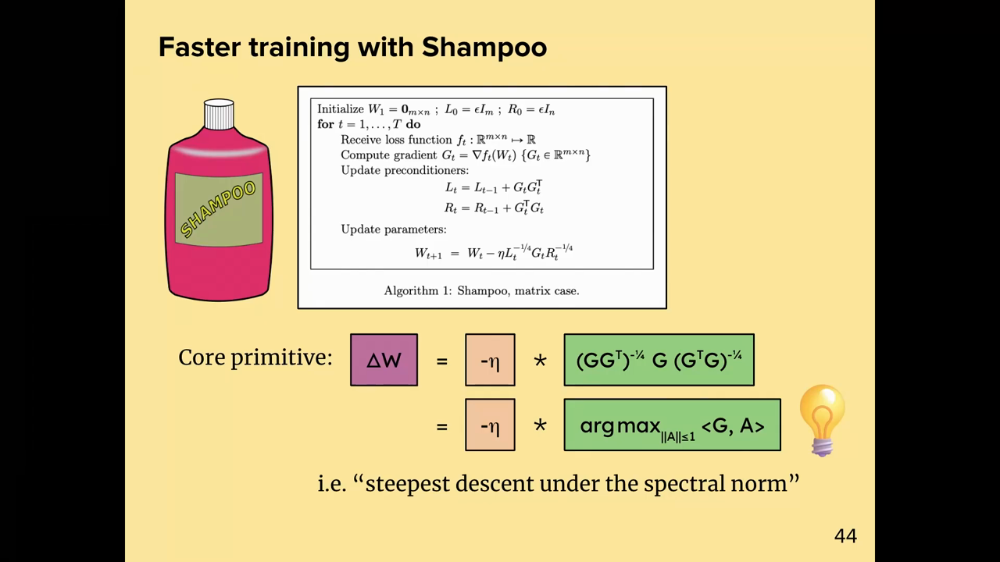
*▲ 강의 슬라이드 [64:00](https://youtu.be/zBvsoxC6tAo?t=3840): [Shampoo](00_%EB%94%A5%EB%9F%AC%EB%8B%9D_%EC%9A%A9%EC%96%B4%EC%82%AC%EC%A0%84.md#shampoo-%EC%83%B4%ED%91%B8-%EC%98%B5%ED%8B%B0%EB%A7%88%EC%9D%B4%EC%A0%80)로 더 빠른 [학습](00_%EB%94%A5%EB%9F%AC%EB%8B%9D_%EC%9A%A9%EC%96%B4%EC%82%AC%EC%A0%84.md#training-%ED%95%99%EC%8A%B5). 알고리즘(행렬 경우)에서 남는 핵심 연산 $(GG^\top)^{-1/4} G (G^\top G)^{-1/4}$ = [스펙트럼 노름](00_%EB%94%A5%EB%9F%AC%EB%8B%9D_%EC%9A%A9%EC%96%B4%EC%82%AC%EC%A0%84.md#spectral-norm-%EC%8A%A4%ED%8E%99%ED%8A%B8%EB%9F%BC-%EB%85%B8%EB%A6%84) 아래의 최급강하*

- 모듈러 [노름](00_%EB%94%A5%EB%9F%AC%EB%8B%9D_%EC%9A%A9%EC%96%B4%EC%82%AC%EC%A0%84.md#norm-%EB%85%B8%EB%A6%84) 작업 덕분에 이런 알고리즘은 구현이 아주 쉽습니다. 선형 모듈의 normalize 함수만 이 스펙트럼 연산으로 덮어쓰면 됩니다. 강사가 노트북으로 시험해 보니, 이 [정규화](00_%EB%94%A5%EB%9F%AC%EB%8B%9D_%EC%9A%A9%EC%96%B4%EC%82%AC%EC%A0%84.md#normalization-%EC%A0%95%EA%B7%9C%ED%99%94)($G^0$, 특잇값을 모두 1로)가 단순한 스펙트럼 [정규화](00_%EB%94%A5%EB%9F%AC%EB%8B%9D_%EC%9A%A9%EC%96%B4%EC%82%AC%EC%A0%84.md#normalization-%EC%A0%95%EA%B7%9C%ED%99%94)($G / \lVert G \rVert_\ast$)보다 훨씬 빨리 학습했고, 둘 다 평범한 [경사하강법](00_%EB%94%A5%EB%9F%AC%EB%8B%9D_%EC%9A%A9%EC%96%B4%EC%82%AC%EC%A0%84.md#gradient-descent-%EA%B2%BD%EC%82%AC%ED%95%98%EA%B0%95%EB%B2%95)보다 훨씬 나았습니다.

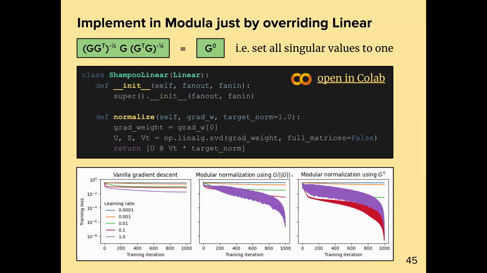
*▲ 강의 슬라이드 [64:35](https://youtu.be/zBvsoxC6tAo?t=3875): Modula에서 Linear의 normalize만 덮어써 구현(SVD로 $UV^\top$). 아래 그림은 평범한 [경사하강법](00_%EB%94%A5%EB%9F%AC%EB%8B%9D_%EC%9A%A9%EC%96%B4%EC%82%AC%EC%A0%84.md#gradient-descent-%EA%B2%BD%EC%82%AC%ED%95%98%EA%B0%95%EB%B2%95), $G/\lVert G \rVert_\ast$ [정규화](00_%EB%94%A5%EB%9F%AC%EB%8B%9D_%EC%9A%A9%EC%96%B4%EC%82%AC%EC%A0%84.md#normalization-%EC%A0%95%EA%B7%9C%ED%99%94), $G^0$ [정규화](00_%EB%94%A5%EB%9F%AC%EB%8B%9D_%EC%9A%A9%EC%96%B4%EC%82%AC%EC%A0%84.md#normalization-%EC%A0%95%EA%B7%9C%ED%99%94)의 [학습](00_%EB%94%A5%EB%9F%AC%EB%8B%9D_%EC%9A%A9%EC%96%B4%EC%82%AC%EC%A0%84.md#training-%ED%95%99%EC%8A%B5) 곡선*

### 10.2 뉴턴-슐츠 반복

▶ 영상 [64:30](https://youtu.be/zBvsoxC6tAo?t=3870)

📐 **수학 개념**: [뉴턴-슐츠 반복과 직교화](%EC%88%98%ED%95%99%EA%B0%9C%EB%85%90/09_%EC%B5%9C%EC%A0%81%ED%99%94%EC%9D%98_%EA%B8%B0%ED%95%98/MM79_%EB%89%B4%ED%84%B4_%EC%8A%90%EC%B8%A0_%EB%B0%98%EB%B3%B5%EA%B3%BC_%EC%A7%81%EA%B5%90%ED%99%94.md)

오픈소스 신경망 "스피드런" 공동체에서 Keller Jordan이 이 스펙트럼 쌍대화를 아주 빠르게 구현했고, 강의 시점에 NanoGPT 스피드런에서 가장 빠른 학습법이 되었습니다. 걱정은 "원리상 옳아도 스펙트럼 연산(SVD)이 너무 비싸 쓸모없지 않나"였는데, **반복법**으로 빠르게 구현할 수 있었습니다. 이것이 **[뉴턴-슐츠 반복](00_%EB%94%A5%EB%9F%AC%EB%8B%9D_%EC%9A%A9%EC%96%B4%EC%82%AC%EC%A0%84.md#newton-schulz-iteration-%EB%89%B4%ED%84%B4-%EC%8A%90%EC%B8%A0-%EB%B0%98%EB%B3%B5)**으로, `Linear.dualize`를 행렬 곱만으로 빠르게 합니다.

강사는 "우리가 Modula를 만들 때 사실 틀렸다"고 덧붙입니다. [정규화](00_%EB%94%A5%EB%9F%AC%EB%8B%9D_%EC%9A%A9%EC%96%B4%EC%82%AC%EC%A0%84.md#normalization-%EC%A0%95%EA%B7%9C%ED%99%94)는 최적이 아니고, 아키텍처를 따라 재귀로 계산하는 **쌍대화**를 해야 합니다. 패키지도 그렇게 고쳐야 합니다.

$$
X_{t+1} = a\, X_t - b\, X_t X_t^\top X_t + c\, X_t X_t^\top X_t X_t^\top X_t
$$

기호 풀이

| 기호 | 읽는 법 | 뜻 | 예제 값 |
| --- | --- | --- | --- |
| $X_t$ | 엑스 티 | $t$번 반복한 행렬. 시작은 $G / \lVert G \rVert_F$ | |
| $a, b, c$ | 계수 | Keller Jordan의 계수 | 3.4445, 4.775, 2.0315 |
| $X_t X_t^\top X_t$ | | 특잇값을 세제곱하는 곱 | |
| 특잇값 하나로 보면 | | $\sigma \leftarrow a\sigma - b\sigma^3 + c\sigma^5$ | 0.1 → 0.3397 |

예제와 풀이

**문제**: 정규화한 [기울기](00_%EB%94%A5%EB%9F%AC%EB%8B%9D_%EC%9A%A9%EC%96%B4%EC%82%AC%EC%A0%84.md#gradient-%EA%B8%B0%EC%9A%B8%EA%B8%B0)의 특잇값 하나가 0.1일 때 뉴턴-슐츠 5차 반복을 한 번 하면 얼마가 되나? (반복은 특잇값마다 따로 작용한다)

**주어진 값**
- $\sigma_t = 0.1$ (지금 특잇값)
- $a = 3.4445$, $b = 4.775$, $c = 2.0315$ (계수)

**풀이**
1. 식을 그대로 쓴다(특잇값 하나로): $\sigma_{t+1} = a\,\sigma_t - b\,\sigma_t^3 + c\,\sigma_t^5$
2. 값을 대입한다: $\sigma_{t+1} = 3.4445 \times 0.1 - 4.775 \times 0.1^3 + 2.0315 \times 0.1^5$
3. 거듭제곱을 한다: $0.1^3 = 0.001$, $0.1^5 = 0.00001$
4. 곱셈을 한다: $3.4445 \times 0.1 = 0.34445$, $4.775 \times 0.001 = 0.004775$, $2.0315 \times 0.00001 = 0.0000203$
5. 뺀다: $0.34445 - 0.004775 = 0.339675$
6. 더한다: $0.339675 + 0.0000203 = 0.3397$

**답**: **0.3397**. 한 번 더 하면 0.9921로, 두 번 만에 1 가까이 간다(그 뒤로는 0.7~1.1 사이를 오감, [MM79_뉴턴_슐츠_반복과_직교화](%EC%88%98%ED%95%99%EA%B0%9C%EB%85%90/09_%EC%B5%9C%EC%A0%81%ED%99%94%EC%9D%98_%EA%B8%B0%ED%95%98/MM79_%EB%89%B4%ED%84%B4_%EC%8A%90%EC%B8%A0_%EB%B0%98%EB%B3%B5%EA%B3%BC_%EC%A7%81%EA%B5%90%ED%99%94.md)).

내 이해

> [!TIP]
> **🆕 2026 업데이트: [Muon](00_%EB%94%A5%EB%9F%AC%EB%8B%9D_%EC%9A%A9%EC%96%B4%EC%82%AC%EC%A0%84.md#muon-%EB%AE%A4%EC%98%A8-%EC%98%B5%ED%8B%B0%EB%A7%88%EC%9D%B4%EC%A0%80)이 1조 [파라미터](00_%EB%94%A5%EB%9F%AC%EB%8B%9D_%EC%9A%A9%EC%96%B4%EC%82%AC%EC%A0%84.md#parameter-%ED%8C%8C%EB%9D%BC%EB%AF%B8%ED%84%B0) 모델까지**
> - **강의**: 스펙트럼 쌍대화의 빠른 구현이 NanoGPT 스피드런에서 가장 빠른 방법이 되었다(작은 모델의 사례).
> - **현재**: 이 방법은 [Muon](00_%EB%94%A5%EB%9F%AC%EB%8B%9D_%EC%9A%A9%EC%96%B4%EC%82%AC%EC%A0%84.md#muon-%EB%AE%A4%EC%98%A8-%EC%98%B5%ED%8B%B0%EB%A7%88%EC%9D%B4%EC%A0%80)이라는 이름으로 큰 모델에 쓰입니다. Moonshot AI(Kimi 팀)는 2025년 2월 [가중치 감쇠](00_%EB%94%A5%EB%9F%AC%EB%8B%9D_%EC%9A%A9%EC%96%B4%EC%82%AC%EC%A0%84.md#weight-decay-%EA%B0%80%EC%A4%91%EC%B9%98-%EA%B0%90%EC%87%A0)를 더하고 파라미터별 업데이트 크기를 맞추면 [Muon](00_%EB%94%A5%EB%9F%AC%EB%8B%9D_%EC%9A%A9%EC%96%B4%EC%82%AC%EC%A0%84.md#muon-%EB%AE%A4%EC%98%A8-%EC%98%B5%ED%8B%B0%EB%A7%88%EC%9D%B4%EC%A0%80)이 큰 규모에서도 튜닝 없이 작동하며, [계산 최적 학습](00_%EB%94%A5%EB%9F%AC%EB%8B%9D_%EC%9A%A9%EC%96%B4%EC%82%AC%EC%A0%84.md#compute-optimal-training-%EA%B3%84%EC%82%B0-%EC%B5%9C%EC%A0%81-%ED%95%99%EC%8A%B5)에서 AdamW보다 약 2배 계산 효율적이라고 보고했습니다(3B/16B [MoE](00_%EB%94%A5%EB%9F%AC%EB%8B%9D_%EC%9A%A9%EC%96%B4%EC%82%AC%EC%A0%84.md#mixture-of-experts-%EC%A0%84%EB%AC%B8%EA%B0%80-%ED%98%BC%ED%95%A9) 모델 Moonlight, 5.7T [토큰](00_%EB%94%A5%EB%9F%AC%EB%8B%9D_%EC%9A%A9%EC%96%B4%EC%82%AC%EC%A0%84.md#token-%ED%86%A0%ED%81%B0)). 2025년 7월 Kimi K2 보고서는 QK-clip을 더한 MuonClip으로 1.04조 [파라미터](00_%EB%94%A5%EB%9F%AC%EB%8B%9D_%EC%9A%A9%EC%96%B4%EC%82%AC%EC%A0%84.md#parameter-%ED%8C%8C%EB%9D%BC%EB%AF%B8%ED%84%B0)(활성 320억) MoE를 15.5T [토큰](00_%EB%94%A5%EB%9F%AC%EB%8B%9D_%EC%9A%A9%EC%96%B4%EC%82%AC%EC%A0%84.md#token-%ED%86%A0%ED%81%B0)에서 [손실](00_%EB%94%A5%EB%9F%AC%EB%8B%9D_%EC%9A%A9%EC%96%B4%EC%82%AC%EC%A0%84.md#loss-function-%EC%86%90%EC%8B%A4-%ED%95%A8%EC%88%98) 급등 없이 사전 학습했습니다.
> - **출처**: [Kimi Team, "Muon is Scalable for LLM Training", arXiv:2502.16982 (2025)](https://arxiv.org/abs/2502.16982) · [Kimi Team, "Kimi K2: Open Agentic Intelligence", arXiv:2507.20534 (2025)](https://arxiv.org/abs/2507.20534) · [Keller Jordan, "Muon: An optimizer for hidden layers in neural networks" (2024)](https://kellerjordan.github.io/posts/muon/)

---

## 11. 맺음말: 정밀도와 강건성

▶ 영상 [65:37](https://youtu.be/zBvsoxC6tAo?t=3937)

📐 **수학 개념**: [가지치기와 양자화](%EC%88%98%ED%95%99%EA%B0%9C%EB%85%90/12_%EA%B0%95%EA%B1%B4%EC%84%B1%EA%B3%BC_%EC%A0%84%EC%9D%B4/MM68_%EA%B0%80%EC%A7%80%EC%B9%98%EA%B8%B0%EC%99%80_%EC%96%91%EC%9E%90%ED%99%94.md) · [적대적 예제와 PGD](%EC%88%98%ED%95%99%EA%B0%9C%EB%85%90/12_%EA%B0%95%EA%B1%B4%EC%84%B1%EA%B3%BC_%EC%A0%84%EC%9D%B4/MM62_%EC%A0%81%EB%8C%80%EC%A0%81_%EC%98%88%EC%A0%9C%EC%99%80_PGD.md)

- 신경망을 레고처럼 만들고, 만든 것의 이론을 블록을 합치는 방식만으로 이해하자는 생각을 정리합니다. 지금까지는 스케일링 문제와 [학습](00_%EB%94%A5%EB%9F%AC%EB%8B%9D_%EC%9A%A9%EC%96%B4%EC%82%AC%EC%A0%84.md#training-%ED%95%99%EC%8A%B5) 속도 기록에 썼지만, 강사는 이 생각이 아직 거의 퍼지지 않았고 더 넓게 쓸 수 있다고 봅니다.
- **낮은 정밀도**: 에너지·돈·시간을 아끼는 좋은 방법은 모델을 아주 낮은 정밀도로 만드는 것([양자화](00_%EB%94%A5%EB%9F%AC%EB%8B%9D_%EC%9A%A9%EC%96%B4%EC%82%AC%EC%A0%84.md#quantization-%EC%96%91%EC%9E%90%ED%99%94))입니다. 정밀도가 어떻게 행동해야 하는지에 대한 이론은 아무도 없고 다들 시도해 볼 뿐입니다. 그런데 정밀도와 연속성은 아주 가까운 개념입니다. 최대한 양자화하려면 공간이 어느 이산화 크기까지 연속적인지 알아야 하기 때문입니다.
- **[적대적](00_%EB%94%A5%EB%9F%AC%EB%8B%9D_%EC%9A%A9%EC%96%B4%EC%82%AC%EC%A0%84.md#adversarial-example-%EC%A0%81%EB%8C%80%EC%A0%81-%EC%98%88%EC%A0%9C) 강건성**도 공간의 연속성을 잘 이해하는 문제와 이어질 것입니다. 이것들을 **모듈 민감도의 문제**로 바꾸고 싶다고 말합니다.
- 강사는 이것을 오픈소스 프로젝트로 만들고 싶다며 modula.systems 웹사이트를 소개하고 마칩니다.

> [!TIP]
> **🆕 2026 업데이트: 4비트 [사전 학습](00_%EB%94%A5%EB%9F%AC%EB%8B%9D_%EC%9A%A9%EC%96%B4%EC%82%AC%EC%A0%84.md#pre-training-%EC%82%AC%EC%A0%84-%ED%95%99%EC%8A%B5)**
> - **강의**: 모델을 아주 낮은 정밀도로 만드는 것이 비용을 아끼는 길이지만 이론이 없고 다들 시도해 볼 뿐이다.
> - **현재**: 실무에서는 정밀도가 계속 내려가고 있습니다. NVIDIA는 2025년 9월, 4비트 형식 NVFP4로 120억 [파라미터](00_%EB%94%A5%EB%9F%AC%EB%8B%9D_%EC%9A%A9%EC%96%B4%EC%82%AC%EC%A0%84.md#parameter-%ED%8C%8C%EB%9D%BC%EB%AF%B8%ED%84%B0) 모델을 10조 [토큰](00_%EB%94%A5%EB%9F%AC%EB%8B%9D_%EC%9A%A9%EC%96%B4%EC%82%AC%EC%A0%84.md#token-%ED%86%A0%ED%81%B0) 사전 학습해 FP8 기준과 거의 같은 [손실](00_%EB%94%A5%EB%9F%AC%EB%8B%9D_%EC%9A%A9%EC%96%B4%EC%82%AC%EC%A0%84.md#loss-function-%EC%86%90%EC%8B%A4-%ED%95%A8%EC%88%98)과 다운스트림 [정확도](00_%EB%94%A5%EB%9F%AC%EB%8B%9D_%EC%9A%A9%EC%96%B4%EC%82%AC%EC%A0%84.md#accuracy-%EC%A0%95%ED%99%95%EB%8F%84)를 얻었다고 보고했습니다(공개된 4비트 [학습](00_%EB%94%A5%EB%9F%AC%EB%8B%9D_%EC%9A%A9%EC%96%B4%EC%82%AC%EC%A0%84.md#training-%ED%95%99%EC%8A%B5) 가운데 가장 긴 실행). 블록 단위 이상값을 줄이는 무작위 아다마르 변환, [순전파](00_%EB%94%A5%EB%9F%AC%EB%8B%9D_%EC%9A%A9%EC%96%B4%EC%82%AC%EC%A0%84.md#feed-forward-%EC%88%9C%EC%A0%84%ED%8C%8C)·[역전파](00_%EB%94%A5%EB%9F%AC%EB%8B%9D_%EC%9A%A9%EC%96%B4%EC%82%AC%EC%A0%84.md#backpropagation-%EC%97%AD%EC%A0%84%ED%8C%8C)에서 일관된 2차원 [양자화](00_%EB%94%A5%EB%9F%AC%EB%8B%9D_%EC%9A%A9%EC%96%B4%EC%82%AC%EC%A0%84.md#quantization-%EC%96%91%EC%9E%90%ED%99%94), [기울기](00_%EB%94%A5%EB%9F%AC%EB%8B%9D_%EC%9A%A9%EC%96%B4%EC%82%AC%EC%A0%84.md#gradient-%EA%B8%B0%EC%9A%B8%EA%B8%B0)를 [편향](00_%EB%94%A5%EB%9F%AC%EB%8B%9D_%EC%9A%A9%EC%96%B4%EC%82%AC%EC%A0%84.md#bias-%ED%8E%B8%ED%96%A5) 없이 만드는 확률적 반올림, 일부 [층](00_%EB%94%A5%EB%9F%AC%EB%8B%9D_%EC%9A%A9%EC%96%B4%EC%82%AC%EC%A0%84.md#layer-%EC%B8%B5)은 높은 정밀도로 남기기를 함께 썼습니다. 이론보다는 공학적 처방이 앞선 상태라는 강사의 관찰은 여전히 맞습니다.
> - **출처**: [NVIDIA, "Pretraining Large Language Models with NVFP4", arXiv:2509.25149 (2025)](https://arxiv.org/abs/2509.25149)

---

## 12. 용어 정리

용어사전에 있는 용어는 위 본문에 링크를 걸었습니다. 아래는 이번 강의에서 새로 나온 용어입니다.

| 용어 | 뜻 |
|---|---|
| [코시-슈바르츠 부등식](00_%EB%94%A5%EB%9F%AC%EB%8B%9D_%EC%9A%A9%EC%96%B4%EC%82%AC%EC%A0%84.md#cauchy-schwarz-inequality-%EC%BD%94%EC%8B%9C-%EC%8A%88%EB%B0%94%EB%A5%B4%EC%B8%A0-%EB%B6%80%EB%93%B1%EC%8B%9D)(Cauchy-Schwarz inequality) | 두 벡터의 [내적](00_%EB%94%A5%EB%9F%AC%EB%8B%9D_%EC%9A%A9%EC%96%B4%EC%82%AC%EC%A0%84.md#dot-product-%EB%82%B4%EC%A0%81)은 두 길이의 곱을 넘지 못한다. 일반 [노름](00_%EB%94%A5%EB%9F%AC%EB%8B%9D_%EC%9A%A9%EC%96%B4%EC%82%AC%EC%A0%84.md#norm-%EB%85%B8%EB%A6%84)에서는 한쪽을 [쌍대 노름](00_%EB%94%A5%EB%9F%AC%EB%8B%9D_%EC%9A%A9%EC%96%B4%EC%82%AC%EC%A0%84.md#dual-norm-%EC%8C%8D%EB%8C%80-%EB%85%B8%EB%A6%84)으로 잰다 |
| [립시츠 매끄러움](00_%EB%94%A5%EB%9F%AC%EB%8B%9D_%EC%9A%A9%EC%96%B4%EC%82%AC%EC%A0%84.md#lipschitz-smoothness-%EB%A6%BD%EC%8B%9C%EC%B8%A0-%EB%A7%A4%EB%81%84%EB%9F%AC%EC%9B%80)(Lipschitz smoothness) | 2차 [미분](00_%EB%94%A5%EB%9F%AC%EB%8B%9D_%EC%9A%A9%EC%96%B4%EC%82%AC%EC%A0%84.md#derivative-%EB%AF%B8%EB%B6%84)(휘어짐)이 어디서나 상수 $\alpha$를 넘지 않는 성질. 1차 근사의 [오차](00_%EB%94%A5%EB%9F%AC%EB%8B%9D_%EC%9A%A9%EC%96%B4%EC%82%AC%EC%A0%84.md#error-%EC%98%A4%EC%B0%A8)가 $\frac{\alpha}{2}\Delta^2$ 안에 든다 |
| [날카로움](00_%EB%94%A5%EB%9F%AC%EB%8B%9D_%EC%9A%A9%EC%96%B4%EC%82%AC%EC%A0%84.md#sharpness-%EB%82%A0%EC%B9%B4%EB%A1%9C%EC%9B%80)([Sharpness](00_%EB%94%A5%EB%9F%AC%EB%8B%9D_%EC%9A%A9%EC%96%B4%EC%82%AC%EC%A0%84.md#sharpness-%EB%82%A0%EC%B9%B4%EB%A1%9C%EC%9B%80)) | [손실](00_%EB%94%A5%EB%9F%AC%EB%8B%9D_%EC%9A%A9%EC%96%B4%EC%82%AC%EC%A0%84.md#loss-function-%EC%86%90%EC%8B%A4-%ED%95%A8%EC%88%98)이나 모듈의 2차 변화를 [노름](00_%EB%94%A5%EB%9F%AC%EB%8B%9D_%EC%9A%A9%EC%96%B4%EC%82%AC%EC%A0%84.md#norm-%EB%85%B8%EB%A6%84)으로 누르는 상수. [헤세 행렬](00_%EB%94%A5%EB%9F%AC%EB%8B%9D_%EC%9A%A9%EC%96%B4%EC%82%AC%EC%A0%84.md#hessian-%ED%97%A4%EC%84%B8-%ED%96%89%EB%A0%AC) 최대 [고윳값](00_%EB%94%A5%EB%9F%AC%EB%8B%9D_%EC%9A%A9%EC%96%B4%EC%82%AC%EC%A0%84.md#eigenvector-eigenvalue-%EA%B3%A0%EC%9C%A0%EB%B2%A1%ED%84%B0%EC%99%80-%EA%B3%A0%EC%9C%B3%EA%B0%92)을 일반화한 것 |
| [조합자 패턴](00_%EB%94%A5%EB%9F%AC%EB%8B%9D_%EC%9A%A9%EC%96%B4%EC%82%AC%EC%A0%84.md#combinator-pattern-%EC%A1%B0%ED%95%A9%EC%9E%90-%ED%8C%A8%ED%84%B4)(Combinator pattern) | 단순한 원소와 그것을 같은 타입으로 합치는 조합자로 복잡한 구조를 만드는 프로그래밍 방식 |
| [모듈 합성과 모듈 연결](00_%EB%94%A5%EB%9F%AC%EB%8B%9D_%EC%9A%A9%EC%96%B4%EC%82%AC%EC%A0%84.md#module-composition-module-concatenation-%EB%AA%A8%EB%93%88-%ED%95%A9%EC%84%B1%EA%B3%BC-%EB%AA%A8%EB%93%88-%EC%97%B0%EA%B2%B0)([Module](00_%EB%94%A5%EB%9F%AC%EB%8B%9D_%EC%9A%A9%EC%96%B4%EC%82%AC%EC%A0%84.md#module-modular-norm-%EB%AA%A8%EB%93%88%EA%B3%BC-%EB%AA%A8%EB%93%88%EB%9F%AC-%EB%85%B8%EB%A6%84) composition, concatenation) | 모듈을 직렬로 잇기 / 병렬로 나란히 두기. 모듈 이론의 두 조합자 |
| [원자·결합·화합물 모듈](00_%EB%94%A5%EB%9F%AC%EB%8B%9D_%EC%9A%A9%EC%96%B4%EC%82%AC%EC%A0%84.md#atomic-module-bond-module-compound-module-%EC%9B%90%EC%9E%90-%EB%AA%A8%EB%93%88-%EA%B2%B0%ED%95%A9-%EB%AA%A8%EB%93%88-%ED%99%94%ED%95%A9%EB%AC%BC-%EB%AA%A8%EB%93%88)(Atom, Bond, Compound) | 손으로 쓴 기본 [층](00_%EB%94%A5%EB%9F%AC%EB%8B%9D_%EC%9A%A9%EC%96%B4%EC%82%AC%EC%A0%84.md#layer-%EC%B8%B5) / [가중치](00_%EB%94%A5%EB%9F%AC%EB%8B%9D_%EC%9A%A9%EC%96%B4%EC%82%AC%EC%A0%84.md#weight-%EA%B0%80%EC%A4%91%EC%B9%98) 없는 모듈 / 조합으로 만든 모듈 |
| [모듈 질량과 모듈 민감도](00_%EB%94%A5%EB%9F%AC%EB%8B%9D_%EC%9A%A9%EC%96%B4%EC%82%AC%EC%A0%84.md#module-mass-module-sensitivity-%EB%AA%A8%EB%93%88-%EC%A7%88%EB%9F%89%EA%B3%BC-%EB%AA%A8%EB%93%88-%EB%AF%BC%EA%B0%90%EB%8F%84)(Mass, Sensitivity) | [학습률](00_%EB%94%A5%EB%9F%AC%EB%8B%9D_%EC%9A%A9%EC%96%B4%EC%82%AC%EC%A0%84.md#learning-rate-%ED%95%99%EC%8A%B5%EB%A5%A0)을 모듈끼리 나누는 비율 / 입력 변화가 출력에서 커지는 배율 |
| [노름이 잘 맞는 모듈](00_%EB%94%A5%EB%9F%AC%EB%8B%9D_%EC%9A%A9%EC%96%B4%EC%82%AC%EC%A0%84.md#well-normed-module-%EB%85%B8%EB%A6%84%EC%9D%B4-%EC%9E%98-%EB%A7%9E%EB%8A%94-%EB%AA%A8%EB%93%88)(Well-normed module) | [가중치](00_%EB%94%A5%EB%9F%AC%EB%8B%9D_%EC%9A%A9%EC%96%B4%EC%82%AC%EC%A0%84.md#weight-%EA%B0%80%EC%A4%91%EC%B9%98)에 대해 1-립시츠, 입력에 대해 민감도-립시츠인 모듈. 조합해도 성질이 유지된다 |
| [텐서 축약](00_%EB%94%A5%EB%9F%AC%EB%8B%9D_%EC%9A%A9%EC%96%B4%EC%82%AC%EC%A0%84.md#tensor-contraction-%ED%85%90%EC%84%9C-%EC%B6%95%EC%95%BD)(Tensor contraction) | 공유하는 첨자끼리 곱해 더하는 연산. [내적](00_%EB%94%A5%EB%9F%AC%EB%8B%9D_%EC%9A%A9%EC%96%B4%EC%82%AC%EC%A0%84.md#dot-product-%EB%82%B4%EC%A0%81)과 [행렬 곱](00_%EB%94%A5%EB%9F%AC%EB%8B%9D_%EC%9A%A9%EC%96%B4%EC%82%AC%EC%A0%84.md#matrix-multiplication-%ED%96%89%EB%A0%AC-%EA%B3%B1)의 [일반화](00_%EB%94%A5%EB%9F%AC%EB%8B%9D_%EC%9A%A9%EC%96%B4%EC%82%AC%EC%A0%84.md#generalization-%EC%9D%BC%EB%B0%98%ED%99%94) (강의 기호 $\diamond$) |
| [쌍대 사상과 모듈러 쌍대화](00_%EB%94%A5%EB%9F%AC%EB%8B%9D_%EC%9A%A9%EC%96%B4%EC%82%AC%EC%A0%84.md#duality-map-modular-dualization-%EC%8C%8D%EB%8C%80-%EC%82%AC%EC%83%81%EA%B3%BC-%EB%AA%A8%EB%93%88%EB%9F%AC-%EC%8C%8D%EB%8C%80%ED%99%94)(Duality map, Modular dualization) | [기울기](00_%EB%94%A5%EB%9F%AC%EB%8B%9D_%EC%9A%A9%EC%96%B4%EC%82%AC%EC%A0%84.md#gradient-%EA%B8%B0%EC%9A%B8%EA%B8%B0)(쌍대 벡터)를 [가중치](00_%EB%94%A5%EB%9F%AC%EB%8B%9D_%EC%9A%A9%EC%96%B4%EC%82%AC%EC%A0%84.md#weight-%EA%B0%80%EC%A4%91%EC%B9%98) 공간의 단위 걸음으로 옮기는 사상 / 그것을 층별로 풀어 재귀로 합치는 절차 |
| [Shampoo](00_%EB%94%A5%EB%9F%AC%EB%8B%9D_%EC%9A%A9%EC%96%B4%EC%82%AC%EC%A0%84.md#shampoo-%EC%83%B4%ED%91%B8-%EC%98%B5%ED%8B%B0%EB%A7%88%EC%9D%B4%EC%A0%80) | [기울기](00_%EB%94%A5%EB%9F%AC%EB%8B%9D_%EC%9A%A9%EC%96%B4%EC%82%AC%EC%A0%84.md#gradient-%EA%B8%B0%EC%9A%B8%EA%B8%B0)를 $(GG^\top)^{-1/4}$, $(G^\top G)^{-1/4}$로 양쪽에서 전처리하는 [옵티마이저](00_%EB%94%A5%EB%9F%AC%EB%8B%9D_%EC%9A%A9%EC%96%B4%EC%82%AC%EC%A0%84.md#optimizer-%EC%98%B5%ED%8B%B0%EB%A7%88%EC%9D%B4%EC%A0%80). 핵심은 $UV^\top$ |
| [뉴턴-슐츠 반복](00_%EB%94%A5%EB%9F%AC%EB%8B%9D_%EC%9A%A9%EC%96%B4%EC%82%AC%EC%A0%84.md#newton-schulz-iteration-%EB%89%B4%ED%84%B4-%EC%8A%90%EC%B8%A0-%EB%B0%98%EB%B3%B5)(Newton-Schulz iteration) | 행렬 곱만으로 특잇값을 1로 밀어 $UV^\top$를 근사하는 반복법 |
