# Lec 24. 딥러닝의 추론 방법 (Inference Methods for Deep Learning)

← 이전: [Lec23_계량_딥러닝](Lec23_%EA%B3%84%EB%9F%89_%EB%94%A5%EB%9F%AC%EB%8B%9D.md) · [목차](00_MIT%EB%94%A5%EB%9F%AC%EB%8B%9D_%EB%AA%A9%EC%B0%A8.md) · 다음: 없음 →

> [!NOTE]
> **강의 정보**
> - **출처**: MIT OpenCourseWare, [Lec 24. Inference Methods for Deep Learning](https://www.youtube.com/watch?v=mbgFTqKxR7A) (83분, 2024년 가을 학기)
> - **강사**: Phillip Isola
> - **라이선스**: 원 강의는 CC BY-NC-SA 4.0입니다. 이 노트는 영어 자막을 바탕으로 한국어로 옮겨 정리한 2차 저작물이며, 같은 조건(비영리·출처 표기·동일 조건 공유)을 따릅니다.
> - 각 절 제목 아래의 `▶ 영상` 시간을 누르면 영상의 해당 위치로 갑니다.
> - `📐 수학 개념` 줄은 그 절에 쓰인 수학을 정리한 노트로 연결됩니다. 전체 목록은 [00_MIT딥러닝_목차](00_MIT%EB%94%A5%EB%9F%AC%EB%8B%9D_%EB%AA%A9%EC%B0%A8.md).
> - 슬라이드 캡처는 원 강의(CC BY-NC-SA 4.0)에서 가져왔고, "직접 그린 그림"은 이 노트의 숫자로 새로 그렸습니다.
> - `🆕 2026 업데이트` 칸은 강의(2024년 가을) 이후 바뀐 내용을 덧붙인 것입니다.

## 한눈에 보기

| 구분 | 내용 |
|---|---|
| 핵심 질문 | [학습](00_%EB%94%A5%EB%9F%AC%EB%8B%9D_%EC%9A%A9%EC%96%B4%EC%82%AC%EC%A0%84.md#training-%ED%95%99%EC%8A%B5)이 끝난 모델을 **쓸 때**(테스트 시점) [순전파](00_%EB%94%A5%EB%9F%AC%EB%8B%9D_%EC%9A%A9%EC%96%B4%EC%82%AC%EC%A0%84.md#feed-forward-%EC%88%9C%EC%A0%84%ED%8C%8C) 한 번보다 계산을 더 써서 더 좋은 답을 얻을 수 있나? |
| 추론의 뜻 | 통계학의 "추론"은 데이터로 생성 과정을 알아내는 것(ML의 **[학습](00_%EB%94%A5%EB%9F%AC%EB%8B%9D_%EC%9A%A9%EC%96%B4%EC%82%AC%EC%A0%84.md#training-%ED%95%99%EC%8A%B5)**). ML의 **[추론](00_%EB%94%A5%EB%9F%AC%EB%8B%9D_%EC%9A%A9%EC%96%B4%EC%82%AC%EC%A0%84.md#inference-%EC%B6%94%EB%A1%A0)**은 학습된 모델로 새 입력을 예측하는 것(통계학의 "예측") |
| 두 축 | Sutton의 [쓴 교훈](00_%EB%94%A5%EB%9F%AC%EB%8B%9D_%EC%9A%A9%EC%96%B4%EC%82%AC%EC%A0%84.md#bitter-lesson-%EC%93%B4-%EA%B5%90%ED%9B%88): 계산에 따라 커지는 방법은 **[학습](00_%EB%94%A5%EB%9F%AC%EB%8B%9D_%EC%9A%A9%EC%96%B4%EC%82%AC%EC%A0%84.md#training-%ED%95%99%EC%8A%B5)**과 **탐색** 둘뿐. o1은 [테스트 시점 계산](00_%EB%94%A5%EB%9F%AC%EB%8B%9D_%EC%9A%A9%EC%96%B4%EC%82%AC%EC%A0%84.md#test-time-compute-%ED%85%8C%EC%8A%A4%ED%8A%B8-%EC%8B%9C%EC%A0%90-%EA%B3%84%EC%82%B0)을 늘려도 [정확도](00_%EB%94%A5%EB%9F%AC%EB%8B%9D_%EC%9A%A9%EC%96%B4%EC%82%AC%EC%A0%84.md#accuracy-%EC%A0%95%ED%99%95%EB%8F%84)가 오름을 보였다. 둘은 서로 맞바꿀 수 있다 |
| 탐색 | [탐욕 샘플링](00_%EB%94%A5%EB%9F%AC%EB%8B%9D_%EC%9A%A9%EC%96%B4%EC%82%AC%EC%A0%84.md#greedy-decoding-%ED%83%90%EC%9A%95-%EB%94%94%EC%BD%94%EB%94%A9)은 문장 전체 [확률](00_%EB%94%A5%EB%9F%AC%EB%8B%9D_%EC%9A%A9%EC%96%B4%EC%82%AC%EC%A0%84.md#probability-%ED%99%95%EB%A5%A0)을 최대로 만들지 않는다 → [Best-of-N](00_%EB%94%A5%EB%9F%AC%EB%8B%9D_%EC%9A%A9%EC%96%B4%EC%82%AC%EC%A0%84.md#best-of-n-sampling-best-of-n-%EC%83%98%ED%94%8C%EB%A7%81), [빔 서치](00_%EB%94%A5%EB%9F%AC%EB%8B%9D_%EC%9A%A9%EC%96%B4%EC%82%AC%EC%A0%84.md#beam-search-%EB%B9%94-%EC%84%9C%EC%B9%98), [생각의 사슬](00_%EB%94%A5%EB%9F%AC%EB%8B%9D_%EC%9A%A9%EC%96%B4%EC%82%AC%EC%A0%84.md#chain-of-thought-prompting-%EC%83%9D%EA%B0%81%EC%9D%98-%EC%82%AC%EC%8A%AC-%ED%94%84%EB%A1%AC%ED%94%84%ED%8C%85)(모델이 스스로 하는 탐색) |
| 점수 | [우도](00_%EB%94%A5%EB%9F%AC%EB%8B%9D_%EC%9A%A9%EC%96%B4%EC%82%AC%EC%A0%84.md#likelihood-%EC%9A%B0%EB%8F%84) 대신 아무 [점수 함수](00_%EB%94%A5%EB%9F%AC%EB%8B%9D_%EC%9A%A9%EC%96%B4%EC%82%AC%EC%A0%84.md#scoring-function-%EC%A0%90%EC%88%98-%ED%95%A8%EC%88%98)나 쓸 수 있다: 사람 평가([RLHF](00_%EB%94%A5%EB%9F%AC%EB%8B%9D_%EC%9A%A9%EC%96%B4%EC%82%AC%EC%A0%84.md#rlhf-reinforcement-learning-from-human-feedback-%EC%82%AC%EB%9E%8C-%ED%94%BC%EB%93%9C%EB%B0%B1-%EA%B0%95%ED%99%94-%ED%95%99%EC%8A%B5)), [보상 모델](00_%EB%94%A5%EB%9F%AC%EB%8B%9D_%EC%9A%A9%EC%96%B4%EC%82%AC%EC%A0%84.md#reward-model-%EB%B3%B4%EC%83%81-%EB%AA%A8%EB%8D%B8), [검증기](00_%EB%94%A5%EB%9F%AC%EB%8B%9D_%EC%9A%A9%EC%96%B4%EC%82%AC%EC%A0%84.md#verifier-%EA%B2%80%EC%A6%9D%EA%B8%B0). [검증](00_%EB%94%A5%EB%9F%AC%EB%8B%9D_%EC%9A%A9%EC%96%B4%EC%82%AC%EC%A0%84.md#validation-data-%EA%B2%80%EC%A6%9D-%EB%8D%B0%EC%9D%B4%ED%84%B0)은 생성보다 쉽다. 그림 [생성 모델](00_%EB%94%A5%EB%9F%AC%EB%8B%9D_%EC%9A%A9%EC%96%B4%EC%82%AC%EC%A0%84.md#generative-model-%EC%83%9D%EC%84%B1-%EB%AA%A8%EB%8D%B8)은 [잠재 변수](00_%EB%94%A5%EB%9F%AC%EB%8B%9D_%EC%9A%A9%EC%96%B4%EC%82%AC%EC%A0%84.md#latent-variable-%EC%9E%A0%EC%9E%AC-%EB%B3%80%EC%88%98)를 경사로 최적화한다([CLIP](00_%EB%94%A5%EB%9F%AC%EB%8B%9D_%EC%9A%A9%EC%96%B4%EC%82%AC%EC%A0%84.md#clip-%ED%81%B4%EB%A6%BD) + VQGAN) |
| 모델 바꾸기 | [맥락 내 학습](00_%EB%94%A5%EB%9F%AC%EB%8B%9D_%EC%9A%A9%EC%96%B4%EC%82%AC%EC%A0%84.md#in-context-learning-%EB%A7%A5%EB%9D%BD-%EB%82%B4-%ED%95%99%EC%8A%B5)은 어떤 경우 맥락에 대한 [경사하강](00_%EB%94%A5%EB%9F%AC%EB%8B%9D_%EC%9A%A9%EC%96%B4%EC%82%AC%EC%A0%84.md#gradient-descent-%EA%B2%BD%EC%82%AC%ED%95%98%EA%B0%95%EB%B2%95)과 같다 → 진짜로 시험 때 경사하강을 하는 [테스트 시점 학습](00_%EB%94%A5%EB%9F%AC%EB%8B%9D_%EC%9A%A9%EC%96%B4%EC%82%AC%EC%A0%84.md#test-time-training-%ED%85%8C%EC%8A%A4%ED%8A%B8-%EC%8B%9C%EC%A0%90-%ED%95%99%EC%8A%B5). [ARC](00_%EB%94%A5%EB%9F%AC%EB%8B%9D_%EC%9A%A9%EC%96%B4%EC%82%AC%EC%A0%84.md#arc-abstraction-and-reasoning-corpus-arc-%EB%B2%A4%EC%B9%98%EB%A7%88%ED%81%AC)에서 큰 효과 |
| 탐색 + [학습](00_%EB%94%A5%EB%9F%AC%EB%8B%9D_%EC%9A%A9%EC%96%B4%EC%82%AC%EC%A0%84.md#training-%ED%95%99%EC%8A%B5) | 탐색으로 찾은 좋은 답을 다시 [학습](00_%EB%94%A5%EB%9F%AC%EB%8B%9D_%EC%9A%A9%EC%96%B4%EC%82%AC%EC%A0%84.md#training-%ED%95%99%EC%8A%B5)([자기 개선](00_%EB%94%A5%EB%9F%AC%EB%8B%9D_%EC%9A%A9%EC%96%B4%EC%82%AC%EC%A0%84.md#self-improvement-%EC%9E%90%EA%B8%B0-%EA%B0%9C%EC%84%A0)) = [강화 학습](00_%EB%94%A5%EB%9F%AC%EB%8B%9D_%EC%9A%A9%EC%96%B4%EC%82%AC%EC%A0%84.md#reinforcement-learning-%EA%B0%95%ED%99%94-%ED%95%99%EC%8A%B5)의 기본 고리. AlphaGo, [STaR](00_%EB%94%A5%EB%9F%AC%EB%8B%9D_%EC%9A%A9%EC%96%B4%EC%82%AC%EC%A0%84.md#star-self-taught-reasoner-%EC%8A%A4%EC%8A%A4%EB%A1%9C-%EB%B0%B0%EC%9A%B0%EB%8A%94-%EC%B6%94%EB%A1%A0%EA%B8%B0), o1(추측) |
| 이전·다음 강의 | Lec23 → (마지막 강의) |

---

## 1. 추론이란

▶ 영상 [01:44](https://youtu.be/mbgFTqKxR7A?t=104)

강사는 이 강의가 올해 새로 만든 강의라고 소개합니다. 아이디어 자체는 오래되었지만 2024년에 갑자기 딥러닝의 가장 뜨거운 주제가 되었기 때문입니다. Sasha Rush의 튜토리얼에서 영감을 받았고, OpenAI o1 같은 최신 모델이 "아마도" 어떻게 동작하는지에 대한 강사의 추측이 이 강의의 결론입니다.

- **통계학의 [추론](00_%EB%94%A5%EB%9F%AC%EB%8B%9D_%EC%9A%A9%EC%96%B4%EC%82%AC%EC%A0%84.md#inference-%EC%B6%94%EB%A1%A0)**(inference): 분포에서 뽑은 표본으로 그 분포나 데이터 생성 과정의 성질을 알아내는 것. 머신러닝에서는 이것을 **[학습](00_%EB%94%A5%EB%9F%AC%EB%8B%9D_%EC%9A%A9%EC%96%B4%EC%82%AC%EC%A0%84.md#training-%ED%95%99%EC%8A%B5)**(training) 또는 밀도 추정이라고 부릅니다.
- **머신러닝의 추론**: 학습된 모델로 새 질의(질문, 그림 등)에 대한 예측을 하는 것. 통계학에서는 이것을 **예측**(prediction)이라고 부릅니다.
- 이 강의는 머신러닝의 뜻을 씁니다. 통계학자와 이야기할 때는 헷갈리지 않게 조심하라고 강사는 덧붙입니다.

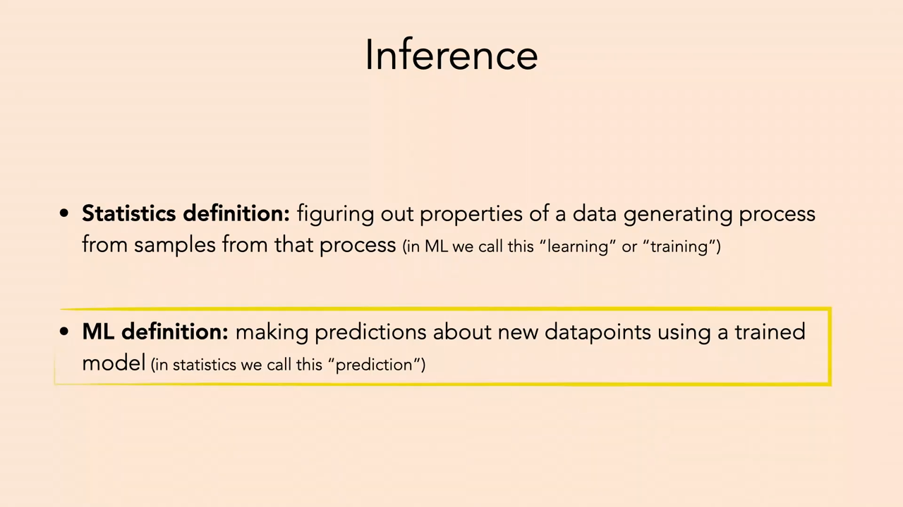
*▲ 강의 슬라이드 [03:25](https://youtu.be/mbgFTqKxR7A?t=205): 추론의 두 정의. 통계학의 정의(ML의 "[학습](00_%EB%94%A5%EB%9F%AC%EB%8B%9D_%EC%9A%A9%EC%96%B4%EC%82%AC%EC%A0%84.md#training-%ED%95%99%EC%8A%B5)")와 ML의 정의(통계학의 "예측")*

수업 안내 [01:10](https://youtu.be/mbgFTqKxR7A?t=70)

- 목요일 수업은 발표 없이 조교와 강사들이 모두 나오는 **기말 프로젝트 상담 시간**으로 쓴다. Piazza에도 공지한다.

---

## 2. 학습과 추론의 지형도

▶ 영상 [03:28](https://youtu.be/mbgFTqKxR7A?t=208)

이 수업의 대부분은 **[학습](00_%EB%94%A5%EB%9F%AC%EB%8B%9D_%EC%9A%A9%EC%96%B4%EC%82%AC%EC%A0%84.md#training-%ED%95%99%EC%8A%B5)** 쪽이었고, 시험 때는 학습된 모델에 [순전파](00_%EB%94%A5%EB%9F%AC%EB%8B%9D_%EC%9A%A9%EC%96%B4%EC%82%AC%EC%A0%84.md#feed-forward-%EC%88%9C%EC%A0%84%ED%8C%8C)를 한 번 하는 것이 전부였습니다. 강사는 시험 때 그보다 훨씬 많은 일을 할 수 있고, 그러면 큰 이득이 있다고 말합니다. 강사가 직접 정리한 지형도(경계는 엄격하지 않음)는 다음과 같습니다.

| 단계 | 하는 일 | 예 |
|---|---|---|
| [사전 학습](00_%EB%94%A5%EB%9F%AC%EB%8B%9D_%EC%9A%A9%EC%96%B4%EC%82%AC%EC%A0%84.md#pre-training-%EC%82%AC%EC%A0%84-%ED%95%99%EC%8A%B5) | 데이터가 주어지면 모델이나 표현을 배운다 | [생성 모델링](00_%EB%94%A5%EB%9F%AC%EB%8B%9D_%EC%9A%A9%EC%96%B4%EC%82%AC%EC%A0%84.md#generative-model-%EC%83%9D%EC%84%B1-%EB%AA%A8%EB%8D%B8), [표현 학습](00_%EB%94%A5%EB%9F%AC%EB%8B%9D_%EC%9A%A9%EC%96%B4%EC%82%AC%EC%A0%84.md#representation-learning-%ED%91%9C%ED%98%84-%ED%95%99%EC%8A%B5), 인터넷 다음 [토큰](00_%EB%94%A5%EB%9F%AC%EB%8B%9D_%EC%9A%A9%EC%96%B4%EC%82%AC%EC%A0%84.md#token-%ED%86%A0%ED%81%B0) 예측 |
| 사후 [학습](00_%EB%94%A5%EB%9F%AC%EB%8B%9D_%EC%9A%A9%EC%96%B4%EC%82%AC%EC%A0%84.md#training-%ED%95%99%EC%8A%B5) (공장 안) | 모델과 새 데이터(새 과제)가 주어지면 모델을 고친다 | [미세 조정](00_%EB%94%A5%EB%9F%AC%EB%8B%9D_%EC%9A%A9%EC%96%B4%EC%82%AC%EC%A0%84.md#fine-tuning-%EB%AF%B8%EC%84%B8-%EC%A1%B0%EC%A0%95), [RLHF](00_%EB%94%A5%EB%9F%AC%EB%8B%9D_%EC%9A%A9%EC%96%B4%EC%82%AC%EC%A0%84.md#rlhf-reinforcement-learning-from-human-feedback-%EC%82%AC%EB%9E%8C-%ED%94%BC%EB%93%9C%EB%B0%B1-%EA%B0%95%ED%99%94-%ED%95%99%EC%8A%B5) |
| 사후 [학습](00_%EB%94%A5%EB%9F%AC%EB%8B%9D_%EC%9A%A9%EC%96%B4%EC%82%AC%EC%A0%84.md#training-%ED%95%99%EC%8A%B5) (배포 뒤) | 배포 중에 들어온 데이터로 모델이나 그 행동을 바꾼다 | [프롬프팅](00_%EB%94%A5%EB%9F%AC%EB%8B%9D_%EC%9A%A9%EC%96%B4%EC%82%AC%EC%A0%84.md#prompting-%ED%94%84%EB%A1%AC%ED%94%84%ED%8C%85), [맥락 내 학습](00_%EB%94%A5%EB%9F%AC%EB%8B%9D_%EC%9A%A9%EC%96%B4%EC%82%AC%EC%A0%84.md#in-context-learning-%EB%A7%A5%EB%9D%BD-%EB%82%B4-%ED%95%99%EC%8A%B5), [테스트 시점 학습](00_%EB%94%A5%EB%9F%AC%EB%8B%9D_%EC%9A%A9%EC%96%B4%EC%82%AC%EC%A0%84.md#test-time-training-%ED%85%8C%EC%8A%A4%ED%8A%B8-%EC%8B%9C%EC%A0%90-%ED%95%99%EC%8A%B5), 연속 [학습](00_%EB%94%A5%EB%9F%AC%EB%8B%9D_%EC%9A%A9%EC%96%B4%EC%82%AC%EC%A0%84.md#training-%ED%95%99%EC%8A%B5), 피드백 제어 |
| [탐색](00_%EB%94%A5%EB%9F%AC%EB%8B%9D_%EC%9A%A9%EC%96%B4%EC%82%AC%EC%A0%84.md#tree-search-%ED%8A%B8%EB%A6%AC-%ED%83%90%EC%83%89) | 모델과 질의가 주어지면 모델은 그대로 두고 가장 좋은 답을 찾는다 | [Best-of-N](00_%EB%94%A5%EB%9F%AC%EB%8B%9D_%EC%9A%A9%EC%96%B4%EC%82%AC%EC%A0%84.md#best-of-n-sampling-best-of-n-%EC%83%98%ED%94%8C%EB%A7%81), [빔 서치](00_%EB%94%A5%EB%9F%AC%EB%8B%9D_%EC%9A%A9%EC%96%B4%EC%82%AC%EC%A0%84.md#beam-search-%EB%B9%94-%EC%84%9C%EC%B9%98), MCTS, [생각의 사슬](00_%EB%94%A5%EB%9F%AC%EB%8B%9D_%EC%9A%A9%EC%96%B4%EC%82%AC%EC%A0%84.md#chain-of-thought-prompting-%EC%83%9D%EA%B0%81%EC%9D%98-%EC%82%AC%EC%8A%AC-%ED%94%84%EB%A1%AC%ED%94%84%ED%8C%85) |

- **[학습](00_%EB%94%A5%EB%9F%AC%EB%8B%9D_%EC%9A%A9%EC%96%B4%EC%82%AC%EC%A0%84.md#training-%ED%95%99%EC%8A%B5)**은 공장(회사의 서버)에서 실제 문제를 만나기 **전에** 하는 일입니다. "통계적 추론", 그리고 **[분할 상환 추론](00_%EB%94%A5%EB%9F%AC%EB%8B%9D_%EC%9A%A9%EC%96%B4%EC%82%AC%EC%A0%84.md#amortized-inference-%EB%B6%84%ED%95%A0-%EC%83%81%ED%99%98-%EC%B6%94%EB%A1%A0)**(amortized inference)이라고도 부릅니다. 매번 단계별로 생각해서 풀 문제를, 한 번 배워 둔 [가중치](00_%EB%94%A5%EB%9F%AC%EB%8B%9D_%EC%9A%A9%EC%96%B4%EC%82%AC%EC%A0%84.md#weight-%EA%B0%80%EC%A4%91%EC%B9%98)로 곧장 답하게 만들어 생각하는 비용을 미리 나눠 갚아 둔다는 뜻입니다.
- **추론**은 배포된 뒤, 현장에서(기기 위에서, 방 안을 돌아다니는 로봇에서) 하는 일입니다. 예측, 생각, 추론(reasoning), 인지라고도 부릅니다.
- 로봇이 걸으며 접촉, 중력 방향, 관절 토크를 느끼고 행동을 바꾸는 **피드백 제어**도 [시험 데이터](00_%EB%94%A5%EB%9F%AC%EB%8B%9D_%EC%9A%A9%EC%96%B4%EC%82%AC%EC%A0%84.md#training-data-test-data-%ED%95%99%EC%8A%B5-%EB%8D%B0%EC%9D%B4%ED%84%B0%EC%99%80-%EC%8B%9C%ED%97%98-%EB%8D%B0%EC%9D%B4%ED%84%B0)로 행동을 바꾸는 예입니다(오늘은 다루지 않음).
- 강의 끝에서는 탐색으로 [학습](00_%EB%94%A5%EB%9F%AC%EB%8B%9D_%EC%9A%A9%EC%96%B4%EC%82%AC%EC%A0%84.md#training-%ED%95%99%EC%8A%B5)을 돕고 [학습](00_%EB%94%A5%EB%9F%AC%EB%8B%9D_%EC%9A%A9%EC%96%B4%EC%82%AC%EC%A0%84.md#training-%ED%95%99%EC%8A%B5)으로 탐색을 돕는 고리를 봅니다. 그 일반적인 이름이 **[강화 학습](00_%EB%94%A5%EB%9F%AC%EB%8B%9D_%EC%9A%A9%EC%96%B4%EC%82%AC%EC%A0%84.md#reinforcement-learning-%EA%B0%95%ED%99%94-%ED%95%99%EC%8A%B5)**이고, [STaR](00_%EB%94%A5%EB%9F%AC%EB%8B%9D_%EC%9A%A9%EC%96%B4%EC%82%AC%EC%A0%84.md#star-self-taught-reasoner-%EC%8A%A4%EC%8A%A4%EB%A1%9C-%EB%B0%B0%EC%9A%B0%EB%8A%94-%EC%B6%94%EB%A1%A0%EA%B8%B0)와 (아마도) o1이 여기에 속합니다(11절).

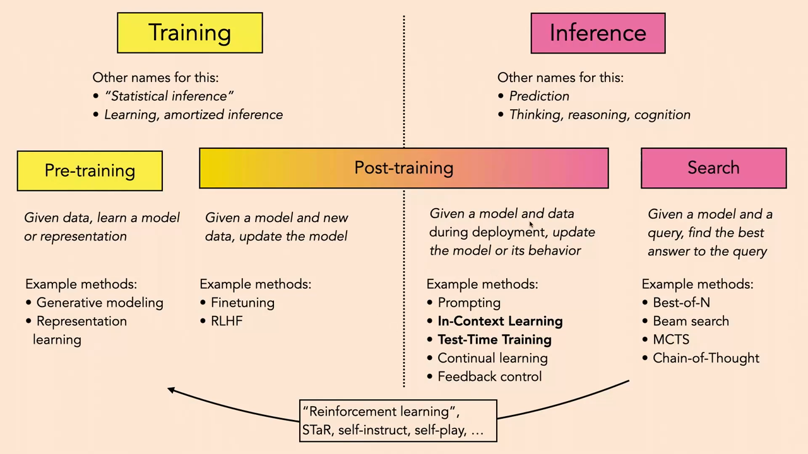
*▲ 강의 슬라이드 [56:10](https://youtu.be/mbgFTqKxR7A?t=3370): [학습](00_%EB%94%A5%EB%9F%AC%EB%8B%9D_%EC%9A%A9%EC%96%B4%EC%82%AC%EC%A0%84.md#training-%ED%95%99%EC%8A%B5)([사전 학습](00_%EB%94%A5%EB%9F%AC%EB%8B%9D_%EC%9A%A9%EC%96%B4%EC%82%AC%EC%A0%84.md#pre-training-%EC%82%AC%EC%A0%84-%ED%95%99%EC%8A%B5), 사후 [학습](00_%EB%94%A5%EB%9F%AC%EB%8B%9D_%EC%9A%A9%EC%96%B4%EC%82%AC%EC%A0%84.md#training-%ED%95%99%EC%8A%B5))과 추론(사후 [학습](00_%EB%94%A5%EB%9F%AC%EB%8B%9D_%EC%9A%A9%EC%96%B4%EC%82%AC%EC%A0%84.md#training-%ED%95%99%EC%8A%B5), 탐색)의 지형도. 아래 화살표는 탐색과 [학습](00_%EB%94%A5%EB%9F%AC%EB%8B%9D_%EC%9A%A9%EC%96%B4%EC%82%AC%EC%A0%84.md#training-%ED%95%99%EC%8A%B5)을 잇는 "[강화 학습](00_%EB%94%A5%EB%9F%AC%EB%8B%9D_%EC%9A%A9%EC%96%B4%EC%82%AC%EC%A0%84.md#reinforcement-learning-%EA%B0%95%ED%99%94-%ED%95%99%EC%8A%B5)"([STaR](00_%EB%94%A5%EB%9F%AC%EB%8B%9D_%EC%9A%A9%EC%96%B4%EC%82%AC%EC%A0%84.md#star-self-taught-reasoner-%EC%8A%A4%EC%8A%A4%EB%A1%9C-%EB%B0%B0%EC%9A%B0%EB%8A%94-%EC%B6%94%EB%A1%A0%EA%B8%B0), self-instruct, self-play 등)*

---

## 3. 탐색과 학습

📐 **수학 개념**: [M07_로그](%EC%88%98%ED%95%99%EA%B0%9C%EB%85%90/01_%EC%88%98%EC%99%80_%ED%95%A8%EC%88%98/M07_%EB%A1%9C%EA%B7%B8.md) · [Best-of-N과 적중 확률](%EC%88%98%ED%95%99%EA%B0%9C%EB%85%90/13_%EC%96%B8%EC%96%B4_%EB%AA%A8%EB%8D%B8%EA%B3%BC_%EC%B6%94%EB%A1%A0/MM80_Best-of-N%EA%B3%BC_%EC%A0%81%EC%A4%91_%ED%99%95%EB%A5%A0.md)

### 3.1 쓴 교훈과 테스트 시점 계산

▶ 영상 [08:30](https://youtu.be/mbgFTqKxR7A?t=510)

- Rich Sutton의 에세이 "[쓴 교훈](00_%EB%94%A5%EB%9F%AC%EB%8B%9D_%EC%9A%A9%EC%96%B4%EC%82%AC%EC%A0%84.md#bitter-lesson-%EC%93%B4-%EA%B5%90%ED%9B%88)"(2019): 영리한 [귀납 편향](00_%EB%94%A5%EB%9F%AC%EB%8B%9D_%EC%9A%A9%EC%96%B4%EC%82%AC%EC%A0%84.md#inductive-bias-%EA%B7%80%EB%82%A9-%ED%8E%B8%ED%96%A5)을 손으로 설계한 시스템은 결국 잘 안 되고, **계산이 늘수록 계속 좋아지는 단순한 방법**만 살아남는다. 그런 방법으로 알려진 것은 **탐색**(search)과 **[학습](00_%EB%94%A5%EB%9F%AC%EB%8B%9D_%EC%9A%A9%EC%96%B4%EC%82%AC%EC%A0%84.md#training-%ED%95%99%EC%8A%B5)**(learning) 둘이다.
- 딥러닝은 대부분 [학습](00_%EB%94%A5%EB%9F%AC%EB%8B%9D_%EC%9A%A9%EC%96%B4%EC%82%AC%EC%A0%84.md#training-%ED%95%99%EC%8A%B5) 쪽(데이터를 많이 모아 흉내 내기)에 집중했습니다. 지금 업계에서 일어나는 변화는 **[학습](00_%EB%94%A5%EB%9F%AC%EB%8B%9D_%EC%9A%A9%EC%96%B4%EC%82%AC%EC%A0%84.md#training-%ED%95%99%EC%8A%B5) 시점 계산**만이 아니라 **[테스트 시점 계산](00_%EB%94%A5%EB%9F%AC%EB%8B%9D_%EC%9A%A9%EC%96%B4%EC%82%AC%EC%A0%84.md#test-time-compute-%ED%85%8C%EC%8A%A4%ED%8A%B8-%EC%8B%9C%EC%A0%90-%EA%B3%84%EC%82%B0)**(시험 때의 탐색)을 많이 쓰는 쪽으로 옮겨 가는 것입니다.
- **OpenAI o1 블로그의 그래프**: 왼쪽은 [학습](00_%EB%94%A5%EB%9F%AC%EB%8B%9D_%EC%9A%A9%EC%96%B4%EC%82%AC%EC%A0%84.md#training-%ED%95%99%EC%8A%B5) 계산([FLOPs](00_%EB%94%A5%EB%9F%AC%EB%8B%9D_%EC%9A%A9%EC%96%B4%EC%82%AC%EC%A0%84.md#flops-pf-day-%EB%B6%80%EB%8F%99%EC%86%8C%EC%88%98%EC%A0%90-%EC%97%B0%EC%82%B0-%EC%88%98%EC%99%80-%ED%8E%98%ED%83%80%ED%94%8C%EB%A1%AD-%EC%9D%BC))을 늘릴수록 AIME [정확도](00_%EB%94%A5%EB%9F%AC%EB%8B%9D_%EC%9A%A9%EC%96%B4%EC%82%AC%EC%A0%84.md#accuracy-%EC%A0%95%ED%99%95%EB%8F%84)가 오르는 익숙한 [스케일링 법칙](00_%EB%94%A5%EB%9F%AC%EB%8B%9D_%EC%9A%A9%EC%96%B4%EC%82%AC%EC%A0%84.md#scaling-laws-%EC%8A%A4%EC%BC%80%EC%9D%BC%EB%A7%81-%EB%B2%95%EC%B9%99)입니다([로그](00_%EB%94%A5%EB%9F%AC%EB%8B%9D_%EC%9A%A9%EC%96%B4%EC%82%AC%EC%A0%84.md#log-ln-%EB%A1%9C%EA%B7%B8) 눈금에서 직선, 강사 눈대중으로 [기울기](00_%EB%94%A5%EB%9F%AC%EB%8B%9D_%EC%9A%A9%EC%96%B4%EC%82%AC%EC%A0%84.md#gradient-%EA%B8%B0%EC%9A%B8%EA%B8%B0) 약 0.5). 오른쪽은 **[테스트 시점 계산](00_%EB%94%A5%EB%9F%AC%EB%8B%9D_%EC%9A%A9%EC%96%B4%EC%82%AC%EC%A0%84.md#test-time-compute-%ED%85%8C%EC%8A%A4%ED%8A%B8-%EC%8B%9C%EC%A0%90-%EA%B3%84%EC%82%B0)**을 늘려도 비슷한 직선이 나오고, [기울기](00_%EB%94%A5%EB%9F%AC%EB%8B%9D_%EC%9A%A9%EC%96%B4%EC%82%AC%EC%A0%84.md#gradient-%EA%B8%B0%EC%9A%B8%EA%B8%B0)는 오히려 더 가파르다는 것입니다. [순전파](00_%EB%94%A5%EB%9F%AC%EB%8B%9D_%EC%9A%A9%EC%96%B4%EC%82%AC%EC%A0%84.md#feed-forward-%EC%88%9C%EC%A0%84%ED%8C%8C) 한 번이 아니라 모델을 여러 번 돌려 지능적으로 추론·탐색하는 데 계산을 쓴다는 뜻입니다([Lec01 6.7](Lec01_%EB%94%A5%EB%9F%AC%EB%8B%9D_%EC%86%8C%EA%B0%9C.md#67-%EC%8A%A4%EC%BC%80%EC%9D%BC%EB%A7%81)).

### 3.2 체스와 바둑의 탐색

▶ 영상 [11:20](https://youtu.be/mbgFTqKxR7A?t=680)

- **Deep Blue**(1994년이라고 말함. 실제로 Kasparov를 이긴 것은 1997년): [학습](00_%EB%94%A5%EB%9F%AC%EB%8B%9D_%EC%9A%A9%EC%96%B4%EC%82%AC%EC%A0%84.md#training-%ED%95%99%EC%8A%B5)이라 부를 만한 것이 거의 없고 **앞을 내다보는 탐색**만 했습니다. "상대가 이렇게 두면 나는 이렇게, 그러면 상대는…"을 10~30수 앞까지 나무(tree)로 펼칩니다. 체스는 한 수에 둘 수 있는 경우의 수(**분기 계수**, branching factor)가 크지 않아 거의 모든 미래를 펼쳐 보고 가장 좋은 미래로 가는 수를 고를 수 있었습니다. 사람도 체스를 둘 때 머릿속에서 이렇게 합니다.
- **AlphaGo**: 바둑은 분기 계수가 체스보다 훨씬 커서 무작정 다 펼칠 수 없습니다. 그래서 **학습된 휴리스틱**을 얹은 탐색, 곧 탐색과 [학습](00_%EB%94%A5%EB%9F%AC%EB%8B%9D_%EC%9A%A9%EC%96%B4%EC%82%AC%EC%A0%84.md#training-%ED%95%99%EC%8A%B5)을 함께 씁니다(11.2절).

### 3.3 탐색과 학습의 맞교환

▶ 영상 [13:31](https://youtu.be/mbgFTqKxR7A?t=811)

Jones(2021)의 보드게임 스케일링 연구(강의에서는 체스라고 했지만 논문의 실험은 헥스(Hex) 게임)는 같은 실력(Elo)을 두 방법으로 얻을 수 있음을 보였습니다. 수많은 대국으로 "판 → 최선의 수"를 배우는 **[학습](00_%EB%94%A5%EB%9F%AC%EB%8B%9D_%EC%9A%A9%EC%96%B4%EC%82%AC%EC%A0%84.md#training-%ED%95%99%EC%8A%B5)**, 또는 배운 것 없이 매 판마다 앞을 내다보는 **탐색**입니다. 둘 사이에는 맞교환 곡선이 있습니다. 탐색을 더 하면 [학습](00_%EB%94%A5%EB%9F%AC%EB%8B%9D_%EC%9A%A9%EC%96%B4%EC%82%AC%EC%A0%84.md#training-%ED%95%99%EC%8A%B5)을 덜 해도 같은 Elo가 나오고, 그 반대도 됩니다.

$$
\log_{10} C_{\text{test}} = -1.2\, \log_{10} C_{\text{train}} + 0.004\, \text{Elo} + 29
$$

기호 풀이

| 기호 | 읽는 법 | 뜻 | 예제 값 |
| --- | --- | --- | --- |
| $C_{\text{train}}$ | 씨 트레인 | [학습](00_%EB%94%A5%EB%9F%AC%EB%8B%9D_%EC%9A%A9%EC%96%B4%EC%82%AC%EC%A0%84.md#training-%ED%95%99%EC%8A%B5)에 쓴 계산량 ([FLOPs](00_%EB%94%A5%EB%9F%AC%EB%8B%9D_%EC%9A%A9%EC%96%B4%EC%82%AC%EC%A0%84.md#flops-pf-day-%EB%B6%80%EB%8F%99%EC%86%8C%EC%88%98%EC%A0%90-%EC%97%B0%EC%82%B0-%EC%88%98%EC%99%80-%ED%8E%98%ED%83%80%ED%94%8C%EB%A1%AD-%EC%9D%BC)) | $10^{15}$ |
| $C_{\text{test}}$ | 씨 테스트 | 한 수를 둘 때 탐색에 쓰는 계산량 | $10^{7}$ |
| $\log_{10}$ | 상용로그 | 10을 몇 번 곱했나 ($\log_{10} 10^{15} = 15$) | 15, 7 |
| $-1.2$ | | 맞교환 [기울기](00_%EB%94%A5%EB%9F%AC%EB%8B%9D_%EC%9A%A9%EC%96%B4%EC%82%AC%EC%A0%84.md#gradient-%EA%B8%B0%EC%9A%B8%EA%B8%B0). [학습](00_%EB%94%A5%EB%9F%AC%EB%8B%9D_%EC%9A%A9%EC%96%B4%EC%82%AC%EC%A0%84.md#training-%ED%95%99%EC%8A%B5) 계산 10배 ↔ 테스트 계산 $10^{1.2} = 15.85$배 | -1.2 |
| $\text{Elo}$ | 엘로 | 실력 점수 (논문 기준점에서 잰 값이라 음수일 수 있다) | -1000 |
| $0.004$, $29$ | | 논문이 데이터에 맞춘 상수 | |

예제와 풀이

**문제**: [학습](00_%EB%94%A5%EB%9F%AC%EB%8B%9D_%EC%9A%A9%EC%96%B4%EC%82%AC%EC%A0%84.md#training-%ED%95%99%EC%8A%B5)에 $10^{15}$ [FLOPs](00_%EB%94%A5%EB%9F%AC%EB%8B%9D_%EC%9A%A9%EC%96%B4%EC%82%AC%EC%A0%84.md#flops-pf-day-%EB%B6%80%EB%8F%99%EC%86%8C%EC%88%98%EC%A0%90-%EC%97%B0%EC%82%B0-%EC%88%98%EC%99%80-%ED%8E%98%ED%83%80%ED%94%8C%EB%A1%AD-%EC%9D%BC)를 쓴 에이전트가 Elo -1000을 내려면 한 수에 테스트 계산을 얼마나 써야 하나?

**주어진 값**
- $C_{\text{train}} = 10^{15}$ ([학습](00_%EB%94%A5%EB%9F%AC%EB%8B%9D_%EC%9A%A9%EC%96%B4%EC%82%AC%EC%A0%84.md#training-%ED%95%99%EC%8A%B5) 계산량), 그래서 $\log_{10} C_{\text{train}} = 15$
- $\text{Elo} = -1000$ (목표 실력)

**풀이**
1. 식을 그대로 쓴다: $\log_{10} C_{\text{test}} = -1.2\, \log_{10} C_{\text{train}} + 0.004\, \text{Elo} + 29$
2. 값을 대입한다: $\log_{10} C_{\text{test}} = -1.2 \times 15 + 0.004 \times (-1000) + 29$
3. 첫 곱셈을 한다: $-1.2 \times 15 = -18$ 이므로 $\log_{10} C_{\text{test}} = -18 + 0.004 \times (-1000) + 29$
4. 둘째 곱셈을 한다: $0.004 \times (-1000) = -4$ 이므로 $\log_{10} C_{\text{test}} = -18 - 4 + 29$
5. 더한다: $-18 - 4 + 29 = 7$
6. [로그](00_%EB%94%A5%EB%9F%AC%EB%8B%9D_%EC%9A%A9%EC%96%B4%EC%82%AC%EC%A0%84.md#log-ln-%EB%A1%9C%EA%B7%B8)를 푼다 ($\log_{10} C = 7$이면 $C = 10^7$): $C_{\text{test}} = 10^{7}$

**답**: 한 수에 **$10^{7}$ [FLOPs](00_%EB%94%A5%EB%9F%AC%EB%8B%9D_%EC%9A%A9%EC%96%B4%EC%82%AC%EC%A0%84.md#flops-pf-day-%EB%B6%80%EB%8F%99%EC%86%8C%EC%88%98%EC%A0%90-%EC%97%B0%EC%82%B0-%EC%88%98%EC%99%80-%ED%8E%98%ED%83%80%ED%94%8C%EB%A1%AD-%EC%9D%BC)**. [학습](00_%EB%94%A5%EB%9F%AC%EB%8B%9D_%EC%9A%A9%EC%96%B4%EC%82%AC%EC%A0%84.md#training-%ED%95%99%EC%8A%B5)을 10배($10^{16}$) 하면 $\log_{10} C_{\text{test}} = -19.2 - 4 + 29 = 5.8$이 되어 테스트 계산이 $10^{1.2} = 15.85$배 줄어든다.

내 이해

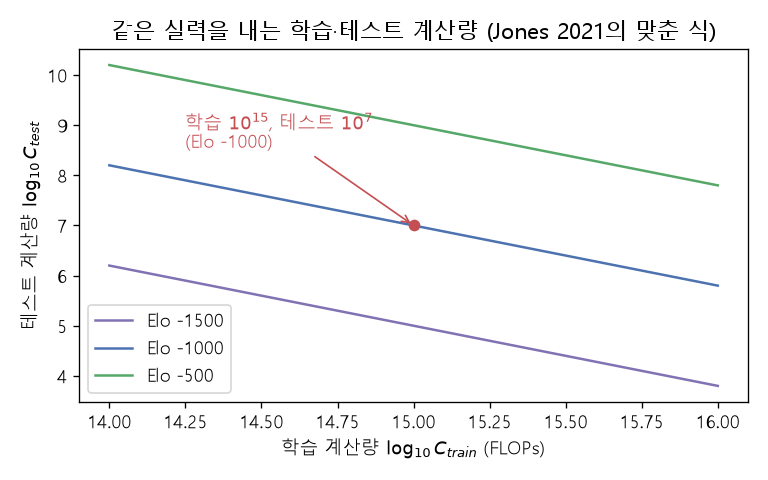
*▲ 직접 그린 그림: 위 식으로 그린 같은 실력 선. 선을 따라 오른쪽([학습](00_%EB%94%A5%EB%9F%AC%EB%8B%9D_%EC%9A%A9%EC%96%B4%EC%82%AC%EC%A0%84.md#training-%ED%95%99%EC%8A%B5) 더)으로 가면 아래(탐색 덜)로 내려간다. 빨간 점이 예제의 ([학습](00_%EB%94%A5%EB%9F%AC%EB%8B%9D_%EC%9A%A9%EC%96%B4%EC%82%AC%EC%A0%84.md#training-%ED%95%99%EC%8A%B5) $10^{15}$, 테스트 $10^{7}$)*

- **탐색은 시험 때, [학습](00_%EB%94%A5%EB%9F%AC%EB%8B%9D_%EC%9A%A9%EC%96%B4%EC%82%AC%EC%A0%84.md#training-%ED%95%99%EC%8A%B5)은 [학습](00_%EB%94%A5%EB%9F%AC%EB%8B%9D_%EC%9A%A9%EC%96%B4%EC%82%AC%EC%A0%84.md#training-%ED%95%99%EC%8A%B5) 때** 계산을 씁니다. 학습해 두면 시험 때 계산이 적게 들고, 탐색하면 [학습](00_%EB%94%A5%EB%9F%AC%EB%8B%9D_%EC%9A%A9%EC%96%B4%EC%82%AC%EC%A0%84.md#training-%ED%95%99%EC%8A%B5)을 덜 해도 됩니다. 어느 쪽이 더 잘 확장되는지는 상황마다 다릅니다.
- 이제부터 딥러닝에서 쓰는 탐색 세 가지, Best-of-N, [빔 서치](00_%EB%94%A5%EB%9F%AC%EB%8B%9D_%EC%9A%A9%EC%96%B4%EC%82%AC%EC%A0%84.md#beam-search-%EB%B9%94-%EC%84%9C%EC%B9%98), 생각의 사슬을 봅니다.

---

## 4. 탐욕 샘플링의 한계

📐 **수학 개념**: [확률의 연쇄법칙과 빔 서치](%EC%88%98%ED%95%99%EA%B0%9C%EB%85%90/04_%ED%99%95%EB%A5%A0%EA%B3%BC_%EC%A0%95%EB%B3%B4/MM39_%ED%99%95%EB%A5%A0%EC%9D%98_%EC%97%B0%EC%87%84%EB%B2%95%EC%B9%99%EA%B3%BC_%EB%B9%94_%EC%84%9C%EC%B9%98.md) · [범주 분포](%EC%88%98%ED%95%99%EA%B0%9C%EB%85%90/04_%ED%99%95%EB%A5%A0%EA%B3%BC_%EC%A0%95%EB%B3%B4/MM35_L2_%ED%9A%8C%EA%B7%80%EC%99%80_%EB%B2%94%EC%A3%BC_%EB%B6%84%ED%8F%AC.md) · [온도 소프트맥스](%EC%88%98%ED%95%99%EA%B0%9C%EB%85%90/12_%EA%B0%95%EA%B1%B4%EC%84%B1%EA%B3%BC_%EC%A0%84%EC%9D%B4/MM65_%EC%98%A8%EB%8F%84_%EC%86%8C%ED%94%84%ED%8A%B8%EB%A7%A5%EC%8A%A4%EC%99%80_%EC%A7%80%EC%8B%9D_%EC%A6%9D%EB%A5%98.md)

### 4.1 교사 강요와 표류

▶ 영상 [15:13](https://youtu.be/mbgFTqKxR7A?t=913)

- 예: 카페인 분자 그림을 [그래프 신경망](00_%EB%94%A5%EB%9F%AC%EB%8B%9D_%EC%9A%A9%EC%96%B4%EC%82%AC%EC%A0%84.md#gnn-graph-neural-network-%EA%B7%B8%EB%9E%98%ED%94%84-%EC%8B%A0%EA%B2%BD%EB%A7%9D)([GNN](00_%EB%94%A5%EB%9F%AC%EB%8B%9D_%EC%9A%A9%EC%96%B4%EC%82%AC%EC%A0%84.md#gnn-graph-neural-network-%EA%B7%B8%EB%9E%98%ED%94%84-%EC%8B%A0%EA%B2%BD%EB%A7%9D))으로 읽고, [LSTM](00_%EB%94%A5%EB%9F%AC%EB%8B%9D_%EC%9A%A9%EC%96%B4%EC%82%AC%EC%A0%84.md#lstm-long-short-term-memory-%EC%9E%A5%EB%8B%A8%EA%B8%B0-%EB%A9%94%EB%AA%A8%EB%A6%AC)이 "가벼운 각성제로 인지 능력을 높인다"는 설명 문장을 씁니다(분자 캡셔닝). 요즘은 [LSTM](00_%EB%94%A5%EB%9F%AC%EB%8B%9D_%EC%9A%A9%EC%96%B4%EC%82%AC%EC%A0%84.md#lstm-long-short-term-memory-%EC%9E%A5%EB%8B%A8%EA%B8%B0-%EB%A9%94%EB%AA%A8%EB%A6%AC) 대신 [트랜스포머](00_%EB%94%A5%EB%9F%AC%EB%8B%9D_%EC%9A%A9%EC%96%B4%EC%82%AC%EC%A0%84.md#transformer-%ED%8A%B8%EB%9E%9C%EC%8A%A4%ED%8F%AC%EB%A8%B8)를 쓰지만 원리는 같습니다.
- **[학습](00_%EB%94%A5%EB%9F%AC%EB%8B%9D_%EC%9A%A9%EC%96%B4%EC%82%AC%EC%A0%84.md#training-%ED%95%99%EC%8A%B5)**: 말뭉치 문장의 [우도](00_%EB%94%A5%EB%9F%AC%EB%8B%9D_%EC%9A%A9%EC%96%B4%EC%82%AC%EC%A0%84.md#likelihood-%EC%9A%B0%EB%8F%84)를 최대로 합니다. 매 위치에서 다음 [토큰](00_%EB%94%A5%EB%9F%AC%EB%8B%9D_%EC%9A%A9%EC%96%B4%EC%82%AC%EC%A0%84.md#token-%ED%86%A0%ED%81%B0)의 [범주 분포](00_%EB%94%A5%EB%9F%AC%EB%8B%9D_%EC%9A%A9%EC%96%B4%EC%82%AC%EC%A0%84.md#categorical-distribution-%EB%B2%94%EC%A3%BC-%EB%B6%84%ED%8F%AC)를 내고, [원-핫](00_%EB%94%A5%EB%9F%AC%EB%8B%9D_%EC%9A%A9%EC%96%B4%EC%82%AC%EC%A0%84.md#one-hot-encoding-%EC%9B%90-%ED%95%AB-%EC%9D%B8%EC%BD%94%EB%94%A9) 정답과의 [교차 엔트로피](00_%EB%94%A5%EB%9F%AC%EB%8B%9D_%EC%9A%A9%EC%96%B4%EC%82%AC%EC%A0%84.md#cross-entropy-%EA%B5%90%EC%B0%A8-%EC%97%94%ED%8A%B8%EB%A1%9C%ED%94%BC)를 줄입니다.
- **[교사 강요](00_%EB%94%A5%EB%9F%AC%EB%8B%9D_%EC%9A%A9%EC%96%B4%EC%82%AC%EC%A0%84.md#teacher-forcing-%EA%B5%90%EC%82%AC-%EA%B0%95%EC%9A%94)**(teacher forcing): 학습할 때 각 단계의 입력으로 **[정답](00_%EB%94%A5%EB%9F%AC%EB%8B%9D_%EC%9A%A9%EC%96%B4%EC%82%AC%EC%A0%84.md#label-%EC%A0%95%EB%8B%B5) 문장의 이전 단어**를 넣어 줍니다([Lec10 8.1](Lec10_%EA%B8%B0%EC%96%B5%EA%B3%BC_%EC%8B%9C%ED%80%80%EC%8A%A4.md#81-%EC%B5%9C%EB%8C%80-%EC%9A%B0%EB%8F%84-%ED%95%99%EC%8A%B5%EA%B3%BC-%EA%B5%90%EC%82%AC-%EA%B0%95%EC%9A%94)).
- **시험할 때**는 [정답](00_%EB%94%A5%EB%9F%AC%EB%8B%9D_%EC%9A%A9%EC%96%B4%EC%82%AC%EC%A0%84.md#label-%EC%A0%95%EB%8B%B5)이 없으므로 모델이 **스스로 뽑은 이전 단어**를 넣습니다. 분포에서 무작위로 뽑거나([샘플링](00_%EB%94%A5%EB%9F%AC%EB%8B%9D_%EC%9A%A9%EC%96%B4%EC%82%AC%EC%A0%84.md#sampling-%EC%83%98%ED%94%8C%EB%A7%81)), 가장 [확률](00_%EB%94%A5%EB%9F%AC%EB%8B%9D_%EC%9A%A9%EC%96%B4%EC%82%AC%EC%A0%84.md#probability-%ED%99%95%EB%A5%A0)이 큰 단어를 고릅니다(**[탐욕 디코딩](00_%EB%94%A5%EB%9F%AC%EB%8B%9D_%EC%9A%A9%EC%96%B4%EC%82%AC%EC%A0%84.md#greedy-decoding-%ED%83%90%EC%9A%95-%EB%94%94%EC%BD%94%EB%94%A9)**). 뽑은 단어가 [학습 데이터](00_%EB%94%A5%EB%9F%AC%EB%8B%9D_%EC%9A%A9%EC%96%B4%EC%82%AC%EC%A0%84.md#training-data-test-data-%ED%95%99%EC%8A%B5-%EB%8D%B0%EC%9D%B4%ED%84%B0%EC%99%80-%EC%8B%9C%ED%97%98-%EB%8D%B0%EC%9D%B4%ED%84%B0)와 조금 다르면 그 뒤의 예측은 [학습](00_%EB%94%A5%EB%9F%AC%EB%8B%9D_%EC%9A%A9%EC%96%B4%EC%82%AC%EC%A0%84.md#training-%ED%95%99%EC%8A%B5) 때 본 적 없는 입력을 받게 되고, 차이가 쌓여 **표류**(drift)합니다.
- 그래서 [학습](00_%EB%94%A5%EB%9F%AC%EB%8B%9D_%EC%9A%A9%EC%96%B4%EC%82%AC%EC%A0%84.md#training-%ED%95%99%EC%8A%B5) 때 최대로 만든 것("[정답](00_%EB%94%A5%EB%9F%AC%EB%8B%9D_%EC%9A%A9%EC%96%B4%EC%82%AC%EC%A0%84.md#label-%EC%A0%95%EB%8B%B5) 이전 단어가 주어졌을 때 다음 단어의 [우도](00_%EB%94%A5%EB%9F%AC%EB%8B%9D_%EC%9A%A9%EC%96%B4%EC%82%AC%EC%A0%84.md#likelihood-%EC%9A%B0%EB%8F%84)")과 시험 때 원하는 것("모델이 뽑은 문장 전체의 [우도](00_%EB%94%A5%EB%9F%AC%EB%8B%9D_%EC%9A%A9%EC%96%B4%EC%82%AC%EC%A0%84.md#likelihood-%EC%9A%B0%EB%8F%84)") 사이에 간극이 생깁니다.

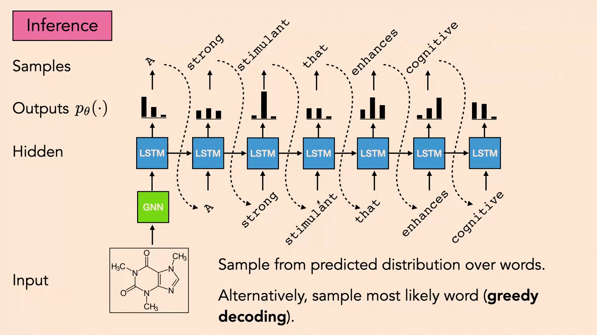
*▲ 강의 슬라이드 [19:40](https://youtu.be/mbgFTqKxR7A?t=1180): 시험 때의 자기회귀 [샘플링](00_%EB%94%A5%EB%9F%AC%EB%8B%9D_%EC%9A%A9%EC%96%B4%EC%82%AC%EC%A0%84.md#sampling-%EC%83%98%ED%94%8C%EB%A7%81). 예측 분포에서 단어를 뽑고(또는 가장 [확률](00_%EB%94%A5%EB%9F%AC%EB%8B%9D_%EC%9A%A9%EC%96%B4%EC%82%AC%EC%A0%84.md#probability-%ED%99%95%EB%A5%A0) 큰 단어를 고르고), 그 단어를 다음 단계 입력으로 넣는다*

### 4.2 탐욕 샘플링은 우도를 최대로 만들지 않는다

▶ 영상 [20:13](https://youtu.be/mbgFTqKxR7A?t=1213)

[자기회귀 모델](00_%EB%94%A5%EB%9F%AC%EB%8B%9D_%EC%9A%A9%EC%96%B4%EC%82%AC%EC%A0%84.md#autoregressive-model-%EC%9E%90%EA%B8%B0%ED%9A%8C%EA%B7%80-%EB%AA%A8%EB%8D%B8)은 문장 [확률](00_%EB%94%A5%EB%9F%AC%EB%8B%9D_%EC%9A%A9%EC%96%B4%EC%82%AC%EC%A0%84.md#probability-%ED%99%95%EB%A5%A0)을 [확률의 연쇄법칙](00_%EB%94%A5%EB%9F%AC%EB%8B%9D_%EC%9A%A9%EC%96%B4%EC%82%AC%EC%A0%84.md#chain-rule-of-probability-%ED%99%95%EB%A5%A0%EC%9D%98-%EC%97%B0%EC%87%84%EB%B2%95%EC%B9%99)으로 나눠 모델링합니다. 우리가 원하는 것은 문장 전체의 [확률](00_%EB%94%A5%EB%9F%AC%EB%8B%9D_%EC%9A%A9%EC%96%B4%EC%82%AC%EC%A0%84.md#probability-%ED%99%95%EB%A5%A0)을 최대로 하는 문장이지만, [탐욕 디코딩](00_%EB%94%A5%EB%9F%AC%EB%8B%9D_%EC%9A%A9%EC%96%B4%EC%82%AC%EC%A0%84.md#greedy-decoding-%ED%83%90%EC%9A%95-%EB%94%94%EC%BD%94%EB%94%A9)은 한 단계씩 가장 큰 것을 고릅니다.

$$
p(\mathbf{x}) = p(x_1)\, p(x_2 \mid x_1) \cdots p(x_n \mid x_1, \dots, x_{n-1}), \qquad
\arg\max_{\mathbf{x}} p(\mathbf{x}) \;\ne\; \Big(\arg\max_{x_1} p(x_1),\ \arg\max_{x_2} p(x_2 \mid \tilde x_1),\ \dots\Big)
$$

기호 풀이

| 기호 | 읽는 법 | 뜻 | 예제 값 |
| --- | --- | --- | --- |
| $\mathbf{x} = (x_1, \dots, x_n)$ | 엑스 | [토큰](00_%EB%94%A5%EB%9F%AC%EB%8B%9D_%EC%9A%A9%EC%96%B4%EC%82%AC%EC%A0%84.md#token-%ED%86%A0%ED%81%B0) $n$개로 된 문장 | (The, cat) |
| $p(x_1)$ | 피 엑스 일 | 첫 [토큰](00_%EB%94%A5%EB%9F%AC%EB%8B%9D_%EC%9A%A9%EC%96%B4%EC%82%AC%EC%A0%84.md#token-%ED%86%A0%ED%81%B0)의 [확률](00_%EB%94%A5%EB%9F%AC%EB%8B%9D_%EC%9A%A9%EC%96%B4%EC%82%AC%EC%A0%84.md#probability-%ED%99%95%EB%A5%A0) | 0.55, 0.45 |
| $p(x_2 \mid x_1)$ | 피 엑스 이 바 엑스 일 | 첫 [토큰](00_%EB%94%A5%EB%9F%AC%EB%8B%9D_%EC%9A%A9%EC%96%B4%EC%82%AC%EC%A0%84.md#token-%ED%86%A0%ED%81%B0)이 주어졌을 때 둘째 [토큰](00_%EB%94%A5%EB%9F%AC%EB%8B%9D_%EC%9A%A9%EC%96%B4%EC%82%AC%EC%A0%84.md#token-%ED%86%A0%ED%81%B0)의 [조건부 확률](00_%EB%94%A5%EB%9F%AC%EB%8B%9D_%EC%9A%A9%EC%96%B4%EC%82%AC%EC%A0%84.md#conditional-probability-%EC%A1%B0%EA%B1%B4%EB%B6%80-%ED%99%95%EB%A5%A0) | 0.4, 0.9 |
| $p(\mathbf{x})$ | 피 엑스 | 문장 전체의 [확률](00_%EB%94%A5%EB%9F%AC%EB%8B%9D_%EC%9A%A9%EC%96%B4%EC%82%AC%EC%A0%84.md#probability-%ED%99%95%EB%A5%A0) ([조건부 확률](00_%EB%94%A5%EB%9F%AC%EB%8B%9D_%EC%9A%A9%EC%96%B4%EC%82%AC%EC%A0%84.md#conditional-probability-%EC%A1%B0%EA%B1%B4%EB%B6%80-%ED%99%95%EB%A5%A0)의 곱) | 0.22, 0.405 |
| $\arg\max_{\mathbf{x}}$ | 아그맥스 | 문장 전체 [확률](00_%EB%94%A5%EB%9F%AC%EB%8B%9D_%EC%9A%A9%EC%96%B4%EC%82%AC%EC%A0%84.md#probability-%ED%99%95%EB%A5%A0)을 가장 크게 하는 문장 | |
| $\tilde x_1$ | 엑스 일 틸드 | 탐욕으로 고른 첫 [토큰](00_%EB%94%A5%EB%9F%AC%EB%8B%9D_%EC%9A%A9%EC%96%B4%EC%82%AC%EC%A0%84.md#token-%ED%86%A0%ED%81%B0) | A |
| $\ne$ | 같지 않다 | 두 방법의 답이 다를 수 있다 | |

예제와 풀이

**문제**: 첫 [토큰](00_%EB%94%A5%EB%9F%AC%EB%8B%9D_%EC%9A%A9%EC%96%B4%EC%82%AC%EC%A0%84.md#token-%ED%86%A0%ED%81%B0)이 "A"일 [확률](00_%EB%94%A5%EB%9F%AC%EB%8B%9D_%EC%9A%A9%EC%96%B4%EC%82%AC%EC%A0%84.md#probability-%ED%99%95%EB%A5%A0) 0.55, "The"일 [확률](00_%EB%94%A5%EB%9F%AC%EB%8B%9D_%EC%9A%A9%EC%96%B4%EC%82%AC%EC%A0%84.md#probability-%ED%99%95%EB%A5%A0) 0.45다. "A" 뒤에 올 가장 그럴듯한 [토큰](00_%EB%94%A5%EB%9F%AC%EB%8B%9D_%EC%9A%A9%EC%96%B4%EC%82%AC%EC%A0%84.md#token-%ED%86%A0%ED%81%B0)의 [확률](00_%EB%94%A5%EB%9F%AC%EB%8B%9D_%EC%9A%A9%EC%96%B4%EC%82%AC%EC%A0%84.md#probability-%ED%99%95%EB%A5%A0)은 0.4, "The" 뒤에 올 가장 그럴듯한 [토큰](00_%EB%94%A5%EB%9F%AC%EB%8B%9D_%EC%9A%A9%EC%96%B4%EC%82%AC%EC%A0%84.md#token-%ED%86%A0%ED%81%B0)의 [확률](00_%EB%94%A5%EB%9F%AC%EB%8B%9D_%EC%9A%A9%EC%96%B4%EC%82%AC%EC%A0%84.md#probability-%ED%99%95%EB%A5%A0)은 0.9다. [탐욕 디코딩](00_%EB%94%A5%EB%9F%AC%EB%8B%9D_%EC%9A%A9%EC%96%B4%EC%82%AC%EC%A0%84.md#greedy-decoding-%ED%83%90%EC%9A%95-%EB%94%94%EC%BD%94%EB%94%A9)이 고른 문장과 가장 [확률](00_%EB%94%A5%EB%9F%AC%EB%8B%9D_%EC%9A%A9%EC%96%B4%EC%82%AC%EC%A0%84.md#probability-%ED%99%95%EB%A5%A0) 높은 문장의 [확률](00_%EB%94%A5%EB%9F%AC%EB%8B%9D_%EC%9A%A9%EC%96%B4%EC%82%AC%EC%A0%84.md#probability-%ED%99%95%EB%A5%A0)은 각각?

**주어진 값**
- $p(\text{A}) = 0.55$, $p(\text{The}) = 0.45$ (첫 [토큰](00_%EB%94%A5%EB%9F%AC%EB%8B%9D_%EC%9A%A9%EC%96%B4%EC%82%AC%EC%A0%84.md#token-%ED%86%A0%ED%81%B0) [확률](00_%EB%94%A5%EB%9F%AC%EB%8B%9D_%EC%9A%A9%EC%96%B4%EC%82%AC%EC%A0%84.md#probability-%ED%99%95%EB%A5%A0))
- $\max p(x_2 \mid \text{A}) = 0.4$, $\max p(x_2 \mid \text{The}) = 0.9$ (각 첫 [토큰](00_%EB%94%A5%EB%9F%AC%EB%8B%9D_%EC%9A%A9%EC%96%B4%EC%82%AC%EC%A0%84.md#token-%ED%86%A0%ED%81%B0) 뒤 최선의 둘째 [토큰](00_%EB%94%A5%EB%9F%AC%EB%8B%9D_%EC%9A%A9%EC%96%B4%EC%82%AC%EC%A0%84.md#token-%ED%86%A0%ED%81%B0) [확률](00_%EB%94%A5%EB%9F%AC%EB%8B%9D_%EC%9A%A9%EC%96%B4%EC%82%AC%EC%A0%84.md#probability-%ED%99%95%EB%A5%A0))

**풀이**
1. 식을 그대로 쓴다: $p(\mathbf{x}) = p(x_1)\, p(x_2 \mid x_1)$
2. 탐욕은 첫 [토큰](00_%EB%94%A5%EB%9F%AC%EB%8B%9D_%EC%9A%A9%EC%96%B4%EC%82%AC%EC%A0%84.md#token-%ED%86%A0%ED%81%B0)에서 큰 쪽을 고른다: $0.55 > 0.45$ 이므로 $\tilde x_1 = \text{A}$
3. 탐욕 문장의 값을 대입한다: $p(\text{A}, \cdot) = 0.55 \times 0.4$
4. 곱한다: $0.55 \times 0.4 = 0.22$
5. 다른 문장의 값을 대입한다: $p(\text{The}, \cdot) = 0.45 \times 0.9$
6. 곱한다: $0.45 \times 0.9 = 0.405$
7. 비교한다: $0.405 > 0.22$

**답**: [탐욕 디코딩](00_%EB%94%A5%EB%9F%AC%EB%8B%9D_%EC%9A%A9%EC%96%B4%EC%82%AC%EC%A0%84.md#greedy-decoding-%ED%83%90%EC%9A%95-%EB%94%94%EC%BD%94%EB%94%A9) 문장 **0.22**, 가장 [확률](00_%EB%94%A5%EB%9F%AC%EB%8B%9D_%EC%9A%A9%EC%96%B4%EC%82%AC%EC%A0%84.md#probability-%ED%99%95%EB%A5%A0) 높은 문장(The로 시작) **0.405**. 첫걸음에서 욕심을 내면 전체로는 손해를 볼 수 있다.

내 이해

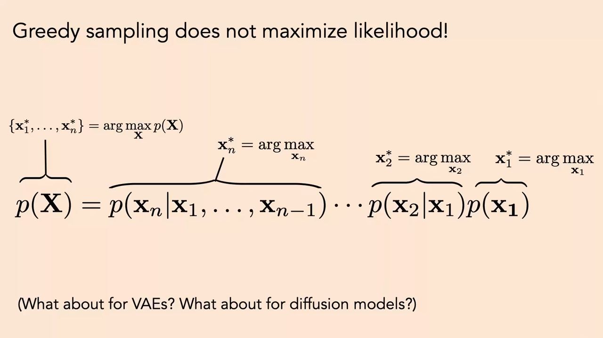
*▲ 강의 슬라이드 [24:10](https://youtu.be/mbgFTqKxR7A?t=1450): "탐욕 [샘플링](00_%EB%94%A5%EB%9F%AC%EB%8B%9D_%EC%9A%A9%EC%96%B4%EC%82%AC%EC%A0%84.md#sampling-%EC%83%98%ED%94%8C%EB%A7%81)은 [우도](00_%EB%94%A5%EB%9F%AC%EB%8B%9D_%EC%9A%A9%EC%96%B4%EC%82%AC%EC%A0%84.md#likelihood-%EC%9A%B0%EB%8F%84)를 최대로 만들지 않는다." 위는 결합 [확률](00_%EB%94%A5%EB%9F%AC%EB%8B%9D_%EC%9A%A9%EC%96%B4%EC%82%AC%EC%A0%84.md#probability-%ED%99%95%EB%A5%A0)의 [argmax](00_%EB%94%A5%EB%9F%AC%EB%8B%9D_%EC%9A%A9%EC%96%B4%EC%82%AC%EC%A0%84.md#argmax-%EC%B5%9C%EB%8C%93%EA%B0%92-%EC%9C%84%EC%B9%98), 아래 괄호는 [조건부 확률](00_%EB%94%A5%EB%9F%AC%EB%8B%9D_%EC%9A%A9%EC%96%B4%EC%82%AC%EC%A0%84.md#conditional-probability-%EC%A1%B0%EA%B1%B4%EB%B6%80-%ED%99%95%EB%A5%A0) 하나씩의 [argmax](00_%EB%94%A5%EB%9F%AC%EB%8B%9D_%EC%9A%A9%EC%96%B4%EC%82%AC%EC%A0%84.md#argmax-%EC%B5%9C%EB%8C%93%EA%B0%92-%EC%9C%84%EC%B9%98). 강사는 둘을 같은 기호로 썼지만 값이 다르다고 답했다*

- **열린 질문: [VAE](00_%EB%94%A5%EB%9F%AC%EB%8B%9D_%EC%9A%A9%EC%96%B4%EC%82%AC%EC%A0%84.md#variational-autoencoder-vae-%EB%B3%80%EB%B6%84-%EC%98%A4%ED%86%A0%EC%9D%B8%EC%BD%94%EB%8D%94)와 [확산 모델](00_%EB%94%A5%EB%9F%AC%EB%8B%9D_%EC%9A%A9%EC%96%B4%EC%82%AC%EC%A0%84.md#diffusion-model-%ED%99%95%EC%82%B0-%EB%AA%A8%EB%8D%B8)은?** 강사의 생각은 이렇습니다. [확산 모델](00_%EB%94%A5%EB%9F%AC%EB%8B%9D_%EC%9A%A9%EC%96%B4%EC%82%AC%EC%A0%84.md#diffusion-model-%ED%99%95%EC%82%B0-%EB%AA%A8%EB%8D%B8)도 잡음을 한 단계씩 조금 지우므로, 단계마다 "덜 시끄러운 그림"을 최대로 고르는 것이 최종 그림의 [확률](00_%EB%94%A5%EB%9F%AC%EB%8B%9D_%EC%9A%A9%EC%96%B4%EC%82%AC%EC%A0%84.md#probability-%ED%99%95%EB%A5%A0)을 최대로 만들지는 않습니다(같은 문제). [VAE](00_%EB%94%A5%EB%9F%AC%EB%8B%9D_%EC%9A%A9%EC%96%B4%EC%82%AC%EC%A0%84.md#variational-autoencoder-vae-%EB%B3%80%EB%B6%84-%EC%98%A4%ED%86%A0%EC%9D%B8%EC%BD%94%EB%8D%94)는 인코드·디코드 한 단계뿐이라 순차적으로 벗어날 여지가 없습니다.
- [언어 모델](00_%EB%94%A5%EB%9F%AC%EB%8B%9D_%EC%9A%A9%EC%96%B4%EC%82%AC%EC%A0%84.md#language-model-%EC%96%B8%EC%96%B4-%EB%AA%A8%EB%8D%B8)에서는 탐욕보다 나은 추론 연구가 많지만 [확산 모델](00_%EB%94%A5%EB%9F%AC%EB%8B%9D_%EC%9A%A9%EC%96%B4%EC%82%AC%EC%A0%84.md#diffusion-model-%ED%99%95%EC%82%B0-%EB%AA%A8%EB%8D%B8)에서는 적으므로, "[확산 모델](00_%EB%94%A5%EB%9F%AC%EB%8B%9D_%EC%9A%A9%EC%96%B4%EC%82%AC%EC%A0%84.md#diffusion-model-%ED%99%95%EC%82%B0-%EB%AA%A8%EB%8D%B8)에서 더 [확률](00_%EB%94%A5%EB%9F%AC%EB%8B%9D_%EC%9A%A9%EC%96%B4%EC%82%AC%EC%A0%84.md#probability-%ED%99%95%EB%A5%A0) 높은 표본을 뽑는 법"은 좋은 연구 주제라고 강사는 말합니다.
- [언어 모델](00_%EB%94%A5%EB%9F%AC%EB%8B%9D_%EC%9A%A9%EC%96%B4%EC%82%AC%EC%A0%84.md#language-model-%EC%96%B8%EC%96%B4-%EB%AA%A8%EB%8D%B8)은 보통 분포에서 **무작위로** 뽑으므로, 운 나쁘게 [확률](00_%EB%94%A5%EB%9F%AC%EB%8B%9D_%EC%9A%A9%EC%96%B4%EC%82%AC%EC%A0%84.md#probability-%ED%99%95%EB%A5%A0) 낮은 설명이 나올 수도 있습니다. 더 [확률](00_%EB%94%A5%EB%9F%AC%EB%8B%9D_%EC%9A%A9%EC%96%B4%EC%82%AC%EC%A0%84.md#probability-%ED%99%95%EB%A5%A0) 높은 표본을 찾는 추론이 필요한 이유입니다.

질의응답 정리 [21:19](https://youtu.be/mbgFTqKxR7A?t=1279)

- **슬라이드의 등호가 틀린 것 아닌가?** 등호([연쇄법칙](00_%EB%94%A5%EB%9F%AC%EB%8B%9D_%EC%9A%A9%EC%96%B4%EC%82%AC%EC%A0%84.md#chain-rule-%EC%97%B0%EC%87%84%EB%B2%95%EC%B9%99))는 맞다. 다만 결합 [확률](00_%EB%94%A5%EB%9F%AC%EB%8B%9D_%EC%9A%A9%EC%96%B4%EC%82%AC%EC%A0%84.md#probability-%ED%99%95%EB%A5%A0)의 [argmax](00_%EB%94%A5%EB%9F%AC%EB%8B%9D_%EC%9A%A9%EC%96%B4%EC%82%AC%EC%A0%84.md#argmax-%EC%B5%9C%EB%8C%93%EA%B0%92-%EC%9C%84%EC%B9%98)와 [조건부 확률](00_%EB%94%A5%EB%9F%AC%EB%8B%9D_%EC%9A%A9%EC%96%B4%EC%82%AC%EC%A0%84.md#conditional-probability-%EC%A1%B0%EA%B1%B4%EB%B6%80-%ED%99%95%EB%A5%A0) 하나씩의 [argmax](00_%EB%94%A5%EB%9F%AC%EB%8B%9D_%EC%9A%A9%EC%96%B4%EC%82%AC%EC%A0%84.md#argmax-%EC%B5%9C%EB%8C%93%EA%B0%92-%EC%9C%84%EC%B9%98)는 같은 값이 아니다. 기호에 프라임을 붙였어야 했다.

---

## 5. 더 나은 샘플 찾기

📐 **수학 개념**: [Best-of-N과 적중 확률](%EC%88%98%ED%95%99%EA%B0%9C%EB%85%90/13_%EC%96%B8%EC%96%B4_%EB%AA%A8%EB%8D%B8%EA%B3%BC_%EC%B6%94%EB%A1%A0/MM80_Best-of-N%EA%B3%BC_%EC%A0%81%EC%A4%91_%ED%99%95%EB%A5%A0.md) · [확률의 연쇄법칙과 빔 서치](%EC%88%98%ED%95%99%EA%B0%9C%EB%85%90/04_%ED%99%95%EB%A5%A0%EA%B3%BC_%EC%A0%95%EB%B3%B4/MM39_%ED%99%95%EB%A5%A0%EC%9D%98_%EC%97%B0%EC%87%84%EB%B2%95%EC%B9%99%EA%B3%BC_%EB%B9%94_%EC%84%9C%EC%B9%98.md) · [몬테카를로와 중요도 샘플링](%EC%88%98%ED%95%99%EA%B0%9C%EB%85%90/11_%EC%83%9D%EC%84%B1_%EB%AA%A8%EB%8D%B8/MM55_%EB%AA%AC%ED%85%8C%EC%B9%B4%EB%A5%BC%EB%A1%9C%EC%99%80_%EC%A4%91%EC%9A%94%EB%8F%84_%EC%83%98%ED%94%8C%EB%A7%81.md)

### 5.1 Best-of-N

▶ 영상 [25:21](https://youtu.be/mbgFTqKxR7A?t=1521)

**[Best-of-N](00_%EB%94%A5%EB%9F%AC%EB%8B%9D_%EC%9A%A9%EC%96%B4%EC%82%AC%EC%A0%84.md#best-of-n-sampling-best-of-n-%EC%83%98%ED%94%8C%EB%A7%81)**은 아주 단순합니다. 평소처럼 무작위 [샘플링](00_%EB%94%A5%EB%9F%AC%EB%8B%9D_%EC%9A%A9%EC%96%B4%EC%82%AC%EC%A0%84.md#sampling-%EC%83%98%ED%94%8C%EB%A7%81)을 **N번 [독립](00_%EB%94%A5%EB%9F%AC%EB%8B%9D_%EC%9A%A9%EC%96%B4%EC%82%AC%EC%A0%84.md#independence-%EB%8F%85%EB%A6%BD)으로** 하고, 각 문장의 전체 [우도](00_%EB%94%A5%EB%9F%AC%EB%8B%9D_%EC%9A%A9%EC%96%B4%EC%82%AC%EC%A0%84.md#likelihood-%EC%9A%B0%EB%8F%84)를 계산해 가장 큰 것을 고릅니다. 뽑을 때는 [최대 우도](00_%EB%94%A5%EB%9F%AC%EB%8B%9D_%EC%9A%A9%EC%96%B4%EC%82%AC%EC%A0%84.md#maximum-likelihood-%EC%B5%9C%EB%8C%80-%EC%9A%B0%EB%8F%84) 문장이 아니라 무작위 문장을 뽑지만, 어떤 문장이든 그 [우도](00_%EB%94%A5%EB%9F%AC%EB%8B%9D_%EC%9A%A9%EC%96%B4%EC%82%AC%EC%A0%84.md#likelihood-%EC%9A%B0%EB%8F%84)는 [연쇄법칙](00_%EB%94%A5%EB%9F%AC%EB%8B%9D_%EC%9A%A9%EC%96%B4%EC%82%AC%EC%A0%84.md#chain-rule-%EC%97%B0%EC%87%84%EB%B2%95%EC%B9%99)으로 [조건부 확률](00_%EB%94%A5%EB%9F%AC%EB%8B%9D_%EC%9A%A9%EC%96%B4%EC%82%AC%EC%A0%84.md#conditional-probability-%EC%A1%B0%EA%B1%B4%EB%B6%80-%ED%99%95%EB%A5%A0)을 곱해 계산할 수 있습니다.

$$
\hat y = \arg\max_{i \in \{1, \dots, N\}} p_\theta(y^{(i)} \mid x), \qquad p_\theta(y_1, \dots, y_T \mid x) = \prod_{t=1}^{T} p_\theta(y_t \mid y_1, \dots, y_{t-1}, x)
$$

기호 풀이

| 기호 | 읽는 법 | 뜻 | 예제 값 |
| --- | --- | --- | --- |
| $x$ | 엑스 | 입력 (분자 그림, 질문) | 카페인 분자 |
| $y^{(i)}$ | 와이 아이 | $i$번째로 뽑은 출력 문장 | 문장 1, 문장 2 |
| $N$ | 엔 | 뽑은 문장 수 | 2 |
| $y_t$ | 와이 티 | 문장의 $t$번째 [토큰](00_%EB%94%A5%EB%9F%AC%EB%8B%9D_%EC%9A%A9%EC%96%B4%EC%82%AC%EC%A0%84.md#token-%ED%86%A0%ED%81%B0) | |
| $T$ | 티 | 문장 길이 ([토큰](00_%EB%94%A5%EB%9F%AC%EB%8B%9D_%EC%9A%A9%EC%96%B4%EC%82%AC%EC%A0%84.md#token-%ED%86%A0%ED%81%B0) 수) | 3 |
| $\prod_{t=1}^{T}$ | 파이 | $t = 1$부터 $T$까지 곱한다 | |
| $p_\theta(\cdot)$ | 피 세타 | [파라미터](00_%EB%94%A5%EB%9F%AC%EB%8B%9D_%EC%9A%A9%EC%96%B4%EC%82%AC%EC%A0%84.md#parameter-%ED%8C%8C%EB%9D%BC%EB%AF%B8%ED%84%B0) $\theta$인 모델의 [확률](00_%EB%94%A5%EB%9F%AC%EB%8B%9D_%EC%9A%A9%EC%96%B4%EC%82%AC%EC%A0%84.md#probability-%ED%99%95%EB%A5%A0) | 0.36, 0.486 |
| $\hat y$ | 와이 햇 | 고른 문장 | 문장 2 |

예제와 풀이

**문제**: 같은 분자에 설명 문장 2개를 뽑았다. 문장 1의 토큰별 [조건부 확률](00_%EB%94%A5%EB%9F%AC%EB%8B%9D_%EC%9A%A9%EC%96%B4%EC%82%AC%EC%A0%84.md#conditional-probability-%EC%A1%B0%EA%B1%B4%EB%B6%80-%ED%99%95%EB%A5%A0)은 0.9, 0.5, 0.8이고, 문장 2는 0.6, 0.9, 0.9다. Best-of-2는 어느 문장을 고르나?

**주어진 값**
- $N = 2$ (뽑은 문장 수)
- 문장 1: $0.9, 0.5, 0.8$ (토큰별 [조건부 확률](00_%EB%94%A5%EB%9F%AC%EB%8B%9D_%EC%9A%A9%EC%96%B4%EC%82%AC%EC%A0%84.md#conditional-probability-%EC%A1%B0%EA%B1%B4%EB%B6%80-%ED%99%95%EB%A5%A0))
- 문장 2: $0.6, 0.9, 0.9$ (토큰별 [조건부 확률](00_%EB%94%A5%EB%9F%AC%EB%8B%9D_%EC%9A%A9%EC%96%B4%EC%82%AC%EC%A0%84.md#conditional-probability-%EC%A1%B0%EA%B1%B4%EB%B6%80-%ED%99%95%EB%A5%A0))

**풀이**
1. 식을 그대로 쓴다: $p_\theta(y \mid x) = \prod_{t=1}^{T} p_\theta(y_t \mid y_1, \dots, y_{t-1}, x)$
2. 값을 대입한다 (곱을 세 항으로 펼친다): $p(\text{문장 1}) = 0.9 \times 0.5 \times 0.8$, $p(\text{문장 2}) = 0.6 \times 0.9 \times 0.9$
3. 문장 1의 앞 두 수를 곱한다: $0.9 \times 0.5 = 0.45$ 이므로 $p(\text{문장 1}) = 0.45 \times 0.8$
4. 마저 곱한다: $0.45 \times 0.8 = 0.36$
5. 문장 2의 앞 두 수를 곱한다: $0.6 \times 0.9 = 0.54$ 이므로 $p(\text{문장 2}) = 0.54 \times 0.9$
6. 마저 곱한다: $0.54 \times 0.9 = 0.486$
7. 큰 쪽을 고른다: $0.486 > 0.36$ 이므로 $\hat y = \text{문장 2}$

**답**: **문장 2**([확률](00_%EB%94%A5%EB%9F%AC%EB%8B%9D_%EC%9A%A9%EC%96%B4%EC%82%AC%EC%A0%84.md#probability-%ED%99%95%EB%A5%A0) 0.486). 첫 [토큰](00_%EB%94%A5%EB%9F%AC%EB%8B%9D_%EC%9A%A9%EC%96%B4%EC%82%AC%EC%A0%84.md#token-%ED%86%A0%ED%81%B0) [확률](00_%EB%94%A5%EB%9F%AC%EB%8B%9D_%EC%9A%A9%EC%96%B4%EC%82%AC%EC%A0%84.md#probability-%ED%99%95%EB%A5%A0)(0.6)은 문장 1(0.9)보다 낮았지만 전체로는 더 그럴듯하다.

내 이해

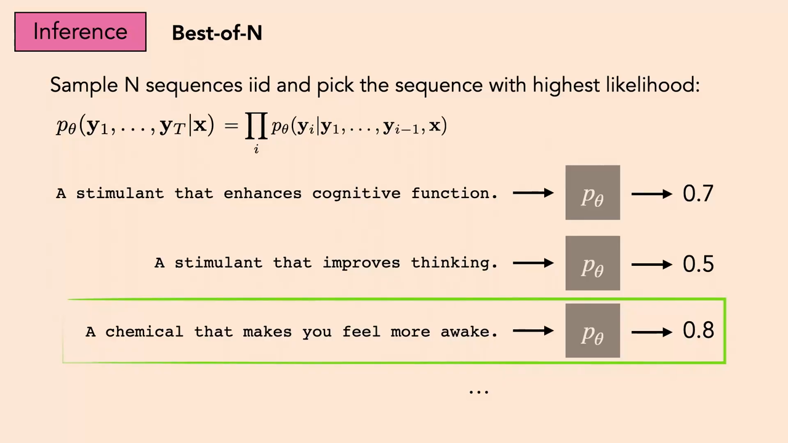
*▲ 강의 슬라이드 [28:30](https://youtu.be/mbgFTqKxR7A?t=1710): Best-of-N. [독립](00_%EB%94%A5%EB%9F%AC%EB%8B%9D_%EC%9A%A9%EC%96%B4%EC%82%AC%EC%A0%84.md#independence-%EB%8F%85%EB%A6%BD)으로 뽑은 문장마다 모델 [확률](00_%EB%94%A5%EB%9F%AC%EB%8B%9D_%EC%9A%A9%EC%96%B4%EC%82%AC%EC%A0%84.md#probability-%ED%99%95%EB%A5%A0)을 계산해(0.7, 0.5, 0.8) 가장 큰 "A chemical that makes you feel more awake."(0.8)를 고른다*

- 같은 프롬프트를 [언어 모델](00_%EB%94%A5%EB%9F%AC%EB%8B%9D_%EC%9A%A9%EC%96%B4%EC%82%AC%EC%A0%84.md#language-model-%EC%96%B8%EC%96%B4-%EB%AA%A8%EB%8D%B8)에 두 번 넣으면 보통 다른 답이 나오는 것도 분포에서 뽑기 때문입니다.
- 강사는 Best-of-N이 "본질적으로 [기각 샘플링](00_%EB%94%A5%EB%9F%AC%EB%8B%9D_%EC%9A%A9%EC%96%B4%EC%82%AC%EC%A0%84.md#rejection-sampling-%EA%B8%B0%EA%B0%81-%EC%83%98%ED%94%8C%EB%A7%81)"이고, 아는 한 **지금 어떤 방법만큼이나 잘 된다**고 말합니다. N을 늘리면 얼마나 좋아지는지는 [MM80_Best-of-N과_적중_확률](%EC%88%98%ED%95%99%EA%B0%9C%EB%85%90/13_%EC%96%B8%EC%96%B4_%EB%AA%A8%EB%8D%B8%EA%B3%BC_%EC%B6%94%EB%A1%A0/MM80_Best-of-N%EA%B3%BC_%EC%A0%81%EC%A4%91_%ED%99%95%EB%A5%A0.md)에서 계산합니다.

질의응답 정리 [26:28](https://youtu.be/mbgFTqKxR7A?t=1588)

- **매 단계 다음 [토큰](00_%EB%94%A5%EB%9F%AC%EB%8B%9D_%EC%9A%A9%EC%96%B4%EC%82%AC%EC%A0%84.md#token-%ED%86%A0%ED%81%B0)을 [확률](00_%EB%94%A5%EB%9F%AC%EB%8B%9D_%EC%9A%A9%EC%96%B4%EC%82%AC%EC%A0%84.md#probability-%ED%99%95%EB%A5%A0)에 비례해 뽑나?** 그렇다. 조건부 [범주 분포](00_%EB%94%A5%EB%9F%AC%EB%8B%9D_%EC%9A%A9%EC%96%B4%EC%82%AC%EC%A0%84.md#categorical-distribution-%EB%B2%94%EC%A3%BC-%EB%B6%84%ED%8F%AC)에서 뽑는다. [온도](00_%EB%94%A5%EB%9F%AC%EB%8B%9D_%EC%9A%A9%EC%96%B4%EC%82%AC%EC%A0%84.md#softmax-temperature-%EC%86%8C%ED%94%84%ED%8A%B8%EB%A7%A5%EC%8A%A4-%EC%98%A8%EB%8F%84)를 1로 두면 데이터 분포의 [편향](00_%EB%94%A5%EB%9F%AC%EB%8B%9D_%EC%9A%A9%EC%96%B4%EC%82%AC%EC%A0%84.md#bias-%ED%8E%B8%ED%96%A5) 없는 표본, 온도를 낮추면 [확률](00_%EB%94%A5%EB%9F%AC%EB%8B%9D_%EC%9A%A9%EC%96%B4%EC%82%AC%EC%A0%84.md#probability-%ED%99%95%EB%A5%A0) 높은 표본 쪽(최빈값 추구)으로 간다.
- **모든 조합을 다 시도하나? 너무 비싸지 않나?** 모든 조합을 보면 진짜 [최대 우도](00_%EB%94%A5%EB%9F%AC%EB%8B%9D_%EC%9A%A9%EC%96%B4%EC%82%AC%EC%A0%84.md#maximum-likelihood-%EC%B5%9C%EB%8C%80-%EC%9A%B0%EB%8F%84) 문장을 찾지만 너무 비싸다. 대신 온도를 조금 낮춰 뽑는다. 온도 0은 탐욕 표본이라 [확률](00_%EB%94%A5%EB%9F%AC%EB%8B%9D_%EC%9A%A9%EC%96%B4%EC%82%AC%EC%A0%84.md#probability-%ED%99%95%EB%A5%A0)을 최대로 하지 못하고, 온도 무한대는 아무 문장이나 뒤지는 것이므로 그 사이를 쓴다.
- **좋은 답에서 단어 하나씩 바꿔 개선하면?** 좋은 생각이다. [MCMC](00_%EB%94%A5%EB%9F%AC%EB%8B%9D_%EC%9A%A9%EC%96%B4%EC%82%AC%EC%A0%84.md#mcmc-markov-chain-monte-carlo-%EB%A7%88%EB%A5%B4%EC%BD%94%ED%94%84-%EC%97%B0%EC%87%84-%EB%AA%AC%ED%85%8C%EC%B9%B4%EB%A5%BC%EB%A1%9C), 깁스 [샘플링](00_%EB%94%A5%EB%9F%AC%EB%8B%9D_%EC%9A%A9%EC%96%B4%EC%82%AC%EC%A0%84.md#sampling-%EC%83%98%ED%94%8C%EB%A7%81), 언덕 오르기(국소 변경 중 개선되는 것 택하기) 같은 최적화·통계적 추론 방법이 모두 여기에 해당한다. "이 글을 더 낫게 10가지로 다시 써 봐"라고 [언어 모델](00_%EB%94%A5%EB%9F%AC%EB%8B%9D_%EC%9A%A9%EC%96%B4%EC%82%AC%EC%A0%84.md#language-model-%EC%96%B8%EC%96%B4-%EB%AA%A8%EB%8D%B8)에 시키는 것도 요즘 쓰는 방법이다.

> [!TIP]
> **🆕 2026 업데이트: Best-of-N보다 계산을 아껴 쓰는 법**
> - **강의**: Best-of-N이 가장 단순하면서도 아는 한 어떤 방법만큼 잘 된다(2024년 가을).
> - **현재**: Snell 외(2024)는 [테스트 시점 계산](00_%EB%94%A5%EB%9F%AC%EB%8B%9D_%EC%9A%A9%EC%96%B4%EC%82%AC%EC%A0%84.md#test-time-compute-%ED%85%8C%EC%8A%A4%ED%8A%B8-%EC%8B%9C%EC%A0%90-%EA%B3%84%EC%82%B0)을 늘리는 여러 방법([검증기](00_%EB%94%A5%EB%9F%AC%EB%8B%9D_%EC%9A%A9%EC%96%B4%EC%82%AC%EC%A0%84.md#verifier-%EA%B2%80%EC%A6%9D%EA%B8%B0)로 탐색하기, 답을 고쳐 쓰기)의 효과가 **문제 난이도에 따라 크게 달라진다**는 것을 보였습니다. 문제마다 계산을 적응적으로 나눠 주는 "계산 최적" 전략은 같은 효과를 Best-of-N보다 **4배 넘게 적은 계산**으로 냈고, [FLOPs](00_%EB%94%A5%EB%9F%AC%EB%8B%9D_%EC%9A%A9%EC%96%B4%EC%82%AC%EC%A0%84.md#flops-pf-day-%EB%B6%80%EB%8F%99%EC%86%8C%EC%88%98%EC%A0%90-%EC%97%B0%EC%82%B0-%EC%88%98%EC%99%80-%ED%8E%98%ED%83%80%ED%94%8C%EB%A1%AD-%EC%9D%BC)를 맞춘 비교에서 작은 모델이 꽤 풀 수 있는 문제라면 [테스트 시점 계산](00_%EB%94%A5%EB%9F%AC%EB%8B%9D_%EC%9A%A9%EC%96%B4%EC%82%AC%EC%A0%84.md#test-time-compute-%ED%85%8C%EC%8A%A4%ED%8A%B8-%EC%8B%9C%EC%A0%90-%EA%B3%84%EC%82%B0)을 더 쓴 작은 모델이 **14배 큰 모델**을 이길 수 있었습니다. Best-of-N은 지금도 기본 비교 기준(baseline)으로 쓰입니다.
> - **출처**: [Snell, Lee, Xu, Kumar, "Scaling LLM Test-Time Compute Optimally can be More Effective than Scaling Model Parameters", arXiv 2408.03314 (2024)](https://arxiv.org/abs/2408.03314)

### 5.2 빔 서치

▶ 영상 [29:14](https://youtu.be/mbgFTqKxR7A?t=1754)

- **[빔 서치](00_%EB%94%A5%EB%9F%AC%EB%8B%9D_%EC%9A%A9%EC%96%B4%EC%82%AC%EC%A0%84.md#beam-search-%EB%B9%94-%EC%84%9C%EC%B9%98)**는 [트리 탐색](00_%EB%94%A5%EB%9F%AC%EB%8B%9D_%EC%9A%A9%EC%96%B4%EC%82%AC%EC%A0%84.md#tree-search-%ED%8A%B8%EB%A6%AC-%ED%83%90%EC%83%89)의 한 형태입니다. 생성하는 매 단계에서 지금까지 가장 좋은 후보 **상위 k개**를 기억해 두고, 하나가 아니라 여러 갈래를 동시에 펼칩니다. 예: "strong"과 "mild"가 비슷하게 그럴듯하면 둘 다 들고 가고, 각각에서 다시 가장 그럴듯한 두 갈래를 펼칩니다. 끝에서 전체 [확률](00_%EB%94%A5%EB%9F%AC%EB%8B%9D_%EC%9A%A9%EC%96%B4%EC%82%AC%EC%A0%84.md#probability-%ED%99%95%EB%A5%A0)이 가장 큰 경로를 고릅니다([Lec10 8.2](Lec10_%EA%B8%B0%EC%96%B5%EA%B3%BC_%EC%8B%9C%ED%80%80%EC%8A%A4.md#82-%EB%B9%94-%EC%84%9C%EC%B9%98)).
- Best-of-N이 서로 독립인 무작위 탐색이라면, [빔 서치](00_%EB%94%A5%EB%9F%AC%EB%8B%9D_%EC%9A%A9%EC%96%B4%EC%82%AC%EC%A0%84.md#beam-search-%EB%B9%94-%EC%84%9C%EC%B9%98)는 나무 모양의 탐색입니다. 생각은 같습니다.
- 강사의 평: Best-of-N이 가장 단순하고 그만큼 잘 되며, [빔 서치](00_%EB%94%A5%EB%9F%AC%EB%8B%9D_%EC%9A%A9%EC%96%B4%EC%82%AC%EC%A0%84.md#beam-search-%EB%B9%94-%EC%84%9C%EC%B9%98)는 그보다 조금 발전한 방법 중 가장 인기 있습니다. [언어 모델](00_%EB%94%A5%EB%9F%AC%EB%8B%9D_%EC%9A%A9%EC%96%B4%EC%82%AC%EC%A0%84.md#language-model-%EC%96%B8%EC%96%B4-%EB%AA%A8%EB%8D%B8) 설정에 "[빔 서치](00_%EB%94%A5%EB%9F%AC%EB%8B%9D_%EC%9A%A9%EC%96%B4%EC%82%AC%EC%A0%84.md#beam-search-%EB%B9%94-%EC%84%9C%EC%B9%98) 켜기/끄기"가 있기도 합니다.

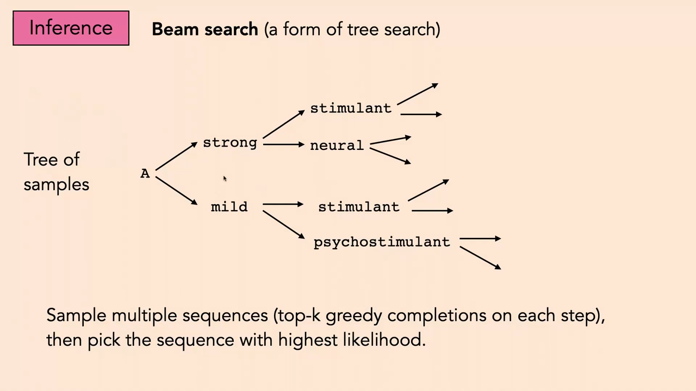
*▲ 강의 슬라이드 [30:00](https://youtu.be/mbgFTqKxR7A?t=1800): [빔 서치](00_%EB%94%A5%EB%9F%AC%EB%8B%9D_%EC%9A%A9%EC%96%B4%EC%82%AC%EC%A0%84.md#beam-search-%EB%B9%94-%EC%84%9C%EC%B9%98)([트리 탐색](00_%EB%94%A5%EB%9F%AC%EB%8B%9D_%EC%9A%A9%EC%96%B4%EC%82%AC%EC%A0%84.md#tree-search-%ED%8A%B8%EB%A6%AC-%ED%83%90%EC%83%89)의 한 형태). 매 단계 상위 k개 갈래를 펼친 표본 나무에서 [확률](00_%EB%94%A5%EB%9F%AC%EB%8B%9D_%EC%9A%A9%EC%96%B4%EC%82%AC%EC%A0%84.md#probability-%ED%99%95%EB%A5%A0)이 가장 큰 문장을 고른다*

### 5.3 생각의 사슬

▶ 영상 [30:31](https://youtu.be/mbgFTqKxR7A?t=1831)

- **[생각의 사슬](00_%EB%94%A5%EB%9F%AC%EB%8B%9D_%EC%9A%A9%EC%96%B4%EC%82%AC%EC%A0%84.md#chain-of-thought-prompting-%EC%83%9D%EA%B0%81%EC%9D%98-%EC%82%AC%EC%8A%AC-%ED%94%84%EB%A1%AC%ED%94%84%ED%8C%85)**(Chain-of-Thought)을 강사는 **창발된(학습된) 탐색**이라고 부릅니다([Lec18 8.2](Lec18_%EC%A0%84%EC%9D%B4_%ED%95%99%EC%8A%B5_%EB%AA%A8%EB%8D%B8.md#82-%EC%86%8C%ED%94%84%ED%8A%B8-%ED%94%84%EB%A1%AC%ED%94%84%ED%8A%B8%EC%99%80-%EC%83%9D%EA%B0%81%EC%9D%98-%EC%82%AC%EC%8A%AC), Lec21의 Jacob Andreas 강의).
- 예: "4 × 5 + 10은?"을 [빔 서치](00_%EB%94%A5%EB%9F%AC%EB%8B%9D_%EC%9A%A9%EC%96%B4%EC%82%AC%EC%A0%84.md#beam-search-%EB%B9%94-%EC%84%9C%EC%B9%98)로 풀 수도 있습니다([확률](00_%EB%94%A5%EB%9F%AC%EB%8B%9D_%EC%9A%A9%EC%96%B4%EC%82%AC%EC%A0%84.md#probability-%ED%99%95%EB%A5%A0)이 수학 [정답](00_%EB%94%A5%EB%9F%AC%EB%8B%9D_%EC%9A%A9%EC%96%B4%EC%82%AC%EC%A0%84.md#label-%EC%A0%95%EB%8B%B5)과 관련 있다면). 그 대신 ChatGPT에게 "[빔 서치](00_%EB%94%A5%EB%9F%AC%EB%8B%9D_%EC%9A%A9%EC%96%B4%EC%82%AC%EC%A0%84.md#beam-search-%EB%B9%94-%EC%84%9C%EC%B9%98)로 풀어 봐"라고 **그냥 시키면**, [학습](00_%EB%94%A5%EB%9F%AC%EB%8B%9D_%EC%9A%A9%EC%96%B4%EC%82%AC%EC%A0%84.md#training-%ED%95%99%EC%8A%B5) 말뭉치에서 그런 행동을 보았거나 [강화 학습](00_%EB%94%A5%EB%9F%AC%EB%8B%9D_%EC%9A%A9%EC%96%B4%EC%82%AC%EC%A0%84.md#reinforcement-learning-%EA%B0%95%ED%99%94-%ED%95%99%EC%8A%B5)으로 다듬어져서 실제로 두 갈래의 풀이를 써 내려가고 "4 × 5 + 10 → 20 + 10 → 30"을 고릅니다.
- 곧 생각의 사슬은 고전 알고리즘으로 쓸 수 있는 추론·탐색 과정을 **[언어 모델](00_%EB%94%A5%EB%9F%AC%EB%8B%9D_%EC%9A%A9%EC%96%B4%EC%82%AC%EC%A0%84.md#language-model-%EC%96%B8%EC%96%B4-%EB%AA%A8%EB%8D%B8)이 스스로** 하면서 중간 단계를 글로 맥락에 적고, 그 맥락에 이어 자기회귀로 계속 쓰는 것입니다.

---

## 6. 점수 함수와 검증기

📐 **수학 개념**: [Best-of-N과 적중 확률](%EC%88%98%ED%95%99%EA%B0%9C%EB%85%90/13_%EC%96%B8%EC%96%B4_%EB%AA%A8%EB%8D%B8%EA%B3%BC_%EC%B6%94%EB%A1%A0/MM80_Best-of-N%EA%B3%BC_%EC%A0%81%EC%A4%91_%ED%99%95%EB%A5%A0.md) · [argmin과 argmax](%EC%88%98%ED%95%99%EA%B0%9C%EB%85%90/02_%EB%AF%B8%EB%B6%84/MM01_argmin%EA%B3%BC_argmax.md)

### 6.1 우도 말고 다른 점수

▶ 영상 [32:51](https://youtu.be/mbgFTqKxR7A?t=1971)

지금까지는 모델의 [우도](00_%EB%94%A5%EB%9F%AC%EB%8B%9D_%EC%9A%A9%EC%96%B4%EC%82%AC%EC%A0%84.md#likelihood-%EC%9A%B0%EB%8F%84)가 높은 문장을 찾았습니다. 같은 탐색을 **아무 [점수 함수](00_%EB%94%A5%EB%9F%AC%EB%8B%9D_%EC%9A%A9%EC%96%B4%EC%82%AC%EC%A0%84.md#scoring-function-%EC%A0%90%EC%88%98-%ED%95%A8%EC%88%98)**로나 할 수 있습니다.

- "재미" 점수: "카페인의 분자 그림"은 0.1, "우리 혈관에 응원 술을 흔들며 뛰어드는 자연의 작은 치어리더"([언어 모델](00_%EB%94%A5%EB%9F%AC%EB%8B%9D_%EC%9A%A9%EC%96%B4%EC%82%AC%EC%A0%84.md#language-model-%EC%96%B8%EC%96%B4-%EB%AA%A8%EB%8D%B8)이 지어낸 문장)는 0.7. 이모지만 쓴 문장이 가장 재미있을 수도 있습니다.
- 점수를 사람이 매기게 하면(온라인 투표 등), 사람이 가장 좋다고 한 답을 고르는 것이 됩니다. 이것이 **[인간 피드백 강화 학습](00_%EB%94%A5%EB%9F%AC%EB%8B%9D_%EC%9A%A9%EC%96%B4%EC%82%AC%EC%A0%84.md#rlhf-reinforcement-learning-from-human-feedback-%EC%82%AC%EB%9E%8C-%ED%94%BC%EB%93%9C%EB%B0%B1-%EA%B0%95%ED%99%94-%ED%95%99%EC%8A%B5)**([RLHF](00_%EB%94%A5%EB%9F%AC%EB%8B%9D_%EC%9A%A9%EC%96%B4%EC%82%AC%EC%A0%84.md#rlhf-reinforcement-learning-from-human-feedback-%EC%82%AC%EB%9E%8C-%ED%94%BC%EB%93%9C%EB%B0%B1-%EA%B0%95%ED%99%94-%ED%95%99%EC%8A%B5))의 바탕입니다.
- "과학적 [정확도](00_%EB%94%A5%EB%9F%AC%EB%8B%9D_%EC%9A%A9%EC%96%B4%EC%82%AC%EC%A0%84.md#accuracy-%EC%A0%95%ED%99%95%EB%8F%84)" 점수를 쓰면 이번엔 "카페인의 분자 그림"(1.0)이 가장 좋습니다.

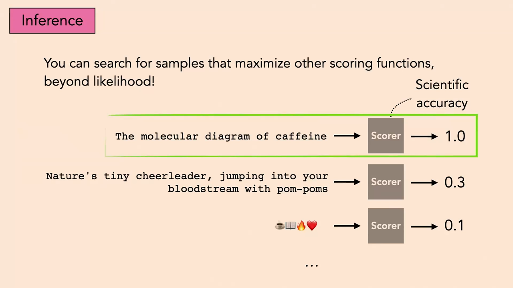
*▲ 강의 슬라이드 [34:10](https://youtu.be/mbgFTqKxR7A?t=2050): [우도](00_%EB%94%A5%EB%9F%AC%EB%8B%9D_%EC%9A%A9%EC%96%B4%EC%82%AC%EC%A0%84.md#likelihood-%EC%9A%B0%EB%8F%84) 말고 다른 점수로도 표본을 고를 수 있다. 과학적 [정확도](00_%EB%94%A5%EB%9F%AC%EB%8B%9D_%EC%9A%A9%EC%96%B4%EC%82%AC%EC%A0%84.md#accuracy-%EC%A0%95%ED%99%95%EB%8F%84) 점수기는 "The molecular diagram of caffeine"에 1.0, 치어리더 문장에 0.3, 이모지에 0.1을 준다*

점수가 여러 개면(재미도 [정확도](00_%EB%94%A5%EB%9F%AC%EB%8B%9D_%EC%9A%A9%EC%96%B4%EC%82%AC%EC%A0%84.md#accuracy-%EC%A0%95%ED%99%95%EB%8F%84)도 원하면) 가장 쉬운 방법은 원하는 만큼 [가중치](00_%EB%94%A5%EB%9F%AC%EB%8B%9D_%EC%9A%A9%EC%96%B4%EC%82%AC%EC%A0%84.md#weight-%EA%B0%80%EC%A4%91%EC%B9%98)를 주어 더하는 것입니다(41:55의 질문에 대한 답, 7.2절 질의응답).

$$
R(y) = \lambda_1 R_1(y) + \lambda_2 R_2(y), \qquad \hat y = \arg\max_{i} R(y^{(i)})
$$

기호 풀이

| 기호 | 읽는 법 | 뜻 | 예제 값 |
| --- | --- | --- | --- |
| $y^{(i)}$ | 와이 아이 | $i$번째 후보 문장 | 분자 그림 문장, 치어리더 문장 |
| $R_1(y)$ | 알 일 | 첫째 점수 (재미) | 0.1, 0.7 |
| $R_2(y)$ | 알 이 | 둘째 점수 (과학적 [정확도](00_%EB%94%A5%EB%9F%AC%EB%8B%9D_%EC%9A%A9%EC%96%B4%EC%82%AC%EC%A0%84.md#accuracy-%EC%A0%95%ED%99%95%EB%8F%84)) | 1.0, 0.3 |
| $\lambda_1, \lambda_2$ | 람다 | 각 점수를 얼마나 중요하게 볼지 ([가중치](00_%EB%94%A5%EB%9F%AC%EB%8B%9D_%EC%9A%A9%EC%96%B4%EC%82%AC%EC%A0%84.md#weight-%EA%B0%80%EC%A4%91%EC%B9%98)) | 0.8, 0.2 |
| $R(y)$ | 알 | 합친 점수 | 0.28, 0.62 |
| $\hat y$ | 와이 햇 | 합친 점수가 가장 큰 후보 | 치어리더 문장 |

예제와 풀이

**문제**: 슬라이드의 두 문장, "분자 그림"(재미 0.1, [정확도](00_%EB%94%A5%EB%9F%AC%EB%8B%9D_%EC%9A%A9%EC%96%B4%EC%82%AC%EC%A0%84.md#accuracy-%EC%A0%95%ED%99%95%EB%8F%84) 1.0)과 "치어리더"(재미 0.7, [정확도](00_%EB%94%A5%EB%9F%AC%EB%8B%9D_%EC%9A%A9%EC%96%B4%EC%82%AC%EC%A0%84.md#accuracy-%EC%A0%95%ED%99%95%EB%8F%84) 0.3)가 있다. 재미에 0.8, [정확도](00_%EB%94%A5%EB%9F%AC%EB%8B%9D_%EC%9A%A9%EC%96%B4%EC%82%AC%EC%A0%84.md#accuracy-%EC%A0%95%ED%99%95%EB%8F%84)에 0.2의 [가중치](00_%EB%94%A5%EB%9F%AC%EB%8B%9D_%EC%9A%A9%EC%96%B4%EC%82%AC%EC%A0%84.md#weight-%EA%B0%80%EC%A4%91%EC%B9%98)를 주면 어느 문장을 고르나?

**주어진 값**
- 분자 그림: $R_1 = 0.1$ (재미), $R_2 = 1.0$ ([정확도](00_%EB%94%A5%EB%9F%AC%EB%8B%9D_%EC%9A%A9%EC%96%B4%EC%82%AC%EC%A0%84.md#accuracy-%EC%A0%95%ED%99%95%EB%8F%84))
- 치어리더: $R_1 = 0.7$ (재미), $R_2 = 0.3$ ([정확도](00_%EB%94%A5%EB%9F%AC%EB%8B%9D_%EC%9A%A9%EC%96%B4%EC%82%AC%EC%A0%84.md#accuracy-%EC%A0%95%ED%99%95%EB%8F%84))
- $\lambda_1 = 0.8$ (재미 [가중치](00_%EB%94%A5%EB%9F%AC%EB%8B%9D_%EC%9A%A9%EC%96%B4%EC%82%AC%EC%A0%84.md#weight-%EA%B0%80%EC%A4%91%EC%B9%98)), $\lambda_2 = 0.2$ ([정확도](00_%EB%94%A5%EB%9F%AC%EB%8B%9D_%EC%9A%A9%EC%96%B4%EC%82%AC%EC%A0%84.md#accuracy-%EC%A0%95%ED%99%95%EB%8F%84) [가중치](00_%EB%94%A5%EB%9F%AC%EB%8B%9D_%EC%9A%A9%EC%96%B4%EC%82%AC%EC%A0%84.md#weight-%EA%B0%80%EC%A4%91%EC%B9%98))

**풀이**
1. 식을 그대로 쓴다: $R(y) = \lambda_1 R_1(y) + \lambda_2 R_2(y)$
2. 값을 대입한다: $R(\text{분자}) = 0.8 \times 0.1 + 0.2 \times 1.0$, $R(\text{치어리더}) = 0.8 \times 0.7 + 0.2 \times 0.3$
3. 분자 그림의 곱셈을 한다: $0.8 \times 0.1 = 0.08$, $0.2 \times 1.0 = 0.2$ 이므로 $R(\text{분자}) = 0.08 + 0.2$
4. 더한다: $0.08 + 0.2 = 0.28$
5. 치어리더의 곱셈을 한다: $0.8 \times 0.7 = 0.56$, $0.2 \times 0.3 = 0.06$ 이므로 $R(\text{치어리더}) = 0.56 + 0.06$
6. 더한다: $0.56 + 0.06 = 0.62$
7. 큰 쪽을 고른다: $0.62 > 0.28$

**답**: **치어리더 문장**(0.62). [가중치](00_%EB%94%A5%EB%9F%AC%EB%8B%9D_%EC%9A%A9%EC%96%B4%EC%82%AC%EC%A0%84.md#weight-%EA%B0%80%EC%A4%91%EC%B9%98)를 반반(0.5, 0.5)으로 바꾸면 분자 그림 0.55, 치어리더 0.5가 되어 답이 뒤집힌다. [가중치](00_%EB%94%A5%EB%9F%AC%EB%8B%9D_%EC%9A%A9%EC%96%B4%EC%82%AC%EC%A0%84.md#weight-%EA%B0%80%EC%A4%91%EC%B9%98)를 정하기 어렵다는 것이 강사가 말한 다목적 최적화의 어려움이다.

내 이해

질의응답 정리 [33:58](https://youtu.be/mbgFTqKxR7A?t=2038)

- **점수기는 따로 학습한 모델인가?** 무엇이든 된다. 문장을 받아 숫자 하나를 내면 된다. 학습한 모델, 사람의 뇌, 동물의 뇌, 형식적 증명 검사기 모두 가능하다.

### 6.2 검증이 생성보다 쉽다

▶ 영상 [34:29](https://youtu.be/mbgFTqKxR7A?t=2069)

- 아주 많이 쓰는 [점수 함수](00_%EB%94%A5%EB%9F%AC%EB%8B%9D_%EC%9A%A9%EC%96%B4%EC%82%AC%EC%A0%84.md#scoring-function-%EC%A0%90%EC%88%98-%ED%95%A8%EC%88%98)가 **[검증](00_%EB%94%A5%EB%9F%AC%EB%8B%9D_%EC%9A%A9%EC%96%B4%EC%82%AC%EC%A0%84.md#verifier-%EA%B2%80%EC%A6%9D%EA%B8%B0)**(verification)입니다. 보통 컴파일러나 수학 증명 검사기 같은 **형식적 절차**로 답이 맞는지 실제로 확인한다는 뜻을 담습니다.
- 예: "피보나치 수열을 계산하는 파이썬 코드를 써 줘"에 [언어 모델](00_%EB%94%A5%EB%9F%AC%EB%8B%9D_%EC%9A%A9%EC%96%B4%EC%82%AC%EC%A0%84.md#language-model-%EC%96%B8%EC%96%B4-%EB%AA%A8%EB%8D%B8)이 두 프로그램을 냅니다. [검증기](00_%EB%94%A5%EB%9F%AC%EB%8B%9D_%EC%9A%A9%EC%96%B4%EC%82%AC%EC%A0%84.md#verifier-%EA%B2%80%EC%A6%9D%EA%B8%B0)는 피보나치 수열을 알고 있으므로 프로그램을 실행해 출력이 맞는지 봅니다. 하나는 초기값이 틀려 "incorrect", 하나는 "correct". 맞은 것을 고르면 [검증기](00_%EB%94%A5%EB%9F%AC%EB%8B%9D_%EC%9A%A9%EC%96%B4%EC%82%AC%EC%A0%84.md#verifier-%EA%B2%80%EC%A6%9D%EA%B8%B0)로 하는 Best-of-N입니다.
- **왜 좋은가**: 근본적으로 **[검증](00_%EB%94%A5%EB%9F%AC%EB%8B%9D_%EC%9A%A9%EC%96%B4%EC%82%AC%EC%A0%84.md#validation-data-%EA%B2%80%EC%A6%9D-%EB%8D%B0%EC%9D%B4%ED%84%B0)이 생성보다 쉽기** 때문입니다. 정리를 증명하는 것보다 증명이 맞는지 검사하는 것이 쉽습니다. P ≠ NP라면, 답을 다항 시간에 검사할 수는 있지만 다항 시간에 찾을 수는 없는 문제가 있습니다. 큰 수의 소인수를 찾는 것은 어렵지만, 주어진 인수들을 곱해 그 수가 되는지 확인하는 것은 쉽습니다.

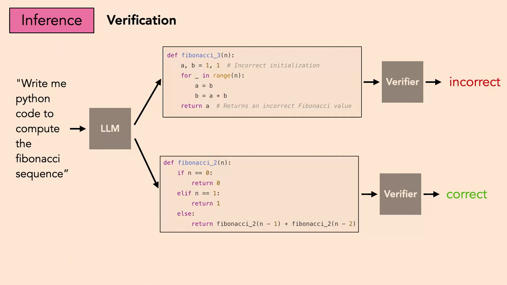
*▲ 강의 슬라이드 [35:00](https://youtu.be/mbgFTqKxR7A?t=2100): [검증](00_%EB%94%A5%EB%9F%AC%EB%8B%9D_%EC%9A%A9%EC%96%B4%EC%82%AC%EC%A0%84.md#validation-data-%EA%B2%80%EC%A6%9D-%EB%8D%B0%EC%9D%B4%ED%84%B0). [언어 모델](00_%EB%94%A5%EB%9F%AC%EB%8B%9D_%EC%9A%A9%EC%96%B4%EC%82%AC%EC%A0%84.md#language-model-%EC%96%B8%EC%96%B4-%EB%AA%A8%EB%8D%B8)이 낸 두 피보나치 프로그램을 [검증기](00_%EB%94%A5%EB%9F%AC%EB%8B%9D_%EC%9A%A9%EC%96%B4%EC%82%AC%EC%A0%84.md#verifier-%EA%B2%80%EC%A6%9D%EA%B8%B0)가 실행해 보고 틀림(위)과 맞음(아래)을 가린다*

---

## 7. 생성 모델의 잠재 공간 탐색

📐 **수학 개념**: [그래디언트 벡터](%EC%88%98%ED%95%99%EA%B0%9C%EB%85%90/02_%EB%AF%B8%EB%B6%84/MM02_%EA%B7%B8%EB%9E%98%EB%94%94%EC%96%B8%ED%8A%B8_%EB%B2%A1%ED%84%B0.md) · [단위 구와 코사인 유사도](%EC%88%98%ED%95%99%EA%B0%9C%EB%85%90/03_%EC%84%A0%ED%98%95%EB%8C%80%EC%88%98/MM44_%EB%8B%A8%EC%9C%84_%EA%B5%AC%EC%99%80_%EC%BD%94%EC%82%AC%EC%9D%B8_%EC%9C%A0%EC%82%AC%EB%8F%84.md) · [확률 밀도와 정규분포](%EC%88%98%ED%95%99%EA%B0%9C%EB%85%90/04_%ED%99%95%EB%A5%A0%EA%B3%BC_%EC%A0%95%EB%B3%B4/MM50_%ED%99%95%EB%A5%A0_%EB%B0%80%EB%8F%84%EC%99%80_%EC%A0%95%EA%B7%9C%EB%B6%84%ED%8F%AC.md)

### 7.1 모방 말고 다른 목표

▶ 영상 [36:46](https://youtu.be/mbgFTqKxR7A?t=2206)

- 이 수업의 90%는 하나의 목표, **"좋은 데이터를 흉내 내라"**([지도 학습](00_%EB%94%A5%EB%9F%AC%EB%8B%9D_%EC%9A%A9%EC%96%B4%EC%82%AC%EC%A0%84.md#supervised-learning-%EC%A7%80%EB%8F%84-%ED%95%99%EC%8A%B5), 생성 모델링, [자기 지도 학습](00_%EB%94%A5%EB%9F%AC%EB%8B%9D_%EC%9A%A9%EC%96%B4%EC%82%AC%EC%A0%84.md#self-supervised-learning-%EC%9E%90%EA%B8%B0-%EC%A7%80%EB%8F%84-%ED%95%99%EC%8A%B5))에 관한 것이었습니다.
- 다른 목표의 예(학생들의 답): 게임이면 상대를 이기기, 해석하기 쉬운 시스템 만들기. 이런 목표는 대개 손으로 점수를 설계하고 그 점수를 최적화하는 [강화 학습](00_%EB%94%A5%EB%9F%AC%EB%8B%9D_%EC%9A%A9%EC%96%B4%EC%82%AC%EC%A0%84.md#reinforcement-learning-%EA%B0%95%ED%99%94-%ED%95%99%EC%8A%B5)의 틀로 쓸 수 있습니다.
- 강사가 제안하는 목표: 사람이 **의미 있다, 아름답다, 유익하다, 기억에 남는다, 흥미롭다**고 여기는 이미지를 만들기. 그림 [생성 모델](00_%EB%94%A5%EB%9F%AC%EB%8B%9D_%EC%9A%A9%EC%96%B4%EC%82%AC%EC%A0%84.md#generative-model-%EC%83%9D%EC%84%B1-%EB%AA%A8%EB%8D%B8)을 사람이 더 좋다고 평가하는 출력을 내도록 조정합니다.

### 7.2 CLIP + VQGAN

▶ 영상 [39:06](https://youtu.be/mbgFTqKxR7A?t=2346)

- [점수 함수](00_%EB%94%A5%EB%9F%AC%EB%8B%9D_%EC%9A%A9%EC%96%B4%EC%82%AC%EC%A0%84.md#scoring-function-%EC%A0%90%EC%88%98-%ED%95%A8%EC%88%98)로 탐색하는 대상을 [자기회귀 모델](00_%EB%94%A5%EB%9F%AC%EB%8B%9D_%EC%9A%A9%EC%96%B4%EC%82%AC%EC%A0%84.md#autoregressive-model-%EC%9E%90%EA%B8%B0%ED%9A%8C%EA%B7%80-%EB%AA%A8%EB%8D%B8)에서 **[잠재 변수](00_%EB%94%A5%EB%9F%AC%EB%8B%9D_%EC%9A%A9%EC%96%B4%EC%82%AC%EC%A0%84.md#latent-variable-%EC%9E%A0%EC%9E%AC-%EB%B3%80%EC%88%98)가 있는 그림 [생성기](00_%EB%94%A5%EB%9F%AC%EB%8B%9D_%EC%9A%A9%EC%96%B4%EC%82%AC%EC%A0%84.md#generator-discriminator-%EC%83%9D%EC%84%B1%EA%B8%B0%EC%99%80-%ED%8C%90%EB%B3%84%EA%B8%B0)** $G(z)$로 바꿉니다. [GAN](00_%EB%94%A5%EB%9F%AC%EB%8B%9D_%EC%9A%A9%EC%96%B4%EC%82%AC%EC%A0%84.md#gan-generative-adversarial-network-%EC%83%9D%EC%84%B1%EC%A0%81-%EC%A0%81%EB%8C%80-%EC%8B%A0%EA%B2%BD%EB%A7%9D), [VAE](00_%EB%94%A5%EB%9F%AC%EB%8B%9D_%EC%9A%A9%EC%96%B4%EC%82%AC%EC%A0%84.md#variational-autoencoder-vae-%EB%B3%80%EB%B6%84-%EC%98%A4%ED%86%A0%EC%9D%B8%EC%BD%94%EB%8D%94)의 디코더, 또는 $z$가 잡음인 [확산 모델](00_%EB%94%A5%EB%9F%AC%EB%8B%9D_%EC%9A%A9%EC%96%B4%EC%82%AC%EC%A0%84.md#diffusion-model-%ED%99%95%EC%82%B0-%EB%AA%A8%EB%8D%B8)이 모두 해당합니다.
- **점수**: [CLIP](00_%EB%94%A5%EB%9F%AC%EB%8B%9D_%EC%9A%A9%EC%96%B4%EC%82%AC%EC%A0%84.md#clip-%ED%81%B4%EB%A6%BD)의 글 인코더가 낸 $e_1$("삶, 우주, 그리고 모든 것에 대한 궁극적 질문의 답은?")과 그림 인코더가 낸 $e_2$의 [내적](00_%EB%94%A5%EB%9F%AC%EB%8B%9D_%EC%9A%A9%EC%96%B4%EC%82%AC%EC%A0%84.md#dot-product-%EB%82%B4%EC%A0%81). [CLIP](00_%EB%94%A5%EB%9F%AC%EB%8B%9D_%EC%9A%A9%EC%96%B4%EC%82%AC%EC%A0%84.md#clip-%ED%81%B4%EB%A6%BD)은 맞는 캡션과 그림의 [내적](00_%EB%94%A5%EB%9F%AC%EB%8B%9D_%EC%9A%A9%EC%96%B4%EC%82%AC%EC%A0%84.md#dot-product-%EB%82%B4%EC%A0%81)이 가장 크도록 학습되어 있으므로, 이 [내적](00_%EB%94%A5%EB%9F%AC%EB%8B%9D_%EC%9A%A9%EC%96%B4%EC%82%AC%EC%A0%84.md#dot-product-%EB%82%B4%EC%A0%81)을 최대로 하는 그림이 글과 가장 잘 맞는 그림입니다.
- **제약이 있는 최적화**: 모든 픽셀 공간이 아니라 [생성기](00_%EB%94%A5%EB%9F%AC%EB%8B%9D_%EC%9A%A9%EC%96%B4%EC%82%AC%EC%A0%84.md#generator-discriminator-%EC%83%9D%EC%84%B1%EA%B8%B0%EC%99%80-%ED%8C%90%EB%B3%84%EA%B8%B0)의 **[잠재 공간](00_%EB%94%A5%EB%9F%AC%EB%8B%9D_%EC%9A%A9%EC%96%B4%EC%82%AC%EC%A0%84.md#latent-space-%EC%9E%A0%EC%9E%AC-%EA%B3%B5%EA%B0%84)** $z$만 뒤집니다. $z$를 [사전 분포](00_%EB%94%A5%EB%9F%AC%EB%8B%9D_%EC%9A%A9%EC%96%B4%EC%82%AC%EC%A0%84.md#prior-posterior-%EC%82%AC%EC%A0%84-%EB%B6%84%ED%8F%AC%EC%99%80-%EC%82%AC%ED%9B%84-%EB%B6%84%ED%8F%AC)([VAE](00_%EB%94%A5%EB%9F%AC%EB%8B%9D_%EC%9A%A9%EC%96%B4%EC%82%AC%EC%A0%84.md#variational-autoencoder-vae-%EB%B3%80%EB%B6%84-%EC%98%A4%ED%86%A0%EC%9D%B8%EC%BD%94%EB%8D%94)면 표준 [정규분포](00_%EB%94%A5%EB%9F%AC%EB%8B%9D_%EC%9A%A9%EC%96%B4%EC%82%AC%EC%A0%84.md#normal-distribution-%EC%A0%95%EA%B7%9C%EB%B6%84%ED%8F%AC))의 [확률](00_%EB%94%A5%EB%9F%AC%EB%8B%9D_%EC%9A%A9%EC%96%B4%EC%82%AC%EC%A0%84.md#probability-%ED%99%95%EB%A5%A0) 높은 영역, 예를 들어 단위 [초구](00_%EB%94%A5%EB%9F%AC%EB%8B%9D_%EC%9A%A9%EC%96%B4%EC%82%AC%EC%A0%84.md#hypersphere-%EC%B4%88%EA%B5%AC) 위에 두면, [생성기](00_%EB%94%A5%EB%9F%AC%EB%8B%9D_%EC%9A%A9%EC%96%B4%EC%82%AC%EC%A0%84.md#generator-discriminator-%EC%83%9D%EC%84%B1%EA%B8%B0%EC%99%80-%ED%8C%90%EB%B3%84%EA%B8%B0)가 보기에 [확률](00_%EB%94%A5%EB%9F%AC%EB%8B%9D_%EC%9A%A9%EC%96%B4%EC%82%AC%EC%A0%84.md#probability-%ED%99%95%EB%A5%A0) 높은 그림들의 다양체 안에 머물면서 글과 맞는 그림을 찾게 됩니다.
- 이 방법이 **[CLIP](00_%EB%94%A5%EB%9F%AC%EB%8B%9D_%EC%9A%A9%EC%96%B4%EC%82%AC%EC%A0%84.md#clip-%ED%81%B4%EB%A6%BD) + VQGAN**으로, [확산 모델](00_%EB%94%A5%EB%9F%AC%EB%8B%9D_%EC%9A%A9%EC%96%B4%EC%82%AC%EC%A0%84.md#diffusion-model-%ED%99%95%EC%82%B0-%EB%AA%A8%EB%8D%B8)이 나오기 전 처음으로 인상적이었던 글→그림 생성기였습니다(강사는 2020년이라 했다가 2021년일 수도 있다고 함. [CLIP](00_%EB%94%A5%EB%9F%AC%EB%8B%9D_%EC%9A%A9%EC%96%B4%EC%82%AC%EC%A0%84.md#clip-%ED%81%B4%EB%A6%BD) 공개가 2021년 1월이므로 2021년). 2020년엔 [학습](00_%EB%94%A5%EB%9F%AC%EB%8B%9D_%EC%9A%A9%EC%96%B4%EC%82%AC%EC%A0%84.md#training-%ED%95%99%EC%8A%B5) 시점에 이 품질의 글→그림 모델이 없었는데, 약한 [생성기](00_%EB%94%A5%EB%9F%AC%EB%8B%9D_%EC%9A%A9%EC%96%B4%EC%82%AC%EC%A0%84.md#generator-discriminator-%EC%83%9D%EC%84%B1%EA%B8%B0%EC%99%80-%ED%8C%90%EB%B3%84%EA%B8%B0)에 **[테스트 시점 계산](00_%EB%94%A5%EB%9F%AC%EB%8B%9D_%EC%9A%A9%EC%96%B4%EC%82%AC%EC%A0%84.md#test-time-compute-%ED%85%8C%EC%8A%A4%ED%8A%B8-%EC%8B%9C%EC%A0%90-%EA%B3%84%EC%82%B0)**(최적화)을 많이 써서 아직 [순전파](00_%EB%94%A5%EB%9F%AC%EB%8B%9D_%EC%9A%A9%EC%96%B4%EC%82%AC%EC%A0%84.md#feed-forward-%EC%88%9C%EC%A0%84%ED%8C%8C) 모델로 분할 상환되지 않은 탐색을 해낸 것입니다([Lec18 10](Lec18_%EC%A0%84%EC%9D%B4_%ED%95%99%EC%8A%B5_%EB%AA%A8%EB%8D%B8.md#10-%EA%B8%B0%EB%B0%98-%EB%AA%A8%EB%8D%B8-%EC%A1%B0%ED%95%A9%ED%95%98%EA%B8%B0), [Lec02 9.3](Lec02_%EC%8B%A0%EA%B2%BD%EB%A7%9D_%ED%95%99%EC%8A%B5.md#93-%ED%8C%8C%EB%9D%BC%EB%AF%B8%ED%84%B0-%EC%B5%9C%EC%A0%81%ED%99%94%EC%99%80-%EC%9E%85%EB%A0%A5-%EC%B5%9C%EC%A0%81%ED%99%94)).

$$
z^* = \arg\max_{z}\; e_1 \cdot E_{\text{img}}(G(z)), \qquad z \leftarrow z + \eta\, \nabla_z \big(e_1 \cdot E_{\text{img}}(G(z))\big)
$$

기호 풀이

| 기호 | 읽는 법 | 뜻 | 예제 값 |
| --- | --- | --- | --- |
| $z$ | 제트 | [생성기](00_%EB%94%A5%EB%9F%AC%EB%8B%9D_%EC%9A%A9%EC%96%B4%EC%82%AC%EC%A0%84.md#generator-discriminator-%EC%83%9D%EC%84%B1%EA%B8%B0%EC%99%80-%ED%8C%90%EB%B3%84%EA%B8%B0)의 [잠재 변수](00_%EB%94%A5%EB%9F%AC%EB%8B%9D_%EC%9A%A9%EC%96%B4%EC%82%AC%EC%A0%84.md#latent-variable-%EC%9E%A0%EC%9E%AC-%EB%B3%80%EC%88%98) (최적화하는 대상) | 0 → 0.4 |
| $G(z)$ | 지 오브 제트 | [생성기](00_%EB%94%A5%EB%9F%AC%EB%8B%9D_%EC%9A%A9%EC%96%B4%EC%82%AC%EC%A0%84.md#generator-discriminator-%EC%83%9D%EC%84%B1%EA%B8%B0%EC%99%80-%ED%8C%90%EB%B3%84%EA%B8%B0)가 만든 그림 | |
| $E_{\text{img}}$ | 이 이미지 | [CLIP](00_%EB%94%A5%EB%9F%AC%EB%8B%9D_%EC%9A%A9%EC%96%B4%EC%82%AC%EC%A0%84.md#clip-%ED%81%B4%EB%A6%BD) 그림 인코더 | |
| $e_2 = E_{\text{img}}(G(z))$ | 이 이 | 그림의 [임베딩](00_%EB%94%A5%EB%9F%AC%EB%8B%9D_%EC%9A%A9%EC%96%B4%EC%82%AC%EC%A0%84.md#embedding-%EC%9E%84%EB%B2%A0%EB%94%A9) (예제에서는 $(\cos z, \sin z)$) | (1, 0) |
| $e_1$ | 이 일 | 글 프롬프트의 [임베딩](00_%EB%94%A5%EB%9F%AC%EB%8B%9D_%EC%9A%A9%EC%96%B4%EC%82%AC%EC%A0%84.md#embedding-%EC%9E%84%EB%B2%A0%EB%94%A9) | (0.6, 0.8) |
| $e_1 \cdot e_2$ | [내적](00_%EB%94%A5%EB%9F%AC%EB%8B%9D_%EC%9A%A9%EC%96%B4%EC%82%AC%EC%A0%84.md#dot-product-%EB%82%B4%EC%A0%81) | 글과 그림이 맞는 정도 (점수) | 0.6 → 0.8642 |
| $\nabla_z$ | 나블라 | 점수의 $z$에 대한 [기울기](00_%EB%94%A5%EB%9F%AC%EB%8B%9D_%EC%9A%A9%EC%96%B4%EC%82%AC%EC%A0%84.md#gradient-%EA%B8%B0%EC%9A%B8%EA%B8%B0) | 0.8 |
| $\eta$ | 에타 | 걸음 크기 | 0.5 |
| $z^*$ | 제트 스타 | 점수를 가장 크게 하는 [잠재 변수](00_%EB%94%A5%EB%9F%AC%EB%8B%9D_%EC%9A%A9%EC%96%B4%EC%82%AC%EC%A0%84.md#latent-variable-%EC%9E%A0%EC%9E%AC-%EB%B3%80%EC%88%98) | 0.9273 |

예제와 풀이

**문제**: 장난감 모형에서 글 [임베딩](00_%EB%94%A5%EB%9F%AC%EB%8B%9D_%EC%9A%A9%EC%96%B4%EC%82%AC%EC%A0%84.md#embedding-%EC%9E%84%EB%B2%A0%EB%94%A9)이 $e_1 = (0.6, 0.8)$이고, [잠재 변수](00_%EB%94%A5%EB%9F%AC%EB%8B%9D_%EC%9A%A9%EC%96%B4%EC%82%AC%EC%A0%84.md#latent-variable-%EC%9E%A0%EC%9E%AC-%EB%B3%80%EC%88%98) $z$로 만든 그림의 [임베딩](00_%EB%94%A5%EB%9F%AC%EB%8B%9D_%EC%9A%A9%EC%96%B4%EC%82%AC%EC%A0%84.md#embedding-%EC%9E%84%EB%B2%A0%EB%94%A9)이 단위원 위의 점 $e_2 = (\cos z, \sin z)$라고 하자. $z = 0$에서 걸음 크기 0.5로 경사 상승을 한 번 하면 점수는 얼마로 오르나?

**주어진 값**
- $e_1 = (0.6, 0.8)$ (글 [임베딩](00_%EB%94%A5%EB%9F%AC%EB%8B%9D_%EC%9A%A9%EC%96%B4%EC%82%AC%EC%A0%84.md#embedding-%EC%9E%84%EB%B2%A0%EB%94%A9))
- $e_2(z) = (\cos z, \sin z)$ (그림 [임베딩](00_%EB%94%A5%EB%9F%AC%EB%8B%9D_%EC%9A%A9%EC%96%B4%EC%82%AC%EC%A0%84.md#embedding-%EC%9E%84%EB%B2%A0%EB%94%A9). $\cos z$, $\sin z$는 각도 $z$(라디안)만큼 돈 단위원 위 점의 가로·세로 좌표로, 계산기로 구한다)
- $z = 0$ (시작점), $\eta = 0.5$ (걸음 크기)

**풀이**
1. 식을 그대로 쓴다: $s(z) = e_1 \cdot e_2(z)$, $z \leftarrow z + \eta\, \nabla_z s(z)$
2. [내적](00_%EB%94%A5%EB%9F%AC%EB%8B%9D_%EC%9A%A9%EC%96%B4%EC%82%AC%EC%A0%84.md#dot-product-%EB%82%B4%EC%A0%81)을 칸별로 펼친다: $s(z) = 0.6 \cos z + 0.8 \sin z$
3. 시작점 값을 대입한다: $s(0) = 0.6 \times \cos 0 + 0.8 \times \sin 0 = 0.6 \times 1 + 0.8 \times 0 = 0.6$
4. [기울기](00_%EB%94%A5%EB%9F%AC%EB%8B%9D_%EC%9A%A9%EC%96%B4%EC%82%AC%EC%A0%84.md#gradient-%EA%B8%B0%EC%9A%B8%EA%B8%B0) 식을 쓴다 ($\cos$의 [미분](00_%EB%94%A5%EB%9F%AC%EB%8B%9D_%EC%9A%A9%EC%96%B4%EC%82%AC%EC%A0%84.md#derivative-%EB%AF%B8%EB%B6%84)은 $-\sin$, $\sin$의 [미분](00_%EB%94%A5%EB%9F%AC%EB%8B%9D_%EC%9A%A9%EC%96%B4%EC%82%AC%EC%A0%84.md#derivative-%EB%AF%B8%EB%B6%84)은 $\cos$): $\nabla_z s = -0.6 \sin z + 0.8 \cos z$
5. [기울기](00_%EB%94%A5%EB%9F%AC%EB%8B%9D_%EC%9A%A9%EC%96%B4%EC%82%AC%EC%A0%84.md#gradient-%EA%B8%B0%EC%9A%B8%EA%B8%B0)에 대입한다: $\nabla_z s(0) = -0.6 \times 0 + 0.8 \times 1 = 0.8$
6. 한 걸음 간다: $z \leftarrow 0 + 0.5 \times 0.8 = 0.4$
7. 새 점수에 대입한다: $s(0.4) = 0.6 \cos 0.4 + 0.8 \sin 0.4$
8. 삼각함수 값을 구한다: $\cos 0.4 = 0.9211$, $\sin 0.4 = 0.3894$ 이므로 $s(0.4) = 0.6 \times 0.9211 + 0.8 \times 0.3894$
9. 곱한다: $0.6 \times 0.9211 = 0.5526$, $0.8 \times 0.3894 = 0.3115$ 이므로 $s(0.4) = 0.5526 + 0.3115$
10. 더한다: $0.5526 + 0.3115 = 0.8641$ (반올림하지 않은 값으로 계산하면 0.8642)

**답**: 점수가 **0.6 → 0.8642**로 오른다. 계속 오르면 $e_2$가 $e_1$과 같은 방향이 되는 $z^* = 0.9273$에서 최댓값 1에 닿는다.

내 이해

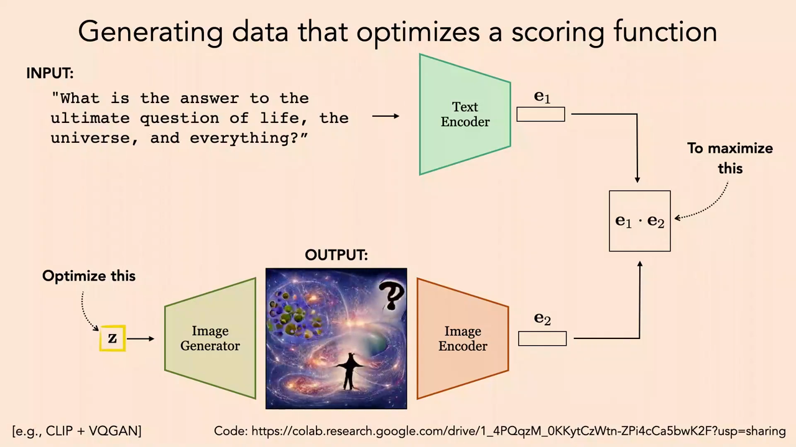
*▲ 강의 슬라이드 [43:25](https://youtu.be/mbgFTqKxR7A?t=2605): [점수 함수](00_%EB%94%A5%EB%9F%AC%EB%8B%9D_%EC%9A%A9%EC%96%B4%EC%82%AC%EC%A0%84.md#scoring-function-%EC%A0%90%EC%88%98-%ED%95%A8%EC%88%98)를 최적화하는 데이터 만들기(예: [CLIP](00_%EB%94%A5%EB%9F%AC%EB%8B%9D_%EC%9A%A9%EC%96%B4%EC%82%AC%EC%A0%84.md#clip-%ED%81%B4%EB%A6%BD) + VQGAN). [잠재 변수](00_%EB%94%A5%EB%9F%AC%EB%8B%9D_%EC%9A%A9%EC%96%B4%EC%82%AC%EC%A0%84.md#latent-variable-%EC%9E%A0%EC%9E%AC-%EB%B3%80%EC%88%98) z를 바꿔 글 [임베딩](00_%EB%94%A5%EB%9F%AC%EB%8B%9D_%EC%9A%A9%EC%96%B4%EC%82%AC%EC%A0%84.md#embedding-%EC%9E%84%EB%B2%A0%EB%94%A9) $e_1$과 그림 [임베딩](00_%EB%94%A5%EB%9F%AC%EB%8B%9D_%EC%9A%A9%EC%96%B4%EC%82%AC%EC%A0%84.md#embedding-%EC%9E%84%EB%B2%A0%EB%94%A9) $e_2$의 [내적](00_%EB%94%A5%EB%9F%AC%EB%8B%9D_%EC%9A%A9%EC%96%B4%EC%82%AC%EC%A0%84.md#dot-product-%EB%82%B4%EC%A0%81)을 최대로 한다*

질의응답 정리 [41:23](https://youtu.be/mbgFTqKxR7A?t=2483)

- **[우도](00_%EB%94%A5%EB%9F%AC%EB%8B%9D_%EC%9A%A9%EC%96%B4%EC%82%AC%EC%A0%84.md#likelihood-%EC%9A%B0%EB%8F%84)와 창의성처럼 목표가 둘이면 어떻게 하나?** 이 분야를 **[다목적 최적화](00_%EB%94%A5%EB%9F%AC%EB%8B%9D_%EC%9A%A9%EC%96%B4%EC%82%AC%EC%A0%84.md#pareto-frontier-%ED%8C%8C%EB%A0%88%ED%86%A0-%EC%A0%84%EC%84%A0)**라고 한다. 가장 쉬운 방법은 관심 정도로 [가중치](00_%EB%94%A5%EB%9F%AC%EB%8B%9D_%EC%9A%A9%EC%96%B4%EC%82%AC%EC%A0%84.md#weight-%EA%B0%80%EC%A4%91%EC%B9%98)를 주어 더하는 것(6.1절의 식)이지만, 목표마다 크기 단위가 달라 좋은 [가중치](00_%EB%94%A5%EB%9F%AC%EB%8B%9D_%EC%9A%A9%EC%96%B4%EC%82%AC%EC%A0%84.md#weight-%EA%B0%80%EC%A4%91%EC%B9%98)를 찾기 어렵다. 다른 목표를 나쁘게 만들지 않고는 어느 목표도 더 좋게 할 수 없는 해들의 경계, **[파레토 전선](00_%EB%94%A5%EB%9F%AC%EB%8B%9D_%EC%9A%A9%EC%96%B4%EC%82%AC%EC%A0%84.md#pareto-frontier-%ED%8C%8C%EB%A0%88%ED%86%A0-%EC%A0%84%EC%84%A0)**을 찾는 기법들이 있다.

### 7.3 기억에 남는 이미지 만들기

▶ 영상 [44:09](https://youtu.be/mbgFTqKxR7A?t=2649)

- [점수 함수](00_%EB%94%A5%EB%9F%AC%EB%8B%9D_%EC%9A%A9%EC%96%B4%EC%82%AC%EC%A0%84.md#scoring-function-%EC%A0%90%EC%88%98-%ED%95%A8%EC%88%98)를 **사람의 모형**으로 바꿀 수 있습니다. 이런 모형을 **[보상 모델](00_%EB%94%A5%EB%9F%AC%EB%8B%9D_%EC%9A%A9%EC%96%B4%EC%82%AC%EC%A0%84.md#reward-model-%EB%B3%B4%EC%83%81-%EB%AA%A8%EB%8D%B8)**이라고도 합니다.
- 강사 연구실의 2018~2019년 연구(GANalyze, ICCV 2019): 이미지가 번쩍였다 사라지는 영상을 보며 반복된 이미지를 표시하는 심리물리 실험으로 **기억에 남는 정도**(memorability)를 재고, 그것을 예측하는 신경망을 학습했습니다(사람이 나온 사진이 대체로 기억에 잘 남았다).
- [생성기](00_%EB%94%A5%EB%9F%AC%EB%8B%9D_%EC%9A%A9%EC%96%B4%EC%82%AC%EC%A0%84.md#generator-discriminator-%EC%83%9D%EC%84%B1%EA%B8%B0%EC%99%80-%ED%8C%90%EB%B3%84%EA%B8%B0) + 기억 예측기 + [잠재 공간](00_%EB%94%A5%EB%9F%AC%EB%8B%9D_%EC%9A%A9%EC%96%B4%EC%82%AC%EC%A0%84.md#latent-space-%EC%9E%A0%EC%9E%AC-%EA%B3%B5%EA%B0%84) 조작을 잇고, **모두 [미분](00_%EB%94%A5%EB%9F%AC%EB%8B%9D_%EC%9A%A9%EC%96%B4%EC%82%AC%EC%A0%84.md#derivative-%EB%AF%B8%EB%B6%84) 가능**하므로 경사하강으로 탐색합니다. [언어 모델](00_%EB%94%A5%EB%9F%AC%EB%8B%9D_%EC%9A%A9%EC%96%B4%EC%82%AC%EC%A0%84.md#language-model-%EC%96%B8%EC%96%B4-%EB%AA%A8%EB%8D%B8)은 기호를 다루는 [트리 탐색](00_%EB%94%A5%EB%9F%AC%EB%8B%9D_%EC%9A%A9%EC%96%B4%EC%82%AC%EC%A0%84.md#tree-search-%ED%8A%B8%EB%A6%AC-%ED%83%90%EC%83%89)이 필요하지만, 픽셀 쪽은 [역전파](00_%EB%94%A5%EB%9F%AC%EB%8B%9D_%EC%9A%A9%EC%96%B4%EC%82%AC%EC%A0%84.md#backpropagation-%EC%97%AD%EC%A0%84%ED%8C%8C)로 [잠재 변수](00_%EB%94%A5%EB%9F%AC%EB%8B%9D_%EC%9A%A9%EC%96%B4%EC%82%AC%EC%A0%84.md#latent-variable-%EC%9E%A0%EC%9E%AC-%EB%B3%80%EC%88%98)까지 곧장 갈 수 있어 오히려 쉽습니다.
- 결과: 개를 더 기억에 남게 하면 눈과 머리가 커지고 가까워집니다(실제로 사람들이 더 잘 기억함). 덜 기억에 남게 하면 작고 흐릿해집니다. 같은 방법으로 **미적 점수**를 높이면 피사계 심도, 4분의 3 각도, 채도 높은 풍경이 나오고, **감정가**(emotional valence)도 조절할 수 있습니다. 단순하고 대칭적인 구조, 크고 가운데 있는 물체가 기억에 잘 남습니다.
- 강사는 이 연구를 사람 지각을 들여다보는 도구로 냈지만, 지금은 같은 생각이 **[RLHF](00_%EB%94%A5%EB%9F%AC%EB%8B%9D_%EC%9A%A9%EC%96%B4%EC%82%AC%EC%A0%84.md#rlhf-reinforcement-learning-from-human-feedback-%EC%82%AC%EB%9E%8C-%ED%94%BC%EB%93%9C%EB%B0%B1-%EA%B0%95%ED%99%94-%ED%95%99%EC%8A%B5)**라는 이름으로 [언어 모델](00_%EB%94%A5%EB%9F%AC%EB%8B%9D_%EC%9A%A9%EC%96%B4%EC%82%AC%EC%A0%84.md#language-model-%EC%96%B8%EC%96%B4-%EB%AA%A8%EB%8D%B8)을 사람이(사람의 모형이) 좋다고, 해롭지 않다고, 공정하다고 하는 출력 쪽으로 미는 데 쓰인다고 연결합니다.

질의응답 정리 [48:05](https://youtu.be/mbgFTqKxR7A?t=2885)

- **결국 뇌의 작동을 해독하려는 연구인가?** 그렇다. 원래 의도는 심리학 논문에 가까웠다.
- **배치 대 물체, 무엇이 중요한가?** 논문(GANalyze)에 분석이 있다. 대체로 주 물체가 가장 중요하고, 가운데 있고 가까울수록 크게 도움이 된다. [손실 함수](00_%EB%94%A5%EB%9F%AC%EB%8B%9D_%EC%9A%A9%EC%96%B4%EC%82%AC%EC%A0%84.md#loss-function-%EC%86%90%EC%8B%A4-%ED%95%A8%EC%88%98)는 단지 사람이 기억할 [확률](00_%EB%94%A5%EB%9F%AC%EB%8B%9D_%EC%9A%A9%EC%96%B4%EC%82%AC%EC%A0%84.md#probability-%ED%99%95%EB%A5%A0)을 회귀하도록 사람 데이터에 맞춘 신경망이다.
- **문화·나이 차이는?** 심리학에서는 **개인차**라고 한다. 이 연구는 모든 사람이 공유하는 공통 부분만 보았고, 문화·나이 비교는 하지 않았다. 공통 부분을 먼저 찾고 집단별 차이를 2차 효과로 보는 것이 보통이며, 좋은 후속 연구 주제다.

---

## 8. 그냥 물어보기

▶ 영상 [51:27](https://youtu.be/mbgFTqKxR7A?t=3087)

📐 **수학 개념**: [분류기 없는 가이던스](%EC%88%98%ED%95%99%EA%B0%9C%EB%85%90/11_%EC%83%9D%EC%84%B1_%EB%AA%A8%EB%8D%B8/MM61_%EB%B6%84%EB%A5%98%EA%B8%B0_%EC%97%86%EB%8A%94_%EA%B0%80%EC%9D%B4%EB%8D%98%EC%8A%A4.md) · [조건부 확률과 독립](%EC%88%98%ED%95%99%EA%B0%9C%EB%85%90/04_%ED%99%95%EB%A5%A0%EA%B3%BC_%EC%A0%95%EB%B3%B4/MM58_%EC%A1%B0%EA%B1%B4%EB%B6%80_%ED%99%95%EB%A5%A0%EA%B3%BC_%EB%8F%85%EB%A6%BD.md)

- Eric Jang이 블로그에서 말한 **"그냥 물어보기"(just ask) 패러다임**: [빔 서치](00_%EB%94%A5%EB%9F%AC%EB%8B%9D_%EC%9A%A9%EC%96%B4%EC%82%AC%EC%A0%84.md#beam-search-%EB%B9%94-%EC%84%9C%EC%B9%98)를 직접 돌리는 대신 모델에게 "[빔 서치](00_%EB%94%A5%EB%9F%AC%EB%8B%9D_%EC%9A%A9%EC%96%B4%EC%82%AC%EC%A0%84.md#beam-search-%EB%B9%94-%EC%84%9C%EC%B9%98)를 해 줘", "단계별로 생각해 보자"라고 **요청**합니다. 그러면 순차적 추론 과정을 코드로 짜 넣지 않아도 모델이 스스로 합니다. 생각의 사슬은 "기호 탐색을 그냥 물어보기"입니다.
- 연속적인 보상 최적화도 그냥 물어볼 수 있을까? 예: DALL-E 1(로 기억한다고 함)에 "폭포 옆 산 그림"을 주면 그저 그런 그림이 나오고, "**아름다운** 폭포 옆 산 그림", "**아주** 아름다운…", "**아주 아주** 아름다운…"으로 갈수록 더 아름다워집니다(어느 정도에서 [포화](00_%EB%94%A5%EB%9F%AC%EB%8B%9D_%EC%9A%A9%EC%96%B4%EC%82%AC%EC%A0%84.md#saturation-%ED%8F%AC%ED%99%94)). 모델이 "이 보상을 원할 때의 출력"이라는 **조건부 분포**를 배웠기 때문에, 보상을 최대로 하는 그림을 직접 탐색하지 않고 보상을 조건으로 줄 수 있습니다.
- Jon Barron의 "make it more" 놀이: "레벨 2 루벤 샌드위치"에서 "레벨 $10^{15}$", "$10^{40}$"으로 가면 결국 우주 그림이 됩니다. 반대로 "$10^{-40}$ 루벤"은 아주 작은 샌드위치가 아니라 **현미경**을 그립니다. 데이터에서 그런 연상을 배웠기 때문입니다.
- **한계**: 이런 창발적(학습된) 능력은 잘 이해된 탐색 알고리즘과 달리, [학습 데이터](00_%EB%94%A5%EB%9F%AC%EB%8B%9D_%EC%9A%A9%EC%96%B4%EC%82%AC%EC%A0%84.md#training-data-test-data-%ED%95%99%EC%8A%B5-%EB%8D%B0%EC%9D%B4%ED%84%B0%EC%99%80-%EC%8B%9C%ED%97%98-%EB%8D%B0%EC%9D%B4%ED%84%B0) 분포에 따라 동작하므로 **보장이나 증명이 없습니다**.

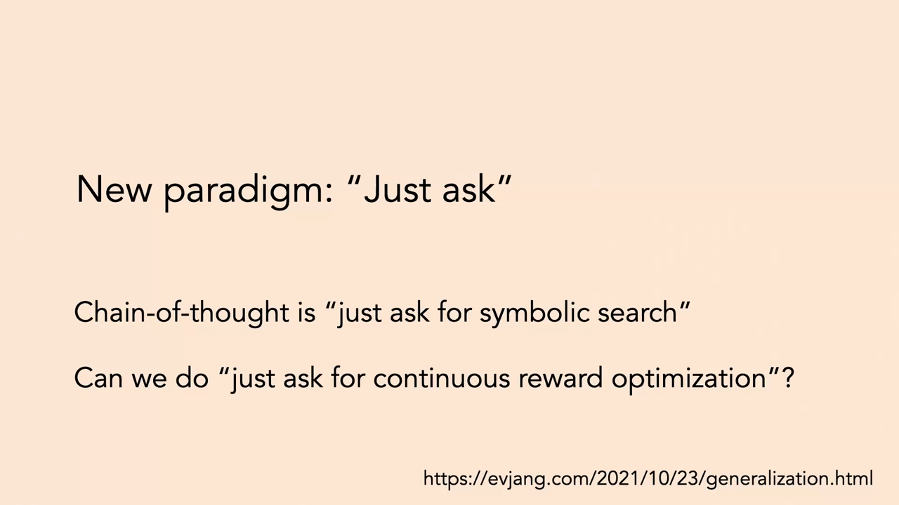
*▲ 강의 슬라이드 [51:10](https://youtu.be/mbgFTqKxR7A?t=3070): 새 패러다임 "그냥 물어보기". 생각의 사슬은 "기호 탐색을 그냥 물어보기"이고, 연속적인 보상 최적화도 그냥 물어볼 수 있을까?*

질의응답 정리 [54:47](https://youtu.be/mbgFTqKxR7A?t=3287)

- **[빔 서치](00_%EB%94%A5%EB%9F%AC%EB%8B%9D_%EC%9A%A9%EC%96%B4%EC%82%AC%EC%A0%84.md#beam-search-%EB%B9%94-%EC%84%9C%EC%B9%98) 같은 탐색을 쓰려면 [언어 모델](00_%EB%94%A5%EB%9F%AC%EB%8B%9D_%EC%9A%A9%EC%96%B4%EC%82%AC%EC%A0%84.md#language-model-%EC%96%B8%EC%96%B4-%EB%AA%A8%EB%8D%B8)을 그에 맞게 학습해야 하나?** 도움은 될 수 있다. Best-of-N 같은 일반 탐색은 어떤 [자기회귀 모델](00_%EB%94%A5%EB%9F%AC%EB%8B%9D_%EC%9A%A9%EC%96%B4%EC%82%AC%EC%A0%84.md#autoregressive-model-%EC%9E%90%EA%B8%B0%ED%9A%8C%EA%B7%80-%EB%AA%A8%EB%8D%B8)에도 쓸 수 있어 안전하다. 하지만 "단계별로 생각해 보자" 같은 프롬프트형 탐색은 모델이 어떻게 학습되었는지에 크게 달려 있다. 그 말 뒤에 좋은 추론이 나오는 데이터로 학습되었어야 한다. 그것이 잘 된다는 것은 경험적 발견이었고, 탐색 알고리즘과 데이터셋을 함께 설계할 수도 있다(11절).

---

## 9. 맥락 내 학습과 경사하강법

▶ 영상 [55:53](https://youtu.be/mbgFTqKxR7A?t=3353)

📐 **수학 개념**: [맥락 내 학습과 경사하강 한 걸음](%EC%88%98%ED%95%99%EA%B0%9C%EB%85%90/13_%EC%96%B8%EC%96%B4_%EB%AA%A8%EB%8D%B8%EA%B3%BC_%EC%B6%94%EB%A1%A0/MM81_%EB%A7%A5%EB%9D%BD_%EB%82%B4_%ED%95%99%EC%8A%B5%EA%B3%BC_%EA%B2%BD%EC%82%AC%ED%95%98%EA%B0%95_%ED%95%9C_%EA%B1%B8%EC%9D%8C.md) · [스케일드 내적 어텐션](%EC%88%98%ED%95%99%EA%B0%9C%EB%85%90/07_%EA%B5%AC%EC%A1%B0_%EC%95%84%ED%82%A4%ED%85%8D%EC%B2%98/MM30_%EC%8A%A4%EC%BC%80%EC%9D%BC%EB%93%9C_%EB%82%B4%EC%A0%81_%EC%96%B4%ED%85%90%EC%85%98.md) · [SGD와 모멘텀](%EC%88%98%ED%95%99%EA%B0%9C%EB%85%90/05_%EC%8B%A0%EA%B2%BD%EB%A7%9D%EC%9D%98_%EA%B3%84%EC%82%B0/MM08_SGD%EC%99%80_%EB%AA%A8%EB%A9%98%ED%85%80.md)

이제 모델을 그대로 두는 탐색이 아니라, 시험 중에 **모델의 행동(때로는 [가중치](00_%EB%94%A5%EB%9F%AC%EB%8B%9D_%EC%9A%A9%EC%96%B4%EC%82%AC%EC%A0%84.md#weight-%EA%B0%80%EC%A4%91%EC%B9%98))을 바꾸는** 방법입니다. 예: 도시를 돌아다니는 자율주행차가 운행이 끝날 때쯤 처음보다 똑똑해진 다른 모델이 되는 것.

- **[맥락 내 학습](00_%EB%94%A5%EB%9F%AC%EB%8B%9D_%EC%9A%A9%EC%96%B4%EC%82%AC%EC%A0%84.md#in-context-learning-%EB%A7%A5%EB%9D%BD-%EB%82%B4-%ED%95%99%EC%8A%B5)**(복습): 처리하는 [시퀀스](00_%EB%94%A5%EB%9F%AC%EB%8B%9D_%EC%9A%A9%EC%96%B4%EC%82%AC%EC%A0%84.md#sequence-%EC%8B%9C%ED%80%80%EC%8A%A4)에 $x_1, y_1, x_2, y_2, \dots$ 같은 바람직한 행동의 예가 들어 있고 끝에 $x_{\text{query}}$가 있습니다. [자기회귀 모델](00_%EB%94%A5%EB%9F%AC%EB%8B%9D_%EC%9A%A9%EC%96%B4%EC%82%AC%EC%A0%84.md#autoregressive-model-%EC%9E%90%EA%B8%B0%ED%9A%8C%EA%B7%80-%EB%AA%A8%EB%8D%B8)이 그 패턴을 이어 쓰는 것이 자연스러운 완성입니다. $(x, y)$ 예들을 보고 질의에 답하는 문제가 바로 [지도 학습](00_%EB%94%A5%EB%9F%AC%EB%8B%9D_%EC%9A%A9%EC%96%B4%EC%82%AC%EC%A0%84.md#supervised-learning-%EC%A7%80%EB%8F%84-%ED%95%99%EC%8A%B5)의 정의이므로, [맥락 내 학습](00_%EB%94%A5%EB%9F%AC%EB%8B%9D_%EC%9A%A9%EC%96%B4%EC%82%AC%EC%A0%84.md#in-context-learning-%EB%A7%A5%EB%9D%BD-%EB%82%B4-%ED%95%99%EC%8A%B5)은 "[지도 학습](00_%EB%94%A5%EB%9F%AC%EB%8B%9D_%EC%9A%A9%EC%96%B4%EC%82%AC%EC%A0%84.md#supervised-learning-%EC%A7%80%EB%8F%84-%ED%95%99%EC%8A%B5)을 하도록 배운 것"입니다.
- **질문**: [맥락 내 학습](00_%EB%94%A5%EB%9F%AC%EB%8B%9D_%EC%9A%A9%EC%96%B4%EC%82%AC%EC%A0%84.md#in-context-learning-%EB%A7%A5%EB%9D%BD-%EB%82%B4-%ED%95%99%EC%8A%B5)은 우리가 아는 [학습](00_%EB%94%A5%EB%9F%AC%EB%8B%9D_%EC%9A%A9%EC%96%B4%EC%82%AC%EC%A0%84.md#training-%ED%95%99%EC%8A%B5) 알고리즘(예: [회귀](00_%EB%94%A5%EB%9F%AC%EB%8B%9D_%EC%9A%A9%EC%96%B4%EC%82%AC%EC%A0%84.md#regression-classification-%ED%9A%8C%EA%B7%80%EC%99%80-%EB%B6%84%EB%A5%98) [손실](00_%EB%94%A5%EB%9F%AC%EB%8B%9D_%EC%9A%A9%EC%96%B4%EC%82%AC%EC%A0%84.md#loss-function-%EC%86%90%EC%8B%A4-%ED%95%A8%EC%88%98)에 대한 경사하강)과 같은가, 근본적으로 새로운가?
- von Oswald 외(ICML 2023)의 설정: [트랜스포머](00_%EB%94%A5%EB%9F%AC%EB%8B%9D_%EC%9A%A9%EC%96%B4%EC%82%AC%EC%A0%84.md#transformer-%ED%8A%B8%EB%9E%9C%EC%8A%A4%ED%8F%AC%EB%A8%B8) $f_\theta$, 질의 $x$, 맥락 $c$. 맥락을 붙인 출력 $f_\theta(x, c)$를 맥락 없는 다른 [파라미터](00_%EB%94%A5%EB%9F%AC%EB%8B%9D_%EC%9A%A9%EC%96%B4%EC%82%AC%EC%A0%84.md#parameter-%ED%8C%8C%EB%9D%BC%EB%AF%B8%ED%84%B0) $\theta'$의 출력 $f_{\theta'}(x)$로 다시 쓸 수 있을까? [트랜스포머](00_%EB%94%A5%EB%9F%AC%EB%8B%9D_%EC%9A%A9%EC%96%B4%EC%82%AC%EC%A0%84.md#transformer-%ED%8A%B8%EB%9E%9C%EC%8A%A4%ED%8F%AC%EB%A8%B8)가 무한히 크면 [보편 근사기](00_%EB%94%A5%EB%9F%AC%EB%8B%9D_%EC%9A%A9%EC%96%B4%EC%82%AC%EC%A0%84.md#universal-approximation-%EB%B3%B4%ED%8E%B8-%EA%B7%BC%EC%82%AC)이므로 가능은 합니다. 흥미로운 것은 어떤 경우(1층 선형 [셀프 어텐션](00_%EB%94%A5%EB%9F%AC%EB%8B%9D_%EC%9A%A9%EC%96%B4%EC%82%AC%EC%A0%84.md#self-attention-%EC%85%80%ED%94%84-%EC%96%B4%ED%85%90%EC%85%98)) $\theta'$이 **맥락에 대한 [손실](00_%EB%94%A5%EB%9F%AC%EB%8B%9D_%EC%9A%A9%EC%96%B4%EC%82%AC%EC%A0%84.md#loss-function-%EC%86%90%EC%8B%A4-%ED%95%A8%EC%88%98)로 $\theta$를 경사하강한 결과**라는 것입니다.

$$
f_\theta(x, c) = f_{\theta'}(x), \qquad \theta' = \theta - \eta\, \nabla_\theta\, \mathcal{L}\big(f_\theta, c\big)
$$

기호 풀이

| 기호 | 읽는 법 | 뜻 | 예제 값 |
| --- | --- | --- | --- |
| $f_\theta$ | 에프 세타 | [파라미터](00_%EB%94%A5%EB%9F%AC%EB%8B%9D_%EC%9A%A9%EC%96%B4%EC%82%AC%EC%A0%84.md#parameter-%ED%8C%8C%EB%9D%BC%EB%AF%B8%ED%84%B0) $\theta$인 모델 ([트랜스포머](00_%EB%94%A5%EB%9F%AC%EB%8B%9D_%EC%9A%A9%EC%96%B4%EC%82%AC%EC%A0%84.md#transformer-%ED%8A%B8%EB%9E%9C%EC%8A%A4%ED%8F%AC%EB%A8%B8). 예제에서는 $f_\theta(x) = \theta x$) | |
| $x$ | 엑스 | 질의 입력 | 2 |
| $c$ | 시 | 맥락: 예 $(x_i, y_i)$들 | (1, 1), (2, 3) |
| $f_\theta(x, c)$ | | 맥락을 붙여 넣었을 때의 출력 | 1.4 |
| $\mathcal{L}(f_\theta, c)$ | 엘 | 맥락 예에 대한 [손실](00_%EB%94%A5%EB%9F%AC%EB%8B%9D_%EC%9A%A9%EC%96%B4%EC%82%AC%EC%A0%84.md#loss-function-%EC%86%90%EC%8B%A4-%ED%95%A8%EC%88%98) $\frac{1}{2}\sum_i (\theta x_i - y_i)^2$ | |
| $\nabla_\theta \mathcal{L}$ | 나블라 | [손실](00_%EB%94%A5%EB%9F%AC%EB%8B%9D_%EC%9A%A9%EC%96%B4%EC%82%AC%EC%A0%84.md#loss-function-%EC%86%90%EC%8B%A4-%ED%95%A8%EC%88%98)의 [기울기](00_%EB%94%A5%EB%9F%AC%EB%8B%9D_%EC%9A%A9%EC%96%B4%EC%82%AC%EC%A0%84.md#gradient-%EA%B8%B0%EC%9A%B8%EA%B8%B0) ($\theta = 0$에서 $-\sum_i y_i x_i$) | -7 |
| $\eta$ | 에타 | [학습률](00_%EB%94%A5%EB%9F%AC%EB%8B%9D_%EC%9A%A9%EC%96%B4%EC%82%AC%EC%A0%84.md#learning-rate-%ED%95%99%EC%8A%B5%EB%A5%A0) (슬라이드는 부호를 포함해 $+\lambda$로 씀) | 0.1 |
| $\theta'$ | 세타 프라임 | 맥락을 [가중치](00_%EB%94%A5%EB%9F%AC%EB%8B%9D_%EC%9A%A9%EC%96%B4%EC%82%AC%EC%A0%84.md#weight-%EA%B0%80%EC%A4%91%EC%B9%98)에 "구워 넣은" 새 [파라미터](00_%EB%94%A5%EB%9F%AC%EB%8B%9D_%EC%9A%A9%EC%96%B4%EC%82%AC%EC%A0%84.md#parameter-%ED%8C%8C%EB%9D%BC%EB%AF%B8%ED%84%B0) | 0.7 |
| $f_{\theta'}(x)$ | | 맥락 없이 새 [파라미터](00_%EB%94%A5%EB%9F%AC%EB%8B%9D_%EC%9A%A9%EC%96%B4%EC%82%AC%EC%A0%84.md#parameter-%ED%8C%8C%EB%9D%BC%EB%AF%B8%ED%84%B0)로 낸 출력 | 1.4 |

예제와 풀이

**문제**: 가장 단순한 경우로, 모델이 $f_\theta(x) = \theta x$이고 $\theta = 0$에서 시작한다. 맥락 예 (1, 1), (2, 3)으로 [학습률](00_%EB%94%A5%EB%9F%AC%EB%8B%9D_%EC%9A%A9%EC%96%B4%EC%82%AC%EC%A0%84.md#learning-rate-%ED%95%99%EC%8A%B5%EB%A5%A0) 0.1의 경사하강을 한 번 해서 $\theta'$을 만들면, 질의 $x = 2$의 출력은?

**주어진 값**
- $\theta = 0$ (시작 [파라미터](00_%EB%94%A5%EB%9F%AC%EB%8B%9D_%EC%9A%A9%EC%96%B4%EC%82%AC%EC%A0%84.md#parameter-%ED%8C%8C%EB%9D%BC%EB%AF%B8%ED%84%B0))
- $c = \{(1, 1), (2, 3)\}$ (맥락 예)
- $\eta = 0.1$ ([학습률](00_%EB%94%A5%EB%9F%AC%EB%8B%9D_%EC%9A%A9%EC%96%B4%EC%82%AC%EC%A0%84.md#learning-rate-%ED%95%99%EC%8A%B5%EB%A5%A0))
- $x = 2$ (질의)

**풀이**
1. 식을 그대로 쓴다: $\theta' = \theta - \eta\, \nabla_\theta \mathcal{L}$, $\nabla_\theta \mathcal{L} = \sum_i (\theta x_i - y_i)\, x_i$
2. [기울기](00_%EB%94%A5%EB%9F%AC%EB%8B%9D_%EC%9A%A9%EC%96%B4%EC%82%AC%EC%A0%84.md#gradient-%EA%B8%B0%EC%9A%B8%EA%B8%B0)에 값을 대입한다 (Σ를 두 항으로 펼친다): $\nabla_\theta \mathcal{L} = (0 \times 1 - 1) \times 1 + (0 \times 2 - 3) \times 2$
3. 괄호 안을 계산한다: $0 \times 1 - 1 = -1$, $0 \times 2 - 3 = -3$ 이므로 $\nabla_\theta \mathcal{L} = (-1) \times 1 + (-3) \times 2$
4. 곱한다: $(-1) \times 1 = -1$, $(-3) \times 2 = -6$ 이므로 $\nabla_\theta \mathcal{L} = -1 - 6$
5. 더한다: $-1 - 6 = -7$
6. 갱신식에 대입한다: $\theta' = 0 - 0.1 \times (-7)$
7. 곱한다: $0.1 \times (-7) = -0.7$ 이므로 $\theta' = 0 - (-0.7) = 0.7$
8. 질의 출력을 구한다: $f_{\theta'}(2) = 0.7 \times 2 = 1.4$

**답**: $\theta' =$ **0.7**, 출력 **1.4**. 같은 맥락을 선형 [어텐션](00_%EB%94%A5%EB%9F%AC%EB%8B%9D_%EC%9A%A9%EC%96%B4%EC%82%AC%EC%A0%84.md#attention-%EC%96%B4%ED%85%90%EC%85%98)에 넣으면 $0.1 \times (1 \times 1 \times 2 + 3 \times 2 \times 2) = 0.1 \times 14 = 1.4$로 똑같다([MM81_맥락_내_학습과_경사하강_한_걸음](%EC%88%98%ED%95%99%EA%B0%9C%EB%85%90/13_%EC%96%B8%EC%96%B4_%EB%AA%A8%EB%8D%B8%EA%B3%BC_%EC%B6%94%EB%A1%A0/MM81_%EB%A7%A5%EB%9D%BD_%EB%82%B4_%ED%95%99%EC%8A%B5%EA%B3%BC_%EA%B2%BD%EC%82%AC%ED%95%98%EA%B0%95_%ED%95%9C_%EA%B1%B8%EC%9D%8C.md)).

내 이해

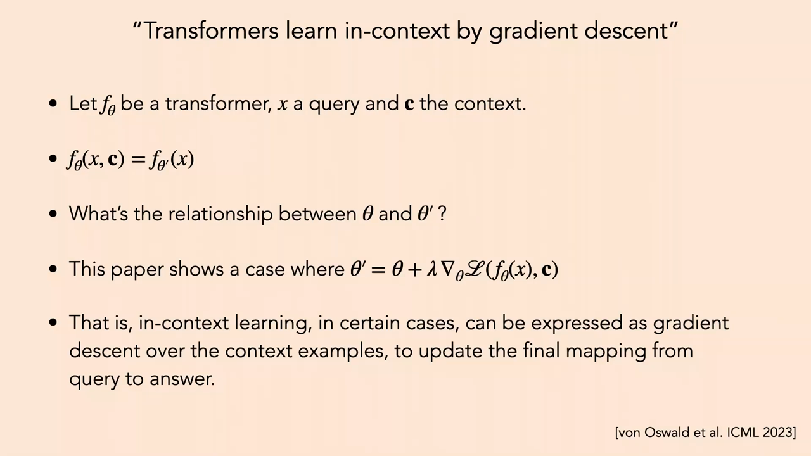
*▲ 강의 슬라이드 [64:40](https://youtu.be/mbgFTqKxR7A?t=3880): "[트랜스포머](00_%EB%94%A5%EB%9F%AC%EB%8B%9D_%EC%9A%A9%EC%96%B4%EC%82%AC%EC%A0%84.md#transformer-%ED%8A%B8%EB%9E%9C%EC%8A%A4%ED%8F%AC%EB%A8%B8)는 경사하강으로 [맥락 내 학습](00_%EB%94%A5%EB%9F%AC%EB%8B%9D_%EC%9A%A9%EC%96%B4%EC%82%AC%EC%A0%84.md#in-context-learning-%EB%A7%A5%EB%9D%BD-%EB%82%B4-%ED%95%99%EC%8A%B5)을 한다"(von Oswald 외, ICML 2023). 어떤 경우 [맥락 내 학습](00_%EB%94%A5%EB%9F%AC%EB%8B%9D_%EC%9A%A9%EC%96%B4%EC%82%AC%EC%A0%84.md#in-context-learning-%EB%A7%A5%EB%9D%BD-%EB%82%B4-%ED%95%99%EC%8A%B5)은 맥락 예에 대한 경사하강으로 "질의 → 답" 사상을 고친 것과 같다*

**그렇다면 왜 맥락에 대해 진짜로 경사하강을 하지 않나?**

- **장점 1**: [맥락 내 학습](00_%EB%94%A5%EB%9F%AC%EB%8B%9D_%EC%9A%A9%EC%96%B4%EC%82%AC%EC%A0%84.md#in-context-learning-%EB%A7%A5%EB%9D%BD-%EB%82%B4-%ED%95%99%EC%8A%B5)은 **학습된 [학습](00_%EB%94%A5%EB%9F%AC%EB%8B%9D_%EC%9A%A9%EC%96%B4%EC%82%AC%EC%A0%84.md#training-%ED%95%99%EC%8A%B5)**이라 보장이 없습니다. 맥락을 더 보여 줘도 나아진다는 보장이 없고, 우리는 데이터와 [학습](00_%EB%94%A5%EB%9F%AC%EB%8B%9D_%EC%9A%A9%EC%96%B4%EC%82%AC%EC%A0%84.md#training-%ED%95%99%EC%8A%B5) 과정으로만 간접적으로 조절합니다. 경사하강은 걸음이 충분히 작으면 적어도 [지역 최솟값](00_%EB%94%A5%EB%9F%AC%EB%8B%9D_%EC%9A%A9%EC%96%B4%EC%82%AC%EC%A0%84.md#local-minimum-%EC%A7%80%EC%97%AD-%EC%B5%9C%EC%86%9F%EA%B0%92)을 찾고, 맥락 예에서의 성능을 올린다는 것이 보장됩니다.
- **장점 2**: 경사하강은 **[테스트 시점 계산](00_%EB%94%A5%EB%9F%AC%EB%8B%9D_%EC%9A%A9%EC%96%B4%EC%82%AC%EC%A0%84.md#test-time-compute-%ED%85%8C%EC%8A%A4%ED%8A%B8-%EC%8B%9C%EC%A0%90-%EA%B3%84%EC%82%B0)을 더 쓸 수 있습니다.** [맥락 내 학습](00_%EB%94%A5%EB%9F%AC%EB%8B%9D_%EC%9A%A9%EC%96%B4%EC%82%AC%EC%A0%84.md#in-context-learning-%EB%A7%A5%EB%9D%BD-%EB%82%B4-%ED%95%99%EC%8A%B5)은 [순전파](00_%EB%94%A5%EB%9F%AC%EB%8B%9D_%EC%9A%A9%EC%96%B4%EC%82%AC%EC%A0%84.md#feed-forward-%EC%88%9C%EC%A0%84%ED%8C%8C) 한 번이지만, 경사하강은 앞뒤로 여러 번, 원하면 끝없이 돌릴 수 있습니다. 계산을 더 쓸 수 있는 방법에는 대개 [스케일링 법칙](00_%EB%94%A5%EB%9F%AC%EB%8B%9D_%EC%9A%A9%EC%96%B4%EC%82%AC%EC%A0%84.md#scaling-laws-%EC%8A%A4%EC%BC%80%EC%9D%BC%EB%A7%81-%EB%B2%95%EC%B9%99)이 따라옵니다.
- **단점**: 경사하강은 가장 똑똑한 [학습](00_%EB%94%A5%EB%9F%AC%EB%8B%9D_%EC%9A%A9%EC%96%B4%EC%82%AC%EC%A0%84.md#training-%ED%95%99%EC%8A%B5) 알고리즘이 아닙니다. [맥락 내 학습](00_%EB%94%A5%EB%9F%AC%EB%8B%9D_%EC%9A%A9%EC%96%B4%EC%82%AC%EC%A0%84.md#in-context-learning-%EB%A7%A5%EB%9D%BD-%EB%82%B4-%ED%95%99%EC%8A%B5)이 경사하강보다 나은 걸음을 배웠을 수도 있습니다. 이론 논문들은 크게 다르지 않다고 시사하지만 장난감 모형에서의 이야기이고, 거대 [언어 모델](00_%EB%94%A5%EB%9F%AC%EB%8B%9D_%EC%9A%A9%EC%96%B4%EC%82%AC%EC%A0%84.md#language-model-%EC%96%B8%EC%96%B4-%EB%AA%A8%EB%8D%B8)에서는 더 똑똑할 수도 있습니다.

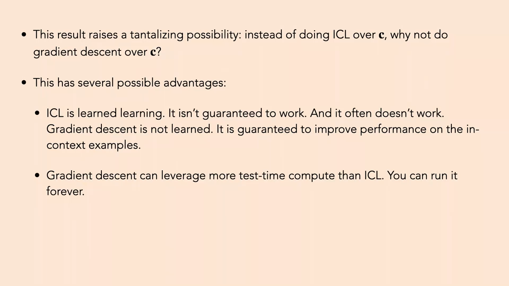
*▲ 강의 슬라이드 [63:10](https://youtu.be/mbgFTqKxR7A?t=3790): 맥락 $c$에 대해 [맥락 내 학습](00_%EB%94%A5%EB%9F%AC%EB%8B%9D_%EC%9A%A9%EC%96%B4%EC%82%AC%EC%A0%84.md#in-context-learning-%EB%A7%A5%EB%9D%BD-%EB%82%B4-%ED%95%99%EC%8A%B5) 대신 경사하강을 하면? 경사하강은 학습된 것이 아니라 맥락 예에서 성능을 올린다는 보장이 있고, [테스트 시점 계산](00_%EB%94%A5%EB%9F%AC%EB%8B%9D_%EC%9A%A9%EC%96%B4%EC%82%AC%EC%A0%84.md#test-time-compute-%ED%85%8C%EC%8A%A4%ED%8A%B8-%EC%8B%9C%EC%A0%90-%EA%B3%84%EC%82%B0)을 더 쓸 수 있다*

질의응답 정리 [60:20](https://youtu.be/mbgFTqKxR7A?t=3620)

- **맥락을 처리한 뒤의 활성값이 경사하강 한 걸음으로 계산된다는 논증인가?** 그렇다. 순수 경험적 논증인지 증명인지는 기억나지 않지만, 증명이 있다면 선형처럼 아주 단순한 경우일 것이다. 후속 논문이 많다.
- **역강화 [학습](00_%EB%94%A5%EB%9F%AC%EB%8B%9D_%EC%9A%A9%EC%96%B4%EC%82%AC%EC%A0%84.md#training-%ED%95%99%EC%8A%B5)에서 사람의 교정을 의도적인 것으로 보고 [가중치](00_%EB%94%A5%EB%9F%AC%EB%8B%9D_%EC%9A%A9%EC%96%B4%EC%82%AC%EC%A0%84.md#weight-%EA%B0%80%EC%A4%91%EC%B9%98)를 고치는 방법과 비슷한가?** 보상으로 암묵적으로 정의된 함수를 쓰는 방법들과 연결이 있을 것 같다.
- **맥락을 포함한 입력으로 다시 학습하자는 것인가, 접두 [토큰](00_%EB%94%A5%EB%9F%AC%EB%8B%9D_%EC%9A%A9%EC%96%B4%EC%82%AC%EC%A0%84.md#token-%ED%86%A0%ED%81%B0)을 최적화하는 프롬프트 최적화인가?** 여러 방법이 가능하지만 여기서 말하는 것은, 맥락 예를 써서 **맥락 없는** "질의 → 답" 사상을 경사하강으로 개선하는 것이다. 다른 아이디어도 좋다.
- **[학습](00_%EB%94%A5%EB%9F%AC%EB%8B%9D_%EC%9A%A9%EC%96%B4%EC%82%AC%EC%A0%84.md#training-%ED%95%99%EC%8A%B5) 때 모든 분야를 다 배울 수는 없으니, 추론 때 배우는 것이 낫지 않나?** 바로 그 이유로 사람들이 [맥락 내 학습](00_%EB%94%A5%EB%9F%AC%EB%8B%9D_%EC%9A%A9%EC%96%B4%EC%82%AC%EC%A0%84.md#in-context-learning-%EB%A7%A5%EB%9D%BD-%EB%82%B4-%ED%95%99%EC%8A%B5)과 [테스트 시점 계산](00_%EB%94%A5%EB%9F%AC%EB%8B%9D_%EC%9A%A9%EC%96%B4%EC%82%AC%EC%A0%84.md#test-time-compute-%ED%85%8C%EC%8A%A4%ED%8A%B8-%EC%8B%9C%EC%A0%90-%EA%B3%84%EC%82%B0)을 좋아한다. [학습](00_%EB%94%A5%EB%9F%AC%EB%8B%9D_%EC%9A%A9%EC%96%B4%EC%82%AC%EC%A0%84.md#training-%ED%95%99%EC%8A%B5) 때는 무한히 많은 상황에 다 대비해야 하지만, 시험 때는 아주 관련 깊은 예들을 받아 그 자리에서 특화된 기술을 배우면 된다.

---

## 10. 테스트 시점 학습

📐 **수학 개념**: [맥락 내 학습과 경사하강 한 걸음](%EC%88%98%ED%95%99%EA%B0%9C%EB%85%90/13_%EC%96%B8%EC%96%B4_%EB%AA%A8%EB%8D%B8%EA%B3%BC_%EC%B6%94%EB%A1%A0/MM81_%EB%A7%A5%EB%9D%BD_%EB%82%B4_%ED%95%99%EC%8A%B5%EA%B3%BC_%EA%B2%BD%EC%82%AC%ED%95%98%EA%B0%95_%ED%95%9C_%EA%B1%B8%EC%9D%8C.md) · [그래디언트 벡터](%EC%88%98%ED%95%99%EA%B0%9C%EB%85%90/02_%EB%AF%B8%EB%B6%84/MM02_%EA%B7%B8%EB%9E%98%EB%94%94%EC%96%B8%ED%8A%B8_%EB%B2%A1%ED%84%B0.md)

### 10.1 자기 지도 테스트 시점 학습

▶ 영상 [65:59](https://youtu.be/mbgFTqKxR7A?t=3959)

- **[테스트 시점 학습](00_%EB%94%A5%EB%9F%AC%EB%8B%9D_%EC%9A%A9%EC%96%B4%EC%82%AC%EC%A0%84.md#test-time-training-%ED%85%8C%EC%8A%A4%ED%8A%B8-%EC%8B%9C%EC%A0%90-%ED%95%99%EC%8A%B5)**(test-time training, TTT): 시험 질의(또는 시험 집합 전체)에 맞춰 모델의 [가중치](00_%EB%94%A5%EB%9F%AC%EB%8B%9D_%EC%9A%A9%EC%96%B4%EC%82%AC%EC%A0%84.md#weight-%EA%B0%80%EC%A4%91%EC%B9%98)를 갱신합니다. 질의에 퓨샷 예 $\{x_1, y_1, x_2, y_2, \dots, x_q\}$가 들어 있으면 그 예로 학습하면 됩니다.
- **더 극단적인 경우**: 라벨 없이 $x$ 하나(사진 한 장, 영화 한 편, 책 한 권)만 있어도 될까? 됩니다. **자기 지도** [손실](00_%EB%94%A5%EB%9F%AC%EB%8B%9D_%EC%9A%A9%EC%96%B4%EC%82%AC%EC%A0%84.md#loss-function-%EC%86%90%EC%8B%A4-%ED%95%A8%EC%88%98)로 학습하면 됩니다(Sun 외, ICML 2020).
- 방법: 분류기를 공통 몸통 $f$와 과제 헤드 $g_{\text{task}}$로 나눕니다. 몸통 $f$에는 자기 지도 헤드 $g_{\text{self-sup}}$도 붙여, 예를 들어 [가린 오토인코더](00_%EB%94%A5%EB%9F%AC%EB%8B%9D_%EC%9A%A9%EC%96%B4%EC%82%AC%EC%A0%84.md#masked-autoencoder-%EA%B0%80%EB%A6%B0-%EC%98%A4%ED%86%A0%EC%9D%B8%EC%BD%94%EB%8D%94)처럼 일부 패치를 지우고 지운 패치를 맞히게 합니다([Lec11 10.3](Lec11_%ED%91%9C%ED%98%84_%ED%95%99%EC%8A%B5_%EC%9E%AC%EA%B5%AC%EC%84%B1.md#103-%EA%B0%80%EB%A6%B0-%EC%98%A4%ED%86%A0%EC%9D%B8%EC%BD%94%EB%8D%94%EC%99%80-bert)). 시험 그림 하나에 대해 이 자기 지도 [손실](00_%EB%94%A5%EB%9F%AC%EB%8B%9D_%EC%9A%A9%EC%96%B4%EC%82%AC%EC%A0%84.md#loss-function-%EC%86%90%EC%8B%A4-%ED%95%A8%EC%88%98)로 $f$를 [미세 조정](00_%EB%94%A5%EB%9F%AC%EB%8B%9D_%EC%9A%A9%EC%96%B4%EC%82%AC%EC%A0%84.md#fine-tuning-%EB%AF%B8%EC%84%B8-%EC%A1%B0%EC%A0%95)하면 표현이 좋아지고, 그 표현으로 "새"를 더 잘 맞힙니다.
- 일반적인 쓸모: [학습](00_%EB%94%A5%EB%9F%AC%EB%8B%9D_%EC%9A%A9%EC%96%B4%EC%82%AC%EC%A0%84.md#training-%ED%95%99%EC%8A%B5) 때 모든 상황에 대비할 수는 없으므로 시험 상황에 맞춥니다. 화성에 가면 그림 분포가 달라지니(더 붉으니) 라벨 없이도 그 자리에서 표현을 적응시키는 식입니다.

$$
\theta_f' = \theta_f - \eta\, \nabla_{\theta_f} \mathcal{L}_{\text{self-sup}}(x;\, \theta_f), \qquad \hat y = g_{\text{task}}\big(f_{\theta_f'}(x)\big)
$$

기호 풀이

| 기호 | 읽는 법 | 뜻 | 예제 값 |
| --- | --- | --- | --- |
| $x$ | 엑스 | 라벨 없는 시험 입력 하나 (보이는 패치 값 2, 가린 패치 값 3) | |
| $\theta_f$ | 세타 에프 | 공통 몸통 $f$의 [파라미터](00_%EB%94%A5%EB%9F%AC%EB%8B%9D_%EC%9A%A9%EC%96%B4%EC%82%AC%EC%A0%84.md#parameter-%ED%8C%8C%EB%9D%BC%EB%AF%B8%ED%84%B0) | 1.0 |
| $\mathcal{L}_{\text{self-sup}}$ | 엘 셀프섭 | 자기 지도 [손실](00_%EB%94%A5%EB%9F%AC%EB%8B%9D_%EC%9A%A9%EC%96%B4%EC%82%AC%EC%A0%84.md#loss-function-%EC%86%90%EC%8B%A4-%ED%95%A8%EC%88%98) (가린 패치 복원 [오차](00_%EB%94%A5%EB%9F%AC%EB%8B%9D_%EC%9A%A9%EC%96%B4%EC%82%AC%EC%A0%84.md#error-%EC%98%A4%EC%B0%A8)). 예제에서는 $\frac{1}{2}(2\theta_f - 3)^2$ | 0.5 → 0.18 |
| $\nabla_{\theta_f}$ | 나블라 | $\theta_f$에 대한 [기울기](00_%EB%94%A5%EB%9F%AC%EB%8B%9D_%EC%9A%A9%EC%96%B4%EC%82%AC%EC%A0%84.md#gradient-%EA%B8%B0%EC%9A%B8%EA%B8%B0) | -2 |
| $\eta$ | 에타 | [학습률](00_%EB%94%A5%EB%9F%AC%EB%8B%9D_%EC%9A%A9%EC%96%B4%EC%82%AC%EC%A0%84.md#learning-rate-%ED%95%99%EC%8A%B5%EB%A5%A0) | 0.1 |
| $\theta_f'$ | 세타 에프 프라임 | 시험 입력에 맞춘 몸통 [파라미터](00_%EB%94%A5%EB%9F%AC%EB%8B%9D_%EC%9A%A9%EC%96%B4%EC%82%AC%EC%A0%84.md#parameter-%ED%8C%8C%EB%9D%BC%EB%AF%B8%ED%84%B0) | 1.2 |
| $g_{\text{task}}$ | 지 태스크 | 과제 헤드 (얼려 둔다) | |
| $\hat y$ | 와이 햇 | 과제 예측 (예: "새") | |

예제와 풀이

**문제**: 장난감 모형에서 몸통이 보이는 패치 값 2를 받아 가린 패치를 $\theta_f \times 2$로 예측하고, 실제 가린 패치 값은 3이다. [손실](00_%EB%94%A5%EB%9F%AC%EB%8B%9D_%EC%9A%A9%EC%96%B4%EC%82%AC%EC%A0%84.md#loss-function-%EC%86%90%EC%8B%A4-%ED%95%A8%EC%88%98)은 $\frac{1}{2}(2\theta_f - 3)^2$, [기울기](00_%EB%94%A5%EB%9F%AC%EB%8B%9D_%EC%9A%A9%EC%96%B4%EC%82%AC%EC%A0%84.md#gradient-%EA%B8%B0%EC%9A%B8%EA%B8%B0)는 $(2\theta_f - 3) \times 2$다. $\theta_f = 1.0$에서 [학습률](00_%EB%94%A5%EB%9F%AC%EB%8B%9D_%EC%9A%A9%EC%96%B4%EC%82%AC%EC%A0%84.md#learning-rate-%ED%95%99%EC%8A%B5%EB%A5%A0) 0.1로 한 걸음 가면 $\theta_f'$과 [손실](00_%EB%94%A5%EB%9F%AC%EB%8B%9D_%EC%9A%A9%EC%96%B4%EC%82%AC%EC%A0%84.md#loss-function-%EC%86%90%EC%8B%A4-%ED%95%A8%EC%88%98)은?

**주어진 값**
- $\theta_f = 1.0$ (사전 학습된 몸통 [파라미터](00_%EB%94%A5%EB%9F%AC%EB%8B%9D_%EC%9A%A9%EC%96%B4%EC%82%AC%EC%A0%84.md#parameter-%ED%8C%8C%EB%9D%BC%EB%AF%B8%ED%84%B0))
- 보이는 패치 2, 가린 패치 3 (시험 그림 하나에서 만든 자기 지도 문제)
- $\eta = 0.1$ ([학습률](00_%EB%94%A5%EB%9F%AC%EB%8B%9D_%EC%9A%A9%EC%96%B4%EC%82%AC%EC%A0%84.md#learning-rate-%ED%95%99%EC%8A%B5%EB%A5%A0))

**풀이**
1. 식을 그대로 쓴다: $\theta_f' = \theta_f - \eta\, \nabla_{\theta_f} \mathcal{L}$, $\nabla_{\theta_f} \mathcal{L} = (2\theta_f - 3) \times 2$
2. [기울기](00_%EB%94%A5%EB%9F%AC%EB%8B%9D_%EC%9A%A9%EC%96%B4%EC%82%AC%EC%A0%84.md#gradient-%EA%B8%B0%EC%9A%B8%EA%B8%B0)에 값을 대입한다: $\nabla_{\theta_f} \mathcal{L} = (2 \times 1.0 - 3) \times 2$
3. 괄호 안을 곱한다: $2 \times 1.0 = 2$ 이므로 $(2 - 3) \times 2$
4. 괄호 안을 뺀다: $2 - 3 = -1$ 이므로 $(-1) \times 2$
5. 곱한다: $(-1) \times 2 = -2$
6. 갱신식에 대입한다: $\theta_f' = 1.0 - 0.1 \times (-2)$
7. 곱한다: $0.1 \times (-2) = -0.2$ 이므로 $\theta_f' = 1.0 + 0.2 = 1.2$
8. 갱신 전 [손실](00_%EB%94%A5%EB%9F%AC%EB%8B%9D_%EC%9A%A9%EC%96%B4%EC%82%AC%EC%A0%84.md#loss-function-%EC%86%90%EC%8B%A4-%ED%95%A8%EC%88%98)을 구한다: $\frac{1}{2}(2 \times 1.0 - 3)^2 = \frac{1}{2} \times (-1)^2 = 0.5$
9. 갱신 뒤 [손실](00_%EB%94%A5%EB%9F%AC%EB%8B%9D_%EC%9A%A9%EC%96%B4%EC%82%AC%EC%A0%84.md#loss-function-%EC%86%90%EC%8B%A4-%ED%95%A8%EC%88%98)을 구한다: $2 \times 1.2 = 2.4$, $2.4 - 3 = -0.6$, $(-0.6)^2 = 0.36$, $\frac{1}{2} \times 0.36 = 0.18$

**답**: $\theta_f' =$ **1.2**, 자기 지도 [손실](00_%EB%94%A5%EB%9F%AC%EB%8B%9D_%EC%9A%A9%EC%96%B4%EC%82%AC%EC%A0%84.md#loss-function-%EC%86%90%EC%8B%A4-%ED%95%A8%EC%88%98)은 **0.5 → 0.18**. 라벨 없이도 시험 그림 하나로 몸통을 고쳤다. 고친 몸통을 과제 헤드에 넣어 예측한다.

내 이해

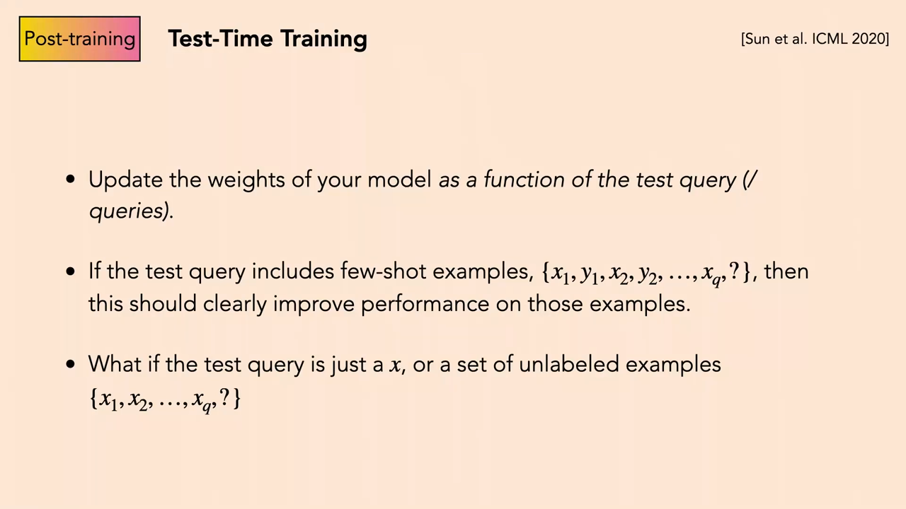
*▲ 강의 슬라이드 [66:30](https://youtu.be/mbgFTqKxR7A?t=3990): [테스트 시점 학습](00_%EB%94%A5%EB%9F%AC%EB%8B%9D_%EC%9A%A9%EC%96%B4%EC%82%AC%EC%A0%84.md#test-time-training-%ED%85%8C%EC%8A%A4%ED%8A%B8-%EC%8B%9C%EC%A0%90-%ED%95%99%EC%8A%B5)(Sun 외, ICML 2020). 시험 질의에 맞춰 [가중치](00_%EB%94%A5%EB%9F%AC%EB%8B%9D_%EC%9A%A9%EC%96%B4%EC%82%AC%EC%A0%84.md#weight-%EA%B0%80%EC%A4%91%EC%B9%98)를 갱신한다. 질의에 퓨샷 예가 있으면 당연히 도움이 되고, 라벨 없는 $x$만 있어도 할 수 있을까?*

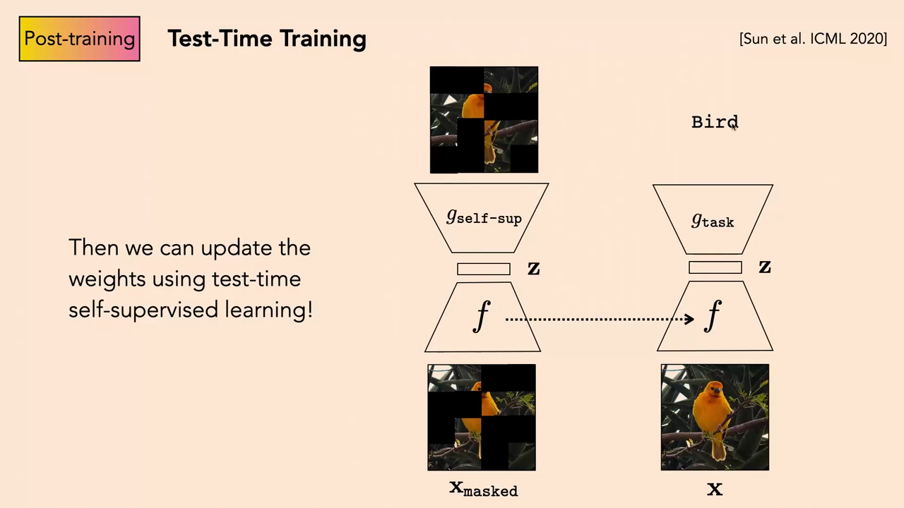
*▲ 강의 슬라이드 [68:50](https://youtu.be/mbgFTqKxR7A?t=4130): 자기 지도 [테스트 시점 학습](00_%EB%94%A5%EB%9F%AC%EB%8B%9D_%EC%9A%A9%EC%96%B4%EC%82%AC%EC%A0%84.md#test-time-training-%ED%85%8C%EC%8A%A4%ED%8A%B8-%EC%8B%9C%EC%A0%90-%ED%95%99%EC%8A%B5). 가린 그림을 복원하는 자기 지도 헤드($g_{\text{self-sup}}$)의 [손실](00_%EB%94%A5%EB%9F%AC%EB%8B%9D_%EC%9A%A9%EC%96%B4%EC%82%AC%EC%A0%84.md#loss-function-%EC%86%90%EC%8B%A4-%ED%95%A8%EC%88%98)로 공통 몸통 $f$를 고치고, 고친 $f$를 과제 헤드($g_{\text{task}}$)와 함께 써서 "Bird"를 맞힌다*

질의응답 정리 [68:18](https://youtu.be/mbgFTqKxR7A?t=4098)

- **$f$와 $g_{\text{task}}$ 중 무엇을 갱신하나?** $f$만. $g_{\text{task}}$는 얼려 두는 것으로 안다.
- **원래 배운 것을 잊지 않게 하려면?** 세부는 기억나지 않지만, $f$를 조금만 흔드는 범위에서 잘 된다. 큰 [학습률](00_%EB%94%A5%EB%9F%AC%EB%8B%9D_%EC%9A%A9%EC%96%B4%EC%82%AC%EC%A0%84.md#learning-rate-%ED%95%99%EC%8A%B5%EB%A5%A0)로 [가중치](00_%EB%94%A5%EB%9F%AC%EB%8B%9D_%EC%9A%A9%EC%96%B4%EC%82%AC%EC%A0%84.md#weight-%EA%B0%80%EC%A4%91%EC%B9%98)를 통째로 바꾸면 보장이 없다([파국적 망각](00_%EB%94%A5%EB%9F%AC%EB%8B%9D_%EC%9A%A9%EC%96%B4%EC%82%AC%EC%A0%84.md#catastrophic-forgetting-%ED%8C%8C%EA%B5%AD%EC%A0%81-%EB%A7%9D%EA%B0%81)).

### 10.2 ARC 챌린지

▶ 영상 [68:52](https://youtu.be/mbgFTqKxR7A?t=4132)

- 강의 1~2주 전 MIT(Jacob Andreas, Yoon Kim 교수 연구실)의 논문(Akyürek 외, 2024)입니다. **[ARC](00_%EB%94%A5%EB%9F%AC%EB%8B%9D_%EC%9A%A9%EC%96%B4%EC%82%AC%EC%A0%84.md#arc-abstraction-and-reasoning-corpus-arc-%EB%B2%A4%EC%B9%98%EB%A7%88%ED%81%AC)**(Abstraction and Reasoning Corpus) 챌린지는 딥러닝이 풀기 아주 어렵게 만든 문제 모음입니다. 입력·출력 격자 예 몇 개를 보고 패턴을 알아내 새 입력의 출력을 그립니다. 전문가는 80~90%를 맞힙니다.
- 몇 년 전의 딥넷은 탐색이나 테스트 시점 최적화 없이 [학습](00_%EB%94%A5%EB%9F%AC%EB%8B%9D_%EC%9A%A9%EC%96%B4%EC%82%AC%EC%A0%84.md#training-%ED%95%99%EC%8A%B5) 집합의 일반 규칙만 배웠으므로, 사람들은 [ARC](00_%EB%94%A5%EB%9F%AC%EB%8B%9D_%EC%9A%A9%EC%96%B4%EC%82%AC%EC%A0%84.md#arc-abstraction-and-reasoning-corpus-arc-%EB%B2%A4%EC%B9%98%EB%A7%88%ED%81%AC)를 풀려면 기호 추론, 탐색 같은 새 방법이 필요하다고 생각했습니다.
- 이 논문은 **테스트 시점 학습만으로** 꽤 멀리 갈 수 있음을 보였습니다. 이런 패턴 문제 전반에 대해 모델을 사전 학습한 뒤, 문제마다 주어진 **몇 개의 예로 경사하강**([지도 학습](00_%EB%94%A5%EB%9F%AC%EB%8B%9D_%EC%9A%A9%EC%96%B4%EC%82%AC%EC%A0%84.md#supervised-learning-%EC%A7%80%EB%8F%84-%ED%95%99%EC%8A%B5))을 해서 모델을 고치고, 그 모델로 질의에 답합니다. 비슷한 문제들의 [학습](00_%EB%94%A5%EB%9F%AC%EB%8B%9D_%EC%9A%A9%EC%96%B4%EC%82%AC%EC%A0%84.md#training-%ED%95%99%EC%8A%B5) 집합으로 하는 보통의 [미세 조정](00_%EB%94%A5%EB%9F%AC%EB%8B%9D_%EC%9A%A9%EC%96%B4%EC%82%AC%EC%A0%84.md#fine-tuning-%EB%AF%B8%EC%84%B8-%EC%A1%B0%EC%A0%95)은 이만큼 잘 되지 않습니다. 그 문제의 예가 가장 관련 깊기 때문입니다.
- [ARC](00_%EB%94%A5%EB%9F%AC%EB%8B%9D_%EC%9A%A9%EC%96%B4%EC%82%AC%EC%A0%84.md#arc-abstraction-and-reasoning-corpus-arc-%EB%B2%A4%EC%B9%98%EB%A7%88%ED%81%AC) 측은 "AGI 진전이 멈췄다, 새 아이디어가 필요하다"고 했지만, 이 논문은 경사하강과 [지도 학습](00_%EB%94%A5%EB%9F%AC%EB%8B%9D_%EC%9A%A9%EC%96%B4%EC%82%AC%EC%A0%84.md#supervised-learning-%EC%A7%80%EB%8F%84-%ED%95%99%EC%8A%B5)이라는 **오래된 방법**으로(맥락 예에 적용한 것이 새로울 뿐) 당시 보고된 최고 성능(약 62%)을 냈습니다. 강사는 "화려한 새 기호 추론이 정말 필요한가, 추론 시점에도 경사하강이 여전히 일꾼인가?"라는 질문을 던집니다. 다만 사람은 80~90%이므로 아직 그 수준은 아닙니다.

질의응답 정리 [72:19](https://youtu.be/mbgFTqKxR7A?t=4339)

- **예 두 개를 [트랜스포머](00_%EB%94%A5%EB%9F%AC%EB%8B%9D_%EC%9A%A9%EC%96%B4%EC%82%AC%EC%A0%84.md#transformer-%ED%8A%B8%EB%9E%9C%EC%8A%A4%ED%8F%AC%EB%A8%B8)에 넣고 "이건 뭐가 되나?"라고 묻는 것인가?** 아니다. 그 방식(맥락으로 넣기)은 덜 잘 된다. 예 한 쌍을 [학습 데이터](00_%EB%94%A5%EB%9F%AC%EB%8B%9D_%EC%9A%A9%EC%96%B4%EC%82%AC%EC%A0%84.md#training-data-test-data-%ED%95%99%EC%8A%B5-%EB%8D%B0%EC%9D%B4%ED%84%B0%EC%99%80-%EC%8B%9C%ED%97%98-%EB%8D%B0%EC%9D%B4%ED%84%B0)로 삼아, 입력을 넣고 출력과의 차이를 벌점으로 주고 [역전파](00_%EB%94%A5%EB%9F%AC%EB%8B%9D_%EC%9A%A9%EC%96%B4%EC%82%AC%EC%A0%84.md#backpropagation-%EC%97%AD%EC%A0%84%ED%8C%8C)로 [파라미터](00_%EB%94%A5%EB%9F%AC%EB%8B%9D_%EC%9A%A9%EC%96%B4%EC%82%AC%EC%A0%84.md#parameter-%ED%8C%8C%EB%9D%BC%EB%AF%B8%ED%84%B0)를 고치는 것을 몇 번 되풀이한다. 그냥 [지도 학습](00_%EB%94%A5%EB%9F%AC%EB%8B%9D_%EC%9A%A9%EC%96%B4%EC%82%AC%EC%A0%84.md#supervised-learning-%EC%A7%80%EB%8F%84-%ED%95%99%EC%8A%B5)이다.
- **시험 [손실](00_%EB%94%A5%EB%9F%AC%EB%8B%9D_%EC%9A%A9%EC%96%B4%EC%82%AC%EC%A0%84.md#loss-function-%EC%86%90%EC%8B%A4-%ED%95%A8%EC%88%98)을 보는 반칙 아닌가?** 아니다. 이 챌린지의 정의가 "새 패턴의 예 몇 개를 보고 질의에 적용하라"이다. 질의의 [정답](00_%EB%94%A5%EB%9F%AC%EB%8B%9D_%EC%9A%A9%EC%96%B4%EC%82%AC%EC%A0%84.md#label-%EC%A0%95%EB%8B%B5)은 보지 않고 예의 [정답](00_%EB%94%A5%EB%9F%AC%EB%8B%9D_%EC%9A%A9%EC%96%B4%EC%82%AC%EC%A0%84.md#label-%EC%A0%95%EB%8B%B5)만 본다. 사람에게도 똑같이 주어진다.

> [!TIP]
> **🆕 2026 업데이트: [ARC](00_%EB%94%A5%EB%9F%AC%EB%8B%9D_%EC%9A%A9%EC%96%B4%EC%82%AC%EC%A0%84.md#arc-abstraction-and-reasoning-corpus-arc-%EB%B2%A4%EC%B9%98%EB%A7%88%ED%81%AC) 점수의 변화**
> - **강의**: [테스트 시점 학습](00_%EB%94%A5%EB%9F%AC%EB%8B%9D_%EC%9A%A9%EC%96%B4%EC%82%AC%EC%A0%84.md#test-time-training-%ED%85%8C%EC%8A%A4%ED%8A%B8-%EC%8B%9C%EC%A0%90-%ED%95%99%EC%8A%B5) 논문이 [ARC](00_%EB%94%A5%EB%9F%AC%EB%8B%9D_%EC%9A%A9%EC%96%B4%EC%82%AC%EC%A0%84.md#arc-abstraction-and-reasoning-corpus-arc-%EB%B2%A4%EC%B9%98%EB%A7%88%ED%81%AC)에서 당시 최고인 약 62%를 냈다(2024년 11월). 논문 초록 기준으로는 8B 모델로 공개 [검증](00_%EB%94%A5%EB%9F%AC%EB%8B%9D_%EC%9A%A9%EC%96%B4%EC%82%AC%EC%A0%84.md#validation-data-%EA%B2%80%EC%A6%9D-%EB%8D%B0%EC%9D%B4%ED%84%B0) 집합 53.0%, 프로그램 합성과 합쳐 61.9%(평균적인 사람 수준).
> - **현재**: 2024년 12월 OpenAI o3(미리보기판)가 [ARC](00_%EB%94%A5%EB%9F%AC%EB%8B%9D_%EC%9A%A9%EC%96%B4%EC%82%AC%EC%A0%84.md#arc-abstraction-and-reasoning-corpus-arc-%EB%B2%A4%EC%B9%98%EB%A7%88%ED%81%AC)-AGI-1 준비공개(semi-private) 평가에서 계산 제한 안에서 75.7%, 약 172배 계산으로 87.5%를 기록했습니다(공개된 o3는 시험한 판과 다르다고 [ARC](00_%EB%94%A5%EB%9F%AC%EB%8B%9D_%EC%9A%A9%EC%96%B4%EC%82%AC%EC%A0%84.md#arc-abstraction-and-reasoning-corpus-arc-%EB%B2%A4%EC%B9%98%EB%A7%88%ED%81%AC) 측이 2025년에 덧붙임). 이후 더 어려운 **[ARC](00_%EB%94%A5%EB%9F%AC%EB%8B%9D_%EC%9A%A9%EC%96%B4%EC%82%AC%EC%A0%84.md#arc-abstraction-and-reasoning-corpus-arc-%EB%B2%A4%EC%B9%98%EB%A7%88%ED%81%AC)-AGI-2**가 나왔고, [ARC](00_%EB%94%A5%EB%9F%AC%EB%8B%9D_%EC%9A%A9%EC%96%B4%EC%82%AC%EC%A0%84.md#arc-abstraction-and-reasoning-corpus-arc-%EB%B2%A4%EC%B9%98%EB%A7%88%ED%81%AC) Prize 2025 대회(작업당 계산 제한)의 1위 점수는 24%로 대상 기준 85%에 못 미쳤습니다. **1~3위가 모두 [테스트 시점 학습](00_%EB%94%A5%EB%9F%AC%EB%8B%9D_%EC%9A%A9%EC%96%B4%EC%82%AC%EC%A0%84.md#test-time-training-%ED%85%8C%EC%8A%A4%ED%8A%B8-%EC%8B%9C%EC%A0%90-%ED%95%99%EC%8A%B5)과 [앙상블](00_%EB%94%A5%EB%9F%AC%EB%8B%9D_%EC%9A%A9%EC%96%B4%EC%82%AC%EC%A0%84.md#ensemble-%EC%95%99%EC%83%81%EB%B8%94)에 바탕을 둔** 방법이어서, 강의가 소개한 접근이 여전히 대회의 주류입니다.
> - **출처**: [Akyürek 외, "The Surprising Effectiveness of Test-Time Training for Abstract Reasoning", arXiv 2411.07279 (2024)](https://arxiv.org/abs/2411.07279) · [ARC Prize, "OpenAI o3 Breakthrough High Score on ARC-AGI-Pub" (2024)](https://arcprize.org/blog/oai-o3-pub-breakthrough) · [ARC Prize, "ARC Prize 2025 Results & Analysis" (2025)](https://arcprize.org/blog/arc-prize-2025-results-analysis)

---

## 11. 탐색으로 학습하기

📐 **수학 개념**: [정답 거르기와 반복 자기 개선](%EC%88%98%ED%95%99%EA%B0%9C%EB%85%90/13_%EC%96%B8%EC%96%B4_%EB%AA%A8%EB%8D%B8%EA%B3%BC_%EC%B6%94%EB%A1%A0/MM82_%EC%A0%95%EB%8B%B5_%EA%B1%B0%EB%A5%B4%EA%B8%B0%EC%99%80_%EB%B0%98%EB%B3%B5_%EC%9E%90%EA%B8%B0_%EA%B0%9C%EC%84%A0.md) · [베이즈 규칙과 사전 확률 보정](%EC%88%98%ED%95%99%EA%B0%9C%EB%85%90/04_%ED%99%95%EB%A5%A0%EA%B3%BC_%EC%A0%95%EB%B3%B4/MM64_%EB%B2%A0%EC%9D%B4%EC%A6%88_%EA%B7%9C%EC%B9%99%EA%B3%BC_%EC%82%AC%EC%A0%84_%ED%99%95%EB%A5%A0_%EB%B3%B4%EC%A0%95.md) · [Best-of-N과 적중 확률](%EC%88%98%ED%95%99%EA%B0%9C%EB%85%90/13_%EC%96%B8%EC%96%B4_%EB%AA%A8%EB%8D%B8%EA%B3%BC_%EC%B6%94%EB%A1%A0/MM80_Best-of-N%EA%B3%BC_%EC%A0%81%EC%A4%91_%ED%99%95%EB%A5%A0.md)

### 11.1 자기 개선

▶ 영상 [73:26](https://youtu.be/mbgFTqKxR7A?t=4406)

- 지금 가장 흥미로운 방식: 시험 때의 탐색·추론·최적화로 **더 나은 답을 찾고**, 그 답을 다시 [기반 모델](00_%EB%94%A5%EB%9F%AC%EB%8B%9D_%EC%9A%A9%EC%96%B4%EC%82%AC%EC%A0%84.md#foundation-model-%EA%B8%B0%EB%B0%98-%EB%AA%A8%EB%8D%B8)에 **증류**해(그 답에 맞춰 학습해) 모델이 바로 내놓게 하고, 이를 **되풀이**합니다. AI 초창기부터 있던 오래된 생각입니다.
- 절차: 답을 여러 개 내고 → Best-of-N, [트리 탐색](00_%EB%94%A5%EB%9F%AC%EB%8B%9D_%EC%9A%A9%EC%96%B4%EC%82%AC%EC%A0%84.md#tree-search-%ED%8A%B8%EB%A6%AC-%ED%83%90%EC%83%89), 최적화로 기본 출력보다 나은 답을 찾고 → 그 (질문, 더 나은 답)을 [지도 학습](00_%EB%94%A5%EB%9F%AC%EB%8B%9D_%EC%9A%A9%EC%96%B4%EC%82%AC%EC%A0%84.md#supervised-learning-%EC%A7%80%EB%8F%84-%ED%95%99%EC%8A%B5) 쌍으로 삼아 [언어 모델](00_%EB%94%A5%EB%9F%AC%EB%8B%9D_%EC%9A%A9%EC%96%B4%EC%82%AC%EC%A0%84.md#language-model-%EC%96%B8%EC%96%B4-%EB%AA%A8%EB%8D%B8)을 맞춥니다. 처음엔 형편없던 모델이 자기 탐색과 [검증](00_%EB%94%A5%EB%9F%AC%EB%8B%9D_%EC%9A%A9%EC%96%B4%EC%82%AC%EC%A0%84.md#validation-data-%EA%B2%80%EC%A6%9D-%EB%8D%B0%EC%9D%B4%ED%84%B0)으로 더 나은 모델이 됩니다. 이것을 **[자기 개선](00_%EB%94%A5%EB%9F%AC%EB%8B%9D_%EC%9A%A9%EC%96%B4%EC%82%AC%EC%A0%84.md#self-improvement-%EC%9E%90%EA%B8%B0-%EA%B0%9C%EC%84%A0)**, 또는 재귀적 [자기 개선](00_%EB%94%A5%EB%9F%AC%EB%8B%9D_%EC%9A%A9%EC%96%B4%EC%82%AC%EC%A0%84.md#self-improvement-%EC%9E%90%EA%B8%B0-%EA%B0%9C%EC%84%A0)이라고 부르기도 합니다.
- **정보는 어디서 오나?** 외부 [검증기](00_%EB%94%A5%EB%9F%AC%EB%8B%9D_%EC%9A%A9%EC%96%B4%EC%82%AC%EC%A0%84.md#verifier-%EA%B2%80%EC%A6%9D%EA%B8%B0)에서 들어옵니다. 그래서 엄밀히는 "외부 [검증기](00_%EB%94%A5%EB%9F%AC%EB%8B%9D_%EC%9A%A9%EC%96%B4%EC%82%AC%EC%A0%84.md#verifier-%EA%B2%80%EC%A6%9D%EA%B8%B0)로 개선"이지만 섞어서 [자기 개선](00_%EB%94%A5%EB%9F%AC%EB%8B%9D_%EC%9A%A9%EC%96%B4%EC%82%AC%EC%A0%84.md#self-improvement-%EC%9E%90%EA%B8%B0-%EA%B0%9C%EC%84%A0)이라 부르기도 합니다. [검증기](00_%EB%94%A5%EB%9F%AC%EB%8B%9D_%EC%9A%A9%EC%96%B4%EC%82%AC%EC%A0%84.md#verifier-%EA%B2%80%EC%A6%9D%EA%B8%B0) 자체를 모델로 만들 수도 있습니다. [검증](00_%EB%94%A5%EB%9F%AC%EB%8B%9D_%EC%9A%A9%EC%96%B4%EC%82%AC%EC%A0%84.md#validation-data-%EA%B2%80%EC%A6%9D-%EB%8D%B0%EC%9D%B4%ED%84%B0)을 배우는 것이 생성을 배우는 것보다 쉬우므로(6.2절), [검증기](00_%EB%94%A5%EB%9F%AC%EB%8B%9D_%EC%9A%A9%EC%96%B4%EC%82%AC%EC%A0%84.md#verifier-%EA%B2%80%EC%A6%9D%EA%B8%B0)를 빨리 배우고 그것으로 [생성기](00_%EB%94%A5%EB%9F%AC%EB%8B%9D_%EC%9A%A9%EC%96%B4%EC%82%AC%EC%A0%84.md#generator-discriminator-%EC%83%9D%EC%84%B1%EA%B8%B0%EC%99%80-%ED%8C%90%EB%B3%84%EA%B8%B0)를 개선하면 순수한 [자기 개선](00_%EB%94%A5%EB%9F%AC%EB%8B%9D_%EC%9A%A9%EC%96%B4%EC%82%AC%EC%A0%84.md#self-improvement-%EC%9E%90%EA%B8%B0-%EA%B0%9C%EC%84%A0)이 됩니다.

### 11.2 강화 학습의 기본 고리

▶ 영상 [75:40](https://youtu.be/mbgFTqKxR7A?t=4540)

**탐색으로 [학습](00_%EB%94%A5%EB%9F%AC%EB%8B%9D_%EC%9A%A9%EC%96%B4%EC%82%AC%EC%A0%84.md#training-%ED%95%99%EC%8A%B5)을 개선하고, [학습](00_%EB%94%A5%EB%9F%AC%EB%8B%9D_%EC%9A%A9%EC%96%B4%EC%82%AC%EC%A0%84.md#training-%ED%95%99%EC%8A%B5)으로 탐색을 개선합니다.** 이것이 [강화 학습](00_%EB%94%A5%EB%9F%AC%EB%8B%9D_%EC%9A%A9%EC%96%B4%EC%82%AC%EC%A0%84.md#reinforcement-learning-%EA%B0%95%ED%99%94-%ED%95%99%EC%8A%B5)의 근본 개념입니다(이 수업에서 따로 다룰 시간은 없었음).

1. **탐색**: 마리오 게임에서 파이프를 뛰어넘고 싶다면, 높은 점수를 얻는 동작 열이 나올 때까지 무작위 동작 열을 시도합니다. "점프"가 높은 점수를 줍니다.
2. **[학습](00_%EB%94%A5%EB%9F%AC%EB%8B%9D_%EC%9A%A9%EC%96%B4%EC%82%AC%EC%A0%84.md#training-%ED%95%99%EC%8A%B5)**: 찾은 좋은 동작 열을 신경망이 곧장 예측하도록 맞춥니다. 상태에서 최적 동작으로 바로 가는 이 신경망을 **[정책](00_%EB%94%A5%EB%9F%AC%EB%8B%9D_%EC%9A%A9%EC%96%B4%EC%82%AC%EC%A0%84.md#policy-%EC%A0%95%EC%B1%85)**(policy)이라고 합니다. 이제 그 상황에서는 탐색 없이 바로 답합니다.
3. **반복**: 다음 탐색은 무작위가 아니라 **[정책](00_%EB%94%A5%EB%9F%AC%EB%8B%9D_%EC%9A%A9%EC%96%B4%EC%82%AC%EC%A0%84.md#policy-%EC%A0%95%EC%B1%85)이 이미 좋다고 보는 동작 열 위주로** 합니다. 이 고리가 계속 개선되고, 게임 점수 같은 보상 함수가 있으면 어떤 조건에서는 최대 보상에 닿는다는 것이 증명되어 있습니다.

- **AlphaGo**도 이렇게 동작합니다. 둘 수 있는 수에 대해 [트리 탐색](00_%EB%94%A5%EB%9F%AC%EB%8B%9D_%EC%9A%A9%EC%96%B4%EC%82%AC%EC%A0%84.md#tree-search-%ED%8A%B8%EB%A6%AC-%ED%83%90%EC%83%89)(MCTS)을 하고, 탐색이 찾은 최선을 휴리스틱(가치·[정책](00_%EB%94%A5%EB%9F%AC%EB%8B%9D_%EC%9A%A9%EC%96%B4%EC%82%AC%EC%A0%84.md#policy-%EC%A0%95%EC%B1%85) 신경망)에 거꾸로 저장합니다. 그러면 나무를 펼치지 않고도 "펼쳤다면 좋은 수를 찾았을 자리"를 예측합니다.

질의응답 정리 [77:20](https://youtu.be/mbgFTqKxR7A?t=4640)

- **이런 예들은 게임 환경이라 자기 대국(self-play)이 되는데, 더 일반적인 경우엔?** 여기에는 세상과의 상호작용과 세상이 주는 보상이 있다. [언어 모델](00_%EB%94%A5%EB%9F%AC%EB%8B%9D_%EC%9A%A9%EC%96%B4%EC%82%AC%EC%A0%84.md#language-model-%EC%96%B8%EC%96%B4-%EB%AA%A8%EB%8D%B8)의 추론 개선에는 어떻게 쓰는지가 바로 다음([STaR](00_%EB%94%A5%EB%9F%AC%EB%8B%9D_%EC%9A%A9%EC%96%B4%EC%82%AC%EC%A0%84.md#star-self-taught-reasoner-%EC%8A%A4%EC%8A%A4%EB%A1%9C-%EB%B0%B0%EC%9A%B0%EB%8A%94-%EC%B6%94%EB%A1%A0%EA%B8%B0))이다.

### 11.3 STaR와 o1 추측

▶ 영상 [78:27](https://youtu.be/mbgFTqKxR7A?t=4707)

- **[STaR](00_%EB%94%A5%EB%9F%AC%EB%8B%9D_%EC%9A%A9%EC%96%B4%EC%82%AC%EC%A0%84.md#star-self-taught-reasoner-%EC%8A%A4%EC%8A%A4%EB%A1%9C-%EB%B0%B0%EC%9A%B0%EB%8A%94-%EC%B6%94%EB%A1%A0%EA%B8%B0)**(Zelikman 외, 2022): [언어 모델](00_%EB%94%A5%EB%9F%AC%EB%8B%9D_%EC%9A%A9%EC%96%B4%EC%82%AC%EC%A0%84.md#language-model-%EC%96%B8%EC%96%B4-%EB%AA%A8%EB%8D%B8)에 질문을 주고 생각의 사슬 형식으로 "생각 단계"(**근거**, rationale)와 답을 내게 합니다. 답이 맞는지 확인할 수단([검증기](00_%EB%94%A5%EB%9F%AC%EB%8B%9D_%EC%9A%A9%EC%96%B4%EC%82%AC%EC%A0%84.md#verifier-%EA%B2%80%EC%A6%9D%EA%B8%B0))이 있다고 가정합니다.
  - 맞으면: 그 (질문, 근거, 답)을 좋은 예로 삼아, [정답](00_%EB%94%A5%EB%9F%AC%EB%8B%9D_%EC%9A%A9%EC%96%B4%EC%82%AC%EC%A0%84.md#label-%EC%A0%95%EB%8B%B5)으로 이끈 근거를 더 잘 내도록 [언어 모델](00_%EB%94%A5%EB%9F%AC%EB%8B%9D_%EC%9A%A9%EC%96%B4%EC%82%AC%EC%A0%84.md#language-model-%EC%96%B8%EC%96%B4-%EB%AA%A8%EB%8D%B8)을 [미세 조정](00_%EB%94%A5%EB%9F%AC%EB%8B%9D_%EC%9A%A9%EC%96%B4%EC%82%AC%EC%A0%84.md#fine-tuning-%EB%AF%B8%EC%84%B8-%EC%A1%B0%EC%A0%95)합니다.
  - 틀리면: [정답](00_%EB%94%A5%EB%9F%AC%EB%8B%9D_%EC%9A%A9%EC%96%B4%EC%82%AC%EC%A0%84.md#label-%EC%A0%95%EB%8B%B5)을 힌트로 주고 근거를 다시 쓰게 하는 단계가 있습니다(강의에서는 자세히 다루지 않음).
- **o1에 대한 추측**(Sasha Rush가 제시한 후보 설명 중 하나, 강사도 "기본적으로 이런 것일 것"이라고 봄):
  1. 문제를 푸는 생각의 사슬을 **탐색**한다: 여러 사슬을 무작위로 뽑는다([빔 서치](00_%EB%94%A5%EB%9F%AC%EB%8B%9D_%EC%9A%A9%EC%96%B4%EC%82%AC%EC%A0%84.md#beam-search-%EB%B9%94-%EC%84%9C%EC%B9%98)처럼 가능한 생각의 갈래들을 뒤진다).
  2. [점수 함수](00_%EB%94%A5%EB%9F%AC%EB%8B%9D_%EC%9A%A9%EC%96%B4%EC%82%AC%EC%A0%84.md#scoring-function-%EC%A0%90%EC%88%98-%ED%95%A8%EC%88%98)로 실제로 [정답](00_%EB%94%A5%EB%9F%AC%EB%8B%9D_%EC%9A%A9%EC%96%B4%EC%82%AC%EC%A0%84.md#label-%EC%A0%95%EB%8B%B5)에 닿은 사슬을 찾고, 그 사슬을 곧장 내도록 [언어 모델](00_%EB%94%A5%EB%9F%AC%EB%8B%9D_%EC%9A%A9%EC%96%B4%EC%82%AC%EC%A0%84.md#language-model-%EC%96%B8%EC%96%B4-%EB%AA%A8%EB%8D%B8)을 **[미세 조정](00_%EB%94%A5%EB%9F%AC%EB%8B%9D_%EC%9A%A9%EC%96%B4%EC%82%AC%EC%A0%84.md#fine-tuning-%EB%AF%B8%EC%84%B8-%EC%A1%B0%EC%A0%95)**한다. [검증](00_%EB%94%A5%EB%9F%AC%EB%8B%9D_%EC%9A%A9%EC%96%B4%EC%82%AC%EC%A0%84.md#validation-data-%EA%B2%80%EC%A6%9D-%EB%8D%B0%EC%9D%B4%ED%84%B0)은 학습된 [검증기](00_%EB%94%A5%EB%9F%AC%EB%8B%9D_%EC%9A%A9%EC%96%B4%EC%82%AC%EC%A0%84.md#verifier-%EA%B2%80%EC%A6%9D%EA%B8%B0)(다른 [언어 모델](00_%EB%94%A5%EB%9F%AC%EB%8B%9D_%EC%9A%A9%EC%96%B4%EC%82%AC%EC%A0%84.md#language-model-%EC%96%B8%EC%96%B4-%EB%AA%A8%EB%8D%B8))일 수도, 인터넷의 사람들일 수도, 컴파일러나 증명 검사기일 수도 있다. 우리는 모른다.
  3. **반복**한다: [언어 모델](00_%EB%94%A5%EB%9F%AC%EB%8B%9D_%EC%9A%A9%EC%96%B4%EC%82%AC%EC%A0%84.md#language-model-%EC%96%B8%EC%96%B4-%EB%AA%A8%EB%8D%B8)이 더 좋은 사슬을 내므로 탐색이 아주 좋은 사슬들의 좁은 공간으로 모이고, 그 안에서 다시 고르고 반복한다. 곧 **[언어 모델](00_%EB%94%A5%EB%9F%AC%EB%8B%9D_%EC%9A%A9%EC%96%B4%EC%82%AC%EC%A0%84.md#language-model-%EC%96%B8%EC%96%B4-%EB%AA%A8%EB%8D%B8)의 추론에 적용한 [강화 학습](00_%EB%94%A5%EB%9F%AC%EB%8B%9D_%EC%9A%A9%EC%96%B4%EC%82%AC%EC%A0%84.md#reinforcement-learning-%EA%B0%95%ED%99%94-%ED%95%99%EC%8A%B5)**이다.
  4. **배포 때**는 미세 조정한 모델을 그대로 쓰거나, 그 위에 탐색을 더 얹을 수 있다. o1 같은 모델이 답하는 데 오래 걸리는 이유다.

걸러 배우기의 한 바퀴는 "정답인 근거만 남기고 다시 나누기"로 쓸 수 있습니다([MM82_정답_거르기와_반복_자기_개선](%EC%88%98%ED%95%99%EA%B0%9C%EB%85%90/13_%EC%96%B8%EC%96%B4_%EB%AA%A8%EB%8D%B8%EA%B3%BC_%EC%B6%94%EB%A1%A0/MM82_%EC%A0%95%EB%8B%B5_%EA%B1%B0%EB%A5%B4%EA%B8%B0%EC%99%80_%EB%B0%98%EB%B3%B5_%EC%9E%90%EA%B8%B0_%EA%B0%9C%EC%84%A0.md)).

$$
p_{t+1}(r \mid x) = \frac{p_t(r \mid x)\, \mathbb{1}[\text{검증}(r) = \text{정답}]}{\sum_{r'} p_t(r' \mid x)\, \mathbb{1}[\text{검증}(r') = \text{정답}]}
$$

기호 풀이

| 기호 | 읽는 법 | 뜻 | 예제 값 |
| --- | --- | --- | --- |
| $x$ | 엑스 | 질문 | 작은 개를 담을 것은? |
| $r$ | 알 | 근거(생각의 사슬)와 답 | $r_1, \dots, r_4$ |
| $p_t(r \mid x)$ | 피 티 | $t$번째 모델이 근거 $r$를 낼 [확률](00_%EB%94%A5%EB%9F%AC%EB%8B%9D_%EC%9A%A9%EC%96%B4%EC%82%AC%EC%A0%84.md#probability-%ED%99%95%EB%A5%A0) | 0.4, 0.3, 0.2, 0.1 |
| $\mathbb{1}[\cdot]$ | [지시 함수](00_%EB%94%A5%EB%9F%AC%EB%8B%9D_%EC%9A%A9%EC%96%B4%EC%82%AC%EC%A0%84.md#indicator-function-%EC%A7%80%EC%8B%9C-%ED%95%A8%EC%88%98) | 괄호 안이 참이면 1, 거짓이면 0 | 0, 1, 1, 0 |
| $\text{검증}(r)$ | | [검증기](00_%EB%94%A5%EB%9F%AC%EB%8B%9D_%EC%9A%A9%EC%96%B4%EC%82%AC%EC%A0%84.md#verifier-%EA%B2%80%EC%A6%9D%EA%B8%B0)가 본 $r$의 답 | |
| 분모 | | 정답인 근거들의 [확률](00_%EB%94%A5%EB%9F%AC%EB%8B%9D_%EC%9A%A9%EC%96%B4%EC%82%AC%EC%A0%84.md#probability-%ED%99%95%EB%A5%A0) 합 (전체 정답률) | 0.5 |
| $p_{t+1}(r \mid x)$ | 피 티 플러스 일 | [정답](00_%EB%94%A5%EB%9F%AC%EB%8B%9D_%EC%9A%A9%EC%96%B4%EC%82%AC%EC%A0%84.md#label-%EC%A0%95%EB%8B%B5)만 걸러 따라 배운 다음 모델의 [확률](00_%EB%94%A5%EB%9F%AC%EB%8B%9D_%EC%9A%A9%EC%96%B4%EC%82%AC%EC%A0%84.md#probability-%ED%99%95%EB%A5%A0) | 0, 0.6, 0.4, 0 |

예제와 풀이

**문제**: 한 질문에 모델이 근거 4개를 각각 0.4, 0.3, 0.2, 0.1의 [확률](00_%EB%94%A5%EB%9F%AC%EB%8B%9D_%EC%9A%A9%EC%96%B4%EC%82%AC%EC%A0%84.md#probability-%ED%99%95%EB%A5%A0)로 낸다. [검증기](00_%EB%94%A5%EB%9F%AC%EB%8B%9D_%EC%9A%A9%EC%96%B4%EC%82%AC%EC%A0%84.md#verifier-%EA%B2%80%EC%A6%9D%EA%B8%B0)는 둘째와 셋째만 [정답](00_%EB%94%A5%EB%9F%AC%EB%8B%9D_%EC%9A%A9%EC%96%B4%EC%82%AC%EC%A0%84.md#label-%EC%A0%95%EB%8B%B5)이라고 한다. [정답](00_%EB%94%A5%EB%9F%AC%EB%8B%9D_%EC%9A%A9%EC%96%B4%EC%82%AC%EC%A0%84.md#label-%EC%A0%95%EB%8B%B5) 근거만 걸러 완벽히 따라 배우면 다음 모델의 [확률](00_%EB%94%A5%EB%9F%AC%EB%8B%9D_%EC%9A%A9%EC%96%B4%EC%82%AC%EC%A0%84.md#probability-%ED%99%95%EB%A5%A0)은?

**주어진 값**
- $p_t = (0.4, 0.3, 0.2, 0.1)$ (근거 4개의 [확률](00_%EB%94%A5%EB%9F%AC%EB%8B%9D_%EC%9A%A9%EC%96%B4%EC%82%AC%EC%A0%84.md#probability-%ED%99%95%EB%A5%A0))
- $\mathbb{1} = (0, 1, 1, 0)$ ([검증](00_%EB%94%A5%EB%9F%AC%EB%8B%9D_%EC%9A%A9%EC%96%B4%EC%82%AC%EC%A0%84.md#validation-data-%EA%B2%80%EC%A6%9D-%EB%8D%B0%EC%9D%B4%ED%84%B0) 결과: 둘째와 셋째만 [정답](00_%EB%94%A5%EB%9F%AC%EB%8B%9D_%EC%9A%A9%EC%96%B4%EC%82%AC%EC%A0%84.md#label-%EC%A0%95%EB%8B%B5))

**풀이**
1. 식을 그대로 쓴다: $p_{t+1}(r) = \dfrac{p_t(r)\, \mathbb{1}(r)}{\sum_{r'} p_t(r')\, \mathbb{1}(r')}$
2. 분모에 값을 대입한다 (Σ를 네 항으로 펼친다): $0.4 \times 0 + 0.3 \times 1 + 0.2 \times 1 + 0.1 \times 0$
3. 곱한다: $0 + 0.3 + 0.2 + 0$
4. 더한다: $0.3 + 0.2 = 0.5$ (지금 모델의 정답률)
5. 둘째 근거에 대입한다: $p_{t+1}(r_2) = 0.3 \times 1 / 0.5$
6. 나눈다: $0.3 / 0.5 = 0.6$
7. 셋째 근거에 대입한다: $p_{t+1}(r_3) = 0.2 \times 1 / 0.5 = 0.4$
8. 틀린 근거는 분자에 0이 곱해진다: $p_{t+1}(r_1) = 0$, $p_{t+1}(r_4) = 0$

**답**: **(0, 0.6, 0.4, 0)**. 정답률이 0.5에서 1로 오른다(이 질문에서는). 실제로는 많은 질문을 한꺼번에 학습하므로 한 질문에서처럼 완벽하지는 않다.

내 이해

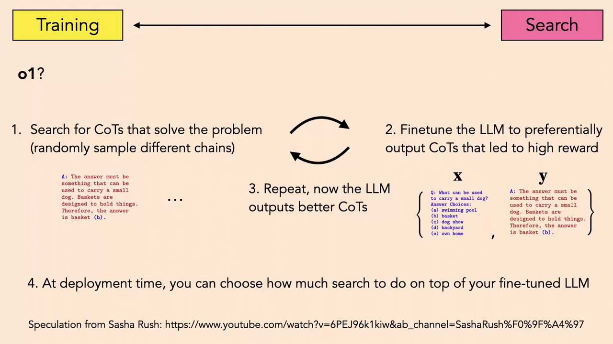
*▲ 강의 슬라이드 [81:20](https://youtu.be/mbgFTqKxR7A?t=4880): o1에 대한 추측(Sasha Rush). (1) 문제를 푸는 생각의 사슬을 탐색, (2) 높은 보상으로 이끈 사슬을 내도록 [미세 조정](00_%EB%94%A5%EB%9F%AC%EB%8B%9D_%EC%9A%A9%EC%96%B4%EC%82%AC%EC%A0%84.md#fine-tuning-%EB%AF%B8%EC%84%B8-%EC%A1%B0%EC%A0%95), (3) 반복, (4) 배포 때 탐색을 얼마나 더 할지 고른다*

질의응답 정리 [81:08](https://youtu.be/mbgFTqKxR7A?t=4868)

- **탐색을 더 하는데 어떻게 더 효율적인가?** 더 효율적이라는 주장이 아니라 **더 정확하다**는 주장이다. 질의마다 계산을 훨씬 많이 써서 더 좋은 답을 찾고, 그것을 [기반 모델](00_%EB%94%A5%EB%9F%AC%EB%8B%9D_%EC%9A%A9%EC%96%B4%EC%82%AC%EC%A0%84.md#foundation-model-%EA%B8%B0%EB%B0%98-%EB%AA%A8%EB%8D%B8)에 증류한다. [기반 모델](00_%EB%94%A5%EB%9F%AC%EB%8B%9D_%EC%9A%A9%EC%96%B4%EC%82%AC%EC%A0%84.md#foundation-model-%EA%B8%B0%EB%B0%98-%EB%AA%A8%EB%8D%B8) 자체는 똑같이 효율적이고, 그 위에 원하는 만큼 탐색을 더 얹을 수 있다. [사전 분포](00_%EB%94%A5%EB%9F%AC%EB%8B%9D_%EC%9A%A9%EC%96%B4%EC%82%AC%EC%A0%84.md#prior-posterior-%EC%82%AC%EC%A0%84-%EB%B6%84%ED%8F%AC%EC%99%80-%EC%82%AC%ED%9B%84-%EB%B6%84%ED%8F%AC)가 고르고 Best-of-N을 무한히 하면 어떤 조건에서는 최선에 닿는다. 계산을 더 써서 더 좋은 답을 얻는 방법일 뿐이다.
- **(질문, 근거, 답) [학습](00_%EB%94%A5%EB%9F%AC%EB%8B%9D_%EC%9A%A9%EC%96%B4%EC%82%AC%EC%A0%84.md#training-%ED%95%99%EC%8A%B5) 집합이 얼마나 커야 하나?** 사람이 쓴 근거 몇 개나 씨앗 정도로 시작하고, 이후로는 모델이 낸 근거 중 [정답](00_%EB%94%A5%EB%9F%AC%EB%8B%9D_%EC%9A%A9%EC%96%B4%EC%82%AC%EC%A0%84.md#label-%EC%A0%95%EB%8B%B5)으로 이끈 것을 [학습](00_%EB%94%A5%EB%9F%AC%EB%8B%9D_%EC%9A%A9%EC%96%B4%EC%82%AC%EC%A0%84.md#training-%ED%95%99%EC%8A%B5) 집합에 더해 스스로 근거를 만들어 간다. 처음 크기는 기억나지 않지만 손으로 쓴 근거가 몇 개뿐이었던 것으로 안다.

> [!TIP]
> **🆕 2026 업데이트: o1 추측은 공개된 방법으로 확인되었다**
> - **강의**: o1이 어떻게 동작하는지 모르지만, "생각의 사슬을 뽑고 → [정답](00_%EB%94%A5%EB%9F%AC%EB%8B%9D_%EC%9A%A9%EC%96%B4%EC%82%AC%EC%A0%84.md#label-%EC%A0%95%EB%8B%B5)으로 걸러 → 다시 배우기"를 되풀이하는 강화 학습일 것이라고 추측했다(2024년 가을).
> - **현재**: DeepSeek-R1(2025년 1월 공개, 2025년 9월 Nature 게재)은 수학·코딩처럼 **답을 자동으로 확인할 수 있는 과제에서 순수 강화 학습만으로** 긴 생각의 사슬과 추론 능력이 생겨남을 공개된 방법으로 보였고, 성능은 OpenAI o1과 비슷했습니다. 같은 논문은 "실패한 시도"로 **과정 [보상 모델](00_%EB%94%A5%EB%9F%AC%EB%8B%9D_%EC%9A%A9%EC%96%B4%EC%82%AC%EC%A0%84.md#reward-model-%EB%B3%B4%EC%83%81-%EB%AA%A8%EB%8D%B8)**(단계마다 점수를 주는 [보상 모델](00_%EB%94%A5%EB%9F%AC%EB%8B%9D_%EC%9A%A9%EC%96%B4%EC%82%AC%EC%A0%84.md#reward-model-%EB%B3%B4%EC%83%81-%EB%AA%A8%EB%8D%B8): 단계를 정의하기 어렵고 보상 해킹이 생김)과 AlphaGo식 **MCTS**를 들었습니다. 곧 강의의 추측처럼 "뽑고, 검증하고, 강화하는" 단순한 고리가 핵심이었고, 강의가 소개한 [트리 탐색](00_%EB%94%A5%EB%9F%AC%EB%8B%9D_%EC%9A%A9%EC%96%B4%EC%82%AC%EC%A0%84.md#tree-search-%ED%8A%B8%EB%A6%AC-%ED%83%90%EC%83%89)은 일반 추론에서는 잘 되지 않았습니다.
> - **출처**: [DeepSeek-AI, "DeepSeek-R1 incentivizes reasoning in LLMs through reinforcement learning", Nature (2025)](https://www.nature.com/articles/s41586-025-09422-z) · [DeepSeek-AI, "DeepSeek-R1: Incentivizing Reasoning Capability in LLMs via Reinforcement Learning", arXiv 2501.12948 (2025)](https://arxiv.org/abs/2501.12948)

---

## 12. 정리

▶ 영상 [82:46](https://youtu.be/mbgFTqKxR7A?t=4966)

- 오늘은 [학습](00_%EB%94%A5%EB%9F%AC%EB%8B%9D_%EC%9A%A9%EC%96%B4%EC%82%AC%EC%A0%84.md#training-%ED%95%99%EC%8A%B5)이 끝난 모델을 **쓸 때** 계산을 더 써서 더 좋은 답을 얻는 방법들을 보았습니다. 모델을 그대로 두는 **탐색**(Best-of-N, [빔 서치](00_%EB%94%A5%EB%9F%AC%EB%8B%9D_%EC%9A%A9%EC%96%B4%EC%82%AC%EC%A0%84.md#beam-search-%EB%B9%94-%EC%84%9C%EC%B9%98), 생각의 사슬, [잠재 공간](00_%EB%94%A5%EB%9F%AC%EB%8B%9D_%EC%9A%A9%EC%96%B4%EC%82%AC%EC%A0%84.md#latent-space-%EC%9E%A0%EC%9E%AC-%EA%B3%B5%EA%B0%84) 최적화), 아무 **[점수 함수](00_%EB%94%A5%EB%9F%AC%EB%8B%9D_%EC%9A%A9%EC%96%B4%EC%82%AC%EC%A0%84.md#scoring-function-%EC%A0%90%EC%88%98-%ED%95%A8%EC%88%98)**나 쓰는 탐색([보상 모델](00_%EB%94%A5%EB%9F%AC%EB%8B%9D_%EC%9A%A9%EC%96%B4%EC%82%AC%EC%A0%84.md#reward-model-%EB%B3%B4%EC%83%81-%EB%AA%A8%EB%8D%B8), [검증기](00_%EB%94%A5%EB%9F%AC%EB%8B%9D_%EC%9A%A9%EC%96%B4%EC%82%AC%EC%A0%84.md#verifier-%EA%B2%80%EC%A6%9D%EA%B8%B0)), 모델을 바꾸는 **[테스트 시점 학습](00_%EB%94%A5%EB%9F%AC%EB%8B%9D_%EC%9A%A9%EC%96%B4%EC%82%AC%EC%A0%84.md#test-time-training-%ED%85%8C%EC%8A%A4%ED%8A%B8-%EC%8B%9C%EC%A0%90-%ED%95%99%EC%8A%B5)**, 그리고 탐색 결과를 다시 학습하는 **[강화 학습](00_%EB%94%A5%EB%9F%AC%EB%8B%9D_%EC%9A%A9%EC%96%B4%EC%82%AC%EC%A0%84.md#reinforcement-learning-%EA%B0%95%ED%99%94-%ED%95%99%EC%8A%B5)의 고리**입니다.
- 강사의 마지막 말: 이것이 AI의 가장 최신 주제이고, 정확히 어떻게 동작하는지 모르지만 아주 멋진 최전선입니다.
- 이 강의가 학기의 마지막 강의입니다. 다음 강의는 없습니다.

---

## 13. 용어 정리

용어사전에 있는 용어는 위 본문에 링크를 걸었습니다. 아래는 이번 강의에서 새로 나온 용어입니다.

| 용어 | 뜻 |
|---|---|
| [추론](00_%EB%94%A5%EB%9F%AC%EB%8B%9D_%EC%9A%A9%EC%96%B4%EC%82%AC%EC%A0%84.md#inference-%EC%B6%94%EB%A1%A0)([Inference](00_%EB%94%A5%EB%9F%AC%EB%8B%9D_%EC%9A%A9%EC%96%B4%EC%82%AC%EC%A0%84.md#inference-%EC%B6%94%EB%A1%A0)) | ML에서는 학습된 모델로 새 입력을 예측하는 것. 통계학에서는 표본으로 생성 과정을 알아내는 것(ML의 [학습](00_%EB%94%A5%EB%9F%AC%EB%8B%9D_%EC%9A%A9%EC%96%B4%EC%82%AC%EC%A0%84.md#training-%ED%95%99%EC%8A%B5)) |
| [분할 상환 추론](00_%EB%94%A5%EB%9F%AC%EB%8B%9D_%EC%9A%A9%EC%96%B4%EC%82%AC%EC%A0%84.md#amortized-inference-%EB%B6%84%ED%95%A0-%EC%83%81%ED%99%98-%EC%B6%94%EB%A1%A0)(Amortized inference) | 매번 풀 문제를 미리 학습해 둔 [가중치](00_%EB%94%A5%EB%9F%AC%EB%8B%9D_%EC%9A%A9%EC%96%B4%EC%82%AC%EC%A0%84.md#weight-%EA%B0%80%EC%A4%91%EC%B9%98)로 곧장 답하게 해, 생각하는 비용을 [학습](00_%EB%94%A5%EB%9F%AC%EB%8B%9D_%EC%9A%A9%EC%96%B4%EC%82%AC%EC%A0%84.md#training-%ED%95%99%EC%8A%B5) 때 미리 치르는 것 |
| [Best-of-N 샘플링](00_%EB%94%A5%EB%9F%AC%EB%8B%9D_%EC%9A%A9%EC%96%B4%EC%82%AC%EC%A0%84.md#best-of-n-sampling-best-of-n-%EC%83%98%ED%94%8C%EB%A7%81)([Best-of-N sampling](00_%EB%94%A5%EB%9F%AC%EB%8B%9D_%EC%9A%A9%EC%96%B4%EC%82%AC%EC%A0%84.md#best-of-n-sampling-best-of-n-%EC%83%98%ED%94%8C%EB%A7%81)) | 답을 N번 [독립](00_%EB%94%A5%EB%9F%AC%EB%8B%9D_%EC%9A%A9%EC%96%B4%EC%82%AC%EC%A0%84.md#independence-%EB%8F%85%EB%A6%BD)으로 뽑고 점수가 가장 높은 것을 고르는 탐색 |
| [트리 탐색](00_%EB%94%A5%EB%9F%AC%EB%8B%9D_%EC%9A%A9%EC%96%B4%EC%82%AC%EC%A0%84.md#tree-search-%ED%8A%B8%EB%A6%AC-%ED%83%90%EC%83%89)([Tree search](00_%EB%94%A5%EB%9F%AC%EB%8B%9D_%EC%9A%A9%EC%96%B4%EC%82%AC%EC%A0%84.md#tree-search-%ED%8A%B8%EB%A6%AC-%ED%83%90%EC%83%89)) | 가능한 다음 수([토큰](00_%EB%94%A5%EB%9F%AC%EB%8B%9D_%EC%9A%A9%EC%96%B4%EC%82%AC%EC%A0%84.md#token-%ED%86%A0%ED%81%B0))를 나무 모양으로 펼쳐 가장 좋은 경로를 찾는 탐색. [빔 서치](00_%EB%94%A5%EB%9F%AC%EB%8B%9D_%EC%9A%A9%EC%96%B4%EC%82%AC%EC%A0%84.md#beam-search-%EB%B9%94-%EC%84%9C%EC%B9%98), MCTS |
| [점수 함수](00_%EB%94%A5%EB%9F%AC%EB%8B%9D_%EC%9A%A9%EC%96%B4%EC%82%AC%EC%A0%84.md#scoring-function-%EC%A0%90%EC%88%98-%ED%95%A8%EC%88%98)(Scoring function) | 후보 출력을 받아 좋은 정도를 숫자 하나로 내는 함수. [우도](00_%EB%94%A5%EB%9F%AC%EB%8B%9D_%EC%9A%A9%EC%96%B4%EC%82%AC%EC%A0%84.md#likelihood-%EC%9A%B0%EB%8F%84), 사람, [보상 모델](00_%EB%94%A5%EB%9F%AC%EB%8B%9D_%EC%9A%A9%EC%96%B4%EC%82%AC%EC%A0%84.md#reward-model-%EB%B3%B4%EC%83%81-%EB%AA%A8%EB%8D%B8), [검증기](00_%EB%94%A5%EB%9F%AC%EB%8B%9D_%EC%9A%A9%EC%96%B4%EC%82%AC%EC%A0%84.md#verifier-%EA%B2%80%EC%A6%9D%EA%B8%B0) |
| [검증기](00_%EB%94%A5%EB%9F%AC%EB%8B%9D_%EC%9A%A9%EC%96%B4%EC%82%AC%EC%A0%84.md#verifier-%EA%B2%80%EC%A6%9D%EA%B8%B0)([Verifier](00_%EB%94%A5%EB%9F%AC%EB%8B%9D_%EC%9A%A9%EC%96%B4%EC%82%AC%EC%A0%84.md#verifier-%EA%B2%80%EC%A6%9D%EA%B8%B0)) | 출력이 맞는지 컴파일러, 증명 검사기, 실행 결과 등으로 확인하는 [점수 함수](00_%EB%94%A5%EB%9F%AC%EB%8B%9D_%EC%9A%A9%EC%96%B4%EC%82%AC%EC%A0%84.md#scoring-function-%EC%A0%90%EC%88%98-%ED%95%A8%EC%88%98) |
| [보상 모델](00_%EB%94%A5%EB%9F%AC%EB%8B%9D_%EC%9A%A9%EC%96%B4%EC%82%AC%EC%A0%84.md#reward-model-%EB%B3%B4%EC%83%81-%EB%AA%A8%EB%8D%B8)(Reward model) | 사람의 선호나 평가를 흉내 내도록 학습한 점수 모델 |
| [인간 피드백 강화 학습](00_%EB%94%A5%EB%9F%AC%EB%8B%9D_%EC%9A%A9%EC%96%B4%EC%82%AC%EC%A0%84.md#rlhf-reinforcement-learning-from-human-feedback-%EC%82%AC%EB%9E%8C-%ED%94%BC%EB%93%9C%EB%B0%B1-%EA%B0%95%ED%99%94-%ED%95%99%EC%8A%B5)([RLHF](00_%EB%94%A5%EB%9F%AC%EB%8B%9D_%EC%9A%A9%EC%96%B4%EC%82%AC%EC%A0%84.md#rlhf-reinforcement-learning-from-human-feedback-%EC%82%AC%EB%9E%8C-%ED%94%BC%EB%93%9C%EB%B0%B1-%EA%B0%95%ED%99%94-%ED%95%99%EC%8A%B5)) | 사람(또는 [보상 모델](00_%EB%94%A5%EB%9F%AC%EB%8B%9D_%EC%9A%A9%EC%96%B4%EC%82%AC%EC%A0%84.md#reward-model-%EB%B3%B4%EC%83%81-%EB%AA%A8%EB%8D%B8))이 좋다고 평가한 출력을 더 내도록 모델을 조정하는 것 |
| [다목적 최적화와 파레토 전선](00_%EB%94%A5%EB%9F%AC%EB%8B%9D_%EC%9A%A9%EC%96%B4%EC%82%AC%EC%A0%84.md#pareto-frontier-%ED%8C%8C%EB%A0%88%ED%86%A0-%EC%A0%84%EC%84%A0)(Multi-objective optimization, Pareto frontier) | 여러 목표를 함께 최적화하는 것. 다른 목표를 나쁘게 하지 않고는 개선할 수 없는 해들의 경계가 [파레토 전선](00_%EB%94%A5%EB%9F%AC%EB%8B%9D_%EC%9A%A9%EC%96%B4%EC%82%AC%EC%A0%84.md#pareto-frontier-%ED%8C%8C%EB%A0%88%ED%86%A0-%EC%A0%84%EC%84%A0) |
| [테스트 시점 학습](00_%EB%94%A5%EB%9F%AC%EB%8B%9D_%EC%9A%A9%EC%96%B4%EC%82%AC%EC%A0%84.md#test-time-training-%ED%85%8C%EC%8A%A4%ED%8A%B8-%EC%8B%9C%EC%A0%90-%ED%95%99%EC%8A%B5)(Test-time training) | 시험 입력(퓨샷 예 또는 라벨 없는 입력의 자기 지도 [손실](00_%EB%94%A5%EB%9F%AC%EB%8B%9D_%EC%9A%A9%EC%96%B4%EC%82%AC%EC%A0%84.md#loss-function-%EC%86%90%EC%8B%A4-%ED%95%A8%EC%88%98))으로 시험 때 [가중치](00_%EB%94%A5%EB%9F%AC%EB%8B%9D_%EC%9A%A9%EC%96%B4%EC%82%AC%EC%A0%84.md#weight-%EA%B0%80%EC%A4%91%EC%B9%98)를 갱신하는 것 |
| [ARC 벤치마크](00_%EB%94%A5%EB%9F%AC%EB%8B%9D_%EC%9A%A9%EC%96%B4%EC%82%AC%EC%A0%84.md#arc-abstraction-and-reasoning-corpus-arc-%EB%B2%A4%EC%B9%98%EB%A7%88%ED%81%AC)([ARC](00_%EB%94%A5%EB%9F%AC%EB%8B%9D_%EC%9A%A9%EC%96%B4%EC%82%AC%EC%A0%84.md#arc-abstraction-and-reasoning-corpus-arc-%EB%B2%A4%EC%B9%98%EB%A7%88%ED%81%AC)) | 입력·출력 격자 예 몇 개에서 규칙을 찾아 새 입력에 적용하는 추상 추론 문제 모음 |
| [강화 학습](00_%EB%94%A5%EB%9F%AC%EB%8B%9D_%EC%9A%A9%EC%96%B4%EC%82%AC%EC%A0%84.md#reinforcement-learning-%EA%B0%95%ED%99%94-%ED%95%99%EC%8A%B5)(Reinforcement learning) | 보상을 최대로 하는 행동을 시행착오(탐색)로 찾고 그것을 [정책](00_%EB%94%A5%EB%9F%AC%EB%8B%9D_%EC%9A%A9%EC%96%B4%EC%82%AC%EC%A0%84.md#policy-%EC%A0%95%EC%B1%85)으로 배우기를 되풀이하는 [학습](00_%EB%94%A5%EB%9F%AC%EB%8B%9D_%EC%9A%A9%EC%96%B4%EC%82%AC%EC%A0%84.md#training-%ED%95%99%EC%8A%B5) |
| [정책](00_%EB%94%A5%EB%9F%AC%EB%8B%9D_%EC%9A%A9%EC%96%B4%EC%82%AC%EC%A0%84.md#policy-%EC%A0%95%EC%B1%85)([Policy](00_%EB%94%A5%EB%9F%AC%EB%8B%9D_%EC%9A%A9%EC%96%B4%EC%82%AC%EC%A0%84.md#policy-%EC%A0%95%EC%B1%85)) | 상태를 받아 할 행동(의 분포)을 곧장 내는 함수(신경망) |
| [자기 개선](00_%EB%94%A5%EB%9F%AC%EB%8B%9D_%EC%9A%A9%EC%96%B4%EC%82%AC%EC%A0%84.md#self-improvement-%EC%9E%90%EA%B8%B0-%EA%B0%9C%EC%84%A0)([Self-improvement](00_%EB%94%A5%EB%9F%AC%EB%8B%9D_%EC%9A%A9%EC%96%B4%EC%82%AC%EC%A0%84.md#self-improvement-%EC%9E%90%EA%B8%B0-%EA%B0%9C%EC%84%A0)) | 모델이 탐색·[검증](00_%EB%94%A5%EB%9F%AC%EB%8B%9D_%EC%9A%A9%EC%96%B4%EC%82%AC%EC%A0%84.md#validation-data-%EA%B2%80%EC%A6%9D-%EB%8D%B0%EC%9D%B4%ED%84%B0)으로 찾은 더 나은 답으로 자신을 다시 학습하는 것 |
| [STaR](00_%EB%94%A5%EB%9F%AC%EB%8B%9D_%EC%9A%A9%EC%96%B4%EC%82%AC%EC%A0%84.md#star-self-taught-reasoner-%EC%8A%A4%EC%8A%A4%EB%A1%9C-%EB%B0%B0%EC%9A%B0%EB%8A%94-%EC%B6%94%EB%A1%A0%EA%B8%B0)([Self-Taught Reasoner](00_%EB%94%A5%EB%9F%AC%EB%8B%9D_%EC%9A%A9%EC%96%B4%EC%82%AC%EC%A0%84.md#star-self-taught-reasoner-%EC%8A%A4%EC%8A%A4%EB%A1%9C-%EB%B0%B0%EC%9A%B0%EB%8A%94-%EC%B6%94%EB%A1%A0%EA%B8%B0)) | [정답](00_%EB%94%A5%EB%9F%AC%EB%8B%9D_%EC%9A%A9%EC%96%B4%EC%82%AC%EC%A0%84.md#label-%EC%A0%95%EB%8B%B5)으로 이끈 생각의 사슬(근거)만 걸러 미세 조정하기를 되풀이하는 방법 |
