# PyTorch 튜토리얼 (PyTorch Tutorial)

← 함께 볼 강의: [Lec02_신경망_학습](Lec02_%EC%8B%A0%EA%B2%BD%EB%A7%9D_%ED%95%99%EC%8A%B5.md) · [목차](00_MIT%EB%94%A5%EB%9F%AC%EB%8B%9D_%EB%AA%A9%EC%B0%A8.md) · 실전 요령: [Lec09_해커의_딥러닝_가이드](Lec09_%ED%95%B4%EC%BB%A4%EC%9D%98_%EB%94%A5%EB%9F%AC%EB%8B%9D_%EA%B0%80%EC%9D%B4%EB%93%9C.md) →

> [!NOTE]
> **강의 정보**
> - **출처**: MIT OpenCourseWare, [6.7960 Review Session: PyTorch Tutorial](https://www.youtube.com/watch?v=o5gPABcGZwc) (29분, 2024년 가을 학기). 번호가 붙은 강의가 아니라 학기 초에 열린 조교 튜토리얼입니다. 조교는 "오늘 강의에서 [기울기](00_%EB%94%A5%EB%9F%AC%EB%8B%9D_%EC%9A%A9%EC%96%B4%EC%82%AC%EC%A0%84.md#gradient-%EA%B8%B0%EC%9A%B8%EA%B8%B0)와 배치를 다뤘다"고 말하므로 [Lec02_신경망_학습](Lec02_%EC%8B%A0%EA%B2%BD%EB%A7%9D_%ED%95%99%EC%8A%B5.md) 무렵에 열렸습니다.
> - **강사**: Jamison Meindl (조교)
> - **라이선스**: 원 강의는 CC BY-NC-SA 4.0입니다. 이 노트는 영어 자막을 바탕으로 한국어로 옮겨 정리한 2차 저작물이며, 같은 조건(비영리·출처 표기·동일 조건 공유)을 따릅니다.
> - 수업에서 쓴 Colab 노트북(6.7960 Deep Learning [PyTorch](00_%EB%94%A5%EB%9F%AC%EB%8B%9D_%EC%9A%A9%EC%96%B4%EC%82%AC%EC%A0%84.md#pytorch-%ED%8C%8C%EC%9D%B4%ED%86%A0%EC%B9%98).ipynb)은 화면에 적힌 대로 David Bau의 "How to read [PyTorch](00_%EB%94%A5%EB%9F%AC%EB%8B%9D_%EC%9A%A9%EC%96%B4%EC%82%AC%EC%A0%84.md#pytorch-%ED%8C%8C%EC%9D%B4%ED%86%A0%EC%B9%98)" 노트북(2020)을 바탕으로 했습니다.
> - **이 노트의 코드**: 강의 노트북의 흐름을 따라 새로 쓴 코드입니다. [GPU](00_%EB%94%A5%EB%9F%AC%EB%8B%9D_%EC%9A%A9%EC%96%B4%EC%82%AC%EC%A0%84.md#device-gpu-%EC%9E%A5%EC%B9%98%EC%99%80-gpu) 없이 CPU에서 돌아가도록 작은 [텐서](00_%EB%94%A5%EB%9F%AC%EB%8B%9D_%EC%9A%A9%EC%96%B4%EC%82%AC%EC%A0%84.md#tensor-%ED%85%90%EC%84%9C)로 바꿨고, [PyTorch](00_%EB%94%A5%EB%9F%AC%EB%8B%9D_%EC%9A%A9%EC%96%B4%EC%82%AC%EC%A0%84.md#pytorch-%ED%8C%8C%EC%9D%B4%ED%86%A0%EC%B9%98) 2.14(CPU)에서 실제로 실행해 결과를 붙였습니다. 코드 줄마다 `[함수]` `[변수]` `[쓸모]` `[연결]` 주석을 달았습니다.
> - 각 절 제목 아래의 `▶ 영상` 시간을 누르면 영상의 해당 위치로 갑니다.
> - `📐 수학 개념` 줄은 그 절에 쓰인 수학을 정리한 노트로 연결됩니다. 전체 목록은 [00_MIT딥러닝_목차](00_MIT%EB%94%A5%EB%9F%AC%EB%8B%9D_%EB%AA%A9%EC%B0%A8.md).
> - 화면 캡처는 원 강의(CC BY-NC-SA 4.0)에서 노트북 부분만 잘라 왔고, "직접 그린 그림"은 이 노트의 숫자로 새로 그렸습니다.

## 한눈에 보기

| 구분 | 내용 |
|---|---|
| [PyTorch](00_%EB%94%A5%EB%9F%AC%EB%8B%9D_%EC%9A%A9%EC%96%B4%EC%82%AC%EC%A0%84.md#pytorch-%ED%8C%8C%EC%9D%B4%ED%86%A0%EC%B9%98)의 두 장점 | **[GPU](00_%EB%94%A5%EB%9F%AC%EB%8B%9D_%EC%9A%A9%EC%96%B4%EC%82%AC%EC%A0%84.md#device-gpu-%EC%9E%A5%EC%B9%98%EC%99%80-gpu)**에서 빠르게 계산한다 · **[자동 미분](00_%EB%94%A5%EB%9F%AC%EB%8B%9D_%EC%9A%A9%EC%96%B4%EC%82%AC%EC%A0%84.md#autograd-%EC%9E%90%EB%8F%99-%EB%AF%B8%EB%B6%84)**으로 [기울기](00_%EB%94%A5%EB%9F%AC%EB%8B%9D_%EC%9A%A9%EC%96%B4%EC%82%AC%EC%A0%84.md#gradient-%EA%B8%B0%EC%9A%B8%EA%B8%B0)를 알아서 구한다 |
| [텐서](00_%EB%94%A5%EB%9F%AC%EB%8B%9D_%EC%9A%A9%EC%96%B4%EC%82%AC%EC%A0%84.md#tensor-%ED%85%90%EC%84%9C) | 만들기(리스트, numpy, `ones_like`, `rand`), 속성(모양·[자료형](00_%EB%94%A5%EB%9F%AC%EB%8B%9D_%EC%9A%A9%EC%96%B4%EC%82%AC%EC%A0%84.md#dtype-data-type-%EC%9E%90%EB%A3%8C%ED%98%95)·장치), 원소별 연산, `permute`·`view`·`reshape`, `cat`·`stack`, `@`와 `*`, `sum`·`mean`·`max` |
| [자동 미분](00_%EB%94%A5%EB%9F%AC%EB%8B%9D_%EC%9A%A9%EC%96%B4%EC%82%AC%EC%A0%84.md#autograd-%EC%9E%90%EB%8F%99-%EB%AF%B8%EB%B6%84) | `requires_grad=True` → 계산 → `backward()` → `.grad`. [기울기](00_%EB%94%A5%EB%9F%AC%EB%8B%9D_%EC%9A%A9%EC%96%B4%EC%82%AC%EC%A0%84.md#gradient-%EA%B8%B0%EC%9A%B8%EA%B8%B0)는 **누적**되므로 `zero_grad()`, 필요 없으면 `torch.no_grad()` |
| [옵티마이저](00_%EB%94%A5%EB%9F%AC%EB%8B%9D_%EC%9A%A9%EC%96%B4%EC%82%AC%EC%A0%84.md#optimizer-%EC%98%B5%ED%8B%B0%EB%A7%88%EC%9D%B4%EC%A0%80) | 손으로 쓴 [경사하강법](00_%EB%94%A5%EB%9F%AC%EB%8B%9D_%EC%9A%A9%EC%96%B4%EC%82%AC%EC%A0%84.md#gradient-descent-%EA%B2%BD%EC%82%AC%ED%95%98%EA%B0%95%EB%B2%95) → `torch.optim.SGD`([모멘텀](00_%EB%94%A5%EB%9F%AC%EB%8B%9D_%EC%9A%A9%EC%96%B4%EC%82%AC%EC%A0%84.md#momentum-%EB%AA%A8%EB%A9%98%ED%85%80)) → `torch.optim.Adam`. 순서는 `zero_grad` → `backward` → `step` |
| 신경망 | `nn.Linear`(y = xWᵀ + b), 배치 입력, `named_parameters`, `state_dict` 저장·불러오기, `nn.Sequential`로 2 → 20 → 20 → 2 MLP, 사인 곡선 위아래 [분류](00_%EB%94%A5%EB%9F%AC%EB%8B%9D_%EC%9A%A9%EC%96%B4%EC%82%AC%EC%A0%84.md#regression-classification-%ED%9A%8C%EA%B7%80%EC%99%80-%EB%B6%84%EB%A5%98) |
| 🆕 그 뒤로 바뀐 것 | `torch.accelerator`(2.6), `torch.load`의 `weights_only=True` 기본값(2.6), `torch.compile` 제어 기능, `torch.optim.Muon`(2.9) |

---

## 1. PyTorch를 쓰는 이유

▶ 영상 [00:00](https://youtu.be/o5gPABcGZwc?t=0)

조교는 과제가 모두 [PyTorch](00_%EB%94%A5%EB%9F%AC%EB%8B%9D_%EC%9A%A9%EC%96%B4%EC%82%AC%EC%A0%84.md#pytorch-%ED%8C%8C%EC%9D%B4%ED%86%A0%EC%B9%98)로 되어 있고, 연구와 산업 현장에서도 대부분 [PyTorch](00_%EB%94%A5%EB%9F%AC%EB%8B%9D_%EC%9A%A9%EC%96%B4%EC%82%AC%EC%A0%84.md#pytorch-%ED%8C%8C%EC%9D%B4%ED%86%A0%EC%B9%98)를 쓴다며 시작합니다. 이유는 두 가지입니다.

1. **빠르다**: [PyTorch](00_%EB%94%A5%EB%9F%AC%EB%8B%9D_%EC%9A%A9%EC%96%B4%EC%82%AC%EC%A0%84.md#pytorch-%ED%8C%8C%EC%9D%B4%ED%86%A0%EC%B9%98)의 [텐서(Tensor)](00_%EB%94%A5%EB%9F%AC%EB%8B%9D_%EC%9A%A9%EC%96%B4%EC%82%AC%EC%A0%84.md#tensor-%ED%85%90%EC%84%9C)는 numpy 배열과 거의 같은 연산을 제공하면서 **[GPU](00_%EB%94%A5%EB%9F%AC%EB%8B%9D_%EC%9A%A9%EC%96%B4%EC%82%AC%EC%A0%84.md#device-gpu-%EC%9E%A5%EC%B9%98%EC%99%80-gpu)**에서도 돌아갑니다. 큰 배열 연산을 한꺼번에 처리하는 [GPU](00_%EB%94%A5%EB%9F%AC%EB%8B%9D_%EC%9A%A9%EC%96%B4%EC%82%AC%EC%A0%84.md#device-gpu-%EC%9E%A5%EC%B9%98%EC%99%80-gpu) 덕분에 큰 모델을 현실적인 시간 안에 학습할 수 있습니다([Lec01 5.7](Lec01_%EB%94%A5%EB%9F%AC%EB%8B%9D_%EC%86%8C%EA%B0%9C.md#57-%EB%B0%B0%EC%B9%98-%EC%B2%98%EB%A6%AC%EC%99%80-%ED%85%90%EC%84%9C)).
2. **[자동 미분(Autograd)](00_%EB%94%A5%EB%9F%AC%EB%8B%9D_%EC%9A%A9%EC%96%B4%EC%82%AC%EC%A0%84.md#autograd-%EC%9E%90%EB%8F%99-%EB%AF%B8%EB%B6%84)**: 계산을 따라가며 [기울기](00_%EB%94%A5%EB%9F%AC%EB%8B%9D_%EC%9A%A9%EC%96%B4%EC%82%AC%EC%A0%84.md#gradient-%EA%B8%B0%EC%9A%B8%EA%B8%B0)를 자동으로 구해 줍니다. 그래서 모델의 [가중치](00_%EB%94%A5%EB%9F%AC%EB%8B%9D_%EC%9A%A9%EC%96%B4%EC%82%AC%EC%A0%84.md#weight-%EA%B0%80%EC%A4%91%EC%B9%98)를 고치는 코드가 아주 짧아집니다. 원리는 [Lec02 6 역전파](Lec02_%EC%8B%A0%EA%B2%BD%EB%A7%9D_%ED%95%99%EC%8A%B5.md#6-%EC%97%AD%EC%A0%84%ED%8C%8C)에서 배웠습니다.

순서는 [텐서](00_%EB%94%A5%EB%9F%AC%EB%8B%9D_%EC%9A%A9%EC%96%B4%EC%82%AC%EC%A0%84.md#tensor-%ED%85%90%EC%84%9C) → [자동 미분](00_%EB%94%A5%EB%9F%AC%EB%8B%9D_%EC%9A%A9%EC%96%B4%EC%82%AC%EC%A0%84.md#autograd-%EC%9E%90%EB%8F%99-%EB%AF%B8%EB%B6%84) → [학습](00_%EB%94%A5%EB%9F%AC%EB%8B%9D_%EC%9A%A9%EC%96%B4%EC%82%AC%EC%A0%84.md#training-%ED%95%99%EC%8A%B5)입니다.

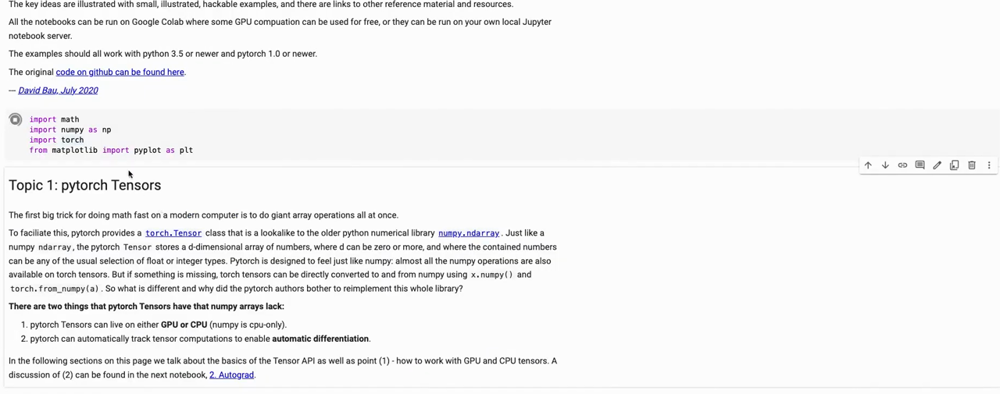
*▲ 강의 화면 [02:50](https://youtu.be/o5gPABcGZwc?t=170): 노트북 첫머리. [텐서](00_%EB%94%A5%EB%9F%AC%EB%8B%9D_%EC%9A%A9%EC%96%B4%EC%82%AC%EC%A0%84.md#tensor-%ED%85%90%EC%84%9C)가 numpy 배열에 없는 두 가지, [GPU](00_%EB%94%A5%EB%9F%AC%EB%8B%9D_%EC%9A%A9%EC%96%B4%EC%82%AC%EC%A0%84.md#device-gpu-%EC%9E%A5%EC%B9%98%EC%99%80-gpu)와 [자동 미분](00_%EB%94%A5%EB%9F%AC%EB%8B%9D_%EC%9A%A9%EC%96%B4%EC%82%AC%EC%A0%84.md#autograd-%EC%9E%90%EB%8F%99-%EB%AF%B8%EB%B6%84)을 가졌다고 설명한다*

<details><summary>진행 메모 (요약)</summary>

- 노트북은 수업 게시판(Piazza)에 올라왔고, 수강생 상당수가 [PyTorch](00_%EB%94%A5%EB%9F%AC%EB%8B%9D_%EC%9A%A9%EC%96%B4%EC%82%AC%EC%A0%84.md#pytorch-%ED%8C%8C%EC%9D%B4%ED%86%A0%EC%B9%98)를 처음 써 본다고 손을 들었다 [02:16](https://youtu.be/o5gPABcGZwc?t=136).
- 시간이 모자라 뒤쪽은 빠르게 넘어갔고, 마지막 분류기 셀은 앞 셀을 실행하지 않아 수업 중에 돌지 않았다 [27:47](https://youtu.be/o5gPABcGZwc?t=1667). 이 노트의 10.2절은 그 코드를 CPU에서 끝까지 돌린 결과다.

</details>

---

## 2. 텐서 만들기

▶ 영상 [02:53](https://youtu.be/o5gPABcGZwc?t=173)

📐 **수학 개념**: [벡터와 행렬](%EC%88%98%ED%95%99%EA%B0%9C%EB%85%90/03_%EC%84%A0%ED%98%95%EB%8C%80%EC%88%98/M05_%EB%B2%A1%ED%84%B0%EC%99%80_%ED%96%89%EB%A0%AC.md)

[텐서](00_%EB%94%A5%EB%9F%AC%EB%8B%9D_%EC%9A%A9%EC%96%B4%EC%82%AC%EC%A0%84.md#tensor-%ED%85%90%EC%84%9C)는 [PyTorch](00_%EB%94%A5%EB%9F%AC%EB%8B%9D_%EC%9A%A9%EC%96%B4%EC%82%AC%EC%A0%84.md#pytorch-%ED%8C%8C%EC%9D%B4%ED%86%A0%EC%B9%98)에서 데이터를 담는 그릇입니다. 모델에 넣는 입력도, 모델이 낸 출력도 모두 [텐서](00_%EB%94%A5%EB%9F%AC%EB%8B%9D_%EC%9A%A9%EC%96%B4%EC%82%AC%EC%A0%84.md#tensor-%ED%85%90%EC%84%9C)입니다. 만드는 방법은 네 가지입니다.

- **데이터에서 바로**: `torch.tensor([[1, 2], [3, 4]])`. 실제로 자주 쓰지는 않지만 알아 두면 좋습니다.
- **numpy 배열에서**: `torch.from_numpy(np_array)`. [텐서](00_%EB%94%A5%EB%9F%AC%EB%8B%9D_%EC%9A%A9%EC%96%B4%EC%82%AC%EC%A0%84.md#tensor-%ED%85%90%EC%84%9C)와 numpy 배열이 **같은 메모리**를 쓸 수 있어서, 한쪽을 바꾸면 다른 쪽도 바뀝니다(아래 코드 출력 3~4행).
- **다른 [텐서](00_%EB%94%A5%EB%9F%AC%EB%8B%9D_%EC%9A%A9%EC%96%B4%EC%82%AC%EC%A0%84.md#tensor-%ED%85%90%EC%84%9C)와 같은 모양으로**: `torch.ones_like(x)`는 1로, `torch.rand_like(x)`는 0~1 사이 난수로 채웁니다.
- **모양을 직접 주고**: `torch.rand(2, 3)`, `torch.ones(2, 3)`, `torch.zeros(2, 3)`. 초기화 방법은 문서에 더 많습니다.

```python
# [함수] import torch: PyTorch 라이브러리를 불러온다 (텐서, 자동 미분, 신경망 모듈)
import torch
# [함수] import numpy as np: 배열 라이브러리 numpy를 np라는 이름으로 불러온다
# [연결] 1절: 텐서는 numpy 배열과 거의 같게 쓰도록 만들어졌다
import numpy as np
# [변수] data: 파이썬 중첩 리스트 [[1, 2], [3, 4]]
data = [[1, 2], [3, 4]]
# [함수] torch.tensor(data): 리스트 값을 복사해 텐서를 만든다. 정수만 있어 자료형은 int64로 정해진다
# [변수] x_data: 2×2 정수 텐서
x_data = torch.tensor(data)
# [연결] 출력 1~2행: 리스트와 같은 모양의 정수 텐서
print(x_data)
# [변수] np_array: 같은 숫자를 담은 numpy 배열
np_array = np.array(data)
# [함수] torch.from_numpy: 값을 복사하지 않고 numpy 배열과 같은 메모리를 쓰는 텐서를 만든다
# [변수] x_np: np_array와 메모리를 함께 쓰는 텐서
x_np = torch.from_numpy(np_array)
# [함수] np_array[0, 0] = 100: numpy 쪽 칸 하나만 바꾼다
# [연결] 2절 "같은 메모리": 텐서 쪽 x_np도 100으로 바뀌는지 본다 (출력 3~4행)
np_array[0, 0] = 100
# [연결] 출력 3~4행: numpy 쪽만 바꿨는데 텐서의 첫 칸도 100이 됐다
print(x_np)
# [함수] torch.ones_like: 입력과 같은 모양·자료형으로 1을 채운다
print(torch.ones_like(x_data))
# [함수] torch.manual_seed(0): 난수 시드를 0으로 고정한다
# [쓸모] 아래 난수가 실행할 때마다 같아져 노트의 숫자를 다시 얻을 수 있다
torch.manual_seed(0)
# [함수] torch.rand_like(..., dtype=torch.float): 같은 모양에 0~1 균등 난수. 정수 텐서라 자료형을 실수로 바꿔 준다
print(torch.rand_like(x_data, dtype=torch.float))
# [변수] shape: 만들 텐서의 모양 (2행 3열)
shape = (2, 3)
# [함수] torch.zeros(shape): 모양만 주고 0으로 채운다. torch.ones, torch.rand도 같은 방식이다
print(torch.zeros(shape))
```

**실행 결과**:

```text
tensor([[1, 2],
        [3, 4]])
tensor([[100,   2],
        [  3,   4]])
tensor([[1, 1],
        [1, 1]])
tensor([[0.4963, 0.7682],
        [0.0885, 0.1320]])
tensor([[0., 0., 0.],
        [0., 0., 0.]])
```

---

## 3. 텐서의 속성: 모양, 자료형, 장치

▶ 영상 [05:41](https://youtu.be/o5gPABcGZwc?t=341)

[텐서](00_%EB%94%A5%EB%9F%AC%EB%8B%9D_%EC%9A%A9%EC%96%B4%EC%82%AC%EC%A0%84.md#tensor-%ED%85%90%EC%84%9C)마다 꼭 알아야 할 속성이 셋 있습니다.

- **모양(shape)**: `.shape`. 차원마다의 크기입니다.
- **[자료형](00_%EB%94%A5%EB%9F%AC%EB%8B%9D_%EC%9A%A9%EC%96%B4%EC%82%AC%EC%A0%84.md#dtype-data-type-%EC%9E%90%EB%A3%8C%ED%98%95)([dtype](00_%EB%94%A5%EB%9F%AC%EB%8B%9D_%EC%9A%A9%EC%96%B4%EC%82%AC%EC%A0%84.md#dtype-data-type-%EC%9E%90%EB%A3%8C%ED%98%95))**: `.dtype`. 모델의 입력은 대부분 32비트 실수 **float32**입니다. [GPU](00_%EB%94%A5%EB%9F%AC%EB%8B%9D_%EC%9A%A9%EC%96%B4%EC%82%AC%EC%A0%84.md#device-gpu-%EC%9E%A5%EC%B9%98%EC%99%80-gpu) 하드웨어가 이 형식에 맞춰 최적화되어 있어 빠르기 때문입니다. 정수 [텐서](00_%EB%94%A5%EB%9F%AC%EB%8B%9D_%EC%9A%A9%EC%96%B4%EC%82%AC%EC%A0%84.md#tensor-%ED%85%90%EC%84%9C)도 가끔 씁니다.
- **장치(device)**: `.device`. [텐서](00_%EB%94%A5%EB%9F%AC%EB%8B%9D_%EC%9A%A9%EC%96%B4%EC%82%AC%EC%A0%84.md#tensor-%ED%85%90%EC%84%9C)가 CPU에 있는지 [GPU](00_%EB%94%A5%EB%9F%AC%EB%8B%9D_%EC%9A%A9%EC%96%B4%EC%82%AC%EC%A0%84.md#device-gpu-%EC%9E%A5%EC%B9%98%EC%99%80-gpu)에 있는지 알려 줍니다. **같은 장치에 있는 텐서끼리만 연산할 수 있습니다.** CPU [텐서](00_%EB%94%A5%EB%9F%AC%EB%8B%9D_%EC%9A%A9%EC%96%B4%EC%82%AC%EC%A0%84.md#tensor-%ED%85%90%EC%84%9C)와 [GPU](00_%EB%94%A5%EB%9F%AC%EB%8B%9D_%EC%9A%A9%EC%96%B4%EC%82%AC%EC%A0%84.md#device-gpu-%EC%9E%A5%EC%B9%98%EC%99%80-gpu) [텐서](00_%EB%94%A5%EB%9F%AC%EB%8B%9D_%EC%9A%A9%EC%96%B4%EC%82%AC%EC%A0%84.md#tensor-%ED%85%90%EC%84%9C)를 더하려면 한쪽을 `.to(device)`로 옮겨야 합니다. 그래서 실전에서는 "이 [텐서](00_%EB%94%A5%EB%9F%AC%EB%8B%9D_%EC%9A%A9%EC%96%B4%EC%82%AC%EC%A0%84.md#tensor-%ED%85%90%EC%84%9C)가 어디 있지?"를 자주 확인하게 됩니다.

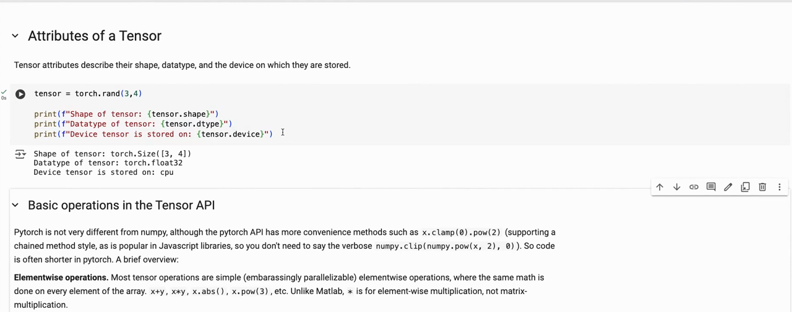
*▲ 강의 화면 [06:20](https://youtu.be/o5gPABcGZwc?t=380): `torch.rand(3, 4)`의 모양, [자료형](00_%EB%94%A5%EB%9F%AC%EB%8B%9D_%EC%9A%A9%EC%96%B4%EC%82%AC%EC%A0%84.md#dtype-data-type-%EC%9E%90%EB%A3%8C%ED%98%95)(float32), 장치(cpu)*

```python
# [함수] import torch: PyTorch 라이브러리를 불러온다
import torch
# [함수] torch.manual_seed(0): 난수 시드 고정 (결과 재현용)
torch.manual_seed(0)
# [함수] torch.rand(3, 4): 3행 4열, 0~1 균등 난수
# [변수] tensor: 속성을 살펴볼 3×4 텐서
tensor = torch.rand(3, 4)
# [함수] .shape: 모양 (3, 4)
print(tensor.shape)
# [함수] .dtype: 자료형. 실수 텐서의 기본값은 32비트 실수 float32
print(tensor.dtype)
# [함수] .device: 텐서가 놓인 장치. 따로 정하지 않으면 cpu
print(tensor.device)
# [함수] torch.cuda.is_available(): NVIDIA GPU를 쓸 수 있으면 True
# [변수] device: GPU가 있으면 "cuda", 없으면 "cpu" (이 노트를 실행한 컴퓨터는 cpu)
# [쓸모] 같은 코드가 GPU가 있든 없든 돌아가게 하는 관용구
device = "cuda" if torch.cuda.is_available() else "cpu"
# [함수] .to(device): 텐서를 그 장치로 옮긴 사본을 돌려준다
# [변수] t2: device로 옮긴 텐서
# [연결] 3절: 연산하는 텐서들은 모두 같은 장치에 있어야 한다
t2 = tensor.to(device)
# [연결] 출력 4행: 이 컴퓨터는 GPU가 없어 그대로 cpu
print(t2.device)
# [함수] torch.tensor([1, 2]).dtype: 정수로 만들면 int64, 실수로 만들면 float32
print(torch.tensor([1, 2]).dtype, torch.tensor([1.0, 2.0]).dtype)
# [함수] .float(): 정수 텐서를 float32로 바꾼다
# [쓸모] 정수 데이터를 모델에 넣기 전에 흔히 쓴다
print(torch.tensor([1, 2]).float())
```

**실행 결과**:

```text
torch.Size([3, 4])
torch.float32
cpu
cpu
torch.int64 torch.float32
tensor([1., 2.])
```

> [!TIP]
> **🆕 2026 업데이트: 장치를 가리지 않는 `torch.accelerator`**
> - **강의(2024년 가을)**: 장치는 `.device`로 확인하고 `.to(device)`로 옮긴다. 이 노트의 코드처럼 `"cuda" if torch.cuda.is_available() else "cpu"`를 직접 쓰는 것이 흔했다.
> - **현재**: [PyTorch](00_%EB%94%A5%EB%9F%AC%EB%8B%9D_%EC%9A%A9%EC%96%B4%EC%82%AC%EC%A0%84.md#pytorch-%ED%8C%8C%EC%9D%B4%ED%86%A0%EC%B9%98) 2.6(2025년 1월)부터 `torch.accelerator` 모듈이 생겨, `torch.accelerator.current_accelerator()`가 지금 컴퓨터의 가속기(NVIDIA `cuda`, 애플 `mps`, 인텔 `xpu` 등)를 돌려준다. [GPU](00_%EB%94%A5%EB%9F%AC%EB%8B%9D_%EC%9A%A9%EC%96%B4%EC%82%AC%EC%A0%84.md#device-gpu-%EC%9E%A5%EC%B9%98%EC%99%80-gpu)가 없으면 `None`이고, `is_available()`, `device_count()`도 있다. 가속기 종류마다 따로 분기하지 않아도 된다. 이 노트를 실행한 CPU 컴퓨터에서는 `None`, `False`가 나왔다.
> - **출처**: [torch.accelerator (PyTorch 2.6 문서, 2025)](https://docs.pytorch.org/docs/2.6/accelerator.html) · [PyTorch 2.6 Release Blog (2025)](https://pytorch.org/blog/pytorch2-6/)

---

## 4. 원소별 연산과 그래프

▶ 영상 [07:24](https://youtu.be/o5gPABcGZwc?t=444)

📐 **수학 개념**: [함수](%EC%88%98%ED%95%99%EA%B0%9C%EB%85%90/01_%EC%88%98%EC%99%80_%ED%95%A8%EC%88%98/M01_%ED%95%A8%EC%88%98%EC%99%80_%EC%9D%BC%EC%B0%A8%ED%95%A8%EC%88%98.md)

[텐서](00_%EB%94%A5%EB%9F%AC%EB%8B%9D_%EC%9A%A9%EC%96%B4%EC%82%AC%EC%A0%84.md#tensor-%ED%85%90%EC%84%9C)에 연산을 하면 새 [텐서](00_%EB%94%A5%EB%9F%AC%EB%8B%9D_%EC%9A%A9%EC%96%B4%EC%82%AC%EC%A0%84.md#tensor-%ED%85%90%EC%84%9C)가 나옵니다. 대부분의 연산은 **원소마다 따로** 적용됩니다.

- `torch.linspace(0, 5, 101)`: 0~5를 같은 간격으로 101개. 어떤 함수의 모양을 구간 전체에서 보고 싶을 때 씁니다.
- 자르기(indexing)는 numpy와 같습니다. `x[:5]`는 앞 다섯 개, `x[-5:]`는 뒤 다섯 개.
- `x.sin()`, `x ** x.cos()`, 텐서끼리 뺄셈 `y2 - y1`, 그리고 `min`·`max`·`mean`·`std` 같은 요약값. 요약값은 모양이 `[]`인 0차원 [텐서](00_%EB%94%A5%EB%9F%AC%EB%8B%9D_%EC%9A%A9%EC%96%B4%EC%82%AC%EC%A0%84.md#tensor-%ED%85%90%EC%84%9C)(스칼라)입니다.
- CPU에 있는 [텐서](00_%EB%94%A5%EB%9F%AC%EB%8B%9D_%EC%9A%A9%EC%96%B4%EC%82%AC%EC%A0%84.md#tensor-%ED%85%90%EC%84%9C)는 matplotlib에 그대로 넘겨 그림을 그릴 수 있습니다.
- `clamp(a, b)`: 값을 a~b 범위로 자릅니다. 출력이 한쪽으로 너무 커질까 걱정될 때 씁니다.

이 밖에도 연산이 아주 많으니, 필요한 변환이 있으면 문서에서 찾아보면 거의 다 있다고 조교는 말합니다.

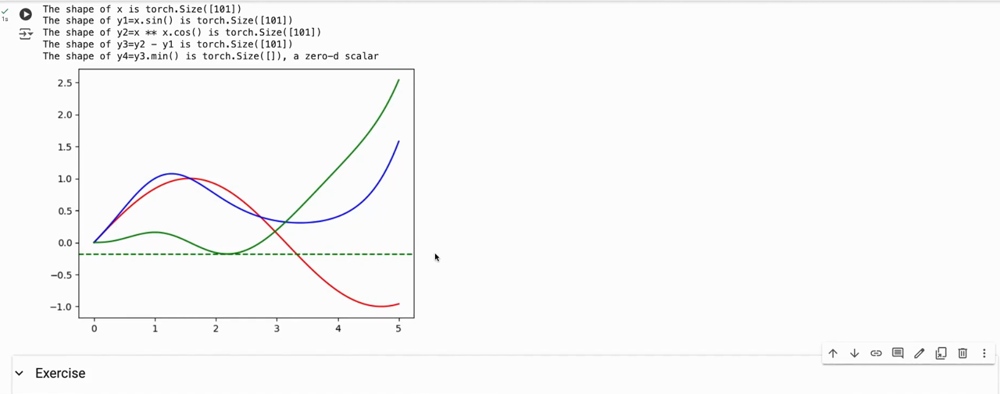
*▲ 강의 화면 [09:30](https://youtu.be/o5gPABcGZwc?t=570): sin x(빨강), x^(cos x)(파랑), 그 차이(초록)와 차이의 최솟값(초록 점선, 약 -0.18)*

```python
# [함수] import torch: PyTorch 라이브러리를 불러온다
import torch
# [함수] torch.linspace(0, 5, 101): 0부터 5까지 같은 간격으로 101개 (간격 0.05)
# [변수] x: 0, 0.05, 0.1, ..., 5
x = torch.linspace(0, 5, 101)
# [함수] x[:5]: 앞 다섯 개. numpy와 같은 자르기(slicing)
print(x[:5])
# [함수] x[-5:]: 뒤 다섯 개. 음수 번호는 끝에서부터 센다
print(x[-5:])
# [함수] x.sin(): 원소마다 sin을 적용한다 (모양은 그대로 101)
# [변수] y1: sin x
y1 = x.sin()
# [함수] x ** x.cos(): 원소마다 x의 (cos x)제곱
# [변수] y2: 강의에서 그린 두 번째 곡선
y2 = x ** x.cos()
# [함수] y2 - y1: 같은 모양 텐서끼리 원소별 뺄셈
# [변수] y3: 두 곡선의 차이
y3 = y2 - y1
# [함수] y3.min(): 가장 작은 값 하나. 결과는 모양이 []인 0차원 텐서(스칼라)
# [변수] y4: y3의 최솟값
y4 = y3.min()
# [함수] .item(): 0차원 텐서를 파이썬 숫자로 꺼낸다
# [연결] 캡처의 초록 점선(최솟값)
print(y1.shape, y4.shape, round(y4.item(), 4))
# [함수] y2.clamp(0, 1): 0보다 작으면 0, 1보다 크면 1로 자른다
# [변수] c: 0~1 사이로 잘린 y2
c = y2.clamp(0, 1)
# [연결] 원래 범위(최솟값·최댓값)와 자른 뒤 범위를 비교한다
print(round(y2.min().item(), 4), round(y2.max().item(), 4), c.min().item(), c.max().item())
# [함수] import matplotlib: 그래프 라이브러리
import matplotlib
# [함수] matplotlib.use("Agg"): 화면 창 없이 그리는 방식으로 정한다 (노트 검사용)
matplotlib.use("Agg")
# [함수] import matplotlib.pyplot as plt: 그래프 그리기 함수 모음
import matplotlib.pyplot as plt
# [함수] plt.plot(x, y1): 텐서를 그대로 넘겨 곡선을 그린다 (기울기를 기록하지 않는 CPU 텐서라 가능)
# [변수] lines: 그려진 선 목록
lines = plt.plot(x, y1)
# [연결] 마지막 출력: 선 1개가 그려졌다
print(len(lines))
```

**실행 결과**:

```text
tensor([0.0000, 0.0500, 0.1000, 0.1500, 0.2000])
tensor([4.8000, 4.8500, 4.9000, 4.9500, 5.0000])
torch.Size([101]) torch.Size([]) -0.1797
0.0 1.5786 0.0 1.0
1
```

---

## 5. 다차원 텐서 다루기

### 5.1 배치 차원과 축 순서 바꾸기

▶ 영상 [10:14](https://youtu.be/o5gPABcGZwc?t=614)

📐 **수학 개념**: [배치 행렬](%EC%88%98%ED%95%99%EA%B0%9C%EB%85%90/03_%EC%84%A0%ED%98%95%EB%8C%80%EC%88%98/MM03_%EB%B2%A1%ED%84%B0_%ED%91%9C%EA%B8%B0%EC%99%80_%EC%A0%84%EC%B9%98.md)

- 딥러닝 데이터는 보통 여러 개를 묶은 **배치**로 다룹니다([미니배치](00_%EB%94%A5%EB%9F%AC%EB%8B%9D_%EC%9A%A9%EC%96%B4%EC%82%AC%EC%A0%84.md#mini-batch-%EB%AF%B8%EB%8B%88%EB%B0%B0%EC%B9%98)). [PyTorch](00_%EB%94%A5%EB%9F%AC%EB%8B%9D_%EC%9A%A9%EC%96%B4%EC%82%AC%EC%A0%84.md#pytorch-%ED%8C%8C%EC%9D%B4%ED%86%A0%EC%B9%98)의 관례는 **배치를 첫 번째 차원**에 두는 것입니다. 이미지라면 `[배치, 채널(R·G·B), 높이, 너비]` 순서입니다.
- `permute(0, 1, 3, 2)`: 원하는 차원 순서를 적어 축을 바꿉니다. 배치(0)와 [채널](00_%EB%94%A5%EB%9F%AC%EB%8B%9D_%EC%9A%A9%EC%96%B4%EC%82%AC%EC%A0%84.md#channel-%EC%B1%84%EB%84%90)(1)은 두고 높이와 너비(2, 3)를 맞바꾸면 `[2, 3, 4, 5]`가 `[2, 3, 5, 4]`가 됩니다.
- `view(2, -1)`와 `reshape(2, -1)`: 모양을 바꿉니다. `-1`은 "남은 크기를 모두 한 차원에"라는 뜻이라 `[2, 60]`이 됩니다. 조교는 `view`가 보통 더 효율적이고 `reshape`도 거의 같은 일을 한다고 설명합니다.
- 둘의 차이(노트 보충): `view`는 데이터를 복사하지 않고 **보는 방식만** 바꾸므로 메모리에 연속으로 놓인 텐서에만 쓸 수 있습니다. `permute` 직후의 [텐서](00_%EB%94%A5%EB%9F%AC%EB%8B%9D_%EC%9A%A9%EC%96%B4%EC%82%AC%EC%A0%84.md#tensor-%ED%85%90%EC%84%9C)처럼 연속이 아니면 `view`는 오류를 내고, `reshape`는 필요하면 복사해서라도 해냅니다(아래 코드 출력 5~7행). [모양 바꾸기](00_%EB%94%A5%EB%9F%AC%EB%8B%9D_%EC%9A%A9%EC%96%B4%EC%82%AC%EC%A0%84.md#reshape-permute-%EB%AA%A8%EC%96%91-%EB%B0%94%EA%BE%B8%EA%B8%B0%EC%99%80-%EC%B6%95-%EC%88%9C%EC%84%9C-%EB%B0%94%EA%BE%B8%EA%B8%B0)에서 생기는 버그와 [einops](00_%EB%94%A5%EB%9F%AC%EB%8B%9D_%EC%9A%A9%EC%96%B4%EC%82%AC%EC%A0%84.md#einops-%EC%95%84%EC%9D%B8%EC%98%B5%EC%8A%A4)는 [Lec09 6.3](Lec09_%ED%95%B4%EC%BB%A4%EC%9D%98_%EB%94%A5%EB%9F%AC%EB%8B%9D_%EA%B0%80%EC%9D%B4%EB%93%9C.md#63-reshape%EC%99%80-einops)에 있습니다.

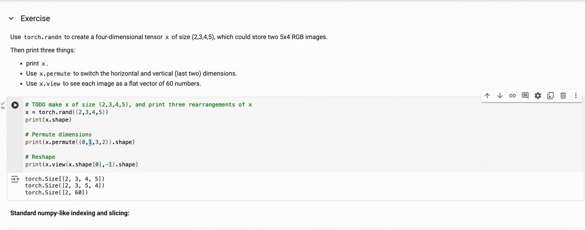
*▲ 강의 화면 [12:10](https://youtu.be/o5gPABcGZwc?t=730): 4×5 RGB 이미지 2장을 permute와 view로 바꾼 모양*

```python
# [함수] import torch: PyTorch 라이브러리를 불러온다
import torch
# [함수] torch.manual_seed(0): 난수 시드 고정
torch.manual_seed(0)
# [함수] torch.rand(2, 3, 4, 5): 모양 [배치 2, 채널 3, 높이 4, 너비 5]인 난수 텐서
# [변수] x: 4×5 크기 RGB 이미지 2장 (값은 그냥 난수)
# [연결] 5절: 배치를 첫 번째 차원에 둔다
x = torch.rand(2, 3, 4, 5)
# [연결] 출력 1행: [2, 3, 4, 5]
print(x.shape)
# [함수] x.permute(0, 1, 3, 2): 차원 순서를 (0, 1, 3, 2)로 다시 놓는다 = 높이와 너비를 맞바꾼다
print(x.permute(0, 1, 3, 2).shape)
# [함수] x.view(2, -1): 배치는 두고 나머지를 한 줄로 편다. -1은 "남는 크기를 알아서" (3 × 4 × 5 = 60)
print(x.view(x.shape[0], -1).shape)
# [함수] x.reshape(2, -1): view와 같은 결과
print(x.reshape(2, -1).shape)
# [변수] p: 축을 바꾼 텐서. 값은 그대로 두고 읽는 순서만 바꿔서 메모리상 연속(contiguous)이 아니다
p = x.permute(0, 1, 3, 2)
# [함수] .is_contiguous(): 메모리에 행 우선 순서로 연속해 놓였는지
print(p.is_contiguous())
# [함수] try ... except: view가 실패하면 오류 대신 안내문을 출력한다
# [연결] 5절 "view와 reshape의 차이"
try:
    # [함수] p.view(2, -1): 연속이 아닌 텐서는 view로 펼 수 없다 (RuntimeError)
    p.view(2, -1)
# [함수] except RuntimeError: view가 실패하면 여기로 온다
except RuntimeError:
    print("view 실패: 메모리가 연속이 아님")
# [함수] p.reshape(2, -1): 필요하면 복사해서라도 모양을 바꾼다
print(p.reshape(2, -1).shape)
```

**실행 결과**:

```text
torch.Size([2, 3, 4, 5])
torch.Size([2, 3, 5, 4])
torch.Size([2, 60])
torch.Size([2, 60])
False
view 실패: 메모리가 연속이 아님
torch.Size([2, 60])
```

### 5.2 자르기와 이어 붙이기

▶ 영상 [12:34](https://youtu.be/o5gPABcGZwc?t=754)

- **자르기**: numpy와 같습니다. `t[0]`은 첫 행, `t[:, 0]`은 첫 열(`:`은 "그 차원 전부"), `t[..., -1]`은 마지막 열. 자르기로 값을 넣을 수도 있습니다: `t[:, 1] = 0`.
- **`torch.cat(..., dim=1)`**: 이미 있는 차원을 따라 **이어 붙입니다**. 4×4 세 개를 열 방향(`dim=1`)으로 붙이면 4×12.
- **`torch.stack(..., dim=0)`**: **새 차원**을 만들어 쌓습니다. 4×4 세 개를 쌓으면 3×4×4. 입력 여러 개로 배치를 만들 때 씁니다.

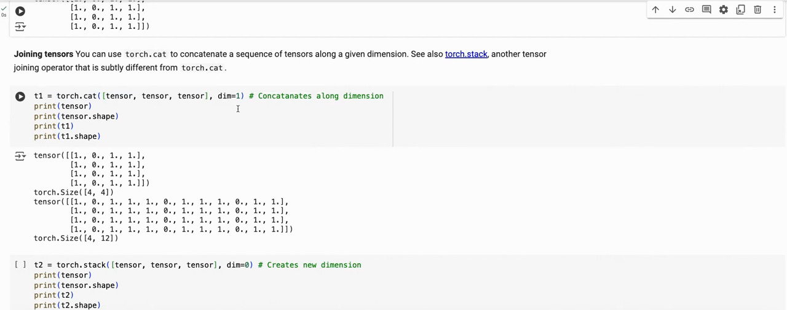
*▲ 강의 화면 [14:10](https://youtu.be/o5gPABcGZwc?t=850): 둘째 열을 0으로 바꾼 4×4를 `torch.cat(dim=1)`로 붙여 4×12를 만든다*

```python
# [함수] import torch: PyTorch 라이브러리를 불러온다
import torch
# [함수] torch.ones(4, 4): 4×4를 1로 채운다
# [변수] tensor: 자르기와 이어 붙이기를 시험할 텐서
tensor = torch.ones(4, 4)
# [함수] tensor[:, 1] = 0: 모든 행(:)의 1번 열(두 번째 열)에 0을 넣는다
# [연결] 강의 노트북의 "둘째 열을 0으로" 예
tensor[:, 1] = 0
# [함수] tensor[0]: 첫 행
print(tensor[0])
# [함수] tensor[:, 0]: 첫 열 (":"는 그 차원 전부)
print(tensor[:, 0])
# [함수] tensor[..., -1]: 마지막 열. "..."는 앞의 차원 전부
print(tensor[..., -1])
# [함수] torch.cat([...], dim=1): 있는 차원(열 방향)을 따라 이어 붙인다
# [변수] t1: 4×4 세 개를 옆으로 붙인 4×12
t1 = torch.cat([tensor, tensor, tensor], dim=1)
# [연결] 출력 4행: 4×12
print(t1.shape)
# [연결] 출력 5행: 첫 행. 0이 4칸마다 나타나 세 덩어리가 옆으로 붙었음을 보여 준다
print(t1[0])
# [함수] torch.stack([...], dim=0): 새 차원을 맨 앞에 만들어 쌓는다
# [변수] t2: 4×4 세 개를 쌓은 3×4×4
# [쓸모] 입력 여러 개를 묶어 배치를 만들 때 쓴다
t2 = torch.stack([tensor, tensor, tensor], dim=0)
# [연결] 마지막 출력: 3×4×4
print(t2.shape)
```

**실행 결과**:

```text
tensor([1., 0., 1., 1.])
tensor([1., 1., 1., 1.])
tensor([1., 1., 1., 1.])
torch.Size([4, 12])
tensor([1., 0., 1., 1., 1., 0., 1., 1., 1., 0., 1., 1.])
torch.Size([3, 4, 4])
```

---

## 6. 행렬 곱, 원소별 곱, 집계

▶ 영상 [14:49](https://youtu.be/o5gPABcGZwc?t=889)

📐 **수학 개념**: [행렬 곱](%EC%88%98%ED%95%99%EA%B0%9C%EB%85%90/03_%EC%84%A0%ED%98%95%EB%8C%80%EC%88%98/M05_%EB%B2%A1%ED%84%B0%EC%99%80_%ED%96%89%EB%A0%AC.md) · [전치](%EC%88%98%ED%95%99%EA%B0%9C%EB%85%90/03_%EC%84%A0%ED%98%95%EB%8C%80%EC%88%98/MM03_%EB%B2%A1%ED%84%B0_%ED%91%9C%EA%B8%B0%EC%99%80_%EC%A0%84%EC%B9%98.md) · [원소별 곱](%EC%88%98%ED%95%99%EA%B0%9C%EB%85%90/07_%EA%B5%AC%EC%A1%B0_%EC%95%84%ED%82%A4%ED%85%8D%EC%B2%98/MM38_LSTM_%EA%B2%8C%EC%9D%B4%ED%8A%B8%EC%99%80_%EC%9B%90%EC%86%8C%EB%B3%84_%EA%B3%B1.md) · [합과 평균](%EC%88%98%ED%95%99%EA%B0%9C%EB%85%90/01_%EC%88%98%EC%99%80_%ED%95%A8%EC%88%98/M02_%EC%8B%9C%EA%B7%B8%EB%A7%88%EC%99%80_%ED%8F%89%EA%B7%A0.md)

- **[행렬 곱](00_%EB%94%A5%EB%9F%AC%EB%8B%9D_%EC%9A%A9%EC%96%B4%EC%82%AC%EC%A0%84.md#matrix-multiplication-%ED%96%89%EB%A0%AC-%EA%B3%B1)**: `A @ B`, `A.matmul(B)`, `torch.matmul(A, B, out=...)`는 모두 같습니다. 조교는 `@`가 가장 쓰기 쉽다고 권합니다.
- **[원소별 곱](00_%EB%94%A5%EB%9F%AC%EB%8B%9D_%EC%9A%A9%EC%96%B4%EC%82%AC%EC%A0%84.md#hadamard-product-%EC%9B%90%EC%86%8C%EB%B3%84-%EA%B3%B1)**: `A * B` 또는 `A.mul(B)`. 같은 자리끼리만 곱합니다. `[[1, 2], [3, 4]]`를 자기 자신과 원소별로 곱하면 각 원소의 제곱이 됩니다.
- **집계([축소 연산](00_%EB%94%A5%EB%9F%AC%EB%8B%9D_%EC%9A%A9%EC%96%B4%EC%82%AC%EC%A0%84.md#reduction-%EC%B6%95%EC%86%8C-%EC%97%B0%EC%82%B0))**: `sum`, `mean`, `max`, `min`을 [텐서](00_%EB%94%A5%EB%9F%AC%EB%8B%9D_%EC%9A%A9%EC%96%B4%EC%82%AC%EC%A0%84.md#tensor-%ED%85%90%EC%84%9C) 전체나 특정 차원(`dim=`)을 따라 구합니다.

$$
(\mathbf{A}\mathbf{B})_{ij} = \sum_{k} A_{ik}\, B_{kj}, \qquad (\mathbf{A} \odot \mathbf{B})_{ij} = A_{ij}\, B_{ij}
$$

<details><summary>기호 풀이</summary>

| 기호 | 읽는 법 | 뜻 | 예제 값 |
| --- | --- | --- | --- |
| $\mathbf{A}, \mathbf{B}$ | 굵은 에이, 비 | 곱할 두 행렬 | A의 행 (1, 2), (3, 4), B = Aᵀ의 행 (1, 3), (2, 4) |
| $(\mathbf{A}\mathbf{B})_{ij}$ | 에이비의 아이 제이 성분 | [행렬 곱](00_%EB%94%A5%EB%9F%AC%EB%8B%9D_%EC%9A%A9%EC%96%B4%EC%82%AC%EC%A0%84.md#matrix-multiplication-%ED%96%89%EB%A0%AC-%EA%B3%B1) 결과의 i행 j열 칸 (`A @ B`) | (1, 2) 칸 = 11 |
| $A_{ik}$ | 에이 아이 케이 | A의 i행 k열 값 | $A_{12} = 2$ |
| $B_{kj}$ | 비 케이 제이 | B의 k행 j열 값 | $B_{22} = 4$ |
| $\sum_{k}$ | 시그마 케이 | k(A의 열 = B의 행 번호)를 모두 돌며 더함 | k = 1, 2 |
| $\odot$ | [원소별 곱](00_%EB%94%A5%EB%9F%AC%EB%8B%9D_%EC%9A%A9%EC%96%B4%EC%82%AC%EC%A0%84.md#hadamard-product-%EC%9B%90%EC%86%8C%EB%B3%84-%EA%B3%B1) | 같은 자리끼리만 곱함 (`A * B`) | - |
| $(\mathbf{A} \odot \mathbf{B})_{ij}$ | 에이 [원소별 곱](00_%EB%94%A5%EB%9F%AC%EB%8B%9D_%EC%9A%A9%EC%96%B4%EC%82%AC%EC%A0%84.md#hadamard-product-%EC%9B%90%EC%86%8C%EB%B3%84-%EA%B3%B1) 비의 아이 제이 성분 | [원소별 곱](00_%EB%94%A5%EB%9F%AC%EB%8B%9D_%EC%9A%A9%EC%96%B4%EC%82%AC%EC%A0%84.md#hadamard-product-%EC%9B%90%EC%86%8C%EB%B3%84-%EA%B3%B1) 결과의 i행 j열 칸 | A ⊙ A의 (2, 1) 칸 = 9 |

</details>

<details><summary>예제와 풀이</summary>

**문제**: 강의 노트북의 행렬 A(행 (1, 2), (3, 4))에 대해, `A @ A.T`의 1행 2열 칸과 `A * A`의 2행 1열 칸은?

**주어진 값**:
- $\mathbf{A}$의 행: (1, 2), (3, 4) (곱할 행렬)
- $\mathbf{B} = \mathbf{A}^\top$의 행: (1, 3), (2, 4) (A의 행과 열을 바꾼 [전치](00_%EB%94%A5%EB%9F%AC%EB%8B%9D_%EC%9A%A9%EC%96%B4%EC%82%AC%EC%A0%84.md#transpose-%EC%A0%84%EC%B9%98))
- $i = 1,\ j = 2$ ([행렬 곱](00_%EB%94%A5%EB%9F%AC%EB%8B%9D_%EC%9A%A9%EC%96%B4%EC%82%AC%EC%A0%84.md#matrix-multiplication-%ED%96%89%EB%A0%AC-%EA%B3%B1)에서 구할 칸), $i = 2,\ j = 1$ ([원소별 곱](00_%EB%94%A5%EB%9F%AC%EB%8B%9D_%EC%9A%A9%EC%96%B4%EC%82%AC%EC%A0%84.md#hadamard-product-%EC%9B%90%EC%86%8C%EB%B3%84-%EA%B3%B1)에서 구할 칸)

**풀이**
1. 식을 그대로 쓴다: $(\mathbf{A}\mathbf{B})_{12} = \sum_{k} A_{1k}\, B_{k2}$, $(\mathbf{A} \odot \mathbf{A})_{21} = A_{21}\, A_{21}$
2. Σ를 k = 1, 2 두 항으로 펼쳐 값을 대입한다: $(\mathbf{A}\mathbf{B})_{12} = A_{11} B_{12} + A_{12} B_{22} = 1 × 3 + 2 × 4$, $(\mathbf{A} \odot \mathbf{A})_{21} = 3 × 3$
3. 곱셈을 먼저 한다: 1 × 3 = 3, 2 × 4 = 8 이므로 $(\mathbf{A}\mathbf{B})_{12} = 3 + 8$
4. 더한다: 3 + 8 = 11
5. [원소별 곱](00_%EB%94%A5%EB%9F%AC%EB%8B%9D_%EC%9A%A9%EC%96%B4%EC%82%AC%EC%A0%84.md#hadamard-product-%EC%9B%90%EC%86%8C%EB%B3%84-%EA%B3%B1)을 계산한다: 3 × 3 = 9 이므로 $(\mathbf{A} \odot \mathbf{A})_{21} = 9$

**답**: `A @ A.T`의 (1, 2) 칸 = **11**, `A * A`의 (2, 1) 칸 = **9** (아래 코드 출력과 같다)

</details>

<details><summary>내 이해</summary>


</details>

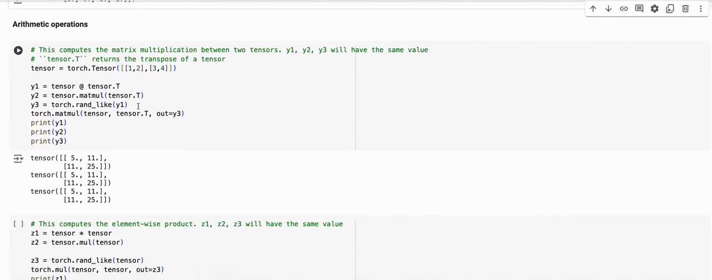
*▲ 강의 화면 [15:00](https://youtu.be/o5gPABcGZwc?t=900): `@`, `matmul`, `out=`을 쓴 세 가지 [행렬 곱](00_%EB%94%A5%EB%9F%AC%EB%8B%9D_%EC%9A%A9%EC%96%B4%EC%82%AC%EC%A0%84.md#matrix-multiplication-%ED%96%89%EB%A0%AC-%EA%B3%B1)이 모두 행이 (5, 11), (11, 25)인 같은 행렬을 낸다*

```python
# [함수] import torch: PyTorch 라이브러리를 불러온다
import torch
# [변수] A: 강의 노트북과 같은 2×2 실수 행렬 [[1, 2], [3, 4]]
A = torch.tensor([[1.0, 2.0], [3.0, 4.0]])
# [함수] A @ A.T: 행렬 곱. A.T는 전치(행과 열을 바꾼 것)
# [변수] y1: [[5, 11], [11, 25]]
# [연결] 6절 식의 예제와 풀이
y1 = A @ A.T
# [함수] A.matmul(A.T): @와 같은 행렬 곱
# [변수] y2: y1과 같은 값
y2 = A.matmul(A.T)
# [연결] 출력 1~2행: [[5, 11], [11, 25]]
print(y1)
# [함수] torch.equal: 두 텐서의 모양과 값이 모두 같으면 True
print(torch.equal(y1, y2))
# [함수] A * A: 같은 자리끼리 곱하는 원소별 곱 (A.mul(A)와 같다)
# [변수] z1: [[1, 4], [9, 16]] = 원소의 제곱
z1 = A * A
# [연결] 출력 4~5행: 원소의 제곱
print(z1)
# [함수] A.sum(): 전체 합 10. dim=0은 위아래로(열마다) 더하고, dim=1은 옆으로(행마다) 더한다
print(A.sum(), A.sum(dim=0), A.sum(dim=1))
# [함수] A.mean(): 전체 평균 2.5. A.max(dim=1).values는 행마다 최댓값, A.argmax(dim=1)은 그 위치
print(A.mean(), A.max(dim=1).values, A.argmax(dim=1))
```

**실행 결과**:

```text
tensor([[ 5., 11.],
        [11., 25.]])
True
tensor([[ 1.,  4.],
        [ 9., 16.]])
tensor(10.) tensor([4., 6.]) tensor([3., 7.])
tensor(2.5000) tensor([2., 4.]) tensor([1, 1])
```

---

## 7. 자동 미분

📐 **수학 개념**: [미분](%EC%88%98%ED%95%99%EA%B0%9C%EB%85%90/02_%EB%AF%B8%EB%B6%84/M03_%EB%AF%B8%EB%B6%84_%EA%B8%B0%EC%9A%B8%EA%B8%B0.md) · [연쇄법칙](%EC%88%98%ED%95%99%EA%B0%9C%EB%85%90/05_%EC%8B%A0%EA%B2%BD%EB%A7%9D%EC%9D%98_%EA%B3%84%EC%82%B0/MM09_%EC%95%BC%EC%BD%94%EB%B9%84%EC%95%88%EA%B3%BC_%EC%97%B0%EC%87%84%EB%B2%95%EC%B9%99.md) · [역전파](%EC%88%98%ED%95%99%EA%B0%9C%EB%85%90/05_%EC%8B%A0%EA%B2%BD%EB%A7%9D%EC%9D%98_%EA%B3%84%EC%82%B0/MM10_%EC%84%A0%ED%98%95%EC%B8%B5%EA%B3%BC_ReLU%EC%9D%98_%EC%97%AD%EC%A0%84%ED%8C%8C.md) · [그래디언트 벡터](%EC%88%98%ED%95%99%EA%B0%9C%EB%85%90/02_%EB%AF%B8%EB%B6%84/MM02_%EA%B7%B8%EB%9E%98%EB%94%94%EC%96%B8%ED%8A%B8_%EB%B2%A1%ED%84%B0.md)

### 7.1 autograd.grad로 도함수 구하기

▶ 영상 [16:03](https://youtu.be/o5gPABcGZwc?t=963)

[자동 미분](00_%EB%94%A5%EB%9F%AC%EB%8B%9D_%EC%9A%A9%EC%96%B4%EC%82%AC%EC%A0%84.md#autograd-%EC%9E%90%EB%8F%99-%EB%AF%B8%EB%B6%84)은 [PyTorch](00_%EB%94%A5%EB%9F%AC%EB%8B%9D_%EC%9A%A9%EC%96%B4%EC%82%AC%EC%A0%84.md#pytorch-%ED%8C%8C%EC%9D%B4%ED%86%A0%EC%B9%98)에서 가장 중요한 부분입니다. 모델이 배우려면 [기울기](00_%EB%94%A5%EB%9F%AC%EB%8B%9D_%EC%9A%A9%EC%96%B4%EC%82%AC%EC%A0%84.md#gradient-%EA%B8%B0%EC%9A%B8%EA%B8%B0)가 있어야 하기 때문입니다.

- 입력을 `requires_grad=True`로 만들면, 그 [텐서](00_%EB%94%A5%EB%9F%AC%EB%8B%9D_%EC%9A%A9%EC%96%B4%EC%82%AC%EC%A0%84.md#tensor-%ED%85%90%EC%84%9C)로 하는 계산이 [계산 그래프](00_%EB%94%A5%EB%9F%AC%EB%8B%9D_%EC%9A%A9%EC%96%B4%EC%82%AC%EC%A0%84.md#computational-graph-%EA%B3%84%EC%82%B0-%EA%B7%B8%EB%9E%98%ED%94%84)로 기록됩니다.
- [미분](00_%EB%94%A5%EB%9F%AC%EB%8B%9D_%EC%9A%A9%EC%96%B4%EC%82%AC%EC%A0%84.md#derivative-%EB%AF%B8%EB%B6%84)은 **스칼라 출력**에서 시작해야 합니다. 그래서 `y = (x**2).cos()`의 합 `s = y.sum()`을 만든 뒤 `torch.autograd.grad(s, [x])`로 $dy/dx$를 얻습니다. 각 $y_i$는 자기 $x_i$에만 기대므로 합을 미분해도 칸마다의 도함수가 그대로 나옵니다.
- 그래프로 그리면 오른쪽으로 갈수록 cos(x²)의 주기가 짧아지고, 도함수의 진폭은 커집니다. 조교는 다항식으로도 같은 방법을 보여 줍니다.

$$
y = \cos(x^2), \qquad \frac{dy}{dx} = -\sin(x^2) \cdot 2x
$$

<details><summary>기호 풀이</summary>

| 기호 | 읽는 법 | 뜻 | 예제 값 |
| --- | --- | --- | --- |
| $x$ | 엑스 | 입력 (`requires_grad=True`인 [텐서](00_%EB%94%A5%EB%9F%AC%EB%8B%9D_%EC%9A%A9%EC%96%B4%EC%82%AC%EC%A0%84.md#tensor-%ED%85%90%EC%84%9C)의 한 칸) | 1 |
| $x^2$ | 엑스 제곱 | 안쪽 함수 | 1 |
| $\cos$ | 코사인 | 바깥 함수. 라디안 단위 각의 코사인 | cos 1 = 0.5403 |
| $y$ | 와이 | 출력 cos(x²) | 0.5403 |
| $\frac{dy}{dx}$ | 디와이 디엑스 | x가 조금 늘 때 y가 변하는 비율 ([미분](00_%EB%94%A5%EB%9F%AC%EB%8B%9D_%EC%9A%A9%EC%96%B4%EC%82%AC%EC%A0%84.md#derivative-%EB%AF%B8%EB%B6%84)) | -1.6829 |
| $\sin$ | 사인 | cos를 미분하면 -sin이 나온다 | sin 1 = 0.8415 |
| $2x$ | 이 엑스 | 안쪽 함수 x²의 도함수 ([연쇄법칙](00_%EB%94%A5%EB%9F%AC%EB%8B%9D_%EC%9A%A9%EC%96%B4%EC%82%AC%EC%A0%84.md#chain-rule-%EC%97%B0%EC%87%84%EB%B2%95%EC%B9%99)으로 곱해짐) | 2 |

</details>

<details><summary>예제와 풀이</summary>

**문제**: x = 1에서 y = cos(x²)의 값과 [기울기](00_%EB%94%A5%EB%9F%AC%EB%8B%9D_%EC%9A%A9%EC%96%B4%EC%82%AC%EC%A0%84.md#gradient-%EA%B8%B0%EC%9A%B8%EA%B8%B0) dy/dx는? (`torch.autograd.grad`가 x = 1 칸에 내놓는 값)

**주어진 값**:
- $x = 1$ (입력, 라디안)

**풀이**
1. 식을 그대로 쓴다: $y = \cos(x^2)$, $\frac{dy}{dx} = -\sin(x^2) \cdot 2x$
2. 값을 대입한다: $y = \cos(1^2)$, $\frac{dy}{dx} = -\sin(1^2) \cdot 2 × 1$
3. 제곱을 먼저 한다: 1² = 1 × 1 = 1 이므로 $y = \cos 1$, $\frac{dy}{dx} = -\sin 1 \cdot 2 × 1$
4. cos과 sin 값을 구한다. 계산기를 라디안 모드로 두고 누른다: cos 1 = 0.5403, sin 1 = 0.8415 이므로 $y = 0.5403$, $\frac{dy}{dx} = -0.8415 × 2 × 1$
5. 곱한다: 0.8415 × 2 = 1.683, × 1 = 1.683 이므로 $\frac{dy}{dx} = -1.683$ (반올림 전 값으로 계산하면 -1.6829)

**답**: y = **0.5403**, dy/dx = **-1.6829** (아래 코드 출력 2행과 같다)

</details>

<details><summary>내 이해</summary>


</details>

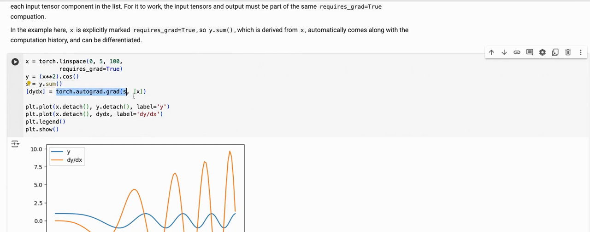
*▲ 강의 화면 [17:10](https://youtu.be/o5gPABcGZwc?t=1030): `torch.autograd.grad(s, [x])`로 구한 cos(x²)(파랑)의 도함수(주황)*

```python
# [함수] import torch: PyTorch 라이브러리를 불러온다
import torch
# [함수] torch.linspace(..., requires_grad=True): 0~5를 101칸으로 나누고, 이 텐서로 하는 계산을 기록하게 한다
# [변수] x: 미분할 입력 101개
x = torch.linspace(0, 5, 101, requires_grad=True)
# [함수] (x ** 2).cos(): 원소마다 cos(x²). 계산 그래프에 "제곱 → cos"가 기록된다
# [변수] y: 101개 출력
y = (x ** 2).cos()
# [함수] y.sum(): 스칼라 하나로 만든다. 미분은 스칼라 출력에서 시작해야 한다
# [변수] s: y의 합. 각 y_i는 자기 x_i에만 기대므로 ds/dx_i = dy_i/dx_i
s = y.sum()
# [함수] torch.autograd.grad(s, [x]): s를 x로 미분한 기울기 목록을 돌려준다
# [변수] dydx: x 자리마다의 dy/dx (101개)
# [연결] 7.1절 식 dy/dx = -2x sin(x²)
[dydx] = torch.autograd.grad(s, [x])
# [함수] x.detach(): 기울기 기록에서 떼어 낸 같은 값 (손계산 비교용)
# [변수] by_hand: 연쇄법칙으로 직접 쓴 도함수 -2x sin(x²)
by_hand = -2 * x.detach() * (x.detach() ** 2).sin()
# [함수] torch.allclose: 두 텐서가 아주 작은 오차 안에서 모두 같으면 True
# [연결] 출력 1행: 자동 미분 = 손계산
print(torch.allclose(dydx, by_hand))
# [함수] x[20]: 21번째 칸 = 20 × 0.05 = 1.0
# [연결] 출력 2행: x = 1에서 y = cos 1 = 0.5403, dy/dx = -2 sin 1 = -1.6829 (7.1절 예제와 풀이)
print(round(x[20].item(), 4), round(y[20].item(), 4), round(dydx[20].item(), 4))
```

**실행 결과**:

```text
True
1.0 0.5403 -1.6829
```

### 7.2 backward와 기울기 누적

▶ 영상 [18:22](https://youtu.be/o5gPABcGZwc?t=1102)

- 모델을 학습할 때는 [기울기](00_%EB%94%A5%EB%9F%AC%EB%8B%9D_%EC%9A%A9%EC%96%B4%EC%82%AC%EC%A0%84.md#gradient-%EA%B8%B0%EC%9A%B8%EA%B8%B0) 하나하나를 `autograd.grad`로 지정하지 않습니다. `loss.backward()` 한 번이면 `requires_grad=True`인 **모든** [텐서](00_%EB%94%A5%EB%9F%AC%EB%8B%9D_%EC%9A%A9%EC%96%B4%EC%82%AC%EC%A0%84.md#tensor-%ED%85%90%EC%84%9C)의 [기울기](00_%EB%94%A5%EB%9F%AC%EB%8B%9D_%EC%9A%A9%EC%96%B4%EC%82%AC%EC%A0%84.md#gradient-%EA%B8%B0%EC%9A%B8%EA%B8%B0)가 각자의 `.grad`에 채워집니다. 조교는 "실제로는 언제나 `.backward()`를 쓴다"고 말합니다. 이것이 [Lec02 6](Lec02_%EC%8B%A0%EA%B2%BD%EB%A7%9D_%ED%95%99%EC%8A%B5.md#6-%EC%97%AD%EC%A0%84%ED%8C%8C)의 [역전파](00_%EB%94%A5%EB%9F%AC%EB%8B%9D_%EC%9A%A9%EC%96%B4%EC%82%AC%EC%A0%84.md#backpropagation-%EC%97%AD%EC%A0%84%ED%8C%8C)를 [PyTorch](00_%EB%94%A5%EB%9F%AC%EB%8B%9D_%EC%9A%A9%EC%96%B4%EC%82%AC%EC%A0%84.md#pytorch-%ED%8C%8C%EC%9D%B4%ED%86%A0%EC%B9%98)가 대신해 주는 부분입니다.
- 노트북의 주의 문구: `.grad`는 덮어쓰지 않고 **더해집니다**([기울기 누적](00_%EB%94%A5%EB%9F%AC%EB%8B%9D_%EC%9A%A9%EC%96%B4%EC%82%AC%EC%A0%84.md#gradient-accumulation-%EA%B8%B0%EC%9A%B8%EA%B8%B0-%EB%88%84%EC%A0%81)). 그래서 다음 계산 전에 `optimizer.zero_grad()`나 `x.grad.zero_()`로 비워야 합니다. 비우지 않으면 지난 [기울기](00_%EB%94%A5%EB%9F%AC%EB%8B%9D_%EC%9A%A9%EC%96%B4%EC%82%AC%EC%A0%84.md#gradient-%EA%B8%B0%EC%9A%B8%EA%B8%B0)가 새 [기울기](00_%EB%94%A5%EB%9F%AC%EB%8B%9D_%EC%9A%A9%EC%96%B4%EC%82%AC%EC%A0%84.md#gradient-%EA%B8%B0%EC%9A%B8%EA%B8%B0)에 섞입니다(아래 출력 2행).

### 7.3 no_grad로 기록 끄기

▶ 영상 [18:55](https://youtu.be/o5gPABcGZwc?t=1135)

- [기울기](00_%EB%94%A5%EB%9F%AC%EB%8B%9D_%EC%9A%A9%EC%96%B4%EC%82%AC%EC%A0%84.md#gradient-%EA%B8%B0%EC%9A%B8%EA%B8%B0)를 쓰지 않을 계산이라면 기록하지 말아야 합니다. `with torch.no_grad():` 블록 안의 계산은 그래프를 만들지 않아 메모리와 시간을 아낍니다. 평가(추론)할 때, 그리고 [파라미터](00_%EB%94%A5%EB%9F%AC%EB%8B%9D_%EC%9A%A9%EC%96%B4%EC%82%AC%EC%A0%84.md#parameter-%ED%8C%8C%EB%9D%BC%EB%AF%B8%ED%84%B0)를 손으로 고칠 때 씁니다(9.2절).
- 노트북 보충: `net.eval()`은 다른 것입니다. [배치 정규화](00_%EB%94%A5%EB%9F%AC%EB%8B%9D_%EC%9A%A9%EC%96%B4%EC%82%AC%EC%A0%84.md#batch-normalization-%EB%B0%B0%EC%B9%98-%EC%A0%95%EA%B7%9C%ED%99%94)·[드롭아웃](00_%EB%94%A5%EB%9F%AC%EB%8B%9D_%EC%9A%A9%EC%96%B4%EC%82%AC%EC%A0%84.md#dropout-%EB%93%9C%EB%A1%AD%EC%95%84%EC%9B%83) 같은 [층](00_%EB%94%A5%EB%9F%AC%EB%8B%9D_%EC%9A%A9%EC%96%B4%EC%82%AC%EC%A0%84.md#layer-%EC%B8%B5)을 추론 방식으로 바꿀 뿐, [기울기](00_%EB%94%A5%EB%9F%AC%EB%8B%9D_%EC%9A%A9%EC%96%B4%EC%82%AC%EC%A0%84.md#gradient-%EA%B8%B0%EC%9A%B8%EA%B8%B0) 기록에는 영향이 없습니다.

```python
# [함수] import torch: PyTorch 라이브러리를 불러온다
import torch
# [변수] x: 기울기를 기록할 입력 (1, 2)
x = torch.tensor([1.0, 2.0], requires_grad=True)
# [함수] (x ** 2).sum(): 손실 x₁² + x₂² (스칼라)
# [변수] loss: 1 + 4 = 5
loss = (x ** 2).sum()
# [함수] loss.backward(): 계산 그래프를 거꾸로 따라가 requires_grad인 텐서마다 .grad에 기울기를 넣는다
loss.backward()
# [함수] x.grad: d(loss)/dx = 2x = (2, 4)
# [연결] 출력 1행
print(x.grad)
# [변수] loss: 같은 손실을 한 번 더 계산 (새 그래프)
loss = (x ** 2).sum()
# [함수] loss.backward(): 두 번째 역전파. 기울기는 .grad에 덮어쓰지 않고 더해진다
loss.backward()
# [연결] 출력 2행: (2, 4) + (2, 4) = (4, 8) → 7.2절 "기울기 누적"
print(x.grad)
# [함수] x.grad.zero_(): .grad를 0으로 비운다 (밑줄 _는 제자리에서 바꾼다는 뜻). optimizer.zero_grad()가 하는 일
x.grad.zero_()
# [변수] loss: 비운 뒤 다시 계산
loss = (x ** 2).sum()
# [함수] loss.backward(): 이번에는 깨끗한 .grad에 (2, 4)가 들어간다
loss.backward()
# [연결] 출력 3행: 다시 (2, 4)
print(x.grad)
# [함수] with torch.no_grad(): 이 블록 안의 계산은 그래프에 기록하지 않는다
# [쓸모] 추론(평가)이나 파라미터를 손으로 고칠 때 메모리와 시간을 아낀다
with torch.no_grad():
    # [변수] z: x × 3이지만 기록이 없어 requires_grad = False
    z = x * 3
# [변수] w: 같은 계산을 블록 밖에서 하면 기록된다
w = x * 3
# [함수] .requires_grad: 기울기를 기록하는 텐서인지. type(w.grad_fn).__name__: 이 값을 만든 연산의 역전파 노드 이름
# [연결] 출력 4행: 7.3절 no_grad
print(z.requires_grad, w.requires_grad, type(w.grad_fn).__name__)
```

**실행 결과**:

```text
tensor([2., 4.])
tensor([4., 8.])
tensor([2., 4.])
False True MulBackward0
```

---

## 8. 옵티마이저

▶ 영상 [19:31](https://youtu.be/o5gPABcGZwc?t=1171)

📐 **수학 개념**: [그래디언트 벡터](%EC%88%98%ED%95%99%EA%B0%9C%EB%85%90/02_%EB%AF%B8%EB%B6%84/MM02_%EA%B7%B8%EB%9E%98%EB%94%94%EC%96%B8%ED%8A%B8_%EB%B2%A1%ED%84%B0.md) · [SGD와 모멘텀](%EC%88%98%ED%95%99%EA%B0%9C%EB%85%90/05_%EC%8B%A0%EA%B2%BD%EB%A7%9D%EC%9D%98_%EA%B3%84%EC%82%B0/MM08_SGD%EC%99%80_%EB%AA%A8%EB%A9%98%ED%85%80.md) · [Adam 업데이트 규칙](%EC%88%98%ED%95%99%EA%B0%9C%EB%85%90/05_%EC%8B%A0%EA%B2%BD%EB%A7%9D%EC%9D%98_%EA%B3%84%EC%82%B0/MM83_Adam_%EC%97%85%EB%8D%B0%EC%9D%B4%ED%8A%B8_%EA%B7%9C%EC%B9%99.md) · [노름](%EC%88%98%ED%95%99%EA%B0%9C%EB%85%90/03_%EC%84%A0%ED%98%95%EB%8C%80%EC%88%98/MM11_%EB%A6%BD%EC%8B%9C%EC%B8%A0_%EC%97%B0%EC%86%8D%EA%B3%BC_%EB%85%B8%EB%A6%84.md)

[옵티마이저(Optimizer)](00_%EB%94%A5%EB%9F%AC%EB%8B%9D_%EC%9A%A9%EC%96%B4%EC%82%AC%EC%A0%84.md#optimizer-%EC%98%B5%ED%8B%B0%EB%A7%88%EC%9D%B4%EC%A0%80)의 일은 단순합니다. [파라미터](00_%EB%94%A5%EB%9F%AC%EB%8B%9D_%EC%9A%A9%EC%96%B4%EC%82%AC%EC%A0%84.md#parameter-%ED%8C%8C%EB%9D%BC%EB%AF%B8%ED%84%B0)에 대한 [기울기](00_%EB%94%A5%EB%9F%AC%EB%8B%9D_%EC%9A%A9%EC%96%B4%EC%82%AC%EC%A0%84.md#gradient-%EA%B8%B0%EC%9A%B8%EA%B8%B0)가 주어지면, 목적 함수가 줄어드는 쪽으로 [파라미터](00_%EB%94%A5%EB%9F%AC%EB%8B%9D_%EC%9A%A9%EC%96%B4%EC%82%AC%EC%A0%84.md#parameter-%ED%8C%8C%EB%9D%BC%EB%AF%B8%ED%84%B0)를 조금 옮깁니다. 노트북은 같은 문제를 세 방법으로 풉니다.

- **문제**: 2차원 점 x에서 [손실](00_%EB%94%A5%EB%9F%AC%EB%8B%9D_%EC%9A%A9%EC%96%B4%EC%82%AC%EC%A0%84.md#loss-function-%EC%86%90%EC%8B%A4-%ED%95%A8%EC%88%98) = ‖bowl · x‖ (2×2 행렬 bowl을 곱한 벡터의 길이). 바닥은 x = (0, 0), 등고선은 비스듬한 타원 그릇입니다.
- **손으로 쓴 [경사하강법](00_%EB%94%A5%EB%9F%AC%EB%8B%9D_%EC%9A%A9%EC%96%B4%EC%82%AC%EC%A0%84.md#gradient-descent-%EA%B2%BD%EC%82%AC%ED%95%98%EA%B0%95%EB%B2%95)**: `loss.backward()`로 [기울기](00_%EB%94%A5%EB%9F%AC%EB%8B%9D_%EC%9A%A9%EC%96%B4%EC%82%AC%EC%A0%84.md#gradient-%EA%B8%B0%EC%9A%B8%EA%B8%B0)를 구하고 `x -= learning_rate * x.grad`. 식으로는 [Lec01 5.1](Lec01_%EB%94%A5%EB%9F%AC%EB%8B%9D_%EC%86%8C%EA%B0%9C.md#51-%EA%B2%BD%EC%82%AC%ED%95%98%EA%B0%95%EB%B2%95)의 $\theta \leftarrow \theta - \eta \nabla J$입니다.
- **`torch.optim.SGD([x], lr=0.1, momentum=0.5)`**: `optimizer.step()`이 갱신을 대신합니다. 루프 순서는 `zero_grad()` → `backward()` → `step()`. 조교는 "바닥에 조금 더 빨리 갔다가 근처에서 조금 튄다"고 말합니다([모멘텀](00_%EB%94%A5%EB%9F%AC%EB%8B%9D_%EC%9A%A9%EC%96%B4%EC%82%AC%EC%A0%84.md#momentum-%EB%AA%A8%EB%A9%98%ED%85%80)은 [Lec02 2.3](Lec02_%EC%8B%A0%EA%B2%BD%EB%A7%9D_%ED%95%99%EC%8A%B5.md#23-%EB%AA%A8%EB%A9%98%ED%85%80)).
- **`torch.optim.Adam([x], lr=0.1)`**: [Adam](00_%EB%94%A5%EB%9F%AC%EB%8B%9D_%EC%9A%A9%EC%96%B4%EC%82%AC%EC%A0%84.md#adam-%EC%95%84%EB%8B%B4-%EC%98%B5%ED%8B%B0%EB%A7%88%EC%9D%B4%EC%A0%80)은 보폭을 [파라미터](00_%EB%94%A5%EB%9F%AC%EB%8B%9D_%EC%9A%A9%EC%96%B4%EC%82%AC%EC%A0%84.md#parameter-%ED%8C%8C%EB%9D%BC%EB%AF%B8%ED%84%B0)마다 스스로 조절하고, 실제로 가장 많이 쓰입니다. 다만 이 장난감 예제에서는 단순한 방법들보다 못했습니다. 이유는 [MM83_Adam_업데이트_규칙](%EC%88%98%ED%95%99%EA%B0%9C%EB%85%90/05_%EC%8B%A0%EA%B2%BD%EB%A7%9D%EC%9D%98_%EA%B3%84%EC%82%B0/MM83_Adam_%EC%97%85%EB%8D%B0%EC%9D%B4%ED%8A%B8_%EA%B7%9C%EC%B9%99.md)에 정리했습니다. 걸음 크기가 [기울기](00_%EB%94%A5%EB%9F%AC%EB%8B%9D_%EC%9A%A9%EC%96%B4%EC%82%AC%EC%A0%84.md#gradient-%EA%B8%B0%EC%9A%B8%EA%B8%B0) 크기와 상관없이 약 0.1이라 바닥 근처에서 맴돕니다.

$$
L(\mathbf{x}) = \lVert \mathbf{B}\mathbf{x} \rVert = \sqrt{(B_{11}x_1 + B_{12}x_2)^2 + (B_{21}x_1 + B_{22}x_2)^2}
$$

<details><summary>기호 풀이</summary>

| 기호 | 읽는 법 | 뜻 | 예제 값 |
| --- | --- | --- | --- |
| $\mathbf{x}$ | 굵은 엑스 | [옵티마이저](00_%EB%94%A5%EB%9F%AC%EB%8B%9D_%EC%9A%A9%EC%96%B4%EC%82%AC%EC%A0%84.md#optimizer-%EC%98%B5%ED%8B%B0%EB%A7%88%EC%9D%B4%EC%A0%80)가 고치는 2차원 점 (`x`) | (-0.9, 0.37) |
| $x_1, x_2$ | 엑스 일, 엑스 이 | x의 두 칸 (코드의 x[0], x[1]) | -0.9, 0.37 |
| $\mathbf{B}$ | 굵은 비 | 노트북의 `bowl` 행렬 | 행 (0.4410, -1.0317), (-0.2844, -0.1035) |
| $B_{ij}$ | 비 아이 제이 | B의 i행 j열 값 | $B_{12} = -1.0317$ |
| $\mathbf{B}\mathbf{x}$ | 비 엑스 | [행렬 곱](00_%EB%94%A5%EB%9F%AC%EB%8B%9D_%EC%9A%A9%EC%96%B4%EC%82%AC%EC%A0%84.md#matrix-multiplication-%ED%96%89%EB%A0%AC-%EA%B3%B1) 결과 벡터 (`torch.mm(bowl, x[:, None])`) | (-0.7786, 0.2177) |
| $\lVert \cdot \rVert$ | [노름](00_%EB%94%A5%EB%9F%AC%EB%8B%9D_%EC%9A%A9%EC%96%B4%EC%82%AC%EC%A0%84.md#norm-%EB%85%B8%EB%A6%84) | 벡터의 길이 √(제곱의 합) (`.norm()`) | - |
| $L(\mathbf{x})$ | 엘 엑스 | [손실](00_%EB%94%A5%EB%9F%AC%EB%8B%9D_%EC%9A%A9%EC%96%B4%EC%82%AC%EC%A0%84.md#loss-function-%EC%86%90%EC%8B%A4-%ED%95%A8%EC%88%98) | 0.8085 |

</details>

<details><summary>예제와 풀이</summary>

**문제**: 출발점 x = (-0.9, 0.37)에서 [손실](00_%EB%94%A5%EB%9F%AC%EB%8B%9D_%EC%9A%A9%EC%96%B4%EC%82%AC%EC%A0%84.md#loss-function-%EC%86%90%EC%8B%A4-%ED%95%A8%EC%88%98) ‖Bx‖는? (아래 코드의 0번째 [손실](00_%EB%94%A5%EB%9F%AC%EB%8B%9D_%EC%9A%A9%EC%96%B4%EC%82%AC%EC%A0%84.md#loss-function-%EC%86%90%EC%8B%A4-%ED%95%A8%EC%88%98))

**주어진 값**:
- $x_1 = -0.9$, $x_2 = 0.37$ (출발점)
- $B_{11} = 0.4410$, $B_{12} = -1.0317$ (bowl 1행)
- $B_{21} = -0.2844$, $B_{22} = -0.1035$ (bowl 2행)

**풀이**
1. 식을 그대로 쓴다: $L = \sqrt{(B_{11}x_1 + B_{12}x_2)^2 + (B_{21}x_1 + B_{22}x_2)^2}$
2. 값을 대입한다: $L = \sqrt{(0.4410 × (-0.9) + (-1.0317) × 0.37)^2 + ((-0.2844) × (-0.9) + (-0.1035) × 0.37)^2}$
3. 첫째 괄호 안 곱셈: 0.4410 × (-0.9) = -0.3969, (-1.0317) × 0.37 = -0.3817 이므로 첫째 괄호 = -0.3969 + (-0.3817)
4. 첫째 괄호를 더한다: -0.3969 + (-0.3817) = -0.7786
5. 둘째 괄호 안 곱셈: (-0.2844) × (-0.9) = 0.2560, (-0.1035) × 0.37 = -0.0383 이므로 둘째 괄호 = 0.2560 + (-0.0383)
6. 둘째 괄호를 더한다: 0.2560 + (-0.0383) = 0.2177 이므로 $L = \sqrt{(-0.7786)^2 + 0.2177^2}$
7. 제곱한다: (-0.7786)² = 0.6062, 0.2177² = 0.0474 이므로 $L = \sqrt{0.6062 + 0.0474}$
8. 더한다: 0.6062 + 0.0474 = 0.6536 이므로 $L = \sqrt{0.6536}$
9. 제곱근을 구한다. √a는 제곱해서 a가 되는 양수이고 계산기의 √ 키로 구한다: √0.6536 = 0.8085 (0.8085 × 0.8085 = 0.6537)

**답**: [손실](00_%EB%94%A5%EB%9F%AC%EB%8B%9D_%EC%9A%A9%EC%96%B4%EC%82%AC%EC%A0%84.md#loss-function-%EC%86%90%EC%8B%A4-%ED%95%A8%EC%88%98) **0.8085** (아래 코드 출력의 첫 숫자, 세 방법 모두 같은 곳에서 출발)

</details>

<details><summary>내 이해</summary>


</details>

| 방법 | 0번째 | 5번째 | 10번째 | 20번째 | 가장 작은 값 |
|---|---|---|---|---|---|
| [경사하강법](00_%EB%94%A5%EB%9F%AC%EB%8B%9D_%EC%9A%A9%EC%96%B4%EC%82%AC%EC%A0%84.md#gradient-descent-%EA%B2%BD%EC%82%AC%ED%95%98%EA%B0%95%EB%B2%95) (lr 0.1) | 0.8085 | 0.2755 | 0.1472 | 0.0559 | 0.0559 |
| SGD + [모멘텀](00_%EB%94%A5%EB%9F%AC%EB%8B%9D_%EC%9A%A9%EC%96%B4%EC%82%AC%EC%A0%84.md#momentum-%EB%AA%A8%EB%A9%98%ED%85%80) 0.5 | 0.8085 | 0.1903 | 0.0927 | 0.0514 | 0.0227 |
| [Adam](00_%EB%94%A5%EB%9F%AC%EB%8B%9D_%EC%9A%A9%EC%96%B4%EC%82%AC%EC%A0%84.md#adam-%EC%95%84%EB%8B%B4-%EC%98%B5%ED%8B%B0%EB%A7%88%EC%9D%B4%EC%A0%80) (lr 0.1) | 0.8085 | 0.1344 | 0.257 | 0.0768 | 0.0607 |

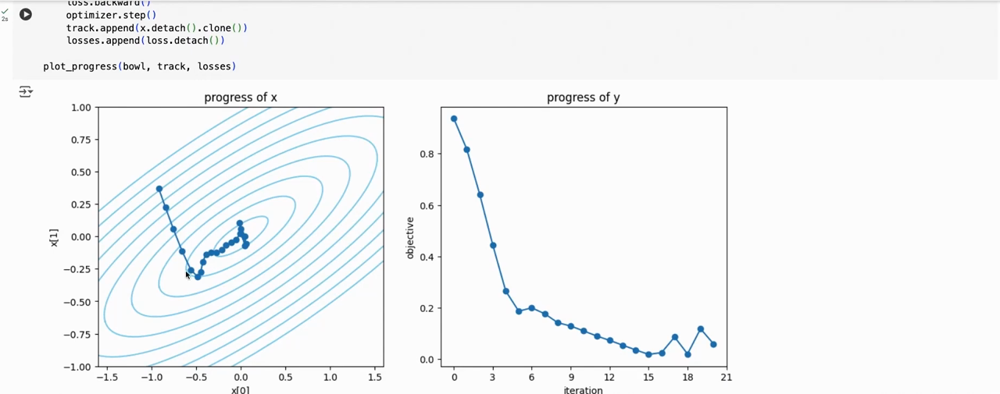
*▲ 강의 화면 [20:30](https://youtu.be/o5gPABcGZwc?t=1230): `torch.optim.SGD(momentum=0.5)`로 21번 움직인 길(왼쪽)과 [손실](00_%EB%94%A5%EB%9F%AC%EB%8B%9D_%EC%9A%A9%EC%96%B4%EC%82%AC%EC%A0%84.md#loss-function-%EC%86%90%EC%8B%A4-%ED%95%A8%EC%88%98)(오른쪽)*

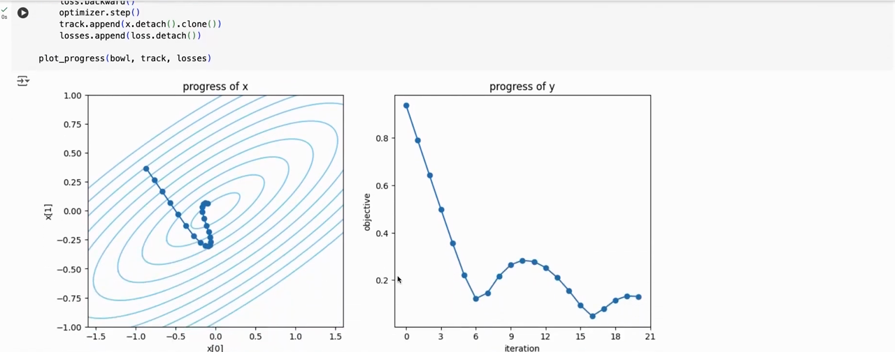
*▲ 강의 화면 [21:10](https://youtu.be/o5gPABcGZwc?t=1270): 같은 문제에 [Adam](00_%EB%94%A5%EB%9F%AC%EB%8B%9D_%EC%9A%A9%EC%96%B4%EC%82%AC%EC%A0%84.md#adam-%EC%95%84%EB%8B%B4-%EC%98%B5%ED%8B%B0%EB%A7%88%EC%9D%B4%EC%A0%80)(lr 0.1). 바닥 근처에서 고리를 그리며 [손실](00_%EB%94%A5%EB%9F%AC%EB%8B%9D_%EC%9A%A9%EC%96%B4%EC%82%AC%EC%A0%84.md#loss-function-%EC%86%90%EC%8B%A4-%ED%95%A8%EC%88%98)이 다시 오른다*

```python
# [함수] import torch: PyTorch 라이브러리를 불러온다
import torch
# [변수] bowl: 강의 노트북의 2×2 행렬. 손실 지형을 비스듬한 타원 그릇 모양으로 만든다
bowl = torch.tensor([[0.4410, -1.0317], [-0.2844, -0.1035]])
# [변수] x_init: 출발점. 노트북은 torch.randn(2)로 뽑았고, 여기서는 캡처의 출발점과 비슷한 (-0.9, 0.37)로 고정한다
x_init = torch.tensor([-0.9, 0.37])
# [함수] def objective(x): 손실 = ‖bowl · x‖ (행렬 곱한 벡터의 길이). x = (0, 0)에서 최솟값 0
# [연결] 8절 식
def objective(x):
    # [함수] torch.mm(bowl, x[:, None]): 2×2 행렬과 2×1 열벡터의 곱. x[:, None]은 x를 열벡터로 세운다
    # [함수] .norm(): 벡터 길이 √(a² + b²)
    return torch.mm(bowl, x[:, None]).norm()
# [함수] def run(make_opt): 옵티마이저를 만들어 21번 갱신하고 손실 기록을 돌려준다
# [변수] make_opt: 파라미터 목록을 받아 옵티마이저를 만드는 함수
def run(make_opt):
    # [변수] x: 출발점을 복사하고 기울기를 기록하게 한다
    x = x_init.clone().requires_grad_(True)
    # [변수] opt: 이 x를 고칠 옵티마이저
    opt = make_opt([x])
    # [변수] losses: 반복마다의 손실
    losses = []
    # [함수] for _ in range(21): 강의 노트북과 같은 21번 반복
    for _ in range(21):
        # [변수] loss: 지금 x의 손실
        loss = objective(x)
        # [함수] opt.zero_grad(): 지난 기울기를 비운다 (7.2절 누적 방지)
        opt.zero_grad()
        # [함수] loss.backward(): x.grad에 기울기를 채운다
        loss.backward()
        # [함수] opt.step(): x.grad를 써서 x를 한 걸음 고친다
        opt.step()
        # [함수] losses.append(loss.item()): 손실을 숫자로 저장
        losses.append(loss.item())
    # [쓸모] 돌려받은 기록으로 옵티마이저를 비교한다
    return losses
# [변수] gd: 모멘텀 없는 SGD = 손으로 쓴 x -= 0.1 * x.grad와 똑같은 경사하강법
gd = run(lambda p: torch.optim.SGD(p, lr=0.1))
# [변수] mom: 노트북의 SGD(lr=0.1, momentum=0.5)
# [연결] MM08 모멘텀
mom = run(lambda p: torch.optim.SGD(p, lr=0.1, momentum=0.5))
# [변수] adam: 노트북의 Adam(lr=0.1)
# [연결] MM83 Adam 업데이트
adam = run(lambda p: torch.optim.Adam(p, lr=0.1))
# [함수] for name, ls in ...: 세 기록에서 0, 5, 10, 20번째 손실과 가장 작은 손실을 출력한다
# [연결] 8절 표
for name, ls in [("GD", gd), ("SGD+모멘텀", mom), ("Adam", adam)]:
    # [함수] round(v, 4): 소수 넷째 자리로 반올림
    print(name, [round(ls[i], 4) for i in (0, 5, 10, 20)], round(min(ls), 4))
```

**실행 결과**:

```text
GD [0.8085, 0.2755, 0.1472, 0.0559] 0.0559
SGD+모멘텀 [0.8085, 0.1903, 0.0927, 0.0514] 0.0227
Adam [0.8085, 0.1344, 0.257, 0.0768] 0.0607
```

세 방법의 길을 한 그림에 겹치면 [MM83 3절](%EC%88%98%ED%95%99%EA%B0%9C%EB%85%90/05_%EC%8B%A0%EA%B2%BD%EB%A7%9D%EC%9D%98_%EA%B3%84%EC%82%B0/MM83_Adam_%EC%97%85%EB%8D%B0%EC%9D%B4%ED%8A%B8_%EA%B7%9C%EC%B9%99.md#3-%EC%88%AB%EC%9E%90%EB%A1%9C-%EB%B3%B4%EA%B8%B0)의 그림과 같습니다.

> [!TIP]
> **🆕 2026 업데이트: [PyTorch](00_%EB%94%A5%EB%9F%AC%EB%8B%9D_%EC%9A%A9%EC%96%B4%EC%82%AC%EC%A0%84.md#pytorch-%ED%8C%8C%EC%9D%B4%ED%86%A0%EC%B9%98)에 들어온 [Muon](00_%EB%94%A5%EB%9F%AC%EB%8B%9D_%EC%9A%A9%EC%96%B4%EC%82%AC%EC%A0%84.md#muon-%EB%AE%A4%EC%98%A8-%EC%98%B5%ED%8B%B0%EB%A7%88%EC%9D%B4%EC%A0%80) [옵티마이저](00_%EB%94%A5%EB%9F%AC%EB%8B%9D_%EC%9A%A9%EC%96%B4%EC%82%AC%EC%A0%84.md#optimizer-%EC%98%B5%ED%8B%B0%EB%A7%88%EC%9D%B4%EC%A0%80)**
> - **강의(2024년 가을)**: `torch.optim`의 SGD와 [Adam](00_%EB%94%A5%EB%9F%AC%EB%8B%9D_%EC%9A%A9%EC%96%B4%EC%82%AC%EC%A0%84.md#adam-%EC%95%84%EB%8B%B4-%EC%98%B5%ED%8B%B0%EB%A7%88%EC%9D%B4%EC%A0%80)을 쓰고, [Adam](00_%EB%94%A5%EB%9F%AC%EB%8B%9D_%EC%9A%A9%EC%96%B4%EC%82%AC%EC%A0%84.md#adam-%EC%95%84%EB%8B%B4-%EC%98%B5%ED%8B%B0%EB%A7%88%EC%9D%B4%EC%A0%80)이 실전 표준이라고 소개했다.
> - **현재**: [PyTorch](00_%EB%94%A5%EB%9F%AC%EB%8B%9D_%EC%9A%A9%EC%96%B4%EC%82%AC%EC%A0%84.md#pytorch-%ED%8C%8C%EC%9D%B4%ED%86%A0%EC%B9%98) 2.9(2025년 10월) 릴리스 노트에 "Introduce [Muon](00_%EB%94%A5%EB%9F%AC%EB%8B%9D_%EC%9A%A9%EC%96%B4%EC%82%AC%EC%A0%84.md#muon-%EB%AE%A4%EC%98%A8-%EC%98%B5%ED%8B%B0%EB%A7%88%EC%9D%B4%EC%A0%80) optimizer to [PyTorch](00_%EB%94%A5%EB%9F%AC%EB%8B%9D_%EC%9A%A9%EC%96%B4%EC%82%AC%EC%A0%84.md#pytorch-%ED%8C%8C%EC%9D%B4%ED%86%A0%EC%B9%98)"가 새 기능으로 올라, `torch.optim.Muon`을 바로 쓸 수 있다(이 노트를 실행한 2.14에도 있다). 공식 문서는 [Muon](00_%EB%94%A5%EB%9F%AC%EB%8B%9D_%EC%9A%A9%EC%96%B4%EC%82%AC%EC%A0%84.md#muon-%EB%AE%A4%EC%98%A8-%EC%98%B5%ED%8B%B0%EB%A7%88%EC%9D%B4%EC%A0%80)을 "[은닉층](00_%EB%94%A5%EB%9F%AC%EB%8B%9D_%EC%9A%A9%EC%96%B4%EC%82%AC%EC%A0%84.md#hidden-layer-%EC%9D%80%EB%8B%89%EC%B8%B5)의 **2차원** 파라미터용"이라고 밝히고, [편향](00_%EB%94%A5%EB%9F%AC%EB%8B%9D_%EC%9A%A9%EC%96%B4%EC%82%AC%EC%A0%84.md#bias-%ED%8E%B8%ED%96%A5)·[임베딩](00_%EB%94%A5%EB%9F%AC%EB%8B%9D_%EC%9A%A9%EC%96%B4%EC%82%AC%EC%A0%84.md#embedding-%EC%9E%84%EB%B2%A0%EB%94%A9) 같은 나머지 [파라미터](00_%EB%94%A5%EB%9F%AC%EB%8B%9D_%EC%9A%A9%EC%96%B4%EC%82%AC%EC%A0%84.md#parameter-%ED%8C%8C%EB%9D%BC%EB%AF%B8%ED%84%B0)는 AdamW 같은 표준 방법으로 학습하라고 한다. 문서의 예처럼 `p.ndim == 2`로 [파라미터](00_%EB%94%A5%EB%9F%AC%EB%8B%9D_%EC%9A%A9%EC%96%B4%EC%82%AC%EC%A0%84.md#parameter-%ED%8C%8C%EB%9D%BC%EB%AF%B8%ED%84%B0)를 나눠 두 [옵티마이저](00_%EB%94%A5%EB%9F%AC%EB%8B%9D_%EC%9A%A9%EC%96%B4%EC%82%AC%EC%A0%84.md#optimizer-%EC%98%B5%ED%8B%B0%EB%A7%88%EC%9D%B4%EC%A0%80)에 넣는다. 기본값은 lr 0.001, momentum 0.95(네스테로프), weight_decay 0.1, [뉴턴-슐츠 반복](00_%EB%94%A5%EB%9F%AC%EB%8B%9D_%EC%9A%A9%EC%96%B4%EC%82%AC%EC%A0%84.md#newton-schulz-iteration-%EB%89%B4%ED%84%B4-%EC%8A%90%EC%B8%A0-%EB%B0%98%EB%B3%B5) 5번이다. [Muon](00_%EB%94%A5%EB%9F%AC%EB%8B%9D_%EC%9A%A9%EC%96%B4%EC%82%AC%EC%A0%84.md#muon-%EB%AE%A4%EC%98%A8-%EC%98%B5%ED%8B%B0%EB%A7%88%EC%9D%B4%EC%A0%80)의 원리는 [Lec07 8](Lec07_%EC%B5%9C%EC%A0%81%ED%99%94%EC%9D%98_%EC%8A%A4%EC%BC%80%EC%9D%BC%EB%A7%81_%EA%B7%9C%EC%B9%99.md#8-rms-%EC%97%B0%EC%82%B0%EC%9E%90-%EB%85%B8%EB%A6%84%EA%B3%BC-%EB%84%88%EB%B9%84-%EC%8A%A4%EC%BC%80%EC%9D%BC%EB%A7%81)과 [Lec13 1](Lec13_%ED%91%9C%ED%98%84_%ED%95%99%EC%8A%B5_%EC%9D%B4%EB%A1%A0.md#1-%EB%93%A4%EB%A8%B8%EB%A6%AC-%EC%8A%A4%ED%8E%99%ED%8A%B8%EB%9F%BC-%EB%85%B8%EB%A6%84-%EC%95%84%EB%9E%98%EC%9D%98-%EC%B5%9C%EA%B8%89%EA%B0%95%ED%95%98%EB%B2%95)에 있다.
> - **출처**: [PyTorch v2.9.0 Release Notes (GitHub, 2025)](https://github.com/pytorch/pytorch/releases/tag/v2.9.0) · [torch.optim.Muon (PyTorch 2.9 문서, 2025)](https://docs.pytorch.org/docs/2.9/generated/torch.optim.Muon.html)

---

## 9. 신경망 모듈

### 9.1 nn.Linear

▶ 영상 [21:16](https://youtu.be/o5gPABcGZwc?t=1276)

📐 **수학 개념**: [행렬 곱](%EC%88%98%ED%95%99%EA%B0%9C%EB%85%90/03_%EC%84%A0%ED%98%95%EB%8C%80%EC%88%98/M05_%EB%B2%A1%ED%84%B0%EC%99%80_%ED%96%89%EB%A0%AC.md) · [전치와 배치 행렬](%EC%88%98%ED%95%99%EA%B0%9C%EB%85%90/03_%EC%84%A0%ED%98%95%EB%8C%80%EC%88%98/MM03_%EB%B2%A1%ED%84%B0_%ED%91%9C%EA%B8%B0%EC%99%80_%EC%A0%84%EC%B9%98.md) · [선형층의 역전파](%EC%88%98%ED%95%99%EA%B0%9C%EB%85%90/05_%EC%8B%A0%EA%B2%BD%EB%A7%9D%EC%9D%98_%EA%B3%84%EC%82%B0/MM10_%EC%84%A0%ED%98%95%EC%B8%B5%EA%B3%BC_ReLU%EC%9D%98_%EC%97%AD%EC%A0%84%ED%8C%8C.md)

[PyTorch](00_%EB%94%A5%EB%9F%AC%EB%8B%9D_%EC%9A%A9%EC%96%B4%EC%82%AC%EC%A0%84.md#pytorch-%ED%8C%8C%EC%9D%B4%ED%86%A0%EC%B9%98)에는 단순한 MLP부터 복잡한 모델까지 만들 수 있는 모듈이 많습니다. 첫 부품은 [선형층(Linear layer)](00_%EB%94%A5%EB%9F%AC%EB%8B%9D_%EC%9A%A9%EC%96%B4%EC%82%AC%EC%A0%84.md#linear-layer-%EC%84%A0%ED%98%95%EC%B8%B5)입니다.

- `torch.nn.Linear(3, 2)`: 입력 특징 3개 → 출력 특징 2개, [편향](00_%EB%94%A5%EB%9F%AC%EB%8B%9D_%EC%9A%A9%EC%96%B4%EC%82%AC%EC%A0%84.md#bias-%ED%8E%B8%ED%96%A5) 포함. [층](00_%EB%94%A5%EB%9F%AC%EB%8B%9D_%EC%9A%A9%EC%96%B4%EC%82%AC%EC%A0%84.md#layer-%EC%B8%B5)을 함수처럼 `net(x)`로 부르면 출력이 나옵니다.
- **배치를 기본으로 가정**합니다. 입력 하나도 `[1.0, 0.0, 0.0]`을 대괄호로 한 번 더 감싸 배치 1개로 넣고, 입력 4개를 쌓아 넣으면 출력 4개가 나옵니다.
- `net.weight`(2×3)와 `net.bias`(2)는 처음에 무작위로 초기화되고, `requires_grad=True`가 붙어 있어 [학습](00_%EB%94%A5%EB%9F%AC%EB%8B%9D_%EC%9A%A9%EC%96%B4%EC%82%AC%EC%A0%84.md#training-%ED%95%99%EC%8A%B5) 대상입니다.
- [파라미터](00_%EB%94%A5%EB%9F%AC%EB%8B%9D_%EC%9A%A9%EC%96%B4%EC%82%AC%EC%A0%84.md#parameter-%ED%8C%8C%EB%9D%BC%EB%AF%B8%ED%84%B0)를 손으로 바꿀 때(예: [편향](00_%EB%94%A5%EB%9F%AC%EB%8B%9D_%EC%9A%A9%EC%96%B4%EC%82%AC%EC%A0%84.md#bias-%ED%8E%B8%ED%96%A5)을 0으로)는 `torch.no_grad()` 안에서 해야 합니다. `net.named_parameters()`로 이름과 값을 볼 수 있습니다.
- `torch.save(net.state_dict(), 파일)`로 저장하고 `net.load_state_dict(torch.load(파일))`로 불러옵니다.

$$
\mathbf{y} = \mathbf{x}\mathbf{W}^\top + \mathbf{b}
$$

<details><summary>기호 풀이</summary>

| 기호 | 읽는 법 | 뜻 | 예제 값 |
| --- | --- | --- | --- |
| $\mathbf{x}$ | 굵은 엑스 | 입력 (행 하나, 배치면 여러 행) | (1, 2, 3) |
| $\mathbf{W}$ | 굵은 대문자 더블유 | [가중치](00_%EB%94%A5%EB%9F%AC%EB%8B%9D_%EC%9A%A9%EC%96%B4%EC%82%AC%EC%A0%84.md#weight-%EA%B0%80%EC%A4%91%EC%B9%98) `net.weight`, 모양 (출력 수 × 입력 수) | 행 (1, 2, 0), (0, 1, -1) |
| $\mathbf{W}^\top$ | 더블유 [전치](00_%EB%94%A5%EB%9F%AC%EB%8B%9D_%EC%9A%A9%EC%96%B4%EC%82%AC%EC%A0%84.md#transpose-%EC%A0%84%EC%B9%98) | W의 행과 열을 바꾼 것 (`net.weight.T`) | 3×2 |
| $\mathbf{b}$ | 굵은 비 | [편향](00_%EB%94%A5%EB%9F%AC%EB%8B%9D_%EC%9A%A9%EC%96%B4%EC%82%AC%EC%A0%84.md#bias-%ED%8E%B8%ED%96%A5) `net.bias` | (0.5, -1) |
| $\mathbf{y}$ | 굵은 와이 | 출력 | (5.5, -2) |

</details>

<details><summary>예제와 풀이</summary>

**문제**: [가중치](00_%EB%94%A5%EB%9F%AC%EB%8B%9D_%EC%9A%A9%EC%96%B4%EC%82%AC%EC%A0%84.md#weight-%EA%B0%80%EC%A4%91%EC%B9%98)와 [편향](00_%EB%94%A5%EB%9F%AC%EB%8B%9D_%EC%9A%A9%EC%96%B4%EC%82%AC%EC%A0%84.md#bias-%ED%8E%B8%ED%96%A5)이 아래와 같은 `nn.Linear(3, 2)`에 입력 (1, 2, 3)을 넣으면 출력은?

**주어진 값**:
- $\mathbf{x} = (1, 2, 3)$ (입력 특징 3개)
- $\mathbf{W}$의 행: (1, 2, 0), (0, 1, -1) (출력마다 한 행)
- $\mathbf{b} = (0.5, -1)$ (출력마다의 [편향](00_%EB%94%A5%EB%9F%AC%EB%8B%9D_%EC%9A%A9%EC%96%B4%EC%82%AC%EC%A0%84.md#bias-%ED%8E%B8%ED%96%A5))

**풀이**
1. 식을 그대로 쓴다: $\mathbf{y} = \mathbf{x}\mathbf{W}^\top + \mathbf{b}$
2. 값을 대입한다 (xWᵀ의 j번째 칸은 x와 W의 j번째 행을 칸끼리 곱해 더한 것): $\mathbf{y} = (1 × 1 + 2 × 2 + 3 × 0 + 0.5,\ \ 1 × 0 + 2 × 1 + 3 × (-1) + (-1))$
3. 첫째 출력의 곱셈: 1 × 1 = 1, 2 × 2 = 4, 3 × 0 = 0 이므로 $y_1 = 1 + 4 + 0 + 0.5$
4. 첫째 출력을 더한다: 1 + 4 + 0 + 0.5 = 5.5
5. 둘째 출력의 곱셈: 1 × 0 = 0, 2 × 1 = 2, 3 × (-1) = -3 이므로 $y_2 = 0 + 2 + (-3) + (-1)$
6. 둘째 출력을 더한다: 0 + 2 - 3 - 1 = -2

**답**: $\mathbf{y} = (5.5, -2)$

</details>

<details><summary>내 이해</summary>


</details>

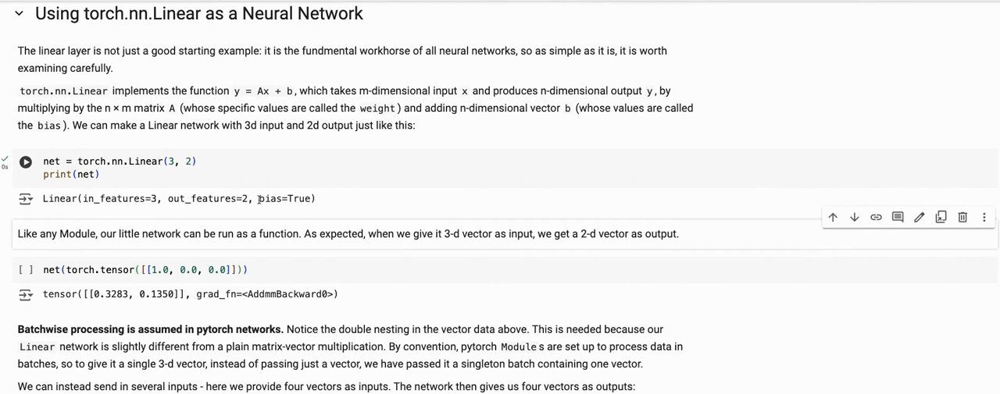
*▲ 강의 화면 [22:00](https://youtu.be/o5gPABcGZwc?t=1320): `torch.nn.Linear(3, 2)`는 y = Ax + b를 계산한다. 3차원 입력 하나를 배치로 감싸 넣으면 2차원 출력이 나온다*

```python
# [함수] import torch: PyTorch 라이브러리를 불러온다
import torch
# [함수] import io: 파일 대신 메모리 버퍼에 저장해 보려고 불러온다
import io
# [함수] torch.manual_seed(0): 가중치 무작위 초기화를 재현하려고 시드를 고정한다
torch.manual_seed(0)
# [함수] torch.nn.Linear(3, 2): 입력 3개 → 출력 2개 선형층. y = x Wᵀ + b
# [변수] net: W(2×3)와 b(2)를 무작위로 초기화한 층
net = torch.nn.Linear(3, 2)
# [연결] 출력 1행: 층의 설정
print(net)
# [변수] x_batch: 입력 4개를 행으로 쌓은 4×3 배치 (마지막 행은 0 벡터)
# [연결] 9.1절: 모듈은 첫 차원을 배치로 본다
x_batch = torch.tensor([[1.0, 0.0, 0.0], [0.0, 1.0, 0.0], [0.0, 0.0, 1.0], [0.0, 0.0, 0.0]])
# [함수] net(x_batch): 층을 함수처럼 부르면 forward가 실행된다
# [변수] out: 4×2 출력. grad_fn이 붙어 역전파할 수 있다
out = net(x_batch)
# [연결] 출력 2행: 입력 4개 → 출력 4개
print(out.shape)
# [함수] .weight, .bias: 층의 파라미터. 모양 (2, 3)과 (2,)이고 기본으로 requires_grad = True
print(net.weight.shape, net.bias.shape, net.weight.requires_grad)
# [변수] manual: 같은 계산을 행렬 곱으로 직접 한 것 x Wᵀ + b
# [연결] 9.1절 식
manual = x_batch @ net.weight.T + net.bias
# [연결] 출력 4행: 직접 계산과 층의 출력이 같다
print(torch.allclose(manual, out))
# [연결] 출력 5행: 0 벡터 입력의 출력은 W·0 + b = b 그 자체
print(torch.allclose(out[3], net.bias))
# [함수] with torch.no_grad(): 파라미터를 손으로 바꿀 때는 기록을 끈다 (안 끄면 오류)
with torch.no_grad():
    # [함수] net.bias[...] = 0: 편향의 모든 칸에 0을 넣는다
    net.bias[...] = 0
# [함수] net.named_parameters(): (이름, 파라미터) 쌍을 차례로 준다
for name, p in net.named_parameters():
    # [연결] 출력 6~7행: weight (2, 3), bias (2,)와 편향 값
    print(name, tuple(p.shape), p.sum().item() if name == "bias" else "")
# [변수] buf: 파일 대신 쓰는 메모리 버퍼. 실제로는 "linear.pt" 같은 파일 이름을 넣는다
buf = io.BytesIO()
# [함수] net.state_dict(): 파라미터 이름 → 텐서 사전. torch.save로 저장한다
torch.save(net.state_dict(), buf)
# [함수] buf.seek(0): 버퍼를 처음부터 다시 읽게 되감는다
buf.seek(0)
# [변수] net2: 새로 만든 같은 모양의 층 (다른 무작위 값)
net2 = torch.nn.Linear(3, 2)
# [함수] torch.load(buf): 저장한 사전을 읽는다. PyTorch 2.6부터 weights_only=True가 기본이라 텐서 사전만 안전하게 읽는다
# [함수] net2.load_state_dict(...): 읽은 값을 net2에 넣는다
# [연결] 9.1절 🆕 업데이트
net2.load_state_dict(torch.load(buf))
# [연결] 출력 8행: 불러온 가중치가 원래와 같다
print(torch.equal(net2.weight, net.weight), torch.equal(net2.bias, net.bias))
```

**실행 결과**:

```text
Linear(in_features=3, out_features=2, bias=True)
torch.Size([4, 2])
torch.Size([2, 3]) torch.Size([2]) True
True
True
weight (2, 3) 
bias (2,) 0.0
True True
```

> [!TIP]
> **🆕 2026 업데이트: `torch.load`는 이제 기본으로 [가중치](00_%EB%94%A5%EB%9F%AC%EB%8B%9D_%EC%9A%A9%EC%96%B4%EC%82%AC%EC%A0%84.md#weight-%EA%B0%80%EC%A4%91%EC%B9%98)만 읽는다**
> - **강의(2024년 가을)**: [가중치](00_%EB%94%A5%EB%9F%AC%EB%8B%9D_%EC%9A%A9%EC%96%B4%EC%82%AC%EC%A0%84.md#weight-%EA%B0%80%EC%A4%91%EC%B9%98)를 저장하고 `torch.load`로 다시 불러오는 것을 보여 주었다. 당시 `torch.load`는 기본적으로 파이썬 pickle을 그대로 풀었다.
> - **현재**: [PyTorch](00_%EB%94%A5%EB%9F%AC%EB%8B%9D_%EC%9A%A9%EC%96%B4%EC%82%AC%EC%A0%84.md#pytorch-%ED%8C%8C%EC%9D%B4%ED%86%A0%EC%B9%98) 2.6(2025년 1월)부터 `torch.load`의 `weights_only` 기본값이 `True`로 바뀌었다. pickle은 파일 안의 임의 코드를 실행할 수 있어 보안상 위험하기 때문이다. [텐서](00_%EB%94%A5%EB%9F%AC%EB%8B%9D_%EC%9A%A9%EC%96%B4%EC%82%AC%EC%A0%84.md#tensor-%ED%85%90%EC%84%9C)와 기본 [자료형](00_%EB%94%A5%EB%9F%AC%EB%8B%9D_%EC%9A%A9%EC%96%B4%EC%82%AC%EC%A0%84.md#dtype-data-type-%EC%9E%90%EB%A3%8C%ED%98%95)으로 된 `state_dict`는 위 코드처럼 그대로 읽히지만, 모듈 객체 전체를 저장한 파일은 오류가 난다. 믿을 수 있는 파일에만 `weights_only=False`를 쓰거나, 처음부터 `state_dict`만 저장하는 것이 권장 방식이다.
> - **출처**: [PyTorch 2.6 Release Blog (2025)](https://pytorch.org/blog/pytorch2-6/) · [BC-Breaking Change: torch.load weights_only=True by default (PyTorch Dev Discuss, 2024)](https://dev-discuss.pytorch.org/t/bc-breaking-change-torch-load-is-being-flipped-to-use-weights-only-true-by-default-in-the-nightlies-after-137602/2573) · [Serialization semantics (PyTorch 2.6 문서)](https://docs.pytorch.org/docs/2.6/notes/serialization.html)

### 9.2 선형층을 손으로 학습시키기

▶ 영상 [23:42](https://youtu.be/o5gPABcGZwc?t=1422)

📐 **수학 개념**: [합과 평균](%EC%88%98%ED%95%99%EA%B0%9C%EB%85%90/01_%EC%88%98%EC%99%80_%ED%95%A8%EC%88%98/M02_%EC%8B%9C%EA%B7%B8%EB%A7%88%EC%99%80_%ED%8F%89%EA%B7%A0.md) · [경사하강법](%EC%88%98%ED%95%99%EA%B0%9C%EB%85%90/05_%EC%8B%A0%EA%B2%BD%EB%A7%9D%EC%9D%98_%EA%B3%84%EC%82%B0/MM08_SGD%EC%99%80_%EB%AA%A8%EB%A9%98%ED%85%80.md)

조교 스스로 "좀 바보 같은 예"라고 부른 문제입니다. 입력이 무엇이든 **언제나 (1, 1)을 출력**하도록 [선형층](00_%EB%94%A5%EB%9F%AC%EB%8B%9D_%EC%9A%A9%EC%96%B4%EC%82%AC%EC%A0%84.md#linear-layer-%EC%84%A0%ED%98%95%EC%B8%B5)을 학습시킵니다.

- [손실](00_%EB%94%A5%EB%9F%AC%EB%8B%9D_%EC%9A%A9%EC%96%B4%EC%82%AC%EC%A0%84.md#loss-function-%EC%86%90%EC%8B%A4-%ED%95%A8%EC%88%98)은 제곱 [오차](00_%EB%94%A5%EB%9F%AC%EB%8B%9D_%EC%9A%A9%EC%96%B4%EC%82%AC%EC%A0%84.md#error-%EC%98%A4%EC%B0%A8)입니다([평균 제곱 오차](00_%EB%94%A5%EB%9F%AC%EB%8B%9D_%EC%9A%A9%EC%96%B4%EC%82%AC%EC%A0%84.md#mse-mean-squared-error-%ED%8F%89%EA%B7%A0-%EC%A0%9C%EA%B3%B1-%EC%98%A4%EC%B0%A8)와 같은 꼴). 입력마다 두 출력의 제곱 [오차](00_%EB%94%A5%EB%9F%AC%EB%8B%9D_%EC%9A%A9%EC%96%B4%EC%82%AC%EC%A0%84.md#error-%EC%98%A4%EC%B0%A8)를 더하고(`sum(1)`), 배치에 대해 평균(`mean()`)을 냅니다.
- 루프: 출력 계산 → [손실](00_%EB%94%A5%EB%9F%AC%EB%8B%9D_%EC%9A%A9%EC%96%B4%EC%82%AC%EC%A0%84.md#loss-function-%EC%86%90%EC%8B%A4-%ED%95%A8%EC%88%98) → `net.zero_grad()` → `loss.backward()` → `with torch.no_grad():` 안에서 모든 [파라미터](00_%EB%94%A5%EB%9F%AC%EB%8B%9D_%EC%9A%A9%EC%96%B4%EC%82%AC%EC%A0%84.md#parameter-%ED%8C%8C%EB%9D%BC%EB%AF%B8%ED%84%B0)에 `p -= 0.01 * p.grad`([학습률](00_%EB%94%A5%EB%9F%AC%EB%8B%9D_%EC%9A%A9%EC%96%B4%EC%82%AC%EC%A0%84.md#learning-rate-%ED%95%99%EC%8A%B5%EB%A5%A0) 0.01의 [경사하강법](00_%EB%94%A5%EB%9F%AC%EB%8B%9D_%EC%9A%A9%EC%96%B4%EC%82%AC%EC%A0%84.md#gradient-descent-%EA%B2%BD%EC%82%AC%ED%95%98%EA%B0%95%EB%B2%95)).
- 결과: [가중치](00_%EB%94%A5%EB%9F%AC%EB%8B%9D_%EC%9A%A9%EC%96%B4%EC%82%AC%EC%A0%84.md#weight-%EA%B0%80%EC%A4%91%EC%B9%98)는 0으로, [편향](00_%EB%94%A5%EB%9F%AC%EB%8B%9D_%EC%9A%A9%EC%96%B4%EC%82%AC%EC%A0%84.md#bias-%ED%8E%B8%ED%96%A5)은 1로 갔고 [손실](00_%EB%94%A5%EB%9F%AC%EB%8B%9D_%EC%9A%A9%EC%96%B4%EC%82%AC%EC%A0%84.md#loss-function-%EC%86%90%EC%8B%A4-%ED%95%A8%EC%88%98)은 거의 0이 되었습니다. 입력을 무시하고 편향만으로 (1, 1)을 내는 것이 정답이기 때문입니다.

$$
L = \frac{1}{N}\sum_{i=1}^{N} \sum_{j=1}^{2} \big(y_{ij} - 1\big)^2
$$

<details><summary>기호 풀이</summary>

| 기호 | 읽는 법 | 뜻 | 예제 값 |
| --- | --- | --- | --- |
| $N$ | 엔 | 배치 안 입력 수 | 2 |
| $i$ | 아이 | 몇 번째 입력인가 | 1, 2 |
| $j$ | 제이 | 몇 번째 출력인가 (출력은 2개) | 1, 2 |
| $y_{ij}$ | 와이 아이 제이 | i번째 입력에 대한 j번째 출력 | $y_{11} = 1.5$ |
| $1$ | 일 | 목표 출력 (언제나 1) | 1 |
| $\sum_{j=1}^{2}$ | 시그마 제이 | 두 출력의 제곱 [오차](00_%EB%94%A5%EB%9F%AC%EB%8B%9D_%EC%9A%A9%EC%96%B4%EC%82%AC%EC%A0%84.md#error-%EC%98%A4%EC%B0%A8)를 더함 (`sum(1)`) | - |
| $\frac{1}{N}\sum_{i=1}^{N}$ | 엔분의 일 시그마 아이 | 입력에 대해 평균 (`mean()`) | - |
| $L$ | 엘 | [손실](00_%EB%94%A5%EB%9F%AC%EB%8B%9D_%EC%9A%A9%EC%96%B4%EC%82%AC%EC%A0%84.md#loss-function-%EC%86%90%EC%8B%A4-%ED%95%A8%EC%88%98) | 1.125 |

</details>

<details><summary>예제와 풀이</summary>

**문제**: 입력 2개에 대한 [층](00_%EB%94%A5%EB%9F%AC%EB%8B%9D_%EC%9A%A9%EC%96%B4%EC%82%AC%EC%A0%84.md#layer-%EC%B8%B5)의 출력이 (1.5, 1)과 (0, 2)일 때, 목표 (1, 1)에 대한 [손실](00_%EB%94%A5%EB%9F%AC%EB%8B%9D_%EC%9A%A9%EC%96%B4%EC%82%AC%EC%A0%84.md#loss-function-%EC%86%90%EC%8B%A4-%ED%95%A8%EC%88%98)은?

**주어진 값**:
- $N = 2$ (입력 수)
- $y_{11} = 1.5,\ y_{12} = 1$ (첫째 입력의 두 출력)
- $y_{21} = 0,\ y_{22} = 2$ (둘째 입력의 두 출력)
- 목표 1 (모든 출력의 목표)

**풀이**
1. 식을 그대로 쓴다: $L = \frac{1}{N}\sum_{i=1}^{N} \sum_{j=1}^{2} \big(y_{ij} - 1\big)^2$
2. 두 Σ를 항 네 개로 펼쳐 값을 대입한다: $L = \frac{1}{2}\big[(1.5 - 1)^2 + (1 - 1)^2 + (0 - 1)^2 + (2 - 1)^2\big]$
3. 괄호 안 뺄셈을 한다: 1.5 - 1 = 0.5, 1 - 1 = 0, 0 - 1 = -1, 2 - 1 = 1 이므로 $L = \frac{1}{2}\big[0.5^2 + 0^2 + (-1)^2 + 1^2\big]$
4. 제곱한다: 0.5² = 0.25, 0² = 0, (-1)² = 1, 1² = 1 이므로 $L = \frac{1}{2}\big[0.25 + 0 + 1 + 1\big]$
5. 더한다: 0.25 + 0 + 1 + 1 = 2.25 이므로 $L = \frac{1}{2} × 2.25$
6. 2로 나눈다: 2.25 ÷ 2 = 1.125

**답**: L = **1.125** (첫째 입력의 [오차](00_%EB%94%A5%EB%9F%AC%EB%8B%9D_%EC%9A%A9%EC%96%B4%EC%82%AC%EC%A0%84.md#error-%EC%98%A4%EC%B0%A8) 합 0.25, 둘째 입력의 [오차](00_%EB%94%A5%EB%9F%AC%EB%8B%9D_%EC%9A%A9%EC%96%B4%EC%82%AC%EC%A0%84.md#error-%EC%98%A4%EC%B0%A8) 합 2의 평균)

</details>

<details><summary>내 이해</summary>


</details>

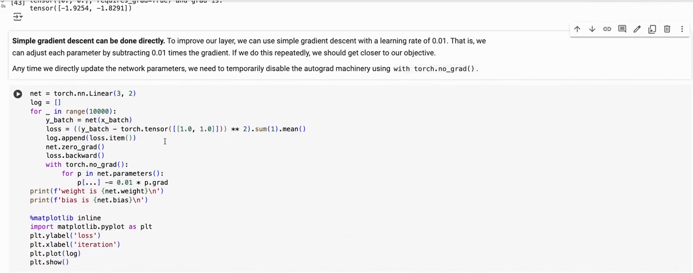
*▲ 강의 화면 [24:40](https://youtu.be/o5gPABcGZwc?t=1480): [학습률](00_%EB%94%A5%EB%9F%AC%EB%8B%9D_%EC%9A%A9%EC%96%B4%EC%82%AC%EC%A0%84.md#learning-rate-%ED%95%99%EC%8A%B5%EB%A5%A0) 0.01로 [파라미터](00_%EB%94%A5%EB%9F%AC%EB%8B%9D_%EC%9A%A9%EC%96%B4%EC%82%AC%EC%A0%84.md#parameter-%ED%8C%8C%EB%9D%BC%EB%AF%B8%ED%84%B0)를 직접 고치는 [학습](00_%EB%94%A5%EB%9F%AC%EB%8B%9D_%EC%9A%A9%EC%96%B4%EC%82%AC%EC%A0%84.md#training-%ED%95%99%EC%8A%B5) 루프. [파라미터](00_%EB%94%A5%EB%9F%AC%EB%8B%9D_%EC%9A%A9%EC%96%B4%EC%82%AC%EC%A0%84.md#parameter-%ED%8C%8C%EB%9D%BC%EB%AF%B8%ED%84%B0)를 고치는 동안은 `torch.no_grad()`로 기록을 끈다*

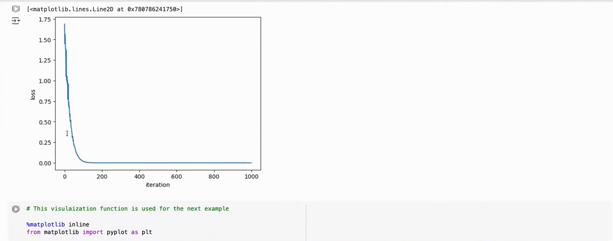
*▲ 강의 화면 [28:10](https://youtu.be/o5gPABcGZwc?t=1690): [학습](00_%EB%94%A5%EB%9F%AC%EB%8B%9D_%EC%9A%A9%EC%96%B4%EC%82%AC%EC%A0%84.md#training-%ED%95%99%EC%8A%B5) 중 [손실](00_%EB%94%A5%EB%9F%AC%EB%8B%9D_%EC%9A%A9%EC%96%B4%EC%82%AC%EC%A0%84.md#loss-function-%EC%86%90%EC%8B%A4-%ED%95%A8%EC%88%98) 곡선. 처음 약 150번 안에 거의 0까지 떨어진다*

```python
# [함수] import torch: PyTorch 라이브러리를 불러온다
import torch
# [함수] torch.manual_seed(0): 가중치 초기화를 재현하려고 시드를 고정한다
torch.manual_seed(0)
# [변수] net: 입력 3 → 출력 2 선형층
net = torch.nn.Linear(3, 2)
# [변수] x_batch: 9.1절과 같은 4×3 입력 배치 (단위 벡터 셋과 0 벡터)
x_batch = torch.tensor([[1.0, 0.0, 0.0], [0.0, 1.0, 0.0], [0.0, 0.0, 1.0], [0.0, 0.0, 0.0]])
# [변수] target: 언제나 내고 싶은 출력 (1, 1). 1×2라 배치의 모든 행에 똑같이 빼진다
target = torch.tensor([[1.0, 1.0]])
# [변수] log: 반복마다의 손실 기록
log = []
# [함수] for step in range(10000): 강의 노트북처럼 10000번 갱신한다 (CPU에서 몇 초)
for step in range(10000):
    # [변수] y_batch: 지금 층의 출력 (4×2)
    y_batch = net(x_batch)
    # [함수] ((y - target) ** 2).sum(1).mean(): 입력마다 두 출력의 제곱 오차를 더하고(sum(1)), 4개 입력에 대해 평균(mean)
    # [변수] loss: 9.2절 식의 L
    loss = ((y_batch - target) ** 2).sum(1).mean()
    # [함수] log.append(loss.item()): 손실을 숫자로 저장
    log.append(loss.item())
    # [함수] net.zero_grad(): 층의 모든 파라미터 .grad를 비운다
    net.zero_grad()
    # [함수] loss.backward(): weight.grad와 bias.grad를 채운다
    loss.backward()
    # [함수] with torch.no_grad(): 파라미터를 손으로 고치는 동안 기록을 끈다
    with torch.no_grad():
        # [함수] for p in net.parameters(): weight와 bias를 차례로
        for p in net.parameters():
            # [함수] p -= 0.01 * p.grad: 학습률 0.01 경사하강 한 걸음 (제자리에서 바꾼다)
            # [연결] Lec01 5.1 경사하강법 식
            p -= 0.01 * p.grad
# [연결] 출력 1행: 0, 100, 1000, 9999번째 손실
print([round(log[i], 4) for i in (0, 100, 1000, 9999)])
# [함수] .round(decimals=4): 넷째 자리 반올림. + 0.0은 -0.0을 0.0으로 바꿔 깔끔하게 보이게 한다
# [연결] 출력 2~4행: 가중치는 0, 편향은 1로 → 무엇이 들어와도 (1, 1)
print(net.weight.detach().round(decimals=4) + 0.0)
# [연결] 마지막 출력: 편향
print(net.bias.detach().round(decimals=4) + 0.0)
```

**실행 결과**:

```text
[1.6803, 0.0614, 0.0007, 0.0]
tensor([[0., 0., 0.],
        [0., 0., 0.]])
tensor([1., 1.])
```

---

## 10. Sequential로 MLP 만들기와 분류기 학습

### 10.1 Sequential로 층 쌓기

▶ 영상 [25:30](https://youtu.be/o5gPABcGZwc?t=1530)

📐 **수학 개념**: [합성함수와 비선형성](%EC%88%98%ED%95%99%EA%B0%9C%EB%85%90/05_%EC%8B%A0%EA%B2%BD%EB%A7%9D%EC%9D%98_%EA%B3%84%EC%82%B0/MM06_%ED%95%A9%EC%84%B1%ED%95%A8%EC%88%98%EC%99%80_%EB%B9%84%EC%84%A0%ED%98%95%EC%84%B1.md) · [ReLU](%EC%88%98%ED%95%99%EA%B0%9C%EB%85%90/05_%EC%8B%A0%EA%B2%BD%EB%A7%9D%EC%9D%98_%EA%B3%84%EC%82%B0/MM05_%ED%99%9C%EC%84%B1%ED%99%94_%ED%95%A8%EC%88%98%EC%9D%98_%EB%AF%B8%EB%B6%84.md)

- `torch.nn.Sequential`은 [층](00_%EB%94%A5%EB%9F%AC%EB%8B%9D_%EC%9A%A9%EC%96%B4%EC%82%AC%EC%A0%84.md#layer-%EC%B8%B5)을 순서대로 이어 앞 [층](00_%EB%94%A5%EB%9F%AC%EB%8B%9D_%EC%9A%A9%EC%96%B4%EC%82%AC%EC%A0%84.md#layer-%EC%B8%B5)의 출력을 다음 [층](00_%EB%94%A5%EB%9F%AC%EB%8B%9D_%EC%9A%A9%EC%96%B4%EC%82%AC%EC%A0%84.md#layer-%EC%B8%B5)의 입력으로 넘깁니다(Keras의 [Sequential](00_%EB%94%A5%EB%9F%AC%EB%8B%9D_%EC%9A%A9%EC%96%B4%EC%82%AC%EC%A0%84.md#sequential-%EC%88%9C%EC%B0%A8-%EB%AA%A8%EB%8D%B8)과 같은 생각).
- [선형층](00_%EB%94%A5%EB%9F%AC%EB%8B%9D_%EC%9A%A9%EC%96%B4%EC%82%AC%EC%A0%84.md#linear-layer-%EC%84%A0%ED%98%95%EC%B8%B5)만 이으면 결국 선형 함수 하나입니다. 사이에 [ReLU](00_%EB%94%A5%EB%9F%AC%EB%8B%9D_%EC%9A%A9%EC%96%B4%EC%82%AC%EC%A0%84.md#relu-%EB%A0%90%EB%A3%A8)(음수를 0으로 자르는 비선형 함수)를 넣으면 [다층 퍼셉트론(MLP)](00_%EB%94%A5%EB%9F%AC%EB%8B%9D_%EC%9A%A9%EC%96%B4%EC%82%AC%EC%A0%84.md#multi-layer-perceptron-%EB%8B%A4%EC%B8%B5-%ED%8D%BC%EC%85%89%ED%8A%B8%EB%A1%A0)이 되고, [조각별 선형 함수](00_%EB%94%A5%EB%9F%AC%EB%8B%9D_%EC%9A%A9%EC%96%B4%EC%82%AC%EC%A0%84.md#piecewise-linear-function-%EC%A1%B0%EA%B0%81%EB%B3%84-%EC%84%A0%ED%98%95-%ED%95%A8%EC%88%98)로 거의 어떤 함수든 근사할 수 있습니다([Lec03](Lec03_%EA%B7%BC%EC%82%AC_%EC%9D%B4%EB%A1%A0.md)).
- 노트북은 `OrderedDict`로 `layer1`, `layer2`, `layer3`에 이름을 붙이고, 각 [층](00_%EB%94%A5%EB%9F%AC%EB%8B%9D_%EC%9A%A9%EC%96%B4%EC%82%AC%EC%A0%84.md#layer-%EC%B8%B5)을 다시 `Sequential(Linear, ReLU)`로 만든 **중첩 [Sequential](00_%EB%94%A5%EB%9F%AC%EB%8B%9D_%EC%9A%A9%EC%96%B4%EC%82%AC%EC%A0%84.md#sequential-%EC%88%9C%EC%B0%A8-%EB%AA%A8%EB%8D%B8)**을 씁니다. 구조는 2 → 20 → 20 → 2, [파라미터](00_%EB%94%A5%EB%9F%AC%EB%8B%9D_%EC%9A%A9%EC%96%B4%EC%82%AC%EC%A0%84.md#parameter-%ED%8C%8C%EB%9D%BC%EB%AF%B8%ED%84%B0) 522개입니다.
- `named_modules()`는 `layer1.0`처럼 점으로 이어진 이름으로 모든 하위 모듈을, `named_parameters()`는 모든 [파라미터](00_%EB%94%A5%EB%9F%AC%EB%8B%9D_%EC%9A%A9%EC%96%B4%EC%82%AC%EC%A0%84.md#parameter-%ED%8C%8C%EB%9D%BC%EB%AF%B8%ED%84%B0)를 보여 줍니다.

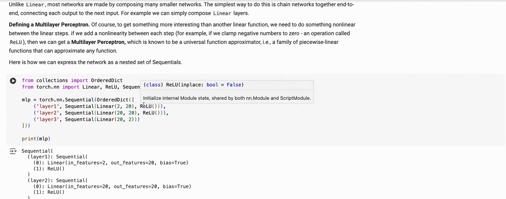
*▲ 강의 화면 [25:45](https://youtu.be/o5gPABcGZwc?t=1545): `OrderedDict`로 이름 붙인 중첩 [Sequential](00_%EB%94%A5%EB%9F%AC%EB%8B%9D_%EC%9A%A9%EC%96%B4%EC%82%AC%EC%A0%84.md#sequential-%EC%88%9C%EC%B0%A8-%EB%AA%A8%EB%8D%B8)과 그 출력*

### 10.2 사인 곡선 위아래 분류

▶ 영상 [26:04](https://youtu.be/o5gPABcGZwc?t=1564)

📐 **수학 개념**: [엔트로피와 교차 엔트로피](%EC%88%98%ED%95%99%EA%B0%9C%EB%85%90/04_%ED%99%95%EB%A5%A0%EA%B3%BC_%EC%A0%95%EB%B3%B4/M10_%EC%97%94%ED%8A%B8%EB%A1%9C%ED%94%BC.md) · [범주 분포](%EC%88%98%ED%95%99%EA%B0%9C%EB%85%90/04_%ED%99%95%EB%A5%A0%EA%B3%BC_%EC%A0%95%EB%B3%B4/MM35_L2_%ED%9A%8C%EA%B7%80%EC%99%80_%EB%B2%94%EC%A3%BC_%EB%B6%84%ED%8F%AC.md) · [Adam](%EC%88%98%ED%95%99%EA%B0%9C%EB%85%90/05_%EC%8B%A0%EA%B2%BD%EB%A7%9D%EC%9D%98_%EA%B3%84%EC%82%B0/MM83_Adam_%EC%97%85%EB%8D%B0%EC%9D%B4%ED%8A%B8_%EA%B7%9C%EC%B9%99.md)

- **문제**: -2~2 사각형 안의 점 (x, y)가 곡선 y = sin 3x **위면 1, 아래면 0**으로 분류합니다.
- 반복마다 무작위 점을 새로 뽑아 [미니배치](00_%EB%94%A5%EB%9F%AC%EB%8B%9D_%EC%9A%A9%EC%96%B4%EC%82%AC%EC%A0%84.md#mini-batch-%EB%AF%B8%EB%8B%88%EB%B0%B0%EC%B9%98)를 만들고, [정답](00_%EB%94%A5%EB%9F%AC%EB%8B%9D_%EC%9A%A9%EC%96%B4%EC%82%AC%EC%A0%84.md#label-%EC%A0%95%EB%8B%B5)을 계산하고, [교차 엔트로피(Cross-entropy)](00_%EB%94%A5%EB%9F%AC%EB%8B%9D_%EC%9A%A9%EC%96%B4%EC%82%AC%EC%A0%84.md#cross-entropy-%EA%B5%90%EC%B0%A8-%EC%97%94%ED%8A%B8%EB%A1%9C%ED%94%BC) [손실](00_%EB%94%A5%EB%9F%AC%EB%8B%9D_%EC%9A%A9%EC%96%B4%EC%82%AC%EC%A0%84.md#loss-function-%EC%86%90%EC%8B%A4-%ED%95%A8%EC%88%98)을 구합니다. [교차 엔트로피](00_%EB%94%A5%EB%9F%AC%EB%8B%9D_%EC%9A%A9%EC%96%B4%EC%82%AC%EC%A0%84.md#cross-entropy-%EA%B5%90%EC%B0%A8-%EC%97%94%ED%8A%B8%EB%A1%9C%ED%94%BC)는 [분류](00_%EB%94%A5%EB%9F%AC%EB%8B%9D_%EC%9A%A9%EC%96%B4%EC%82%AC%EC%A0%84.md#regression-classification-%ED%9A%8C%EA%B7%80%EC%99%80-%EB%B6%84%EB%A5%98)에 쓰는 [손실](00_%EB%94%A5%EB%9F%AC%EB%8B%9D_%EC%9A%A9%EC%96%B4%EC%82%AC%EC%A0%84.md#loss-function-%EC%86%90%EC%8B%A4-%ED%95%A8%EC%88%98)로, [정답](00_%EB%94%A5%EB%9F%AC%EB%8B%9D_%EC%9A%A9%EC%96%B4%EC%82%AC%EC%A0%84.md#label-%EC%A0%95%EB%8B%B5) 클래스에 낮은 [확률](00_%EB%94%A5%EB%9F%AC%EB%8B%9D_%EC%9A%A9%EC%96%B4%EC%82%AC%EC%A0%84.md#probability-%ED%99%95%EB%A5%A0)을 줄수록 커집니다. 이어서 `zero_grad` → `backward` → `optimizer.step()`([Adam](00_%EB%94%A5%EB%9F%AC%EB%8B%9D_%EC%9A%A9%EC%96%B4%EC%82%AC%EC%A0%84.md#adam-%EC%95%84%EB%8B%B4-%EC%98%B5%ED%8B%B0%EB%A7%88%EC%9D%B4%EC%A0%80))입니다.
- [정확도](00_%EB%94%A5%EB%9F%AC%EB%8B%9D_%EC%9A%A9%EC%96%B4%EC%82%AC%EC%A0%84.md#accuracy-%EC%A0%95%ED%99%95%EB%8F%84)는 [로짓](00_%EB%94%A5%EB%9F%AC%EB%8B%9D_%EC%9A%A9%EC%96%B4%EC%82%AC%EC%A0%84.md#logit-%EB%A1%9C%EC%A7%93)이 큰 쪽(`argmax`)을 예측으로 보고 맞힌 비율로 잽니다.
- 수업에서는 앞 셀을 실행하지 않아 이 셀이 돌지 않았습니다. 아래는 같은 구조를 CPU에서 끝까지 돌린 결과입니다(점 1000개 × 1024번, 약 10초). [정확도](00_%EB%94%A5%EB%9F%AC%EB%8B%9D_%EC%9A%A9%EC%96%B4%EC%82%AC%EC%A0%84.md#accuracy-%EC%A0%95%ED%99%95%EB%8F%84)가 0.438에서 0.991까지 오릅니다.

$$
\ell = -\ln \frac{e^{z_c}}{\sum_{k} e^{z_k}}
$$

<details><summary>기호 풀이</summary>

| 기호 | 읽는 법 | 뜻 | 예제 값 |
| --- | --- | --- | --- |
| $z_k$ | 제트 케이 | k번 클래스의 [로짓](00_%EB%94%A5%EB%9F%AC%EB%8B%9D_%EC%9A%A9%EC%96%B4%EC%82%AC%EC%A0%84.md#logit-%EB%A1%9C%EC%A7%93) (망의 출력, `out_batch`의 한 칸) | $z_0 = 0.2,\ z_1 = 1.0$ |
| $c$ | 씨 | [정답](00_%EB%94%A5%EB%9F%AC%EB%8B%9D_%EC%9A%A9%EC%96%B4%EC%82%AC%EC%A0%84.md#label-%EC%A0%95%EB%8B%B5) 클래스 번호 (`target_batch`) | 1 |
| $e^{z}$ | 이의 제트 제곱 | [지수](00_%EB%94%A5%EB%9F%AC%EB%8B%9D_%EC%9A%A9%EC%96%B4%EC%82%AC%EC%A0%84.md#e-exponent-e%EC%99%80-%EC%A7%80%EC%88%98) 함수. e = 2.71828... | $e^{1} = 2.7183$ |
| $\sum_{k}$ | 시그마 케이 | 모든 클래스에 대해 더함 | 2개 항 |
| $\frac{e^{z_c}}{\sum_k e^{z_k}}$ | | [소프트맥스](00_%EB%94%A5%EB%9F%AC%EB%8B%9D_%EC%9A%A9%EC%96%B4%EC%82%AC%EC%A0%84.md#softmax-%EC%86%8C%ED%94%84%ED%8A%B8%EB%A7%A5%EC%8A%A4)가 [정답](00_%EB%94%A5%EB%9F%AC%EB%8B%9D_%EC%9A%A9%EC%96%B4%EC%82%AC%EC%A0%84.md#label-%EC%A0%95%EB%8B%B5) 클래스에 준 [확률](00_%EB%94%A5%EB%9F%AC%EB%8B%9D_%EC%9A%A9%EC%96%B4%EC%82%AC%EC%A0%84.md#probability-%ED%99%95%EB%A5%A0) | 0.69 |
| $\ln$ | 자연로그 | e를 몇 제곱하면 그 수가 되는가 | ln 0.69 = -0.3711 |
| $\ell$ | 엘 | 점 하나의 [교차 엔트로피](00_%EB%94%A5%EB%9F%AC%EB%8B%9D_%EC%9A%A9%EC%96%B4%EC%82%AC%EC%A0%84.md#cross-entropy-%EA%B5%90%EC%B0%A8-%EC%97%94%ED%8A%B8%EB%A1%9C%ED%94%BC) (`cross_entropy`는 배치 평균) | 0.3711 |

</details>

<details><summary>예제와 풀이</summary>

**문제**: 점 하나에 대해 망이 [로짓](00_%EB%94%A5%EB%9F%AC%EB%8B%9D_%EC%9A%A9%EC%96%B4%EC%82%AC%EC%A0%84.md#logit-%EB%A1%9C%EC%A7%93) (0.2, 1.0)을 냈고 [정답](00_%EB%94%A5%EB%9F%AC%EB%8B%9D_%EC%9A%A9%EC%96%B4%EC%82%AC%EC%A0%84.md#label-%EC%A0%95%EB%8B%B5)은 클래스 1(곡선 위)이다. [교차 엔트로피](00_%EB%94%A5%EB%9F%AC%EB%8B%9D_%EC%9A%A9%EC%96%B4%EC%82%AC%EC%A0%84.md#cross-entropy-%EA%B5%90%EC%B0%A8-%EC%97%94%ED%8A%B8%EB%A1%9C%ED%94%BC) [손실](00_%EB%94%A5%EB%9F%AC%EB%8B%9D_%EC%9A%A9%EC%96%B4%EC%82%AC%EC%A0%84.md#loss-function-%EC%86%90%EC%8B%A4-%ED%95%A8%EC%88%98)은?

**주어진 값**:
- $z_0 = 0.2$ (클래스 0 "아래"의 [로짓](00_%EB%94%A5%EB%9F%AC%EB%8B%9D_%EC%9A%A9%EC%96%B4%EC%82%AC%EC%A0%84.md#logit-%EB%A1%9C%EC%A7%93))
- $z_1 = 1.0$ (클래스 1 "위"의 [로짓](00_%EB%94%A5%EB%9F%AC%EB%8B%9D_%EC%9A%A9%EC%96%B4%EC%82%AC%EC%A0%84.md#logit-%EB%A1%9C%EC%A7%93))
- $c = 1$ ([정답](00_%EB%94%A5%EB%9F%AC%EB%8B%9D_%EC%9A%A9%EC%96%B4%EC%82%AC%EC%A0%84.md#label-%EC%A0%95%EB%8B%B5) 클래스)

**풀이**
1. 식을 그대로 쓴다: $\ell = -\ln \frac{e^{z_c}}{\sum_{k} e^{z_k}}$
2. Σ를 k = 0, 1 두 항으로 펼쳐 값을 대입한다: $\ell = -\ln \frac{e^{1.0}}{e^{0.2} + e^{1.0}}$
3. [지수](00_%EB%94%A5%EB%9F%AC%EB%8B%9D_%EC%9A%A9%EC%96%B4%EC%82%AC%EC%A0%84.md#e-exponent-e%EC%99%80-%EC%A7%80%EC%88%98)를 계산한다. $e^{a}$는 약 2.71828을 a제곱한 값이고 계산기의 $e^x$ 키로 구한다: $e^{0.2} = 1.2214$, $e^{1.0} = 2.7183$ 이므로 $\ell = -\ln \frac{2.7183}{1.2214 + 2.7183}$
4. 분모를 더한다: 1.2214 + 2.7183 = 3.9397 이므로 $\ell = -\ln \frac{2.7183}{3.9397}$
5. 나눈다: 2.7183 ÷ 3.9397 = 0.69 ([정답](00_%EB%94%A5%EB%9F%AC%EB%8B%9D_%EC%9A%A9%EC%96%B4%EC%82%AC%EC%A0%84.md#label-%EC%A0%95%EB%8B%B5) 클래스의 [확률](00_%EB%94%A5%EB%9F%AC%EB%8B%9D_%EC%9A%A9%EC%96%B4%EC%82%AC%EC%A0%84.md#probability-%ED%99%95%EB%A5%A0)) 이므로 $\ell = -\ln 0.69$
6. 자연로그를 구한다. ln a는 "e를 몇 제곱하면 a가 되는가"이고 계산기의 ln 키로 구한다: ln 0.69 = -0.3711 이므로 $\ell = -(-0.3711)$
7. 부호를 뒤집는다: -(-0.3711) = 0.3711

**답**: ℓ = **0.3711** (`torch.nn.functional.cross_entropy`로 계산해도 0.3711)

</details>

<details><summary>내 이해</summary>


</details>

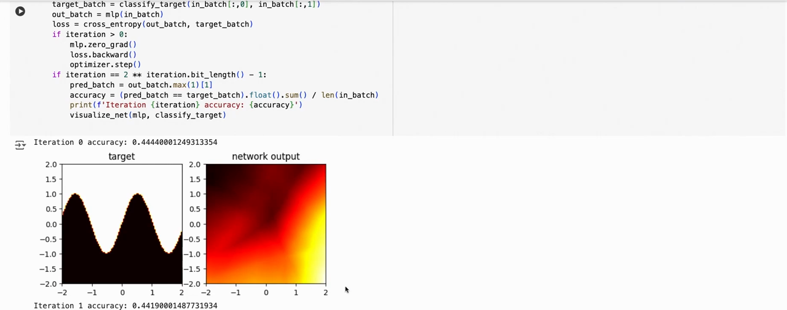
*▲ 강의 화면 [26:30](https://youtu.be/o5gPABcGZwc?t=1590): [학습](00_%EB%94%A5%EB%9F%AC%EB%8B%9D_%EC%9A%A9%EC%96%B4%EC%82%AC%EC%A0%84.md#training-%ED%95%99%EC%8A%B5) 루프와 반복 0의 결과. [정답](00_%EB%94%A5%EB%9F%AC%EB%8B%9D_%EC%9A%A9%EC%96%B4%EC%82%AC%EC%A0%84.md#label-%EC%A0%95%EB%8B%B5)(왼쪽)은 sin 곡선 위가 1이고, 아직 [학습](00_%EB%94%A5%EB%9F%AC%EB%8B%9D_%EC%9A%A9%EC%96%B4%EC%82%AC%EC%A0%84.md#training-%ED%95%99%EC%8A%B5) 전인 망의 출력(오른쪽)은 엉뚱하다([정확도](00_%EB%94%A5%EB%9F%AC%EB%8B%9D_%EC%9A%A9%EC%96%B4%EC%82%AC%EC%A0%84.md#accuracy-%EC%A0%95%ED%99%95%EB%8F%84) 0.444)*

```python
# [함수] import torch: PyTorch 라이브러리를 불러온다
import torch
# [함수] OrderedDict: 넣은 순서를 지키는 사전. 층에 이름을 붙일 때 쓴다
from collections import OrderedDict
# [함수] Linear, ReLU, Sequential: 선형층, ReLU 활성화, 층을 차례로 잇는 그릇
from torch.nn import Linear, ReLU, Sequential
# [함수] cross_entropy: 로짓과 정답 번호를 받아 교차 엔트로피 손실의 평균을 낸다 (소프트맥스 포함)
from torch.nn.functional import cross_entropy
# [함수] torch.manual_seed(0): 초기화와 입력 난수를 재현하려고 시드를 고정한다
torch.manual_seed(0)
# [함수] Sequential(OrderedDict([...])): 이름 붙인 층 세 개를 순서대로 잇는다. 앞의 두 층은 다시 Sequential(선형 + ReLU)
# [변수] mlp: 2 → 20 → 20 → 2 다층 퍼셉트론 (강의 노트북과 같은 구조)
# [연결] 10.1절
mlp = Sequential(OrderedDict([
    ("layer1", Sequential(Linear(2, 20), ReLU())),
    ("layer2", Sequential(Linear(20, 20), ReLU())),
    ("layer3", Sequential(Linear(20, 2))),
]))
# [함수] p.numel(): 파라미터 텐서의 칸 수. 모두 더하면 (2·20 + 20) + (20·20 + 20) + (20·2 + 2) = 522
# [연결] 출력 1행
print(sum(p.numel() for p in mlp.parameters()))
# [함수] mlp.named_modules(): 자기 자신을 포함한 모든 하위 모듈을 "layer1.0" 같은 이름과 함께 준다
# [연결] 출력 2행: 이름 9개
print([n for n, _ in mlp.named_modules()])
# [함수] def classify_target(x, y): 점 (x, y)가 곡선 y = sin 3x 위에 있으면 1, 아래면 0
def classify_target(x, y):
    # [함수] (y > (x * 3).sin()).long(): 참/거짓을 정수 1/0으로 바꾼다 (cross_entropy가 정수 정답을 원한다)
    return (y > (x * 3).sin()).long()
# [함수] torch.optim.Adam(mlp.parameters(), lr=0.01): 모든 파라미터를 Adam으로 고친다
# [변수] optimizer: Adam 옵티마이저
# [연결] MM83 Adam 업데이트
optimizer = torch.optim.Adam(mlp.parameters(), lr=0.01)
# [함수] for iteration in range(1024): 미니배치 1024번
for iteration in range(1024):
    # [함수] torch.rand(1000, 2) * 4 - 2: 0~1 난수를 -2~2로 늘린다
    # [변수] in_batch: 이번 반복의 점 1000개 (매번 새로 뽑으니 미니배치 SGD와 같다)
    in_batch = torch.rand(1000, 2) * 4 - 2
    # [변수] target_batch: 점마다의 정답 0/1
    target_batch = classify_target(in_batch[:, 0], in_batch[:, 1])
    # [변수] out_batch: 망의 출력 로짓 1000×2
    out_batch = mlp(in_batch)
    # [변수] loss: 교차 엔트로피 평균 (10.2절 식)
    loss = cross_entropy(out_batch, target_batch)
    # [함수] optimizer.zero_grad(): 지난 기울기를 비운다
    optimizer.zero_grad()
    # [함수] loss.backward(): 모든 층의 기울기를 채운다
    loss.backward()
    # [함수] optimizer.step(): Adam 한 걸음
    optimizer.step()
    # [함수] iteration == 2 ** k - 1 꼴(0, 1, 3, 7, ...)일 때만 출력한다 (강의 노트북 방식)
    if iteration == 2 ** iteration.bit_length() - 1:
        # [함수] out_batch.argmax(1): 로짓이 더 큰 쪽을 예측 클래스로 고른다
        # [변수] accuracy: 맞힌 비율
        accuracy = (out_batch.argmax(1) == target_batch).float().mean().item()
        # [연결] 출력 3~13행: 학습이 진행될수록 정확도가 오른다
        print(iteration, round(loss.item(), 4), round(accuracy, 4))
# [함수] torch.linspace(-2, 2, 201): 시험용 격자 한 변의 좌표 201개
g = torch.linspace(-2, 2, 201)
# [함수] torch.meshgrid(g, g, indexing="xy"): 201×201 격자의 x, y 좌표
gx, gy = torch.meshgrid(g, g, indexing="xy")
# [함수] torch.stack([...], dim=1): 격자 점 40401개를 (x, y) 행으로 묶는다
grid = torch.stack([gx.flatten(), gy.flatten()], dim=1)
# [함수] with torch.no_grad(): 평가에는 기울기 기록이 필요 없다 (7.3절)
with torch.no_grad():
    # [변수] test_acc: 격자 전체에서의 정확도
    test_acc = (mlp(grid).argmax(1) == classify_target(grid[:, 0], grid[:, 1])).float().mean().item()
# [연결] 마지막 출력: 학습에 쓰지 않은 격자 점에서도 정확도가 높다 (그림 Tut_fig_classifier와 같은 숫자)
print(round(test_acc, 4))
```

**실행 결과**:

```text
522
['', 'layer1', 'layer1.0', 'layer1.1', 'layer2', 'layer2.0', 'layer2.1', 'layer3', 'layer3.0']
0 0.7363 0.438
1 0.7038 0.492
3 0.6435 0.731
7 0.5086 0.867
15 0.3237 0.851
31 0.2776 0.875
63 0.1832 0.918
127 0.1091 0.968
255 0.0829 0.979
511 0.0518 0.984
1023 0.0264 0.991
0.9922
```

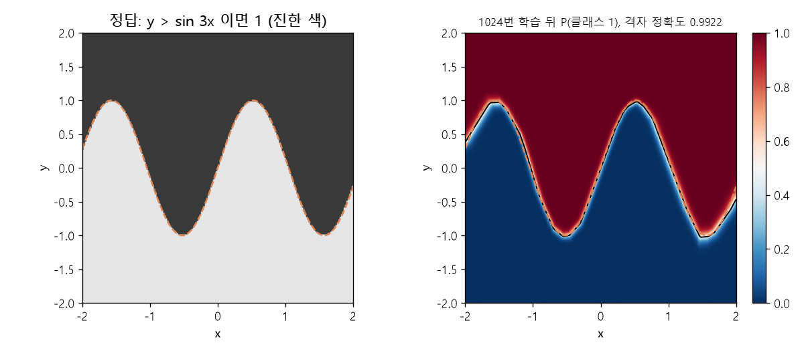
*▲ 직접 그린 그림: 위 코드로 1024번 학습한 뒤 격자 점마다의 P(클래스 1)(오른쪽)와 [정답](00_%EB%94%A5%EB%9F%AC%EB%8B%9D_%EC%9A%A9%EC%96%B4%EC%82%AC%EC%A0%84.md#label-%EC%A0%95%EB%8B%B5)(왼쪽). 검은 선([확률](00_%EB%94%A5%EB%9F%AC%EB%8B%9D_%EC%9A%A9%EC%96%B4%EC%82%AC%EC%A0%84.md#probability-%ED%99%95%EB%A5%A0) 0.5)이 주황 점선 y = sin 3x를 거의 따라간다. 격자 [정확도](00_%EB%94%A5%EB%9F%AC%EB%8B%9D_%EC%9A%A9%EC%96%B4%EC%82%AC%EC%A0%84.md#accuracy-%EC%A0%95%ED%99%95%EB%8F%84) 0.9922 (코드 마지막 출력과 같음)*

> [!TIP]
> **🆕 2026 업데이트: `torch.compile`**
> - **강의(2024년 가을)**: 다루지 않았다. 튜토리얼의 모든 코드는 한 줄씩 바로 실행되는 방식(eager 모드)이다.
> - **현재**: [PyTorch](00_%EB%94%A5%EB%9F%AC%EB%8B%9D_%EC%9A%A9%EC%96%B4%EC%82%AC%EC%A0%84.md#pytorch-%ED%8C%8C%EC%9D%B4%ED%86%A0%EC%B9%98) 2 계열의 `torch.compile(model)`은 모델을 그래프로 잡아 최적화된 커널로 바꿔 주는 한 줄짜리 가속 기능이다. 강의 뒤로도 계속 다듬어져, 2.6(2025년 1월)에는 [컴파일](00_%EB%94%A5%EB%9F%AC%EB%8B%9D_%EC%9A%A9%EC%96%B4%EC%82%AC%EC%A0%84.md#compile-%EC%BB%B4%ED%8C%8C%EC%9D%BC) 동작을 호출마다 바꾸는 `torch.compiler.set_stance`와 Python 3.13 지원이, 2.9(2025년 10월)에는 그래프가 끊기는 지점에서 오류를 낼지 이어 갈지를 구역마다 정하는 `torch._dynamo.error_on_graph_break()`가 들어왔다. 다만 기본 백엔드는 C++ 컴파일러가 필요해서, 이 노트를 실행한 Windows CPU 컴퓨터(MSVC 없음)에서는 "Compiler: cl is not found" 오류로 돌지 않았다. 그래서 코드는 싣지 않았다.
> - **출처**: [PyTorch 2.6 Release Blog (2025)](https://pytorch.org/blog/pytorch2-6/) · [PyTorch 2.9 Release Blog (2025)](https://pytorch.org/blog/pytorch-2-9/)

---

## 11. 용어 정리

용어사전에 있는 용어는 위 본문에 링크를 걸었습니다. 아래는 이 튜토리얼에서 새로 나온 용어입니다.

| 용어 | 뜻 |
|---|---|
| [파이토치(PyTorch)](00_%EB%94%A5%EB%9F%AC%EB%8B%9D_%EC%9A%A9%EC%96%B4%EC%82%AC%EC%A0%84.md#pytorch-%ED%8C%8C%EC%9D%B4%ED%86%A0%EC%B9%98) | [GPU](00_%EB%94%A5%EB%9F%AC%EB%8B%9D_%EC%9A%A9%EC%96%B4%EC%82%AC%EC%A0%84.md#device-gpu-%EC%9E%A5%EC%B9%98%EC%99%80-gpu) 연산과 [자동 미분](00_%EB%94%A5%EB%9F%AC%EB%8B%9D_%EC%9A%A9%EC%96%B4%EC%82%AC%EC%A0%84.md#autograd-%EC%9E%90%EB%8F%99-%EB%AF%B8%EB%B6%84)을 갖춘 파이썬 딥러닝 라이브러리. 이 수업의 과제가 쓴다 |
| [자료형(dtype)](00_%EB%94%A5%EB%9F%AC%EB%8B%9D_%EC%9A%A9%EC%96%B4%EC%82%AC%EC%A0%84.md#dtype-data-type-%EC%9E%90%EB%A3%8C%ED%98%95) | [텐서](00_%EB%94%A5%EB%9F%AC%EB%8B%9D_%EC%9A%A9%EC%96%B4%EC%82%AC%EC%A0%84.md#tensor-%ED%85%90%EC%84%9C) 칸에 담기는 숫자의 형식. 모델 입력은 보통 float32 |
| [장치(Device)](00_%EB%94%A5%EB%9F%AC%EB%8B%9D_%EC%9A%A9%EC%96%B4%EC%82%AC%EC%A0%84.md#device-gpu-%EC%9E%A5%EC%B9%98%EC%99%80-gpu) | [텐서](00_%EB%94%A5%EB%9F%AC%EB%8B%9D_%EC%9A%A9%EC%96%B4%EC%82%AC%EC%A0%84.md#tensor-%ED%85%90%EC%84%9C)가 놓인 곳(CPU, [GPU](00_%EB%94%A5%EB%9F%AC%EB%8B%9D_%EC%9A%A9%EC%96%B4%EC%82%AC%EC%A0%84.md#device-gpu-%EC%9E%A5%EC%B9%98%EC%99%80-gpu)). 같은 장치의 텐서끼리만 연산할 수 있다 |
| [모양 바꾸기와 축 순서 바꾸기(Reshape, Permute)](00_%EB%94%A5%EB%9F%AC%EB%8B%9D_%EC%9A%A9%EC%96%B4%EC%82%AC%EC%A0%84.md#reshape-permute-%EB%AA%A8%EC%96%91-%EB%B0%94%EA%BE%B8%EA%B8%B0%EC%99%80-%EC%B6%95-%EC%88%9C%EC%84%9C-%EB%B0%94%EA%BE%B8%EA%B8%B0) | `view`·`reshape`는 원소 순서를 두고 모양만, `permute`는 차원 순서를 바꾼다 |
| [이어 붙이기와 쌓기(Concatenate, Stack)](00_%EB%94%A5%EB%9F%AC%EB%8B%9D_%EC%9A%A9%EC%96%B4%EC%82%AC%EC%A0%84.md#concatenate-stack-%EC%9D%B4%EC%96%B4-%EB%B6%99%EC%9D%B4%EA%B8%B0%EC%99%80-%EC%8C%93%EA%B8%B0) | `cat`은 있는 차원을 따라 붙이고, `stack`은 새 차원을 만들어 쌓는다 |
| [축소 연산(Reduction)](00_%EB%94%A5%EB%9F%AC%EB%8B%9D_%EC%9A%A9%EC%96%B4%EC%82%AC%EC%A0%84.md#reduction-%EC%B6%95%EC%86%8C-%EC%97%B0%EC%82%B0) | `sum`·`mean`·`max`처럼 차원을 따라 값을 하나로 줄이는 연산 |
| [값 자르기(Clamp)](00_%EB%94%A5%EB%9F%AC%EB%8B%9D_%EC%9A%A9%EC%96%B4%EC%82%AC%EC%A0%84.md#clamp-%EA%B0%92-%EC%9E%90%EB%A5%B4%EA%B8%B0) | 값을 정한 범위 안으로 자르는 원소별 연산 |
| [기울기 누적(Gradient accumulation)](00_%EB%94%A5%EB%9F%AC%EB%8B%9D_%EC%9A%A9%EC%96%B4%EC%82%AC%EC%A0%84.md#gradient-accumulation-%EA%B8%B0%EC%9A%B8%EA%B8%B0-%EB%88%84%EC%A0%81) | `backward()`의 [기울기](00_%EB%94%A5%EB%9F%AC%EB%8B%9D_%EC%9A%A9%EC%96%B4%EC%82%AC%EC%A0%84.md#gradient-%EA%B8%B0%EC%9A%B8%EA%B8%B0)가 `.grad`에 더해지는 동작. 매 반복 `zero_grad()`로 비운다 |
| [기울기 기록 끄기(no_grad)](00_%EB%94%A5%EB%9F%AC%EB%8B%9D_%EC%9A%A9%EC%96%B4%EC%82%AC%EC%A0%84.md#no_grad-%EA%B8%B0%EC%9A%B8%EA%B8%B0-%EA%B8%B0%EB%A1%9D-%EB%81%84%EA%B8%B0) | [계산 그래프](00_%EB%94%A5%EB%9F%AC%EB%8B%9D_%EC%9A%A9%EC%96%B4%EC%82%AC%EC%A0%84.md#computational-graph-%EA%B3%84%EC%82%B0-%EA%B7%B8%EB%9E%98%ED%94%84)를 만들지 않는 구역. 평가와 [파라미터](00_%EB%94%A5%EB%9F%AC%EB%8B%9D_%EC%9A%A9%EC%96%B4%EC%82%AC%EC%A0%84.md#parameter-%ED%8C%8C%EB%9D%BC%EB%AF%B8%ED%84%B0) 직접 수정에 쓴다 |
| [신경망 모듈(nn.Module)](00_%EB%94%A5%EB%9F%AC%EB%8B%9D_%EC%9A%A9%EC%96%B4%EC%82%AC%EC%A0%84.md#nnmodule-%EC%8B%A0%EA%B2%BD%EB%A7%9D-%EB%AA%A8%EB%93%88) | [파라미터](00_%EB%94%A5%EB%9F%AC%EB%8B%9D_%EC%9A%A9%EC%96%B4%EC%82%AC%EC%A0%84.md#parameter-%ED%8C%8C%EB%9D%BC%EB%AF%B8%ED%84%B0)와 forward 계산을 묶은 [PyTorch](00_%EB%94%A5%EB%9F%AC%EB%8B%9D_%EC%9A%A9%EC%96%B4%EC%82%AC%EC%A0%84.md#pytorch-%ED%8C%8C%EC%9D%B4%ED%86%A0%EC%B9%98)의 [층](00_%EB%94%A5%EB%9F%AC%EB%8B%9D_%EC%9A%A9%EC%96%B4%EC%82%AC%EC%A0%84.md#layer-%EC%B8%B5)·모델 단위. `Linear`, `Sequential`이 그 예 |
| [상태 사전(state_dict)](00_%EB%94%A5%EB%9F%AC%EB%8B%9D_%EC%9A%A9%EC%96%B4%EC%82%AC%EC%A0%84.md#state_dict-%EC%83%81%ED%83%9C-%EC%82%AC%EC%A0%84) | [파라미터](00_%EB%94%A5%EB%9F%AC%EB%8B%9D_%EC%9A%A9%EC%96%B4%EC%82%AC%EC%A0%84.md#parameter-%ED%8C%8C%EB%9D%BC%EB%AF%B8%ED%84%B0) 이름 → [텐서](00_%EB%94%A5%EB%9F%AC%EB%8B%9D_%EC%9A%A9%EC%96%B4%EC%82%AC%EC%A0%84.md#tensor-%ED%85%90%EC%84%9C) 사전. 모델 저장·불러오기의 표준 형식 |
