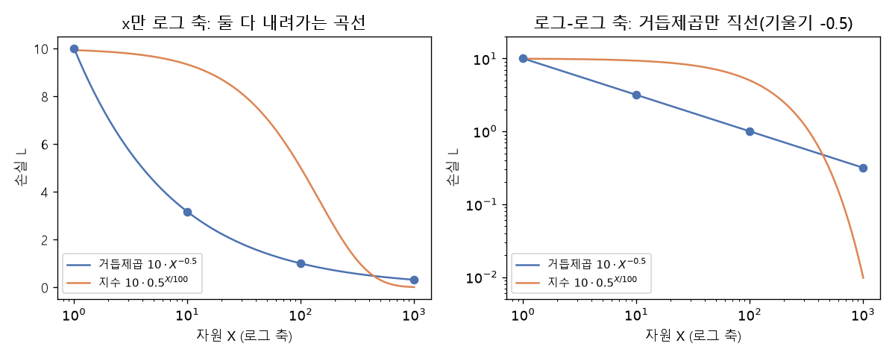

# 거듭제곱 법칙과 로그-로그 그래프 (Power law, Log-log plot)

[목차로 돌아가기](../../00_MIT%EB%94%A5%EB%9F%AC%EB%8B%9D_%EB%AA%A9%EC%B0%A8.md) · 먼저 볼 것: [M06_지수와_e](../../%EC%88%98%ED%95%99%EA%B0%9C%EB%85%90/01_%EC%88%98%EC%99%80_%ED%95%A8%EC%88%98/M06_%EC%A7%80%EC%88%98%EC%99%80_e.md), [M07_로그](../../%EC%88%98%ED%95%99%EA%B0%9C%EB%85%90/01_%EC%88%98%EC%99%80_%ED%95%A8%EC%88%98/M07_%EB%A1%9C%EA%B7%B8.md) · 쓰는 곳: [Lec20 4](../../Lec20_%EC%8A%A4%EC%BC%80%EC%9D%BC%EB%A7%81_%EB%B2%95%EC%B9%99.md#4-%EB%B0%9C%EA%B2%AC-1-%EA%B1%B0%EB%93%AD%EC%A0%9C%EA%B3%B1-%EB%B2%95%EC%B9%99), [Lec20 5](../../Lec20_%EC%8A%A4%EC%BC%80%EC%9D%BC%EB%A7%81_%EB%B2%95%EC%B9%99.md#5-%EB%B0%9C%EA%B2%AC-2-%EC%97%AC%EB%9F%AC-%EC%9A%94%EC%9D%B8%EC%97%90-%ED%95%A8%EA%BB%98-%EC%9D%98%EC%A1%B4%ED%95%9C%EB%8B%A4)

📚 학습 순서 7/99 (1. 수와 함수): ← 이전: [MM84_삼각함수와_단위원](../../%EC%88%98%ED%95%99%EA%B0%9C%EB%85%90/01_%EC%88%98%EC%99%80_%ED%95%A8%EC%88%98/MM84_%EC%82%BC%EA%B0%81%ED%95%A8%EC%88%98%EC%99%80_%EB%8B%A8%EC%9C%84%EC%9B%90.md) · 다음: [M03_미분_기울기](../../%EC%88%98%ED%95%99%EA%B0%9C%EB%85%90/02_%EB%AF%B8%EB%B6%84/M03_%EB%AF%B8%EB%B6%84_%EA%B8%B0%EC%9A%B8%EA%B8%B0.md) →

> [!NOTE]
> **3줄 요약**
> - **[거듭제곱 법칙](../../00_%EB%94%A5%EB%9F%AC%EB%8B%9D_%EC%9A%A9%EC%96%B4%EC%82%AC%EC%A0%84.md#power-law-%EA%B1%B0%EB%93%AD%EC%A0%9C%EA%B3%B1-%EB%B2%95%EC%B9%99)** $L = (X_c / X)^{\alpha}$: 자원 $X$를 $k$배 하면 [손실](../../00_%EB%94%A5%EB%9F%AC%EB%8B%9D_%EC%9A%A9%EC%96%B4%EC%82%AC%EC%A0%84.md#loss-function-%EC%86%90%EC%8B%A4-%ED%95%A8%EC%88%98)은 언제나 $k^{-\alpha}$배가 된다. Kaplan 등의 데이터 법칙($\alpha = 0.095$)에서 데이터를 2배 하면 [손실](../../00_%EB%94%A5%EB%9F%AC%EB%8B%9D_%EC%9A%A9%EC%96%B4%EC%82%AC%EC%A0%84.md#loss-function-%EC%86%90%EC%8B%A4-%ED%95%A8%EC%88%98)은 0.9363배, 10배 하면 0.8035배.
> - 양변에 [로그](../../00_%EB%94%A5%EB%9F%AC%EB%8B%9D_%EC%9A%A9%EC%96%B4%EC%82%AC%EC%A0%84.md#log-ln-%EB%A1%9C%EA%B7%B8)를 취하면 $\log L = \alpha \log X_c - \alpha \log X$, 곧 **[로그-로그 그래프](../../00_%EB%94%A5%EB%9F%AC%EB%8B%9D_%EC%9A%A9%EC%96%B4%EC%82%AC%EC%A0%84.md#log-log-plot-%EB%A1%9C%EA%B7%B8-%EB%A1%9C%EA%B7%B8-%EA%B7%B8%EB%9E%98%ED%94%84)에서 [기울기](../../00_%EB%94%A5%EB%9F%AC%EB%8B%9D_%EC%9A%A9%EC%96%B4%EC%82%AC%EC%A0%84.md#gradient-%EA%B8%B0%EC%9A%B8%EA%B8%B0) $-\alpha$인 직선**이다. 그래서 점들이 [로그](../../00_%EB%94%A5%EB%9F%AC%EB%8B%9D_%EC%9A%A9%EC%96%B4%EC%82%AC%EC%A0%84.md#log-ln-%EB%A1%9C%EA%B7%B8)-로그 축에서 일직선이면 [거듭제곱 법칙](../../00_%EB%94%A5%EB%9F%AC%EB%8B%9D_%EC%9A%A9%EC%96%B4%EC%82%AC%EC%A0%84.md#power-law-%EA%B1%B0%EB%93%AD%EC%A0%9C%EA%B3%B1-%EB%B2%95%EC%B9%99)이라고 본다.
> - 두 점 $(10^8, 3.5041)$, $(10^{10}, 2.2624)$만 있어도 [기울기](../../00_%EB%94%A5%EB%9F%AC%EB%8B%9D_%EC%9A%A9%EC%96%B4%EC%82%AC%EC%A0%84.md#gradient-%EA%B8%B0%EC%9A%B8%EA%B8%B0)로 $\alpha = 0.095$를 되찾는다. [지수](../../00_%EB%94%A5%EB%9F%AC%EB%8B%9D_%EC%9A%A9%EC%96%B4%EC%82%AC%EC%A0%84.md#e-exponent-e%EC%99%80-%EC%A7%80%EC%88%98)가 작으면 느리다: $\alpha = 0.076$이면 [손실](../../00_%EB%94%A5%EB%9F%AC%EB%8B%9D_%EC%9A%A9%EC%96%B4%EC%82%AC%EC%A0%84.md#loss-function-%EC%86%90%EC%8B%A4-%ED%95%A8%EC%88%98)을 절반으로 줄이는 데 자원이 9,139.5배 필요하다.

## 1. 개념 설명

비유: **복리 이자의 반대**를 떠올리자. 은행 이자는 "1년마다 몇 %"처럼 **시간이 일정하게 지날 때마다** 일정 배수로 늘어난다([지수](../../00_%EB%94%A5%EB%9F%AC%EB%8B%9D_%EC%9A%A9%EC%96%B4%EC%82%AC%EC%A0%84.md#e-exponent-e%EC%99%80-%EC%A7%80%EC%88%98) 함수). [거듭제곱 법칙](../../00_%EB%94%A5%EB%9F%AC%EB%8B%9D_%EC%9A%A9%EC%96%B4%EC%82%AC%EC%A0%84.md#power-law-%EA%B1%B0%EB%93%AD%EC%A0%9C%EA%B3%B1-%EB%B2%95%EC%B9%99)은 "**자원이 일정 배수로 늘 때마다**" [손실](../../00_%EB%94%A5%EB%9F%AC%EB%8B%9D_%EC%9A%A9%EC%96%B4%EC%82%AC%EC%A0%84.md#loss-function-%EC%86%90%EC%8B%A4-%ED%95%A8%EC%88%98)이 일정 배수로 준다. 자원이 1→2로 늘 때와 1,000→2,000으로 늘 때 [손실](../../00_%EB%94%A5%EB%9F%AC%EB%8B%9D_%EC%9A%A9%EC%96%B4%EC%82%AC%EC%A0%84.md#loss-function-%EC%86%90%EC%8B%A4-%ED%95%A8%EC%88%98)이 줄어드는 비율이 같다. 그래서 자원을 덧셈으로(1, 2, 3, ...) 늘리면 점점 효과가 줄어들고, 곱셈으로(1, 10, 100, ...) 늘려야 꾸준히 준다.

- **음수 [지수](../../00_%EB%94%A5%EB%9F%AC%EB%8B%9D_%EC%9A%A9%EC%96%B4%EC%82%AC%EC%A0%84.md#e-exponent-e%EC%99%80-%EC%A7%80%EC%88%98)와 소수 [지수](../../00_%EB%94%A5%EB%9F%AC%EB%8B%9D_%EC%9A%A9%EC%96%B4%EC%82%AC%EC%A0%84.md#e-exponent-e%EC%99%80-%EC%A7%80%EC%88%98)**: $X^{-\alpha} = 1 / X^{\alpha}$이다. $X^{0.5} = \sqrt{X}$이고, 일반적인 소수 [지수](../../00_%EB%94%A5%EB%9F%AC%EB%8B%9D_%EC%9A%A9%EC%96%B4%EC%82%AC%EC%A0%84.md#e-exponent-e%EC%99%80-%EC%A7%80%EC%88%98)는 $a^b = e^{b \ln a}$로 계산한다($e \approx 2.718$, $\ln$은 "e를 몇 번 곱해야 그 수가 되나", [M06_지수와_e](../../%EC%88%98%ED%95%99%EA%B0%9C%EB%85%90/01_%EC%88%98%EC%99%80_%ED%95%A8%EC%88%98/M06_%EC%A7%80%EC%88%98%EC%99%80_e.md), [M07_로그](../../%EC%88%98%ED%95%99%EA%B0%9C%EB%85%90/01_%EC%88%98%EC%99%80_%ED%95%A8%EC%88%98/M07_%EB%A1%9C%EA%B7%B8.md)).
- **[로그-로그 그래프](../../00_%EB%94%A5%EB%9F%AC%EB%8B%9D_%EC%9A%A9%EC%96%B4%EC%82%AC%EC%A0%84.md#log-log-plot-%EB%A1%9C%EA%B7%B8-%EB%A1%9C%EA%B7%B8-%EA%B7%B8%EB%9E%98%ED%94%84)**: 가로축과 세로축 모두 [로그](../../00_%EB%94%A5%EB%9F%AC%EB%8B%9D_%EC%9A%A9%EC%96%B4%EC%82%AC%EC%A0%84.md#log-ln-%EB%A1%9C%EA%B7%B8) 눈금이다. 눈금 한 칸이 "+1"이 아니라 "×10"이다. 이 축에서는 곱셈 관계가 덧셈 관계로 바뀌어, [거듭제곱 법칙](../../00_%EB%94%A5%EB%9F%AC%EB%8B%9D_%EC%9A%A9%EC%96%B4%EC%82%AC%EC%A0%84.md#power-law-%EA%B1%B0%EB%93%AD%EC%A0%9C%EA%B3%B1-%EB%B2%95%EC%B9%99)이 직선이 된다. 반대로 [지수](../../00_%EB%94%A5%EB%9F%AC%EB%8B%9D_%EC%9A%A9%EC%96%B4%EC%82%AC%EC%A0%84.md#e-exponent-e%EC%99%80-%EC%A7%80%EC%88%98) 감소 $L = c \cdot r^{X}$는 [로그](../../00_%EB%94%A5%EB%9F%AC%EB%8B%9D_%EC%9A%A9%EC%96%B4%EC%82%AC%EC%A0%84.md#log-ln-%EB%A1%9C%EA%B7%B8)-로그 축에서 아래로 꺾여 떨어지는 곡선이다(아래 그림).
- **$X_c$**: 직선의 위아래 위치를 정하는 상수다. 절편이 $\alpha \log X_c$다.


*▲ 직접 그린 그림: 거듭제곱 $10 \cdot X^{-0.5}$(파랑)와 [지수](../../00_%EB%94%A5%EB%9F%AC%EB%8B%9D_%EC%9A%A9%EC%96%B4%EC%82%AC%EC%A0%84.md#e-exponent-e%EC%99%80-%EC%A7%80%EC%88%98) $10 \cdot 0.5^{X/100}$(주황). 왼쪽은 가로축만 [로그](../../00_%EB%94%A5%EB%9F%AC%EB%8B%9D_%EC%9A%A9%EC%96%B4%EC%82%AC%EC%A0%84.md#log-ln-%EB%A1%9C%EA%B7%B8), 오른쪽은 두 축 모두 [로그](../../00_%EB%94%A5%EB%9F%AC%EB%8B%9D_%EC%9A%A9%EC%96%B4%EC%82%AC%EC%A0%84.md#log-ln-%EB%A1%9C%EA%B7%B8). [로그](../../00_%EB%94%A5%EB%9F%AC%EB%8B%9D_%EC%9A%A9%EC%96%B4%EC%82%AC%EC%A0%84.md#log-ln-%EB%A1%9C%EA%B7%B8)-로그 축에서 거듭제곱만 [기울기](../../00_%EB%94%A5%EB%9F%AC%EB%8B%9D_%EC%9A%A9%EC%96%B4%EC%82%AC%EC%A0%84.md#gradient-%EA%B8%B0%EC%9A%B8%EA%B8%B0) -0.5인 직선이다(점: X = 1, 10, 100, 1000에서 10, 3.1623, 1, 0.3162)*

## 2. 필요한 이유

[Lec20 4](../../Lec20_%EC%8A%A4%EC%BC%80%EC%9D%BC%EB%A7%81_%EB%B2%95%EC%B9%99.md#4-%EB%B0%9C%EA%B2%AC-1-%EA%B1%B0%EB%93%AD%EC%A0%9C%EA%B3%B1-%EB%B2%95%EC%B9%99)에서 Kaplan 등(2020)은 시험 [손실](../../00_%EB%94%A5%EB%9F%AC%EB%8B%9D_%EC%9A%A9%EC%96%B4%EC%82%AC%EC%A0%84.md#loss-function-%EC%86%90%EC%8B%A4-%ED%95%A8%EC%88%98)이 데이터, [파라미터](../../00_%EB%94%A5%EB%9F%AC%EB%8B%9D_%EC%9A%A9%EC%96%B4%EC%82%AC%EC%A0%84.md#parameter-%ED%8C%8C%EB%9D%BC%EB%AF%B8%ED%84%B0) 수, 계산량의 [거듭제곱 법칙](../../00_%EB%94%A5%EB%9F%AC%EB%8B%9D_%EC%9A%A9%EC%96%B4%EC%82%AC%EC%A0%84.md#power-law-%EA%B1%B0%EB%93%AD%EC%A0%9C%EA%B3%B1-%EB%B2%95%EC%B9%99)을 따른다는 것을 [로그-로그 그래프](../../00_%EB%94%A5%EB%9F%AC%EB%8B%9D_%EC%9A%A9%EC%96%B4%EC%82%AC%EC%A0%84.md#log-log-plot-%EB%A1%9C%EA%B7%B8-%EB%A1%9C%EA%B7%B8-%EA%B7%B8%EB%9E%98%ED%94%84)의 직선으로 보였다. 강사가 "[로그-로그 그래프](../../00_%EB%94%A5%EB%9F%AC%EB%8B%9D_%EC%9A%A9%EC%96%B4%EC%82%AC%EC%A0%84.md#log-log-plot-%EB%A1%9C%EA%B7%B8-%EB%A1%9C%EA%B7%B8-%EA%B7%B8%EB%9E%98%ED%94%84)에서 [거듭제곱 법칙](../../00_%EB%94%A5%EB%9F%AC%EB%8B%9D_%EC%9A%A9%EC%96%B4%EC%82%AC%EC%A0%84.md#power-law-%EA%B1%B0%EB%93%AD%EC%A0%9C%EA%B3%B1-%EB%B2%95%EC%B9%99)은 [기울기](../../00_%EB%94%A5%EB%9F%AC%EB%8B%9D_%EC%9A%A9%EC%96%B4%EC%82%AC%EC%A0%84.md#gradient-%EA%B8%B0%EC%9A%B8%EA%B8%B0)가 지수인 직선"이라고 말하는 이유, 그리고 "$X$를 두 배로 하면 [손실](../../00_%EB%94%A5%EB%9F%AC%EB%8B%9D_%EC%9A%A9%EC%96%B4%EC%82%AC%EC%A0%84.md#loss-function-%EC%86%90%EC%8B%A4-%ED%95%A8%EC%88%98)이 $2^{-\alpha}$배"가 어디서 나오는지를 숫자로 확인한다. 작은 실험의 직선을 연장해 큰 모델을 예측하는 [외삽](../../00_%EB%94%A5%EB%9F%AC%EB%8B%9D_%EC%9A%A9%EC%96%B4%EC%82%AC%EC%A0%84.md#extrapolation-%EC%99%B8%EC%82%BD)([Lec20 2.1](../../Lec20_%EC%8A%A4%EC%BC%80%EC%9D%BC%EB%A7%81_%EB%B2%95%EC%B9%99.md#21-gpt-4%EC%9D%98-%EC%98%88%EC%B8%A1-%EA%B3%A1%EC%84%A0))도 이 직선 위에서 하는 일이다.

## 3. 숫자로 보기

Kaplan 등의 데이터 법칙 $L(D) = (5.4 \times 10^{13} / D)^{0.095}$

| $D$ ([토큰](../../00_%EB%94%A5%EB%9F%AC%EB%8B%9D_%EC%9A%A9%EC%96%B4%EC%82%AC%EC%A0%84.md#token-%ED%86%A0%ED%81%B0)) | $10^8$ | $10^9$ | $10^{10}$ |
|---|---|---|---|
| $L$ | 3.5041 | 2.8156 | 2.2624 |
| $\log_{10} L$ | 0.5446 | 0.4496 | 0.3546 |
| $\log_{10} D$ | 8 | 9 | 10 |

- $\log_{10} D$가 1 늘 때마다 $\log_{10} L$은 0.095씩 준다: $0.5446 - 0.4496 = 0.095$, $0.4496 - 0.3546 = 0.095$. 일정하게 줄어드니 직선이다.
- [손실](../../00_%EB%94%A5%EB%9F%AC%EB%8B%9D_%EC%9A%A9%EC%96%B4%EC%82%AC%EC%A0%84.md#loss-function-%EC%86%90%EC%8B%A4-%ED%95%A8%EC%88%98) 자체로 보면 매번 같은 **배수**로 준다: $2.8156 / 3.5041 = 0.8035$, $2.2624 / 2.8156 = 0.8035$ ($= 10^{-0.095}$).
- 데이터를 두 배로 하면 $2^{-0.095} = 0.9363$배, 약 6.4% 준다.

[거듭제곱 법칙](../../00_%EB%94%A5%EB%9F%AC%EB%8B%9D_%EC%9A%A9%EC%96%B4%EC%82%AC%EC%A0%84.md#power-law-%EA%B1%B0%EB%93%AD%EC%A0%9C%EA%B3%B1-%EB%B2%95%EC%B9%99)의 꼴은 다음과 같다.

$$
L(X) = \left(\frac{X_c}{X}\right)^{\alpha}
$$

<details><summary>기호 풀이</summary>

| 기호 | 읽는 법 | 뜻 | 예제 값 |
| --- | --- | --- | --- |
| $X$ | 엑스 | 자원 (데이터, [파라미터](../../00_%EB%94%A5%EB%9F%AC%EB%8B%9D_%EC%9A%A9%EC%96%B4%EC%82%AC%EC%A0%84.md#parameter-%ED%8C%8C%EB%9D%BC%EB%AF%B8%ED%84%B0), 계산량) | 100, 200 |
| $X_c$ | 엑스 씨 | 맞춤 상수 (직선의 위아래 위치) | $10^4$ |
| $\alpha$ | 알파 | [지수](../../00_%EB%94%A5%EB%9F%AC%EB%8B%9D_%EC%9A%A9%EC%96%B4%EC%82%AC%EC%A0%84.md#e-exponent-e%EC%99%80-%EC%A7%80%EC%88%98) ([로그](../../00_%EB%94%A5%EB%9F%AC%EB%8B%9D_%EC%9A%A9%EC%96%B4%EC%82%AC%EC%A0%84.md#log-ln-%EB%A1%9C%EA%B7%B8)-로그 직선의 [기울기](../../00_%EB%94%A5%EB%9F%AC%EB%8B%9D_%EC%9A%A9%EC%96%B4%EC%82%AC%EC%A0%84.md#gradient-%EA%B8%B0%EC%9A%B8%EA%B8%B0) 크기) | 0.5 |
| $L(X)$ | 엘 | [손실](../../00_%EB%94%A5%EB%9F%AC%EB%8B%9D_%EC%9A%A9%EC%96%B4%EC%82%AC%EC%A0%84.md#loss-function-%EC%86%90%EC%8B%A4-%ED%95%A8%EC%88%98) | 10, 7.07107 |

</details>

<details><summary>예제와 풀이</summary>

**문제**: $X_c = 10^4$, $\alpha = 0.5$인 [거듭제곱 법칙](../../00_%EB%94%A5%EB%9F%AC%EB%8B%9D_%EC%9A%A9%EC%96%B4%EC%82%AC%EC%A0%84.md#power-law-%EA%B1%B0%EB%93%AD%EC%A0%9C%EA%B3%B1-%EB%B2%95%EC%B9%99)에서 자원이 100일 때와 200일 때 [손실](../../00_%EB%94%A5%EB%9F%AC%EB%8B%9D_%EC%9A%A9%EC%96%B4%EC%82%AC%EC%A0%84.md#loss-function-%EC%86%90%EC%8B%A4-%ED%95%A8%EC%88%98)은? 두 [손실](../../00_%EB%94%A5%EB%9F%AC%EB%8B%9D_%EC%9A%A9%EC%96%B4%EC%82%AC%EC%A0%84.md#loss-function-%EC%86%90%EC%8B%A4-%ED%95%A8%EC%88%98)의 비는?

**주어진 값**
- $X_c = 10^4 = 10{,}000$ (맞춤 상수)
- $\alpha = 0.5$ ([지수](../../00_%EB%94%A5%EB%9F%AC%EB%8B%9D_%EC%9A%A9%EC%96%B4%EC%82%AC%EC%A0%84.md#e-exponent-e%EC%99%80-%EC%A7%80%EC%88%98), 0.5제곱은 제곱근 $\sqrt{\ }$과 같다)
- $X = 100$, $X = 200$ (자원)

**풀이**
1. 식을 그대로 쓴다: $L(X) = \left(\dfrac{X_c}{X}\right)^{\alpha}$
2. 값을 대입한다($X = 100$): $L = \left(\dfrac{10{,}000}{100}\right)^{0.5}$
3. 나눈다: $10{,}000 / 100 = 100$ 이므로 $L = 100^{0.5}$
4. 0.5제곱은 제곱근이다($\sqrt{x}$는 제곱해서 $x$가 되는 양수): $\sqrt{100} = 10$
5. 값을 대입한다($X = 200$): $L = \left(\dfrac{10{,}000}{200}\right)^{0.5}$
6. 나눈다: $10{,}000 / 200 = 50$ 이므로 $L = \sqrt{50}$
7. 제곱근을 구한다: $\sqrt{50} = 7.07107$
8. 비를 구한다(나눈다): $7.07107 / 10 = 0.707107$

**답**: $L(100) = $ **10**, $L(200) = $ **7.0711**. 비 0.7071은 $2^{-0.5}$와 같다. 자원을 두 배로 하면 어디서 출발하든 [손실](../../00_%EB%94%A5%EB%9F%AC%EB%8B%9D_%EC%9A%A9%EC%96%B4%EC%82%AC%EC%A0%84.md#loss-function-%EC%86%90%EC%8B%A4-%ED%95%A8%EC%88%98)은 $2^{-\alpha}$배다.

</details>

<details><summary>내 이해</summary>


</details>

양변에 밑이 10인 [로그](../../00_%EB%94%A5%EB%9F%AC%EB%8B%9D_%EC%9A%A9%EC%96%B4%EC%82%AC%EC%A0%84.md#log-ln-%EB%A1%9C%EA%B7%B8)를 취하면 직선의 식이 된다.

$$
\log_{10} L = \underbrace{\alpha \log_{10} X_c}_{\text{절편}} \; - \; \alpha \log_{10} X
$$

<details><summary>기호 풀이</summary>

| 기호 | 읽는 법 | 뜻 | 예제 값 |
| --- | --- | --- | --- |
| $\log_{10}$ | [로그](../../00_%EB%94%A5%EB%9F%AC%EB%8B%9D_%EC%9A%A9%EC%96%B4%EC%82%AC%EC%A0%84.md#log-ln-%EB%A1%9C%EA%B7%B8) 십 | 10을 몇 번 곱해야 그 수가 되나 | $\log_{10} 10^9 = 9$ |
| $\log_{10} X$ | | [로그-로그 그래프](../../00_%EB%94%A5%EB%9F%AC%EB%8B%9D_%EC%9A%A9%EC%96%B4%EC%82%AC%EC%A0%84.md#log-log-plot-%EB%A1%9C%EA%B7%B8-%EB%A1%9C%EA%B7%B8-%EA%B7%B8%EB%9E%98%ED%94%84)의 가로 좌표 | 9 |
| $\log_{10} L$ | | [로그-로그 그래프](../../00_%EB%94%A5%EB%9F%AC%EB%8B%9D_%EC%9A%A9%EC%96%B4%EC%82%AC%EC%A0%84.md#log-log-plot-%EB%A1%9C%EA%B7%B8-%EB%A1%9C%EA%B7%B8-%EA%B7%B8%EB%9E%98%ED%94%84)의 세로 좌표 | 0.449577 |
| $-\alpha$ | 마이너스 알파 | 직선의 [기울기](../../00_%EB%94%A5%EB%9F%AC%EB%8B%9D_%EC%9A%A9%EC%96%B4%EC%82%AC%EC%A0%84.md#gradient-%EA%B8%B0%EC%9A%B8%EA%B8%B0) | -0.095 |
| $\alpha \log_{10} X_c$ | | 직선의 절편 ($\log_{10} X = 0$일 때 높이) | 1.30458 |
| $X_c$ | 엑스 씨 | 맞춤 상수 | $5.4 \times 10^{13}$ |

</details>

<details><summary>예제와 풀이</summary>

**문제**: Kaplan 등의 데이터 법칙($X_c = D_c = 5.4 \times 10^{13}$, $\alpha = 0.095$)에서 $D = 10^9$일 때 [로그-로그 그래프](../../00_%EB%94%A5%EB%9F%AC%EB%8B%9D_%EC%9A%A9%EC%96%B4%EC%82%AC%EC%A0%84.md#log-log-plot-%EB%A1%9C%EA%B7%B8-%EB%A1%9C%EA%B7%B8-%EA%B7%B8%EB%9E%98%ED%94%84)의 세로 좌표 $\log_{10} L$을 직선 식으로 구하고, [손실](../../00_%EB%94%A5%EB%9F%AC%EB%8B%9D_%EC%9A%A9%EC%96%B4%EC%82%AC%EC%A0%84.md#loss-function-%EC%86%90%EC%8B%A4-%ED%95%A8%EC%88%98) $L$로 되돌려라.

**주어진 값**
- $X_c = 5.4 \times 10^{13}$ (맞춤 상수)
- $\alpha = 0.095$ ([지수](../../00_%EB%94%A5%EB%9F%AC%EB%8B%9D_%EC%9A%A9%EC%96%B4%EC%82%AC%EC%A0%84.md#e-exponent-e%EC%99%80-%EC%A7%80%EC%88%98))
- $X = 10^9$ (데이터 크기)

**풀이**
1. 식을 그대로 쓴다: $\log_{10} L = \alpha \log_{10} X_c - \alpha \log_{10} X$
2. 값을 대입한다: $\log_{10} L = 0.095 \times \log_{10}(5.4 \times 10^{13}) - 0.095 \times \log_{10} 10^9$
3. [로그](../../00_%EB%94%A5%EB%9F%AC%EB%8B%9D_%EC%9A%A9%EC%96%B4%EC%82%AC%EC%A0%84.md#log-ln-%EB%A1%9C%EA%B7%B8)를 구한다($\log_{10}$은 10을 몇 번 곱하나, 계산기의 log): $\log_{10}(5.4 \times 10^{13}) = 13.7324$, $\log_{10} 10^9 = 9$
4. 첫 곱셈을 한다(절편): $0.095 \times 13.7324 = 1.30458$
5. 둘째 곱셈을 한다: $0.095 \times 9 = 0.855$ 이므로 $\log_{10} L = 1.30458 - 0.855$
6. 뺀다: $1.30458 - 0.855 = 0.449577$
7. [로그](../../00_%EB%94%A5%EB%9F%AC%EB%8B%9D_%EC%9A%A9%EC%96%B4%EC%82%AC%EC%A0%84.md#log-ln-%EB%A1%9C%EA%B7%B8)를 되돌린다(10의 거듭제곱): $L = 10^{0.449577} = 2.81564$

**답**: $\log_{10} L = $ **0.4496**, $L = $ **2.8156**. 거듭제곱 식으로 바로 계산한 값([Lec20 4.2](../../Lec20_%EC%8A%A4%EC%BC%80%EC%9D%BC%EB%A7%81_%EB%B2%95%EC%B9%99.md#42-%EB%8D%B0%EC%9D%B4%ED%84%B0-%ED%81%AC%EA%B8%B0%EC%97%90-%EB%8C%80%ED%95%9C-%EB%B2%95%EC%B9%99))과 같다.

</details>

<details><summary>내 이해</summary>


</details>

[로그-로그 그래프](../../00_%EB%94%A5%EB%9F%AC%EB%8B%9D_%EC%9A%A9%EC%96%B4%EC%82%AC%EC%A0%84.md#log-log-plot-%EB%A1%9C%EA%B7%B8-%EB%A1%9C%EA%B7%B8-%EA%B7%B8%EB%9E%98%ED%94%84)의 두 점에서 [지수](../../00_%EB%94%A5%EB%9F%AC%EB%8B%9D_%EC%9A%A9%EC%96%B4%EC%82%AC%EC%A0%84.md#e-exponent-e%EC%99%80-%EC%A7%80%EC%88%98)를 되찾는다.

$$
\alpha = -\,\frac{\log_{10} L_2 - \log_{10} L_1}{\log_{10} X_2 - \log_{10} X_1}
$$

<details><summary>기호 풀이</summary>

| 기호 | 읽는 법 | 뜻 | 예제 값 |
| --- | --- | --- | --- |
| $X_1$, $X_2$ | 엑스 일, 엑스 이 | 두 실험의 자원 | $10^8$, $10^{10}$ |
| $L_1$, $L_2$ | 엘 일, 엘 이 | 두 실험의 [손실](../../00_%EB%94%A5%EB%9F%AC%EB%8B%9D_%EC%9A%A9%EC%96%B4%EC%82%AC%EC%A0%84.md#loss-function-%EC%86%90%EC%8B%A4-%ED%95%A8%EC%88%98) | 3.50411, 2.26244 |
| 분자 | | 세로 변화량 | -0.19 |
| 분모 | | 가로 변화량 | 2 |
| $\alpha$ | 알파 | [기울기](../../00_%EB%94%A5%EB%9F%AC%EB%8B%9D_%EC%9A%A9%EC%96%B4%EC%82%AC%EC%A0%84.md#gradient-%EA%B8%B0%EC%9A%B8%EA%B8%B0)에 마이너스를 붙인 값 | 0.095 |

</details>

<details><summary>예제와 풀이</summary>

**문제**: [토큰](../../00_%EB%94%A5%EB%9F%AC%EB%8B%9D_%EC%9A%A9%EC%96%B4%EC%82%AC%EC%A0%84.md#token-%ED%86%A0%ED%81%B0) $10^8$개로 학습한 모델의 [손실](../../00_%EB%94%A5%EB%9F%AC%EB%8B%9D_%EC%9A%A9%EC%96%B4%EC%82%AC%EC%A0%84.md#loss-function-%EC%86%90%EC%8B%A4-%ED%95%A8%EC%88%98)이 3.50411, $10^{10}$개로 학습한 모델의 [손실](../../00_%EB%94%A5%EB%9F%AC%EB%8B%9D_%EC%9A%A9%EC%96%B4%EC%82%AC%EC%A0%84.md#loss-function-%EC%86%90%EC%8B%A4-%ED%95%A8%EC%88%98)이 2.26244였다. [거듭제곱 법칙](../../00_%EB%94%A5%EB%9F%AC%EB%8B%9D_%EC%9A%A9%EC%96%B4%EC%82%AC%EC%A0%84.md#power-law-%EA%B1%B0%EB%93%AD%EC%A0%9C%EA%B3%B1-%EB%B2%95%EC%B9%99)의 [지수](../../00_%EB%94%A5%EB%9F%AC%EB%8B%9D_%EC%9A%A9%EC%96%B4%EC%82%AC%EC%A0%84.md#e-exponent-e%EC%99%80-%EC%A7%80%EC%88%98) $\alpha$는?

**주어진 값**
- $X_1 = 10^8$, $L_1 = 3.50411$ (작은 실험)
- $X_2 = 10^{10}$, $L_2 = 2.26244$ (큰 실험)

**풀이**
1. 식을 그대로 쓴다: $\alpha = -\dfrac{\log_{10} L_2 - \log_{10} L_1}{\log_{10} X_2 - \log_{10} X_1}$
2. 값을 대입한다: $\alpha = -\dfrac{\log_{10} 2.26244 - \log_{10} 3.50411}{\log_{10} 10^{10} - \log_{10} 10^8}$
3. [손실](../../00_%EB%94%A5%EB%9F%AC%EB%8B%9D_%EC%9A%A9%EC%96%B4%EC%82%AC%EC%A0%84.md#loss-function-%EC%86%90%EC%8B%A4-%ED%95%A8%EC%88%98)의 [로그](../../00_%EB%94%A5%EB%9F%AC%EB%8B%9D_%EC%9A%A9%EC%96%B4%EC%82%AC%EC%A0%84.md#log-ln-%EB%A1%9C%EA%B7%B8)를 구한다: $\log_{10} 2.26244 = 0.354577$, $\log_{10} 3.50411 = 0.544577$
4. 자원의 [로그](../../00_%EB%94%A5%EB%9F%AC%EB%8B%9D_%EC%9A%A9%EC%96%B4%EC%82%AC%EC%A0%84.md#log-ln-%EB%A1%9C%EA%B7%B8)를 구한다: $\log_{10} 10^{10} = 10$, $\log_{10} 10^8 = 8$ 이므로 $\alpha = -\dfrac{0.354577 - 0.544577}{10 - 8}$
5. 분자를 뺀다: $0.354577 - 0.544577 = -0.19$
6. 분모를 뺀다: $10 - 8 = 2$ 이므로 $\alpha = -\dfrac{-0.19}{2}$
7. 나눈다: $-0.19 / 2 = -0.095$
8. 마이너스를 붙인다: $-(-0.095) = 0.095$

**답**: $\alpha = $ **0.095**. 실제로는 점이 여러 개라 최소제곱으로 직선을 맞춘다(아래 코드의 `np.polyfit`).

</details>

<details><summary>내 이해</summary>


</details>

## 4. 코드로 확인

```python
# [변수] Dc, a: Kaplan 등(2020)의 데이터 법칙 상수 5.4e13과 지수 0.095
Dc, a = 5.4e13, 0.095
# [변수] D: 데이터 크기 10^8, 10^9, 10^10 토큰 (3절 표의 세 열)
D = np.array([1e8, 1e9, 1e10])
# [함수] ** : 거듭제곱. 배열이면 원소마다 계산한다
# [변수] L: 거듭제곱 법칙으로 예측한 시험 손실
L = (Dc / D) ** a
# [연결] 3절 표의 L 행: 3.5041 2.8156 2.2624
print(L.round(4))
# [함수] np.log10: 밑이 10인 로그
# [연결] 3절 표의 log10 L 행과 직선의 절편 a * log10(Dc) = 1.3046
print(np.log10(L).round(4), round(a * np.log10(Dc), 4))
# [함수] np.polyfit(x, y, 1): 점들에 가장 잘 맞는 직선 y = 기울기 * x + 절편 (최소제곱)
# [변수] slope = -0.095, icpt = 1.3046: 로그-로그 직선의 기울기와 절편
# [쓸모] 실험 점들에서 지수를 추정할 때 이렇게 한다
slope, icpt = np.polyfit(np.log10(D), np.log10(L), 1)
# [연결] 3절 셋째 식: 기울기는 -alpha
print(round(slope, 4), round(icpt, 4))
# [연결] 3줄 요약: 2배면 0.9363배, 10배면 0.8035배, alpha = 0.076에서 손실을 절반으로 하려면 9139.5배
print(round(2 ** -a, 4), round(10 ** -a, 4), round(2 ** (1 / 0.076), 1))
```

**실행 결과**:

```text
[3.5041 2.8156 2.2624]
[0.5446 0.4496 0.3546] 1.3046
-0.095 1.3046
0.9363 0.8035 9139.5
```

> [!WARNING]
> **⚠ 주의**
> - [로그-로그 그래프](../../00_%EB%94%A5%EB%9F%AC%EB%8B%9D_%EC%9A%A9%EC%96%B4%EC%82%AC%EC%A0%84.md#log-log-plot-%EB%A1%9C%EA%B7%B8-%EB%A1%9C%EA%B7%B8-%EA%B7%B8%EB%9E%98%ED%94%84)에서 직선처럼 보이는 범위는 유한하다. [손실](../../00_%EB%94%A5%EB%9F%AC%EB%8B%9D_%EC%9A%A9%EC%96%B4%EC%82%AC%EC%A0%84.md#loss-function-%EC%86%90%EC%8B%A4-%ED%95%A8%EC%88%98)은 0 아래로 갈 수 없으므로 언젠가 바닥([줄일 수 없는 손실](../../00_%EB%94%A5%EB%9F%AC%EB%8B%9D_%EC%9A%A9%EC%96%B4%EC%82%AC%EC%A0%84.md#irreducible-loss-%EC%A4%84%EC%9D%BC-%EC%88%98-%EC%97%86%EB%8A%94-%EC%86%90%EC%8B%A4))에 닿아 휜다. 그래서 친칠라 같은 최근 식은 $L = E + A / N^{\alpha} + \dots$처럼 상수 $E$를 더한다.
> - 몇 자릿수에 걸친 점들이 일직선이어도, 측정한 범위 밖으로 멀리 외삽하면 틀릴 수 있다. Rosenfeld 등(2020)처럼 작은 규모에서 맞추고 따로 둔 큰 규모로 검증해야 한다([Lec20 6](../../Lec20_%EC%8A%A4%EC%BC%80%EC%9D%BC%EB%A7%81_%EB%B2%95%EC%B9%99.md#6-%EB%8B%A4%EB%A5%B8-%EB%B6%84%EC%95%BC%EC%9D%98-%EA%B1%B0%EB%93%AD%EC%A0%9C%EA%B3%B1-%EB%B2%95%EC%B9%99%EA%B3%BC-%EC%99%B8%EC%82%BD-%EA%B2%80%EC%A6%9D)).
> - [지수](../../00_%EB%94%A5%EB%9F%AC%EB%8B%9D_%EC%9A%A9%EC%96%B4%EC%82%AC%EC%A0%84.md#e-exponent-e%EC%99%80-%EC%A7%80%EC%88%98) $\alpha$는 [손실 함수](../../00_%EB%94%A5%EB%9F%AC%EB%8B%9D_%EC%9A%A9%EC%96%B4%EC%82%AC%EC%A0%84.md#loss-function-%EC%86%90%EC%8B%A4-%ED%95%A8%EC%88%98), 데이터, 구조에 따라 다르다. [교차 엔트로피](../../00_%EB%94%A5%EB%9F%AC%EB%8B%9D_%EC%9A%A9%EC%96%B4%EC%82%AC%EC%A0%84.md#cross-entropy-%EA%B5%90%EC%B0%A8-%EC%97%94%ED%8A%B8%EB%A1%9C%ED%94%BC)에서 얻은 $\alpha$를 다른 [손실](../../00_%EB%94%A5%EB%9F%AC%EB%8B%9D_%EC%9A%A9%EC%96%B4%EC%82%AC%EC%A0%84.md#loss-function-%EC%86%90%EC%8B%A4-%ED%95%A8%EC%88%98)이나 다른 모델에 그대로 쓰면 안 된다.
> - [로그](../../00_%EB%94%A5%EB%9F%AC%EB%8B%9D_%EC%9A%A9%EC%96%B4%EC%82%AC%EC%A0%84.md#log-ln-%EB%A1%9C%EA%B7%B8)의 밑은 상관없다. $\log_{10}$이든 $\ln$이든 [기울기](../../00_%EB%94%A5%EB%9F%AC%EB%8B%9D_%EC%9A%A9%EC%96%B4%EC%82%AC%EC%A0%84.md#gradient-%EA%B8%B0%EC%9A%B8%EA%B8%B0)는 같은 $-\alpha$다(절편만 바뀐다).

## 5. 개념 재확인

<details><summary>1. $\alpha = 0.095$일 때 데이터를 10배로 늘리면 손실은 몇 배가 되나?</summary>

| 단계 | 하는 일 | 계산 | 결과 |
|---|---|---|---|
| 1 | 배수의 식 | $10^{-\alpha}$ | |
| 2 | 자연로그 | $\ln 10$ | 2.302585 |
| 3 | [지수](../../00_%EB%94%A5%EB%9F%AC%EB%8B%9D_%EC%9A%A9%EC%96%B4%EC%82%AC%EC%A0%84.md#e-exponent-e%EC%99%80-%EC%A7%80%EC%88%98) 곱하기 | $-0.095 \times 2.302585$ | -0.218746 |
| 4 | $e$의 거듭제곱 | $e^{-0.218746}$ | 0.80353 |

**① 쓰는 식**
$$L \to k^{-\alpha} L, \qquad k^{-\alpha} = e^{-\alpha \ln k}$$
- 위 식 ← ② (자연로그), ③ ([지수](../../00_%EB%94%A5%EB%9F%AC%EB%8B%9D_%EC%9A%A9%EC%96%B4%EC%82%AC%EC%A0%84.md#e-exponent-e%EC%99%80-%EC%A7%80%EC%88%98) 곱하기), ④ ($e$의 거듭제곱)에서 쓴다.
```python
# [변수] a: 지수, k: 자원 배수
a, k = 0.095, 10                                   # ①
# [변수] lk = 2.302585: ln 10
lk = np.log(k)                                     # ②
# [변수] m = -0.218746: -a * ln k
m = -a * lk                                        # ③
# [연결] 2.302585 -0.218746 0.80353
print(round(lk, 6), round(m, 6), round(np.exp(m), 5))   # ④
```

**주어진 값**
- $\alpha = 0.095$ (데이터에 대한 [지수](../../00_%EB%94%A5%EB%9F%AC%EB%8B%9D_%EC%9A%A9%EC%96%B4%EC%82%AC%EC%A0%84.md#e-exponent-e%EC%99%80-%EC%A7%80%EC%88%98))
- $k = 10$ (데이터를 늘리는 배수)

**풀이**
1. 식을 그대로 쓴다: $k^{-\alpha} = e^{-\alpha \ln k}$
2. 값을 대입한다: $10^{-0.095} = e^{-0.095 \times \ln 10}$
3. (②) 자연로그를 구한다: $\ln 10 = 2.302585$ 이므로 $e^{-0.095 \times 2.302585}$
4. (③) 곱한다: $-0.095 \times 2.302585 = -0.218746$ 이므로 $e^{-0.218746}$
5. (④) $e$의 거듭제곱을 계산한다: $e^{-0.218746} = 0.80353$

**답**: [손실](../../00_%EB%94%A5%EB%9F%AC%EB%8B%9D_%EC%9A%A9%EC%96%B4%EC%82%AC%EC%A0%84.md#loss-function-%EC%86%90%EC%8B%A4-%ED%95%A8%EC%88%98)은 **0.8035배**(약 20% 감소). 3절 표에서 $2.8156 / 3.5041$로 본 값과 같다.

</details>

<details><summary>2. $\alpha_N = 0.076$이면 손실을 절반으로 줄이는 데 파라미터를 몇 배로 늘려야 하나?</summary>

| 단계 | 하는 일 | 계산 | 결과 |
|---|---|---|---|
| 1 | 조건 | $k^{-0.076} = 0.5$ → $k = 2^{1/0.076}$ | |
| 2 | [지수](../../00_%EB%94%A5%EB%9F%AC%EB%8B%9D_%EC%9A%A9%EC%96%B4%EC%82%AC%EC%A0%84.md#e-exponent-e%EC%99%80-%EC%A7%80%EC%88%98) 나누기 | $1 / 0.076$ | 13.1579 |
| 3 | 자연로그 곱하기 | $13.1579 \times \ln 2$ | 9.12036 |
| 4 | $e$의 거듭제곱 | $e^{9.12036}$ | 9139.5 |

**① 쓰는 식**
$$k^{-\alpha} = \frac{1}{2} \;\Longleftrightarrow\; k = 2^{1/\alpha} = e^{\ln 2 / \alpha}$$
- 위 식 ← ② ([지수](../../00_%EB%94%A5%EB%9F%AC%EB%8B%9D_%EC%9A%A9%EC%96%B4%EC%82%AC%EC%A0%84.md#e-exponent-e%EC%99%80-%EC%A7%80%EC%88%98) 나누기), ③ (자연로그 곱하기), ④ ($e$의 거듭제곱)에서 쓴다.
```python
# [변수] a: 파라미터에 대한 지수 (Kaplan 등)
a = 0.076                                          # ①
# [변수] inv = 13.1579: 1 / a
inv = 1 / a                                        # ②
# [변수] m = 9.12036: ln 2 / a
m = np.log(2) * inv                                # ③
# [연결] 13.1579 9.12036 9139.5
print(round(inv, 4), round(m, 5), round(np.exp(m), 1))  # ④
```

**주어진 값**
- $\alpha = 0.076$ ([파라미터](../../00_%EB%94%A5%EB%9F%AC%EB%8B%9D_%EC%9A%A9%EC%96%B4%EC%82%AC%EC%A0%84.md#parameter-%ED%8C%8C%EB%9D%BC%EB%AF%B8%ED%84%B0)에 대한 [지수](../../00_%EB%94%A5%EB%9F%AC%EB%8B%9D_%EC%9A%A9%EC%96%B4%EC%82%AC%EC%A0%84.md#e-exponent-e%EC%99%80-%EC%A7%80%EC%88%98))
- 목표 배수 $1/2$ ([손실](../../00_%EB%94%A5%EB%9F%AC%EB%8B%9D_%EC%9A%A9%EC%96%B4%EC%82%AC%EC%A0%84.md#loss-function-%EC%86%90%EC%8B%A4-%ED%95%A8%EC%88%98)을 절반으로)

**풀이**
1. 식을 그대로 쓴다: $k = 2^{1/\alpha} = e^{\ln 2 / \alpha}$
2. 값을 대입한다: $k = 2^{1/0.076}$
3. (②) [지수](../../00_%EB%94%A5%EB%9F%AC%EB%8B%9D_%EC%9A%A9%EC%96%B4%EC%82%AC%EC%A0%84.md#e-exponent-e%EC%99%80-%EC%A7%80%EC%88%98)를 나눈다: $1 / 0.076 = 13.1579$ 이므로 $k = 2^{13.1579}$
4. (③) 소수 [지수](../../00_%EB%94%A5%EB%9F%AC%EB%8B%9D_%EC%9A%A9%EC%96%B4%EC%82%AC%EC%A0%84.md#e-exponent-e%EC%99%80-%EC%A7%80%EC%88%98)는 $e^{b \ln a}$로 바꾼다. 자연로그를 곱한다: $13.1579 \times \ln 2 = 13.1579 \times 0.693147 = 9.12036$
5. (④) $e$의 거듭제곱을 계산한다: $e^{9.12036} = 9139.5$

**답**: 약 **9,139.5배**. 1억 [파라미터](../../00_%EB%94%A5%EB%9F%AC%EB%8B%9D_%EC%9A%A9%EC%96%B4%EC%82%AC%EC%A0%84.md#parameter-%ED%8C%8C%EB%9D%BC%EB%AF%B8%ED%84%B0) 모델의 [손실](../../00_%EB%94%A5%EB%9F%AC%EB%8B%9D_%EC%9A%A9%EC%96%B4%EC%82%AC%EC%A0%84.md#loss-function-%EC%86%90%EC%8B%A4-%ED%95%A8%EC%88%98)을 절반으로 하려면 약 9,000억 [파라미터](../../00_%EB%94%A5%EB%9F%AC%EB%8B%9D_%EC%9A%A9%EC%96%B4%EC%82%AC%EC%A0%84.md#parameter-%ED%8C%8C%EB%9D%BC%EB%AF%B8%ED%84%B0)가 필요하다. [지수](../../00_%EB%94%A5%EB%9F%AC%EB%8B%9D_%EC%9A%A9%EC%96%B4%EC%82%AC%EC%A0%84.md#e-exponent-e%EC%99%80-%EC%A7%80%EC%88%98)가 작으면 이렇게 느리다.

</details>

## 예제 풀기

[예제 10문제 풀기](../../%EC%98%88%EC%A0%9C/01_%EC%88%98%EC%99%80_%ED%95%A8%EC%88%98/%EC%98%88%EC%A0%9C_MM72_%EA%B1%B0%EB%93%AD%EC%A0%9C%EA%B3%B1_%EB%B2%95%EC%B9%99%EA%B3%BC_%EB%A1%9C%EA%B7%B8_%EB%A1%9C%EA%B7%B8_%EA%B7%B8%EB%9E%98%ED%94%84.md)

<details><summary>내 이해</summary>


</details>
