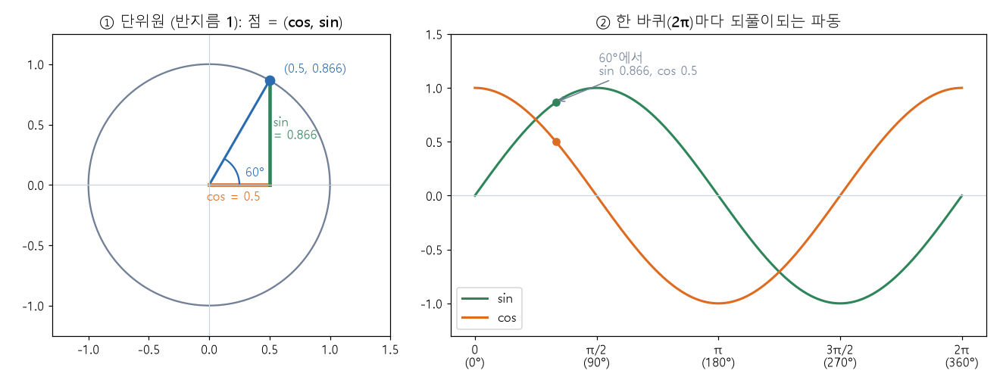

# 삼각함수와 단위원 (Trigonometric functions, unit circle)

[목차로 돌아가기](../../00_MIT%EB%94%A5%EB%9F%AC%EB%8B%9D_%EB%AA%A9%EC%B0%A8.md) · 먼저 볼 것: [M01_함수와_일차함수](../../%EC%88%98%ED%95%99%EA%B0%9C%EB%85%90/01_%EC%88%98%EC%99%80_%ED%95%A8%EC%88%98/M01_%ED%95%A8%EC%88%98%EC%99%80_%EC%9D%BC%EC%B0%A8%ED%95%A8%EC%88%98.md) · 쓰는 곳: [MM17_사인파_위치_인코딩](../../%EC%88%98%ED%95%99%EA%B0%9C%EB%85%90/07_%EA%B5%AC%EC%A1%B0_%EC%95%84%ED%82%A4%ED%85%8D%EC%B2%98/MM17_%EC%82%AC%EC%9D%B8%ED%8C%8C_%EC%9C%84%EC%B9%98_%EC%9D%B8%EC%BD%94%EB%94%A9.md), [MM07_리만_합과_보편_근사](../../%EC%88%98%ED%95%99%EA%B0%9C%EB%85%90/06_%EA%B7%BC%EC%82%AC_%EC%9D%B4%EB%A1%A0/MM07_%EB%A6%AC%EB%A7%8C_%ED%95%A9%EA%B3%BC_%EB%B3%B4%ED%8E%B8_%EA%B7%BC%EC%82%AC.md), [Lec08 7 위치 인코딩 (RoPE)](../../Lec08_%ED%8A%B8%EB%9E%9C%EC%8A%A4%ED%8F%AC%EB%A8%B8.md#7-%EC%9C%84%EC%B9%98-%EC%9D%B8%EC%BD%94%EB%94%A9)

📚 학습 순서 6/99 (1. 수와 함수): ← 이전: [M07_로그](../../%EC%88%98%ED%95%99%EA%B0%9C%EB%85%90/01_%EC%88%98%EC%99%80_%ED%95%A8%EC%88%98/M07_%EB%A1%9C%EA%B7%B8.md) · 다음: [MM72_거듭제곱_법칙과_로그_로그_그래프](../../%EC%88%98%ED%95%99%EA%B0%9C%EB%85%90/01_%EC%88%98%EC%99%80_%ED%95%A8%EC%88%98/MM72_%EA%B1%B0%EB%93%AD%EC%A0%9C%EA%B3%B1_%EB%B2%95%EC%B9%99%EA%B3%BC_%EB%A1%9C%EA%B7%B8_%EB%A1%9C%EA%B7%B8_%EA%B7%B8%EB%9E%98%ED%94%84.md) →

> [!NOTE]
> **3줄 요약**
> - 반지름 1인 원(단위원) 위에서 각도 $\theta$만큼 돌아간 점의 좌표가 $(\cos\theta,\ \sin\theta)$다. cos은 가로, sin은 세로이고, $\tan\theta = \sin\theta / \cos\theta$는 그 점을 잇는 직선의 [기울기](../../00_%EB%94%A5%EB%9F%AC%EB%8B%9D_%EC%9A%A9%EC%96%B4%EC%82%AC%EC%A0%84.md#gradient-%EA%B8%B0%EC%9A%B8%EA%B8%B0)다. 점이 반지름 1인 원 위에 있으니 늘 $\sin^2\theta + \cos^2\theta = 1$이다.
> - 각도는 **라디안**으로 잰다. 180° = π ≈ 3.1416 라디안이고 한 바퀴는 2π다. 한 바퀴 돌면 제자리라서 sin과 cos은 주기 2π로 되풀이한다.
> - 각도 더하기 공식 $\sin(a+b) = \sin a \cos b + \cos a \sin b$ 덕분에 "b만큼 더 돌기"는 늘 같은 곱셈이다. 그래서 [위치 인코딩](../../00_%EB%94%A5%EB%9F%AC%EB%8B%9D_%EC%9A%A9%EC%96%B4%EC%82%AC%EC%A0%84.md#positional-encoding-%EC%9C%84%EC%B9%98-%EC%9D%B8%EC%BD%94%EB%94%A9)의 사인파는 위치가 달라져도 규칙이 같고, [RoPE](../../00_%EB%94%A5%EB%9F%AC%EB%8B%9D_%EC%9A%A9%EC%96%B4%EC%82%AC%EC%A0%84.md#rope-rotary-position-embedding-%ED%9A%8C%EC%A0%84-%EC%9C%84%EC%B9%98-%EC%9E%84%EB%B2%A0%EB%94%A9)에서는 위치 (4, 2)와 (7, 5)처럼 **차이가 같은 두 위치의 [내적](../../00_%EB%94%A5%EB%9F%AC%EB%8B%9D_%EC%9A%A9%EC%96%B4%EC%82%AC%EC%A0%84.md#dot-product-%EB%82%B4%EC%A0%81)이 같다**(둘 다 0.5).

## 1. 개념 설명

비유: 반지름 1짜리 대관람차가 있다. 3시 방향(오른쪽 끝)에서 출발해 반시계 방향으로 $\theta$만큼 돌아간 칸이 있다. 그 칸이 바퀴 중심에서 **오른쪽으로 얼마**인지가 $\cos\theta$, **위로 얼마**인지가 $\sin\theta$다. 칸이 3시 방향에 있으면 (1, 0), 12시 방향에 있으면 (0, 1)이다.

- **sin, cos, tan**: 위 칸의 세로 높이, 가로 위치, 그리고 세로 ÷ 가로(원점에서 칸까지 직선의 [기울기](../../00_%EB%94%A5%EB%9F%AC%EB%8B%9D_%EC%9A%A9%EC%96%B4%EC%82%AC%EC%A0%84.md#gradient-%EA%B8%B0%EC%9A%B8%EA%B8%B0))다.
- **라디안**(radian): 각을 "반지름과 같은 길이의 호가 만드는 각 = 1"로 재는 단위다. 반지름 1인 원의 둘레는 $2\pi$이므로 한 바퀴가 $2\pi$ 라디안이다. 컴퓨터의 `sin`, `cos`은 도(°)가 아니라 **라디안**을 받는다.
- **주기**: 한 바퀴($2\pi$) 돌면 같은 자리라서 $\sin(\theta + 2\pi) = \sin\theta$이다.

$$
P(\theta) = (\cos\theta,\ \sin\theta), \qquad \tan\theta = \frac{\sin\theta}{\cos\theta}
$$

<details><summary>기호 풀이</summary>

| 기호 | 읽는 법 | 뜻 | 예제 값 |
| --- | --- | --- | --- |
| $P(\theta)$ | 피 세타 | 단위원에서 $\theta$만큼 돌아간 점 | (0.5, 0.8660) |
| $\theta$ | 세타 | 3시 방향에서 반시계로 돈 각도 | 60° |
| $\cos\theta$ | 코사인 세타 | 점의 가로 좌표 | 0.5 |
| $\sin\theta$ | 사인 세타 | 점의 세로 좌표 | 0.8660 |
| $\tan\theta$ | 탄젠트 세타 | 세로 ÷ 가로 (직선의 [기울기](../../00_%EB%94%A5%EB%9F%AC%EB%8B%9D_%EC%9A%A9%EC%96%B4%EC%82%AC%EC%A0%84.md#gradient-%EA%B8%B0%EC%9A%B8%EA%B8%B0)) | 1.7321 |

</details>

<details><summary>예제와 풀이</summary>

**문제**: 단위원에서 60° 돌아간 점의 좌표와 $\tan 60°$는? (60°에서 $\cos 60° = 0.5$, $\sin 60° = \frac{\sqrt{3}}{2}$이다. 정삼각형을 반으로 자른 삼각형에서 나오는 값이다. √3은 제곱하면 3이 되는 수로 약 1.7321이다.)

**주어진 값**:
- $\theta = 60°$ (돈 각도)
- $\cos 60° = 0.5$ (점의 가로 좌표)
- $\sin 60° = \frac{\sqrt{3}}{2}$ (점의 세로 좌표)

**풀이**
1. 식을 그대로 쓴다: $P(\theta) = (\cos\theta,\ \sin\theta)$, $\tan\theta = \frac{\sin\theta}{\cos\theta}$
2. 값을 대입한다: $P(60°) = \left(0.5,\ \frac{\sqrt{3}}{2}\right)$, $\tan 60° = \frac{\sqrt{3}/2}{0.5}$
3. √3의 값을 쓴다: √3 ≈ 1.7321 이므로 $P(60°) = \left(0.5,\ \frac{1.7321}{2}\right)$
4. 세로 좌표를 나눈다: 1.7321 ÷ 2 = 0.8660 이므로 $P(60°) = (0.5,\ 0.8660)$
5. tan을 나눗셈으로 쓴다 (소수 대신 √3 그대로): $\tan 60° = \frac{\sqrt{3}/2}{0.5}$
6. 0.5로 나누는 것은 2를 곱하는 것이다: $\frac{\sqrt{3}}{2} \times 2 = \sqrt{3} = 1.7321$

**답**: $P(60°) = (0.5,\ 0.8660)$, $\tan 60° = 1.7321$

</details>

<details><summary>내 이해</summary>


</details>

도(°)와 라디안은 길이의 cm와 inch 같은 단위 차이다. 바꾸는 식과, 반지름이 $r$인 원에서 각 $\theta$(라디안)가 만드는 호의 길이는 다음과 같다.

$$
\text{라디안} = \text{도} \times \frac{\pi}{180}, \qquad s = r\,\theta
$$

<details><summary>기호 풀이</summary>

| 기호 | 읽는 법 | 뜻 | 예제 값 |
| --- | --- | --- | --- |
| $\pi$ | 파이 | 원주율, 지름 1인 원의 둘레 (3.14159...) | 3.1416 |
| $\frac{\pi}{180}$ | 파이 나누기 백팔십 | 1도를 라디안으로 바꾸는 배율 | 0.017453 |
| $s$ | 에스 | 호의 길이 | 1.5708 |
| $r$ | 알 | 원의 반지름 (단위원이면 1) | 1 |
| $\theta$ | 세타 | 각도 (라디안) | 1.5708 |

</details>

<details><summary>예제와 풀이</summary>

**문제**: 90°를 라디안으로 바꾸고, 반지름 1인 단위원에서 그 각이 만드는 호의 길이를 구하라.

**주어진 값**:
- 도 $= 90$ (바꿀 각도)
- $\pi = 3.1416$ (원주율)
- $r = 1$ (단위원의 반지름)

**풀이**
1. 식을 그대로 쓴다: $\text{라디안} = \text{도} \times \frac{\pi}{180}$, $s = r\,\theta$
2. 값을 대입한다: $\text{라디안} = 90 \times \frac{3.1416}{180}$, $s = 1 \times \theta$
3. 분수를 먼저 계산한다: 90 ÷ 180 = 0.5 이므로 $\text{라디안} = 0.5 \times 3.1416$
4. 곱한다: 0.5 × 3.1416 = 1.5708 이므로 $\theta = 1.5708$
5. 호의 길이 식에 넣는다: $s = 1 \times 1.5708$
6. 곱한다: 1 × 1.5708 = 1.5708

**답**: 90° = 1.5708 라디안(= π/2), 호의 길이 $s = 1.5708$ (한 바퀴 둘레 6.2832의 4분의 1)

</details>

<details><summary>내 이해</summary>


</details>

점 $(\cos\theta, \sin\theta)$는 반지름 1인 원 위에 있으므로 원점에서의 거리가 1이다. 가로 $\cos\theta$, 세로 $\sin\theta$인 직각삼각형에 피타고라스 정리(밑변² + 높이² = 빗변²)를 쓰면 다음이 나온다.

$$
\sin^2\theta + \cos^2\theta = 1
$$

<details><summary>기호 풀이</summary>

| 기호 | 읽는 법 | 뜻 | 예제 값 |
| --- | --- | --- | --- |
| $\sin^2\theta$ | 사인 제곱 세타 | $(\sin\theta)^2$, sin 값을 제곱한 것 | 0.9216 |
| $\cos^2\theta$ | 코사인 제곱 세타 | $(\cos\theta)^2$, cos 값을 제곱한 것 | 0.0784 |
| $1$ | 일 | 단위원의 반지름 1을 제곱한 값 | 1 |

</details>

<details><summary>예제와 풀이</summary>

**문제**: 1사분면(오른쪽 위)의 각 $\theta$에서 $\cos\theta = 0.28$이다. $\sin\theta$는?

**주어진 값**:
- $\cos\theta = 0.28$ (점의 가로 좌표)
- 1사분면이라 $\sin\theta > 0$ (세로 좌표는 양수)

**풀이**
1. 식을 그대로 쓴다: $\sin^2\theta + \cos^2\theta = 1$
2. 값을 대입한다: $\sin^2\theta + 0.28^2 = 1$
3. 제곱한다: 0.28 × 0.28 = 0.0784 이므로 $\sin^2\theta + 0.0784 = 1$
4. 0.0784를 넘긴다: 1 − 0.0784 = 0.9216 이므로 $\sin^2\theta = 0.9216$
5. 제곱근을 구한다 (제곱해서 0.9216이 되는 양수): $\sqrt{0.9216} = 0.96$ 이므로 $\sin\theta = 0.96$

**답**: $\sin\theta = 0.96$ (확인: 0.96² + 0.28² = 0.9216 + 0.0784 = 1)

</details>

<details><summary>내 이해</summary>


</details>

## 2. 필요한 이유

[MM17_사인파_위치_인코딩](../../%EC%88%98%ED%95%99%EA%B0%9C%EB%85%90/07_%EA%B5%AC%EC%A1%B0_%EC%95%84%ED%82%A4%ED%85%8D%EC%B2%98/MM17_%EC%82%AC%EC%9D%B8%ED%8C%8C_%EC%9C%84%EC%B9%98_%EC%9D%B8%EC%BD%94%EB%94%A9.md)은 위치 $p$를 $\sin(\omega p)$, $\cos(\omega p)$ 묶음으로 바꾼다. 각 $\omega p$가 클수록 점이 단위원 위를 더 돈다. 위치가 한 칸 늘 때 점은 $\omega$만큼 돌고, 한 바퀴($2\pi$)를 도는 데 걸리는 위치 수가 주기 $T$다.

$$
\bigl(\sin(\omega p),\ \cos(\omega p)\bigr), \qquad T = \frac{2\pi}{\omega}
$$

<details><summary>기호 풀이</summary>

| 기호 | 읽는 법 | 뜻 | 예제 값 |
| --- | --- | --- | --- |
| $p$ | 피 | 위치 (몇 번째 칸인지) | 2 |
| $\omega$ | 오메가 | 위치가 한 칸 늘 때 도는 각 (라디안) | $\pi/4$ |
| $\omega p$ | 오메가 피 | 위치 $p$에서 도는 각의 합 | $\pi/2$ |
| $T$ | 티 | 한 바퀴 도는 데 걸리는 위치 수 (주기) | 8 |

</details>

<details><summary>예제와 풀이</summary>

**문제**: $\omega = \pi/4$(한 칸에 45°)일 때 주기 $T$와, 위치 $p = 2$, $p = 10$의 $(\sin, \cos)$ 묶음은?

**주어진 값**:
- $\omega = \pi/4$ (한 칸에 도는 각)
- $p = 2$, $p = 10$ (비교할 두 위치)

**풀이**
1. 식을 그대로 쓴다: $T = \frac{2\pi}{\omega}$, $\bigl(\sin(\omega p),\ \cos(\omega p)\bigr)$
2. 값을 대입한다: $T = \frac{2\pi}{\pi/4}$, $\bigl(\sin(\tfrac{\pi}{4} \times 2),\ \cos(\tfrac{\pi}{4} \times 2)\bigr)$
3. 주기를 계산한다 (분수로 나누기는 뒤집어 곱한다): $\frac{2\pi}{\pi/4} = 2\pi \times \frac{4}{\pi} = 8$ 이므로 $T = 8$
4. $p = 2$의 각을 구한다: $\frac{\pi}{4} \times 2 = \frac{\pi}{2}$ (90°)
5. $p = 2$의 값을 읽는다: 90°는 12시 방향이라 $(\sin, \cos) = (1,\ 0)$
6. $p = 10$의 각을 구한다: $\frac{\pi}{4} \times 10 = \frac{5\pi}{2}$
7. 한 바퀴를 뺀다: $\frac{5\pi}{2} - 2\pi = \frac{\pi}{2}$ 이므로 $p = 2$와 같은 자리다
8. $p = 10$의 값을 읽는다: $(\sin, \cos) = (1,\ 0)$

**답**: $T = 8$이고, $p = 2$와 $p = 10$은 둘 다 $(1, 0)$ (위치가 8 떨어지면 같은 값)

</details>

<details><summary>내 이해</summary>


</details>

[RoPE](../../00_%EB%94%A5%EB%9F%AC%EB%8B%9D_%EC%9A%A9%EC%96%B4%EC%82%AC%EC%A0%84.md#rope-rotary-position-embedding-%ED%9A%8C%EC%A0%84-%EC%9C%84%EC%B9%98-%EC%9E%84%EB%B2%A0%EB%94%A9)([Lec08 7](../../Lec08_%ED%8A%B8%EB%9E%9C%EC%8A%A4%ED%8F%AC%EB%A8%B8.md#7-%EC%9C%84%EC%B9%98-%EC%9D%B8%EC%BD%94%EB%94%A9))는 한 걸음 더 나간다. 위치가 하나 늘 때마다 벡터 한 쌍을 일정한 각도로 돌린다. 이때 "a만큼 돌린 뒤 b만큼 더 돌리기"를 계산하는 공식이 각도 더하기다.

$$
\sin(a+b) = \sin a\cos b + \cos a\sin b, \qquad \cos(a+b) = \cos a\cos b - \sin a\sin b
$$

<details><summary>기호 풀이</summary>

| 기호 | 읽는 법 | 뜻 | 예제 값 |
| --- | --- | --- | --- |
| $a$ | 에이 | 먼저 돈 각도 | 30° |
| $b$ | 비 | 이어서 더 돈 각도 | 60° |
| $a+b$ | 에이 플러스 비 | 합쳐서 돈 각도 | 90° |
| $\sin a\cos b$ | 사인 에이 코사인 비 | 두 값의 곱 | 0.25 |

</details>

<details><summary>예제와 풀이</summary>

**문제**: $a = 30°$, $b = 60°$일 때 공식으로 $\sin(a+b)$와 $\cos(a+b)$를 구하고 90°의 값과 맞는지 확인하라. ($\cos 30° = \sin 60° = \frac{\sqrt{3}}{2}$, $\sin 30° = \cos 60° = 0.5$)

**주어진 값**:
- $\sin 30° = 0.5$, $\cos 30° = \frac{\sqrt{3}}{2}$ (a의 값)
- $\sin 60° = \frac{\sqrt{3}}{2}$, $\cos 60° = 0.5$ (b의 값)

**풀이**
1. 식을 그대로 쓴다: $\sin(a+b) = \sin a\cos b + \cos a\sin b$
2. 값을 대입한다: $\sin 90° = 0.5 \times 0.5 + \frac{\sqrt{3}}{2} \times \frac{\sqrt{3}}{2}$
3. 첫 항을 곱한다: 0.5 × 0.5 = 0.25 이므로 $\sin 90° = 0.25 + \frac{\sqrt{3}}{2} \times \frac{\sqrt{3}}{2}$
4. 둘째 항을 곱한다 (√3 × √3 = 3, 2 × 2 = 4): $\frac{3}{4} = 0.75$ 이므로 $\sin 90° = 0.25 + 0.75$
5. 더한다: 0.25 + 0.75 = 1
6. cos 식을 그대로 쓰고 대입한다: $\cos 90° = \cos 30°\cos 60° - \sin 30°\sin 60° = \frac{\sqrt{3}}{2} \times 0.5 - 0.5 \times \frac{\sqrt{3}}{2}$
7. 두 항을 곱한다: $\frac{\sqrt{3}}{2} \times 0.5 = 0.4330$, $0.5 \times \frac{\sqrt{3}}{2} = 0.4330$ 이므로 $\cos 90° = 0.4330 - 0.4330$
8. 뺀다: 0.4330 − 0.4330 = 0

**답**: $\sin 90° = 1$, $\cos 90° = 0$ (12시 방향의 점 (0, 1)과 맞는다)

</details>

<details><summary>내 이해</summary>


</details>

위 공식에서 $b$ 대신 $-b$를 넣으면($\cos(-b) = \cos b$, $\sin(-b) = -\sin b$) $\cos(a - b) = \cos a\cos b + \sin a\sin b$가 나온다. 이 오른쪽 식이 단위원 위 두 점의 [내적](../../00_%EB%94%A5%EB%9F%AC%EB%8B%9D_%EC%9A%A9%EC%96%B4%EC%82%AC%EC%A0%84.md#dot-product-%EB%82%B4%EC%A0%81)과 똑같다. 그래서 두 위치의 각이 $a$, $b$인 [RoPE](../../00_%EB%94%A5%EB%9F%AC%EB%8B%9D_%EC%9A%A9%EC%96%B4%EC%82%AC%EC%A0%84.md#rope-rotary-position-embedding-%ED%9A%8C%EC%A0%84-%EC%9C%84%EC%B9%98-%EC%9E%84%EB%B2%A0%EB%94%A9) 벡터의 [내적](../../00_%EB%94%A5%EB%9F%AC%EB%8B%9D_%EC%9A%A9%EC%96%B4%EC%82%AC%EC%A0%84.md#dot-product-%EB%82%B4%EC%A0%81)에는 각 위치 자체가 아니라 **각도 차이**만 남는다.

$$
(\cos a,\ \sin a) \cdot (\cos b,\ \sin b) = \cos a\cos b + \sin a\sin b = \cos(a - b)
$$

<details><summary>기호 풀이</summary>

| 기호 | 읽는 법 | 뜻 | 예제 값 |
| --- | --- | --- | --- |
| $(\cos a,\ \sin a)$ | 코사인 에이, 사인 에이 | 위치 m에서 돌아간 단위 벡터 | (−0.5, 0.8660) |
| $(\cos b,\ \sin b)$ | 코사인 비, 사인 비 | 위치 n에서 돌아간 단위 벡터 | (0.5, 0.8660) |
| $\cdot$ | 점 | [내적](../../00_%EB%94%A5%EB%9F%AC%EB%8B%9D_%EC%9A%A9%EC%96%B4%EC%82%AC%EC%A0%84.md#dot-product-%EB%82%B4%EC%A0%81): 같은 자리끼리 곱해서 더한다 | 0.5 |
| $a - b$ | 에이 마이너스 비 | 두 위치의 각도 차이 | 60° |

</details>

<details><summary>예제와 풀이</summary>

**문제**: 위치가 하나 늘 때마다 30°씩 도는 단위 벡터가 있다. 위치 4($a = 120°$)와 위치 2($b = 60°$)의 벡터를 내적하고, $\cos(a - b)$와 맞는지 확인하라.

**주어진 값**:
- $a = 120°$ (위치 4: 30° × 4)
- $b = 60°$ (위치 2: 30° × 2)
- $(\cos 120°,\ \sin 120°) = (-0.5,\ 0.8660)$, $(\cos 60°,\ \sin 60°) = (0.5,\ 0.8660)$

**풀이**
1. 식을 그대로 쓴다: $(\cos a,\ \sin a) \cdot (\cos b,\ \sin b) = \cos a\cos b + \sin a\sin b$
2. 값을 대입한다: $(-0.5,\ 0.8660) \cdot (0.5,\ 0.8660) = (-0.5) \times 0.5 + 0.8660 \times 0.8660$
3. 첫 항을 곱한다: (−0.5) × 0.5 = −0.25 이므로 $-0.25 + 0.8660 \times 0.8660$
4. 둘째 항을 곱한다: 0.8660 × 0.8660 = 0.75 이므로 $-0.25 + 0.75$
5. 더한다: −0.25 + 0.75 = 0.5
6. 차이 쪽 식에 넣어 확인한다: $\cos(a - b) = \cos(120° - 60°) = \cos 60° = 0.5$

**답**: [내적](../../00_%EB%94%A5%EB%9F%AC%EB%8B%9D_%EC%9A%A9%EC%96%B4%EC%82%AC%EC%A0%84.md#dot-product-%EB%82%B4%EC%A0%81) = 0.5 = $\cos 60°$ (위치 4와 2의 차이 2칸 = 60°만 남는다)

</details>

<details><summary>내 이해</summary>


</details>

## 3. 숫자로 보기

자주 쓰는 각의 값이다. 반지름 1인 원이니 (cos, sin) 점의 거리는 모두 1이다.

| 도 | 라디안 | 점 (cos, sin) | tan |
|---|---|---|---|
| 0° | 0 | (1, 0) | 0 |
| 30° | 0.5236 (π/6) | (0.8660, 0.5) | 0.5774 |
| 45° | 0.7854 (π/4) | (0.7071, 0.7071) | 1 |
| 60° | 1.0472 (π/3) | (0.5, 0.8660) | 1.7321 |
| 90° | 1.5708 (π/2) | (0, 1) | 정의 안 됨 (0으로 나눔) |
| 180° | 3.1416 (π) | (−1, 0) | 0 |
| 270° | 4.7124 (3π/2) | (0, −1) | 정의 안 됨 |
| 360° | 6.2832 (2π) | (1, 0) | 0 |

- 90°에서 점이 (0, 1)이라 $\cos 90° = 0$이고, $\tan 90°$는 $1/0$이라 정의되지 않는다.
- sin의 모양: 0 → 1 → 0 → −1 → 0으로 한 바퀴 동안 오르내린다. [MM07_리만_합과_보편_근사](../../%EC%88%98%ED%95%99%EA%B0%9C%EB%85%90/06_%EA%B7%BC%EC%82%AC_%EC%9D%B4%EB%A1%A0/MM07_%EB%A6%AC%EB%A7%8C_%ED%95%A9%EA%B3%BC_%EB%B3%B4%ED%8E%B8_%EA%B7%BC%EC%82%AC.md)에서 사인 곡선을 계단으로 따라 그릴 때 이 모양을 쓴다.
- 주기: $\sin 750° = \sin(750° - 720°) = \sin 30° = 0.5$. 한 바퀴(360°)씩 몇 번이든 빼도 같다.

**[RoPE](../../00_%EB%94%A5%EB%9F%AC%EB%8B%9D_%EC%9A%A9%EC%96%B4%EC%82%AC%EC%A0%84.md#rope-rotary-position-embedding-%ED%9A%8C%EC%A0%84-%EC%9C%84%EC%B9%98-%EC%9E%84%EB%B2%A0%EB%94%A9): 위치마다 30°씩 돌리면** ($a = 30° \times m$, $b = 30° \times n$)

| (m, n) | 위치 차 $m-n$ | $a$ | $b$ | [내적](../../00_%EB%94%A5%EB%9F%AC%EB%8B%9D_%EC%9A%A9%EC%96%B4%EC%82%AC%EC%A0%84.md#dot-product-%EB%82%B4%EC%A0%81) $\cos a\cos b + \sin a\sin b$ |
|---|---|---|---|---|
| (4, 2) | 2 | 120° | 60° | 0.5 |
| (7, 5) | 2 | 210° | 150° | 0.5 |
| (6, 5) | 1 | 180° | 150° | 0.8660 |

- (4, 2)와 (7, 5)는 위치 번호가 다르지만 차이가 2로 같아서 [내적](../../00_%EB%94%A5%EB%9F%AC%EB%8B%9D_%EC%9A%A9%EC%96%B4%EC%82%AC%EC%A0%84.md#dot-product-%EB%82%B4%EC%A0%81)이 같다. 위치 차이만 한 번 cos 60°로 남는다.
- 차이가 1이면 cos 30° = 0.8660이다. 멀어질수록 [내적](../../00_%EB%94%A5%EB%9F%AC%EB%8B%9D_%EC%9A%A9%EC%96%B4%EC%82%AC%EC%A0%84.md#dot-product-%EB%82%B4%EC%A0%81)이 줄어드는 성질이 자연스럽게 생긴다(90° 차이에서 0).



<details><summary>기호 풀이</summary>

| 기호 | 읽는 법 | 뜻 | 예제 값 |
| --- | --- | --- | --- |
| $(\cos\theta, \sin\theta)$ | 코사인 세타, 사인 세타 | 단위원 위의 점 | (0.5, 0.8660) |
| $\theta$ | 세타 | 돈 각도 | 60° |
| $T = 2\pi$ | 티 이퐁 | 한 바퀴. sin, cos 그래프가 되풀이되는 길이 | 6.2832 |
| $a - b$ | 에이 마이너스 비 | 두 위치의 각 차이 | 60° |

</details>

## 4. 코드로 확인

```python
# [함수] import math: 파이썬 기본 수학 모듈. radians(도 → 라디안), cos, sin, tan이 들어 있다
# [쓸모] math의 삼각함수는 도(°)가 아니라 라디안을 받는다. 도 단위 각은 math.radians로 바꿔서 넣는다
import math
# [변수] for deg in [...]: 3절 표의 각도(도) 중 6개. 한 번에 하나씩 deg에 들어온다
# [연결] 출력 한 줄이 본문 3절 표의 한 행 (도, 라디안, cos, sin, sin²+cos²)
for deg in [0, 30, 45, 60, 90, 180]:
    # [함수] math.radians(deg): 도를 라디안으로 바꾼다. deg × π/180
    # [변수] t: 라디안 각. 90°이면 1.5708
    t = math.radians(deg)
    # [함수] math.cos(t), math.sin(t): 단위원 위의 점의 가로, 세로 좌표. round(값, 4)는 소수 넷째 자리 반올림
    # [쓸모] 마지막 칸은 sin² + cos²를 계산해 늘 1이 되는지 확인한다
    # [연결] 90°의 cos은 정확한 0이 아니라 6e-17이어서 round하면 0.0, 점 (0, 1)과 맞는다
    print(deg, round(t, 4), round(math.cos(t), 4), round(math.sin(t), 4), round(math.sin(t) ** 2 + math.cos(t) ** 2, 4))
# [함수] 리스트 안의 for(리스트 컴프리헨션): 각도마다 tan을 계산해 리스트로 모은다
# [쓸모] 90°는 tan이 정의되지 않아 뺐다
# [연결] 3절 표의 tan 칸 (0.5774, 1, 1.7321)
print([round(math.tan(math.radians(d)), 4) for d in (30, 45, 60)])
```

**실행 결과**:

```text
0 0.0 1.0 0.0 1.0
30 0.5236 0.866 0.5 1.0
45 0.7854 0.7071 0.7071 1.0
60 1.0472 0.5 0.866 1.0
90 1.5708 0.0 1.0 1.0
180 3.1416 -1.0 0.0 1.0
[0.5774, 1.0, 1.7321]
```

```python
# [함수] import math: 삼각함수와 radians를 쓰려고 불러온다
import math
# [변수] step = 30: 위치가 하나 늘 때마다 도는 각도(도). RoPE에서 위치당 돌리는 각에 해당한다
# [연결] 3절의 RoPE 표 (30°씩)
step = 30
# [함수] def dot_at(m, n): 위치 m과 n의 단위 벡터를 만들어 내적을 돌려주는 함수
# [쓸모] 위치 쌍마다 같은 계산을 되풀이하려고 함수로 묶었다
def dot_at(m, n):
    # [변수] a, b: 위치 m, n에서 돈 각도(라디안). 각 = step × 위치
    a, b = math.radians(step * m), math.radians(step * n)
    # [변수] q, k: (1, 0)을 a, b만큼 돌린 단위 벡터 (cos, sin)
    q = (math.cos(a), math.sin(a))
    k = (math.cos(b), math.sin(b))
    # [함수] 내적: 같은 자리끼리 곱해서 더한다
    # [연결] 본문 2절의 cos a cos b + sin a sin b = cos(a - b)
    return q[0] * k[0] + q[1] * k[1]
# [변수] 위치 쌍 세 개: (4, 2)와 (7, 5)는 차이가 2, (6, 5)는 차이가 1
# [연결] 출력 세 줄이 3절 RoPE 표의 (m, n, 내적) 세 행
for m, n in [(4, 2), (7, 5), (6, 5)]:
    print(m, n, round(dot_at(m, n), 4))
# [함수] sin(30°)와 sin(750°)를 비교한다. 750 = 30 + 2 × 360이라 한 바퀴를 두 번 더 돈 자리다
# [연결] 3절의 주기 설명, 두 값이 같다
print(round(math.sin(math.radians(30)), 4), round(math.sin(math.radians(750)), 4))
```

**실행 결과**:

```text
4 2 0.5
7 5 0.5
6 5 0.866
0.5 0.5
```

> [!WARNING]
> **⚠ 주의**
> - `math.sin(30)`은 30°가 아니라 **30 라디안**의 sin이다(−0.9880). 도 단위 각은 반드시 `math.radians`로 바꾼 뒤 넣는다.
> - $\sin^2\theta$는 $(\sin\theta)^2$이다. $\sin(\theta^2)$이나 $\sin(2\theta)$와 다르다.
> - $\tan 90°$처럼 cos이 0인 곳에서 tan은 정의되지 않는다(0으로 나눌 수 없다).
> - $\sin(a + b)$는 $\sin a + \sin b$가 **아니다**. 각도 더하기 공식의 네 항을 모두 써야 한다. 예: $\sin 90° = 1$이지만 $\sin 30° + \sin 60° = 1.3660$.

## 5. 개념 재확인

<details><summary>1. 각이 150°이다. 라디안과 (cos, sin), tan을 구하고 $\sin^2 + \cos^2 = 1$을 확인하라.</summary>

| 단계 | 하는 일 | 식 | 계산 | 결과 |
|---|---|---|---|---|
| 1 | 라디안으로 바꾼다 | $\text{도} \times \pi / 180$ | $150 \times 3.1416 / 180$ | 2.6180 |
| 2 | cos | 30°의 점을 세로축 기준으로 거울에 비춘 자리 | $-\cos 30°$ | −0.8660 |
| 3 | sin | 거울에 비춰도 높이는 같다 | $\sin 30°$ | 0.5 |
| 4 | tan | $\sin / \cos$ | $0.5 / (-0.8660)$ | −0.5774 |
| 5 | 확인 | $\sin^2 + \cos^2$ | $0.25 + 0.75$ | 1 |

**① 쓰는 식**
$$\text{라디안} = \text{도} \times \frac{\pi}{180}, \qquad \tan\theta = \frac{\sin\theta}{\cos\theta}, \qquad \sin^2\theta + \cos^2\theta = 1$$
- 위 식 ← 왼쪽 식은 ② (라디안), 가운데 식은 ⑤ (tan), 오른쪽 식은 ⑥ (확인)에서 쓴다. 150°는 왼쪽 위(2사분면)라서 cos은 음수, sin은 양수다.
```python
# [함수] import math: 삼각함수와 radians를 쓰려고 불러온다
import math
# [변수] deg = 150: 문제에서 준 각도(도)
deg = 150                                  # ①
# [함수] math.radians: 도를 라디안으로 바꾼다. 150 × π/180
# [변수] t = 2.6180: 라디안 각
t = math.radians(deg)                      # ②
# [변수] c: 점의 가로 좌표 cos t = -0.8660. 2사분면이라 음수다
c = math.cos(t)                            # ③
# [변수] s: 점의 세로 좌표 sin t = 0.5
s = math.sin(t)                            # ④
# [연결] 단계 ②③④ → 2.618 -0.866 0.5
print(round(t, 4), round(c, 4), round(s, 4))
# [연결] 단계 ⑤ tan = sin / cos → -0.5774
print(round(s / c, 4))                     # ⑤
# [쓸모] 단계 ⑥ sin² + cos²가 1인지 확인한다 → 1.0
print(round(s ** 2 + c ** 2, 4))           # ⑥
```

**② 라디안**
- 식을 그대로 쓴다: $\text{라디안} = \text{도} \times \frac{\pi}{180}$
- 값을 대입한다: $150 \times \frac{3.1416}{180}$
- 곱한다: 150 × 3.1416 = 471.24
- 나눈다: 471.24 ÷ 180 = 2.6180

**③ cos**
- 150°의 점은 30°의 점 (0.8660, 0.5)를 세로축 기준으로 뒤집은 자리다. 가로 부호만 바뀐다.
- $\cos 150° = -\cos 30° = -0.8660$

**④ sin**
- 세로 높이는 그대로다: $\sin 150° = \sin 30° = 0.5$

**⑤ tan**
- 식을 그대로 쓴다: $\tan\theta = \frac{\sin\theta}{\cos\theta}$
- 값을 대입한다: $\tan 150° = \frac{0.5}{-0.8660}$
- 나눈다: 0.5 ÷ (−0.8660) = −0.5774

**⑥ 확인**
- 식을 그대로 쓴다: $\sin^2\theta + \cos^2\theta = 1$
- 값을 대입한다: $0.5^2 + (-0.8660)^2$
- 각각 제곱한다: 0.5 × 0.5 = 0.25, (−0.8660) × (−0.8660) = 0.75 이므로 $0.25 + 0.75$
- 더한다: 0.25 + 0.75 = 1

**답**: 라디안 **2.6180**, (cos, sin) = **(−0.8660, 0.5)**, tan = **−0.5774**, $\sin^2 + \cos^2 = $ **1**

</details>

<details><summary>2. 각도 더하기 공식으로 $\sin 75°$를 구하라. (75° = 30° + 45°)</summary>

| 단계 | 하는 일 | 식 | 계산 | 결과 |
|---|---|---|---|---|
| 1 | 각을 쪼갠다 | $75° = a + b$ | $30° + 45°$ | a = 30°, b = 45° |
| 2 | a의 값 | $\sin 30°,\ \cos 30°$ | 표에서 읽는다 | 0.5, 0.86603 |
| 3 | b의 값 | $\sin 45° = \cos 45°$ | 표에서 읽는다 | 0.70711 |
| 4 | 첫 항 | $\sin a\cos b$ | $0.5 \times 0.70711$ | 0.35356 |
| 5 | 둘째 항 | $\cos a\sin b$ | $0.86603 \times 0.70711$ | 0.61238 |
| 6 | 더한다 | 첫 항 + 둘째 항 | $0.35356 + 0.61238$ | 0.96594 (≈ 0.9659) |

**① 쓰는 식**
$$\sin(a+b) = \sin a\cos b + \cos a\sin b$$
- 위 식 ← 첫째 항은 ④, 둘째 항은 ⑤에서 계산하고 ⑥에서 더한다. 맞는지는 `math.sin(75°)`와 비교해서 확인한다.
```python
# [함수] import math: sin, cos, radians를 쓰려고 불러온다
import math
# [변수] a, b: 75°를 쪼갠 두 각(도). 값은 math.radians로 라디안으로 바꿔 쓴다
a, b = math.radians(30), math.radians(45)  # ①
# [변수] sa, ca: a의 sin과 cos = 0.5, 0.86603
sa, ca = math.sin(a), math.cos(a)          # ②
# [변수] sb, cb: b의 sin과 cos. 45°라 둘 다 0.70711
sb, cb = math.sin(b), math.cos(b)          # ③
# [변수] first = sin a cos b: 첫 항 = 0.35356 (0.353555를 다섯째 자리로 반올림)
first = sa * cb                            # ④
# [변수] second = cos a sin b: 둘째 항 = 0.61238
second = ca * sb                           # ⑤
# [연결] 단계 ④⑤⑥ → 0.3536 0.6124 0.9659 (소수 넷째 자리 반올림)
print(round(first, 4), round(second, 4), round(first + second, 4))   # ⑥
# [쓸모] math.sin으로 75°를 바로 계산한 값과 비교한다 → 0.9659. 공식이 맞다
print(round(math.sin(math.radians(75)), 4))
```

**② a의 값**
- $\sin 30° = 0.5$, $\cos 30° = 0.86603$ (3절 표)

**③ b의 값**
- $\sin 45° = \cos 45° = 0.70711$ (정사각형 대각선, 3절 표의 0.7071)

**④ 첫 항**
- 식을 그대로 쓴다: $\sin a\cos b$
- 값을 대입한다: $\sin 30° \times \cos 45° = 0.5 \times 0.70711$
- 곱한다: 0.5 × 0.70711 = 0.35356 (0.353555를 다섯째 자리로 반올림)

**⑤ 둘째 항**
- 식을 그대로 쓴다: $\cos a\sin b$
- 값을 대입한다: $\cos 30° \times \sin 45° = 0.86603 \times 0.70711$
- 곱한다: 0.86603 × 0.70711 = 0.61238

**⑥ 더하기**
- 식을 그대로 쓴다: $\sin(a+b) = \sin a\cos b + \cos a\sin b$
- 값을 대입한다: $\sin 75° = 0.35356 + 0.61238$
- 더한다: 0.35356 + 0.61238 = 0.96594 (반올림하면 0.9659)

**답**: $\sin 75° \approx$ **0.9659** (`math.sin`으로 구한 값과 같다)

</details>

## 예제 풀기

[예제 10문제 풀기](../../%EC%98%88%EC%A0%9C/01_%EC%88%98%EC%99%80_%ED%95%A8%EC%88%98/%EC%98%88%EC%A0%9C_MM84_%EC%82%BC%EA%B0%81%ED%95%A8%EC%88%98%EC%99%80_%EB%8B%A8%EC%9C%84%EC%9B%90.md)

<details><summary>내 이해</summary>


</details>
