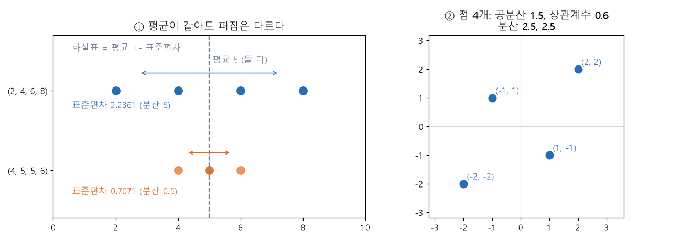

# 분산과 표준편차와 공분산 (Variance, standard deviation, covariance)

[목차로 돌아가기](../../00_MIT%EB%94%A5%EB%9F%AC%EB%8B%9D_%EB%AA%A9%EC%B0%A8.md) · 먼저 볼 것: [M02_시그마와_평균](../../%EC%88%98%ED%95%99%EA%B0%9C%EB%85%90/01_%EC%88%98%EC%99%80_%ED%95%A8%EC%88%98/M02_%EC%8B%9C%EA%B7%B8%EB%A7%88%EC%99%80_%ED%8F%89%EA%B7%A0.md) · 쓰는 곳: [MM33_표준화와_최소최대_정규화](../../%EC%88%98%ED%95%99%EA%B0%9C%EB%85%90/05_%EC%8B%A0%EA%B2%BD%EB%A7%9D%EC%9D%98_%EA%B3%84%EC%82%B0/MM33_%ED%91%9C%EC%A4%80%ED%99%94%EC%99%80_%EC%B5%9C%EC%86%8C%EC%B5%9C%EB%8C%80_%EC%A0%95%EA%B7%9C%ED%99%94.md), [MM40_PCA와_선형_오토인코더](../../%EC%88%98%ED%95%99%EA%B0%9C%EB%85%90/10_%ED%91%9C%ED%98%84_%ED%95%99%EC%8A%B5/MM40_PCA%EC%99%80_%EC%84%A0%ED%98%95_%EC%98%A4%ED%86%A0%EC%9D%B8%EC%BD%94%EB%8D%94.md), [MM43_마할라노비스_거리](../../%EC%88%98%ED%95%99%EA%B0%9C%EB%85%90/03_%EC%84%A0%ED%98%95%EB%8C%80%EC%88%98/MM43_%EB%A7%88%ED%95%A0%EB%9D%BC%EB%85%B8%EB%B9%84%EC%8A%A4_%EA%B1%B0%EB%A6%AC.md), [MM50_확률_밀도와_정규분포](../../%EC%88%98%ED%95%99%EA%B0%9C%EB%85%90/04_%ED%99%95%EB%A5%A0%EA%B3%BC_%EC%A0%95%EB%B3%B4/MM50_%ED%99%95%EB%A5%A0_%EB%B0%80%EB%8F%84%EC%99%80_%EC%A0%95%EA%B7%9C%EB%B6%84%ED%8F%AC.md), [MM22_기댓값과_일반화_간극](../../%EC%88%98%ED%95%99%EA%B0%9C%EB%85%90/04_%ED%99%95%EB%A5%A0%EA%B3%BC_%EC%A0%95%EB%B3%B4/MM22_%EA%B8%B0%EB%8C%93%EA%B0%92%EA%B3%BC_%EC%9D%BC%EB%B0%98%ED%99%94_%EA%B0%84%EA%B7%B9.md)

📚 학습 순서 3/99 (1. 수와 함수): ← 이전: [M02_시그마와_평균](../../%EC%88%98%ED%95%99%EA%B0%9C%EB%85%90/01_%EC%88%98%EC%99%80_%ED%95%A8%EC%88%98/M02_%EC%8B%9C%EA%B7%B8%EB%A7%88%EC%99%80_%ED%8F%89%EA%B7%A0.md) · 다음: [M06_지수와_e](../../%EC%88%98%ED%95%99%EA%B0%9C%EB%85%90/01_%EC%88%98%EC%99%80_%ED%95%A8%EC%88%98/M06_%EC%A7%80%EC%88%98%EC%99%80_e.md) →

> [!NOTE]
> **3줄 요약**
> - 평균은 "가운데"만 알려 준다. **[분산](../../00_%EB%94%A5%EB%9F%AC%EB%8B%9D_%EC%9A%A9%EC%96%B4%EC%82%AC%EC%A0%84.md#variance-%EB%B6%84%EC%82%B0)**은 값들이 평균에서 얼마나 퍼져 있는지(편차의 제곱의 평균), **표준편차**는 그 제곱근이라 데이터와 같은 단위로 "보통 이만큼 떨어져 있다"를 말해 준다. (2, 4, 6, 8)은 평균 5, [분산](../../00_%EB%94%A5%EB%9F%AC%EB%8B%9D_%EC%9A%A9%EC%96%B4%EC%82%AC%EC%A0%84.md#variance-%EB%B6%84%EC%82%B0) 5, 표준편차 2.2361이다.
> - **공분산**은 두 값이 함께 오르내리는 정도, **상관계수** $\rho$는 그것을 −1 ~ 1로 눌러 단위를 없앤 값이다. 축이 여럿이면 [분산](../../00_%EB%94%A5%EB%9F%AC%EB%8B%9D_%EC%9A%A9%EC%96%B4%EC%82%AC%EC%A0%84.md#variance-%EB%B6%84%EC%82%B0)과 공분산을 한 표로 모은 것이 **[공분산 행렬](../../00_%EB%94%A5%EB%9F%AC%EB%8B%9D_%EC%9A%A9%EC%96%B4%EC%82%AC%EC%A0%84.md#covariance-matrix-%EA%B3%B5%EB%B6%84%EC%82%B0-%ED%96%89%EB%A0%AC)** $\Sigma$다.
> - [표준화](../../00_%EB%94%A5%EB%9F%AC%EB%8B%9D_%EC%9A%A9%EC%96%B4%EC%82%AC%EC%A0%84.md#standardization-%ED%91%9C%EC%A4%80%ED%99%94)는 $(x-\mu)/\sigma$, [PCA](../../00_%EB%94%A5%EB%9F%AC%EB%8B%9D_%EC%9A%A9%EC%96%B4%EC%82%AC%EC%A0%84.md#pca-principal-component-analysis-%EC%A3%BC%EC%84%B1%EB%B6%84-%EB%B6%84%EC%84%9D)는 $\Sigma$의 [고유벡터](../../00_%EB%94%A5%EB%9F%AC%EB%8B%9D_%EC%9A%A9%EC%96%B4%EC%82%AC%EC%A0%84.md#eigenvector-eigenvalue-%EA%B3%A0%EC%9C%A0%EB%B2%A1%ED%84%B0%EC%99%80-%EA%B3%A0%EC%9C%B3%EA%B0%92), [마할라노비스 거리](../../00_%EB%94%A5%EB%9F%AC%EB%8B%9D_%EC%9A%A9%EC%96%B4%EC%82%AC%EC%A0%84.md#mahalanobis-distance-%EB%A7%88%ED%95%A0%EB%9D%BC%EB%85%B8%EB%B9%84%EC%8A%A4-%EA%B1%B0%EB%A6%AC)는 $\Sigma$로 거리를 보정, [정규분포](../../00_%EB%94%A5%EB%9F%AC%EB%8B%9D_%EC%9A%A9%EC%96%B4%EC%82%AC%EC%A0%84.md#normal-distribution-%EC%A0%95%EA%B7%9C%EB%B6%84%ED%8F%AC)는 $\mu$와 $\sigma^2$ 두 숫자로 정해진다. 모두 이 노트의 값을 쓴다.

## 1. 개념 설명

비유: 두 반의 시험 평균이 똑같이 5점이다. 한 반은 점수가 4~6점에 몰려 있고, 다른 반은 2점과 8점이 섞여 있다. 평균만 보면 두 반이 같지만 **퍼짐**이 다르다. 퍼짐을 숫자 하나로 재는 방법이 [분산](../../00_%EB%94%A5%EB%9F%AC%EB%8B%9D_%EC%9A%A9%EC%96%B4%EC%82%AC%EC%A0%84.md#variance-%EB%B6%84%EC%82%B0)이다.

- **편차**: 각 값에서 평균을 뺀 것($x_i - \mu$). 평균보다 크면 양수, 작으면 음수다. 그냥 더하면 양수와 음수가 지워져 0이 되므로, **제곱**해서 부호를 없앤다.
- **[분산](../../00_%EB%94%A5%EB%9F%AC%EB%8B%9D_%EC%9A%A9%EC%96%B4%EC%82%AC%EC%A0%84.md#variance-%EB%B6%84%EC%82%B0)**: 편차 제곱의 평균. 값이 평균에서 멀수록 크게 커진다. 단위가 제곱이다(cm이면 cm²).
- **표준편차**: [분산](../../00_%EB%94%A5%EB%9F%AC%EB%8B%9D_%EC%9A%A9%EC%96%B4%EC%82%AC%EC%A0%84.md#variance-%EB%B6%84%EC%82%B0)의 제곱근. 단위가 원래 값과 같아서(cm) "평균에서 보통 이만큼 떨어져 있다"고 읽을 수 있다.

$$
\mu = \frac{1}{N}\sum_{i=1}^{N} x_i, \qquad \sigma^2 = \mathrm{Var}[x] = \frac{1}{N}\sum_{i=1}^{N}(x_i - \mu)^2, \qquad \sigma = \sqrt{\sigma^2}
$$

<details><summary>기호 풀이</summary>

| 기호 | 읽는 법 | 뜻 | 예제 값 |
| --- | --- | --- | --- |
| $x_i$ | 엑스 아이 | i번째 값 | 2, 4, 6, 8 |
| $N$ | 대문자 엔 | 값의 개수 | 4 |
| $\mu$ | 뮤 | 평균 (모두 더해 개수로 나눈 값) | 5 |
| $\sum_{i=1}^{N}$ | 시그마 | i = 1부터 N까지 전부 더한다 | - |
| $(x_i - \mu)$ | 엑스 아이 빼기 뮤 | 편차: 평균에서 얼마나 떨어졌는지 | −3, −1, 1, 3 |
| $\sigma^2$, $\mathrm{Var}[x]$ | 시그마 제곱, [분산](../../00_%EB%94%A5%EB%9F%AC%EB%8B%9D_%EC%9A%A9%EC%96%B4%EC%82%AC%EC%A0%84.md#variance-%EB%B6%84%EC%82%B0) | 편차 제곱의 평균 | 5 |
| $\sigma$ | 시그마 | 표준편차 = [분산](../../00_%EB%94%A5%EB%9F%AC%EB%8B%9D_%EC%9A%A9%EC%96%B4%EC%82%AC%EC%A0%84.md#variance-%EB%B6%84%EC%82%B0)의 제곱근 | 2.2361 |
| $\sqrt{\ }$ | 루트 | 제곱근: 제곱해서 그 수가 되는 양수 | $\sqrt{5} = 2.2361$ |

</details>

<details><summary>예제와 풀이</summary>

**문제**: 네 값 $x = (2, 4, 6, 8)$의 평균, [분산](../../00_%EB%94%A5%EB%9F%AC%EB%8B%9D_%EC%9A%A9%EC%96%B4%EC%82%AC%EC%A0%84.md#variance-%EB%B6%84%EC%82%B0), 표준편차를 구하라.

**주어진 값**:
- $x_1 = 2,\ x_2 = 4,\ x_3 = 6,\ x_4 = 8$ (값 네 개)
- $N = 4$ (값의 개수)

**풀이**
1. 식을 그대로 쓴다: $\mu = \frac{1}{N}\sum x_i$, $\sigma^2 = \frac{1}{N}\sum (x_i - \mu)^2$, $\sigma = \sqrt{\sigma^2}$
2. 값을 대입한다: $\mu = \frac{1}{4}(2 + 4 + 6 + 8)$, $\sigma^2 = \frac{1}{4}\big((2-\mu)^2 + (4-\mu)^2 + (6-\mu)^2 + (8-\mu)^2\big)$
3. 합을 구한다: 2 + 4 + 6 + 8 = 20 이므로 $\mu = \frac{1}{4} \times 20$
4. 평균을 구한다: 20 ÷ 4 = 5 이므로 $\mu = 5$
5. 평균을 넣는다: $\sigma^2 = \frac{1}{4}\big((2-5)^2 + (4-5)^2 + (6-5)^2 + (8-5)^2\big)$
6. 편차를 계산한다: 2 − 5 = −3, 4 − 5 = −1, 6 − 5 = 1, 8 − 5 = 3 이므로 $\sigma^2 = \frac{1}{4}\big((-3)^2 + (-1)^2 + 1^2 + 3^2\big)$
7. 제곱한다: (−3)² = 9, (−1)² = 1, 1² = 1, 3² = 9 이므로 $\sigma^2 = \frac{1}{4}(9 + 1 + 1 + 9)$
8. 더한다: 9 + 1 + 1 + 9 = 20 이므로 $\sigma^2 = \frac{1}{4} \times 20$
9. 나눈다: 20 ÷ 4 = 5 이므로 $\sigma^2 = 5$
10. 제곱근을 구한다: $\sigma = \sqrt{5} = 2.2361$ (2.2361 × 2.2361 ≈ 5)

**답**: 평균 $\mu = 5$, [분산](../../00_%EB%94%A5%EB%9F%AC%EB%8B%9D_%EC%9A%A9%EC%96%B4%EC%82%AC%EC%A0%84.md#variance-%EB%B6%84%EC%82%B0) $\sigma^2 = 5$, 표준편차 $\sigma = 2.2361$

</details>

<details><summary>내 이해</summary>


</details>

## 2. 필요한 이유

- [MM33_표준화와_최소최대_정규화](../../%EC%88%98%ED%95%99%EA%B0%9C%EB%85%90/05_%EC%8B%A0%EA%B2%BD%EB%A7%9D%EC%9D%98_%EA%B3%84%EC%82%B0/MM33_%ED%91%9C%EC%A4%80%ED%99%94%EC%99%80_%EC%B5%9C%EC%86%8C%EC%B5%9C%EB%8C%80_%EC%A0%95%EA%B7%9C%ED%99%94.md): [표준화](../../00_%EB%94%A5%EB%9F%AC%EB%8B%9D_%EC%9A%A9%EC%96%B4%EC%82%AC%EC%A0%84.md#standardization-%ED%91%9C%EC%A4%80%ED%99%94)는 각 값에서 평균을 빼고 표준편차로 나눈다. $z = (x - \mu)/\sigma$는 "평균에서 표준편차 몇 개만큼 떨어졌나"이고, 표준화한 데이터는 평균 0, [분산](../../00_%EB%94%A5%EB%9F%AC%EB%8B%9D_%EC%9A%A9%EC%96%B4%EC%82%AC%EC%A0%84.md#variance-%EB%B6%84%EC%82%B0) 1이다.
- [MM22_기댓값과_일반화_간극](../../%EC%88%98%ED%95%99%EA%B0%9C%EB%85%90/04_%ED%99%95%EB%A5%A0%EA%B3%BC_%EC%A0%95%EB%B3%B4/MM22_%EA%B8%B0%EB%8C%93%EA%B0%92%EA%B3%BC_%EC%9D%BC%EB%B0%98%ED%99%94_%EA%B0%84%EA%B7%B9.md): [분산](../../00_%EB%94%A5%EB%9F%AC%EB%8B%9D_%EC%9A%A9%EC%96%B4%EC%82%AC%EC%A0%84.md#variance-%EB%B6%84%EC%82%B0)은 [기댓값](../../00_%EB%94%A5%EB%9F%AC%EB%8B%9D_%EC%9A%A9%EC%96%B4%EC%82%AC%EC%A0%84.md#expectation-%EA%B8%B0%EB%8C%93%EA%B0%92) $E[\cdot]$로도 쓴다. $E[x]$는 값을 [확률](../../00_%EB%94%A5%EB%9F%AC%EB%8B%9D_%EC%9A%A9%EC%96%B4%EC%82%AC%EC%A0%84.md#probability-%ED%99%95%EB%A5%A0)로 가중한 평균이다(N개가 모두 같은 [확률](../../00_%EB%94%A5%EB%9F%AC%EB%8B%9D_%EC%9A%A9%EC%96%B4%EC%82%AC%EC%A0%84.md#probability-%ED%99%95%EB%A5%A0) $1/N$이면 그냥 평균).
- [MM50_확률_밀도와_정규분포](../../%EC%88%98%ED%95%99%EA%B0%9C%EB%85%90/04_%ED%99%95%EB%A5%A0%EA%B3%BC_%EC%A0%95%EB%B3%B4/MM50_%ED%99%95%EB%A5%A0_%EB%B0%80%EB%8F%84%EC%99%80_%EC%A0%95%EA%B7%9C%EB%B6%84%ED%8F%AC.md): [정규분포](../../00_%EB%94%A5%EB%9F%AC%EB%8B%9D_%EC%9A%A9%EC%96%B4%EC%82%AC%EC%A0%84.md#normal-distribution-%EC%A0%95%EA%B7%9C%EB%B6%84%ED%8F%AC) $\mathcal{N}(\mu, \sigma^2)$는 평균 $\mu$와 [분산](../../00_%EB%94%A5%EB%9F%AC%EB%8B%9D_%EC%9A%A9%EC%96%B4%EC%82%AC%EC%A0%84.md#variance-%EB%B6%84%EC%82%B0) $\sigma^2$ 두 숫자로 정해진다.

$$
\mathrm{Var}[x] = E\big[(x-\mu)^2\big] = E[x^2] - \mu^2
$$

<details><summary>기호 풀이</summary>

| 기호 | 읽는 법 | 뜻 | 예제 값 |
| --- | --- | --- | --- |
| $E[\cdot]$ | 이 | [기댓값](../../00_%EB%94%A5%EB%9F%AC%EB%8B%9D_%EC%9A%A9%EC%96%B4%EC%82%AC%EC%A0%84.md#expectation-%EA%B8%B0%EB%8C%93%EA%B0%92)(평균). 여기서는 N개의 값의 평균 | - |
| $E\big[(x-\mu)^2\big]$ | 이 엑스 빼기 뮤 제곱 | 편차 제곱의 평균 (1절의 [분산](../../00_%EB%94%A5%EB%9F%AC%EB%8B%9D_%EC%9A%A9%EC%96%B4%EC%82%AC%EC%A0%84.md#variance-%EB%B6%84%EC%82%B0) 정의) | 5 |
| $E[x^2]$ | 이 엑스 제곱 | 값을 제곱한 것들의 평균 | 30 |
| $\mu^2$ | 뮤 제곱 | 평균의 제곱 | 25 |

</details>

<details><summary>예제와 풀이</summary>

**문제**: $x = (2, 4, 6, 8)$에서 $E[x^2] - \mu^2$로 [분산](../../00_%EB%94%A5%EB%9F%AC%EB%8B%9D_%EC%9A%A9%EC%96%B4%EC%82%AC%EC%A0%84.md#variance-%EB%B6%84%EC%82%B0)을 구해 1절의 값과 맞는지 확인하라.

**주어진 값**:
- $x = (2, 4, 6, 8)$ (값 네 개)
- $\mu = 5$ (1절에서 구한 평균)

**풀이**
1. 식을 그대로 쓴다: $\mathrm{Var}[x] = E[x^2] - \mu^2$
2. 값을 대입한다: $\mathrm{Var}[x] = \frac{2^2 + 4^2 + 6^2 + 8^2}{4} - 5^2$
3. 제곱한다: 2² = 4, 4² = 16, 6² = 36, 8² = 64, 5² = 25 이므로 $\mathrm{Var}[x] = \frac{4 + 16 + 36 + 64}{4} - 25$
4. 더한다: 4 + 16 + 36 + 64 = 120 이므로 $\mathrm{Var}[x] = \frac{120}{4} - 25$
5. 나눈다: 120 ÷ 4 = 30 이므로 $\mathrm{Var}[x] = 30 - 25$
6. 뺀다: 30 − 25 = 5

**답**: $\mathrm{Var}[x] = 5$ (1절과 같다)

</details>

<details><summary>내 이해</summary>


</details>

값이 두 종류($x$, $y$)이면 둘이 **함께** 움직이는지도 알고 싶다. **공분산**은 두 편차를 곱해 평균한 값이다. 둘 다 평균보다 크거나 둘 다 작으면 곱이 양수이고, 하나만 크면 음수다. 단위가 $x$의 단위 × $y$의 단위라서 크기만 보고 "강한지" 알 수 없으니, 표준편차로 나눠 −1 ~ 1로 만든 것이 상관계수다.

$$
\mathrm{Cov}[x, y] = \frac{1}{N}\sum_{i=1}^{N}(x_i - \mu_x)(y_i - \mu_y), \qquad \rho = \frac{\mathrm{Cov}[x, y]}{\sigma_x\,\sigma_y}
$$

<details><summary>기호 풀이</summary>

| 기호 | 읽는 법 | 뜻 | 예제 값 |
| --- | --- | --- | --- |
| $\mathrm{Cov}[x, y]$ | 코분산 엑스 와이 | 공분산: 두 편차의 곱의 평균 | 1.5 |
| $x_i,\ y_i$ | 엑스 아이, 와이 아이 | i번째 점의 두 값 | (2, 2) |
| $\mu_x,\ \mu_y$ | 뮤 엑스, 뮤 와이 | 각 축의 평균 | 0, 0 |
| $\rho$ | 로 | 상관계수 (−1 ~ 1) | 0.6 |
| $\sigma_x,\ \sigma_y$ | 시그마 엑스, 시그마 와이 | 각 축의 표준편차 | 1.5811, 1.5811 |

</details>

<details><summary>예제와 풀이</summary>

**문제**: 점 네 개 (2, 2), (−2, −2), (1, −1), (−1, 1)에서 공분산 $\mathrm{Cov}[x, y]$와 상관계수 $\rho$를 구하라. (두 축의 평균은 모두 0이다.)

**주어진 값**:
- $(x_i, y_i) = (2, 2),\ (-2, -2),\ (1, -1),\ (-1, 1)$ (점 네 개)
- $N = 4$, $\mu_x = \mu_y = 0$ (개수와 평균)
- $\sigma_x^2 = \sigma_y^2 = 2.5$ (각 축의 [분산](../../00_%EB%94%A5%EB%9F%AC%EB%8B%9D_%EC%9A%A9%EC%96%B4%EC%82%AC%EC%A0%84.md#variance-%EB%B6%84%EC%82%B0): (4 + 4 + 1 + 1) ÷ 4)

**풀이**
1. 식을 그대로 쓴다: $\mathrm{Cov}[x, y] = \frac{1}{N}\sum (x_i - \mu_x)(y_i - \mu_y)$, $\rho = \frac{\mathrm{Cov}[x, y]}{\sigma_x \sigma_y}$
2. 값을 대입한다: $\mathrm{Cov} = \frac{1}{4}\big((2-0)(2-0) + (-2-0)(-2-0) + (1-0)(-1-0) + (-1-0)(1-0)\big)$
3. 편차를 계산한다 (평균이 0이라 값 그대로): $\mathrm{Cov} = \frac{1}{4}\big(2 \times 2 + (-2)(-2) + 1 \times (-1) + (-1) \times 1\big)$
4. 곱한다: 2 × 2 = 4, (−2)(−2) = 4, 1 × (−1) = −1, (−1) × 1 = −1 이므로 $\mathrm{Cov} = \frac{1}{4}(4 + 4 - 1 - 1)$
5. 더한다: 4 + 4 − 1 − 1 = 6 이므로 $\mathrm{Cov} = \frac{1}{4} \times 6$
6. 나눈다: 6 ÷ 4 = 1.5 이므로 $\mathrm{Cov}[x, y] = 1.5$
7. 표준편차를 구한다: $\sigma_x = \sigma_y = \sqrt{2.5} = 1.5811$ 이므로 $\rho = \frac{1.5}{1.5811 \times 1.5811}$
8. 분모를 곱한다: 1.5811 × 1.5811 = 2.5 (제곱근을 두 번 곱하면 원래 수) 이므로 $\rho = \frac{1.5}{2.5}$
9. 나눈다: 1.5 ÷ 2.5 = 0.6

**답**: $\mathrm{Cov}[x, y] = 1.5$, $\rho = 0.6$ (함께 오르내리는 경향이 꽤 강한 양의 관계)

</details>

<details><summary>내 이해</summary>


</details>

축이 둘 이상이면 [분산](../../00_%EB%94%A5%EB%9F%AC%EB%8B%9D_%EC%9A%A9%EC%96%B4%EC%82%AC%EC%A0%84.md#variance-%EB%B6%84%EC%82%B0)과 공분산을 한 표로 모은다. 대각선은 각 축의 [분산](../../00_%EB%94%A5%EB%9F%AC%EB%8B%9D_%EC%9A%A9%EC%96%B4%EC%82%AC%EC%A0%84.md#variance-%EB%B6%84%EC%82%B0), 나머지는 두 축의 공분산이다. 평균이 0인 데이터에서는 점 하나의 $\mathbf{x}_i\mathbf{x}_i^\top$를 평균한 것과 같다.

$$
\Sigma = \begin{pmatrix} \mathrm{Var}[x] & \mathrm{Cov}[x, y] \\ \mathrm{Cov}[y, x] & \mathrm{Var}[y] \end{pmatrix} = \frac{1}{N}\sum_{i=1}^{N}\mathbf{x}_i\mathbf{x}_i^\top
$$

<details><summary>기호 풀이</summary>

| 기호 | 읽는 법 | 뜻 | 예제 값 |
| --- | --- | --- | --- |
| $\Sigma$ | 시그마 (대문자) | [공분산 행렬](../../00_%EB%94%A5%EB%9F%AC%EB%8B%9D_%EC%9A%A9%EC%96%B4%EC%82%AC%EC%A0%84.md#covariance-matrix-%EA%B3%B5%EB%B6%84%EC%82%B0-%ED%96%89%EB%A0%AC): [분산](../../00_%EB%94%A5%EB%9F%AC%EB%8B%9D_%EC%9A%A9%EC%96%B4%EC%82%AC%EC%A0%84.md#variance-%EB%B6%84%EC%82%B0)과 공분산을 모은 표 | $\begin{pmatrix}2.5&1.5\\1.5&2.5\end{pmatrix}$ |
| $\mathrm{Var}[x]$, $\mathrm{Var}[y]$ | [분산](../../00_%EB%94%A5%EB%9F%AC%EB%8B%9D_%EC%9A%A9%EC%96%B4%EC%82%AC%EC%A0%84.md#variance-%EB%B6%84%EC%82%B0) 엑스, [분산](../../00_%EB%94%A5%EB%9F%AC%EB%8B%9D_%EC%9A%A9%EC%96%B4%EC%82%AC%EC%A0%84.md#variance-%EB%B6%84%EC%82%B0) 와이 | 대각선 칸: 각 축의 [분산](../../00_%EB%94%A5%EB%9F%AC%EB%8B%9D_%EC%9A%A9%EC%96%B4%EC%82%AC%EC%A0%84.md#variance-%EB%B6%84%EC%82%B0) | 2.5, 2.5 |
| $\mathrm{Cov}[x, y]$ | 코분산 엑스 와이 | 바깥 칸: 두 축의 공분산 ($\mathrm{Cov}[y, x]$와 같다) | 1.5 |
| $\mathbf{x}_i$ | 엑스 아이 (굵게) | i번째 점을 세로로 쓴 벡터 $(x_i, y_i)^\top$ | $(2, 2)^\top$ |
| $\mathbf{x}_i\mathbf{x}_i^\top$ | 엑스 엑스 [전치](../../00_%EB%94%A5%EB%9F%AC%EB%8B%9D_%EC%9A%A9%EC%96%B4%EC%82%AC%EC%A0%84.md#transpose-%EC%A0%84%EC%B9%98) | 열벡터 × 행벡터 = 2×2 행렬 | $\begin{pmatrix}4&4\\4&4\end{pmatrix}$ |

</details>

<details><summary>예제와 풀이</summary>

**문제**: 점 (2, 2), (−2, −2), (1, −1), (−1, 1)의 [공분산 행렬](../../00_%EB%94%A5%EB%9F%AC%EB%8B%9D_%EC%9A%A9%EC%96%B4%EC%82%AC%EC%A0%84.md#covariance-matrix-%EA%B3%B5%EB%B6%84%EC%82%B0-%ED%96%89%EB%A0%AC) $\Sigma$를 구하고, $\frac{1}{N}\sum \mathbf{x}_i\mathbf{x}_i^\top$로도 구해 맞는지 확인하라.

**주어진 값**:
- $\mathrm{Var}[x] = \mathrm{Var}[y] = 2.5$ (위 예제의 각 축 [분산](../../00_%EB%94%A5%EB%9F%AC%EB%8B%9D_%EC%9A%A9%EC%96%B4%EC%82%AC%EC%A0%84.md#variance-%EB%B6%84%EC%82%B0))
- $\mathrm{Cov}[x, y] = 1.5$ (위 예제의 공분산)
- $N = 4$ (점의 개수)

**풀이**
1. 식을 그대로 쓴다: $\Sigma = \begin{pmatrix} \mathrm{Var}[x] & \mathrm{Cov}[x, y] \\ \mathrm{Cov}[y, x] & \mathrm{Var}[y] \end{pmatrix}$
2. 값을 대입한다: $\Sigma = \begin{pmatrix} 2.5 & 1.5 \\ 1.5 & 2.5 \end{pmatrix}$
3. 다른 식으로 확인한다. 점마다 $\mathbf{x}_i\mathbf{x}_i^\top$를 구한다: $(2,2)$는 $\begin{pmatrix}4&4\\4&4\end{pmatrix}$, $(-2,-2)$는 $\begin{pmatrix}4&4\\4&4\end{pmatrix}$, $(1,-1)$은 $\begin{pmatrix}1&-1\\-1&1\end{pmatrix}$, $(-1,1)$은 $\begin{pmatrix}1&-1\\-1&1\end{pmatrix}$
4. 네 행렬을 칸마다 더한다: 4 + 4 + 1 + 1 = 10, 4 + 4 − 1 − 1 = 6 이므로 합은 $\begin{pmatrix}10&6\\6&10\end{pmatrix}$
5. 점의 개수 4로 나눈다: 10 ÷ 4 = 2.5, 6 ÷ 4 = 1.5 이므로 $\begin{pmatrix}2.5&1.5\\1.5&2.5\end{pmatrix}$

**답**: $\Sigma = \begin{pmatrix}2.5&1.5\\1.5&2.5\end{pmatrix}$ (두 방법이 같다. 상관계수 $\rho = 1.5 / 2.5 = 0.6$)

</details>

<details><summary>내 이해</summary>


</details>

## 3. 숫자로 보기

**[표준화](../../00_%EB%94%A5%EB%9F%AC%EB%8B%9D_%EC%9A%A9%EC%96%B4%EC%82%AC%EC%A0%84.md#standardization-%ED%91%9C%EC%A4%80%ED%99%94)** $z = (x - \mu)/\sigma$ ($x = (2, 4, 6, 8)$, $\mu = 5$, $\sigma = 2.2361$)

| $x$ | 편차 $x - \mu$ | 편차² | $z$ |
|---|---|---|---|
| 2 | −3 | 9 | −1.3416 |
| 4 | −1 | 1 | −0.4472 |
| 6 | 1 | 1 | 0.4472 |
| 8 | 3 | 9 | 1.3416 |
| 합 | 0 | 20 | 0 |

- 편차의 합은 늘 0이다(그래서 제곱해서 센다). 편차² 합 20을 4로 나누면 [분산](../../00_%EB%94%A5%EB%9F%AC%EB%8B%9D_%EC%9A%A9%EC%96%B4%EC%82%AC%EC%A0%84.md#variance-%EB%B6%84%EC%82%B0) 5다.
- $z$의 평균은 0, [분산](../../00_%EB%94%A5%EB%9F%AC%EB%8B%9D_%EC%9A%A9%EC%96%B4%EC%82%AC%EC%A0%84.md#variance-%EB%B6%84%EC%82%B0)은 $(1.8 + 0.2 + 0.2 + 1.8) / 4 = 1$이다. 이것이 [표준화](../../00_%EB%94%A5%EB%9F%AC%EB%8B%9D_%EC%9A%A9%EC%96%B4%EC%82%AC%EC%A0%84.md#standardization-%ED%91%9C%EC%A4%80%ED%99%94)다.
- 같은 평균 5인 $(4, 5, 5, 6)$은 편차²가 (1, 0, 0, 1)이라 [분산](../../00_%EB%94%A5%EB%9F%AC%EB%8B%9D_%EC%9A%A9%EC%96%B4%EC%82%AC%EC%A0%84.md#variance-%EB%B6%84%EC%82%B0) 0.5, 표준편차 0.7071이다. 평균이 같아도 퍼짐은 (2, 4, 6, 8)의 3분의 1 정도다.

**[공분산 행렬](../../00_%EB%94%A5%EB%9F%AC%EB%8B%9D_%EC%9A%A9%EC%96%B4%EC%82%AC%EC%A0%84.md#covariance-matrix-%EA%B3%B5%EB%B6%84%EC%82%B0-%ED%96%89%EB%A0%AC)** (점 (2, 2), (−2, −2), (1, −1), (−1, 1))

| 점 | $x \times y$ |
|---|---|
| (2, 2) | 4 |
| (−2, −2) | 4 |
| (1, −1) | −1 |
| (−1, 1) | −1 |
| 평균 | 1.5 |

- $\mathrm{Cov} = 1.5$, $\mathrm{Var}[x] = \mathrm{Var}[y] = 2.5$ → $\rho = 1.5 / 2.5 = 0.6$.
- 상관계수의 감각: $\rho = 1$이면 점이 오르는 직선 위, $\rho = -1$이면 내리는 직선 위, $\rho = 0$이면 한 쪽이 커져도 다른 쪽이 어느 쪽으로도 기울지 않는다.
- 점 (3, 0), (−3, 0), (0, 1), (0, −1)은 $\Sigma = \begin{pmatrix}4.5&0\\0&0.5\end{pmatrix}$로, 가로로 길게 퍼지고(4.5) 세로로 좁다(0.5). 공분산은 0이다.



<details><summary>기호 풀이</summary>

| 기호 | 읽는 법 | 뜻 | 예제 값 |
| --- | --- | --- | --- |
| $z$ | 제트 | 표준화한 값 $(x-\mu)/\sigma$ | 1.3416 |
| $\mu$ | 뮤 | 평균 | 5 |
| $\sigma$ | 시그마 | 표준편차 | 2.2361 |
| $\rho$ | 로 | 상관계수 | 0.6 |
| $\Sigma$ | 시그마 (대문자) | [공분산 행렬](../../00_%EB%94%A5%EB%9F%AC%EB%8B%9D_%EC%9A%A9%EC%96%B4%EC%82%AC%EC%A0%84.md#covariance-matrix-%EA%B3%B5%EB%B6%84%EC%82%B0-%ED%96%89%EB%A0%AC) | $\begin{pmatrix}2.5&1.5\\1.5&2.5\end{pmatrix}$ |

</details>

## 4. 코드로 확인

```python
# [함수] import numpy as np: 배열 계산 라이브러리. 여기서는 np.var, np.std로 손계산을 확인한다
import numpy as np
# [변수] x: 1절 예제의 값 네 개
# [변수] N: 값의 개수
x = [2, 4, 6, 8]
N = len(x)
# [함수] sum(x) / N: 모두 더해 개수로 나눈다. 평균 μ
# [변수] mu = 5.0: 평균
mu = sum(x) / N
# [함수] 리스트 컴프리헨션: x의 값마다 평균을 뺀 편차를 모은다
# [변수] dev = [-3.0, -1.0, 1.0, 3.0]: 3절 표의 편차 칸
dev = [xi - mu for xi in x]
# [함수] d ** 2: 제곱. sum(...) / N: 제곱의 평균
# [변수] var = 5.0: 분산 σ² (편차 제곱의 평균)
var = sum(d ** 2 for d in dev) / N
# [함수] var ** 0.5: 제곱근
# [변수] std = 2.2361: 표준편차 σ
std = var ** 0.5
# [변수] z: 편차를 표준편차로 나눈 표준화 값
# [연결] 3절 표의 z 칸, MM33의 표준화
z = [d / std for d in dev]
# [연결] 출력 1: 평균, 분산, 표준편차 → 5.0 5.0 2.2361
print(mu, var, round(std, 4))
# [연결] 출력 2: z 네 개 → 3절 표의 z 칸
print([round(v, 4) for v in z])
# [함수] np.var(x): N으로 나누는 분산. np.std: 그 제곱근
# [쓸모] 손으로 구한 값과 같은지 확인한다
print(np.var(x), round(np.std(x), 4))
# [함수] ddof=1: N 대신 N-1로 나누는 표본 분산 (4절 ⚠ 주의 참고)
# [연결] 20 / 3 = 6.6667
print(round(np.var(x, ddof=1), 4))
```

**실행 결과**:

```text
5.0 5.0 2.2361
[-1.3416, -0.4472, 0.4472, 1.3416]
5.0 2.2361
6.6667
```

```python
# [함수] import numpy as np: 배열과 행렬 곱(@)을 쓰려고 불러온다
import numpy as np
# [변수] P: 점 네 개. 한 행이 한 점 (x, y)
# [연결] 본문 2절의 공분산 예제
P = np.array([[2, 2], [-2, -2], [1, -1], [-1, 1]], float)
# [함수] P.mean(axis=0): 행 방향으로 평균, 즉 열(축)마다 평균
# [변수] mu = [0, 0]: 두 축의 평균
mu = P.mean(axis=0)
# [변수] D: 편차 행렬 (각 값에서 그 축의 평균을 뺀 것). 평균이 0이라 P와 같다
D = P - mu
# [함수] D[:, 0] * D[:, 1]: 두 축의 편차를 점마다 곱한다. .sum() / len(P): 곱의 평균
# [변수] cov_xy = 1.5: 공분산
cov_xy = (D[:, 0] * D[:, 1]).sum() / len(P)
# [함수] .std(): N으로 나누는 표준편차
# [변수] sx, sy: 각 축의 표준편차 1.5811
sx, sy = D[:, 0].std(), D[:, 1].std()
# [변수] rho = cov / (σx σy) = 0.6: 상관계수
rho = cov_xy / (sx * sy)
# [함수] D.T @ D / len(P): 전치한 D와 D의 행렬 곱을 N으로 나눈다
# [변수] S: 공분산 행렬 Σ. 점마다 x xᵀ를 더해 평균한 것과 같다
S = D.T @ D / len(P)
# [연결] 출력 1: 평균, 공분산, 상관계수 → 본문 2절의 1.5, 0.6
print(mu, cov_xy, round(rho, 4))
# [연결] 출력 2: Σ = [[2.5, 1.5], [1.5, 2.5]]
print(S)
# [함수] np.cov(P.T, bias=True): numpy가 만든 공분산 행렬. bias=True가 N으로 나누는 쪽이다
# [쓸모] 손으로 만든 S와 같은지 확인한다
print(np.cov(P.T, bias=True))
```

**실행 결과**:

```text
[0. 0.] 1.5 0.6
[[2.5 1.5]
 [1.5 2.5]]
[[2.5 1.5]
 [1.5 2.5]]
```

> [!WARNING]
> **⚠ 주의**
> - **N으로 나눌지 N−1로 나눌지**가 도구마다 다르다. `np.var`, `np.std`는 N(위 값 5.0), `np.var(ddof=1)`, `np.cov`(기본), pandas의 `var`, [PyTorch](../../00_%EB%94%A5%EB%9F%AC%EB%8B%9D_%EC%9A%A9%EC%96%B4%EC%82%AC%EC%A0%84.md#pytorch-%ED%8C%8C%EC%9D%B4%ED%86%A0%EC%B9%98)의 `torch.var`(기본)은 N−1(6.6667)이다. 이 노트는 N으로 나눈다. 표본으로 모집단의 [분산](../../00_%EB%94%A5%EB%9F%AC%EB%8B%9D_%EC%9A%A9%EC%96%B4%EC%82%AC%EC%A0%84.md#variance-%EB%B6%84%EC%82%B0)을 추정할 때는 N−1을 쓴다.
> - [분산](../../00_%EB%94%A5%EB%9F%AC%EB%8B%9D_%EC%9A%A9%EC%96%B4%EC%82%AC%EC%A0%84.md#variance-%EB%B6%84%EC%82%B0)의 단위는 원래 값의 **제곱**이다. cm를 m로 바꾸면 [분산](../../00_%EB%94%A5%EB%9F%AC%EB%8B%9D_%EC%9A%A9%EC%96%B4%EC%82%AC%EC%A0%84.md#variance-%EB%B6%84%EC%82%B0)은 1/10000배, 표준편차는 1/100배가 된다. 그러나 표준화한 $z$와 상관계수 $\rho$는 단위를 바꿔도 그대로다.
> - 공분산이 0이라는 것은 **직선 모양의 관계가 없다**는 뜻이지 서로 무관하다는 뜻이 아니다($y = x^2$인 점들도 공분산이 0일 수 있다). 상관은 인과도 아니다.
> - 표준편차가 0이면(값이 모두 같으면) 상관계수의 분모가 0이라 정의되지 않는다.

## 5. 개념 재확인

<details><summary>1. 점수 (2, 4, 4, 4, 5, 5, 7, 9)의 평균, 분산, 표준편차와, 점수 9의 표준화 값 $z$를 구하라.</summary>

| 단계 | 하는 일 | 식 | 계산 | 결과 |
|---|---|---|---|---|
| 1 | 평균 | $\frac{1}{N}\sum x_i$ | $40 / 8$ | 5 |
| 2 | 편차 | $x_i - \mu$ | $2-5,\ 4-5,\ \ldots,\ 9-5$ | −3, −1, −1, −1, 0, 0, 2, 4 |
| 3 | [분산](../../00_%EB%94%A5%EB%9F%AC%EB%8B%9D_%EC%9A%A9%EC%96%B4%EC%82%AC%EC%A0%84.md#variance-%EB%B6%84%EC%82%B0) | $\frac{1}{N}\sum (x_i-\mu)^2$ | $(9+1+1+1+0+0+4+16) / 8 = 32 / 8$ | 4 |
| 4 | 표준편차 | $\sqrt{\sigma^2}$ | $\sqrt{4}$ | 2 |
| 5 | 9의 [표준화](../../00_%EB%94%A5%EB%9F%AC%EB%8B%9D_%EC%9A%A9%EC%96%B4%EC%82%AC%EC%A0%84.md#standardization-%ED%91%9C%EC%A4%80%ED%99%94) | $(x-\mu)/\sigma$ | $(9-5)/2$ | 2 |

**① 쓰는 식**
$$\mu = \frac{1}{N}\sum x_i, \qquad \sigma^2 = \frac{1}{N}\sum (x_i - \mu)^2, \qquad \sigma = \sqrt{\sigma^2}, \qquad z = \frac{x - \mu}{\sigma}$$
- 위 식 ← 첫째 식은 ② (평균), 둘째 식은 ③④ (편차 제곱의 평균), 셋째 식은 ⑤ (표준편차), 넷째 식은 ⑥ ([표준화](../../00_%EB%94%A5%EB%9F%AC%EB%8B%9D_%EC%9A%A9%EC%96%B4%EC%82%AC%EC%A0%84.md#standardization-%ED%91%9C%EC%A4%80%ED%99%94))에서 쓴다.
```python
# [변수] x: 점수 여덟 개. 문제에서 준 값
x = [2, 4, 4, 4, 5, 5, 7, 9]               # ①
# [함수] sum(x) / len(x): 모두 더해 개수로 나눈다
# [변수] mu = 5.0: 평균
mu = sum(x) / len(x)                       # ②
# [변수] dev: 편차 = 값 - 평균. 합이 0이 된다
dev = [xi - mu for xi in x]                # ③
# [함수] sum(d * d ...) / len(x): 편차 제곱의 평균
# [변수] var = 4.0: 분산
var = sum(d * d for d in dev) / len(x)     # ④
# [함수] ** 0.5: 제곱근
# [변수] std = 2.0: 표준편차
std = var ** 0.5                           # ⑤
# [변수] z9 = (9 - 5) / 2 = 2.0: 점수 9는 평균보다 표준편차 2개만큼 크다
z9 = (9 - mu) / std                        # ⑥
# [연결] 단계 ②③ → 5.0 [-3.0, -1.0, -1.0, -1.0, 0.0, 0.0, 2.0, 4.0]
print(mu, dev)
# [연결] 단계 ④⑤⑥ → 4.0 2.0 2.0
print(var, std, z9)
```

**② 평균**
- 식을 그대로 쓴다: $\mu = \frac{1}{N}\sum x_i$
- 값을 대입한다: $\mu = \frac{1}{8}(2 + 4 + 4 + 4 + 5 + 5 + 7 + 9)$
- 더한다: 2 + 4 + 4 + 4 + 5 + 5 + 7 + 9 = 40 이므로 $\mu = \frac{1}{8} \times 40$
- 나눈다: 40 ÷ 8 = 5

**③ 편차**
- 값마다 평균 5를 뺀다: 2 − 5 = −3, 4 − 5 = −1, 4 − 5 = −1, 4 − 5 = −1, 5 − 5 = 0, 5 − 5 = 0, 7 − 5 = 2, 9 − 5 = 4

**④ [분산](../../00_%EB%94%A5%EB%9F%AC%EB%8B%9D_%EC%9A%A9%EC%96%B4%EC%82%AC%EC%A0%84.md#variance-%EB%B6%84%EC%82%B0)**
- 식을 그대로 쓴다: $\sigma^2 = \frac{1}{N}\sum (x_i - \mu)^2$
- 값을 대입한다: $\sigma^2 = \frac{1}{8}\big((-3)^2 + (-1)^2 + (-1)^2 + (-1)^2 + 0^2 + 0^2 + 2^2 + 4^2\big)$
- 제곱한다: 9, 1, 1, 1, 0, 0, 4, 16 이므로 $\sigma^2 = \frac{1}{8}(9 + 1 + 1 + 1 + 0 + 0 + 4 + 16)$
- 더한다: 9 + 1 + 1 + 1 + 0 + 0 + 4 + 16 = 32 이므로 $\sigma^2 = \frac{1}{8} \times 32$
- 나눈다: 32 ÷ 8 = 4

**⑤ 표준편차**
- 식을 그대로 쓴다: $\sigma = \sqrt{\sigma^2}$
- 값을 대입한다: $\sigma = \sqrt{4}$
- 제곱근을 구한다: 2 × 2 = 4 이므로 $\sigma = 2$

**⑥ 9의 [표준화](../../00_%EB%94%A5%EB%9F%AC%EB%8B%9D_%EC%9A%A9%EC%96%B4%EC%82%AC%EC%A0%84.md#standardization-%ED%91%9C%EC%A4%80%ED%99%94)**
- 식을 그대로 쓴다: $z = \frac{x - \mu}{\sigma}$
- 값을 대입한다: $z = \frac{9 - 5}{2}$
- 뺀다: 9 − 5 = 4 이므로 $z = \frac{4}{2}$
- 나눈다: 4 ÷ 2 = 2

**답**: 평균 **5**, [분산](../../00_%EB%94%A5%EB%9F%AC%EB%8B%9D_%EC%9A%A9%EC%96%B4%EC%82%AC%EC%A0%84.md#variance-%EB%B6%84%EC%82%B0) **4**, 표준편차 **2**, 9의 $z$ = **2** (평균보다 표준편차 2개만큼 위)

</details>

<details><summary>2. 점 (1, 2), (2, 1), (3, 4), (4, 3)의 공분산, 상관계수, 공분산 행렬을 구하라.</summary>

| 단계 | 하는 일 | 식 | 계산 | 결과 |
|---|---|---|---|---|
| 1 | 두 축의 평균 | $\frac{1}{N}\sum x_i$ | $10 / 4$ | 2.5, 2.5 |
| 2 | 편차 곱의 평균 (공분산) | $\frac{1}{N}\sum (x_i-\mu_x)(y_i-\mu_y)$ | $(0.75 + 0.75 + 0.75 + 0.75) / 4$ | 0.75 |
| 3 | 각 축의 [분산](../../00_%EB%94%A5%EB%9F%AC%EB%8B%9D_%EC%9A%A9%EC%96%B4%EC%82%AC%EC%A0%84.md#variance-%EB%B6%84%EC%82%B0) | $\frac{1}{N}\sum (x_i-\mu_x)^2$ | $(2.25 + 0.25 + 0.25 + 2.25) / 4$ | 1.25, 1.25 |
| 4 | 상관계수 | $\mathrm{Cov} / (\sigma_x\sigma_y)$ | $0.75 / (1.1180 \times 1.1180)$ | 0.6 |
| 5 | [공분산 행렬](../../00_%EB%94%A5%EB%9F%AC%EB%8B%9D_%EC%9A%A9%EC%96%B4%EC%82%AC%EC%A0%84.md#covariance-matrix-%EA%B3%B5%EB%B6%84%EC%82%B0-%ED%96%89%EB%A0%AC) | $\Sigma$ | [분산](../../00_%EB%94%A5%EB%9F%AC%EB%8B%9D_%EC%9A%A9%EC%96%B4%EC%82%AC%EC%A0%84.md#variance-%EB%B6%84%EC%82%B0)은 대각선, 공분산은 바깥 칸 | $\begin{pmatrix}1.25&0.75\\0.75&1.25\end{pmatrix}$ |

**① 쓰는 식**
$$\mathrm{Cov}[x, y] = \frac{1}{N}\sum (x_i - \mu_x)(y_i - \mu_y), \qquad \rho = \frac{\mathrm{Cov}[x, y]}{\sigma_x\,\sigma_y}$$
- 위 식 ← 왼쪽 식은 ③ (공분산), 오른쪽 식은 ⑤ (상관계수)에서 쓴다. [분산](../../00_%EB%94%A5%EB%9F%AC%EB%8B%9D_%EC%9A%A9%EC%96%B4%EC%82%AC%EC%A0%84.md#variance-%EB%B6%84%EC%82%B0)은 앞 문제의 식이고 ④에서 쓴다.
```python
# [함수] import numpy as np: 배열 계산용
import numpy as np
# [변수] x, y: 점 네 개의 가로, 세로 값. 문제에서 준 값
x = np.array([1, 2, 3, 4], float)          # ①
y = np.array([2, 1, 4, 3], float)          # ①
# [변수] dx, dy: 각 값에서 그 축의 평균(둘 다 2.5)을 뺀 편차
dx, dy = x - x.mean(), y - y.mean()        # ②
# [함수] dx * dy: 점마다 편차를 곱한다. .mean(): 그 평균
# [변수] cov = 0.75: 공분산
cov = (dx * dy).mean()                     # ③
# [함수] (dx ** 2).mean(): 편차 제곱의 평균, 즉 분산
# [변수] vx, vy = 1.25, 1.25: 각 축의 분산
vx, vy = (dx ** 2).mean(), (dy ** 2).mean()   # ④
# [변수] rho = cov / (σx σy) = 0.6: 상관계수. 제곱근 ** 0.5로 표준편차를 만든다
rho = cov / (vx ** 0.5 * vy ** 0.5)        # ⑤
# [연결] 단계 ②③④⑤ → 0.75 1.25 1.25 0.6
print(cov, vx, vy, round(rho, 4))
# [함수] np.array([[...], [...]]): 2×2 행렬을 만든다
# [연결] 단계 ⑥ 공분산 행렬 → [[1.25 0.75] [0.75 1.25]]
print(np.array([[vx, cov], [cov, vy]]))    # ⑥
```

**② 평균과 편차**
- 평균: $\mu_x = (1 + 2 + 3 + 4) / 4 = 10 / 4 = 2.5$, $\mu_y = (2 + 1 + 4 + 3) / 4 = 10 / 4 = 2.5$
- $x$의 편차: 1 − 2.5 = −1.5, 2 − 2.5 = −0.5, 3 − 2.5 = 0.5, 4 − 2.5 = 1.5
- $y$의 편차: 2 − 2.5 = −0.5, 1 − 2.5 = −1.5, 4 − 2.5 = 1.5, 3 − 2.5 = 0.5

**③ 공분산**
- 식을 그대로 쓴다: $\mathrm{Cov}[x, y] = \frac{1}{N}\sum (x_i - \mu_x)(y_i - \mu_y)$
- 값을 대입한다: $\mathrm{Cov} = \frac{1}{4}\big((-1.5)(-0.5) + (-0.5)(-1.5) + (0.5)(1.5) + (1.5)(0.5)\big)$
- 곱한다: 0.75, 0.75, 0.75, 0.75 이므로 $\mathrm{Cov} = \frac{1}{4}(0.75 + 0.75 + 0.75 + 0.75)$
- 더한다: 0.75 × 4 = 3 이므로 $\mathrm{Cov} = \frac{1}{4} \times 3$
- 나눈다: 3 ÷ 4 = 0.75

**④ 각 축의 [분산](../../00_%EB%94%A5%EB%9F%AC%EB%8B%9D_%EC%9A%A9%EC%96%B4%EC%82%AC%EC%A0%84.md#variance-%EB%B6%84%EC%82%B0)**
- 식을 그대로 쓴다: $\mathrm{Var}[x] = \frac{1}{N}\sum (x_i - \mu_x)^2$
- 값을 대입한다: $\mathrm{Var}[x] = \frac{1}{4}\big((-1.5)^2 + (-0.5)^2 + 0.5^2 + 1.5^2\big)$
- 제곱한다: 2.25, 0.25, 0.25, 2.25 이므로 $\mathrm{Var}[x] = \frac{1}{4}(2.25 + 0.25 + 0.25 + 2.25)$
- 더한다: 2.25 + 0.25 + 0.25 + 2.25 = 5 이므로 $\mathrm{Var}[x] = \frac{1}{4} \times 5$
- 나눈다: 5 ÷ 4 = 1.25. $y$의 편차도 (−0.5, −1.5, 1.5, 0.5)의 제곱이 같은 숫자들이라 $\mathrm{Var}[y] = 1.25$

**⑤ 상관계수**
- 식을 그대로 쓴다: $\rho = \frac{\mathrm{Cov}[x, y]}{\sigma_x\,\sigma_y}$
- 값을 대입한다: $\rho = \frac{0.75}{\sqrt{1.25} \times \sqrt{1.25}}$
- 제곱근을 곱한다: $\sqrt{1.25} \times \sqrt{1.25} = 1.25$ 이므로 $\rho = \frac{0.75}{1.25}$
- 나눈다: 0.75 ÷ 1.25 = 0.6

**⑥ [공분산 행렬](../../00_%EB%94%A5%EB%9F%AC%EB%8B%9D_%EC%9A%A9%EC%96%B4%EC%82%AC%EC%A0%84.md#covariance-matrix-%EA%B3%B5%EB%B6%84%EC%82%B0-%ED%96%89%EB%A0%AC)**
- 식을 그대로 쓴다: $\Sigma = \begin{pmatrix} \mathrm{Var}[x] & \mathrm{Cov}[x, y] \\ \mathrm{Cov}[y, x] & \mathrm{Var}[y] \end{pmatrix}$
- 값을 대입한다: $\Sigma = \begin{pmatrix} 1.25 & 0.75 \\ 0.75 & 1.25 \end{pmatrix}$

**답**: 공분산 **0.75**, 상관계수 **0.6**, $\Sigma = $ **$\begin{pmatrix}1.25&0.75\\0.75&1.25\end{pmatrix}$**

</details>

## 예제 풀기

[예제 10문제 풀기](../../%EC%98%88%EC%A0%9C/01_%EC%88%98%EC%99%80_%ED%95%A8%EC%88%98/%EC%98%88%EC%A0%9C_MM85_%EB%B6%84%EC%82%B0%EA%B3%BC_%ED%91%9C%EC%A4%80%ED%8E%B8%EC%B0%A8%EC%99%80_%EA%B3%B5%EB%B6%84%EC%82%B0.md)

<details><summary>내 이해</summary>


</details>
