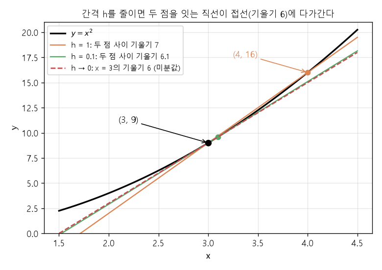
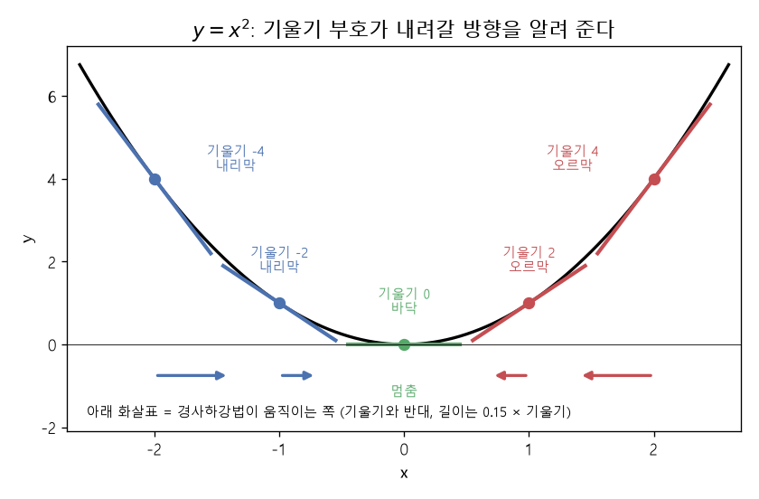

# 미분 — 기울기

[MIT 딥러닝 목차](../../00_MIT%EB%94%A5%EB%9F%AC%EB%8B%9D_%EB%AA%A9%EC%B0%A8.md)

📚 학습 순서 8/99 (2. 미분): ← 이전: [MM72_거듭제곱_법칙과_로그_로그_그래프](../../%EC%88%98%ED%95%99%EA%B0%9C%EB%85%90/01_%EC%88%98%EC%99%80_%ED%95%A8%EC%88%98/MM72_%EA%B1%B0%EB%93%AD%EC%A0%9C%EA%B3%B1_%EB%B2%95%EC%B9%99%EA%B3%BC_%EB%A1%9C%EA%B7%B8_%EB%A1%9C%EA%B7%B8_%EA%B7%B8%EB%9E%98%ED%94%84.md) · 다음: [M04_편미분](../../%EC%88%98%ED%95%99%EA%B0%9C%EB%85%90/02_%EB%AF%B8%EB%B6%84/M04_%ED%8E%B8%EB%AF%B8%EB%B6%84.md) →

> [!NOTE]
> **3줄 요약**
> - [미분](../../00_%EB%94%A5%EB%9F%AC%EB%8B%9D_%EC%9A%A9%EC%96%B4%EC%82%AC%EC%A0%84.md#derivative-%EB%AF%B8%EB%B6%84)은 "**입력을 아주 조금 움직이면 출력이 얼마나 변하나**"를 구하는 것이다. 비율(출력이 변한 양 ÷ 입력이 변한 양)로 구하며, 그 자리의 [기울기](../../00_%EB%94%A5%EB%9F%AC%EB%8B%9D_%EC%9A%A9%EC%96%B4%EC%82%AC%EC%A0%84.md#gradient-%EA%B8%B0%EC%9A%B8%EA%B8%B0)다.
> - [기울기](../../00_%EB%94%A5%EB%9F%AC%EB%8B%9D_%EC%9A%A9%EC%96%B4%EC%82%AC%EC%A0%84.md#gradient-%EA%B8%B0%EC%9A%B8%EA%B8%B0)가 **양수면 오르막, 음수면 내리막**, 0이면 바닥(또는 꼭대기)이다.
> - [경사하강법](../../00_%EB%94%A5%EB%9F%AC%EB%8B%9D_%EC%9A%A9%EC%96%B4%EC%82%AC%EC%A0%84.md#gradient-descent-%EA%B2%BD%EC%82%AC%ED%95%98%EA%B0%95%EB%B2%95)은 [기울기](../../00_%EB%94%A5%EB%9F%AC%EB%8B%9D_%EC%9A%A9%EC%96%B4%EC%82%AC%EC%A0%84.md#gradient-%EA%B8%B0%EC%9A%B8%EA%B8%B0)의 **반대 방향**으로 조금씩 움직여 [손실](../../00_%EB%94%A5%EB%9F%AC%EB%8B%9D_%EC%9A%A9%EC%96%B4%EC%82%AC%EC%A0%84.md#loss-function-%EC%86%90%EC%8B%A4-%ED%95%A8%EC%88%98)을 줄이는 방법이다. EX\_02의 `W -= learning_rate * grad_w`가 그것이다.

## 1. 개념 설명

[미분](../../00_%EB%94%A5%EB%9F%AC%EB%8B%9D_%EC%9A%A9%EC%96%B4%EC%82%AC%EC%A0%84.md#derivative-%EB%AF%B8%EB%B6%84) = 어떤 지점에서 "조금 움직였을 때 얼마나 변하는지" 비율.

## 2. 필요한 이유

EX\_02에서 모델은 W를 얼마로 해야 할지 모른다. [손실](../../00_%EB%94%A5%EB%9F%AC%EB%8B%9D_%EC%9A%A9%EC%96%B4%EC%82%AC%EC%A0%84.md#loss-function-%EC%86%90%EC%8B%A4-%ED%95%A8%EC%88%98)(코드의 cost)이 작아지는 쪽으로 W를 옮겨야 하는데, **어느 쪽이 내리막인지** 알려 주는 것이 [미분](../../00_%EB%94%A5%EB%9F%AC%EB%8B%9D_%EC%9A%A9%EC%96%B4%EC%82%AC%EC%A0%84.md#derivative-%EB%AF%B8%EB%B6%84)이다.

> 비유: 눈을 가리고 산을 내려간다. 산 전체는 안 보이지만 발밑이 어느 쪽으로 기울었는지는 느낄 수 있다. 그 [기울기](../../00_%EB%94%A5%EB%9F%AC%EB%8B%9D_%EC%9A%A9%EC%96%B4%EC%82%AC%EC%A0%84.md#gradient-%EA%B8%B0%EC%9A%B8%EA%B8%B0)를 느끼고 내리막 쪽으로 한 발씩 간다.

## 3. 출발점: 변화량 나누기

속도를 시점마다 기록한 값이 있으면, "다음 값 − 지금 값"으로 가속(속도가 얼마나 변했나)을 구할 수 있다. 이게 [미분](../../00_%EB%94%A5%EB%9F%AC%EB%8B%9D_%EC%9A%A9%EC%96%B4%EC%82%AC%EC%A0%84.md#derivative-%EB%AF%B8%EB%B6%84)의 출발점이다. 아래 표의 아랫줄은 **속도의 변화**다(시점이 1칸 가면 시간이 1 지나므로, 변화량이 곧 "1초당 변화"가 된다).

| 시점 i | 0 | 1 | 2 | 3 | 4 |
|---|---|---|---|---|---|
| 속도 log[i] (예시 값) | 0 | 3 | 7 | 12 | 14 |
| 속도의 변화 log[i+1] − log[i] | 3 | 4 | 5 | 2 | |

이번에는 위치-시간 그래프를 생각해 보자. 세로 = 위치, 가로 = 시간이다. 2초 동안 위치가 10 m 변했으면 10 ÷ 2 = 5 m/s다. 이처럼 **[기울기](../../00_%EB%94%A5%EB%9F%AC%EB%8B%9D_%EC%9A%A9%EC%96%B4%EC%82%AC%EC%A0%84.md#gradient-%EA%B8%B0%EC%9A%B8%EA%B8%B0) = 세로 변화 ÷ 가로 변화**다.

Δ(델타)는 "변한 양"(나중 − 처음)을 뜻하는 기호다. Δy는 y가 변한 양, Δx는 x가 변한 양이다.

$$\text{기울기} = \frac{\Delta y}{\Delta x} = \frac{y\text{가 변한 양}}{x\text{가 변한 양}}$$

<details><summary>기호 풀이</summary>

| 기호 | 읽는 법 | 뜻 | 예제 값 |
| --- | --- | --- | --- |
| [기울기](../../00_%EB%94%A5%EB%9F%AC%EB%8B%9D_%EC%9A%A9%EC%96%B4%EC%82%AC%EC%A0%84.md#gradient-%EA%B8%B0%EC%9A%B8%EA%B8%B0) | [기울기](../../00_%EB%94%A5%EB%9F%AC%EB%8B%9D_%EC%9A%A9%EC%96%B4%EC%82%AC%EC%A0%84.md#gradient-%EA%B8%B0%EC%9A%B8%EA%B8%B0) | [기울기](../../00_%EB%94%A5%EB%9F%AC%EB%8B%9D_%EC%9A%A9%EC%96%B4%EC%82%AC%EC%A0%84.md#gradient-%EA%B8%B0%EC%9A%B8%EA%B8%B0): x가 변한 양 1당 y가 변한 양 | 3 |
| $\Delta$ | 델타 | 변한 양(나중 − 처음) | $5 - 2$ |
| $\Delta y$ | 델타 와이 | y가 변한 양 | $16 - 7 = 9$ |
| $\Delta x$ | 델타 엑스 | x가 변한 양 | $5 - 2 = 3$ |

</details>

<details><summary>예제와 풀이</summary>

**문제**: x가 2에서 5로 바뀌는 동안 y가 7에서 16으로 바뀌었다. 이 구간의 [기울기](../../00_%EB%94%A5%EB%9F%AC%EB%8B%9D_%EC%9A%A9%EC%96%B4%EC%82%AC%EC%A0%84.md#gradient-%EA%B8%B0%EC%9A%B8%EA%B8%B0)는?

**주어진 값**:
- 처음 $x = 2$, 나중 $x = 5$ (가로 위치)
- 처음 $y = 7$, 나중 $y = 16$ (세로 위치)

**풀이**
1. 식을 그대로 쓴다: $\text{기울기} = \frac{\Delta y}{\Delta x} = \frac{y\text{가 변한 양}}{x\text{가 변한 양}}$
2. 값을 대입한다(Δ는 나중 − 처음): $\text{기울기} = \frac{16 - 7}{5 - 2}$
3. 분자(위)의 뺄셈을 한다: $16 - 7 = 9$ 이므로 $\frac{9}{5 - 2}$
4. 분모(아래)의 뺄셈을 한다: $5 - 2 = 3$ 이므로 $\frac{9}{3}$
5. 나눗셈을 한다: $9 \div 3 = 3$

**답**: [기울기](../../00_%EB%94%A5%EB%9F%AC%EB%8B%9D_%EC%9A%A9%EC%96%B4%EC%82%AC%EC%A0%84.md#gradient-%EA%B8%B0%EC%9A%B8%EA%B8%B0) = 3

</details>

<details><summary>내 이해</summary>


</details>

직선 $y = 2x + 1$에서 x를 1 → 2로 바꾸면 y는 3 → 5. [기울기](../../00_%EB%94%A5%EB%9F%AC%EB%8B%9D_%EC%9A%A9%EC%96%B4%EC%82%AC%EC%A0%84.md#gradient-%EA%B8%B0%EC%9A%B8%EA%B8%B0) = 2 ÷ 1 = **2**. 직선은 어디서 재도 [기울기](../../00_%EB%94%A5%EB%9F%AC%EB%8B%9D_%EC%9A%A9%EC%96%B4%EC%82%AC%EC%A0%84.md#gradient-%EA%B8%B0%EC%9A%B8%EA%B8%B0)가 같다([M01_함수와_일차함수](../../%EC%88%98%ED%95%99%EA%B0%9C%EB%85%90/01_%EC%88%98%EC%99%80_%ED%95%A8%EC%88%98/M01_%ED%95%A8%EC%88%98%EC%99%80_%EC%9D%BC%EC%B0%A8%ED%95%A8%EC%88%98.md)의 w).

## 4. 곡선의 기울기: 간격 줄이기

곡선 $y = x^2$은 위치마다 [기울기](../../00_%EB%94%A5%EB%9F%AC%EB%8B%9D_%EC%9A%A9%EC%96%B4%EC%82%AC%EC%A0%84.md#gradient-%EA%B8%B0%EC%9A%B8%EA%B8%B0)가 다르다. x = 3에서의 [기울기](../../00_%EB%94%A5%EB%9F%AC%EB%8B%9D_%EC%9A%A9%EC%96%B4%EC%82%AC%EC%A0%84.md#gradient-%EA%B8%B0%EC%9A%B8%EA%B8%B0)를 재려면 간격 h를 점점 줄여 본다.

| 간격 h | 계산 $\frac{(3+h)^2 - 3^2}{h}$ | [기울기](../../00_%EB%94%A5%EB%9F%AC%EB%8B%9D_%EC%9A%A9%EC%96%B4%EC%82%AC%EC%A0%84.md#gradient-%EA%B8%B0%EC%9A%B8%EA%B8%B0) |
|---|---|---|
| 1 | (16 − 9) ÷ 1 | 7 |
| 0.1 | (9.61 − 9) ÷ 0.1 | 6.1 |
| 0.01 | (9.0601 − 9) ÷ 0.01 | 6.01 |
| 0.001 | | 6.001 |

간격을 줄일수록 **6**에 가까워진다. 왜 6인지 식으로 따라가 보자.



1. $(3+h)^2 = 9 + 6h + h^2$ ← 괄호를 풀어 쓴다($(a+b)^2 = a^2 + 2ab + b^2$에서 a = 3, b = h)
2. $(3+h)^2 - 9 = 6h + h^2$ ← 9가 서로 지워진다
3. $\dfrac{6h + h^2}{h} = \dfrac{6h}{h} + \dfrac{h^2}{h}$ ← 분자의 두 항을 각각 h로 나눈다(h는 0이 아니다)
4. $\dfrac{6h}{h} + \dfrac{h^2}{h} = 6 + h$ ← $h \div h = 1$이므로 $6h \div h = 6$, $h^2 \div h = h$
5. h가 0에 가까워지면 $6 + h$는 **6**에 가까워진다 ← h = 1이면 7, h = 0.1이면 6.1로 표와 같다

미분값은 간격이 정해진 구간의 [기울기](../../00_%EB%94%A5%EB%9F%AC%EB%8B%9D_%EC%9A%A9%EC%96%B4%EC%82%AC%EC%A0%84.md#gradient-%EA%B8%B0%EC%9A%B8%EA%B8%B0)가 아니라, **h가 0에 가까워질 때 다가가는 값**이다. h에 0을 그대로 넣는 것이 아니다(원래 식은 0 ÷ 0이 되어 계산할 수 없다). 이것을 "x = 3에서 $x^2$의 미분값은 6"이라고 한다.

```python
for h in [1, 0.1, 0.01, 0.001]:
    print(h, ((3 + h)**2 - 3**2) / h)   # (나중 y − 처음 y) ÷ 간격
```

**실행 결과**:

```text
1 7.0
0.1 6.100000000000012
0.01 6.009999999999849
0.001 6.000999999999479
```

> 끝자리의 `...12`, `...849`는 컴퓨터가 소수를 저장할 때 생기는 아주 작은 [오차](../../00_%EB%94%A5%EB%9F%AC%EB%8B%9D_%EC%9A%A9%EC%96%B4%EC%82%AC%EC%A0%84.md#error-%EC%98%A4%EC%B0%A8)다. 수학적으로는 6.1, 6.01, 6.001이다.

## 5. 기호와 공식

<details><summary>기호 풀이</summary>

| 기호 | 읽는 법 | 뜻 | 예 |
| --- | --- | --- | --- |
| $\Delta$ | 델타 | 변화량(나중 − 처음) | x가 1 → 2이면 $\Delta x = 1$ |
| $\frac{dy}{dx}$ | 디와이 디엑스 | x를 **아주 조금** 바꿀 때 y가 변하는 비율. 분수처럼 생겼지만 기호 하나다 | $y = x^2$, x = 3이면 6 |
| $f'(x)$ | 에프 프라임 엑스 | f를 미분한 함수. [기울기](../../00_%EB%94%A5%EB%9F%AC%EB%8B%9D_%EC%9A%A9%EC%96%B4%EC%82%AC%EC%A0%84.md#gradient-%EA%B8%B0%EC%9A%B8%EA%B8%B0)를 알려 주는 함수 | $f(x) = x^2$이면 $f'(x) = 2x$ |

</details>

지금 외울 공식은 이것뿐이다.

| 함수 | [미분](../../00_%EB%94%A5%EB%9F%AC%EB%8B%9D_%EC%9A%A9%EC%96%B4%EC%82%AC%EC%A0%84.md#derivative-%EB%AF%B8%EB%B6%84) | 숫자로 확인 |
|---|---|---|
| 상수 (예: 5) | 0 | 변하지 않으니 [기울기](../../00_%EB%94%A5%EB%9F%AC%EB%8B%9D_%EC%9A%A9%EC%96%B4%EC%82%AC%EC%A0%84.md#gradient-%EA%B8%B0%EC%9A%B8%EA%B8%B0) 0 |
| $ax$ (예: $2x$) | $a$ (2) | 직선의 [기울기](../../00_%EB%94%A5%EB%9F%AC%EB%8B%9D_%EC%9A%A9%EC%96%B4%EC%82%AC%EC%A0%84.md#gradient-%EA%B8%B0%EC%9A%B8%EA%B8%B0) |
| $x^2$ | $2x$ | x = 3이면 6 (4절 표) |
| $x^n$ | $n \cdot x^{n-1}$ | $x^2$ → $2x^1$ |

더하기로 이어진 식은 하나씩 미분해서 더한다: $(2x + 1)' = 2 + 0 = 2$

## 6. 기울기 부호의 뜻

$y = x^2$의 [기울기](../../00_%EB%94%A5%EB%9F%AC%EB%8B%9D_%EC%9A%A9%EC%96%B4%EC%82%AC%EC%A0%84.md#gradient-%EA%B8%B0%EC%9A%B8%EA%B8%B0)는 $2x$다.

| x | −2 | −1 | 0 | 1 | 2 |
|---|---|---|---|---|---|
| [기울기](../../00_%EB%94%A5%EB%9F%AC%EB%8B%9D_%EC%9A%A9%EC%96%B4%EC%82%AC%EC%A0%84.md#gradient-%EA%B8%B0%EC%9A%B8%EA%B8%B0) $2x$ | −4 | −2 | 0 | 2 | 4 |
| 뜻 | 내리막 | 내리막 | **바닥** | 오르막 | 오르막 |

- 가장 낮은 곳(x = 0)에서 [기울기](../../00_%EB%94%A5%EB%9F%AC%EB%8B%9D_%EC%9A%A9%EC%96%B4%EC%82%AC%EC%A0%84.md#gradient-%EA%B8%B0%EC%9A%B8%EA%B8%B0)가 0이다.
- 값을 줄이려면 [기울기](../../00_%EB%94%A5%EB%9F%AC%EB%8B%9D_%EC%9A%A9%EC%96%B4%EC%82%AC%EC%A0%84.md#gradient-%EA%B8%B0%EC%9A%B8%EA%B8%B0)와 **반대로** 움직인다. [기울기](../../00_%EB%94%A5%EB%9F%AC%EB%8B%9D_%EC%9A%A9%EC%96%B4%EC%82%AC%EC%A0%84.md#gradient-%EA%B8%B0%EC%9A%B8%EA%B8%B0)가 +4면 왼쪽(−)으로, −4면 오른쪽(+)으로.



## 7. 경사하강법 미리 보기

$y = x^2$의 가장 낮은 곳을 찾아 보자. x = 5에서 출발하고, 한 번에 [기울기](../../00_%EB%94%A5%EB%9F%AC%EB%8B%9D_%EC%9A%A9%EC%96%B4%EC%82%AC%EC%A0%84.md#gradient-%EA%B8%B0%EC%9A%B8%EA%B8%B0)의 0.1배만큼 반대로 간다. 이 0.1은 한 번에 가는 보폭의 배율이고, **[학습률](../../00_%EB%94%A5%EB%9F%AC%EB%8B%9D_%EC%9A%A9%EC%96%B4%EC%82%AC%EC%A0%84.md#learning-rate-%ED%95%99%EC%8A%B5%EB%A5%A0)**(learning rate)이라고 부른다.

$$\text{새 } x = x - 0.1 \times \text{기울기}(2x)$$

<details><summary>기호 풀이</summary>

| 기호 | 읽는 법 | 뜻 | 예제 값 |
| --- | --- | --- | --- |
| 새 $x$ | 새 엑스 | 한 걸음 옮긴 뒤의 x | 2.4 |
| $x$ | 엑스 | 지금 위치 | 3 |
| $0.1$ | 영점일 | [학습률](../../00_%EB%94%A5%EB%9F%AC%EB%8B%9D_%EC%9A%A9%EC%96%B4%EC%82%AC%EC%A0%84.md#learning-rate-%ED%95%99%EC%8A%B5%EB%A5%A0): 한 번에 가는 보폭의 배율 | 0.1 |
| [기울기](../../00_%EB%94%A5%EB%9F%AC%EB%8B%9D_%EC%9A%A9%EC%96%B4%EC%82%AC%EC%A0%84.md#gradient-%EA%B8%B0%EC%9A%B8%EA%B8%B0)$(2x)$ | [기울기](../../00_%EB%94%A5%EB%9F%AC%EB%8B%9D_%EC%9A%A9%EC%96%B4%EC%82%AC%EC%A0%84.md#gradient-%EA%B8%B0%EC%9A%B8%EA%B8%B0) 이 엑스 | $y = x^2$의 [기울기](../../00_%EB%94%A5%EB%9F%AC%EB%8B%9D_%EC%9A%A9%EC%96%B4%EC%82%AC%EC%A0%84.md#gradient-%EA%B8%B0%EC%9A%B8%EA%B8%B0) $2x$ | 6 |

</details>

<details><summary>예제와 풀이</summary>

**문제**: 곡선 $y = x^2$ 위의 지금 위치 x = 3에서 [학습률](../../00_%EB%94%A5%EB%9F%AC%EB%8B%9D_%EC%9A%A9%EC%96%B4%EC%82%AC%EC%A0%84.md#learning-rate-%ED%95%99%EC%8A%B5%EB%A5%A0) 0.1로 경사하강 한 걸음을 가면 새 x는?

**주어진 값**:
- $x = 3$ (지금 위치)
- $0.1$ ([학습률](../../00_%EB%94%A5%EB%9F%AC%EB%8B%9D_%EC%9A%A9%EC%96%B4%EC%82%AC%EC%A0%84.md#learning-rate-%ED%95%99%EC%8A%B5%EB%A5%A0): [기울기](../../00_%EB%94%A5%EB%9F%AC%EB%8B%9D_%EC%9A%A9%EC%96%B4%EC%82%AC%EC%A0%84.md#gradient-%EA%B8%B0%EC%9A%B8%EA%B8%B0)에 곱하는 보폭 배율)
- [기울기](../../00_%EB%94%A5%EB%9F%AC%EB%8B%9D_%EC%9A%A9%EC%96%B4%EC%82%AC%EC%A0%84.md#gradient-%EA%B8%B0%EC%9A%B8%EA%B8%B0) $2x$ (곡선 $y = x^2$의 [기울기](../../00_%EB%94%A5%EB%9F%AC%EB%8B%9D_%EC%9A%A9%EC%96%B4%EC%82%AC%EC%A0%84.md#gradient-%EA%B8%B0%EC%9A%B8%EA%B8%B0) 공식)

**풀이**
1. 식을 그대로 쓴다: $\text{새 } x = x - 0.1 \times \text{기울기}(2x)$
2. 값을 대입한다: $\text{새 } x = 3 - 0.1 \times (2 \times 3)$
3. 괄호 안 곱셈([기울기](../../00_%EB%94%A5%EB%9F%AC%EB%8B%9D_%EC%9A%A9%EC%96%B4%EC%82%AC%EC%A0%84.md#gradient-%EA%B8%B0%EC%9A%B8%EA%B8%B0))을 먼저 한다: $2 \times 3 = 6$ 이므로 $\text{새 } x = 3 - 0.1 \times 6$
4. 곱셈을 한다(보폭): $0.1 \times 6 = 0.6$ 이므로 $\text{새 } x = 3 - 0.6$
5. 뺄셈을 한다: $3 - 0.6 = 2.4$

**답**: 새 x = 2.4

</details>

<details><summary>내 이해</summary>


</details>

첫 걸음을 손으로 계산하면 이렇다.

- x = 5의 [기울기](../../00_%EB%94%A5%EB%9F%AC%EB%8B%9D_%EC%9A%A9%EC%96%B4%EC%82%AC%EC%A0%84.md#gradient-%EA%B8%B0%EC%9A%B8%EA%B8%B0) = 2 × 5 = 10
- 새 x = 5 − 0.1 × 10 = **4.0** ← 아래 실행 결과의 1단계와 같다

```python
x = 5.0
for step in range(11):
    print(step, round(x, 4))
    x = x - 0.1 * (2 * x)    # 기울기(2x)의 반대 방향으로 0.1배만큼 이동
```

**실행 결과**:

```text
0 5.0
1 4.0
2 3.2
3 2.56
4 2.048
5 1.6384
6 1.3107
7 1.0486
8 0.8389
9 0.6711
10 0.5369
```

- 0(바닥)에 점점 가까워진다.
- 바닥에 가까울수록 [기울기](../../00_%EB%94%A5%EB%9F%AC%EB%8B%9D_%EC%9A%A9%EC%96%B4%EC%82%AC%EC%A0%84.md#gradient-%EA%B8%B0%EC%9A%B8%EA%B8%B0)가 작아져서 걸음도 작아진다(걸음 크기가 1.0 → 0.8 → 0.64 …).

EX\_02의 이 줄과 같은 모양이다.

```python
W -= learning_rate * grad_w   # W = W − 학습률 × 기울기
```

> [!WARNING]
> **⚠ [학습률](../../00_%EB%94%A5%EB%9F%AC%EB%8B%9D_%EC%9A%A9%EC%96%B4%EC%82%AC%EC%A0%84.md#learning-rate-%ED%95%99%EC%8A%B5%EB%A5%A0)이 너무 클 때**
> [학습률](../../00_%EB%94%A5%EB%9F%AC%EB%8B%9D_%EC%9A%A9%EC%96%B4%EC%82%AC%EC%A0%84.md#learning-rate-%ED%95%99%EC%8A%B5%EB%A5%A0)(곱하는 0.1)이 너무 크면 바닥을 지나쳐 반대편으로 튄다. 위 예에서 0.1 대신 1.1을 쓰면 x가 5.0 → −6.0 → 7.2 → −8.64 → 10.368로 점점 멀어진다.
> 실제 예제에서 이 일이 생기는 모습은 D02_경사하강법으로_직선찾기의 '[학습률](../../00_%EB%94%A5%EB%9F%AC%EB%8B%9D_%EC%9A%A9%EC%96%B4%EC%82%AC%EC%A0%84.md#learning-rate-%ED%95%99%EC%8A%B5%EB%A5%A0)이 너무 클 때'에 있다.

### 7.1 쓰이는 곳

| 노트 | 쓰이는 곳 |
|---|---|
| D06_이미지분류와_MNIST 4.4~4.5절 | 32장씩 보고 [기울기](../../00_%EB%94%A5%EB%9F%AC%EB%8B%9D_%EC%9A%A9%EC%96%B4%EC%82%AC%EC%A0%84.md#gradient-%EA%B8%B0%EC%9A%B8%EA%B8%B0)를 어림잡는 확률적 [경사하강법](../../00_%EB%94%A5%EB%9F%AC%EB%8B%9D_%EC%9A%A9%EC%96%B4%EC%82%AC%EC%A0%84.md#gradient-descent-%EA%B2%BD%EC%82%AC%ED%95%98%EA%B0%95%EB%B2%95), 보폭을 자동 조절하는 [Adam](../../00_%EB%94%A5%EB%9F%AC%EB%8B%9D_%EC%9A%A9%EC%96%B4%EC%82%AC%EC%A0%84.md#adam-%EC%95%84%EB%8B%B4-%EC%98%B5%ED%8B%B0%EB%A7%88%EC%9D%B4%EC%A0%80) |
| D08_ReLU와_드롭아웃 4.2절 | [기울기](../../00_%EB%94%A5%EB%9F%AC%EB%8B%9D_%EC%9A%A9%EC%96%B4%EC%82%AC%EC%A0%84.md#gradient-%EA%B8%B0%EC%9A%B8%EA%B8%B0)가 [층](../../00_%EB%94%A5%EB%9F%AC%EB%8B%9D_%EC%9A%A9%EC%96%B4%EC%82%AC%EC%A0%84.md#layer-%EC%B8%B5)마다 곱해져 0에 가까워지는 문제([기울기 소실](../../00_%EB%94%A5%EB%9F%AC%EB%8B%9D_%EC%9A%A9%EC%96%B4%EC%82%AC%EC%A0%84.md#vanishing-gradient-%EA%B8%B0%EC%9A%B8%EA%B8%B0-%EC%86%8C%EC%8B%A4))와 [ReLU](../../00_%EB%94%A5%EB%9F%AC%EB%8B%9D_%EC%9A%A9%EC%96%B4%EC%82%AC%EC%A0%84.md#relu-%EB%A0%90%EB%A3%A8) |

## 8. 개념 재확인

<details><summary>1. $y = 5x$의 기울기는?</summary>

| 단계 | 하는 일 | 식 | 계산 | 결과 |
|---|---|---|---|---|
| 1 | 두 점의 y 구하기 | $y = 5x$ | x = 1, 2일 때 5×1, 5×2 | 5, 10 |
| 2 | 변화량 나누기 | $\frac{\Delta y}{\Delta x}$ | (10 − 5) ÷ (2 − 1) | 5 |
| 3 | 다른 두 점으로 확인 | $\frac{\Delta y}{\Delta x}$ | (15 − 0) ÷ (3 − 0) | 5 |

**① 쓰는 식**
$$\text{기울기} = \frac{\Delta y}{\Delta x} = \frac{y\text{가 변한 양}}{x\text{가 변한 양}}$$
- 위 식 ← ③ ($\Delta y$, $\Delta x$ 구해서 나누기), ④ (다른 두 점으로 같은 식 확인)
- $\Delta y$는 y가 변한 양(나중 y − 처음 y), $\Delta x$는 x가 변한 양(나중 x − 처음 x)이다.
- 이 문제의 식은 $y = 5x$이다. 두 점의 y는 ②에서 구한다.

**주어진 값**
- 직선 $y = 5x$ (식)
- 첫째 두 점의 $x$: $1$과 $2$
- 확인용 두 점의 $x$: $0$과 $3$

**② 두 점의 y 구하기** ($y = 5x$)
- 식을 그대로 쓴다: $y = 5x$
- $x = 1$을 대입한다: $y = 5 \times 1$
- 곱셈을 한다: $5 \times 1 = 5$ 이므로 $y = 5$
- $x = 2$를 대입한다: $y = 5 \times 2$
- 곱셈을 한다: $5 \times 2 = 10$ 이므로 $y = 10$
- 두 점은 (1, 5)와 (2, 10)이다.

**③ 변화량 나누기** ($\frac{\Delta y}{\Delta x}$)
- 식을 그대로 쓴다: $\text{기울기} = \frac{\Delta y}{\Delta x}$
- 값을 대입한다(Δ는 나중 − 처음): $\text{기울기} = \frac{10 - 5}{2 - 1}$
- 분자(위)의 뺄셈을 한다: $10 - 5 = 5$ 이므로 $\frac{5}{2 - 1}$
- 분모(아래)의 뺄셈을 한다: $2 - 1 = 1$ 이므로 $\frac{5}{1}$
- 나눗셈을 한다: $5 \div 1 = 5$

**④ 다른 두 점으로 확인** (직선은 어디서 재도 같다)
- 식을 그대로 쓴다: $\text{기울기} = \frac{\Delta y}{\Delta x}$
- 두 점의 y를 구한다: $x = 0$이면 $y = 5 \times 0 = 0$, $x = 3$이면 $y = 5 \times 3 = 15$ → 두 점 (0, 0)과 (3, 15)
- 값을 대입한다: $\text{기울기} = \frac{15 - 0}{3 - 0}$
- 분자와 분모의 뺄셈을 한다: $15 - 0 = 15$, $3 - 0 = 3$ 이므로 $\frac{15}{3}$
- 나눗셈을 한다: $15 \div 3 = 5$ → ③과 같은 값이다.

**답**: [기울기](../../00_%EB%94%A5%EB%9F%AC%EB%8B%9D_%EC%9A%A9%EC%96%B4%EC%82%AC%EC%A0%84.md#gradient-%EA%B8%B0%EC%9A%B8%EA%B8%B0)는 **5**

</details>

<details><summary>2. $y = x^2$에서 x = 4의 기울기는?</summary>

| 단계 | 하는 일 | 식 | 계산 | 결과 |
|---|---|---|---|---|
| 1 | [미분](../../00_%EB%94%A5%EB%9F%AC%EB%8B%9D_%EC%9A%A9%EC%96%B4%EC%82%AC%EC%A0%84.md#derivative-%EB%AF%B8%EB%B6%84) 공식 고르기 | $x^2$ → $2x$ | - | $2x$ |
| 2 | x에 4 넣기 | $2x$ | 2 × 4 | 8 |
| 3 | 괄호 풀고 16 빼기 | $(4+h)^2 - 16$ | $16 + 8h + h^2 - 16$ | $8h + h^2$ |
| 4 | h로 나누기 | $\frac{8h + h^2}{h}$ | 각 항을 h로 나눔 | $8 + h$ |
| 5 | h를 0에 가깝게 | $8 + h$ | h = 1, 0.1, 0.01 | 9, 8.1, 8.01 (→ 8에 가까워짐) |

**① 쓰는 식**
$$\frac{(4+h)^2 - 4^2}{h}$$
- 위 식 ← $(4+h)^2 - 4^2$ 부분은 ③, 분모 $h$로 나누기는 ④, h를 줄여 보기는 ⑤
- $h$는 x를 4에서 옮긴 아주 작은 간격이다. 위 식은 "x가 4에서 4+h로 갈 때 y가 변한 양 ÷ x가 변한 양(h)"이다.
- 공식으로는 $x^2$의 [미분](../../00_%EB%94%A5%EB%9F%AC%EB%8B%9D_%EC%9A%A9%EC%96%B4%EC%82%AC%EC%A0%84.md#derivative-%EB%AF%B8%EB%B6%84)이 $2x$이다: $(x^2)' = 2x$ ← ②, ⑥

**주어진 값**
- $y = x^2$ (곡선)
- $x = 4$ ([기울기](../../00_%EB%94%A5%EB%9F%AC%EB%8B%9D_%EC%9A%A9%EC%96%B4%EC%82%AC%EC%A0%84.md#gradient-%EA%B8%B0%EC%9A%B8%EA%B8%B0)를 구할 자리)
- $h$ (x를 4에서 옮긴 아주 작은 간격): $1$, $0.1$, $0.01$로 줄여 본다

**② 공식으로 바로 구하기** ($x^2 \to 2x$)
- 식을 그대로 쓴다: $(x^2)' = 2x$
- 값을 대입한다: $2 \times 4$
- 곱셈을 한다: $2 \times 4 = 8$
- 아래 ③~⑥에서 이 값이 맞는지 직접 확인한다.

**③ 괄호 풀고 16 빼기** ($(4+h)^2 - 16$)
- 식을 그대로 쓴다: $\frac{(4+h)^2 - 4^2}{h}$ 의 분자 $(4+h)^2 - 4^2$
- 값을 대입하고 괄호를 푼다: $(a+b)^2 = a^2 + 2ab + b^2$ 에서 $a = 4$, $b = h$ 이므로 $(4+h)^2 = 4^2 + 2 \times 4 \times h + h^2$
- 숫자를 계산한다: $4^2 = 16$, $2 \times 4 \times h = 8h$ 이므로 $(4+h)^2 = 16 + 8h + h^2$
- 양쪽에서 $4^2 = 16$을 뺀다: $16 + 8h + h^2 - 16 = 8h + h^2$ (16이 서로 지워진다)

**④ h로 나누기** ($\frac{8h + h^2}{h}$)
- 식을 그대로 쓴다: $\frac{(4+h)^2 - 4^2}{h}$
- 값을 대입한다(③ 결과): $\frac{8h + h^2}{h}$
- 분자의 두 항을 각각 h로 나눈다(h는 0이 아니다): $\frac{8h}{h} + \frac{h^2}{h}$
- 첫째 항: $8h \div h = 8$ 이므로 $8 + \frac{h^2}{h}$
- 둘째 항: $h^2 \div h = h$ 이므로 $8 + h$

**⑤ h를 0에 가깝게 줄이기** ($8 + h$)
- 식을 그대로 쓴다: $8 + h$
- $h = 1$을 대입한다: $8 + 1 = 9$
- $h = 0.1$을 대입한다: $8 + 0.1 = 8.1$
- $h = 0.01$을 대입한다: $8 + 0.01 = 8.01$
- h가 0에 가까워질수록 8에 가까워진다. h에 0을 그대로 넣는 것은 아니다(원래 식이 0 ÷ 0이 되어 계산할 수 없다).

**⑥ 공식과 비교**
- ⑤에서 다가가는 값은 8이고, ②에서 공식으로 구한 값은 $2 \times 4 = 8$이다. 같다.

**답**: [기울기](../../00_%EB%94%A5%EB%9F%AC%EB%8B%9D_%EC%9A%A9%EC%96%B4%EC%82%AC%EC%A0%84.md#gradient-%EA%B8%B0%EC%9A%B8%EA%B8%B0)는 **8**

</details>

<details><summary>3. 기울기가 −2일 때 값을 줄이려면 x를 늘리나 줄이나?</summary>

| 단계 | 하는 일 | 식 | 계산 | 결과 |
|---|---|---|---|---|
| 1 | 이동량 구하기 | [학습률](../../00_%EB%94%A5%EB%9F%AC%EB%8B%9D_%EC%9A%A9%EC%96%B4%EC%82%AC%EC%A0%84.md#learning-rate-%ED%95%99%EC%8A%B5%EB%A5%A0) × [기울기](../../00_%EB%94%A5%EB%9F%AC%EB%8B%9D_%EC%9A%A9%EC%96%B4%EC%82%AC%EC%A0%84.md#gradient-%EA%B8%B0%EC%9A%B8%EA%B8%B0) | 0.1 × (−2) | −0.2 |
| 2 | 새 x 구하기 | $x - \text{학습률} \times \text{기울기}$ | 4 − (−0.2) | 4.2 |
| 3 | x 변화 확인 | 새 x와 처음 x 비교 | 4 → 4.2 | 커짐 |

[기울기](../../00_%EB%94%A5%EB%9F%AC%EB%8B%9D_%EC%9A%A9%EC%96%B4%EC%82%AC%EC%A0%84.md#gradient-%EA%B8%B0%EC%9A%B8%EA%B8%B0)가 음수인 곳은 내리막이라, 오른쪽(+)으로 가야 바닥에 가까워진다.

**① 쓰는 식**
$$\text{새 } x = x - \text{학습률} \times \text{기울기}$$
- 위 식 ← ② ([학습률](../../00_%EB%94%A5%EB%9F%AC%EB%8B%9D_%EC%9A%A9%EC%96%B4%EC%82%AC%EC%A0%84.md#learning-rate-%ED%95%99%EC%8A%B5%EB%A5%A0) × [기울기](../../00_%EB%94%A5%EB%9F%AC%EB%8B%9D_%EC%9A%A9%EC%96%B4%EC%82%AC%EC%A0%84.md#gradient-%EA%B8%B0%EC%9A%B8%EA%B8%B0) = 이동량), ③ (x − 이동량 = 새 x), ④ (x 변화 확인)
- [학습률](../../00_%EB%94%A5%EB%9F%AC%EB%8B%9D_%EC%9A%A9%EC%96%B4%EC%82%AC%EC%A0%84.md#learning-rate-%ED%95%99%EC%8A%B5%EB%A5%A0)은 한 번에 가는 보폭의 배율(여기서는 0.1), [기울기](../../00_%EB%94%A5%EB%9F%AC%EB%8B%9D_%EC%9A%A9%EC%96%B4%EC%82%AC%EC%A0%84.md#gradient-%EA%B8%B0%EC%9A%B8%EA%B8%B0)는 지금 자리의 [기울기](../../00_%EB%94%A5%EB%9F%AC%EB%8B%9D_%EC%9A%A9%EC%96%B4%EC%82%AC%EC%A0%84.md#gradient-%EA%B8%B0%EC%9A%B8%EA%B8%B0)(여기서는 −2)이다.
- 처음 x는 4라고 가정한다(표의 계산과 같다).
```python
W -= learning_rate * grad_w   # ② 학습률 × 기울기가 이동량, ③ 그 이동량을 W에서 뺌
```

**주어진 값**
- [기울기](../../00_%EB%94%A5%EB%9F%AC%EB%8B%9D_%EC%9A%A9%EC%96%B4%EC%82%AC%EC%A0%84.md#gradient-%EA%B8%B0%EC%9A%B8%EA%B8%B0) $= -2$ (지금 자리의 [기울기](../../00_%EB%94%A5%EB%9F%AC%EB%8B%9D_%EC%9A%A9%EC%96%B4%EC%82%AC%EC%A0%84.md#gradient-%EA%B8%B0%EC%9A%B8%EA%B8%B0))
- [학습률](../../00_%EB%94%A5%EB%9F%AC%EB%8B%9D_%EC%9A%A9%EC%96%B4%EC%82%AC%EC%A0%84.md#learning-rate-%ED%95%99%EC%8A%B5%EB%A5%A0) $= 0.1$ (보폭의 배율)
- 처음 $x = 4$ (가정한 지금 위치)

**② 이동량 구하기** ([학습률](../../00_%EB%94%A5%EB%9F%AC%EB%8B%9D_%EC%9A%A9%EC%96%B4%EC%82%AC%EC%A0%84.md#learning-rate-%ED%95%99%EC%8A%B5%EB%A5%A0) × [기울기](../../00_%EB%94%A5%EB%9F%AC%EB%8B%9D_%EC%9A%A9%EC%96%B4%EC%82%AC%EC%A0%84.md#gradient-%EA%B8%B0%EC%9A%B8%EA%B8%B0))
- 식을 그대로 쓴다: $\text{이동량} = \text{학습률} \times \text{기울기}$
- 값을 대입한다: $\text{이동량} = 0.1 \times (-2)$
- 곱셈을 한다: $0.1 \times (-2) = -0.2$ (양수에 음수를 곱하면 음수) 이므로 이동량 $= -0.2$

**③ 새 x 구하기** ($x - \text{이동량}$)
- 식을 그대로 쓴다: $\text{새 } x = x - \text{학습률} \times \text{기울기}$
- 값을 대입한다(② 결과를 이동량 자리에 쓴다): $\text{새 } x = 4 - (-0.2)$
- 빼기 음수는 더하기와 같다: $4 - (-0.2) = 4 + 0.2$
- 덧셈을 한다: $4 + 0.2 = 4.2$ 이므로 새 $x = 4.2$

**④ x 변화 확인**
- 식을 쓴다: $\text{변화} = \text{새 } x - \text{처음 } x$
- 값을 대입한다: $\text{변화} = 4.2 - 4$
- 뺄셈을 한다: $4.2 - 4 = 0.2$ 이므로 x가 커졌다.
- 그래서 [기울기](../../00_%EB%94%A5%EB%9F%AC%EB%8B%9D_%EC%9A%A9%EC%96%B4%EC%82%AC%EC%A0%84.md#gradient-%EA%B8%B0%EC%9A%B8%EA%B8%B0)가 음수(내리막)이면 x를 늘려야 값이 줄어든다.

**답**: x를 **늘린다**. [기울기](../../00_%EB%94%A5%EB%9F%AC%EB%8B%9D_%EC%9A%A9%EC%96%B4%EC%82%AC%EC%A0%84.md#gradient-%EA%B8%B0%EC%9A%B8%EA%B8%B0)의 반대 방향으로 움직이는 것이다.

</details>

## 예제 풀기

[예제 10문제 풀기](../../%EC%98%88%EC%A0%9C/02_%EB%AF%B8%EB%B6%84/%EC%98%88%EC%A0%9C_M03_%EB%AF%B8%EB%B6%84_%EA%B8%B0%EC%9A%B8%EA%B8%B0.md)

<details><summary>내 이해</summary>


</details>
