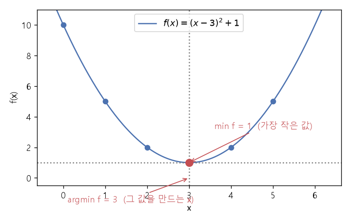

# argmin과 argmax (최솟값 위치와 최댓값 위치)

[목차로 돌아가기](../../00_MIT%EB%94%A5%EB%9F%AC%EB%8B%9D_%EB%AA%A9%EC%B0%A8.md) · 먼저 볼 것: [M01_함수와_일차함수](../../%EC%88%98%ED%95%99%EA%B0%9C%EB%85%90/01_%EC%88%98%EC%99%80_%ED%95%A8%EC%88%98/M01_%ED%95%A8%EC%88%98%EC%99%80_%EC%9D%BC%EC%B0%A8%ED%95%A8%EC%88%98.md), [M09_최솟값과_볼록함수](../../%EC%88%98%ED%95%99%EA%B0%9C%EB%85%90/02_%EB%AF%B8%EB%B6%84/M09_%EC%B5%9C%EC%86%9F%EA%B0%92%EA%B3%BC_%EB%B3%BC%EB%A1%9D%ED%95%A8%EC%88%98.md) · 쓰는 곳: [Lec01 5.1 경사하강법](../../Lec01_%EB%94%A5%EB%9F%AC%EB%8B%9D_%EC%86%8C%EA%B0%9C.md#51-%EA%B2%BD%EC%82%AC%ED%95%98%EA%B0%95%EB%B2%95), [Lec01 5.6](../../Lec01_%EB%94%A5%EB%9F%AC%EB%8B%9D_%EC%86%8C%EA%B0%9C.md#56-%EC%86%8C%ED%94%84%ED%8A%B8%EB%A7%A5%EC%8A%A4%EC%99%80-%EA%B5%90%EC%B0%A8-%EC%97%94%ED%8A%B8%EB%A1%9C%ED%94%BC-%EC%86%90%EC%8B%A4)

📚 학습 순서 12/99 (2. 미분): ← 이전: [M09_최솟값과_볼록함수](../../%EC%88%98%ED%95%99%EA%B0%9C%EB%85%90/02_%EB%AF%B8%EB%B6%84/M09_%EC%B5%9C%EC%86%9F%EA%B0%92%EA%B3%BC_%EB%B3%BC%EB%A1%9D%ED%95%A8%EC%88%98.md) · 다음: [MM86_정적분과_넓이](../../%EC%88%98%ED%95%99%EA%B0%9C%EB%85%90/02_%EB%AF%B8%EB%B6%84/MM86_%EC%A0%95%EC%A0%81%EB%B6%84%EA%B3%BC_%EB%84%93%EC%9D%B4.md) →

> [!NOTE]
> **3줄 요약**
> - $\min f$는 **가장 작은 값**, $\arg\min f$는 그 값이 나오는 **위치(입력)**다. $f(x) = (x-3)^2 + 1$이면 $\min f = 1$, $\arg\min f = 3$.
> - $\arg\max$는 반대로 가장 큰 값이 나오는 위치다. [분류](../../00_%EB%94%A5%EB%9F%AC%EB%8B%9D_%EC%9A%A9%EC%96%B4%EC%82%AC%EC%A0%84.md#regression-classification-%ED%9A%8C%EA%B7%80%EC%99%80-%EB%B6%84%EB%A5%98) 모델은 점수 중 가장 큰 칸의 번호, 곧 $\arg\max$를 예측으로 삼는다.
> - [학습](../../00_%EB%94%A5%EB%9F%AC%EB%8B%9D_%EC%9A%A9%EC%96%B4%EC%82%AC%EC%A0%84.md#training-%ED%95%99%EC%8A%B5)의 목표 $\theta^* = \arg\min_\theta J(\theta)$는 "[손실](../../00_%EB%94%A5%EB%9F%AC%EB%8B%9D_%EC%9A%A9%EC%96%B4%EC%82%AC%EC%A0%84.md#loss-function-%EC%86%90%EC%8B%A4-%ED%95%A8%EC%88%98)이 가장 작아지는 **[파라미터](../../00_%EB%94%A5%EB%9F%AC%EB%8B%9D_%EC%9A%A9%EC%96%B4%EC%82%AC%EC%A0%84.md#parameter-%ED%8C%8C%EB%9D%BC%EB%AF%B8%ED%84%B0) 값 자체**를 찾아라"라는 뜻이다. [손실](../../00_%EB%94%A5%EB%9F%AC%EB%8B%9D_%EC%9A%A9%EC%96%B4%EC%82%AC%EC%A0%84.md#loss-function-%EC%86%90%EC%8B%A4-%ED%95%A8%EC%88%98) 값이 아니라 [파라미터](../../00_%EB%94%A5%EB%9F%AC%EB%8B%9D_%EC%9A%A9%EC%96%B4%EC%82%AC%EC%A0%84.md#parameter-%ED%8C%8C%EB%9D%BC%EB%AF%B8%ED%84%B0)를 원한다.

## 1. 개념 설명

비유: 반에서 키가 가장 큰 학생을 찾을 때 "가장 큰 키는 182cm"가 $\max$이고, "그 학생은 7번"이 $\arg\max$다. 같은 질문에 답이 두 종류인데, 무엇을 원하느냐에 따라 기호가 다르다.

- $\min_x f(x)$: $x$를 이리저리 바꿔 볼 때 $f(x)$가 가질 수 있는 **가장 작은 값**
- $\arg\min_x f(x)$: 그 가장 작은 값을 만드는 **$x$**
- $\max$, $\arg\max$는 "가장 큰"으로 바꾼 것

이름의 arg는 argument(함수에 넣는 값, 인수)의 줄임말이다. "인수 중 최소를 만드는 것"으로 읽으면 된다.

## 2. 필요한 이유

- **[학습](../../00_%EB%94%A5%EB%9F%AC%EB%8B%9D_%EC%9A%A9%EC%96%B4%EC%82%AC%EC%A0%84.md#training-%ED%95%99%EC%8A%B5) 목표를 쓰는 기호**: [Lec01 5.1](../../Lec01_%EB%94%A5%EB%9F%AC%EB%8B%9D_%EC%86%8C%EA%B0%9C.md#51-%EA%B2%BD%EC%82%AC%ED%95%98%EA%B0%95%EB%B2%95)의 $\theta^* = \arg\min_\theta \frac{1}{N}\sum_i L(f_\theta(x_i), y_i)$. 우리가 갖고 싶은 것은 "[손실](../../00_%EB%94%A5%EB%9F%AC%EB%8B%9D_%EC%9A%A9%EC%96%B4%EC%82%AC%EC%A0%84.md#loss-function-%EC%86%90%EC%8B%A4-%ED%95%A8%EC%88%98)이 얼마나 작은가"가 아니라 "그때의 [가중치](../../00_%EB%94%A5%EB%9F%AC%EB%8B%9D_%EC%9A%A9%EC%96%B4%EC%82%AC%EC%A0%84.md#weight-%EA%B0%80%EC%A4%91%EC%B9%98)와 [편향](../../00_%EB%94%A5%EB%9F%AC%EB%8B%9D_%EC%9A%A9%EC%96%B4%EC%82%AC%EC%A0%84.md#bias-%ED%8E%B8%ED%96%A5)"이다. 그래서 $\min$이 아니라 $\arg\min$을 쓴다.
- **[분류](../../00_%EB%94%A5%EB%9F%AC%EB%8B%9D_%EC%9A%A9%EC%96%B4%EC%82%AC%EC%A0%84.md#regression-classification-%ED%9A%8C%EA%B7%80%EC%99%80-%EB%B6%84%EB%A5%98) 예측**: [Lec01 5.6](../../Lec01_%EB%94%A5%EB%9F%AC%EB%8B%9D_%EC%86%8C%EA%B0%9C.md#56-%EC%86%8C%ED%94%84%ED%8A%B8%EB%A7%A5%EC%8A%A4%EC%99%80-%EA%B5%90%EC%B0%A8-%EC%97%94%ED%8A%B8%EB%A1%9C%ED%94%BC-%EC%86%90%EC%8B%A4)에서 마지막 [층](../../00_%EB%94%A5%EB%9F%AC%EB%8B%9D_%EC%9A%A9%EC%96%B4%EC%82%AC%EC%A0%84.md#layer-%EC%B8%B5) 점수 중 가장 큰 칸의 번호를 예측으로 삼는다. 이것이 $\arg\max$다. 코드로는 `np.argmax`, `torch.argmax`.

## 3. 숫자로 보기

### 3.1 argmin: $f(x) = (x-3)^2 + 1$

| $x$ | 0 | 1 | 2 | **3** | 4 | 5 |
|---|---|---|---|---|---|---|
| $(x-3)^2$ | 9 | 4 | 1 | 0 | 1 | 4 |
| $f(x)$ | 10 | 5 | 2 | **1** | 2 | 5 |

- 가장 작은 값은 1이다 → $\min f = 1$
- 그 값이 나오는 곳은 $x = 3$이다 → $\arg\min f = 3$
- $(x-3)^2$은 0보다 작아질 수 없고, $x = 3$일 때만 0이다. 그래서 바닥이 $x = 3$이다.



### 3.2 argmax: 분류 점수

세 범주(흰동가리, 회색곰, 카멜레온)에 대한 점수가 `[2.0, 1.0, 0.1]`이라고 하자. [소프트맥스](../../00_%EB%94%A5%EB%9F%AC%EB%8B%9D_%EC%9A%A9%EC%96%B4%EC%82%AC%EC%A0%84.md#softmax-%EC%86%8C%ED%94%84%ED%8A%B8%EB%A7%A5%EC%8A%A4)를 씌우면 `[0.659, 0.2424, 0.0986]`이 된다.

| 칸 번호 | 0 | 1 | 2 |
|---|---|---|---|
| 범주 | 흰동가리 | 회색곰 | 카멜레온 |
| 점수 | **2.0** | 1.0 | 0.1 |
| [소프트맥스](../../00_%EB%94%A5%EB%9F%AC%EB%8B%9D_%EC%9A%A9%EC%96%B4%EC%82%AC%EC%A0%84.md#softmax-%EC%86%8C%ED%94%84%ED%8A%B8%EB%A7%A5%EC%8A%A4) | **0.659** | 0.2424 | 0.0986 |

- $\max$ = 0.659 (가장 큰 "[확률](../../00_%EB%94%A5%EB%9F%AC%EB%8B%9D_%EC%9A%A9%EC%96%B4%EC%82%AC%EC%A0%84.md#probability-%ED%99%95%EB%A5%A0)")
- $\arg\max$ = 0 → 예측은 **흰동가리**
- [소프트맥스](../../00_%EB%94%A5%EB%9F%AC%EB%8B%9D_%EC%9A%A9%EC%96%B4%EC%82%AC%EC%A0%84.md#softmax-%EC%86%8C%ED%94%84%ED%8A%B8%EB%A7%A5%EC%8A%A4)는 크기 순서를 바꾸지 않으므로, 점수에서 바로 $\arg\max$를 구해도 답이 같다.

<details><summary>기호 풀이</summary>

| 기호 | 읽는 법 | 뜻 | 예제 값 |
| --- | --- | --- | --- |
| $\min_x f(x)$ | 민 엑스 에프 엑스 | $x$를 바꿔 가며 본 $f$의 가장 작은 값 | 1 |
| $\arg\min_x f(x)$ | 아그민 | 가장 작은 값을 만드는 $x$ | 3 |
| $\max$, $\arg\max$ | 맥스, 아그맥스 | 가장 큰 값, 그 위치 | 0.659, 0 |
| $\theta$ | 세타 | 모델의 [파라미터](../../00_%EB%94%A5%EB%9F%AC%EB%8B%9D_%EC%9A%A9%EC%96%B4%EC%82%AC%EC%A0%84.md#parameter-%ED%8C%8C%EB%9D%BC%EB%AF%B8%ED%84%B0) 전체([가중치](../../00_%EB%94%A5%EB%9F%AC%EB%8B%9D_%EC%9A%A9%EC%96%B4%EC%82%AC%EC%A0%84.md#weight-%EA%B0%80%EC%A4%91%EC%B9%98)와 [편향](../../00_%EB%94%A5%EB%9F%AC%EB%8B%9D_%EC%9A%A9%EC%96%B4%EC%82%AC%EC%A0%84.md#bias-%ED%8E%B8%ED%96%A5)) | - |
| $\theta^*$ | 세타 스타 | [손실](../../00_%EB%94%A5%EB%9F%AC%EB%8B%9D_%EC%9A%A9%EC%96%B4%EC%82%AC%EC%A0%84.md#loss-function-%EC%86%90%EC%8B%A4-%ED%95%A8%EC%88%98)을 가장 작게 만드는 [파라미터](../../00_%EB%94%A5%EB%9F%AC%EB%8B%9D_%EC%9A%A9%EC%96%B4%EC%82%AC%EC%A0%84.md#parameter-%ED%8C%8C%EB%9D%BC%EB%AF%B8%ED%84%B0) | - |

</details>

## 4. 코드로 확인

```python
# [함수] import: 숫자 배열 라이브러리 NumPy를 np라는 짧은 이름으로 불러온다
# [연결] 아래의 np.arange, np.array, np.exp가 모두 여기서 온다
import numpy as np

# [함수] np.arange(6): 0부터 5까지 정수 6개짜리 배열을 만든다
# [변수] x = [0 1 2 3 4 5]: f에 넣어 볼 입력 후보. 여러 x를 한 번에 계산하려고 배열로 둔다
# [쓸모] x[3]처럼 칸 번호로 꺼내거나, x - 3처럼 모든 칸을 한 번에 계산할 수 있다
# [연결] 다음 줄 f의 입력이고, 셋째 줄에서 argmin이 준 칸 번호를 실제 x 값으로 바꾸는 데 쓴다
x = np.arange(6)
# [함수] **: 거듭제곱. 배열에 쓰면 칸마다 따로 계산한다
# [변수] f = [10 5 2 1 2 5]: x마다의 함숫값 f(x) = (x-3)² + 1. 가장 작은 칸을 찾으려고 모아 둔다
# [쓸모] f.min()으로 최솟값, f.argmin()으로 최솟값의 칸 번호를 얻는다
# [연결] 본문 3.1의 표와 같은 값이다
f = (x - 3) ** 2 + 1
# [함수] f.min(): 가장 작은 값(min). f.argmin(): 그 값이 있는 칸 번호(argmin). print: 화면에 출력
# [연결] 칸 번호 3을 x[3]으로 바꿔 실제 입력 3을 얻는다 → 본문의 min f = 1, argmin f = 3
print(f, f.min(), x[f.argmin()])

# [함수] np.array: 파이썬 목록을 NumPy 배열로 바꾼다
# [변수] s = [2.0 1.0 0.1]: 흰동가리·회색곰·카멜레온의 분류 점수. 소프트맥스에 넣으려고 둔다
# [연결] 본문 3.2의 점수 표
s = np.array([2.0, 1.0, 0.1])
# [함수] np.exp: 칸마다 e의 거듭제곱. .sum(): 모든 칸의 합
# [변수] p = [0.659 0.2424 0.0986]: 소프트맥스 결과("확률"). 합이 1이 되도록 나눈 값이다
# [쓸모] p.argmax()로 가장 큰 칸, 곧 예측 범주를 얻는다
# [연결] 소프트맥스 식은 Lec01 5.6, e는 M06_지수와_e
p = np.exp(s) / np.exp(s).sum()
# [함수] p.round(4): 소수 넷째 자리로 반올림. p.argmax(): 가장 큰 값의 칸 번호
# [연결] 결과 0 → 0번 칸 흰동가리가 예측. 점수 s.argmax()로 구해도 같다(소프트맥스는 순서를 안 바꿈)
print(p.round(4), p.argmax())
```

**실행 결과**:

```text
[10  5  2  1  2  5] 1 3
[0.659  0.2424 0.0986] 0
```

> [!WARNING]
> **⚠ 주의**
> - `f.argmin()`은 **칸 번호**를 돌려준다. 여기서는 x가 0부터 시작해서 칸 번호와 x가 우연히 같다. x가 `[10, 20, 30]`처럼 다르면 `x[f.argmin()]`로 꺼내야 한다.
> - 가장 작은 값이 여러 곳에 있으면 `np.argmin`은 **맨 앞의 위치**를 돌려준다.

## 5. 개념 재확인

<details><summary>1. 값 <code>[4, 1, 3, 1]</code>에서 min과 argmin은? (칸 번호는 0부터)</summary>

| 단계 | 하는 일 | 계산 | 결과 |
|---|---|---|---|
| 1 | 가장 작은 값 찾기 | 4, 1, 3, 1 중 최소 | 1 |
| 2 | 그 값이 있는 칸 | 칸 1과 칸 3 | 두 곳 |
| 3 | 같은 값이 여럿이면 | 맨 앞 칸 | 1 |

**① 쓰는 식**
$$\min = \text{가장 작은 값}, \qquad \arg\min = \text{그 값의 위치}$$
- 위 식 ← 왼쪽은 ② (가장 작은 값), 오른쪽은 ③ (위치)과 ④ (같은 값이 여럿일 때)에서 쓴다.
```python
# [함수] np.array: 목록을 NumPy 배열로 바꾼다 (np는 import numpy as np로 불러온 것)
# [변수] v = [4 1 3 1]: 문제에서 준 값 4개. min과 argmin을 구하려고 배열로 둔다
# [쓸모] v.min(), v.argmin() 같은 배열 함수를 바로 쓸 수 있다
v = np.array([4, 1, 3, 1])    # ①
# [함수] v.min(): 배열에서 가장 작은 값을 돌려준다
# [연결] 단계 ② → 1
print(v.min())                # ②
# [함수] v.argmin(): 가장 작은 값이 있는 칸 번호. 같은 값이 여럿이면 맨 앞 칸을 고른다
# [연결] 단계 ③④ → 칸 1과 칸 3 중 앞의 1. 본문 ⚠ 주의의 "맨 앞 위치"와 같은 규칙
print(v.argmin())             # ③④
```

**주어진 값**
- $v = [4, 1, 3, 1]$ (값 4개, 칸 번호는 0부터)

**② 가장 작은 값**
- 식을 그대로 쓴다: $\min = \text{가장 작은 값}$
- 값을 대입한다: $\min$ = (4, 1, 3, 1 중 가장 작은 값)
- 앞에서부터 둘씩 비교한다: 4와 1 중 작은 것은 1, 그 1과 3 중 작은 것은 1, 그 1과 1 중 작은 것은 1 이므로 $\min = 1$

**③ 위치**
- 식을 그대로 쓴다: $\arg\min = \text{그 값의 위치}$
- 값을 대입한다 (칸마다 값을 적는다): 칸 0 = 4, 칸 1 = 1, 칸 2 = 3, 칸 3 = 1
- 값이 1인 칸을 찾는다: 칸 1과 칸 3 이므로 후보는 두 곳

**④ 같은 값이 여럿일 때**
- `np.argmin`은 같은 값이 여럿이면 맨 앞 칸을 고른다: 칸 1과 칸 3 중 앞은 칸 1 이므로 $\arg\min = 1$

**답**: min **1**, [argmin](../../00_%EB%94%A5%EB%9F%AC%EB%8B%9D_%EC%9A%A9%EC%96%B4%EC%82%AC%EC%A0%84.md#argmin-%EC%B5%9C%EC%86%9F%EA%B0%92-%EC%9C%84%EC%B9%98) **1**

</details>

<details><summary>2. $g(x) = (x+2)^2$의 min과 argmin은?</summary>

| 단계 | 하는 일 | 계산 | 결과 |
|---|---|---|---|
| 1 | 제곱의 성질 | $(x+2)^2 \ge 0$ | 가장 작아야 0 |
| 2 | 0이 되는 곳 | $x + 2 = 0$ | $x = -2$ |
| 3 | 확인 | $g(-3) = 1$, $g(-2) = 0$, $g(-1) = 1$ | 양옆이 더 큼 |

**① 쓰는 식**
$$g(x) = (x+2)^2 \ge 0$$
- 위 식 ← ② (제곱은 0 이상)와 ③ (0이 되는 곳), ④ (양옆 확인)에서 쓴다.
```python
# [함수] np.arange(-4, 1): -4부터 1 바로 앞(0)까지 정수 배열을 만든다
# [변수] x = [-4 -3 -2 -1 0]: 입력 후보. 바닥 -2와 그 양옆을 함께 보려고 이 범위를 고른다
x = np.arange(-4, 1)                  # ①
# [함수] **: 칸마다 제곱
# [변수] g = [4 1 0 1 4]: x마다의 g(x) = (x+2)². 0 이상이고 x = -2에서만 0이 된다
# [연결] 단계 ②(제곱은 0 이상)와 ③(0이 되는 곳)을 숫자로 보여 준다
g = (x + 2) ** 2                      # ②③
# [함수] g.min(): 최솟값. g.argmin(): 그 칸 번호(2). x[...]: 칸 번호를 실제 x 값으로 바꾼다
# [연결] 단계 ④ → [4 1 0 1 4] 0 -2. 양옆(-3, -1)이 1로 바닥보다 크다
print(g, g.min(), x[g.argmin()])      # ④
```

**주어진 값**
- $g(x) = (x+2)^2$ (함수)
- $x = -3, -2, -1$ (양옆을 확인할 입력)

**② 제곱은 0 이상**
- 식을 그대로 쓴다: $g(x) = (x+2)^2 \ge 0$
- 이유: 양수를 제곱해도, 음수를 제곱해도 0 이상이다. 그래서 $g$는 0보다 작아질 수 없다.

**③ 0이 되는 곳**
- 식을 그대로 쓴다: $g(x) = 0$
- 값을 대입한다: $(x+2)^2 = 0$
- 제곱이 0이 되려면 안쪽이 0이어야 한다: $x + 2 = 0$
- 양변에서 2를 뺀다: $x = 0 - 2 = -2$ 이므로 $\arg\min = -2$, $\min = g(-2) = 0$

**④ 양옆 확인**
- 식을 그대로 쓴다: $g(x) = (x+2)^2$
- $x = -3$을 대입한다: $g(-3) = (-3 + 2)^2 = (-1)^2 = 1$
- $x = -1$을 대입한다: $g(-1) = (-1 + 2)^2 = 1^2 = 1$
- 비교한다: 둘 다 $g(-2) = 0$보다 크다.

**답**: min **0**, [argmin](../../00_%EB%94%A5%EB%9F%AC%EB%8B%9D_%EC%9A%A9%EC%96%B4%EC%82%AC%EC%A0%84.md#argmin-%EC%B5%9C%EC%86%9F%EA%B0%92-%EC%9C%84%EC%B9%98) **−2**

</details>

## 예제 풀기

[예제 10문제 풀기](../../%EC%98%88%EC%A0%9C/02_%EB%AF%B8%EB%B6%84/%EC%98%88%EC%A0%9C_MM01_argmin%EA%B3%BC_argmax.md)

<details><summary>내 이해</summary>


</details>
