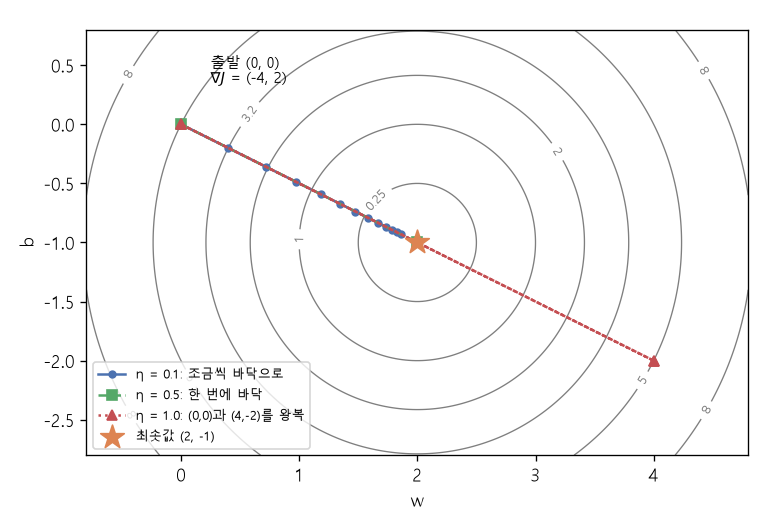

# 그래디언트 벡터 (Gradient vector, ∇)

[목차로 돌아가기](../../00_MIT%EB%94%A5%EB%9F%AC%EB%8B%9D_%EB%AA%A9%EC%B0%A8.md) · 먼저 볼 것: [M03_미분_기울기](../../%EC%88%98%ED%95%99%EA%B0%9C%EB%85%90/02_%EB%AF%B8%EB%B6%84/M03_%EB%AF%B8%EB%B6%84_%EA%B8%B0%EC%9A%B8%EA%B8%B0.md), [M04_편미분](../../%EC%88%98%ED%95%99%EA%B0%9C%EB%85%90/02_%EB%AF%B8%EB%B6%84/M04_%ED%8E%B8%EB%AF%B8%EB%B6%84.md) · 쓰는 곳: [Lec01 5.1 경사하강법](../../Lec01_%EB%94%A5%EB%9F%AC%EB%8B%9D_%EC%86%8C%EA%B0%9C.md#51-%EA%B2%BD%EC%82%AC%ED%95%98%EA%B0%95%EB%B2%95)

📚 학습 순서 10/99 (2. 미분): ← 이전: [M04_편미분](../../%EC%88%98%ED%95%99%EA%B0%9C%EB%85%90/02_%EB%AF%B8%EB%B6%84/M04_%ED%8E%B8%EB%AF%B8%EB%B6%84.md) · 다음: [M09_최솟값과_볼록함수](../../%EC%88%98%ED%95%99%EA%B0%9C%EB%85%90/02_%EB%AF%B8%EB%B6%84/M09_%EC%B5%9C%EC%86%9F%EA%B0%92%EA%B3%BC_%EB%B3%BC%EB%A1%9D%ED%95%A8%EC%88%98.md) →

> [!NOTE]
> **3줄 요약**
> - [파라미터](../../00_%EB%94%A5%EB%9F%AC%EB%8B%9D_%EC%9A%A9%EC%96%B4%EC%82%AC%EC%A0%84.md#parameter-%ED%8C%8C%EB%9D%BC%EB%AF%B8%ED%84%B0)가 여러 개일 때 **[파라미터](../../00_%EB%94%A5%EB%9F%AC%EB%8B%9D_%EC%9A%A9%EC%96%B4%EC%82%AC%EC%A0%84.md#parameter-%ED%8C%8C%EB%9D%BC%EB%AF%B8%ED%84%B0)마다 편미분한 값을 한 줄로 모은 것**이 그래디언트 $\nabla J$다. $J(w, b) = (w-2)^2 + (b+1)^2$이면 $\nabla J = (2(w-2),\ 2(b+1))$.
> - 그래디언트는 **J가 가장 빨리 커지는 방향**을 가리킨다. 그래서 [경사하강법](../../00_%EB%94%A5%EB%9F%AC%EB%8B%9D_%EC%9A%A9%EC%96%B4%EC%82%AC%EC%A0%84.md#gradient-descent-%EA%B2%BD%EC%82%AC%ED%95%98%EA%B0%95%EB%B2%95)은 그 반대로 간다: $\theta \leftarrow \theta - \eta \nabla J(\theta)$.
> - [학습률](../../00_%EB%94%A5%EB%9F%AC%EB%8B%9D_%EC%9A%A9%EC%96%B4%EC%82%AC%EC%A0%84.md#learning-rate-%ED%95%99%EC%8A%B5%EB%A5%A0) $\eta$가 알맞으면 바닥으로 다가가고(η = 0.1), 너무 크면 바닥을 넘어 왕복한다(η = 1.0).

## 1. 개념 설명

비유: 안개 낀 산비탈에 서 있다. 발밑 경사만 느낄 수 있다. 동쪽(w 방향)으로 한 걸음 가면 얼마나 높아지는지, 북쪽(b 방향)으로 한 걸음 가면 얼마나 높아지는지를 각각 재면, 두 값을 합친 화살표가 "가장 가파르게 올라가는 방향"이 된다. 이 화살표가 그래디언트다. 내려가고 싶으면 화살표의 반대쪽으로 걷는다.

- [M03_미분_기울기](../../%EC%88%98%ED%95%99%EA%B0%9C%EB%85%90/02_%EB%AF%B8%EB%B6%84/M03_%EB%AF%B8%EB%B6%84_%EA%B8%B0%EC%9A%B8%EA%B8%B0.md)의 [미분](../../00_%EB%94%A5%EB%9F%AC%EB%8B%9D_%EC%9A%A9%EC%96%B4%EC%82%AC%EC%A0%84.md#derivative-%EB%AF%B8%EB%B6%84)은 변수가 하나일 때의 [기울기](../../00_%EB%94%A5%EB%9F%AC%EB%8B%9D_%EC%9A%A9%EC%96%B4%EC%82%AC%EC%A0%84.md#gradient-%EA%B8%B0%EC%9A%B8%EA%B8%B0)다.
- [M04_편미분](../../%EC%88%98%ED%95%99%EA%B0%9C%EB%85%90/02_%EB%AF%B8%EB%B6%84/M04_%ED%8E%B8%EB%AF%B8%EB%B6%84.md)의 [편미분](../../00_%EB%94%A5%EB%9F%AC%EB%8B%9D_%EC%9A%A9%EC%96%B4%EC%82%AC%EC%A0%84.md#partial-derivative-%ED%8E%B8%EB%AF%B8%EB%B6%84)은 변수가 여럿일 때, **하나만 움직이고 나머지는 고정**한 [기울기](../../00_%EB%94%A5%EB%9F%AC%EB%8B%9D_%EC%9A%A9%EC%96%B4%EC%82%AC%EC%A0%84.md#gradient-%EA%B8%B0%EC%9A%B8%EA%B8%B0)다.
- 그래디언트는 그 [편미분](../../00_%EB%94%A5%EB%9F%AC%EB%8B%9D_%EC%9A%A9%EC%96%B4%EC%82%AC%EC%A0%84.md#partial-derivative-%ED%8E%B8%EB%AF%B8%EB%B6%84)들을 **벡터 하나로 묶은 것**이다.

$$
\nabla J(w, b) = \left(\frac{\partial J}{\partial w},\ \frac{\partial J}{\partial b}\right)
$$

<details><summary>기호 풀이</summary>

| 기호 | 읽는 법 | 뜻 | 예제 값 |
| --- | --- | --- | --- |
| $\nabla J(w, b)$ | 나블라 제이, 그래디언트 J | [편미분](../../00_%EB%94%A5%EB%9F%AC%EB%8B%9D_%EC%9A%A9%EC%96%B4%EC%82%AC%EC%A0%84.md#partial-derivative-%ED%8E%B8%EB%AF%B8%EB%B6%84)을 모은 벡터 (가장 가파르게 올라가는 방향) | (2, 4) |
| $J$ | 제이 | [손실](../../00_%EB%94%A5%EB%9F%AC%EB%8B%9D_%EC%9A%A9%EC%96%B4%EC%82%AC%EC%A0%84.md#loss-function-%EC%86%90%EC%8B%A4-%ED%95%A8%EC%88%98) 함수 | J(3, 1) = 5 |
| $w$, $b$ | 더블유, 비 | J를 바꾸는 두 변수 ([가중치](../../00_%EB%94%A5%EB%9F%AC%EB%8B%9D_%EC%9A%A9%EC%96%B4%EC%82%AC%EC%A0%84.md#weight-%EA%B0%80%EC%A4%91%EC%B9%98)와 [편향](../../00_%EB%94%A5%EB%9F%AC%EB%8B%9D_%EC%9A%A9%EC%96%B4%EC%82%AC%EC%A0%84.md#bias-%ED%8E%B8%ED%96%A5)) | (3, 1) |
| $\partial$ | 파셜, 라운드 디 | [편미분](../../00_%EB%94%A5%EB%9F%AC%EB%8B%9D_%EC%9A%A9%EC%96%B4%EC%82%AC%EC%A0%84.md#partial-derivative-%ED%8E%B8%EB%AF%B8%EB%B6%84) 표시 (다른 변수는 고정) | - |
| $\frac{\partial J}{\partial w}$ | 파셜 제이 파셜 더블유 | w만 움직일 때 J의 [기울기](../../00_%EB%94%A5%EB%9F%AC%EB%8B%9D_%EC%9A%A9%EC%96%B4%EC%82%AC%EC%A0%84.md#gradient-%EA%B8%B0%EC%9A%B8%EA%B8%B0) | 2 |
| $\frac{\partial J}{\partial b}$ | 파셜 제이 파셜 비 | b만 움직일 때 J의 [기울기](../../00_%EB%94%A5%EB%9F%AC%EB%8B%9D_%EC%9A%A9%EC%96%B4%EC%82%AC%EC%A0%84.md#gradient-%EA%B8%B0%EC%9A%B8%EA%B8%B0) | 4 |

</details>

<details><summary>예제와 풀이</summary>

**문제**: [손실](../../00_%EB%94%A5%EB%9F%AC%EB%8B%9D_%EC%9A%A9%EC%96%B4%EC%82%AC%EC%A0%84.md#loss-function-%EC%86%90%EC%8B%A4-%ED%95%A8%EC%88%98) $J(w, b) = (w-2)^2 + (b+1)^2$에서 [가중치](../../00_%EB%94%A5%EB%9F%AC%EB%8B%9D_%EC%9A%A9%EC%96%B4%EC%82%AC%EC%A0%84.md#weight-%EA%B0%80%EC%A4%91%EC%B9%98) w = 3, [편향](../../00_%EB%94%A5%EB%9F%AC%EB%8B%9D_%EC%9A%A9%EC%96%B4%EC%82%AC%EC%A0%84.md#bias-%ED%8E%B8%ED%96%A5) b = 1일 때 그래디언트 $\nabla J$는?

**주어진 값**:
- $w = 3$ ([가중치](../../00_%EB%94%A5%EB%9F%AC%EB%8B%9D_%EC%9A%A9%EC%96%B4%EC%82%AC%EC%A0%84.md#weight-%EA%B0%80%EC%A4%91%EC%B9%98))
- $b = 1$ ([편향](../../00_%EB%94%A5%EB%9F%AC%EB%8B%9D_%EC%9A%A9%EC%96%B4%EC%82%AC%EC%A0%84.md#bias-%ED%8E%B8%ED%96%A5))
- $\frac{\partial J}{\partial w} = 2(w-2)$ (b를 고정하고 w로 미분한 식, 3절)
- $\frac{\partial J}{\partial b} = 2(b+1)$ (w를 고정하고 b로 미분한 식, 3절)

**풀이**
1. 식을 그대로 쓴다: $\nabla J(w, b) = \left(\frac{\partial J}{\partial w},\ \frac{\partial J}{\partial b}\right)$
2. 값을 대입한다: $\nabla J(3, 1) = \big(2(3 - 2),\ 2(1 + 1)\big)$
3. 첫째 칸 괄호를 계산한다: 3 − 2 = 1 이므로 $\nabla J(3, 1) = \big(2 \times 1,\ 2(1 + 1)\big)$
4. 첫째 칸 곱셈을 한다: 2 × 1 = 2 이므로 $\nabla J(3, 1) = \big(2,\ 2(1 + 1)\big)$
5. 둘째 칸 괄호를 계산한다: 1 + 1 = 2 이므로 $\nabla J(3, 1) = \big(2,\ 2 \times 2\big)$
6. 둘째 칸 곱셈을 한다: 2 × 2 = 4 이므로 $\nabla J(3, 1) = (2, 4)$

**답**: $\nabla J(3, 1) = (2, 4)$ (두 칸 모두 양수라 w도 b도 줄여야 [손실](../../00_%EB%94%A5%EB%9F%AC%EB%8B%9D_%EC%9A%A9%EC%96%B4%EC%82%AC%EC%A0%84.md#loss-function-%EC%86%90%EC%8B%A4-%ED%95%A8%EC%88%98)이 준다)

</details>

<details><summary>내 이해</summary>


</details>

## 2. 필요한 이유

[Lec01 5.1](../../Lec01_%EB%94%A5%EB%9F%AC%EB%8B%9D_%EC%86%8C%EA%B0%9C.md#51-%EA%B2%BD%EC%82%AC%ED%95%98%EA%B0%95%EB%B2%95)의 갱신식은 [파라미터](../../00_%EB%94%A5%EB%9F%AC%EB%8B%9D_%EC%9A%A9%EC%96%B4%EC%82%AC%EC%A0%84.md#parameter-%ED%8C%8C%EB%9D%BC%EB%AF%B8%ED%84%B0) 전체 $\theta$를 한꺼번에 움직인다.

$$
\theta \leftarrow \theta - \eta\, \nabla_\theta J(\theta)
$$

<details><summary>기호 풀이</summary>

| 기호 | 읽는 법 | 뜻 | 예제 값 |
| --- | --- | --- | --- |
| $\theta$ | 세타 | [파라미터](../../00_%EB%94%A5%EB%9F%AC%EB%8B%9D_%EC%9A%A9%EC%96%B4%EC%82%AC%EC%A0%84.md#parameter-%ED%8C%8C%EB%9D%BC%EB%AF%B8%ED%84%B0) 전체 (여기서는 (w, b)) | (3, 1) |
| $\leftarrow$ | 갱신 | 오른쪽 값으로 바꿔 넣기 (코드의 `=`) | (3, 1) → (2.5, 0) |
| $\eta$ | 에타 | [학습률](../../00_%EB%94%A5%EB%9F%AC%EB%8B%9D_%EC%9A%A9%EC%96%B4%EC%82%AC%EC%A0%84.md#learning-rate-%ED%95%99%EC%8A%B5%EB%A5%A0), 한 걸음의 크기 | 0.25 |
| $\nabla_\theta J(\theta)$ | 나블라 세타 제이 세타 | θ의 모든 칸에 대한 [편미분](../../00_%EB%94%A5%EB%9F%AC%EB%8B%9D_%EC%9A%A9%EC%96%B4%EC%82%AC%EC%A0%84.md#partial-derivative-%ED%8E%B8%EB%AF%B8%EB%B6%84)을 모은 그래디언트 | (2, 4) |
| $J(\theta)$ | 제이 세타 | 지금 θ에서의 [손실](../../00_%EB%94%A5%EB%9F%AC%EB%8B%9D_%EC%9A%A9%EC%96%B4%EC%82%AC%EC%A0%84.md#loss-function-%EC%86%90%EC%8B%A4-%ED%95%A8%EC%88%98) | 5 |

</details>

<details><summary>예제와 풀이</summary>

**문제**: 같은 [손실](../../00_%EB%94%A5%EB%9F%AC%EB%8B%9D_%EC%9A%A9%EC%96%B4%EC%82%AC%EC%A0%84.md#loss-function-%EC%86%90%EC%8B%A4-%ED%95%A8%EC%88%98) $J(w, b) = (w-2)^2 + (b+1)^2$에서 지금 (w, b) = (3, 1)이고 [학습률](../../00_%EB%94%A5%EB%9F%AC%EB%8B%9D_%EC%9A%A9%EC%96%B4%EC%82%AC%EC%A0%84.md#learning-rate-%ED%95%99%EC%8A%B5%EB%A5%A0)이 0.25일 때 한 번 갱신한 (w, b)와 [손실](../../00_%EB%94%A5%EB%9F%AC%EB%8B%9D_%EC%9A%A9%EC%96%B4%EC%82%AC%EC%A0%84.md#loss-function-%EC%86%90%EC%8B%A4-%ED%95%A8%EC%88%98)은?

**주어진 값**:
- $\theta = (w, b) = (3, 1)$ (지금 [파라미터](../../00_%EB%94%A5%EB%9F%AC%EB%8B%9D_%EC%9A%A9%EC%96%B4%EC%82%AC%EC%A0%84.md#parameter-%ED%8C%8C%EB%9D%BC%EB%AF%B8%ED%84%B0))
- $\eta = 0.25$ ([학습률](../../00_%EB%94%A5%EB%9F%AC%EB%8B%9D_%EC%9A%A9%EC%96%B4%EC%82%AC%EC%A0%84.md#learning-rate-%ED%95%99%EC%8A%B5%EB%A5%A0))
- $\nabla_\theta J = \big(2(w-2),\ 2(b+1)\big)$ (그래디언트 식, 3절)

**풀이**
1. 식을 그대로 쓴다: $\theta \leftarrow \theta - \eta\, \nabla_\theta J(\theta)$
2. 값을 대입한다: $\theta \leftarrow (3, 1) - 0.25 \times \big(2(3 - 2),\ 2(1 + 1)\big)$
3. 괄호 안을 계산한다: 3 − 2 = 1, 1 + 1 = 2 이므로 $\theta \leftarrow (3, 1) - 0.25 \times (2 \times 1,\ 2 \times 2)$
4. 그래디언트 곱셈을 한다: 2 × 1 = 2, 2 × 2 = 4 이므로 $\theta \leftarrow (3, 1) - 0.25 \times (2, 4)$
5. [학습률](../../00_%EB%94%A5%EB%9F%AC%EB%8B%9D_%EC%9A%A9%EC%96%B4%EC%82%AC%EC%A0%84.md#learning-rate-%ED%95%99%EC%8A%B5%EB%A5%A0)을 칸마다 곱한다: 0.25 × 2 = 0.5, 0.25 × 4 = 1 이므로 $\theta \leftarrow (3, 1) - (0.5, 1)$
6. 칸끼리 뺀다: 3 − 0.5 = 2.5, 1 − 1 = 0 이므로 θ = (2.5, 0)
7. 갱신 전 [손실](../../00_%EB%94%A5%EB%9F%AC%EB%8B%9D_%EC%9A%A9%EC%96%B4%EC%82%AC%EC%A0%84.md#loss-function-%EC%86%90%EC%8B%A4-%ED%95%A8%EC%88%98)을 구한다 (확인용): (3 − 2)² + (1 + 1)² = 1² + 2² = 1 + 4 = 5
8. 갱신 후 [손실](../../00_%EB%94%A5%EB%9F%AC%EB%8B%9D_%EC%9A%A9%EC%96%B4%EC%82%AC%EC%A0%84.md#loss-function-%EC%86%90%EC%8B%A4-%ED%95%A8%EC%88%98)을 구한다 (확인용): (2.5 − 2)² + (0 + 1)² = 0.5² + 1² = 0.25 + 1 = 1.25

**답**: θ = (2.5, 0), J는 5에서 1.25로 줄어든다

</details>

<details><summary>내 이해</summary>


</details>

강의 슬라이드에는 같은 식이 $\theta^{t+1} = \theta^t - \eta \frac{\partial J(\theta)}{\partial \theta}$로 적혀 있다. 실제 신경망의 $\theta$는 [가중치](../../00_%EB%94%A5%EB%9F%AC%EB%8B%9D_%EC%9A%A9%EC%96%B4%EC%82%AC%EC%A0%84.md#weight-%EA%B0%80%EC%A4%91%EC%B9%98)와 [편향](../../00_%EB%94%A5%EB%9F%AC%EB%8B%9D_%EC%9A%A9%EC%96%B4%EC%82%AC%EC%A0%84.md#bias-%ED%8E%B8%ED%96%A5) 수백만 개를 모은 것이라, [파라미터](../../00_%EB%94%A5%EB%9F%AC%EB%8B%9D_%EC%9A%A9%EC%96%B4%EC%82%AC%EC%A0%84.md#parameter-%ED%8C%8C%EB%9D%BC%EB%AF%B8%ED%84%B0)마다 식을 따로 쓰지 않고 벡터 하나로 쓴다. 그 [기울기](../../00_%EB%94%A5%EB%9F%AC%EB%8B%9D_%EC%9A%A9%EC%96%B4%EC%82%AC%EC%A0%84.md#gradient-%EA%B8%B0%EC%9A%B8%EA%B8%B0) 벡터를 계산해 주는 것이 [역전파](../../00_%EB%94%A5%EB%9F%AC%EB%8B%9D_%EC%9A%A9%EC%96%B4%EC%82%AC%EC%A0%84.md#backpropagation-%EC%97%AD%EC%A0%84%ED%8C%8C)(자동 [미분](../../00_%EB%94%A5%EB%9F%AC%EB%8B%9D_%EC%9A%A9%EC%96%B4%EC%82%AC%EC%A0%84.md#derivative-%EB%AF%B8%EB%B6%84))다.

## 3. 숫자로 보기

[손실](../../00_%EB%94%A5%EB%9F%AC%EB%8B%9D_%EC%9A%A9%EC%96%B4%EC%82%AC%EC%A0%84.md#loss-function-%EC%86%90%EC%8B%A4-%ED%95%A8%EC%88%98) $J(w, b) = (w-2)^2 + (b+1)^2$을 쓴다. 바닥은 $w = 2$, $b = -1$에서 $J = 0$이다.

**[편미분](../../00_%EB%94%A5%EB%9F%AC%EB%8B%9D_%EC%9A%A9%EC%96%B4%EC%82%AC%EC%A0%84.md#partial-derivative-%ED%8E%B8%EB%AF%B8%EB%B6%84) 구하기** (한 줄에 한 동작)
- $w$로 [편미분](../../00_%EB%94%A5%EB%9F%AC%EB%8B%9D_%EC%9A%A9%EC%96%B4%EC%82%AC%EC%A0%84.md#partial-derivative-%ED%8E%B8%EB%AF%B8%EB%B6%84): $b$는 고정이니 $(b+1)^2$은 상수라 0, $(w-2)^2$은 $2(w-2)$ → $\frac{\partial J}{\partial w} = 2(w-2)$
- $b$로 [편미분](../../00_%EB%94%A5%EB%9F%AC%EB%8B%9D_%EC%9A%A9%EC%96%B4%EC%82%AC%EC%A0%84.md#partial-derivative-%ED%8E%B8%EB%AF%B8%EB%B6%84): 같은 방법으로 $\frac{\partial J}{\partial b} = 2(b+1)$

**출발점 (0, 0)에서**
- $J(0, 0) = (0-2)^2 + (0+1)^2 = 4 + 1 = 5$
- $\nabla J(0, 0) = (2(0-2),\ 2(0+1)) = (-4,\ 2)$
- 읽는 법: w를 늘리면 J가 줄고(−4), b를 늘리면 J가 는다(+2). 그래서 w는 늘리고 b는 줄여야 한다.

**η = 0.1로 갱신**

| 단계 | w | b | $\partial J / \partial w$ | $\partial J / \partial b$ | J |
|---|---|---|---|---|---|
| 0 | 0 | 0 | −4 | 2 | 5 |
| 1 | 0 − 0.1×(−4) = **0.4** | 0 − 0.1×2 = **−0.2** | −3.2 | 1.6 | 3.2 |
| 2 | **0.72** | **−0.36** | −2.56 | 1.28 | 2.048 |
| 3 | **0.976** | **−0.488** | −2.048 | 1.024 | 1.3107 |

- 한 번 갱신할 때마다 J가 0.64배가 된다(5 → 3.2 → 2.048 → 1.3107). 바닥 (2, −1)에 꾸준히 다가간다.

**[학습률](../../00_%EB%94%A5%EB%9F%AC%EB%8B%9D_%EC%9A%A9%EC%96%B4%EC%82%AC%EC%A0%84.md#learning-rate-%ED%95%99%EC%8A%B5%EB%A5%A0)을 바꾸면**

| η | 첫 갱신 뒤 (w, b) | 그다음 | 결과 |
|---|---|---|---|
| 0.1 | (0.4, −0.2) | (0.72, −0.36) | 조금씩 바닥으로 |
| 0.5 | (2, −1) | (2, −1) | 한 번에 바닥 (이 식에서만 생기는 우연) |
| 1.0 | (4, −2) | (0, 0) | 바닥을 사이에 두고 왕복, J는 계속 5 |



<details><summary>기호 풀이</summary>

| 기호 | 읽는 법 | 뜻 | 예제 값 |
| --- | --- | --- | --- |
| $\nabla J$ | 나블라 제이, 그래디언트 J | [편미분](../../00_%EB%94%A5%EB%9F%AC%EB%8B%9D_%EC%9A%A9%EC%96%B4%EC%82%AC%EC%A0%84.md#partial-derivative-%ED%8E%B8%EB%AF%B8%EB%B6%84)을 모은 벡터 | (−4, 2) |
| $\frac{\partial J}{\partial w}$ | 파셜 제이 파셜 더블유 | w만 움직일 때 J의 [기울기](../../00_%EB%94%A5%EB%9F%AC%EB%8B%9D_%EC%9A%A9%EC%96%B4%EC%82%AC%EC%A0%84.md#gradient-%EA%B8%B0%EC%9A%B8%EA%B8%B0) | −4 |
| $\theta$ | 세타 | [파라미터](../../00_%EB%94%A5%EB%9F%AC%EB%8B%9D_%EC%9A%A9%EC%96%B4%EC%82%AC%EC%A0%84.md#parameter-%ED%8C%8C%EB%9D%BC%EB%AF%B8%ED%84%B0) 전체 (여기서는 (w, b)) | (0, 0) |
| $\eta$ | 에타 | [학습률](../../00_%EB%94%A5%EB%9F%AC%EB%8B%9D_%EC%9A%A9%EC%96%B4%EC%82%AC%EC%A0%84.md#learning-rate-%ED%95%99%EC%8A%B5%EB%A5%A0), 한 걸음의 크기 | 0.1 |
| $\leftarrow$ | 갱신 | 오른쪽 값으로 바꿔 넣기 (코드의 `=`) | - |
| $\theta^t$ | 세타 티 | t번째 단계의 [파라미터](../../00_%EB%94%A5%EB%9F%AC%EB%8B%9D_%EC%9A%A9%EC%96%B4%EC%82%AC%EC%A0%84.md#parameter-%ED%8C%8C%EB%9D%BC%EB%AF%B8%ED%84%B0) | - |

</details>

## 4. 코드로 확인

```python
# [변수] w, b = 0.0, 0.0: 학습할 파라미터 두 개의 출발점. 일부러 바닥 (2, -1)에서 먼 곳에서 시작한다
# [변수] eta = 0.1: 학습률 η. 한 걸음의 크기를 정한다
# [연결] 본문 3절 표의 0단계, 갱신식 θ ← θ - η∇J의 θ와 η
w, b, eta = 0.0, 0.0, 0.1
# [함수] range(4): 0, 1, 2, 3을 차례로 내준다. for: 그 횟수만큼 아래 블록을 되풀이한다
# [변수] t: 지금 몇 번째 단계인지 (출력 표의 "단계" 칸)
for t in range(4):
    # [변수] J: 지금 (w, b)에서의 손실 (w-2)² + (b+1)². 줄어드는지 확인하려고 매번 계산한다
    # [연결] 바닥 (2, -1)에서 0이 된다. 결과 5 → 3.2 → 2.048 → 1.3107
    J = (w - 2) ** 2 + (b + 1) ** 2
    # [변수] gw = ∂J/∂w = 2(w-2), gb = ∂J/∂b = 2(b+1): 그래디언트 벡터 ∇J의 두 칸
    # [쓸모] 부호로 방향을 안다. gw < 0이면 w를 늘려야 J가 준다
    # [연결] 편미분 규칙은 M04_편미분, 이 두 값을 묶은 것이 ∇J (본문 1절)
    gw, gb = 2 * (w - 2), 2 * (b + 1)
    # [함수] round(값, 4): 소수 넷째 자리로 반올림. print: 한 줄로 출력
    # [연결] 출력 한 줄이 본문 표의 한 행 (단계, w, b, J)
    print(t, round(w, 4), round(b, 4), round(J, 4))
    # [변수] 새 w, b: 그래디언트의 반대 방향(빼기)으로 η만큼 움직인 값
    # [연결] 갱신식 θ ← θ - η∇J를 칸마다 쓴 것 = Lec01 5.1의 "한 번의 경사하강 갱신"
    w, b = w - eta * gw, b - eta * gb
```

**실행 결과**:

```text
0 0.0 0.0 5.0
1 0.4 -0.2 3.2
2 0.72 -0.36 2.048
3 0.976 -0.488 1.3107
```

> [!WARNING]
> **⚠ 주의**
> - 그래디언트는 **올라가는** 방향이다. 갱신식의 빼기(−)를 빠뜨리면 [손실](../../00_%EB%94%A5%EB%9F%AC%EB%8B%9D_%EC%9A%A9%EC%96%B4%EC%82%AC%EC%A0%84.md#loss-function-%EC%86%90%EC%8B%A4-%ED%95%A8%EC%88%98)이 커진다.
> - η = 0.5에서 한 번에 바닥에 닿은 것은 이 [손실](../../00_%EB%94%A5%EB%9F%AC%EB%8B%9D_%EC%9A%A9%EC%96%B4%EC%82%AC%EC%A0%84.md#loss-function-%EC%86%90%EC%8B%A4-%ED%95%A8%EC%88%98) 식이 단순해서 생긴 우연이다. 실제 신경망에서 [학습률](../../00_%EB%94%A5%EB%9F%AC%EB%8B%9D_%EC%9A%A9%EC%96%B4%EC%82%AC%EC%A0%84.md#learning-rate-%ED%95%99%EC%8A%B5%EB%A5%A0)은 실험으로 정한다.

## 5. 개념 재확인

<details><summary>1. $J(w, b) = (w-2)^2 + (b+1)^2$, 출발점 (1, 1), η = 0.25이면 한 번 갱신한 뒤 (w, b)와 J는?</summary>

| 단계 | 하는 일 | 식 | 계산 | 결과 |
|---|---|---|---|---|
| 1 | 처음 [손실](../../00_%EB%94%A5%EB%9F%AC%EB%8B%9D_%EC%9A%A9%EC%96%B4%EC%82%AC%EC%A0%84.md#loss-function-%EC%86%90%EC%8B%A4-%ED%95%A8%EC%88%98) | $(w-2)^2 + (b+1)^2$ | $1 + 4$ | 5 |
| 2 | 그래디언트 | $(2(w-2),\ 2(b+1))$ | $(2×(−1),\ 2×2)$ | (−2, 4) |
| 3 | w 갱신 | $w - \eta \frac{\partial J}{\partial w}$ | $1 - 0.25×(−2)$ | 1.5 |
| 4 | b 갱신 | $b - \eta \frac{\partial J}{\partial b}$ | $1 - 0.25×4$ | 0 |
| 5 | 새 [손실](../../00_%EB%94%A5%EB%9F%AC%EB%8B%9D_%EC%9A%A9%EC%96%B4%EC%82%AC%EC%A0%84.md#loss-function-%EC%86%90%EC%8B%A4-%ED%95%A8%EC%88%98) | $(1.5-2)^2 + (0+1)^2$ | $0.25 + 1$ | 1.25 |

**① 쓰는 식**
$$\nabla J = (2(w-2),\ 2(b+1)), \qquad \theta \leftarrow \theta - \eta \nabla J$$
- 위 식 ← 왼쪽 식은 ③ (그래디언트), 오른쪽 식은 ④ (w 갱신)와 ⑤ (b 갱신)에서 쓰고, ② (처음 [손실](../../00_%EB%94%A5%EB%9F%AC%EB%8B%9D_%EC%9A%A9%EC%96%B4%EC%82%AC%EC%A0%84.md#loss-function-%EC%86%90%EC%8B%A4-%ED%95%A8%EC%88%98))와 ⑥ (새 [손실](../../00_%EB%94%A5%EB%9F%AC%EB%8B%9D_%EC%9A%A9%EC%96%B4%EC%82%AC%EC%A0%84.md#loss-function-%EC%86%90%EC%8B%A4-%ED%95%A8%EC%88%98))은 J 식에 넣어 확인한다.
```python
# [변수] w, b = 1.0, 1.0: 출발점, eta = 0.25: 학습률. 문제에서 준 값
w, b, eta = 1.0, 1.0, 0.25                # ①
# [함수] lambda: 이름 없는 짧은 함수를 만든다. J(w, b)처럼 불러 쓸 수 있다
# [변수] J: 손실 함수 (w-2)² + (b+1)². 갱신 전과 후에 두 번 계산하려고 함수로 둔다
J = lambda w, b: (w - 2)**2 + (b + 1)**2
# [연결] 단계 ② 처음 손실 → 5.0
print(J(w, b))                            # ②
# [변수] gw, gb = -2.0, 4.0: 그래디언트 ∇J의 두 칸. w는 늘리고(-), b는 줄여야(+) 함을 알려 준다
# [연결] 단계 ③, 식은 본문 3절의 편미분
gw, gb = 2 * (w - 2), 2 * (b + 1)         # ③
# [변수] 새 w = 1 - 0.25×(-2) = 1.5: 기울기 반대 방향으로 한 걸음
w = w - eta * gw                          # ④
# [변수] 새 b = 1 - 0.25×4 = 0.0
b = b - eta * gb                          # ⑤
# [연결] 단계 ⑥ → 1.5 0.0 1.25. 손실이 5에서 1.25로 줄었다
print(w, b, J(w, b))                      # ⑥
```

**주어진 값**
- $(w, b) = (1, 1)$ (출발점)
- $\eta = 0.25$ ([학습률](../../00_%EB%94%A5%EB%9F%AC%EB%8B%9D_%EC%9A%A9%EC%96%B4%EC%82%AC%EC%A0%84.md#learning-rate-%ED%95%99%EC%8A%B5%EB%A5%A0))
- $J(w, b) = (w-2)^2 + (b+1)^2$ ([손실](../../00_%EB%94%A5%EB%9F%AC%EB%8B%9D_%EC%9A%A9%EC%96%B4%EC%82%AC%EC%A0%84.md#loss-function-%EC%86%90%EC%8B%A4-%ED%95%A8%EC%88%98))

**② 처음 [손실](../../00_%EB%94%A5%EB%9F%AC%EB%8B%9D_%EC%9A%A9%EC%96%B4%EC%82%AC%EC%A0%84.md#loss-function-%EC%86%90%EC%8B%A4-%ED%95%A8%EC%88%98)**
- 식을 그대로 쓴다: $J(w, b) = (w-2)^2 + (b+1)^2$
- 값을 대입한다: $J(1, 1) = (1-2)^2 + (1+1)^2$
- 괄호를 계산한다: 1 − 2 = −1, 1 + 1 = 2 이므로 $J(1, 1) = (-1)^2 + 2^2$
- 제곱한다: (−1)² = 1, 2² = 4 이므로 $J(1, 1) = 1 + 4$
- 더한다: 1 + 4 = 5 이므로 $J(1, 1) = 5$

**③ 그래디언트**
- 식을 그대로 쓴다: $\nabla J = \left(\frac{\partial J}{\partial w},\ \frac{\partial J}{\partial b}\right) = \big(2(w-2),\ 2(b+1)\big)$
- 값을 대입한다: $\nabla J(1, 1) = \big(2(1-2),\ 2(1+1)\big)$
- 괄호를 계산한다: 1 − 2 = −1, 1 + 1 = 2 이므로 $\nabla J(1, 1) = (2 \times (-1),\ 2 \times 2)$
- 곱셈을 한다: 2 × (−1) = −2, 2 × 2 = 4 이므로 $\nabla J(1, 1) = (-2, 4)$

**④ w 갱신**
- 식을 그대로 쓴다: $w \leftarrow w - \eta \frac{\partial J}{\partial w}$
- 값을 대입한다: $w \leftarrow 1 - 0.25 \times (-2)$
- 곱셈을 한다: 0.25 × (−2) = −0.5 이므로 $w \leftarrow 1 - (-0.5)$
- 뺄셈을 한다: 1 − (−0.5) = 1 + 0.5 = 1.5 이므로 $w = 1.5$

**⑤ b 갱신**
- 식을 그대로 쓴다: $b \leftarrow b - \eta \frac{\partial J}{\partial b}$
- 값을 대입한다: $b \leftarrow 1 - 0.25 \times 4$
- 곱셈을 한다: 0.25 × 4 = 1 이므로 $b \leftarrow 1 - 1$
- 뺄셈을 한다: 1 − 1 = 0 이므로 $b = 0$

**⑥ 새 [손실](../../00_%EB%94%A5%EB%9F%AC%EB%8B%9D_%EC%9A%A9%EC%96%B4%EC%82%AC%EC%A0%84.md#loss-function-%EC%86%90%EC%8B%A4-%ED%95%A8%EC%88%98)**
- 식을 그대로 쓴다: $J(w, b) = (w-2)^2 + (b+1)^2$
- 값을 대입한다: $J(1.5, 0) = (1.5-2)^2 + (0+1)^2$
- 괄호를 계산한다: 1.5 − 2 = −0.5, 0 + 1 = 1 이므로 $J(1.5, 0) = (-0.5)^2 + 1^2$
- 제곱한다: (−0.5)² = 0.25, 1² = 1 이므로 $J(1.5, 0) = 0.25 + 1$
- 더한다: 0.25 + 1 = 1.25 이므로 $J(1.5, 0) = 1.25$ (5에서 줄었다)

**답**: (w, b) = **(1.5, 0)**, J = **1.25**

</details>

<details><summary>2. 같은 J에서 η = 1.0이면 왜 바닥에 가지 못하나? 출발점 (0, 0)으로 두 번 갱신해 확인하라.</summary>

| 단계 | 하는 일 | 계산 | 결과 |
|---|---|---|---|
| 1 | (0, 0)의 그래디언트 | $(2×(−2),\ 2×1)$ | (−4, 2) |
| 2 | 첫 갱신 | $(0 + 4,\ 0 - 2)$ | (4, −2) |
| 3 | (4, −2)의 그래디언트 | $(2×2,\ 2×(−1))$ | (4, −2) |
| 4 | 둘째 갱신 | $(4 - 4,\ −2 + 2)$ | (0, 0) |
| 5 | 결론 | 출발점으로 돌아옴 | 왕복 |

**① 쓰는 식**
$$w \leftarrow w - \eta \cdot 2(w-2)$$
- 위 식 ← ② (첫 갱신 준비), ③ (첫 갱신), ④ (둘째 갱신 준비), ⑤ (둘째 갱신)에서 쓴다. b도 같은 모양이다.
- η = 1.0을 넣으면 $w - 2(w-2) = 4 - w$가 된다. 바닥(2)을 기준으로 **거울에 비친 자리**로 뛰는 셈이다.
```python
# [변수] w, b = 0.0, 0.0: 출발점, eta = 1.0: 너무 큰 학습률. 문제에서 준 값
w, b, eta = 0.0, 0.0, 1.0                 # ①
# [함수] range(2): 두 번 되풀이 (첫 갱신, 둘째 갱신)
for t in range(2):
    # [변수] gw, gb: 지금 자리의 그래디언트. 첫 번째 (-4, 2), 두 번째 (4, -2)
    gw, gb = 2 * (w - 2), 2 * (b + 1)     # ②④
    # [변수] 새 w, b: η = 1이라 바닥을 건너뛰어 반대편으로 간다
    # [연결] w - 2(w-2) = 4 - w, 바닥 2를 기준으로 거울에 비친 자리 (① 쓰는 식 설명)
    w, b = w - eta * gw, b - eta * gb     # ③⑤
    # [연결] 출력 (4.0, -2.0) → (0.0, 0.0). 출발점으로 돌아와 왕복이 된다
    print(w, b)
```

**주어진 값**
- $(w, b) = (0, 0)$ (출발점)
- $\eta = 1.0$ (너무 큰 [학습률](../../00_%EB%94%A5%EB%9F%AC%EB%8B%9D_%EC%9A%A9%EC%96%B4%EC%82%AC%EC%A0%84.md#learning-rate-%ED%95%99%EC%8A%B5%EB%A5%A0))
- $\nabla J = \big(2(w-2),\ 2(b+1)\big)$ (그래디언트 식)

**② (0, 0)의 그래디언트**
- 식을 그대로 쓴다: $\nabla J = \big(2(w-2),\ 2(b+1)\big)$
- 값을 대입한다: $\nabla J(0, 0) = \big(2(0-2),\ 2(0+1)\big)$
- 괄호를 계산한다: 0 − 2 = −2, 0 + 1 = 1 이므로 $\nabla J(0, 0) = (2 \times (-2),\ 2 \times 1)$
- 곱셈을 한다: 2 × (−2) = −4, 2 × 1 = 2 이므로 $\nabla J(0, 0) = (-4, 2)$

**③ 첫 갱신**
- 식을 그대로 쓴다: $\theta \leftarrow \theta - \eta \nabla J$
- 값을 대입한다: $(w, b) \leftarrow (0, 0) - 1.0 \times (-4, 2)$
- [학습률](../../00_%EB%94%A5%EB%9F%AC%EB%8B%9D_%EC%9A%A9%EC%96%B4%EC%82%AC%EC%A0%84.md#learning-rate-%ED%95%99%EC%8A%B5%EB%A5%A0)을 칸마다 곱한다: 1.0 × (−4) = −4, 1.0 × 2 = 2 이므로 $(w, b) \leftarrow (0, 0) - (-4, 2)$
- 칸끼리 뺀다: 0 − (−4) = 4, 0 − 2 = −2 이므로 $(w, b) = (4, -2)$

**④ (4, −2)의 그래디언트**
- 식을 그대로 쓴다: $\nabla J = \big(2(w-2),\ 2(b+1)\big)$
- 값을 대입한다: $\nabla J(4, -2) = \big(2(4-2),\ 2(-2+1)\big)$
- 괄호를 계산한다: 4 − 2 = 2, −2 + 1 = −1 이므로 $\nabla J(4, -2) = (2 \times 2,\ 2 \times (-1))$
- 곱셈을 한다: 2 × 2 = 4, 2 × (−1) = −2 이므로 $\nabla J(4, -2) = (4, -2)$

**⑤ 둘째 갱신**
- 식을 그대로 쓴다: $\theta \leftarrow \theta - \eta \nabla J$
- 값을 대입한다: $(w, b) \leftarrow (4, -2) - 1.0 \times (4, -2)$
- [학습률](../../00_%EB%94%A5%EB%9F%AC%EB%8B%9D_%EC%9A%A9%EC%96%B4%EC%82%AC%EC%A0%84.md#learning-rate-%ED%95%99%EC%8A%B5%EB%A5%A0)을 칸마다 곱한다: 1.0 × 4 = 4, 1.0 × (−2) = −2 이므로 $(w, b) \leftarrow (4, -2) - (4, -2)$
- 칸끼리 뺀다: 4 − 4 = 0, −2 − (−2) = 0 이므로 $(w, b) = (0, 0)$ (출발점으로 돌아왔다)

**답**: 한 걸음이 너무 커서 바닥 (2, −1)을 **건너뛰어 반대편으로** 간다. (0, 0)과 (4, −2)를 계속 왕복하고 J는 5에 머문다.

</details>

## 예제 풀기

[예제 10문제 풀기](../../%EC%98%88%EC%A0%9C/02_%EB%AF%B8%EB%B6%84/%EC%98%88%EC%A0%9C_MM02_%EA%B7%B8%EB%9E%98%EB%94%94%EC%96%B8%ED%8A%B8_%EB%B2%A1%ED%84%B0.md)

<details><summary>내 이해</summary>


</details>
