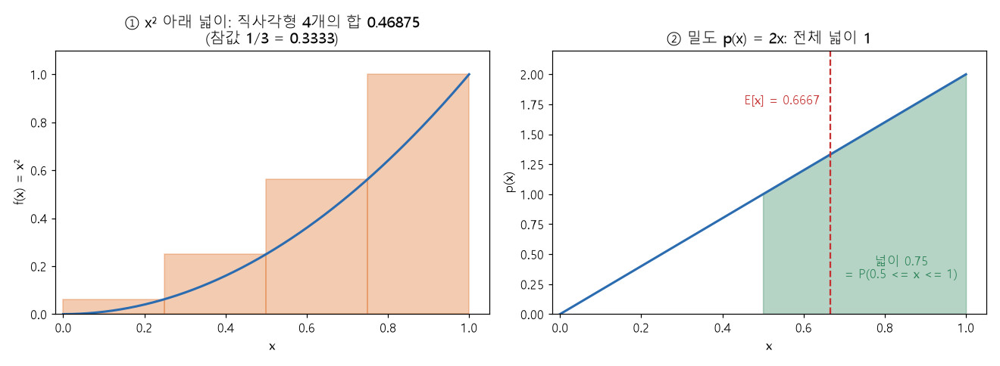

# 정적분과 넓이 (Definite integral and area)

[목차로 돌아가기](../../00_MIT%EB%94%A5%EB%9F%AC%EB%8B%9D_%EB%AA%A9%EC%B0%A8.md) · 먼저 볼 것: [M03_미분_기울기](../../%EC%88%98%ED%95%99%EA%B0%9C%EB%85%90/02_%EB%AF%B8%EB%B6%84/M03_%EB%AF%B8%EB%B6%84_%EA%B8%B0%EC%9A%B8%EA%B8%B0.md), [M02_시그마와_평균](../../%EC%88%98%ED%95%99%EA%B0%9C%EB%85%90/01_%EC%88%98%EC%99%80_%ED%95%A8%EC%88%98/M02_%EC%8B%9C%EA%B7%B8%EB%A7%88%EC%99%80_%ED%8F%89%EA%B7%A0.md), [M06_지수와_e](../../%EC%88%98%ED%95%99%EA%B0%9C%EB%85%90/01_%EC%88%98%EC%99%80_%ED%95%A8%EC%88%98/M06_%EC%A7%80%EC%88%98%EC%99%80_e.md) · 쓰는 곳: [MM07_리만_합과_보편_근사](../../%EC%88%98%ED%95%99%EA%B0%9C%EB%85%90/06_%EA%B7%BC%EC%82%AC_%EC%9D%B4%EB%A1%A0/MM07_%EB%A6%AC%EB%A7%8C_%ED%95%A9%EA%B3%BC_%EB%B3%B4%ED%8E%B8_%EA%B7%BC%EC%82%AC.md), [MM50_확률_밀도와_정규분포](../../%EC%88%98%ED%95%99%EA%B0%9C%EB%85%90/04_%ED%99%95%EB%A5%A0%EA%B3%BC_%EC%A0%95%EB%B3%B4/MM50_%ED%99%95%EB%A5%A0_%EB%B0%80%EB%8F%84%EC%99%80_%EC%A0%95%EA%B7%9C%EB%B6%84%ED%8F%AC.md), [MM22_기댓값과_일반화_간극](../../%EC%88%98%ED%95%99%EA%B0%9C%EB%85%90/04_%ED%99%95%EB%A5%A0%EA%B3%BC_%EC%A0%95%EB%B3%B4/MM22_%EA%B8%B0%EB%8C%93%EA%B0%92%EA%B3%BC_%EC%9D%BC%EB%B0%98%ED%99%94_%EA%B0%84%EA%B7%B9.md), [MM54_가우스_혼합과_주변_우도](../../%EC%88%98%ED%95%99%EA%B0%9C%EB%85%90/11_%EC%83%9D%EC%84%B1_%EB%AA%A8%EB%8D%B8/MM54_%EA%B0%80%EC%9A%B0%EC%8A%A4_%ED%98%BC%ED%95%A9%EA%B3%BC_%EC%A3%BC%EB%B3%80_%EC%9A%B0%EB%8F%84.md)

📚 학습 순서 13/99 (2. 미분): ← 이전: [MM01_argmin과_argmax](../../%EC%88%98%ED%95%99%EA%B0%9C%EB%85%90/02_%EB%AF%B8%EB%B6%84/MM01_argmin%EA%B3%BC_argmax.md) · 다음: [M05_벡터와_행렬](../../%EC%88%98%ED%95%99%EA%B0%9C%EB%85%90/03_%EC%84%A0%ED%98%95%EB%8C%80%EC%88%98/M05_%EB%B2%A1%ED%84%B0%EC%99%80_%ED%96%89%EB%A0%AC.md) →

> [!NOTE]
> **3줄 요약**
> - **정적분** $\int_a^b f(x)\,dx$는 곡선 $f$ 아래, $a$에서 $b$까지의 **넓이**다. 가느다란 직사각형을 늘어놓고 넓이를 더한 [리만 합](../../00_%EB%94%A5%EB%9F%AC%EB%8B%9D_%EC%9A%A9%EC%96%B4%EC%82%AC%EC%A0%84.md#riemann-sum-%EB%A6%AC%EB%A7%8C-%ED%95%A9)에서 직사각형 폭을 0으로 보낸 값이다. $x^2$의 0에서 1까지 넓이는 직사각형 4개로 0.46875, 100개로 0.33835, 끝없이 늘리면 $1/3$이다.
> - 계산은 [미분](../../00_%EB%94%A5%EB%9F%AC%EB%8B%9D_%EC%9A%A9%EC%96%B4%EC%82%AC%EC%A0%84.md#derivative-%EB%AF%B8%EB%B6%84)을 거꾸로 하면 된다. $f$의 역도함수 $F$(미분하면 $f$)를 찾아 $F(b) - F(a)$를 구한다. $x^n$은 $x^{n+1}/(n+1)$, $e^x$는 $e^x$다.
> - [확률](../../00_%EB%94%A5%EB%9F%AC%EB%8B%9D_%EC%9A%A9%EC%96%B4%EC%82%AC%EC%A0%84.md#probability-%ED%99%95%EB%A5%A0) 밀도는 **아래 넓이의 합이 1**이다. 구간의 [확률](../../00_%EB%94%A5%EB%9F%AC%EB%8B%9D_%EC%9A%A9%EC%96%B4%EC%82%AC%EC%A0%84.md#probability-%ED%99%95%EB%A5%A0)은 그 구간의 넓이이고, [기댓값](../../00_%EB%94%A5%EB%9F%AC%EB%8B%9D_%EC%9A%A9%EC%96%B4%EC%82%AC%EC%A0%84.md#expectation-%EA%B8%B0%EB%8C%93%EA%B0%92)은 $\int x\,p(x)\,dx$다. 연속 분포에서 Σ(더하기)가 ∫(적분)으로 바뀐 것이다.

## 1. 개념 설명

비유: 수도꼭지에서 물이 나오는데 세기가 시간마다 다르다. 1초마다 "그 1초 동안의 세기 × 1초"를 구해 더하면 물통에 담긴 총량이 된다. 1초를 0.1초, 0.01초로 잘게 쪼갤수록 더 정확해진다. 세기 그래프 **아래 넓이**가 총량이고, 그것이 정적분이다.

- **[리만 합](../../00_%EB%94%A5%EB%9F%AC%EB%8B%9D_%EC%9A%A9%EC%96%B4%EC%82%AC%EC%A0%84.md#riemann-sum-%EB%A6%AC%EB%A7%8C-%ED%95%A9)**: 구간 $[a, b]$를 폭 $\Delta x$인 $n$조각으로 나누고, 조각마다 높이 $f(x_i)$ × 폭 $\Delta x$인 직사각형 넓이를 더한다. 조각을 늘릴수록(폭이 0에 가까울수록) 곡선 아래 넓이에 가까워진다. [MM07_리만_합과_보편_근사](../../%EC%88%98%ED%95%99%EA%B0%9C%EB%85%90/06_%EA%B7%BC%EC%82%AC_%EC%9D%B4%EB%A1%A0/MM07_%EB%A6%AC%EB%A7%8C_%ED%95%A9%EA%B3%BC_%EB%B3%B4%ED%8E%B8_%EA%B7%BC%EC%82%AC.md)은 이 직사각형들로 곡선을 근사한다.
- **역도함수**(antiderivative): 미분하면 $f$가 되는 함수 $F$. [미분](../../00_%EB%94%A5%EB%9F%AC%EB%8B%9D_%EC%9A%A9%EC%96%B4%EC%82%AC%EC%A0%84.md#derivative-%EB%AF%B8%EB%B6%84)의 거꾸로다. 상수는 미분하면 0이라 $+C$가 붙는다. 상수배와 합은 항마다 따로 계산한다.
- **기본 정리**(fundamental theorem): 넓이는 직사각형을 하나하나 더하지 않아도, 역도함수의 끝값 차이 $F(b) - F(a)$로 한 번에 나온다.

$$
\int_a^b f(x)\,dx = \lim_{n\to\infty}\sum_{i=1}^{n} f(x_i)\,\Delta x, \qquad \Delta x = \frac{b-a}{n},\quad x_i = a + i\,\Delta x
$$

<details><summary>기호 풀이</summary>

| 기호 | 읽는 법 | 뜻 | 예제 값 |
| --- | --- | --- | --- |
| $\int_a^b f(x)\,dx$ | 인테그랄 에이에서 비까지 에프 엑스 디엑스 | $a$에서 $b$까지 곡선 $f$ 아래 넓이 (S를 길게 늘인 기호, Sum) | 0.3333 |
| $f(x)$ | 에프 엑스 | 곡선의 높이 | $x^2$ |
| $dx$ | 디엑스 | "$x$ 방향 아주 얇은 폭" 표시 | - |
| $\Delta x$ | 델타 엑스 | 직사각형 하나의 폭 = (b − a) ÷ n | 0.25 |
| $x_i$ | 엑스 아이 | i번째 직사각형 오른쪽 끝의 x | 0.25, 0.5, 0.75, 1 |
| $n$ | 엔 | 직사각형(조각) 개수 | 4 |
| $\lim_{n\to\infty}$ | 리미트 엔 무한대 | n을 한없이 키울 때 다가가는 값 | 1/3 |
| $\sum_{i=1}^{n}$ | 시그마 | i = 1부터 n까지 전부 더한다 | - |

</details>

<details><summary>예제와 풀이</summary>

**문제**: $f(x) = x^2$, 구간 $[0, 1]$을 직사각형 $n = 4$개(오른쪽 끝 높이)로 나눈 [리만 합](../../00_%EB%94%A5%EB%9F%AC%EB%8B%9D_%EC%9A%A9%EC%96%B4%EC%82%AC%EC%A0%84.md#riemann-sum-%EB%A6%AC%EB%A7%8C-%ED%95%A9)을 구하라.

**주어진 값**:
- $f(x) = x^2$ (곡선)
- $a = 0,\ b = 1$ (구간의 양 끝)
- $n = 4$ (직사각형 개수)

**풀이**
1. 식을 그대로 쓴다: $\sum_{i=1}^{n} f(x_i)\,\Delta x$, $\Delta x = \frac{b-a}{n}$, $x_i = a + i\,\Delta x$
2. 값을 대입한다: $\Delta x = \frac{1 - 0}{4}$
3. 폭을 계산한다: 1 ÷ 4 = 0.25 이므로 $\Delta x = 0.25$
4. 오른쪽 끝 x를 구한다: $x_i = 0 + i \times 0.25$ 이므로 $x_1 = 0.25,\ x_2 = 0.5,\ x_3 = 0.75,\ x_4 = 1$
5. 높이를 구한다 ($f(x) = x^2$에 넣는다): 0.25² = 0.0625, 0.5² = 0.25, 0.75² = 0.5625, 1² = 1
6. 높이를 더한다: 0.0625 + 0.25 + 0.5625 + 1 = 1.875 이므로 합 $= 1.875 \times \Delta x$
7. 폭을 곱한다: 1.875 × 0.25 = 0.46875

**답**: [리만 합](../../00_%EB%94%A5%EB%9F%AC%EB%8B%9D_%EC%9A%A9%EC%96%B4%EC%82%AC%EC%A0%84.md#riemann-sum-%EB%A6%AC%EB%A7%8C-%ED%95%A9) = 0.46875 (참값 1/3 = 0.3333보다 크다. 오른쪽 끝 높이는 오르는 곡선 위에서 넓이를 부풀린다)

</details>

<details><summary>내 이해</summary>


</details>

역도함수를 찾는 규칙은 [미분](../../00_%EB%94%A5%EB%9F%AC%EB%8B%9D_%EC%9A%A9%EC%96%B4%EC%82%AC%EC%A0%84.md#derivative-%EB%AF%B8%EB%B6%84) 규칙([M03_미분_기울기](../../%EC%88%98%ED%95%99%EA%B0%9C%EB%85%90/02_%EB%AF%B8%EB%B6%84/M03_%EB%AF%B8%EB%B6%84_%EA%B8%B0%EC%9A%B8%EA%B8%B0.md))을 거꾸로 읽은 것이다. $x^n$을 미분하면 $n x^{n-1}$([지수](../../00_%EB%94%A5%EB%9F%AC%EB%8B%9D_%EC%9A%A9%EC%96%B4%EC%82%AC%EC%A0%84.md#e-exponent-e%EC%99%80-%EC%A7%80%EC%88%98)를 앞으로 내리고 1 줄임)이고, $e^x$는 미분해도 $e^x$다([M06_지수와_e](../../%EC%88%98%ED%95%99%EA%B0%9C%EB%85%90/01_%EC%88%98%EC%99%80_%ED%95%A8%EC%88%98/M06_%EC%A7%80%EC%88%98%EC%99%80_e.md)). 그러니 거꾸로 하면 [지수](../../00_%EB%94%A5%EB%9F%AC%EB%8B%9D_%EC%9A%A9%EC%96%B4%EC%82%AC%EC%A0%84.md#e-exponent-e%EC%99%80-%EC%A7%80%EC%88%98)를 1 올리고 그 [지수](../../00_%EB%94%A5%EB%9F%AC%EB%8B%9D_%EC%9A%A9%EC%96%B4%EC%82%AC%EC%A0%84.md#e-exponent-e%EC%99%80-%EC%A7%80%EC%88%98)로 나눈다.

$$
\int x^n\,dx = \frac{x^{n+1}}{n+1} + C \quad (n \ne -1), \qquad \int e^x\,dx = e^x + C
$$

<details><summary>기호 풀이</summary>

| 기호 | 읽는 법 | 뜻 | 예제 값 |
| --- | --- | --- | --- |
| $\int \cdots dx$ | 인테그랄 | 역도함수(미분하면 $\cdots$이 되는 함수)를 구한다 | - |
| $x^n$ | 엑스의 엔제곱 | 거듭제곱 함수 | $x^2$ |
| $\frac{x^{n+1}}{n+1}$ | 엑스 엔 플러스 일 나누기 엔 플러스 일 | [지수](../../00_%EB%94%A5%EB%9F%AC%EB%8B%9D_%EC%9A%A9%EC%96%B4%EC%82%AC%EC%A0%84.md#e-exponent-e%EC%99%80-%EC%A7%80%EC%88%98)를 1 올리고 그 [지수](../../00_%EB%94%A5%EB%9F%AC%EB%8B%9D_%EC%9A%A9%EC%96%B4%EC%82%AC%EC%A0%84.md#e-exponent-e%EC%99%80-%EC%A7%80%EC%88%98)로 나눈 것 | $x^3/3$ |
| $C$ | 씨 | 임의의 상수 (미분하면 0이라 알 수 없다) | - |
| $e^x$ | 이의 엑스제곱 | 미분해도 자기 자신인 함수 ($e = 2.7183$) | - |

</details>

<details><summary>예제와 풀이</summary>

**문제**: $x^2$의 역도함수를 공식으로 구하고, 미분해서 $x^2$가 되돌아오는지 확인하라.

**주어진 값**:
- $n = 2$ ([지수](../../00_%EB%94%A5%EB%9F%AC%EB%8B%9D_%EC%9A%A9%EC%96%B4%EC%82%AC%EC%A0%84.md#e-exponent-e%EC%99%80-%EC%A7%80%EC%88%98))
- [미분](../../00_%EB%94%A5%EB%9F%AC%EB%8B%9D_%EC%9A%A9%EC%96%B4%EC%82%AC%EC%A0%84.md#derivative-%EB%AF%B8%EB%B6%84) 규칙: $x^m$을 미분하면 $m\,x^{m-1}$ (확인할 때 쓴다)

**풀이**
1. 식을 그대로 쓴다: $\int x^n\,dx = \frac{x^{n+1}}{n+1} + C$
2. 값을 대입한다: $\int x^2\,dx = \frac{x^{2+1}}{2+1} + C$
3. [지수](../../00_%EB%94%A5%EB%9F%AC%EB%8B%9D_%EC%9A%A9%EC%96%B4%EC%82%AC%EC%A0%84.md#e-exponent-e%EC%99%80-%EC%A7%80%EC%88%98)를 계산한다: 2 + 1 = 3 이므로 $\int x^2\,dx = \frac{x^3}{3} + C$
4. 후보 $F(x) = \frac{x^3}{3}$를 미분한다 ([미분](../../00_%EB%94%A5%EB%9F%AC%EB%8B%9D_%EC%9A%A9%EC%96%B4%EC%82%AC%EC%A0%84.md#derivative-%EB%AF%B8%EB%B6%84) 규칙을 쓴다): $F'(x) = \frac{3\,x^{3-1}}{3}$
5. [지수](../../00_%EB%94%A5%EB%9F%AC%EB%8B%9D_%EC%9A%A9%EC%96%B4%EC%82%AC%EC%A0%84.md#e-exponent-e%EC%99%80-%EC%A7%80%EC%88%98)를 계산한다: 3 − 1 = 2 이므로 $F'(x) = \frac{3\,x^2}{3}$
6. 나눈다: 3 ÷ 3 = 1 이므로 $F'(x) = x^2$

**답**: $\int x^2\,dx = \frac{x^3}{3} + C$ (미분하면 $x^2$로 돌아온다)

</details>

<details><summary>내 이해</summary>


</details>

이제 직사각형을 하나하나 더하지 않고도 넓이가 나온다. 역도함수 $F$를 알면, 끝값의 차이가 곧 정적분이다.

$$
\int_a^b f(x)\,dx = F(b) - F(a), \qquad F'(x) = f(x)
$$

<details><summary>기호 풀이</summary>

| 기호 | 읽는 법 | 뜻 | 예제 값 |
| --- | --- | --- | --- |
| $F(x)$ | 대문자 에프 엑스 | $f$의 역도함수 (미분하면 $f$) | $x^3/3$ |
| $F'(x) = f(x)$ | 에프 프라임 = 에프 | $F$를 미분하면 $f$가 된다는 약속 | $x^2$ |
| $F(b) - F(a)$ | 에프 비 빼기 에프 에이 | 끝값에서 시작값을 뺀 것 | 9 − 0 = 9 |
| $\left[F(x)\right]_a^b$ | 대괄호 a에서 b | $F(b) - F(a)$를 줄여 쓰는 표기 | - |

</details>

<details><summary>예제와 풀이</summary>

**문제**: $\int_0^3 x^2\,dx$를 기본 정리로 구하라.

**주어진 값**:
- $f(x) = x^2$ (곡선)
- $a = 0,\ b = 3$ (구간의 양 끝)
- $F(x) = \frac{x^3}{3}$ (앞에서 구한 역도함수)

**풀이**
1. 식을 그대로 쓴다: $\int_a^b f(x)\,dx = F(b) - F(a)$
2. 값을 대입한다: $\int_0^3 x^2\,dx = \frac{3^3}{3} - \frac{0^3}{3}$
3. 세제곱한다: 3³ = 27, 0³ = 0 이므로 $\frac{27}{3} - \frac{0}{3}$
4. 나눈다: 27 ÷ 3 = 9, 0 ÷ 3 = 0 이므로 $9 - 0$
5. 뺀다: 9 − 0 = 9

**답**: $\int_0^3 x^2\,dx = 9$

</details>

<details><summary>내 이해</summary>


</details>

## 2. 필요한 이유

[MM50_확률_밀도와_정규분포](../../%EC%88%98%ED%95%99%EA%B0%9C%EB%85%90/04_%ED%99%95%EB%A5%A0%EA%B3%BC_%EC%A0%95%EB%B3%B4/MM50_%ED%99%95%EB%A5%A0_%EB%B0%80%EB%8F%84%EC%99%80_%EC%A0%95%EA%B7%9C%EB%B6%84%ED%8F%AC.md)의 연속 분포에서는 한 점의 [확률](../../00_%EB%94%A5%EB%9F%AC%EB%8B%9D_%EC%9A%A9%EC%96%B4%EC%82%AC%EC%A0%84.md#probability-%ED%99%95%EB%A5%A0)이 0이고, **구간의 [확률](../../00_%EB%94%A5%EB%9F%AC%EB%8B%9D_%EC%9A%A9%EC%96%B4%EC%82%AC%EC%A0%84.md#probability-%ED%99%95%EB%A5%A0)은 밀도 곡선 아래 넓이**다. 전체 넓이는 1이어야 하므로 밀도 $p(x)$는 적분이 1이 되도록 정한다.

$$
\int_0^1 p(x)\,dx = 1, \qquad P(c \le x \le d) = \int_c^d p(x)\,dx
$$

<details><summary>기호 풀이</summary>

| 기호 | 읽는 법 | 뜻 | 예제 값 |
| --- | --- | --- | --- |
| $p(x)$ | 피 엑스 | [확률 밀도 함수](../../00_%EB%94%A5%EB%9F%AC%EB%8B%9D_%EC%9A%A9%EC%96%B4%EC%82%AC%EC%A0%84.md#probability-density-function-%ED%99%95%EB%A5%A0-%EB%B0%80%EB%8F%84-%ED%95%A8%EC%88%98): 값마다 주는 밀도 (0 이상) | $2x$ |
| $\int_0^1 p(x)\,dx = 1$ | 인테그랄 영에서 일 피 엑스 디엑스 = 1 | 전체 넓이가 1 | 1 |
| $P(c \le x \le d)$ | 피 씨 이하 엑스 이하 디 | $x$가 $c$와 $d$ 사이일 [확률](../../00_%EB%94%A5%EB%9F%AC%EB%8B%9D_%EC%9A%A9%EC%96%B4%EC%82%AC%EC%A0%84.md#probability-%ED%99%95%EB%A5%A0) | 0.75 |
| $c,\ d$ | 씨, 디 | [확률](../../00_%EB%94%A5%EB%9F%AC%EB%8B%9D_%EC%9A%A9%EC%96%B4%EC%82%AC%EC%A0%84.md#probability-%ED%99%95%EB%A5%A0)을 구하려는 구간의 양 끝 | 0.5, 1 |

</details>

<details><summary>예제와 풀이</summary>

**문제**: $[0, 1]$에서 $p(x) = 2x$가 밀도인지(넓이 1인지) 확인하고, $P(0.5 \le x \le 1)$을 구하라. ($2x$의 역도함수는 $x^2$이다. $2x = 2 \cdot x^1$이므로 $2 \cdot \frac{x^2}{2} = x^2$이다.)

**주어진 값**:
- $p(x) = 2x$ (밀도 후보)
- $F(x) = x^2$ (역도함수)
- $c = 0.5,\ d = 1$ ([확률](../../00_%EB%94%A5%EB%9F%AC%EB%8B%9D_%EC%9A%A9%EC%96%B4%EC%82%AC%EC%A0%84.md#probability-%ED%99%95%EB%A5%A0)을 구할 구간)

**풀이**
1. 식을 그대로 쓴다: $\int_0^1 p(x)\,dx = F(1) - F(0)$, $P(c \le x \le d) = F(d) - F(c)$
2. 값을 대입한다: $\int_0^1 2x\,dx = 1^2 - 0^2$, $P(0.5 \le x \le 1) = 1^2 - 0.5^2$
3. 제곱한다: 1² = 1, 0² = 0, 0.5² = 0.25 이므로 전체 넓이는 $1 - 0$, [확률](../../00_%EB%94%A5%EB%9F%AC%EB%8B%9D_%EC%9A%A9%EC%96%B4%EC%82%AC%EC%A0%84.md#probability-%ED%99%95%EB%A5%A0)은 $1 - 0.25$
4. 뺀다: 1 − 0 = 1, 1 − 0.25 = 0.75

**답**: 전체 넓이 = 1이라 밀도가 맞고, $P(0.5 \le x \le 1) = 0.75$ (값이 큰 쪽에 [확률](../../00_%EB%94%A5%EB%9F%AC%EB%8B%9D_%EC%9A%A9%EC%96%B4%EC%82%AC%EC%A0%84.md#probability-%ED%99%95%EB%A5%A0)이 몰려 있다)

</details>

<details><summary>내 이해</summary>


</details>

[MM22_기댓값과_일반화_간극](../../%EC%88%98%ED%95%99%EA%B0%9C%EB%85%90/04_%ED%99%95%EB%A5%A0%EA%B3%BC_%EC%A0%95%EB%B3%B4/MM22_%EA%B8%B0%EB%8C%93%EA%B0%92%EA%B3%BC_%EC%9D%BC%EB%B0%98%ED%99%94_%EA%B0%84%EA%B7%B9.md)의 [기댓값](../../00_%EB%94%A5%EB%9F%AC%EB%8B%9D_%EC%9A%A9%EC%96%B4%EC%82%AC%EC%A0%84.md#expectation-%EA%B8%B0%EB%8C%93%EA%B0%92)도 같은 변화를 겪는다. 값이 몇 개뿐일 때는 값 × [확률](../../00_%EB%94%A5%EB%9F%AC%EB%8B%9D_%EC%9A%A9%EC%96%B4%EC%82%AC%EC%A0%84.md#probability-%ED%99%95%EB%A5%A0)을 더하는 Σ였고, 값이 연속이면 값 × 밀도를 "더하는" ∫이 된다.

$$
E[x] = \sum_{k} x_k\, p_k \quad\longrightarrow\quad E[x] = \int x\,p(x)\,dx
$$

<details><summary>기호 풀이</summary>

| 기호 | 읽는 법 | 뜻 | 예제 값 |
| --- | --- | --- | --- |
| $E[x]$ | 이 엑스 | [기댓값](../../00_%EB%94%A5%EB%9F%AC%EB%8B%9D_%EC%9A%A9%EC%96%B4%EC%82%AC%EC%A0%84.md#expectation-%EA%B8%B0%EB%8C%93%EA%B0%92): [확률](../../00_%EB%94%A5%EB%9F%AC%EB%8B%9D_%EC%9A%A9%EC%96%B4%EC%82%AC%EC%A0%84.md#probability-%ED%99%95%EB%A5%A0)로 가중한 평균 | 0.6667 |
| $x_k,\ p_k$ | 엑스 케이, 피 케이 | 값 $k$와 그 [확률](../../00_%EB%94%A5%EB%9F%AC%EB%8B%9D_%EC%9A%A9%EC%96%B4%EC%82%AC%EC%A0%84.md#probability-%ED%99%95%EB%A5%A0) (이산) | - |
| $x\,p(x)$ | 엑스 피 엑스 | 값 × 밀도 (연속) | $2x^2$ |
| $\int x\,p(x)\,dx$ | 인테그랄 엑스 피 엑스 디엑스 | $x\,p(x)$ 곡선 아래 넓이 | 0.6667 |

</details>

<details><summary>예제와 풀이</summary>

**문제**: $[0, 1]$에서 밀도 $p(x) = 2x$일 때 [기댓값](../../00_%EB%94%A5%EB%9F%AC%EB%8B%9D_%EC%9A%A9%EC%96%B4%EC%82%AC%EC%A0%84.md#expectation-%EA%B8%B0%EB%8C%93%EA%B0%92) $E[x]$를 구하라. ($2x^2$의 역도함수는 $2 \cdot \frac{x^3}{3}$이다.)

**주어진 값**:
- $p(x) = 2x$ (밀도)
- $a = 0,\ b = 1$ (구간)
- $x\,p(x) = 2x^2$ (피적분 함수), $F(x) = \frac{2x^3}{3}$ (그 역도함수)

**풀이**
1. 식을 그대로 쓴다: $E[x] = \int x\,p(x)\,dx$
2. 값을 대입한다: $E[x] = \int_0^1 x \cdot 2x\,dx$
3. 곱한다: $x \cdot 2x = 2x^2$ 이므로 $E[x] = \int_0^1 2x^2\,dx$
4. 기본 정리를 쓴다: $E[x] = F(1) - F(0) = \frac{2 \times 1^3}{3} - \frac{2 \times 0^3}{3}$
5. 세제곱한다: 1³ = 1, 0³ = 0 이므로 $E[x] = \frac{2 \times 1}{3} - \frac{2 \times 0}{3}$
6. 곱한다: 2 × 1 = 2, 2 × 0 = 0 이므로 $E[x] = \frac{2}{3} - 0$
7. 나눈다: 2 ÷ 3 = 0.6667

**답**: $E[x] = \frac{2}{3} = 0.6667$ (큰 값 쪽으로 쏠린 밀도라 평균이 구간의 가운데 0.5보다 오른쪽이다)

</details>

<details><summary>내 이해</summary>


</details>

[MM54_가우스_혼합과_주변_우도](../../%EC%88%98%ED%95%99%EA%B0%9C%EB%85%90/11_%EC%83%9D%EC%84%B1_%EB%AA%A8%EB%8D%B8/MM54_%EA%B0%80%EC%9A%B0%EC%8A%A4_%ED%98%BC%ED%95%A9%EA%B3%BC_%EC%A3%BC%EB%B3%80_%EC%9A%B0%EB%8F%84.md)의 [주변 우도](../../00_%EB%94%A5%EB%9F%AC%EB%8B%9D_%EC%9A%A9%EC%96%B4%EC%82%AC%EC%A0%84.md#marginal-likelihood-%EC%A3%BC%EB%B3%80-%EC%9A%B0%EB%8F%84) $p(x) = \int p(x \mid z)\,p(z)\,dz$도 같은 ∫이다. [잠재 변수](../../00_%EB%94%A5%EB%9F%AC%EB%8B%9D_%EC%9A%A9%EC%96%B4%EC%82%AC%EC%A0%84.md#latent-variable-%EC%9E%A0%EC%9E%AC-%EB%B3%80%EC%88%98) $z$의 모든 값에 대해 "그 $z$일 때의 밀도 × $z$의 밀도"를 더한 것이다.

## 3. 숫자로 보기

**[리만 합](../../00_%EB%94%A5%EB%9F%AC%EB%8B%9D_%EC%9A%A9%EC%96%B4%EC%82%AC%EC%A0%84.md#riemann-sum-%EB%A6%AC%EB%A7%8C-%ED%95%A9)이 넓이에 다가간다** ($f(x) = x^2$, $[0, 1]$, 오른쪽 끝 높이)

| 직사각형 수 $n$ | 폭 $\Delta x$ | [리만 합](../../00_%EB%94%A5%EB%9F%AC%EB%8B%9D_%EC%9A%A9%EC%96%B4%EC%82%AC%EC%A0%84.md#riemann-sum-%EB%A6%AC%EB%A7%8C-%ED%95%A9) | 참값 $1/3$과의 차 |
|---|---|---|---|
| 4 | 0.25 | 0.46875 | 0.1354 |
| 10 | 0.1 | 0.385 | 0.0517 |
| 100 | 0.01 | 0.33835 | 0.0050 |
| 끝없이 | 0 | 0.3333 (= 1/3) | 0 |

- 왼쪽 끝 높이를 쓰면 반대로 모자란 값이 나온다. 직사각형이 많아질수록 둘 다 같은 값 $1/3$으로 모인다.
- 기본 정리: $F(x) = x^3/3$이므로 $F(1) - F(0) = 1/3 - 0 = 0.3333$. 조각 수천 개를 더한 것을 한 줄로 얻는다.
- $e^x$: $\int_0^1 e^x\,dx = e^1 - e^0 = 2.7183 - 1 = 1.7183$ ($e^0 = 1$, $e = 2.7183$).

**밀도 $p(x) = 2x$ ($[0, 1]$)로 보는 [확률](../../00_%EB%94%A5%EB%9F%AC%EB%8B%9D_%EC%9A%A9%EC%96%B4%EC%82%AC%EC%A0%84.md#probability-%ED%99%95%EB%A5%A0) 계산**

| 구하는 것 | 적분 | 역도함수 | 값 |
|---|---|---|---|
| 전체 넓이 | $\int_0^1 2x\,dx$ | $x^2$ | $1 - 0 = 1$ |
| $P(0.5 \le x \le 1)$ | $\int_{0.5}^{1} 2x\,dx$ | $x^2$ | $1 - 0.25 = 0.75$ |
| [기댓값](../../00_%EB%94%A5%EB%9F%AC%EB%8B%9D_%EC%9A%A9%EC%96%B4%EC%82%AC%EC%A0%84.md#expectation-%EA%B8%B0%EB%8C%93%EA%B0%92) $E[x]$ | $\int_0^1 2x^2\,dx$ | $\frac{2x^3}{3}$ | $0.6667$ |
| $E[x^2]$ | $\int_0^1 2x^3\,dx$ | $\frac{x^4}{2}$ | $0.5$ |
| [분산](../../00_%EB%94%A5%EB%9F%AC%EB%8B%9D_%EC%9A%A9%EC%96%B4%EC%82%AC%EC%A0%84.md#variance-%EB%B6%84%EC%82%B0) | $E[x^2] - E[x]^2$ ([MM85_분산과_표준편차와_공분산](../../%EC%88%98%ED%95%99%EA%B0%9C%EB%85%90/01_%EC%88%98%EC%99%80_%ED%95%A8%EC%88%98/MM85_%EB%B6%84%EC%82%B0%EA%B3%BC_%ED%91%9C%EC%A4%80%ED%8E%B8%EC%B0%A8%EC%99%80_%EA%B3%B5%EB%B6%84%EC%82%B0.md)) | - | $0.5 - 0.4444 = 0.0556$ |



<details><summary>기호 풀이</summary>

| 기호 | 읽는 법 | 뜻 | 예제 값 |
| --- | --- | --- | --- |
| $\int_a^b f(x)\,dx$ | 인테그랄 | 곡선 $f$ 아래, $a$에서 $b$까지 넓이 | 0.3333 |
| $\Delta x$ | 델타 엑스 | 직사각형 폭 | 0.25 |
| $F(b) - F(a)$ | 에프 비 빼기 에프 에이 | 역도함수의 끝값 차이 | 0.3333 |
| $p(x)$ | 피 엑스 | [확률](../../00_%EB%94%A5%EB%9F%AC%EB%8B%9D_%EC%9A%A9%EC%96%B4%EC%82%AC%EC%A0%84.md#probability-%ED%99%95%EB%A5%A0) 밀도 | $2x$ |
| $E[x]$ | 이 엑스 | [기댓값](../../00_%EB%94%A5%EB%9F%AC%EB%8B%9D_%EC%9A%A9%EC%96%B4%EC%82%AC%EC%A0%84.md#expectation-%EA%B8%B0%EB%8C%93%EA%B0%92) | 0.6667 |

</details>

## 4. 코드로 확인

```python
# [함수] def riemann(n): 직사각형 n개로 x²의 [0, 1] 리만 합(오른쪽 끝 높이)을 구해 돌려주는 함수
# [쓸모] n만 바꿔 같은 계산을 되풀이하려고 함수로 묶었다
def riemann(n):
    # [변수] dx = 1 / n: 직사각형 폭 Δx = (b - a) / n, 여기서 b - a = 1
    dx = 1 / n
    # [함수] range(1, n + 1): 1, 2, ..., n. (i * dx) ** 2: 오른쪽 끝 x_i = i·dx의 높이 x²
    # [함수] sum(...) * dx: 높이를 모두 더하고 폭을 곱한다 = 직사각형 넓이의 합
    # [연결] 본문 1절 식 Σ f(x_i) Δx
    return sum((i * dx) ** 2 for i in range(1, n + 1)) * dx
# [변수] for n in (...): 3절 표의 직사각형 수 4, 10, 100과 1000
# [연결] 출력 한 줄이 3절 표의 한 행. 1000개면 0.33383으로 참값 0.33333에 더 가깝다
for n in (4, 10, 100, 1000):
    print(n, round(riemann(n), 5))
# [변수] 1 / 3: 기본 정리로 구한 참값 F(1) - F(0) = 1³/3 - 0
# [연결] 본문 1절 세 번째 식
print(round(1 / 3, 5))
```

**실행 결과**:

```text
4 0.46875
10 0.385
100 0.33835
1000 0.33383
0.33333
```

```python
# [함수] import math: math.exp(e의 거듭제곱), math.e를 쓰려고 불러온다
import math
# [변수] n = 1000, dx = 0.001: 직사각형 1000개와 폭
n = 1000
dx = 1 / n
# [함수] (i + 0.5) * dx: 각 조각의 가운데 x. 가운데 높이를 쓰면 오른쪽 끝보다 오차가 작다
# [변수] xs: 0.0005, 0.0015, ..., 0.9995
xs = [(i + 0.5) * dx for i in range(n)]
# [함수] lambda: 이름 없는 짧은 함수. p(x) = 2x
# [변수] p: 밀도 후보
p = lambda x: 2 * x
# [변수] total = 1.0: 전체 넓이 ∫p dx. 1이어야 밀도다
total = sum(p(x) for x in xs) * dx
# [함수] if x >= 0.5: 0.5 이상인 조각만 더한다
# [변수] prob = 0.75: P(0.5 ≤ x ≤ 1)
prob = sum(p(x) for x in xs if x >= 0.5) * dx
# [변수] mean = 0.6667: 기댓값 ∫x p(x) dx
mean = sum(x * p(x) for x in xs) * dx
# [변수] ex2 = 0.5: E[x²] = ∫x² p(x) dx
ex2 = sum(x ** 2 * p(x) for x in xs) * dx
# [연결] 출력 1: 전체 넓이, 확률, 기댓값 → 3절 두 번째 표의 1, 0.75, 0.6667
print(round(total, 4), round(prob, 4), round(mean, 4))
# [연결] 출력 2: 분산 E[x²] - E[x]² → 0.0556 (MM85의 Var = E[x²] - μ²)
print(round(ex2 - mean ** 2, 4))
# [함수] math.exp(x): e의 x제곱. 합 × dx가 ∫₀¹ eˣ dx의 근삿값
# [연결] 출력 3: 근삿값과 참값 e - 1 = 1.7183 (3절)
print(round(sum(math.exp(x) for x in xs) * dx, 4), round(math.e - 1, 4))
```

**실행 결과**:

```text
1.0 0.75 0.6667
0.0556
1.7183 1.7183
```

> [!WARNING]
> **⚠ 주의**
> - 정적분은 **숫자 하나**(넓이)이고, 부정적분(역도함수)은 **함수**이며 $+C$가 붙는다. 정적분 $F(b) - F(a)$에서는 $C$가 서로 지워져 사라진다.
> - $n = -1$인 $\int x^{-1}\,dx$에는 $\frac{x^{n+1}}{n+1}$ 공식을 쓸 수 없다(0으로 나누게 된다). 이 경우의 답은 [로그](../../00_%EB%94%A5%EB%9F%AC%EB%8B%9D_%EC%9A%A9%EC%96%B4%EC%82%AC%EC%A0%84.md#log-ln-%EB%A1%9C%EA%B7%B8)다([M07_로그](../../%EC%88%98%ED%95%99%EA%B0%9C%EB%85%90/01_%EC%88%98%EC%99%80_%ED%95%A8%EC%88%98/M07_%EB%A1%9C%EA%B7%B8.md)).
> - $f$가 0보다 작은 구간의 넓이는 **음수**로 센다. 총 넓이가 아니라 부호 있는 넓이다.
> - 밀도 $p(x)$는 [확률](../../00_%EB%94%A5%EB%9F%AC%EB%8B%9D_%EC%9A%A9%EC%96%B4%EC%82%AC%EC%A0%84.md#probability-%ED%99%95%EB%A5%A0)이 아니다. 밀도 값은 1보다 클 수 있고(폭 0.5인 균등 분포는 밀도 2), [확률](../../00_%EB%94%A5%EB%9F%AC%EB%8B%9D_%EC%9A%A9%EC%96%B4%EC%82%AC%EC%A0%84.md#probability-%ED%99%95%EB%A5%A0)은 구간의 **넓이**다. 한 점의 넓이는 0이라 한 점의 [확률](../../00_%EB%94%A5%EB%9F%AC%EB%8B%9D_%EC%9A%A9%EC%96%B4%EC%82%AC%EC%A0%84.md#probability-%ED%99%95%EB%A5%A0)도 0이다.
> - 직사각형으로 근사한 값은 높이를 오른쪽 끝, 왼쪽 끝, 가운데 중 어디서 읽느냐에 따라 달라진다. $n$이 커질수록 모두 참값에 모인다.

## 5. 개념 재확인

<details><summary>1. $\int_0^2 (3x^2 + 1)\,dx$를 구하라.</summary>

| 단계 | 하는 일 | 식 | 계산 | 결과 |
|---|---|---|---|---|
| 1 | 항마다 역도함수 | $\int 3x^2\,dx,\ \int 1\,dx$ | $3 \cdot \frac{x^3}{3},\ x$ | $F(x) = x^3 + x$ |
| 2 | 끝값 $F(2)$ | $F(b)$ | $2^3 + 2$ | 10 |
| 3 | 시작값 $F(0)$ | $F(a)$ | $0^3 + 0$ | 0 |
| 4 | 뺀다 | $F(b) - F(a)$ | $10 - 0$ | 10 |

**① 쓰는 식**
$$\int_a^b f(x)\,dx = F(b) - F(a), \qquad \int x^n\,dx = \frac{x^{n+1}}{n+1}$$
- 위 식 ← 오른쪽 식은 ② (항마다 역도함수 찾기)에서, 왼쪽 식은 ③④⑤ (끝값 대입과 빼기)에서 쓴다.
```python
# [함수] lambda x: ...: 이름 없는 함수. F(x) = x³ + x는 3x² + 1의 역도함수다
# [변수] F: 단계 ②에서 찾은 역도함수
F = lambda x: x ** 3 + x                   # ②
# [변수] a, b = 0, 2: 구간의 양 끝. 문제에서 준 값
a, b = 0, 2                                # ①
# [변수] F(b) = 10, F(a) = 0: 끝값과 시작값
print(F(b), F(a))                          # ③④
# [연결] 단계 ⑤ F(b) - F(a) → 10
print(F(b) - F(a))                         # ⑤
# [함수] sum(...) * dx: 가운데 높이를 쓴 리만 합 (n = 1000)
# [쓸모] 역도함수로 구한 값이 맞는지 직사각형 합으로 확인한다 → 10.0
print(round(sum(3 * ((i + 0.5) * 0.002) ** 2 + 1 for i in range(1000)) * 0.002, 4))
```

**② 항마다 역도함수**
- 식을 그대로 쓴다: $\int x^n\,dx = \frac{x^{n+1}}{n+1}$
- $3x^2$ 항 (n = 2): $3 \times \frac{x^{2+1}}{2+1} = 3 \times \frac{x^3}{3}$, 3 ÷ 3 = 1 이므로 $x^3$
- $1$ 항 ($1 = x^0$이라 n = 0): $\frac{x^{0+1}}{0+1} = \frac{x}{1} = x$
- 합친다: $F(x) = x^3 + x$

**③ 끝값**
- 식을 그대로 쓴다: $F(b) = x^3 + x$에 $x = b$를 넣는다
- 값을 대입한다: $F(2) = 2^3 + 2$
- 세제곱한다: 2³ = 8 이므로 $F(2) = 8 + 2$
- 더한다: 8 + 2 = 10

**④ 시작값**
- 값을 대입한다: $F(0) = 0^3 + 0 = 0 + 0 = 0$

**⑤ 빼기**
- 식을 그대로 쓴다: $\int_a^b f(x)\,dx = F(b) - F(a)$
- 값을 대입한다: $\int_0^2 (3x^2 + 1)\,dx = 10 - 0$
- 뺀다: 10 − 0 = 10

**답**: **10**

</details>

<details><summary>2. $[0, 1]$에서 $p(x) = 3x^2$이 밀도인지 확인하고, $P(x \le 0.5)$와 $E[x]$를 구하라.</summary>

| 단계 | 하는 일 | 식 | 계산 | 결과 |
|---|---|---|---|---|
| 1 | 역도함수 | $\int 3x^2\,dx$ | $x^3$ | $F(x) = x^3$ |
| 2 | 전체 넓이 | $F(1) - F(0)$ | $1 - 0$ | 1 (밀도가 맞다) |
| 3 | $P(x \le 0.5)$ | $F(0.5) - F(0)$ | $0.125 - 0$ | 0.125 |
| 4 | $x\,p(x)$의 역도함수 | $\int 3x^3\,dx$ | $3 \cdot \frac{x^4}{4}$ | $G(x) = \frac{3x^4}{4}$ |
| 5 | $E[x]$ | $G(1) - G(0)$ | $0.75 - 0$ | 0.75 |

**① 쓰는 식**
$$\int_0^1 p(x)\,dx = 1, \qquad P(c \le x \le d) = \int_c^d p(x)\,dx, \qquad E[x] = \int x\,p(x)\,dx$$
- 위 식 ← 첫째 식은 ③ (전체 넓이), 둘째 식은 ④ ([확률](../../00_%EB%94%A5%EB%9F%AC%EB%8B%9D_%EC%9A%A9%EC%96%B4%EC%82%AC%EC%A0%84.md#probability-%ED%99%95%EB%A5%A0)), 셋째 식은 ⑤⑥ ([기댓값](../../00_%EB%94%A5%EB%9F%AC%EB%8B%9D_%EC%9A%A9%EC%96%B4%EC%82%AC%EC%A0%84.md#expectation-%EA%B8%B0%EB%8C%93%EA%B0%92))에서 쓴다.
```python
# [함수] lambda x: ...: 이름 없는 함수. F는 3x²의 역도함수 x³
# [변수] F: 단계 ②의 역도함수
F = lambda x: x ** 3                       # ②
# [변수] G: 3x³의 역도함수 3x⁴/4. 기댓값 ∫x·3x² dx = ∫3x³ dx에 쓴다
G = lambda x: 3 * x ** 4 / 4               # ⑤
# [연결] 단계 ③ 전체 넓이 F(1) - F(0) → 1
print(F(1) - F(0))                         # ③
# [연결] 단계 ④ P(x ≤ 0.5) = F(0.5) - F(0) → 0.125
print(F(0.5) - F(0))                       # ④
# [연결] 단계 ⑥ E[x] = G(1) - G(0) → 0.75
print(G(1) - G(0))                         # ⑥
```

**② 역도함수**
- 식을 그대로 쓴다: $\int x^n\,dx = \frac{x^{n+1}}{n+1}$
- 값을 대입한다 (n = 2): $\int 3x^2\,dx = 3 \times \frac{x^3}{3}$
- 계산한다: 3 ÷ 3 = 1 이므로 $F(x) = x^3$

**③ 전체 넓이**
- 식을 그대로 쓴다: $\int_0^1 p(x)\,dx = F(1) - F(0)$
- 값을 대입한다: $1^3 - 0^3$
- 계산한다: 1 − 0 = 1. 전체 넓이가 1이므로 밀도가 맞다.

**④ [확률](../../00_%EB%94%A5%EB%9F%AC%EB%8B%9D_%EC%9A%A9%EC%96%B4%EC%82%AC%EC%A0%84.md#probability-%ED%99%95%EB%A5%A0)**
- 식을 그대로 쓴다: $P(x \le 0.5) = F(0.5) - F(0)$
- 값을 대입한다: $0.5^3 - 0^3$
- 세제곱한다: 0.5 × 0.5 × 0.5 = 0.125 이므로 $0.125 - 0$
- 뺀다: 0.125 − 0 = 0.125

**⑤ [기댓값](../../00_%EB%94%A5%EB%9F%AC%EB%8B%9D_%EC%9A%A9%EC%96%B4%EC%82%AC%EC%A0%84.md#expectation-%EA%B8%B0%EB%8C%93%EA%B0%92)의 역도함수**
- 식을 그대로 쓴다: $E[x] = \int x\,p(x)\,dx$
- 값을 대입한다: $\int_0^1 x \cdot 3x^2\,dx$
- 곱한다: $x \cdot 3x^2 = 3x^3$ 이므로 $\int_0^1 3x^3\,dx$
- 역도함수를 구한다 (n = 3): $3 \times \frac{x^4}{4}$ 이므로 $G(x) = \frac{3x^4}{4}$

**⑥ [기댓값](../../00_%EB%94%A5%EB%9F%AC%EB%8B%9D_%EC%9A%A9%EC%96%B4%EC%82%AC%EC%A0%84.md#expectation-%EA%B8%B0%EB%8C%93%EA%B0%92)**
- 식을 그대로 쓴다: $E[x] = G(1) - G(0)$
- 값을 대입한다: $\frac{3 \times 1^4}{4} - \frac{3 \times 0^4}{4}$
- 계산한다: 3 × 1 = 3, 3 × 0 = 0 이므로 $\frac{3}{4} - 0$
- 나눈다: 3 ÷ 4 = 0.75

**답**: 전체 넓이 **1**(밀도가 맞다), $P(x \le 0.5) = $ **0.125**, $E[x] = $ **0.75** (큰 값 쪽에 [확률](../../00_%EB%94%A5%EB%9F%AC%EB%8B%9D_%EC%9A%A9%EC%96%B4%EC%82%AC%EC%A0%84.md#probability-%ED%99%95%EB%A5%A0)이 더 몰린다)

</details>

## 예제 풀기

[예제 10문제 풀기](../../%EC%98%88%EC%A0%9C/02_%EB%AF%B8%EB%B6%84/%EC%98%88%EC%A0%9C_MM86_%EC%A0%95%EC%A0%81%EB%B6%84%EA%B3%BC_%EB%84%93%EC%9D%B4.md)

<details><summary>내 이해</summary>


</details>
