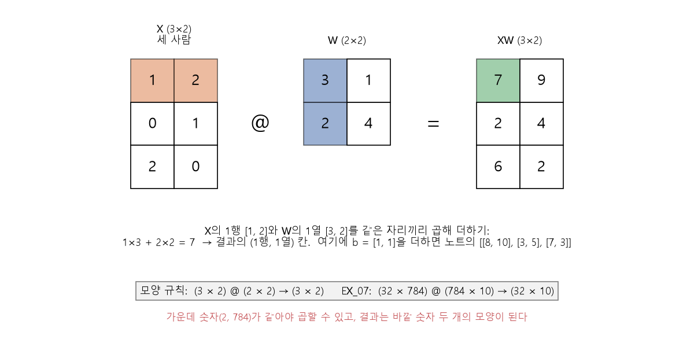

# 벡터와 행렬

[MIT 딥러닝 목차](../../00_MIT%EB%94%A5%EB%9F%AC%EB%8B%9D_%EB%AA%A9%EC%B0%A8.md)

📚 학습 순서 14/99 (3. 선형대수): ← 이전: [MM86_정적분과_넓이](../../%EC%88%98%ED%95%99%EA%B0%9C%EB%85%90/02_%EB%AF%B8%EB%B6%84/MM86_%EC%A0%95%EC%A0%81%EB%B6%84%EA%B3%BC_%EB%84%93%EC%9D%B4.md) · 다음: [MM03_벡터_표기와_전치](../../%EC%88%98%ED%95%99%EA%B0%9C%EB%85%90/03_%EC%84%A0%ED%98%95%EB%8C%80%EC%88%98/MM03_%EB%B2%A1%ED%84%B0_%ED%91%9C%EA%B8%B0%EC%99%80_%EC%A0%84%EC%B9%98.md) →

> [!NOTE]
> **3줄 요약**
> - **벡터**는 숫자를 한 줄로 묶은 것(1차원 배열), **행렬**은 숫자를 표로 묶은 것(2차원 배열)이다. 배열의 모양을 **shape**라고 한다.
> - [행렬 곱](../../00_%EB%94%A5%EB%9F%AC%EB%8B%9D_%EC%9A%A9%EC%96%B4%EC%82%AC%EC%A0%84.md#matrix-multiplication-%ED%96%89%EB%A0%AC-%EA%B3%B1)은 "**한 줄과 한 열을 같은 자리끼리 곱해서 더하기**"를 모든 칸에 하는 것이다. D01_퍼셉트론의 [가중합](../../00_%EB%94%A5%EB%9F%AC%EB%8B%9D_%EC%9A%A9%EC%96%B4%EC%82%AC%EC%A0%84.md#weighted-sum-%EA%B0%80%EC%A4%91%ED%95%A9)을 여러 개 한꺼번에 하는 계산이다.
> - Keras의 `Dense` [층](../../00_%EB%94%A5%EB%9F%AC%EB%8B%9D_%EC%9A%A9%EC%96%B4%EC%82%AC%EC%A0%84.md#layer-%EC%B8%B5)이 하는 일이 바로 "입력 × [가중치](../../00_%EB%94%A5%EB%9F%AC%EB%8B%9D_%EC%9A%A9%EC%96%B4%EC%82%AC%EC%A0%84.md#weight-%EA%B0%80%EC%A4%91%EC%B9%98) 행렬 + [편향](../../00_%EB%94%A5%EB%9F%AC%EB%8B%9D_%EC%9A%A9%EC%96%B4%EC%82%AC%EC%A0%84.md#bias-%ED%8E%B8%ED%96%A5)"이다.

## 1. 개념 설명

- 벡터 = 숫자 묶음 한 줄. 예: 한 사람의 [나이, BMI] = `[50, 25]`
- 행렬 = 숫자 표. 예: 18명의 [나이, BMI]를 모은 18행 × 2열 표

## 2. 필요한 이유

EX\_04부터는 입력도 여러 개, 출력도 여러 개, 사람도 18명이다. 이걸 for문 세 겹으로 계산하는 대신 **표 단위로 한 번에** 계산하는 방법이 [행렬 곱](../../00_%EB%94%A5%EB%9F%AC%EB%8B%9D_%EC%9A%A9%EC%96%B4%EC%82%AC%EC%A0%84.md#matrix-multiplication-%ED%96%89%EB%A0%AC-%EA%B3%B1)이다. [GPU](../../00_%EB%94%A5%EB%9F%AC%EB%8B%9D_%EC%9A%A9%EC%96%B4%EC%82%AC%EC%A0%84.md#device-gpu-%EC%9E%A5%EC%B9%98%EC%99%80-gpu)가 딥러닝을 빠르게 돌리는 것도 이 [행렬 곱](../../00_%EB%94%A5%EB%9F%AC%EB%8B%9D_%EC%9A%A9%EC%96%B4%EC%82%AC%EC%A0%84.md#matrix-multiplication-%ED%96%89%EB%A0%AC-%EA%B3%B1)을 아주 빨리 하기 때문이다.

## 3. 모양(shape) 읽기

| 이름 | 예 | shape | 차원 |
|---|---|---|---|
| 숫자 하나(스칼라) | `10` | `()` | 0 |
| 벡터 | `[1, 2, 3]` | `(3,)` | 1 |
| 행렬 | EX\_04 입력 18명 × [나이, BMI] | `(18, 2)` | 2 |
| 3차원 배열 | [MNIST](../../00_%EB%94%A5%EB%9F%AC%EB%8B%9D_%EC%9A%A9%EC%96%B4%EC%82%AC%EC%A0%84.md#mnist-%EC%86%90%EA%B8%80%EC%94%A8-%EC%88%AB%EC%9E%90-%EB%8D%B0%EC%9D%B4%ED%84%B0%EC%85%8B) 그림 6만 장 × 28 × 28 | `(60000, 28, 28)` | 3 |
| 4차원 배열 | [CNN](../../00_%EB%94%A5%EB%9F%AC%EB%8B%9D_%EC%9A%A9%EC%96%B4%EC%82%AC%EC%A0%84.md#cnn-convolutional-neural-network-%ED%95%A9%EC%84%B1%EA%B3%B1-%EC%8B%A0%EA%B2%BD%EB%A7%9D) 입력 6만 장 × 28 × 28 × 1채널 | `(60000, 28, 28, 1)` | 4 |

- shape는 "바깥 묶음부터 몇 개씩"이다. (18, 2)는 "2개짜리 묶음이 18개".
- 숫자 배열을 통틀어 **[텐서](../../00_%EB%94%A5%EB%9F%AC%EB%8B%9D_%EC%9A%A9%EC%96%B4%EC%82%AC%EC%A0%84.md#tensor-%ED%85%90%EC%84%9C)**(tensor)라 한다. 스칼라·벡터·행렬도 [텐서](../../00_%EB%94%A5%EB%9F%AC%EB%8B%9D_%EC%9A%A9%EC%96%B4%EC%82%AC%EC%A0%84.md#tensor-%ED%85%90%EC%84%9C)의 특별한 경우이지만, 보통 3차원 이상일 때 이 말을 많이 쓴다. TensorFlow의 이름이 여기서 왔다.

## 4. 곱셈 세 가지

### 4.1 원소별 곱 (`*`)

같은 자리끼리 곱한다. 결과 모양은 그대로다. E01_퍼셉트론_예제의 `W * X`.

$$[4, 5, 6] * [1, 2, 3] = [4, 10, 18]$$

<details><summary>기호 풀이</summary>

| 기호 | 읽는 법 | 뜻 | 예제 값 |
| --- | --- | --- | --- |
| $[4, 5, 6]$ | 벡터 사 오 육 | 왼쪽 벡터(숫자 묶음) | $[2, 3]$ |
| $*$ | 곱하기([원소별 곱](../../00_%EB%94%A5%EB%9F%AC%EB%8B%9D_%EC%9A%A9%EC%96%B4%EC%82%AC%EC%A0%84.md#hadamard-product-%EC%9B%90%EC%86%8C%EB%B3%84-%EA%B3%B1)) | 같은 자리끼리 곱하기 | $2 \times 5$, $3 \times (-1)$ |
| $[1, 2, 3]$ | 벡터 일 이 삼 | 오른쪽 벡터. 왼쪽과 길이가 같다 | $[5, -1]$ |
| $[4, 10, 18]$ | 벡터 사 십 십팔 | 자리별 곱. 길이는 그대로 | $[10, -3]$ |

</details>

<details><summary>예제와 풀이</summary>

**문제**: 두 벡터 $[2, 3]$과 $[5, -1]$을 같은 자리끼리 곱하면([원소별 곱](../../00_%EB%94%A5%EB%9F%AC%EB%8B%9D_%EC%9A%A9%EC%96%B4%EC%82%AC%EC%A0%84.md#hadamard-product-%EC%9B%90%EC%86%8C%EB%B3%84-%EA%B3%B1))?

**주어진 값**:
- $[2, 3]$ (왼쪽 벡터)
- $[5, -1]$ (오른쪽 벡터, 길이가 같다)

**풀이**
1. 식을 그대로 쓴다: $[4, 5, 6] * [1, 2, 3] = [4, 10, 18]$ (자리마다 $4 \times 1$, $5 \times 2$, $6 \times 3$)
2. 값을 대입한다: $[2, 3] * [5, -1] = [2 \times 5,\ 3 \times (-1)]$
3. 1번 자리 곱셈을 한다: $2 \times 5 = 10$ 이므로 $[10,\ 3 \times (-1)]$
4. 2번 자리 곱셈을 한다: $3 \times (-1) = -3$ 이므로 $[10, -3]$

**답**: $[10, -3]$

</details>

<details><summary>내 이해</summary>


</details>

### 4.2 내적 (`np.dot`)

같은 자리끼리 곱해서 **전부 더한다**(Σ는 [M02_시그마와_평균](../../%EC%88%98%ED%95%99%EA%B0%9C%EB%85%90/01_%EC%88%98%EC%99%80_%ED%95%A8%EC%88%98/M02_%EC%8B%9C%EA%B7%B8%EB%A7%88%EC%99%80_%ED%8F%89%EA%B7%A0.md)). 결과는 숫자 하나다. D01_퍼셉트론의 [가중합](../../00_%EB%94%A5%EB%9F%AC%EB%8B%9D_%EC%9A%A9%EC%96%B4%EC%82%AC%EC%A0%84.md#weighted-sum-%EA%B0%80%EC%A4%91%ED%95%A9) $\sum w_i x_i$가 [내적](../../00_%EB%94%A5%EB%9F%AC%EB%8B%9D_%EC%9A%A9%EC%96%B4%EC%82%AC%EC%A0%84.md#dot-product-%EB%82%B4%EC%A0%81)이다.

$$[1, 2, 3] \cdot [4, 5, 6] = 1×4 + 2×5 + 3×6 = 32$$

<details><summary>기호 풀이</summary>

| 기호 | 읽는 법 | 뜻 | 예제 값 |
| --- | --- | --- | --- |
| $[1, 2, 3]$, $[4, 5, 6]$ | 벡터 | 길이가 같은 두 벡터 | $[2, 1, 0]$, $[3, 4, 5]$ |
| $\cdot$ | 닷 | [내적](../../00_%EB%94%A5%EB%9F%AC%EB%8B%9D_%EC%9A%A9%EC%96%B4%EC%82%AC%EC%A0%84.md#dot-product-%EB%82%B4%EC%A0%81): 같은 자리끼리 곱해 전부 더하기 | $[2, 1, 0] \cdot [3, 4, 5]$ |
| $1×4 + 2×5 + 3×6$ | 일 곱하기 사 더하기 … | 자리별 곱의 합 | $6 + 4 + 0$ |
| $32$ | 삼십이 | 결과(숫자 하나) | 10 |

</details>

<details><summary>예제와 풀이</summary>

**문제**: 두 벡터 $[2, 1, 0]$과 $[3, 4, 5]$의 [내적](../../00_%EB%94%A5%EB%9F%AC%EB%8B%9D_%EC%9A%A9%EC%96%B4%EC%82%AC%EC%A0%84.md#dot-product-%EB%82%B4%EC%A0%81)(같은 자리끼리 곱해 전부 더한 값)은?

**주어진 값**:
- $[2, 1, 0]$ (왼쪽 벡터)
- $[3, 4, 5]$ (오른쪽 벡터)

**풀이**
1. 식을 그대로 쓴다: $[1, 2, 3] \cdot [4, 5, 6] = 1×4 + 2×5 + 3×6 = 32$
2. 값을 대입한다: $[2, 1, 0] \cdot [3, 4, 5] = 2 \times 3 + 1 \times 4 + 0 \times 5$
3. 1번 자리 곱셈을 한다: $2 \times 3 = 6$ 이므로 $6 + 1 \times 4 + 0 \times 5$
4. 2번 자리 곱셈을 한다: $1 \times 4 = 4$ 이므로 $6 + 4 + 0 \times 5$
5. 3번 자리 곱셈을 한다: $0 \times 5 = 0$ 이므로 $6 + 4 + 0$
6. 앞의 두 수를 더한다: $6 + 4 = 10$ 이므로 $10 + 0$
7. 마지막 수를 더한다: $10 + 0 = 10$

**답**: 10

</details>

<details><summary>내 이해</summary>


</details>

### 4.3 행렬 곱 (`@`)

행 = 가로줄, 열 = 세로줄이다. **왼쪽의 한 행**과 **오른쪽의 한 열**을 내적한 값이 결과의 한 칸이 된다.

입력 x = `[1, 2]`, [가중치](../../00_%EB%94%A5%EB%9F%AC%EB%8B%9D_%EC%9A%A9%EC%96%B4%EC%82%AC%EC%A0%84.md#weight-%EA%B0%80%EC%A4%91%EC%B9%98) W = $\begin{bmatrix} 3 & 1 \\ 2 & 4 \end{bmatrix}$

| 결과 칸 | 계산 (x와 W의 열을 [내적](../../00_%EB%94%A5%EB%9F%AC%EB%8B%9D_%EC%9A%A9%EC%96%B4%EC%82%AC%EC%A0%84.md#dot-product-%EB%82%B4%EC%A0%81)) | 값 |
|---|---|---|
| 1번 출력 | 1×**3** + 2×**2** (W의 1열) | 7 |
| 2번 출력 | 1×**1** + 2×**4** (W의 2열) | 9 |

$$x\,W = [7, 9] \qquad x\,W + b = [7, 9] + [1, 1] = [8, 10]$$

- W의 **열 하나 = 출력 하나를 만드는 [가중치](../../00_%EB%94%A5%EB%9F%AC%EB%8B%9D_%EC%9A%A9%EC%96%B4%EC%82%AC%EC%A0%84.md#weight-%EA%B0%80%EC%A4%91%EC%B9%98) 묶음**이다. 열이 2개면 출력이 2개.
- [편향](../../00_%EB%94%A5%EB%9F%AC%EB%8B%9D_%EC%9A%A9%EC%96%B4%EC%82%AC%EC%A0%84.md#bias-%ED%8E%B8%ED%96%A5) b는 출력마다 하나씩 더한다.

<details><summary>기호 풀이</summary>

| 기호 | 읽는 법 | 뜻 | 예 |
| --- | --- | --- | --- |
| $x$ | 엑스 | 입력 한 줄(벡터) | `[1, 2]` |
| $W$ | 대문자 더블유 | [가중치](../../00_%EB%94%A5%EB%9F%AC%EB%8B%9D_%EC%9A%A9%EC%96%B4%EC%82%AC%EC%A0%84.md#weight-%EA%B0%80%EC%A4%91%EC%B9%98) 행렬 | $\begin{bmatrix} 3 & 1 \\ 2 & 4 \end{bmatrix}$ |
| $b$ | 비 | [편향](../../00_%EB%94%A5%EB%9F%AC%EB%8B%9D_%EC%9A%A9%EC%96%B4%EC%82%AC%EC%A0%84.md#bias-%ED%8E%B8%ED%96%A5)(출력마다 하나) | `[1, 1]` |
| `@` | 앳 | [행렬 곱](../../00_%EB%94%A5%EB%9F%AC%EB%8B%9D_%EC%9A%A9%EC%96%B4%EC%82%AC%EC%A0%84.md#matrix-multiplication-%ED%96%89%EB%A0%AC-%EA%B3%B1) (코드 기호) | `x @ W` |

</details>

<details><summary>예제와 풀이</summary>

**문제**: 입력 $x = [2, 1]$, [가중치](../../00_%EB%94%A5%EB%9F%AC%EB%8B%9D_%EC%9A%A9%EC%96%B4%EC%82%AC%EC%A0%84.md#weight-%EA%B0%80%EC%A4%91%EC%B9%98) $W = \begin{bmatrix} 1 & 2 \\ 3 & 0 \end{bmatrix}$, [편향](../../00_%EB%94%A5%EB%9F%AC%EB%8B%9D_%EC%9A%A9%EC%96%B4%EC%82%AC%EC%A0%84.md#bias-%ED%8E%B8%ED%96%A5) $b = [1, -1]$일 때 출력 $xW + b$는?

**주어진 값**:
- $x = [2, 1]$ (입력 한 줄)
- $W = \begin{bmatrix} 1 & 2 \\ 3 & 0 \end{bmatrix}$ ([가중치](../../00_%EB%94%A5%EB%9F%AC%EB%8B%9D_%EC%9A%A9%EC%96%B4%EC%82%AC%EC%A0%84.md#weight-%EA%B0%80%EC%A4%91%EC%B9%98). 1열 $[1, 3]$은 1번 출력용, 2열 $[2, 0]$은 2번 출력용)
- $b = [1, -1]$ (출력마다 더하는 [편향](../../00_%EB%94%A5%EB%9F%AC%EB%8B%9D_%EC%9A%A9%EC%96%B4%EC%82%AC%EC%A0%84.md#bias-%ED%8E%B8%ED%96%A5))

**풀이**
1. 식을 그대로 쓴다: $x\,W + b$
2. 값을 대입한다: $[2, 1] \begin{bmatrix} 1 & 2 \\ 3 & 0 \end{bmatrix} + [1, -1]$
3. [행렬 곱](../../00_%EB%94%A5%EB%9F%AC%EB%8B%9D_%EC%9A%A9%EC%96%B4%EC%82%AC%EC%A0%84.md#matrix-multiplication-%ED%96%89%EB%A0%AC-%EA%B3%B1)을 칸마다 펼친다(x와 W의 각 열을 [내적](../../00_%EB%94%A5%EB%9F%AC%EB%8B%9D_%EC%9A%A9%EC%96%B4%EC%82%AC%EC%A0%84.md#dot-product-%EB%82%B4%EC%A0%81)): $[2 \times 1 + 1 \times 3,\ 2 \times 2 + 1 \times 0] + [1, -1]$
4. 1번 칸 첫 곱셈을 한다: $2 \times 1 = 2$ 이므로 1번 칸은 $2 + 1 \times 3$
5. 1번 칸 둘째 곱셈을 한다: $1 \times 3 = 3$ 이므로 $2 + 3$
6. 1번 칸 덧셈을 한다: $2 + 3 = 5$
7. 2번 칸 첫 곱셈을 한다: $2 \times 2 = 4$ 이므로 2번 칸은 $4 + 1 \times 0$
8. 2번 칸 둘째 곱셈을 한다: $1 \times 0 = 0$ 이므로 $4 + 0$
9. 2번 칸 덧셈을 한다: $4 + 0 = 4$ 이므로 $xW = [5, 4]$, 식은 $[5, 4] + [1, -1]$
10. 1번 자리에 [편향](../../00_%EB%94%A5%EB%9F%AC%EB%8B%9D_%EC%9A%A9%EC%96%B4%EC%82%AC%EC%A0%84.md#bias-%ED%8E%B8%ED%96%A5)을 더한다: $5 + 1 = 6$ 이므로 $[6,\ 4 + (-1)]$
11. 2번 자리에 [편향](../../00_%EB%94%A5%EB%9F%AC%EB%8B%9D_%EC%9A%A9%EC%96%B4%EC%82%AC%EC%A0%84.md#bias-%ED%8E%B8%ED%96%A5)을 더한다: $4 + (-1) = 3$ 이므로 $[6, 3]$

**답**: $xW + b = [6, 3]$

</details>

<details><summary>내 이해</summary>


</details>

### 4.4 여러 사람을 한 번에

입력을 사람마다 한 줄씩 쌓은 행렬 X(3명 × 2)에 같은 W를 곱하면 3명의 결과가 한 번에 나온다.

$$X = \begin{bmatrix} 1 & 2 \\ 0 & 1 \\ 2 & 0 \end{bmatrix} \quad\Rightarrow\quad X W + b = \begin{bmatrix} 8 & 10 \\ 3 & 5 \\ 7 & 3 \end{bmatrix}$$

<details><summary>기호 풀이</summary>

| 기호 | 읽는 법 | 뜻 | 예제 값 |
| --- | --- | --- | --- |
| $X$ | 대문자 엑스 | 입력을 사람마다 한 줄씩 쌓은 행렬 | $\begin{bmatrix} 1 & 1 \\ 2 & 0 \end{bmatrix}$ |
| $W$ | 대문자 더블유 | [가중치](../../00_%EB%94%A5%EB%9F%AC%EB%8B%9D_%EC%9A%A9%EC%96%B4%EC%82%AC%EC%A0%84.md#weight-%EA%B0%80%EC%A4%91%EC%B9%98) 행렬(4.3절과 같다) | $\begin{bmatrix} 3 & 1 \\ 2 & 4 \end{bmatrix}$ |
| $b$ | 비 | [편향](../../00_%EB%94%A5%EB%9F%AC%EB%8B%9D_%EC%9A%A9%EC%96%B4%EC%82%AC%EC%A0%84.md#bias-%ED%8E%B8%ED%96%A5). 모든 줄에 똑같이 더한다 | $[1, 1]$ |
| $\Rightarrow$ | 그러면 | 왼쪽을 넣으면 오른쪽이 나온다 | $X \Rightarrow XW + b$ |
| $XW + b$ | 엑스 더블유 플러스 비 | 줄마다 $xW + b$를 한 결과(한 줄 = 한 사람) | $\begin{bmatrix} 6 & 6 \\ 7 & 3 \end{bmatrix}$ |

</details>

<details><summary>예제와 풀이</summary>

**문제**: 두 사람의 입력을 쌓은 $X = \begin{bmatrix} 1 & 1 \\ 2 & 0 \end{bmatrix}$에 4.3절의 [가중치](../../00_%EB%94%A5%EB%9F%AC%EB%8B%9D_%EC%9A%A9%EC%96%B4%EC%82%AC%EC%A0%84.md#weight-%EA%B0%80%EC%A4%91%EC%B9%98) $W$를 곱하고 [편향](../../00_%EB%94%A5%EB%9F%AC%EB%8B%9D_%EC%9A%A9%EC%96%B4%EC%82%AC%EC%A0%84.md#bias-%ED%8E%B8%ED%96%A5) $b = [1, 1]$을 더하면?

**주어진 값**:
- $X = \begin{bmatrix} 1 & 1 \\ 2 & 0 \end{bmatrix}$ (1행 = 1번 사람 $[1, 1]$, 2행 = 2번 사람 $[2, 0]$)
- $W = \begin{bmatrix} 3 & 1 \\ 2 & 4 \end{bmatrix}$ ([가중치](../../00_%EB%94%A5%EB%9F%AC%EB%8B%9D_%EC%9A%A9%EC%96%B4%EC%82%AC%EC%A0%84.md#weight-%EA%B0%80%EC%A4%91%EC%B9%98). 1열 $[3, 2]$, 2열 $[1, 4]$)
- $b = [1, 1]$ ([편향](../../00_%EB%94%A5%EB%9F%AC%EB%8B%9D_%EC%9A%A9%EC%96%B4%EC%82%AC%EC%A0%84.md#bias-%ED%8E%B8%ED%96%A5). 모든 줄에 더한다)

**풀이**
1. 식을 그대로 쓴다: $X W + b$
2. 값을 대입한다: $\begin{bmatrix} 1 & 1 \\ 2 & 0 \end{bmatrix} \begin{bmatrix} 3 & 1 \\ 2 & 4 \end{bmatrix} + [1, 1]$
3. [행렬 곱](../../00_%EB%94%A5%EB%9F%AC%EB%8B%9D_%EC%9A%A9%EC%96%B4%EC%82%AC%EC%A0%84.md#matrix-multiplication-%ED%96%89%EB%A0%AC-%EA%B3%B1)을 칸마다 펼친다(X의 각 행과 W의 각 열을 [내적](../../00_%EB%94%A5%EB%9F%AC%EB%8B%9D_%EC%9A%A9%EC%96%B4%EC%82%AC%EC%A0%84.md#dot-product-%EB%82%B4%EC%A0%81)): $\begin{bmatrix} 1 \times 3 + 1 \times 2 & 1 \times 1 + 1 \times 4 \\ 2 \times 3 + 0 \times 2 & 2 \times 1 + 0 \times 4 \end{bmatrix} + [1, 1]$
4. 1행 1열 첫 곱셈: $1 \times 3 = 3$ 이므로 이 칸은 $3 + 1 \times 2$
5. 1행 1열 둘째 곱셈: $1 \times 2 = 2$ 이므로 $3 + 2$
6. 1행 1열 덧셈: $3 + 2 = 5$
7. 1행 2열 첫 곱셈: $1 \times 1 = 1$ 이므로 이 칸은 $1 + 1 \times 4$
8. 1행 2열 둘째 곱셈: $1 \times 4 = 4$ 이므로 $1 + 4$
9. 1행 2열 덧셈: $1 + 4 = 5$
10. 2행 1열 첫 곱셈: $2 \times 3 = 6$ 이므로 이 칸은 $6 + 0 \times 2$
11. 2행 1열 둘째 곱셈: $0 \times 2 = 0$ 이므로 $6 + 0$
12. 2행 1열 덧셈: $6 + 0 = 6$
13. 2행 2열 첫 곱셈: $2 \times 1 = 2$ 이므로 이 칸은 $2 + 0 \times 4$
14. 2행 2열 둘째 곱셈: $0 \times 4 = 0$ 이므로 $2 + 0$
15. 2행 2열 덧셈: $2 + 0 = 2$ 이므로 $XW = \begin{bmatrix} 5 & 5 \\ 6 & 2 \end{bmatrix}$, 식은 $\begin{bmatrix} 5 & 5 \\ 6 & 2 \end{bmatrix} + [1, 1]$
16. 1행 1열에 [편향](../../00_%EB%94%A5%EB%9F%AC%EB%8B%9D_%EC%9A%A9%EC%96%B4%EC%82%AC%EC%A0%84.md#bias-%ED%8E%B8%ED%96%A5)을 더한다: $5 + 1 = 6$
17. 1행 2열에 [편향](../../00_%EB%94%A5%EB%9F%AC%EB%8B%9D_%EC%9A%A9%EC%96%B4%EC%82%AC%EC%A0%84.md#bias-%ED%8E%B8%ED%96%A5)을 더한다: $5 + 1 = 6$
18. 2행 1열에 [편향](../../00_%EB%94%A5%EB%9F%AC%EB%8B%9D_%EC%9A%A9%EC%96%B4%EC%82%AC%EC%A0%84.md#bias-%ED%8E%B8%ED%96%A5)을 더한다: $6 + 1 = 7$
19. 2행 2열에 [편향](../../00_%EB%94%A5%EB%9F%AC%EB%8B%9D_%EC%9A%A9%EC%96%B4%EC%82%AC%EC%A0%84.md#bias-%ED%8E%B8%ED%96%A5)을 더한다: $2 + 1 = 3$ 이므로 $\begin{bmatrix} 6 & 6 \\ 7 & 3 \end{bmatrix}$

**답**: $XW + b = \begin{bmatrix} 6 & 6 \\ 7 & 3 \end{bmatrix}$

</details>

<details><summary>내 이해</summary>


</details>

```python
import numpy as np
W = np.array([[3, 1],
              [2, 4]])            # 입력 2개 → 출력 2개 가중치 (2×2)
b = np.array([1, 1])              # 출력마다 편향 하나
x = np.array([1, 2])              # 한 사람
print(x @ W, x @ W + b)           # @ 가 행렬 곱

X = np.array([[1, 2],
              [0, 1],
              [2, 0]])            # 세 사람 (3×2)
print(X @ W + b)                  # 세 사람을 한 번에 → (3×2)
```

**실행 결과**:

```text
[7 9] [ 8 10]
[[ 8 10]
 [ 3  5]
 [ 7  3]]
```



## 5. 모양 규칙

말로 먼저: 앞 행렬의 가로 칸 수와 뒤 행렬의 세로 칸 수가 같아야 곱할 수 있다. 아래 식에서 a, k, c는 아무 자연수다.

$$(a \times \mathbf{k}) \;@\; (\mathbf{k} \times c) \;\rightarrow\; (a \times c)$$

<details><summary>기호 풀이</summary>

| 기호 | 읽는 법 | 뜻 | 예제 값 |
| --- | --- | --- | --- |
| $a$ | 에이 | 앞 행렬의 행(가로줄) 수 | 4 |
| $\mathbf{k}$ | 케이 | 앞 행렬의 열 수 = 뒤 행렬의 행 수(같아야 한다) | 3 |
| $c$ | 씨 | 뒤 행렬의 열(세로줄) 수 | 2 |
| $\times$ | 바이 | 모양 표기 "행 × 열" | 4 × 3 |
| $@$ | 앳 | [행렬 곱](../../00_%EB%94%A5%EB%9F%AC%EB%8B%9D_%EC%9A%A9%EC%96%B4%EC%82%AC%EC%A0%84.md#matrix-multiplication-%ED%96%89%EB%A0%AC-%EA%B3%B1) | (4 × 3) @ (3 × 2) |
| $\rightarrow$ | 결과는 | 곱한 결과의 모양 | (4 × 2) |

</details>

<details><summary>예제와 풀이</summary>

**문제**: 모양이 (4 × 3)인 행렬과 (3 × 2)인 행렬을 [행렬 곱](../../00_%EB%94%A5%EB%9F%AC%EB%8B%9D_%EC%9A%A9%EC%96%B4%EC%82%AC%EC%A0%84.md#matrix-multiplication-%ED%96%89%EB%A0%AC-%EA%B3%B1) 하면 결과 모양은?

**주어진 값**:
- $a = 4$ (앞 행렬의 행 수)
- $\mathbf{k} = 3$ (앞 행렬의 열 수이자 뒤 행렬의 행 수)
- $c = 2$ (뒤 행렬의 열 수)

**풀이**
1. 식을 그대로 쓴다: $(a \times \mathbf{k}) \;@\; (\mathbf{k} \times c) \;\rightarrow\; (a \times c)$
2. 값을 대입한다: $(4 \times \mathbf{3}) \;@\; (\mathbf{3} \times 2) \;\rightarrow\; (a \times c)$
3. 가운데 숫자를 비교한다: 앞의 열 3과 뒤의 행 3이 같으므로 곱할 수 있다
4. 바깥 숫자를 읽는다: 앞의 행 $a = 4$, 뒤의 열 $c = 2$
5. 결과 모양 $(a \times c)$에 넣는다: $(4 \times 2)$

**답**: (4 × 2)

</details>

<details><summary>내 이해</summary>


</details>

**가운데 숫자가 같아야** 곱할 수 있고, 결과는 바깥 숫자 두 개의 모양이 된다.

| 계산 | 모양 | 결과 |
|---|---|---|
| EX\_04: 입력 @ W | (18 × **2**) @ (**2** × 2) | (18 × 2): 18명 × 혈압 2개 |
| EX\_07: 그림 @ W | (32 × **784**) @ (**784** × 10) | (32 × 10): 32장 × 숫자 10개 점수 |

> [!WARNING]
> **⚠ 모양이 맞지 않을 때의 오류**
> (1 × 3) @ (2 × 2)는 가운데가 3과 2로 달라서 곱할 수 없다.
> ```text
> ValueError: matmul: Input operand 1 has a mismatch in its core dimension 0, with gufunc signature (n?,k),(k,m?)->(n?,m?) (size 2 is different from 3)
> ```
> Keras에서 shape 관련 오류가 나면 가장 먼저 "가운데 숫자가 맞나"를 본다.

## 6. 가중치 개수 세기

입력 n개 → 출력 m개인 [덴스 층](../../00_%EB%94%A5%EB%9F%AC%EB%8B%9D_%EC%9A%A9%EC%96%B4%EC%82%AC%EC%A0%84.md#dense-layer-%EB%8D%B4%EC%8A%A4-%EC%B8%B5)의 [파라미터](../../00_%EB%94%A5%EB%9F%AC%EB%8B%9D_%EC%9A%A9%EC%96%B4%EC%82%AC%EC%A0%84.md#parameter-%ED%8C%8C%EB%9D%BC%EB%AF%B8%ED%84%B0) 수([가중치](../../00_%EB%94%A5%EB%9F%AC%EB%8B%9D_%EC%9A%A9%EC%96%B4%EC%82%AC%EC%A0%84.md#weight-%EA%B0%80%EC%A4%91%EC%B9%98)+[편향](../../00_%EB%94%A5%EB%9F%AC%EB%8B%9D_%EC%9A%A9%EC%96%B4%EC%82%AC%EC%A0%84.md#bias-%ED%8E%B8%ED%96%A5)):

$$\text{Param \#} = \underbrace{n \times m}_{\text{W 행렬}} + \underbrace{m}_{\text{편향}}$$

<details><summary>기호 풀이</summary>

| 기호 | 읽는 법 | 뜻 | 예제 값 |
| --- | --- | --- | --- |
| Param # | 파람 넘버 | [파라미터](../../00_%EB%94%A5%EB%9F%AC%EB%8B%9D_%EC%9A%A9%EC%96%B4%EC%82%AC%EC%A0%84.md#parameter-%ED%8C%8C%EB%9D%BC%EB%AF%B8%ED%84%B0) 수(Keras `summary()`의 열 이름) | 16 |
| $n$ | 엔 | 입력 개수 | 3 |
| $m$ | 엠 | 출력 개수. [편향](../../00_%EB%94%A5%EB%9F%AC%EB%8B%9D_%EC%9A%A9%EC%96%B4%EC%82%AC%EC%A0%84.md#bias-%ED%8E%B8%ED%96%A5)도 출력마다 하나라 m개 | 4 |
| $n \times m$ | 엔 곱하기 엠 | W 행렬의 칸 수([가중치](../../00_%EB%94%A5%EB%9F%AC%EB%8B%9D_%EC%9A%A9%EC%96%B4%EC%82%AC%EC%A0%84.md#weight-%EA%B0%80%EC%A4%91%EC%B9%98) 개수) | 12 |
| $\underbrace{\quad}_{\text{이름}}$ | 언더브레이스 | 아래 글씨는 그 부분의 이름 | W 행렬, [편향](../../00_%EB%94%A5%EB%9F%AC%EB%8B%9D_%EC%9A%A9%EC%96%B4%EC%82%AC%EC%A0%84.md#bias-%ED%8E%B8%ED%96%A5) |

</details>

<details><summary>예제와 풀이</summary>

**문제**: 입력 3개를 받아 출력 4개를 내는 [덴스 층](../../00_%EB%94%A5%EB%9F%AC%EB%8B%9D_%EC%9A%A9%EC%96%B4%EC%82%AC%EC%A0%84.md#dense-layer-%EB%8D%B4%EC%8A%A4-%EC%B8%B5)의 [파라미터](../../00_%EB%94%A5%EB%9F%AC%EB%8B%9D_%EC%9A%A9%EC%96%B4%EC%82%AC%EC%A0%84.md#parameter-%ED%8C%8C%EB%9D%BC%EB%AF%B8%ED%84%B0)([가중치](../../00_%EB%94%A5%EB%9F%AC%EB%8B%9D_%EC%9A%A9%EC%96%B4%EC%82%AC%EC%A0%84.md#weight-%EA%B0%80%EC%A4%91%EC%B9%98) + [편향](../../00_%EB%94%A5%EB%9F%AC%EB%8B%9D_%EC%9A%A9%EC%96%B4%EC%82%AC%EC%A0%84.md#bias-%ED%8E%B8%ED%96%A5)) 수는?

**주어진 값**:
- $n = 3$ (입력 개수)
- $m = 4$ (출력 개수)

**풀이**
1. 식을 그대로 쓴다: $\text{Param \#} = \underbrace{n \times m}_{\text{W 행렬}} + \underbrace{m}_{\text{편향}}$
2. 값을 대입한다: $\text{Param \#} = \underbrace{3 \times 4}_{\text{W 행렬}} + \underbrace{4}_{\text{편향}}$
3. 곱셈을 먼저 한다(W 행렬 칸 수): $3 \times 4 = 12$ 이므로 $\text{Param \#} = 12 + 4$
4. 덧셈을 한다: $12 + 4 = 16$

**답**: 16

</details>

<details><summary>내 이해</summary>


</details>

| 예제 | n | m | 계산 | [파라미터](../../00_%EB%94%A5%EB%9F%AC%EB%8B%9D_%EC%9A%A9%EC%96%B4%EC%82%AC%EC%A0%84.md#parameter-%ED%8C%8C%EB%9D%BC%EB%AF%B8%ED%84%B0) 수 |
|---|---|---|---|---|
| EX\_04 `Dense(2)` | 2 | 2 | 2×2 + 2 | 6 |
| EX\_05 `Dense(1)` | 2 | 1 | 2×1 + 1 | 3 |
| EX\_06 `Dense(3)` | 2 | 3 | 2×3 + 3 | 9 |
| EX\_07 `Dense(10)` | 784 | 10 | 784×10 + 10 | 7,850 |

## 7. 쓰이는 곳

| 노트 | 쓰이는 곳 |
|---|---|
| D03_Dense층과_정규화 | `Dense` [층](../../00_%EB%94%A5%EB%9F%AC%EB%8B%9D_%EC%9A%A9%EC%96%B4%EC%82%AC%EC%A0%84.md#layer-%EC%B8%B5) = $XW + b$ |
| D06_이미지분류와_MNIST | 그림의 shape, [Flatten](../../00_%EB%94%A5%EB%9F%AC%EB%8B%9D_%EC%9A%A9%EC%96%B4%EC%82%AC%EC%A0%84.md#flatten-%ED%8F%89%ED%83%84%ED%99%94) |
| D07_합성곱과_풀링 | [합성곱](../../00_%EB%94%A5%EB%9F%AC%EB%8B%9D_%EC%9A%A9%EC%96%B4%EC%82%AC%EC%A0%84.md#convolution-%ED%95%A9%EC%84%B1%EA%B3%B1) [필터](../../00_%EB%94%A5%EB%9F%AC%EB%8B%9D_%EC%9A%A9%EC%96%B4%EC%82%AC%EC%A0%84.md#filter-%ED%95%84%ED%84%B0)도 작은 행렬이다 |

## 8. 개념 재확인

<details><summary>1. shape (60000, 28, 28)은 무엇을 뜻하나?</summary>

| 단계 | 하는 일 | 식 | 계산 | 결과 |
|---|---|---|---|---|
| 1 | 바깥 묶음 읽기 | 첫 숫자 60000 | - | 60000개 |
| 2 | 안쪽 묶음 읽기 | (28, 28) | 28줄 × 28칸 | 28 × 28 표 한 장 |
| 3 | 한 장의 숫자 수 | 28 × 28 | 28 × 28 | 784개 |
| 4 | 전체 숫자 수 | 60000 × 784 | 60000 × 784 | 47,040,000개 |

숫자가 3개이므로 3차원 배열이다.

**① 쓰는 식**
- shape는 "바깥 묶음부터 몇 개씩"을 적은 것이다. (60000, 28, 28)은 (묶음 수, 줄 수, 칸 수)로 읽는다.
- 세 숫자를 곱하면 배열 전체의 숫자 개수가 된다: $60000 \times 28 \times 28$ ← 바깥 60000은 ②, 안쪽 $28 \times 28$은 ③④, 전체 곱은 ⑤

**주어진 값**
- shape $(60000,\ 28,\ 28)$ (숫자 3개)
- 읽는 규칙: $(\text{묶음 수},\ \text{줄 수},\ \text{칸 수})$

**② 바깥 묶음 읽기** (첫 숫자 60000)
- 식을 그대로 쓴다: $(\text{묶음 수},\ \text{줄 수},\ \text{칸 수})$
- 값을 대입한다: $(60000,\ 28,\ 28)$ 이므로 묶음 수 $= 60000$
- 가장 바깥 묶음이 60000개이다. 그림이 60000장이라는 뜻이다.

**③ 안쪽 묶음 읽기** ((28, 28))
- 식을 그대로 쓴다: $(\ldots,\ \text{줄 수},\ \text{칸 수})$
- 값을 대입한다: 줄 수 $= 28$, 칸 수 $= 28$
- 한 장 안에는 28줄이 있고, 한 줄에 28칸이 있다. 한 장은 28 × 28 표이다.

**④ 한 장의 숫자 수** ($28 \times 28$)
- 식을 그대로 쓴다: $\text{한 장의 숫자 수} = \text{줄 수} \times \text{칸 수}$
- 값을 대입한다: $28 \times 28$
- 곱셈을 쪼갠다(28을 20과 8로): $28 \times 28 = 28 \times 20 + 28 \times 8$
- 첫째 곱셈을 한다: $28 \times 20 = 560$ 이므로 $560 + 28 \times 8$
- 둘째 곱셈을 한다: $28 \times 8 = 224$ 이므로 $560 + 224$
- 덧셈을 한다: $560 + 224 = 784$ → 한 장에 784개

**⑤ 전체 숫자 수** ($60000 \times 784$)
- 식을 그대로 쓴다: $\text{전체 숫자 수} = \text{묶음 수} \times \text{한 장의 숫자 수}$
- 값을 대입한다: $60000 \times 784$
- 0을 떼고 곱한다: 60000은 6에 0이 4개 붙은 수이므로 $6 \times 784 = 4704$
- 0을 4개 붙인다: $4704 \to 47{,}040{,}000$ → 전체 47,040,000개

**답**: 28 × 28 표가 **60000장**

</details>

<details><summary>2. (5 × 3) @ (3 × 4)의 결과 모양은? (5 × 3) @ (4 × 3)은?</summary>

| 단계 | 하는 일 | 식 | 계산 | 결과 |
|---|---|---|---|---|
| 1 | 첫 번째 가운데 숫자 비교 | $(5 \times 3) @ (3 \times 4)$ | 3과 3 | 같음, 곱할 수 있음 |
| 2 | 첫 번째 바깥 숫자 남기기 | $(a \times k) @ (k \times c) \rightarrow (a \times c)$ | 5와 4 | (5 × 4) |
| 3 | 두 번째 가운데 숫자 비교 | $(5 \times 3) @ (4 \times 3)$ | 3과 4 | 다름, 곱할 수 없음 |
| 4 | 두 번째 결과 | `ValueError: matmul: …` | 한 행 3칸, 한 열 4칸 | 짝이 안 맞아 오류 |

**① 쓰는 식**
$$(a \times \mathbf{k}) \;@\; (\mathbf{k} \times c) \;\rightarrow\; (a \times c)$$
- 위 식 ← ② ④ (가운데 숫자 k 비교), ③ (바깥 숫자로 결과 모양 만들기), ⑤ (k가 달라 오류)
- 앞 행렬은 a줄 × k칸, 뒤 행렬은 k줄 × c칸이다. 가운데 k가 같아야 곱할 수 있고, 결과는 바깥 두 숫자 a, c로 만든 (a × c) 모양이다.
- 이유: [행렬 곱](../../00_%EB%94%A5%EB%9F%AC%EB%8B%9D_%EC%9A%A9%EC%96%B4%EC%82%AC%EC%A0%84.md#matrix-multiplication-%ED%96%89%EB%A0%AC-%EA%B3%B1)은 앞의 한 행(k칸)과 뒤의 한 열(k칸)을 같은 자리끼리 곱해서 더한다. 칸 수가 다르면 짝이 남아 계산할 수 없다.

**주어진 값**
- 첫째 경우: $(5 \times 3)$ @ $(3 \times 4)$
- 둘째 경우: $(5 \times 3)$ @ $(4 \times 3)$

**② 첫 번째의 가운데 숫자 비교** ($(5 \times 3) @ (3 \times 4)$)
- 식을 그대로 쓴다: $(a \times k) @ (k \times c)$ ($k$가 같아야 곱할 수 있다)
- 값을 대입한다: $(5 \times 3) @ (3 \times 4)$ 이므로 $a = 5$, $k = 3$ (앞), $k = 3$ (뒤), $c = 4$
- 가운데 숫자를 비교한다: 앞 행렬의 가로 칸 수 3, 뒤 행렬의 세로 줄 수 3 이므로 $3 = 3$, 곱할 수 있다.

**③ 첫 번째의 바깥 숫자 남기기** ($(a \times c)$)
- 식을 그대로 쓴다: $(a \times k) @ (k \times c) \rightarrow (a \times c)$
- 값을 대입한다: $a = 5$, $c = 4$ 이므로 $(5 \times 4)$
- 결과 모양: (5 × 4)

**④ 두 번째의 가운데 숫자 비교** ($(5 \times 3) @ (4 \times 3)$)
- 식을 그대로 쓴다: $(a \times k) @ (k \times c)$
- 값을 대입한다: 앞 행렬 $(5 \times 3)$의 $k = 3$, 뒤 행렬 $(4 \times 3)$의 세로 줄 수 $= 4$
- 가운데 숫자를 비교한다: $3 \neq 4$, 곱할 수 없다.

**⑤ 두 번째 결과** (오류)
- 이유를 쓴다: [행렬 곱](../../00_%EB%94%A5%EB%9F%AC%EB%8B%9D_%EC%9A%A9%EC%96%B4%EC%82%AC%EC%A0%84.md#matrix-multiplication-%ED%96%89%EB%A0%AC-%EA%B3%B1)은 앞의 한 행(3칸)과 뒤의 한 열(4칸)을 같은 자리끼리 짝지어 곱한다.
- 값을 대입한다: 3칸과 4칸은 짝이 맞지 않는다(한 칸이 남는다).
- 그래서 `ValueError: matmul: …` 오류가 난다.

**답**: 첫 번째는 **(5 × 4)**, 두 번째는 가운데가 3과 4로 달라서 **오류**

</details>

<details><summary>3. x = <code>[2, 1]</code>, W = <code>[[1, 0], [3, 2]]</code>이면 x @ W는?</summary>

| 단계 | 하는 일 | 식 | 계산 | 결과 |
|---|---|---|---|---|
| 1 | 모양 확인 | `x @ W` | (2,)와 (2 × 2), 가운데 2와 2 | 곱할 수 있음 |
| 2 | W의 1열 고르기 | 세로줄 | 윗줄 1, 아랫줄 3 | `[1, 3]` |
| 3 | 1열과 [내적](../../00_%EB%94%A5%EB%9F%AC%EB%8B%9D_%EC%9A%A9%EC%96%B4%EC%82%AC%EC%A0%84.md#dot-product-%EB%82%B4%EC%A0%81) | x · 1열 | 2 × 1 + 1 × 3 | 5 |
| 4 | W의 2열과 [내적](../../00_%EB%94%A5%EB%9F%AC%EB%8B%9D_%EC%9A%A9%EC%96%B4%EC%82%AC%EC%A0%84.md#dot-product-%EB%82%B4%EC%A0%81) | x · 2열 | 2 × 0 + 1 × 2 | 2 |
| 5 | 두 칸 모으기 | `print(x @ W)` | - | `[5, 2]` |

**① 쓰는 식**
- [행렬 곱](../../00_%EB%94%A5%EB%9F%AC%EB%8B%9D_%EC%9A%A9%EC%96%B4%EC%82%AC%EC%A0%84.md#matrix-multiplication-%ED%96%89%EB%A0%AC-%EA%B3%B1)은 **왼쪽의 한 행**과 **오른쪽의 한 열**을 같은 자리끼리 곱해서 더한 값([내적](../../00_%EB%94%A5%EB%9F%AC%EB%8B%9D_%EC%9A%A9%EC%96%B4%EC%82%AC%EC%A0%84.md#dot-product-%EB%82%B4%EC%A0%81))이 결과의 한 칸이 된다.
- x는 입력 벡터 `[2, 1]`, W는 [가중치](../../00_%EB%94%A5%EB%9F%AC%EB%8B%9D_%EC%9A%A9%EC%96%B4%EC%82%AC%EC%A0%84.md#weight-%EA%B0%80%EC%A4%91%EC%B9%98) 행렬 $\begin{bmatrix} 1 & 0 \\ 3 & 2 \end{bmatrix}$이다. W의 열 하나가 출력 하나를 만든다.
```python
x = np.array([2, 1])      # ② 입력 x (2칸)
W = np.array([[1, 0],     # ② 가중치 W (2×2), 윗줄 [1, 0]
              [3, 2]])    # ② 아랫줄 [3, 2] (1열은 ③④, 2열은 ⑤에서 쓴다)
print(x @ W)              # ⑥ @ 가 행렬 곱: 두 출력을 모은 결과 [5 2]
```

**주어진 값**
- $x = [2, 1]$ (입력 벡터)
- $W = \begin{bmatrix} 1 & 0 \\ 3 & 2 \end{bmatrix}$ ([가중치](../../00_%EB%94%A5%EB%9F%AC%EB%8B%9D_%EC%9A%A9%EC%96%B4%EC%82%AC%EC%A0%84.md#weight-%EA%B0%80%EC%A4%91%EC%B9%98). 1열 $[1, 3]$, 2열 $[0, 2]$)

**② 모양 확인** (`x @ W`)
- 식을 그대로 쓴다: $(a \times k) @ (k \times c)$ ($k$가 같아야 곱할 수 있다)
- 값을 대입한다: x는 2칸짜리 벡터이므로 $(1 \times 2)$로 보고, W는 $(2 \times 2)$ → $(1 \times 2) @ (2 \times 2)$
- 가운데 숫자를 비교한다: 2와 2로 같으므로 곱할 수 있다. 결과는 2칸이다(출력 2개).

**③ W의 1열 고르기** (세로줄)
- 식을 그대로 쓴다: 1열 $= W$의 첫 번째 세로줄
- 값을 대입한다: $W = \begin{bmatrix} \mathbf{1} & 0 \\ \mathbf{3} & 2 \end{bmatrix}$ 이므로 윗줄 1, 아랫줄 3
- 1열 $= [1, 3]$

**④ 1열과 [내적](../../00_%EB%94%A5%EB%9F%AC%EB%8B%9D_%EC%9A%A9%EC%96%B4%EC%82%AC%EC%A0%84.md#dot-product-%EB%82%B4%EC%A0%81)** (x · 1열)
- 식을 그대로 쓴다: $x \cdot (\text{1열}) = x_1 \times w_{11} + x_2 \times w_{21}$ (같은 자리끼리 곱해 전부 더한다)
- 값을 대입한다: $[2, 1] \cdot [1, 3] = 2 \times 1 + 1 \times 3$
- 첫째 곱셈을 한다: $2 \times 1 = 2$ 이므로 $2 + 1 \times 3$
- 둘째 곱셈을 한다: $1 \times 3 = 3$ 이므로 $2 + 3$
- 덧셈을 한다: $2 + 3 = 5$ → 1번 출력은 5

**⑤ W의 2열과 [내적](../../00_%EB%94%A5%EB%9F%AC%EB%8B%9D_%EC%9A%A9%EC%96%B4%EC%82%AC%EC%A0%84.md#dot-product-%EB%82%B4%EC%A0%81)** (x · 2열)
- 식을 그대로 쓴다: $x \cdot (\text{2열}) = x_1 \times w_{12} + x_2 \times w_{22}$
- 2열을 읽는다: $W = \begin{bmatrix} 1 & \mathbf{0} \\ 3 & \mathbf{2} \end{bmatrix}$ 이므로 2열 $= [0, 2]$
- 값을 대입한다: $[2, 1] \cdot [0, 2] = 2 \times 0 + 1 \times 2$
- 첫째 곱셈을 한다: $2 \times 0 = 0$ 이므로 $0 + 1 \times 2$
- 둘째 곱셈을 한다: $1 \times 2 = 2$ 이므로 $0 + 2$
- 덧셈을 한다: $0 + 2 = 2$ → 2번 출력은 2

**⑥ 두 칸 모으기** (`print(x @ W)`)
- 식을 그대로 쓴다: $x\,W = [\,\text{1번 출력},\ \text{2번 출력}\,]$
- 값을 대입한다: $x\,W = [5,\ 2]$
- 1번 출력 5, 2번 출력 2를 순서대로 놓는다: `[5, 2]`

**답**: x @ W = **`[5, 2]`**

</details>

## 예제 풀기

[예제 10문제 풀기](../../%EC%98%88%EC%A0%9C/03_%EC%84%A0%ED%98%95%EB%8C%80%EC%88%98/%EC%98%88%EC%A0%9C_M05_%EB%B2%A1%ED%84%B0%EC%99%80_%ED%96%89%EB%A0%AC.md)

<details><summary>내 이해</summary>


</details>
