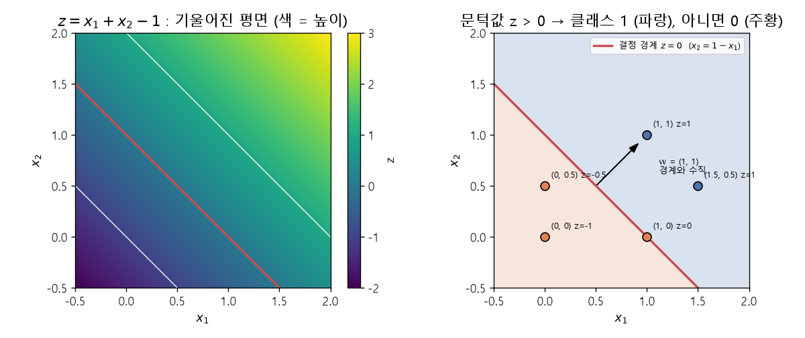

# 평면과 결정 경계 (Plane, Decision boundary)

[목차로 돌아가기](../../00_MIT%EB%94%A5%EB%9F%AC%EB%8B%9D_%EB%AA%A9%EC%B0%A8.md) · 먼저 볼 것: [M01_함수와_일차함수](../../%EC%88%98%ED%95%99%EA%B0%9C%EB%85%90/01_%EC%88%98%EC%99%80_%ED%95%A8%EC%88%98/M01_%ED%95%A8%EC%88%98%EC%99%80_%EC%9D%BC%EC%B0%A8%ED%95%A8%EC%88%98.md), [MM03_벡터_표기와_전치](../../%EC%88%98%ED%95%99%EA%B0%9C%EB%85%90/03_%EC%84%A0%ED%98%95%EB%8C%80%EC%88%98/MM03_%EB%B2%A1%ED%84%B0_%ED%91%9C%EA%B8%B0%EC%99%80_%EC%A0%84%EC%B9%98.md) · 쓰는 곳: [Lec01 5.4 퍼셉트론과 선형 분류](../../Lec01_%EB%94%A5%EB%9F%AC%EB%8B%9D_%EC%86%8C%EA%B0%9C.md#54-%ED%8D%BC%EC%85%89%ED%8A%B8%EB%A1%A0%EA%B3%BC-%EC%84%A0%ED%98%95-%EB%B6%84%EB%A5%98)

📚 학습 순서 16/99 (3. 선형대수): ← 이전: [MM03_벡터_표기와_전치](../../%EC%88%98%ED%95%99%EA%B0%9C%EB%85%90/03_%EC%84%A0%ED%98%95%EB%8C%80%EC%88%98/MM03_%EB%B2%A1%ED%84%B0_%ED%91%9C%EA%B8%B0%EC%99%80_%EC%A0%84%EC%B9%98.md) · 다음: [MM87_역행렬과_연립일차방정식](../../%EC%88%98%ED%95%99%EA%B0%9C%EB%85%90/03_%EC%84%A0%ED%98%95%EB%8C%80%EC%88%98/MM87_%EC%97%AD%ED%96%89%EB%A0%AC%EA%B3%BC_%EC%97%B0%EB%A6%BD%EC%9D%BC%EC%B0%A8%EB%B0%A9%EC%A0%95%EC%8B%9D.md) →

> [!NOTE]
> **3줄 요약**
> - 입력이 2개일 때 $z = w_1 x_1 + w_2 x_2 + b$의 그래프는 **기울어진 평면**이다. 입력이 1개일 때 직선인 것과 같은 이치다.
> - 그 평면에서 높이가 0인 곳($z = 0$)을 이으면 **직선**이 생긴다. 이 직선이 [결정 경계](../../00_%EB%94%A5%EB%9F%AC%EB%8B%9D_%EC%9A%A9%EC%96%B4%EC%82%AC%EC%A0%84.md#decision-boundary-%EA%B2%B0%EC%A0%95-%EA%B2%BD%EA%B3%84)다. $z = x_1 + x_2 - 1$이면 경계는 $x_2 = 1 - x_1$.
> - [퍼셉트론](../../00_%EB%94%A5%EB%9F%AC%EB%8B%9D_%EC%9A%A9%EC%96%B4%EC%82%AC%EC%A0%84.md#perceptron-%ED%8D%BC%EC%85%89%ED%8A%B8%EB%A1%A0)은 $z > 0$이면 1, 아니면 0으로 나누므로, 한 층짜리 [퍼셉트론](../../00_%EB%94%A5%EB%9F%AC%EB%8B%9D_%EC%9A%A9%EC%96%B4%EC%82%AC%EC%A0%84.md#perceptron-%ED%8D%BC%EC%85%89%ED%8A%B8%EB%A1%A0)은 **직선 하나로 나눌 수 있는 데이터만** 분류한다.

## 1. 개념 설명

비유: 한쪽으로 기울어진 탁자 위에 물을 부으면, 수면 높이와 탁자 면이 만나는 선이 생긴다. 탁자 면이 평면 $z$이고, 수면 높이가 문턱값 0이고, 그 만나는 선이 [결정 경계](../../00_%EB%94%A5%EB%9F%AC%EB%8B%9D_%EC%9A%A9%EC%96%B4%EC%82%AC%EC%A0%84.md#decision-boundary-%EA%B2%B0%EC%A0%95-%EA%B2%BD%EA%B3%84)다. 선보다 높은 쪽은 클래스 1, 낮은 쪽은 클래스 0이다.

- [M01_함수와_일차함수](../../%EC%88%98%ED%95%99%EA%B0%9C%EB%85%90/01_%EC%88%98%EC%99%80_%ED%95%A8%EC%88%98/M01_%ED%95%A8%EC%88%98%EC%99%80_%EC%9D%BC%EC%B0%A8%ED%95%A8%EC%88%98.md)의 $y = wx + b$는 입력 하나, 그래프는 직선이다.
- 입력이 둘이면 $z = w_1 x_1 + w_2 x_2 + b$, 그래프는 $(x_1, x_2)$ 바닥 위에 놓인 평면이다. $w_1$은 $x_1$ 방향 [기울기](../../00_%EB%94%A5%EB%9F%AC%EB%8B%9D_%EC%9A%A9%EC%96%B4%EC%82%AC%EC%A0%84.md#gradient-%EA%B8%B0%EC%9A%B8%EA%B8%B0), $w_2$는 $x_2$ 방향 [기울기](../../00_%EB%94%A5%EB%9F%AC%EB%8B%9D_%EC%9A%A9%EC%96%B4%EC%82%AC%EC%A0%84.md#gradient-%EA%B8%B0%EC%9A%B8%EA%B8%B0), $b$는 원점에서의 높이다.
- 벡터로 쓰면 $z = \mathbf{x}^\top\mathbf{w} + b$다([MM03_벡터_표기와_전치](../../%EC%88%98%ED%95%99%EA%B0%9C%EB%85%90/03_%EC%84%A0%ED%98%95%EB%8C%80%EC%88%98/MM03_%EB%B2%A1%ED%84%B0_%ED%91%9C%EA%B8%B0%EC%99%80_%EC%A0%84%EC%B9%98.md)).

## 2. 필요한 이유

[Lec01 5.4](../../Lec01_%EB%94%A5%EB%9F%AC%EB%8B%9D_%EC%86%8C%EA%B0%9C.md#54-%ED%8D%BC%EC%85%89%ED%8A%B8%EB%A1%A0%EA%B3%BC-%EC%84%A0%ED%98%95-%EB%B6%84%EB%A5%98)에서 강사는 "입력이 2차원이면 그래프가 경사로처럼 보이는 이유는 평면이기 때문"이고, "그 평면에 문턱을 주면 선형 분류기가 된다"고 설명한다. 그래서 한 [층](../../00_%EB%94%A5%EB%9F%AC%EB%8B%9D_%EC%9A%A9%EC%96%B4%EC%82%AC%EC%A0%84.md#layer-%EC%B8%B5)으로는 XOR처럼 직선 하나로 나눌 수 없는 데이터를 풀 수 없다. [층](../../00_%EB%94%A5%EB%9F%AC%EB%8B%9D_%EC%9A%A9%EC%96%B4%EC%82%AC%EC%A0%84.md#layer-%EC%B8%B5)을 쌓는 이유가 여기서 나온다.

## 3. 숫자로 보기

$w_1 = 1$, $w_2 = 1$, $b = -1$, 곧 $z = x_1 + x_2 - 1$.

| 점 $(x_1, x_2)$ | $z = x_1 + x_2 - 1$ | $z > 0$? | 클래스 |
|---|---|---|---|
| (0, 0) | 0 + 0 − 1 = **−1** | 아니오 | 0 |
| (0, 0.5) | 0 + 0.5 − 1 = **−0.5** | 아니오 | 0 |
| (1, 0) | 1 + 0 − 1 = **0** | 아니오 (경계 위) | 0 |
| (1, 1) | 1 + 1 − 1 = **1** | 예 | 1 |
| (1.5, 0.5) | 1.5 + 0.5 − 1 = **1** | 예 | 1 |

**경계 직선 구하기** (한 줄에 한 동작)
- 경계는 $z = 0$인 곳: $x_1 + x_2 - 1 = 0$
- $x_2$만 남기기: $x_2 = 1 - x_1$
- 지나는 점: $(0, 1)$, $(1, 0)$

**[가중치](../../00_%EB%94%A5%EB%9F%AC%EB%8B%9D_%EC%9A%A9%EC%96%B4%EC%82%AC%EC%A0%84.md#weight-%EA%B0%80%EC%A4%91%EC%B9%98) 벡터의 방향**
- $\mathbf{w} = (1, 1)$은 경계 직선과 **수직**이고, $z$가 커지는 쪽(클래스 1 쪽)을 가리킨다.
- 그래서 [학습](../../00_%EB%94%A5%EB%9F%AC%EB%8B%9D_%EC%9A%A9%EC%96%B4%EC%82%AC%EC%A0%84.md#training-%ED%95%99%EC%8A%B5)으로 $\mathbf{w}$가 바뀌면 경계가 돌아가고, $b$가 바뀌면 경계가 평행 이동한다.



<details><summary>기호 풀이</summary>

| 기호 | 읽는 법 | 뜻 | 예제 값 |
| --- | --- | --- | --- |
| $x_1, x_2$ | 엑스 일, 엑스 이 | 입력 두 칸 (바닥의 가로·세로 좌표) | (1, 1) |
| $w_1, w_2$ | 더블유 일, 더블유 이 | 각 방향의 [기울기](../../00_%EB%94%A5%EB%9F%AC%EB%8B%9D_%EC%9A%A9%EC%96%B4%EC%82%AC%EC%A0%84.md#gradient-%EA%B8%B0%EC%9A%B8%EA%B8%B0) ([가중치](../../00_%EB%94%A5%EB%9F%AC%EB%8B%9D_%EC%9A%A9%EC%96%B4%EC%82%AC%EC%A0%84.md#weight-%EA%B0%80%EC%A4%91%EC%B9%98)) | 1, 1 |
| $b$ | 비 | 원점에서의 높이 ([편향](../../00_%EB%94%A5%EB%9F%AC%EB%8B%9D_%EC%9A%A9%EC%96%B4%EC%82%AC%EC%A0%84.md#bias-%ED%8E%B8%ED%96%A5)) | −1 |
| $z$ | 지 | 평면의 높이 | 1 |
| $z = 0$ | 지 이퀄 영 | [결정 경계](../../00_%EB%94%A5%EB%9F%AC%EB%8B%9D_%EC%9A%A9%EC%96%B4%EC%82%AC%EC%A0%84.md#decision-boundary-%EA%B2%B0%EC%A0%95-%EA%B2%BD%EA%B3%84) (높이가 0인 선) | $x_2 = 1 - x_1$ |
| $\mathbf{w}$ | 굵은 더블유 | [가중치](../../00_%EB%94%A5%EB%9F%AC%EB%8B%9D_%EC%9A%A9%EC%96%B4%EC%82%AC%EC%A0%84.md#weight-%EA%B0%80%EC%A4%91%EC%B9%98) 벡터, 경계와 수직 | (1, 1) |

</details>

## 4. 코드로 확인

```python
# [함수] import: NumPy를 np로 불러온다
import numpy as np

# [변수] w = [1 1]: 두 방향의 기울기(가중치 벡터 𝐰), b = -1: 원점에서의 높이(편향)
# [연결] 평면 z = x₁ + x₂ - 1을 정한다 (본문 3절)
w, b = np.array([1, 1]), -1
# [변수] pts: 판정할 점 5개를 행으로 쌓은 (5 × 2) 행렬. 한 번에 계산하려고 쌓는다
# [쓸모] pts[3]이 넷째 점 (1, 1). 행마다 (x₁, x₂)
pts = np.array([[0, 0], [0, 0.5], [1, 0], [1, 1], [1.5, 0.5]])
# [함수] @: 행렬 × 벡터. 행마다 내적 x₁w₁ + x₂w₂를 계산한다
# [변수] z: 점마다 평면의 높이. 0보다 큰지로 클래스를 정하려고 구한다
# [연결] 벡터 표기 𝐱ᵀ𝐰 + b (MM03_벡터_표기와_전치)
z = pts @ w + b
# [연결] → [-1.  -0.5  0.   1.   1. ], 본문 3절 표의 z 칸
print(z)
# [함수] z > 0: 칸마다 참/거짓. .astype(int): 참 → 1, 거짓 → 0으로 바꾼다
# [연결] 계단 함수(문턱값 0)를 코드로 쓴 것 = 퍼셉트론의 판정 (Lec01 5.4) → [0 0 0 1 1]
print((z > 0).astype(int))
```

**실행 결과**:

```text
[-1.  -0.5  0.   1.   1. ]
[0 0 0 1 1]
```

> [!WARNING]
> **⚠ 주의**
> - 계단 함수의 정의($z > 0$이면 1)에 따라 경계 **위**의 점 (1, 0)은 클래스 0이다. $z \ge 0$으로 정의하는 책도 있어서 경계 위 점의 처리는 정의를 확인해야 한다.
> - 입력이 3개면 경계는 평면, 그 이상이면 "초평면(hyperplane)"이 된다. 차원만 늘 뿐 "한 번 곧게 자른다"는 성질은 같다.

## 5. 개념 재확인

<details><summary>1. $w = (2, -1)$, $b = 0$이면 결정 경계는? 점 (1, 1)과 (1, 3)은 각각 어느 클래스인가?</summary>

| 단계 | 하는 일 | 계산 | 결과 |
|---|---|---|---|
| 1 | 경계 식 | $2x_1 - x_2 = 0$ | $x_2 = 2x_1$ |
| 2 | (1, 1)의 z | 2×1 − 1 | 1 |
| 3 | (1, 1) 판정 | 1 > 0 | 클래스 1 |
| 4 | (1, 3)의 z | 2×1 − 3 | −1 |
| 5 | (1, 3) 판정 | −1 > 0 아님 | 클래스 0 |

**① 쓰는 식**
$$z = w_1 x_1 + w_2 x_2 + b, \qquad \text{클래스} = \begin{cases} 1 & z > 0 \\ 0 & \text{그 밖} \end{cases}$$
- 위 식 ← 왼쪽 식은 ② (경계 식, $z = 0$으로 둠)와 ③⑤ (z 계산), 오른쪽 식은 ④⑥ (판정)에서 쓴다.
```python
# [변수] w = [2 -1], b = 0: 문제에서 준 가중치와 편향. 경계 x₂ = 2x₁을 정한다
w, b = np.array([2, -1]), 0                 # ①
# [변수] pts: 판정할 두 점 (1, 1), (1, 3)을 행으로 쌓은 행렬
pts = np.array([[1, 1], [1, 3]])
# [함수] @: 행마다 내적. [변수] z = [1 -1]: 두 점의 평면 높이
# [연결] 단계 ③ (1, 1)의 z와 단계 ⑤ (1, 3)의 z를 한 번에
z = pts @ w + b                             # ③⑤
# [함수] (z > 0).astype(int): 문턱값 0으로 클래스 판정 → [1 0]
# [연결] 단계 ④ (1, 1)은 클래스 1, 단계 ⑥ (1, 3)은 클래스 0
print(z, (z > 0).astype(int))               # ④⑥
```

**주어진 값**
- $w_1 = 2$, $w_2 = -1$ ([가중치](../../00_%EB%94%A5%EB%9F%AC%EB%8B%9D_%EC%9A%A9%EC%96%B4%EC%82%AC%EC%A0%84.md#weight-%EA%B0%80%EC%A4%91%EC%B9%98))
- $b = 0$ ([편향](../../00_%EB%94%A5%EB%9F%AC%EB%8B%9D_%EC%9A%A9%EC%96%B4%EC%82%AC%EC%A0%84.md#bias-%ED%8E%B8%ED%96%A5))
- 점 $(1, 1)$과 $(1, 3)$ (판정할 점)

**② 경계 식**
- 식을 그대로 쓴다: $z = w_1 x_1 + w_2 x_2 + b$ (경계는 $z = 0$인 곳)
- 값을 대입한다: $0 = 2 \times x_1 + (-1) \times x_2 + 0$
- 정리한다: $2x_1 - x_2 = 0$
- 양변에 $x_2$를 더해 $x_2$만 남긴다: $x_2 = 2x_1$ (원점을 지나는 [기울기](../../00_%EB%94%A5%EB%9F%AC%EB%8B%9D_%EC%9A%A9%EC%96%B4%EC%82%AC%EC%A0%84.md#gradient-%EA%B8%B0%EC%9A%B8%EA%B8%B0) 2인 직선)

**③ (1, 1)의 z**
- 식을 그대로 쓴다: $z = w_1 x_1 + w_2 x_2 + b$
- 값을 대입한다: $z = 2 \times 1 + (-1) \times 1 + 0$
- 곱셈을 한다: 2 × 1 = 2, (−1) × 1 = −1 이므로 $z = 2 + (-1) + 0$
- 더한다: 2 + (−1) + 0 = 1 이므로 $z = 1$

**④ (1, 1) 판정**
- 식을 그대로 쓴다: 클래스 = 1 (z > 0일 때)
- 값을 대입한다: z = 1 이고 1 > 0 이므로 클래스 1 (직선 $x_2 = 2x_1$의 아래쪽)

**⑤ (1, 3)의 z**
- 식을 그대로 쓴다: $z = w_1 x_1 + w_2 x_2 + b$
- 값을 대입한다: $z = 2 \times 1 + (-1) \times 3 + 0$
- 곱셈을 한다: 2 × 1 = 2, (−1) × 3 = −3 이므로 $z = 2 + (-3) + 0$
- 더한다: 2 + (−3) + 0 = −1 이므로 $z = -1$

**⑥ (1, 3) 판정**
- 값을 대입한다: z = −1 이고 −1은 0보다 크지 않으므로 클래스 0 (직선의 위쪽)

**답**: 경계 **$x_2 = 2x_1$**, (1, 1)은 **클래스 1**, (1, 3)은 **클래스 0**

</details>

<details><summary>2. XOR 데이터 (0,0)→0, (1,0)→1, (0,1)→1, (1,1)→0을 직선 하나로 나눌 수 없는 이유는? $z = x_1 + x_2 - 0.5$로 시도해 보라.</summary>

| 단계 | 하는 일 | 계산 | 결과 |
|---|---|---|---|
| 1 | 점마다 z | −0.5, 0.5, 0.5, 1.5 | - |
| 2 | 판정 | z > 0 | 0, 1, 1, 1 |
| 3 | [정답](../../00_%EB%94%A5%EB%9F%AC%EB%8B%9D_%EC%9A%A9%EC%96%B4%EC%82%AC%EC%A0%84.md#label-%EC%A0%95%EB%8B%B5)과 비교 | 0, 1, 1, 0 | (1,1)만 틀림 |
| 4 | 이유 | 클래스 1이 대각선 두 모서리, 클래스 0이 나머지 두 모서리 | 직선 하나로는 못 가름 |

**① 쓰는 식**
$$z = x_1 + x_2 - 0.5$$
- 위 식 ← ② (점마다 z)와 ③ (판정), ④ ([정답](../../00_%EB%94%A5%EB%9F%AC%EB%8B%9D_%EC%9A%A9%EC%96%B4%EC%82%AC%EC%A0%84.md#label-%EC%A0%95%EB%8B%B5)과 비교)에서 쓰고, ⑤ (이유)는 그림으로 따진다.
```python
# [변수] X: XOR 입력 4개를 행으로 쌓은 (4 × 2) 행렬, y = [0 1 1 0]: 정답. 예측과 비교하려고 둔다
X = np.array([[0, 0], [1, 0], [0, 1], [1, 1]]); y = np.array([0, 1, 1, 0])   # ①
# [함수] @: 행마다 내적 x₁ + x₂. [변수] z: 직선 x₁ + x₂ = 0.5로 시도한 평면 높이
# [연결] 단계 ② → [-0.5  0.5  0.5  1.5]
z = X @ np.array([1, 1]) - 0.5              # ②
# [변수] pred = [0 1 1 1]: 문턱값 0으로 판정한 예측
pred = (z > 0).astype(int)                  # ③
# [함수] ==: 칸마다 같은지 비교 (참/거짓 배열)
# [연결] 단계 ④ → [ True  True  True False], (1,1)만 틀림. 해결은 MM06_합성함수와_비선형성 재확인 2
print(pred == y)                            # ④
```

**주어진 값**
- $w_1 = 1$, $w_2 = 1$, $b = -0.5$ (시도하는 평면 $z = x_1 + x_2 - 0.5$)
- XOR 점과 [정답](../../00_%EB%94%A5%EB%9F%AC%EB%8B%9D_%EC%9A%A9%EC%96%B4%EC%82%AC%EC%A0%84.md#label-%EC%A0%95%EB%8B%B5): (0,0)→0, (1,0)→1, (0,1)→1, (1,1)→0

**② 점마다 z**
- 식을 그대로 쓴다: $z = x_1 + x_2 - 0.5$
- (0,0)을 대입한다: 0 + 0 − 0.5 = −0.5
- (1,0)을 대입한다: 1 + 0 − 0.5 = 0.5
- (0,1)을 대입한다: 0 + 1 − 0.5 = 0.5
- (1,1)을 대입한다: 1 + 1 − 0.5 = 1.5

**③ 판정**
- 식을 그대로 쓴다: 클래스 = 1 (z > 0일 때), 아니면 0
- 값을 대입한다: −0.5는 0보다 크지 않아 0, 0.5 > 0 이라 1, 0.5 > 0 이라 1, 1.5 > 0 이라 1 이므로 예측은 0, 1, 1, 1

**④ [정답](../../00_%EB%94%A5%EB%9F%AC%EB%8B%9D_%EC%9A%A9%EC%96%B4%EC%82%AC%EC%A0%84.md#label-%EC%A0%95%EB%8B%B5)과 비교**
- 칸마다 비교한다: 예측 0, 1, 1, 1 과 [정답](../../00_%EB%94%A5%EB%9F%AC%EB%8B%9D_%EC%9A%A9%EC%96%B4%EC%82%AC%EC%A0%84.md#label-%EC%A0%95%EB%8B%B5) 0, 1, 1, 0 을 맞춰 본다.
- 앞의 세 점은 같고, (1,1)은 [정답](../../00_%EB%94%A5%EB%9F%AC%EB%8B%9D_%EC%9A%A9%EC%96%B4%EC%82%AC%EC%A0%84.md#label-%EC%A0%95%EB%8B%B5)이 0인데 1로 판정했다. 한 점이 틀렸다.

**⑤ 이유**
- 정사각형의 네 모서리 중 클래스 1인 (1,0), (0,1)은 서로 **마주 보는 대각선**에 있다. 클래스 0인 (0,0), (1,1)도 대각선이다.
- 직선 하나는 평면을 두 쪽으로만 가른다. 어떻게 그어도 한쪽에 대각선 두 점만 모을 수 없다.

**답**: 클래스가 **대각선으로 엇갈려** 있어서 직선 하나로는 가를 수 없다. [층](../../00_%EB%94%A5%EB%9F%AC%EB%8B%9D_%EC%9A%A9%EC%96%B4%EC%82%AC%EC%A0%84.md#layer-%EC%B8%B5)을 하나 더 쌓아야 풀린다([MM06_합성함수와_비선형성](../../%EC%88%98%ED%95%99%EA%B0%9C%EB%85%90/05_%EC%8B%A0%EA%B2%BD%EB%A7%9D%EC%9D%98_%EA%B3%84%EC%82%B0/MM06_%ED%95%A9%EC%84%B1%ED%95%A8%EC%88%98%EC%99%80_%EB%B9%84%EC%84%A0%ED%98%95%EC%84%B1.md)).

</details>

## 예제 풀기

[예제 10문제 풀기](../../%EC%98%88%EC%A0%9C/03_%EC%84%A0%ED%98%95%EB%8C%80%EC%88%98/%EC%98%88%EC%A0%9C_MM04_%ED%8F%89%EB%A9%B4%EA%B3%BC_%EA%B2%B0%EC%A0%95_%EA%B2%BD%EA%B3%84.md)

<details><summary>내 이해</summary>


</details>
