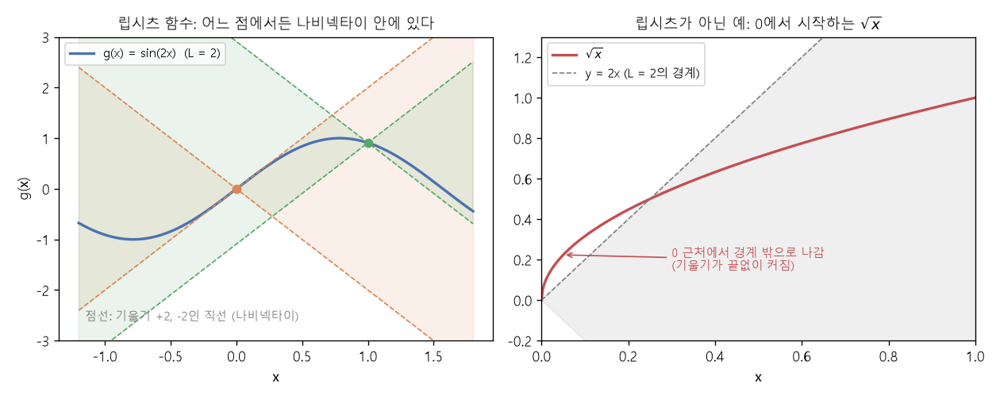

# 립시츠 연속과 노름 (Lipschitz continuity, Norm)

[목차로 돌아가기](../../00_MIT%EB%94%A5%EB%9F%AC%EB%8B%9D_%EB%AA%A9%EC%B0%A8.md) · 먼저 볼 것: [M03_미분_기울기](../../%EC%88%98%ED%95%99%EA%B0%9C%EB%85%90/02_%EB%AF%B8%EB%B6%84/M03_%EB%AF%B8%EB%B6%84_%EA%B8%B0%EC%9A%B8%EA%B8%B0.md), [MM03_벡터_표기와_전치](../../%EC%88%98%ED%95%99%EA%B0%9C%EB%85%90/03_%EC%84%A0%ED%98%95%EB%8C%80%EC%88%98/MM03_%EB%B2%A1%ED%84%B0_%ED%91%9C%EA%B8%B0%EC%99%80_%EC%A0%84%EC%B9%98.md) · 쓰는 곳: [Lec03 4](../../Lec03_%EA%B7%BC%EC%82%AC_%EC%9D%B4%EB%A1%A0.md#4-%EA%B7%BC%EC%82%AC-%EB%AC%B8%EC%A0%9C%EB%A5%BC-%EC%8B%9D%EC%9C%BC%EB%A1%9C-%EC%93%B0%EA%B8%B0), [Lec03 5](../../Lec03_%EA%B7%BC%EC%82%AC_%EC%9D%B4%EB%A1%A0.md#5-%EB%A6%BD%EC%8B%9C%EC%B8%A0-%EC%97%B0%EC%86%8D)

📚 학습 순서 19/99 (3. 선형대수): ← 이전: [MM88_고윳값과_특잇값_분해](../../%EC%88%98%ED%95%99%EA%B0%9C%EB%85%90/03_%EC%84%A0%ED%98%95%EB%8C%80%EC%88%98/MM88_%EA%B3%A0%EC%9C%B3%EA%B0%92%EA%B3%BC_%ED%8A%B9%EC%9E%87%EA%B0%92_%EB%B6%84%ED%95%B4.md) · 다음: [MM44_단위_구와_코사인_유사도](../../%EC%88%98%ED%95%99%EA%B0%9C%EB%85%90/03_%EC%84%A0%ED%98%95%EB%8C%80%EC%88%98/MM44_%EB%8B%A8%EC%9C%84_%EA%B5%AC%EC%99%80_%EC%BD%94%EC%82%AC%EC%9D%B8_%EC%9C%A0%EC%82%AC%EB%8F%84.md) →

> [!NOTE]
> **3줄 요약**
> - **[립시츠 연속](../../00_%EB%94%A5%EB%9F%AC%EB%8B%9D_%EC%9A%A9%EC%96%B4%EC%82%AC%EC%A0%84.md#lipschitz-continuity-%EB%A6%BD%EC%8B%9C%EC%B8%A0-%EC%97%B0%EC%86%8D)(Lipschitz continuity)**: 입력이 $\Delta x$만큼 바뀔 때 출력이 $L|\Delta x|$보다 더 바뀌지 않는 함수. 쉽게 말해 **[기울기](../../00_%EB%94%A5%EB%9F%AC%EB%8B%9D_%EC%9A%A9%EC%96%B4%EC%82%AC%EC%A0%84.md#gradient-%EA%B8%B0%EC%9A%B8%EA%B8%B0)가 어디서나 $L$을 넘지 않는** 함수다. $\sin 2x$는 $L = 2$, $\sqrt{x}$는 0 근처 [기울기](../../00_%EB%94%A5%EB%9F%AC%EB%8B%9D_%EC%9A%A9%EC%96%B4%EC%82%AC%EC%A0%84.md#gradient-%EA%B8%B0%EC%9A%B8%EA%B8%B0)가 끝없이 커져서 립시츠가 아니다.
> - 입력이 벡터면 $|\Delta x|$ 대신 **[노름](../../00_%EB%94%A5%EB%9F%AC%EB%8B%9D_%EC%9A%A9%EC%96%B4%EC%82%AC%EC%A0%84.md#norm-%EB%85%B8%EB%A6%84)([Norm](../../00_%EB%94%A5%EB%9F%AC%EB%8B%9D_%EC%9A%A9%EC%96%B4%EC%82%AC%EC%A0%84.md#norm-%EB%85%B8%EB%A6%84))** $\lVert \Delta x \rVert$으로 크기를 잰다. 강의는 **[RMS 노름](../../00_%EB%94%A5%EB%9F%AC%EB%8B%9D_%EC%9A%A9%EC%96%B4%EC%82%AC%EC%A0%84.md#rms-norm-rms-%EB%85%B8%EB%A6%84)** $\lVert x \rVert_{\mathrm{RMS}} = \lVert x \rVert_2 / \sqrt{d}$을 쓴다. 1이 100개인 벡터는 유클리드 [노름](../../00_%EB%94%A5%EB%9F%AC%EB%8B%9D_%EC%9A%A9%EC%96%B4%EC%82%AC%EC%A0%84.md#norm-%EB%85%B8%EB%A6%84) 10, [RMS 노름](../../00_%EB%94%A5%EB%9F%AC%EB%8B%9D_%EC%9A%A9%EC%96%B4%EC%82%AC%EC%A0%84.md#rms-norm-rms-%EB%85%B8%EB%A6%84) 1이다.
> - 두 **함수** 사이의 거리도 여러 방식으로 잰다. 가장 큰 차이를 보는 **[최대 오차](../../00_%EB%94%A5%EB%9F%AC%EB%8B%9D_%EC%9A%A9%EC%96%B4%EC%82%AC%EC%A0%84.md#l-error-l1-error-%EC%B5%9C%EB%8C%80-%EC%98%A4%EC%B0%A8%EC%99%80-%EC%A0%81%EB%B6%84-%EC%98%A4%EC%B0%A8)($L^\infty$)**와 차이를 모두 더하는 **[적분 오차](../../00_%EB%94%A5%EB%9F%AC%EB%8B%9D_%EC%9A%A9%EC%96%B4%EC%82%AC%EC%A0%84.md#l-error-l1-error-%EC%B5%9C%EB%8C%80-%EC%98%A4%EC%B0%A8%EC%99%80-%EC%A0%81%EB%B6%84-%EC%98%A4%EC%B0%A8)($L^1$)**. $f = x$, $g = x^2$ (0~1)이면 [최대 오차](../../00_%EB%94%A5%EB%9F%AC%EB%8B%9D_%EC%9A%A9%EC%96%B4%EC%82%AC%EC%A0%84.md#l-error-l1-error-%EC%B5%9C%EB%8C%80-%EC%98%A4%EC%B0%A8%EC%99%80-%EC%A0%81%EB%B6%84-%EC%98%A4%EC%B0%A8) 0.25, [적분 오차](../../00_%EB%94%A5%EB%9F%AC%EB%8B%9D_%EC%9A%A9%EC%96%B4%EC%82%AC%EC%A0%84.md#l-error-l1-error-%EC%B5%9C%EB%8C%80-%EC%98%A4%EC%B0%A8%EC%99%80-%EC%A0%81%EB%B6%84-%EC%98%A4%EC%B0%A8) 0.1667.

## 1. 개념 설명

비유: 산길의 **경사 제한 표지판**. "이 길은 어디서도 경사가 20%를 넘지 않는다"고 하면, 100 m를 걸어도 높이는 20 m 넘게 바뀌지 않는다. 립시츠 상수 $L$이 그 경사 제한이다.

- **[립시츠 연속](../../00_%EB%94%A5%EB%9F%AC%EB%8B%9D_%EC%9A%A9%EC%96%B4%EC%82%AC%EC%A0%84.md#lipschitz-continuity-%EB%A6%BD%EC%8B%9C%EC%B8%A0-%EC%97%B0%EC%86%8D)**: 모든 $x$와 $\Delta x$에 대해
$$|g(x + \Delta x) - g(x)| \le L\,|\Delta x|$$

<details><summary>기호 풀이</summary>

| 기호 | 읽는 법 | 뜻 | 예제 값 |
| --- | --- | --- | --- |
| $g$ | 지 | 재려는 함수 | $g(x) = x^2$ (0~1) |
| $x$ | 엑스 | 기준 입력 | 0.5 |
| $\Delta x$ | 델타 엑스 | 입력의 변화량 | 0.2 |
| $\lvert \cdot \rvert$ | 절댓값 | 부호를 뗀 크기 | - |
| $L$ | 엘 | [립시츠](../../00_%EB%94%A5%EB%9F%AC%EB%8B%9D_%EC%9A%A9%EC%96%B4%EC%82%AC%EC%A0%84.md#lipschitz-continuity-%EB%A6%BD%EC%8B%9C%EC%B8%A0-%EC%97%B0%EC%86%8D) 상수, [기울기](../../00_%EB%94%A5%EB%9F%AC%EB%8B%9D_%EC%9A%A9%EC%96%B4%EC%82%AC%EC%A0%84.md#gradient-%EA%B8%B0%EC%9A%B8%EA%B8%B0)의 상한 | 2 |

</details>

<details><summary>예제와 풀이</summary>

**문제**: 0~1에서 [기울기](../../00_%EB%94%A5%EB%9F%AC%EB%8B%9D_%EC%9A%A9%EC%96%B4%EC%82%AC%EC%A0%84.md#gradient-%EA%B8%B0%EC%9A%B8%EA%B8%B0) 상한이 2인 $g(x) = x^2$의 입력을 0.5에서 0.2만큼 움직이면, 출력 변화가 상한 안에 드는가?

**주어진 값**:
- $g(x) = x^2$ (재려는 함수)
- $L = 2$ (립시츠 상수)
- $x = 0.5$ (기준 입력)
- $\Delta x = 0.2$ (입력 변화량)

**풀이**
1. 식을 그대로 쓴다: $|g(x + \Delta x) - g(x)| \le L\,|\Delta x|$
2. 값을 대입한다: $|(0.5 + 0.2)^2 - 0.5^2| \le 2\,|0.2|$
3. 괄호 안 덧셈을 한다: $0.5 + 0.2 = 0.7$ 이므로 $|0.7^2 - 0.5^2| \le 2\,|0.2|$
4. 제곱을 한다: $0.7^2 = 0.49$
5. 제곱을 한다: $0.5^2 = 0.25$ 이므로 $|0.49 - 0.25| \le 2\,|0.2|$
6. 뺄셈을 한다: $0.49 - 0.25 = 0.24$ (양수라 절댓값도 0.24)
7. 오른쪽 곱셈을 한다: $2 \times 0.2 = 0.4$ 이므로 $0.24 \le 0.4$
8. 두 수를 비교한다: 0.24는 0.4보다 작다

**답**: 성립한다 (0.24 ≤ 0.4)

</details>

<details><summary>내 이해</summary>


</details>

  양변을 $|\Delta x|$로 나누면 "두 점을 이은 직선의 [기울기](../../00_%EB%94%A5%EB%9F%AC%EB%8B%9D_%EC%9A%A9%EC%96%B4%EC%82%AC%EC%A0%84.md#gradient-%EA%B8%B0%EC%9A%B8%EA%B8%B0) $\le L$"이다. $\Delta x \to 0$이면 도함수 $|g'(x)| \le L$과 같은 말이 된다.
- **나비넥타이(bow tie)**: 한 점 $(x_0, g(x_0))$에서 [기울기](../../00_%EB%94%A5%EB%9F%AC%EB%8B%9D_%EC%9A%A9%EC%96%B4%EC%82%AC%EC%A0%84.md#gradient-%EA%B8%B0%EC%9A%B8%EA%B8%B0) $+L$, $-L$인 직선 두 개를 그리면 나비넥타이 모양이 생긴다. 립시츠 함수는 **어느 점에서 그리든** 그 나비넥타이 밖으로 나가지 않는다.
- **[노름](../../00_%EB%94%A5%EB%9F%AC%EB%8B%9D_%EC%9A%A9%EC%96%B4%EC%82%AC%EC%A0%84.md#norm-%EB%85%B8%EB%A6%84)([Norm](../../00_%EB%94%A5%EB%9F%AC%EB%8B%9D_%EC%9A%A9%EC%96%B4%EC%82%AC%EC%A0%84.md#norm-%EB%85%B8%EB%A6%84))**: 벡터의 "크기"를 재는 규칙. 유클리드 [노름](../../00_%EB%94%A5%EB%9F%AC%EB%8B%9D_%EC%9A%A9%EC%96%B4%EC%82%AC%EC%A0%84.md#norm-%EB%85%B8%EB%A6%84) $\lVert x \rVert_2 = \sqrt{\sum_i x_i^2}$은 차원 $d$가 클수록 커지고, **[RMS 노름](../../00_%EB%94%A5%EB%9F%AC%EB%8B%9D_%EC%9A%A9%EC%96%B4%EC%82%AC%EC%A0%84.md#rms-norm-rms-%EB%85%B8%EB%A6%84)**은 $\sqrt{d}$로 나눠 "원소 하나의 평균적 크기"를 잰다.
$$\lVert x \rVert_{\mathrm{RMS}} = \sqrt{\frac{1}{d}\sum_{i=1}^{d} x_i^2} = \frac{\lVert x \rVert_2}{\sqrt{d}}$$

<details><summary>기호 풀이</summary>

| 기호 | 읽는 법 | 뜻 | 예제 값 |
| --- | --- | --- | --- |
| $x$ | 엑스 | 크기를 잴 벡터 | (2, −1, 2, 4) |
| $d$ | 디 | 벡터의 차원(원소 수) | 4 |
| $x_i$ | 엑스 아이 | $i$번째 원소 | $x_4 = 4$ |
| $\sum_{i=1}^{d} x_i^2$ | 제곱의 합 | 원소를 제곱해 모두 더함 | 25 |
| $\lVert x \rVert_2$ | 엑스의 투 [노름](../../00_%EB%94%A5%EB%9F%AC%EB%8B%9D_%EC%9A%A9%EC%96%B4%EC%82%AC%EC%A0%84.md#norm-%EB%85%B8%EB%A6%84) | 유클리드 [노름](../../00_%EB%94%A5%EB%9F%AC%EB%8B%9D_%EC%9A%A9%EC%96%B4%EC%82%AC%EC%A0%84.md#norm-%EB%85%B8%EB%A6%84)(길이) | 5 |
| $\lVert x \rVert_{\mathrm{RMS}}$ | 엑스의 [RMS 노름](../../00_%EB%94%A5%EB%9F%AC%EB%8B%9D_%EC%9A%A9%EC%96%B4%EC%82%AC%EC%A0%84.md#rms-norm-rms-%EB%85%B8%EB%A6%84) | 원소 하나의 평균적 크기 | 2.5 |

</details>

<details><summary>예제와 풀이</summary>

**문제**: 원소 4개짜리 벡터 (2, −1, 2, 4)의 [RMS 노름](../../00_%EB%94%A5%EB%9F%AC%EB%8B%9D_%EC%9A%A9%EC%96%B4%EC%82%AC%EC%A0%84.md#rms-norm-rms-%EB%85%B8%EB%A6%84)(원소 하나의 평균적 크기)은?

**주어진 값**:
- $x = (2, -1, 2, 4)$ (크기를 잴 벡터)
- $d = 4$ (원소 수)

**풀이**
1. 식을 그대로 쓴다: $\lVert x \rVert_{\mathrm{RMS}} = \sqrt{\frac{1}{d}\sum_{i=1}^{d} x_i^2} = \frac{\lVert x \rVert_2}{\sqrt{d}}$
2. 값을 대입한다: $\lVert x \rVert_{\mathrm{RMS}} = \sqrt{\frac{1}{4}\left(2^2 + (-1)^2 + 2^2 + 4^2\right)} = \frac{\sqrt{2^2 + (-1)^2 + 2^2 + 4^2}}{\sqrt{4}}$
3. 제곱을 한다: $2^2 = 4$, $(-1)^2 = 1$, $2^2 = 4$, $4^2 = 16$
4. Σ를 펼친 덧셈을 한다: $4 + 1 + 4 + 16 = 25$
5. $\frac{1}{4}$을 곱한다: $25 \times \frac{1}{4} = 6.25$
6. √의 뜻: 제곱해서 그 수가 되는 양수(제곱근)다. 계산기나 Python `math.sqrt`로 구한다. $2.5 \times 2.5 = 6.25$ 이므로 $\sqrt{6.25} = 2.5$
7. 오른쪽 식으로 확인한다. 제곱근: $\sqrt{25} = 5$, $\sqrt{4} = 2$
8. 나눗셈을 한다: $5 \div 2 = 2.5$ (같은 값)

**답**: $\lVert x \rVert_{\mathrm{RMS}} = 2.5$ (유클리드 [노름](../../00_%EB%94%A5%EB%9F%AC%EB%8B%9D_%EC%9A%A9%EC%96%B4%EC%82%AC%EC%A0%84.md#norm-%EB%85%B8%EB%A6%84)은 5)

</details>

<details><summary>내 이해</summary>


</details>

- **함수 사이 [오차](../../00_%EB%94%A5%EB%9F%AC%EB%8B%9D_%EC%9A%A9%EC%96%B4%EC%82%AC%EC%A0%84.md#error-%EC%98%A4%EC%B0%A8)**: 근사 함수 $f$와 목표 함수 $g$가 얼마나 다른지.
$$\mathrm{error}_\infty(f, g) = \max_x |f(x) - g(x)|, \qquad \mathrm{error}_1(f, g) = \int |f(x) - g(x)|\,dx$$

<details><summary>기호 풀이</summary>

| 기호 | 읽는 법 | 뜻 | 예제 값 |
| --- | --- | --- | --- |
| $f$ | 에프 | 근사 함수 | $f(x) = 1$ |
| $g$ | 지 | 목표 함수 | $g(x) = x^2$ |
| $x$ | 엑스 | 입력 (0~1) | 0~1 |
| $\lvert f(x) - g(x) \rvert$ | 차이의 절댓값 | 한 입력에서 두 함수의 차이 | $1 - x^2$ |
| $\max_x$ | 맥스 오버 엑스 | 모든 $x$ 중 가장 큰 값 | $x = 0$에서 1 |
| $\int \cdots dx$ | 인티그럴 디 엑스 | 차이를 입력 전체에서 더한 넓이 | 0.6667 |
| $\mathrm{error}_\infty$ | 에러 인피니티 | [최대 오차](../../00_%EB%94%A5%EB%9F%AC%EB%8B%9D_%EC%9A%A9%EC%96%B4%EC%82%AC%EC%A0%84.md#l-error-l1-error-%EC%B5%9C%EB%8C%80-%EC%98%A4%EC%B0%A8%EC%99%80-%EC%A0%81%EB%B6%84-%EC%98%A4%EC%B0%A8) | 1 |
| $\mathrm{error}_1$ | 에러 원 | [적분 오차](../../00_%EB%94%A5%EB%9F%AC%EB%8B%9D_%EC%9A%A9%EC%96%B4%EC%82%AC%EC%A0%84.md#l-error-l1-error-%EC%B5%9C%EB%8C%80-%EC%98%A4%EC%B0%A8%EC%99%80-%EC%A0%81%EB%B6%84-%EC%98%A4%EC%B0%A8) | 0.6667 |

</details>

<details><summary>예제와 풀이</summary>

**문제**: 0~1에서 근사 함수가 늘 1이고 목표 함수가 $g(x) = x^2$일 때, [최대 오차](../../00_%EB%94%A5%EB%9F%AC%EB%8B%9D_%EC%9A%A9%EC%96%B4%EC%82%AC%EC%A0%84.md#l-error-l1-error-%EC%B5%9C%EB%8C%80-%EC%98%A4%EC%B0%A8%EC%99%80-%EC%A0%81%EB%B6%84-%EC%98%A4%EC%B0%A8)와 [적분 오차](../../00_%EB%94%A5%EB%9F%AC%EB%8B%9D_%EC%9A%A9%EC%96%B4%EC%82%AC%EC%A0%84.md#l-error-l1-error-%EC%B5%9C%EB%8C%80-%EC%98%A4%EC%B0%A8%EC%99%80-%EC%A0%81%EB%B6%84-%EC%98%A4%EC%B0%A8)는?

**주어진 값**:
- $f(x) = 1$ (근사 함수, 어디서나 1)
- $g(x) = x^2$ (목표 함수)
- $0 \le x \le 1$ (입력 구간)

**풀이**
1. 식을 그대로 쓴다: $\mathrm{error}_\infty(f, g) = \max_x |f(x) - g(x)|, \quad \mathrm{error}_1(f, g) = \int |f(x) - g(x)|\,dx$
2. 값을 대입한다: $\mathrm{error}_\infty = \max_x |1 - x^2|, \quad \mathrm{error}_1 = \int_0^1 |1 - x^2|\,dx$
3. 절댓값을 정리한다: 0~1에서 $x^2 \le 1$ 이므로 $|1 - x^2| = 1 - x^2$
4. 차이가 가장 큰 곳을 찾는다: $x^2$가 가장 작은 $x = 0$에서 $1 - 0 = 1$ 이므로 $\mathrm{error}_\infty = 1$
5. 적분(∫)의 뜻: 0~1에서 $1 - x^2$ 그래프 아래 넓이다. 높이 1인 정사각형 넓이에서 $x^2$ 아래 넓이를 빼서 구한다
6. 정사각형 넓이를 구한다: $1 \times 1 = 1$
7. $x^2$ 아래 넓이를 구한다: 공식 $\int_0^1 x^2\,dx = \frac{1}{3}$ ($\frac{x^3}{3}$에 1을 넣은 값) $= 0.3333$
8. 뺄셈을 한다: $1 - 0.3333 = 0.6667$ 이므로 $\mathrm{error}_1 = 0.6667$

**답**: $\mathrm{error}_\infty = 1$, $\mathrm{error}_1 = 0.6667$

</details>

<details><summary>내 이해</summary>


</details>


*▲ 직접 그린 그림: 왼쪽은 $L = 2$인 $\sin 2x$와 두 점의 나비넥타이, 오른쪽은 나비넥타이를 벗어나는 $\sqrt{x}$*

## 2. 필요한 이유

[Lec03 4절](../../Lec03_%EA%B7%BC%EC%82%AC_%EC%9D%B4%EB%A1%A0.md#4-%EA%B7%BC%EC%82%AC-%EB%AC%B8%EC%A0%9C%EB%A5%BC-%EC%8B%9D%EC%9C%BC%EB%A1%9C-%EC%93%B0%EA%B8%B0)에서 강사는 "신경망이 함수를 [오차](../../00_%EB%94%A5%EB%9F%AC%EB%8B%9D_%EC%9A%A9%EC%96%B4%EC%82%AC%EC%A0%84.md#error-%EC%98%A4%EC%B0%A8) $\varepsilon$ 안으로 근사할 수 있나"를 묻기 위해 [오차](../../00_%EB%94%A5%EB%9F%AC%EB%8B%9D_%EC%9A%A9%EC%96%B4%EC%82%AC%EC%A0%84.md#error-%EC%98%A4%EC%B0%A8)를 재는 방법($L^\infty$, $L^1$)부터 정한다. [5절](../../Lec03_%EA%B7%BC%EC%82%AC_%EC%9D%B4%EB%A1%A0.md#5-%EB%A6%BD%EC%8B%9C%EC%B8%A0-%EC%97%B0%EC%86%8D)에서는 근사할 대상을 **립시츠 함수**로 정한다. [기울기](../../00_%EB%94%A5%EB%9F%AC%EB%8B%9D_%EC%9A%A9%EC%96%B4%EC%82%AC%EC%A0%84.md#gradient-%EA%B8%B0%EC%9A%B8%EA%B8%B0)에 상한이 있어야 "막대 한 칸 안에서 함수가 얼마나 벗어날 수 있나"를 셀 수 있기 때문이다([MM12_직사각형_근사와_차원의_저주](../../%EC%88%98%ED%95%99%EA%B0%9C%EB%85%90/06_%EA%B7%BC%EC%82%AC_%EC%9D%B4%EB%A1%A0/MM12_%EC%A7%81%EC%82%AC%EA%B0%81%ED%98%95_%EA%B7%BC%EC%82%AC%EC%99%80_%EC%B0%A8%EC%9B%90%EC%9D%98_%EC%A0%80%EC%A3%BC.md)). 입력이 여러 개일 때 $\Delta x$의 크기를 재려고 [RMS 노름](../../00_%EB%94%A5%EB%9F%AC%EB%8B%9D_%EC%9A%A9%EC%96%B4%EC%82%AC%EC%A0%84.md#rms-norm-rms-%EB%85%B8%EB%A6%84)을 쓴다.

## 3. 숫자로 보기

### 3.1 립시츠 상수 재기 (0~1 구간)

두 점 사이 [기울기](../../00_%EB%94%A5%EB%9F%AC%EB%8B%9D_%EC%9A%A9%EC%96%B4%EC%82%AC%EC%A0%84.md#gradient-%EA%B8%B0%EC%9A%B8%EA%B8%B0) $\frac{|g(x + \Delta x) - g(x)|}{|\Delta x|}$의 최댓값을 촘촘한 점(간격 0.00001)으로 잰다.

| 함수 | 도함수 | 가장 큰 [기울기](../../00_%EB%94%A5%EB%9F%AC%EB%8B%9D_%EC%9A%A9%EC%96%B4%EC%82%AC%EC%A0%84.md#gradient-%EA%B8%B0%EC%9A%B8%EA%B8%B0) | 립시츠? |
|---|---|---|---|
| $\sin 2x$ | $2\cos 2x$ | 2.0 | 예, $L = 2$ |
| $x^2$ | $2x$ | 2.0 | 예, $L = 2$ (0~1에서만) |
| $\sqrt{x}$ | $\frac{1}{2\sqrt{x}}$ | 316.2278 | 아니오. 점을 더 촘촘히 하면 더 커진다 |

- $x^2$는 구간을 0~2로 넓히면 $L = 4$, 실수 전체에서는 립시츠가 아니다. 립시츠 상수는 **구간에 따라** 달라진다.
- $|x|$처럼 꺾인 점에서 미분할 수 없어도 립시츠일 수 있다($L = 1$).

### 3.2 노름 비교

| 벡터 | 차원 $d$ | 유클리드 [노름](../../00_%EB%94%A5%EB%9F%AC%EB%8B%9D_%EC%9A%A9%EC%96%B4%EC%82%AC%EC%A0%84.md#norm-%EB%85%B8%EB%A6%84) | [RMS 노름](../../00_%EB%94%A5%EB%9F%AC%EB%8B%9D_%EC%9A%A9%EC%96%B4%EC%82%AC%EC%A0%84.md#rms-norm-rms-%EB%85%B8%EB%A6%84) |
|---|---|---|---|
| (1, 1, 1, 1) | 4 | $\sqrt{4} = 2$ | $2 / \sqrt{4} = 1$ |
| (3, 4) | 2 | $\sqrt{25} = 5$ | $5 / \sqrt{2} = 3.5355$ |
| 1이 100개 | 100 | $\sqrt{100} = 10$ | $10 / 10 = 1$ |

- 원소가 모두 1이면 차원과 상관없이 [RMS 노름](../../00_%EB%94%A5%EB%9F%AC%EB%8B%9D_%EC%9A%A9%EC%96%B4%EC%82%AC%EC%A0%84.md#rms-norm-rms-%EB%85%B8%EB%A6%84)은 1이다. 강의가 [RMS 노름](../../00_%EB%94%A5%EB%9F%AC%EB%8B%9D_%EC%9A%A9%EC%96%B4%EC%82%AC%EC%A0%84.md#rms-norm-rms-%EB%85%B8%EB%A6%84)을 "차원 없는(non-dimensional) 크기"라고 부른 이유다.

### 3.3 두 함수 사이 오차: $f(x) = x$, $g(x) = x^2$, $0 \le x \le 1$

| [오차](../../00_%EB%94%A5%EB%9F%AC%EB%8B%9D_%EC%9A%A9%EC%96%B4%EC%82%AC%EC%A0%84.md#error-%EC%98%A4%EC%B0%A8) | 계산 | 값 |
|---|---|---|
| [최대 오차](../../00_%EB%94%A5%EB%9F%AC%EB%8B%9D_%EC%9A%A9%EC%96%B4%EC%82%AC%EC%A0%84.md#l-error-l1-error-%EC%B5%9C%EB%8C%80-%EC%98%A4%EC%B0%A8%EC%99%80-%EC%A0%81%EB%B6%84-%EC%98%A4%EC%B0%A8) $L^\infty$ | $x - x^2$의 최댓값, $x = 0.5$에서 $0.5 - 0.25$ | 0.25 |
| [적분 오차](../../00_%EB%94%A5%EB%9F%AC%EB%8B%9D_%EC%9A%A9%EC%96%B4%EC%82%AC%EC%A0%84.md#l-error-l1-error-%EC%B5%9C%EB%8C%80-%EC%98%A4%EC%B0%A8%EC%99%80-%EC%A0%81%EB%B6%84-%EC%98%A4%EC%B0%A8) $L^1$ | $\int_0^1 (x - x^2)\,dx = \frac{1}{2} - \frac{1}{3}$ | 0.1667 |

- [적분 오차](../../00_%EB%94%A5%EB%9F%AC%EB%8B%9D_%EC%9A%A9%EC%96%B4%EC%82%AC%EC%A0%84.md#l-error-l1-error-%EC%B5%9C%EB%8C%80-%EC%98%A4%EC%B0%A8%EC%99%80-%EC%A0%81%EB%B6%84-%EC%98%A4%EC%B0%A8)는 "차이의 넓이"라서 차이가 큰 곳이 좁으면 작게 나온다. 강의의 정리는 [적분 오차](../../00_%EB%94%A5%EB%9F%AC%EB%8B%9D_%EC%9A%A9%EC%96%B4%EC%82%AC%EC%A0%84.md#l-error-l1-error-%EC%B5%9C%EB%8C%80-%EC%98%A4%EC%B0%A8%EC%99%80-%EC%A0%81%EB%B6%84-%EC%98%A4%EC%B0%A8)($L^1$)를 쓴다.

<details><summary>기호 풀이</summary>

| 기호 | 읽는 법 | 뜻 | 예제 값 |
| --- | --- | --- | --- |
| $L$ | 엘 | 립시츠 상수, [기울기](../../00_%EB%94%A5%EB%9F%AC%EB%8B%9D_%EC%9A%A9%EC%96%B4%EC%82%AC%EC%A0%84.md#gradient-%EA%B8%B0%EC%9A%B8%EA%B8%B0)의 상한 | 2 |
| $\Delta x$ | 델타 엑스 | 입력의 변화량 | 0.5 |
| $\lVert x \rVert_2$ | 엑스의 투 [노름](../../00_%EB%94%A5%EB%9F%AC%EB%8B%9D_%EC%9A%A9%EC%96%B4%EC%82%AC%EC%A0%84.md#norm-%EB%85%B8%EB%A6%84) | 유클리드 [노름](../../00_%EB%94%A5%EB%9F%AC%EB%8B%9D_%EC%9A%A9%EC%96%B4%EC%82%AC%EC%A0%84.md#norm-%EB%85%B8%EB%A6%84)(길이) | 5 |
| $\lVert x \rVert_{\mathrm{RMS}}$ | 엑스의 [RMS 노름](../../00_%EB%94%A5%EB%9F%AC%EB%8B%9D_%EC%9A%A9%EC%96%B4%EC%82%AC%EC%A0%84.md#rms-norm-rms-%EB%85%B8%EB%A6%84) | 유클리드 [노름](../../00_%EB%94%A5%EB%9F%AC%EB%8B%9D_%EC%9A%A9%EC%96%B4%EC%82%AC%EC%A0%84.md#norm-%EB%85%B8%EB%A6%84) ÷ $\sqrt{d}$ | 3.5355 |
| $d$ | 디 | 벡터의 차원(원소 수) | 2 |
| $\max_x$ | 맥스 오버 엑스 | 모든 $x$ 중 가장 큰 값 | - |
| $\mathrm{error}_\infty$ | 에러 인피니티 | 두 함수의 최대 차이 | 0.25 |
| $\mathrm{error}_1$ | 에러 원 | 두 함수 차이의 넓이 | 0.1667 |

</details>

## 4. 코드로 확인

```python
# [함수] import: NumPy를 np로 불러온다. linspace, diff, abs, linalg.norm, trapezoid가 여기서 온다
import numpy as np

# [함수] np.linspace(0, 1, 100001): 0~1을 간격 0.00001로 나눈 점
# [변수] x: 기울기를 잴 위치. 촘촘할수록 최대 기울기를 정확히 잡는다
x = np.linspace(0, 1, 100001)
# [변수] name, g: 함수 이름과 함수. 립시츠 상수를 비교할 세 함수 (본문 3.1 표)
for name, g in [("sin2x", lambda v: np.sin(2 * v)), ("x^2", lambda v: v ** 2), ("sqrt", np.sqrt)]:
    # [함수] np.diff: 이웃한 값의 차이. 차이 ÷ 차이 = 이웃한 두 점을 이은 직선의 기울기
    # [변수] ratio: 모든 이웃 구간의 기울기 크기
    ratio = np.abs(np.diff(g(x)) / np.diff(x))
    # [연결] → 2.0, 2.0, 316.2278: sqrt만 기울기가 폭발한다 (본문 3.1 표, 그림 오른쪽)
    print(name, round(ratio.max(), 4))

# [변수] v: 노름을 비교할 벡터들 (본문 3.2 표)
for v in ([1, 1, 1, 1], [3, 4], [1] * 100):
    # [함수] np.array(..., float): 목록을 실수 벡터로 바꾼다
    v = np.array(v, float)
    # [함수] np.linalg.norm: 유클리드 노름 √(Σ vᵢ²). [변수] euc: 벡터의 길이
    euc = np.linalg.norm(v)
    # [변수] rms: RMS 노름 = 유클리드 노름 ÷ √d. [쓸모] 차원이 달라도 원소 하나의 크기를 비교할 수 있다
    rms = euc / np.sqrt(len(v))
    # [연결] → 4 2.0 1.0 / 2 5.0 3.5355 / 100 10.0 1.0 (Lec03 5.2)
    print(len(v), round(euc, 4), round(rms, 4))

# [변수] diff: f(x) = x와 g(x) = x²의 차이. 0~1에서 항상 0 이상
diff = x - x ** 2
# [함수] .max(): 최대 오차 L∞. np.trapezoid: 사다리꼴 공식으로 넓이(적분)를 구한다 → 적분 오차 L1
# [연결] → 0.25 0.1667 (본문 3.3 표, Lec03 4절의 두 오차)
print(round(diff.max(), 4), round(np.trapezoid(np.abs(diff), x), 4))
```

**실행 결과**:

```text
sin2x 2.0
x^2 2.0
sqrt 316.2278
4 2.0 1.0
2 5.0 3.5355
100 10.0 1.0
0.25 0.1667
```

> [!WARNING]
> **⚠ 주의**
> - [립시츠 연속](../../00_%EB%94%A5%EB%9F%AC%EB%8B%9D_%EC%9A%A9%EC%96%B4%EC%82%AC%EC%A0%84.md#lipschitz-continuity-%EB%A6%BD%EC%8B%9C%EC%B8%A0-%EC%97%B0%EC%86%8D)이면 연속이지만, 연속이라고 립시츠는 아니다. $\sqrt{x}$와 [Lec03 3절](../../Lec03_%EA%B7%BC%EC%82%AC_%EC%9D%B4%EB%A1%A0.md#3-%EB%8F%99%EA%B8%B0-%EB%AC%B8%EC%A0%9C)의 바이어슈트라스 함수는 연속이지만 립시츠가 아니다.
> - 강의는 "[기울기](../../00_%EB%94%A5%EB%9F%AC%EB%8B%9D_%EC%9A%A9%EC%96%B4%EC%82%AC%EC%A0%84.md#gradient-%EA%B8%B0%EC%9A%B8%EA%B8%B0)가 $L$ 이하"와 립시츠가 같은지 확실하지 않다고 했다. [미분](../../00_%EB%94%A5%EB%9F%AC%EB%8B%9D_%EC%9A%A9%EC%96%B4%EC%82%AC%EC%A0%84.md#derivative-%EB%AF%B8%EB%B6%84) 가능한 함수에서는 같다. 다만 $|x|$처럼 몇 점에서 [미분](../../00_%EB%94%A5%EB%9F%AC%EB%8B%9D_%EC%9A%A9%EC%96%B4%EC%82%AC%EC%A0%84.md#derivative-%EB%AF%B8%EB%B6%84)이 안 되는 립시츠 함수도 있다(립시츠 함수는 거의 모든 점에서 [미분](../../00_%EB%94%A5%EB%9F%AC%EB%8B%9D_%EC%9A%A9%EC%96%B4%EC%82%AC%EC%A0%84.md#derivative-%EB%AF%B8%EB%B6%84) 가능하다는 것이 라데마허 정리).
> - 어떤 [노름](../../00_%EB%94%A5%EB%9F%AC%EB%8B%9D_%EC%9A%A9%EC%96%B4%EC%82%AC%EC%A0%84.md#norm-%EB%85%B8%EB%A6%84)을 쓰느냐에 따라 같은 함수의 립시츠 상수가 달라진다. [RMS 노름](../../00_%EB%94%A5%EB%9F%AC%EB%8B%9D_%EC%9A%A9%EC%96%B4%EC%82%AC%EC%A0%84.md#rms-norm-rms-%EB%85%B8%EB%A6%84)은 유클리드 [노름](../../00_%EB%94%A5%EB%9F%AC%EB%8B%9D_%EC%9A%A9%EC%96%B4%EC%82%AC%EC%A0%84.md#norm-%EB%85%B8%EB%A6%84)보다 $\sqrt{d}$배 작으므로, 같은 함수라도 [RMS 노름](../../00_%EB%94%A5%EB%9F%AC%EB%8B%9D_%EC%9A%A9%EC%96%B4%EC%82%AC%EC%A0%84.md#rms-norm-rms-%EB%85%B8%EB%A6%84) 기준 상수는 $\sqrt{d}$배 크다.

## 5. 개념 재확인

<details><summary>1. $g(x) = x^2$ (0~2 구간)에서 $x = 1$, $\Delta x = 0.5$일 때 기울기는? 이 구간의 립시츠 상수는?</summary>

| 단계 | 하는 일 | 계산 | 결과 |
|---|---|---|---|
| 1 | 출력 변화 | $|1.5^2 - 1^2|$ | 1.25 |
| 2 | [기울기](../../00_%EB%94%A5%EB%9F%AC%EB%8B%9D_%EC%9A%A9%EC%96%B4%EC%82%AC%EC%A0%84.md#gradient-%EA%B8%B0%EC%9A%B8%EA%B8%B0) | $1.25 ÷ 0.5$ | 2.5 |
| 3 | 구간의 최대 [기울기](../../00_%EB%94%A5%EB%9F%AC%EB%8B%9D_%EC%9A%A9%EC%96%B4%EC%82%AC%EC%A0%84.md#gradient-%EA%B8%B0%EC%9A%B8%EA%B8%B0) | $|g'(2)| = 2 × 2$ | 4 |

**① 쓰는 식**
$$\frac{|g(x + \Delta x) - g(x)|}{|\Delta x|} \le L, \qquad g'(x) = 2x$$
- 위 식 ← 분자는 ② (출력 변화), 나눗셈은 ③ ([기울기](../../00_%EB%94%A5%EB%9F%AC%EB%8B%9D_%EC%9A%A9%EC%96%B4%EC%82%AC%EC%A0%84.md#gradient-%EA%B8%B0%EC%9A%B8%EA%B8%B0)), $g'$의 최댓값은 ④ (립시츠 상수)에서 쓴다.
```python
# [변수] g: 제곱 함수, x0 = 1, dx = 0.5: 문제에서 준 값
g, x0, dx = (lambda v: v ** 2), 1.0, 0.5            # ①
# [변수] change = 1.25: 입력이 0.5 바뀔 때 출력 변화량
change = abs(g(x0 + dx) - g(x0))                     # ②
# [연결] 단계 ③ 기울기 = 변화량 ÷ 0.5 → 1.25 2.5
print(change, change / dx)                           # ③
# [함수] np.linspace: 0~2를 촘촘히. np.diff: 이웃 기울기. [연결] 단계 ④ → 4.0 (x = 2 근처가 가장 가파름)
x = np.linspace(0, 2, 200001)                        # ④
print(round(np.abs(np.diff(g(x)) / np.diff(x)).max(), 4))  # ④
```

**주어진 값**
- $g(x) = x^2$ (재려는 함수), 구간 0~2
- $x = 1$ (기준 입력)
- $\Delta x = 0.5$ (입력 변화량)
- $g'(x) = 2x$ (도함수)

**② 출력 변화**
1. 식을 그대로 쓴다: $|g(x + \Delta x) - g(x)|$
2. 값을 대입한다: $|g(1 + 0.5) - g(1)| = |1.5^2 - 1^2|$
3. 제곱을 한다: $1.5^2 = 1.5 \times 1.5 = 2.25$, $1^2 = 1$ 이므로 $|2.25 - 1|$
4. 뺄셈을 한다: 2.25 − 1 = 1.25 (양수라 절댓값도 1.25)

**③ [기울기](../../00_%EB%94%A5%EB%9F%AC%EB%8B%9D_%EC%9A%A9%EC%96%B4%EC%82%AC%EC%A0%84.md#gradient-%EA%B8%B0%EC%9A%B8%EA%B8%B0)**
1. 식을 그대로 쓴다: $\frac{|g(x + \Delta x) - g(x)|}{|\Delta x|}$
2. 값을 대입한다: $\frac{1.25}{|0.5|}$
3. 나눗셈을 한다: 1.25 ÷ 0.5 = 2.5. 이 두 점 사이의 [기울기](../../00_%EB%94%A5%EB%9F%AC%EB%8B%9D_%EC%9A%A9%EC%96%B4%EC%82%AC%EC%A0%84.md#gradient-%EA%B8%B0%EC%9A%B8%EA%B8%B0)다.

**④ 립시츠 상수**
1. 식을 그대로 쓴다: $L = \max |g'(x)|$, $g'(x) = 2x$
2. 값을 대입한다: 구간 0~2에서 $x$가 클수록 $2x$가 커지므로 가장 큰 곳은 $x = 2$ 이므로 $g'(2) = 2 \times 2$
3. 곱셈을 한다: 2 × 2 = 4
4. 읽는다: 어느 두 점을 골라도 [기울기](../../00_%EB%94%A5%EB%9F%AC%EB%8B%9D_%EC%9A%A9%EC%96%B4%EC%82%AC%EC%A0%84.md#gradient-%EA%B8%B0%EC%9A%B8%EA%B8%B0)는 4를 넘지 않는다.

**답**: 두 점 사이 [기울기](../../00_%EB%94%A5%EB%9F%AC%EB%8B%9D_%EC%9A%A9%EC%96%B4%EC%82%AC%EC%A0%84.md#gradient-%EA%B8%B0%EC%9A%B8%EA%B8%B0)는 **2.5**, 0~2 구간의 립시츠 상수는 **4**.

</details>

<details><summary>2. 벡터 $x = (1, 2, 2)$의 유클리드 노름과 RMS 노름은?</summary>

| 단계 | 하는 일 | 계산 | 결과 |
|---|---|---|---|
| 1 | 제곱의 합 | $1 + 4 + 4$ | 9 |
| 2 | 유클리드 [노름](../../00_%EB%94%A5%EB%9F%AC%EB%8B%9D_%EC%9A%A9%EC%96%B4%EC%82%AC%EC%A0%84.md#norm-%EB%85%B8%EB%A6%84) | $\sqrt{9}$ | 3 |
| 3 | [RMS 노름](../../00_%EB%94%A5%EB%9F%AC%EB%8B%9D_%EC%9A%A9%EC%96%B4%EC%82%AC%EC%A0%84.md#rms-norm-rms-%EB%85%B8%EB%A6%84) | $3 / \sqrt{3}$ | 1.7321 |

**① 쓰는 식**
$$\lVert x \rVert_2 = \sqrt{\sum_i x_i^2}, \qquad \lVert x \rVert_{\mathrm{RMS}} = \frac{\lVert x \rVert_2}{\sqrt{d}}$$
- 위 식 ← 제곱합은 ② (제곱의 합), 제곱근은 ③ (유클리드 [노름](../../00_%EB%94%A5%EB%9F%AC%EB%8B%9D_%EC%9A%A9%EC%96%B4%EC%82%AC%EC%A0%84.md#norm-%EB%85%B8%EB%A6%84)), $\sqrt{d}$로 나누기는 ④ ([RMS 노름](../../00_%EB%94%A5%EB%9F%AC%EB%8B%9D_%EC%9A%A9%EC%96%B4%EC%82%AC%EC%A0%84.md#rms-norm-rms-%EB%85%B8%EB%A6%84))에서 쓴다.
```python
# [변수] x: 문제의 벡터 (d = 3)
x = np.array([1.0, 2.0, 2.0])                 # ①
# [함수] (x ** 2).sum(): 원소 제곱의 합. [변수] sq = 9.0
sq = (x ** 2).sum()                           # ②
# [함수] np.sqrt: 제곱근. [변수] euc = 3.0
euc = np.sqrt(sq)                             # ③
# [연결] 단계 ④ RMS 노름 = 3 ÷ √3 → 9.0 3.0 1.7321
print(sq, euc, round(euc / np.sqrt(len(x)), 4))   # ④
```

**주어진 값**
- $x = (1, 2, 2)$ (크기를 잴 벡터)
- $d = 3$ (원소 수)

**② 제곱의 합**
1. 식을 그대로 쓴다: $\sum_i x_i^2$
2. 값을 대입한다 (Σ를 세 항으로 펼침): $1^2 + 2^2 + 2^2$
3. 제곱을 한다: 1² = 1, 2² = 4, 2² = 4 이므로 $1 + 4 + 4$
4. 더한다: 1 + 4 + 4 = 9

**③ 유클리드 [노름](../../00_%EB%94%A5%EB%9F%AC%EB%8B%9D_%EC%9A%A9%EC%96%B4%EC%82%AC%EC%A0%84.md#norm-%EB%85%B8%EB%A6%84)**
1. 식을 그대로 쓴다: $\lVert x \rVert_2 = \sqrt{\sum_i x_i^2}$ (√는 제곱하면 안의 수가 되는 양수)
2. 값을 대입한다: $\lVert x \rVert_2 = \sqrt{9}$
3. 제곱근을 구한다: 3 × 3 = 9 이므로 $\lVert x \rVert_2 = 3$

**④ [RMS 노름](../../00_%EB%94%A5%EB%9F%AC%EB%8B%9D_%EC%9A%A9%EC%96%B4%EC%82%AC%EC%A0%84.md#rms-norm-rms-%EB%85%B8%EB%A6%84)**
1. 식을 그대로 쓴다: $\lVert x \rVert_{\mathrm{RMS}} = \frac{\lVert x \rVert_2}{\sqrt{d}}$
2. 값을 대입한다: $\lVert x \rVert_{\mathrm{RMS}} = \frac{3}{\sqrt{3}}$
3. 제곱근을 구한다: 1.7321 × 1.7321 ≈ 3 이므로 $\sqrt{3} \approx 1.7321$ (계산기나 Python `math.sqrt(3)`로 구한다)
4. 나눗셈을 한다: 3 ÷ 1.7321 ≈ 1.7321. 원소 크기 (1, 2, 2)의 "제곱 평균 제곱근"이다.

**답**: 유클리드 [노름](../../00_%EB%94%A5%EB%9F%AC%EB%8B%9D_%EC%9A%A9%EC%96%B4%EC%82%AC%EC%A0%84.md#norm-%EB%85%B8%EB%A6%84) **3**, [RMS 노름](../../00_%EB%94%A5%EB%9F%AC%EB%8B%9D_%EC%9A%A9%EC%96%B4%EC%82%AC%EC%A0%84.md#rms-norm-rms-%EB%85%B8%EB%A6%84) **1.7321**.

</details>

## 예제 풀기

[예제 10문제 풀기](../../%EC%98%88%EC%A0%9C/03_%EC%84%A0%ED%98%95%EB%8C%80%EC%88%98/%EC%98%88%EC%A0%9C_MM11_%EB%A6%BD%EC%8B%9C%EC%B8%A0_%EC%97%B0%EC%86%8D%EA%B3%BC_%EB%85%B8%EB%A6%84.md)

<details><summary>내 이해</summary>


</details>
