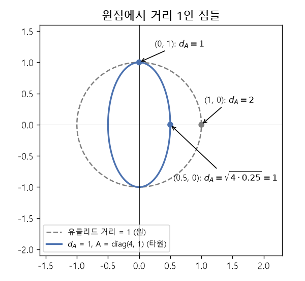

# 마할라노비스 거리와 양의 준정부호 행렬 (Mahalanobis distance, Positive semidefinite matrix)

[목차로 돌아가기](../../00_MIT%EB%94%A5%EB%9F%AC%EB%8B%9D_%EB%AA%A9%EC%B0%A8.md) · 먼저 볼 것: [M05_벡터와_행렬](../../%EC%88%98%ED%95%99%EA%B0%9C%EB%85%90/03_%EC%84%A0%ED%98%95%EB%8C%80%EC%88%98/M05_%EB%B2%A1%ED%84%B0%EC%99%80_%ED%96%89%EB%A0%AC.md), [MM03_벡터_표기와_전치](../../%EC%88%98%ED%95%99%EA%B0%9C%EB%85%90/03_%EC%84%A0%ED%98%95%EB%8C%80%EC%88%98/MM03_%EB%B2%A1%ED%84%B0_%ED%91%9C%EA%B8%B0%EC%99%80_%EC%A0%84%EC%B9%98.md), [MM11_립시츠_연속과_노름](../../%EC%88%98%ED%95%99%EA%B0%9C%EB%85%90/03_%EC%84%A0%ED%98%95%EB%8C%80%EC%88%98/MM11_%EB%A6%BD%EC%8B%9C%EC%B8%A0_%EC%97%B0%EC%86%8D%EA%B3%BC_%EB%85%B8%EB%A6%84.md), [MM85_분산과_표준편차와_공분산](../../%EC%88%98%ED%95%99%EA%B0%9C%EB%85%90/01_%EC%88%98%EC%99%80_%ED%95%A8%EC%88%98/MM85_%EB%B6%84%EC%82%B0%EA%B3%BC_%ED%91%9C%EC%A4%80%ED%8E%B8%EC%B0%A8%EC%99%80_%EA%B3%B5%EB%B6%84%EC%82%B0.md) · 쓰는 곳: [Lec12 4.1](../../Lec12_%EC%9C%A0%EC%82%AC%EB%8F%84_%EA%B8%B0%EB%B0%98_%ED%91%9C%ED%98%84_%ED%95%99%EC%8A%B5.md#41-%EC%84%A0%ED%98%95-%EA%B1%B0%EB%A6%AC-%EC%B2%99%EB%8F%84%EC%99%80-%EB%A7%88%ED%95%A0%EB%9D%BC%EB%85%B8%EB%B9%84%EC%8A%A4-%EA%B1%B0%EB%A6%AC), [Lec12 4.2](../../Lec12_%EC%9C%A0%EC%82%AC%EB%8F%84_%EA%B8%B0%EB%B0%98_%ED%91%9C%ED%98%84_%ED%95%99%EC%8A%B5.md#42-%EC%B5%9C%EC%A0%81%ED%99%94-%EB%AC%B8%EC%A0%9C%EB%A1%9C-%ED%92%80%EA%B8%B0)

📚 학습 순서 22/99 (3. 선형대수): ← 이전: [MM69_선형_보간과_잠재_방향](../../%EC%88%98%ED%95%99%EA%B0%9C%EB%85%90/03_%EC%84%A0%ED%98%95%EB%8C%80%EC%88%98/MM69_%EC%84%A0%ED%98%95_%EB%B3%B4%EA%B0%84%EA%B3%BC_%EC%9E%A0%EC%9E%AC_%EB%B0%A9%ED%96%A5.md) · 다음: [M08_확률_기초](../../%EC%88%98%ED%95%99%EA%B0%9C%EB%85%90/04_%ED%99%95%EB%A5%A0%EA%B3%BC_%EC%A0%95%EB%B3%B4/M08_%ED%99%95%EB%A5%A0_%EA%B8%B0%EC%B4%88.md) →

> [!NOTE]
> **3줄 요약**
> - 입력을 $\mathbf{z} = W\mathbf{x}$로 옮긴 뒤 잰 유클리드 거리는, 원래 공간에서 행렬 $A = W^\top W$로 잰 **[마할라노비스 거리](../../00_%EB%94%A5%EB%9F%AC%EB%8B%9D_%EC%9A%A9%EC%96%B4%EC%82%AC%EC%A0%84.md#mahalanobis-distance-%EB%A7%88%ED%95%A0%EB%9D%BC%EB%85%B8%EB%B9%84%EC%8A%A4-%EA%B1%B0%EB%A6%AC)** $(\mathbf{x}_i-\mathbf{x}_j)^\top A (\mathbf{x}_i-\mathbf{x}_j)$와 같다. 예: 차이 (-2, 1), $A = \text{diag}(4, 1)$이면 17.
> - $A$는 어떤 벡터를 넣어도 $\mathbf{v}^\top A \mathbf{v} \ge 0$인 **[양의 준정부호 행렬](../../00_%EB%94%A5%EB%9F%AC%EB%8B%9D_%EC%9A%A9%EC%96%B4%EC%82%AC%EC%A0%84.md#positive-semidefinite-matrix-%EC%96%91%EC%9D%98-%EC%A4%80%EC%A0%95%EB%B6%80%ED%98%B8-%ED%96%89%EB%A0%AC)**(PSD)이어야 "거리"가 음수가 되지 않는다. $W^\top W$ 꼴은 늘 PSD다.
> - [거리 척도 학습](../../00_%EB%94%A5%EB%9F%AC%EB%8B%9D_%EC%9A%A9%EC%96%B4%EC%82%AC%EC%A0%84.md#metric-learning-%EA%B1%B0%EB%A6%AC-%EC%B2%99%EB%8F%84-%ED%95%99%EC%8A%B5)은 $A$(또는 $W$)를 배워 "같은 쪽은 가깝게, 다른 쪽은 멀게" 자를 다시 만드는 일이다.

## 1. 개념 설명

비유: 지도 위 직선거리는 같아도 평지 1 km와 산길 1 km는 걸리는 시간이 다르다. 방향마다 다른 "값"을 매기는 자가 있으면 더 쓸모 있는 거리가 된다. [마할라노비스 거리](../../00_%EB%94%A5%EB%9F%AC%EB%8B%9D_%EC%9A%A9%EC%96%B4%EC%82%AC%EC%A0%84.md#mahalanobis-distance-%EB%A7%88%ED%95%A0%EB%9D%BC%EB%85%B8%EB%B9%84%EC%8A%A4-%EA%B1%B0%EB%A6%AC)는 방향마다 눈금이 다른 자다.

- **유클리드 거리**: $\|\mathbf{x}_i - \mathbf{x}_j\|^2 = (\mathbf{x}_i - \mathbf{x}_j)^\top(\mathbf{x}_i - \mathbf{x}_j)$. 모든 방향이 같은 눈금이다.
- **선형 변환 뒤의 거리**: $\mathbf{z} = W\mathbf{x}$로 옮긴 뒤 유클리드 거리를 재면 $\|W(\mathbf{x}_i - \mathbf{x}_j)\|^2$이다. [전치](../../%EC%88%98%ED%95%99%EA%B0%9C%EB%85%90/03_%EC%84%A0%ED%98%95%EB%8C%80%EC%88%98/MM03_%EB%B2%A1%ED%84%B0_%ED%91%9C%EA%B8%B0%EC%99%80_%EC%A0%84%EC%B9%98.md) 규칙 $(W\mathbf{d})^\top = \mathbf{d}^\top W^\top$를 쓰면 $\mathbf{d}^\top W^\top W \mathbf{d}$로 바뀐다.
- **[마할라노비스 거리](../../00_%EB%94%A5%EB%9F%AC%EB%8B%9D_%EC%9A%A9%EC%96%B4%EC%82%AC%EC%A0%84.md#mahalanobis-distance-%EB%A7%88%ED%95%A0%EB%9D%BC%EB%85%B8%EB%B9%84%EC%8A%A4-%EA%B1%B0%EB%A6%AC)**: 그래서 $A = W^\top W$로 두면 $d_A(\mathbf{x}_i, \mathbf{x}_j)^2 = \mathbf{d}^\top A \mathbf{d}$다. $A$가 단위행렬이면 보통의 유클리드 거리다. (원래 통계학에서는 $A$로 데이터 공분산의 역행렬을 쓴다.)
- **[양의 준정부호](../../00_%EB%94%A5%EB%9F%AC%EB%8B%9D_%EC%9A%A9%EC%96%B4%EC%82%AC%EC%A0%84.md#positive-semidefinite-matrix-%EC%96%91%EC%9D%98-%EC%A4%80%EC%A0%95%EB%B6%80%ED%98%B8-%ED%96%89%EB%A0%AC)**: 모든 $\mathbf{v}$에 대해 $\mathbf{v}^\top A \mathbf{v} \ge 0$인 대칭 행렬. [고윳값](../../00_%EB%94%A5%EB%9F%AC%EB%8B%9D_%EC%9A%A9%EC%96%B4%EC%82%AC%EC%A0%84.md#eigenvector-eigenvalue-%EA%B3%A0%EC%9C%A0%EB%B2%A1%ED%84%B0%EC%99%80-%EA%B3%A0%EC%9C%B3%EA%B0%92)이 모두 0 이상인 것과 같다. $\mathbf{v}^\top W^\top W \mathbf{v} = \|W\mathbf{v}\|^2 \ge 0$이므로 $W^\top W$는 늘 PSD다. 기호로 $A \succeq 0$이라 쓴다.

## 2. 필요한 이유

[Lec12 4.1](../../Lec12_%EC%9C%A0%EC%82%AC%EB%8F%84_%EA%B8%B0%EB%B0%98_%ED%91%9C%ED%98%84_%ED%95%99%EC%8A%B5.md#41-%EC%84%A0%ED%98%95-%EA%B1%B0%EB%A6%AC-%EC%B2%99%EB%8F%84%EC%99%80-%EB%A7%88%ED%95%A0%EB%9D%BC%EB%85%B8%EB%B9%84%EC%8A%A4-%EA%B1%B0%EB%A6%AC)에서 강사는 "같은 쌍/다른 쌍" 정보만으로 $\mathbf{z} = W\mathbf{x}$를 배우는 선형 [거리 척도 학습](../../00_%EB%94%A5%EB%9F%AC%EB%8B%9D_%EC%9A%A9%EC%96%B4%EC%82%AC%EC%A0%84.md#metric-learning-%EA%B1%B0%EB%A6%AC-%EC%B2%99%EB%8F%84-%ED%95%99%EC%8A%B5)을 소개하고, 이것이 PSD 행렬 $A$의 [마할라노비스 거리](../../00_%EB%94%A5%EB%9F%AC%EB%8B%9D_%EC%9A%A9%EC%96%B4%EC%82%AC%EC%A0%84.md#mahalanobis-distance-%EB%A7%88%ED%95%A0%EB%9D%BC%EB%85%B8%EB%B9%84%EC%8A%A4-%EA%B1%B0%EB%A6%AC)를 배우는 것과 같다고 말한다. [Lec12 4.2](../../Lec12_%EC%9C%A0%EC%82%AC%EB%8F%84_%EA%B8%B0%EB%B0%98_%ED%91%9C%ED%98%84_%ED%95%99%EC%8A%B5.md#42-%EC%B5%9C%EC%A0%81%ED%99%94-%EB%AC%B8%EC%A0%9C%EB%A1%9C-%ED%92%80%EA%B8%B0)의 Xing 등(2003) 최적화 문제는 "$A \succeq 0$"이라는 조건 아래에서 푼다. 이 조건이 왜 필요한지, 그리고 $A$가 어떤 방향을 지우는지 읽으려면 이 노트의 계산이 필요하다.

## 3. 숫자로 보기

$\mathbf{x}_i = (1, 2)$, $\mathbf{x}_j = (3, 1)$, $W = \begin{pmatrix}2&0\\0&1\end{pmatrix}$ (첫째 칸을 2배로 늘리는 변환)

- 차이: $\mathbf{d} = \mathbf{x}_i - \mathbf{x}_j = (-2, 1)$
- 유클리드 거리 제곱: $(-2)^2 + 1^2 = 5$
- 변환: $W\mathbf{d} = (2 \times -2,\ 1 \times 1) = (-4, 1)$
- 변환 뒤 거리 제곱: $(-4)^2 + 1^2 = 17$
- $A = W^\top W = \text{diag}(4, 1)$
- $\mathbf{d}^\top A \mathbf{d} = 4 \times 4 + 1 \times 1 = 17$ → 위와 같다

PSD인지 보기

| 행렬 | [고윳값](../../00_%EB%94%A5%EB%9F%AC%EB%8B%9D_%EC%9A%A9%EC%96%B4%EC%82%AC%EC%A0%84.md#eigenvector-eigenvalue-%EA%B3%A0%EC%9C%A0%EB%B2%A1%ED%84%B0%EC%99%80-%EA%B3%A0%EC%9C%B3%EA%B0%92) | PSD? | 거리 제곱이 음수가 되는 벡터 |
|---|---|---|---|
| $\text{diag}(4, 1)$ | 4, 1 | 예 | 없음 |
| $\text{diag}(1, 0)$ | 1, 0 | 예 (0 허용) | 없음. 다만 $(0, 1)$ 방향 차이는 0으로 본다 |
| $\begin{pmatrix}1&2\\2&1\end{pmatrix}$ | 3, -1 | 아니오 | $\mathbf{v} = (1, -1)$: $1 - 2 - 2 + 1 = -2$ |

- 둘째 행이 [거리 척도 학습](../../00_%EB%94%A5%EB%9F%AC%EB%8B%9D_%EC%9A%A9%EC%96%B4%EC%82%AC%EC%A0%84.md#metric-learning-%EA%B1%B0%EB%A6%AC-%EC%B2%99%EB%8F%84-%ED%95%99%EC%8A%B5)의 핵심이다. [고윳값](../../00_%EB%94%A5%EB%9F%AC%EB%8B%9D_%EC%9A%A9%EC%96%B4%EC%82%AC%EC%A0%84.md#eigenvector-eigenvalue-%EA%B3%A0%EC%9C%A0%EB%B2%A1%ED%84%B0%EC%99%80-%EA%B3%A0%EC%9C%B3%EA%B0%92) 0인 방향은 "무시해도 되는 방향"이 된다. [Lec12 4.2](../../Lec12_%EC%9C%A0%EC%82%AC%EB%8F%84_%EA%B8%B0%EB%B0%98_%ED%91%9C%ED%98%84_%ED%95%99%EC%8A%B5.md#42-%EC%B5%9C%EC%A0%81%ED%99%94-%EB%AC%B8%EC%A0%9C%EB%A1%9C-%ED%92%80%EA%B8%B0)의 예에서 $y$축 방향을 지우는 것이 바로 이것이다.


*▲ 직접 그린 그림: 원점에서 거리 1인 점들. 유클리드 거리는 원, $A = \text{diag}(4, 1)$의 [마할라노비스 거리](../../00_%EB%94%A5%EB%9F%AC%EB%8B%9D_%EC%9A%A9%EC%96%B4%EC%82%AC%EC%A0%84.md#mahalanobis-distance-%EB%A7%88%ED%95%A0%EB%9D%BC%EB%85%B8%EB%B9%84%EC%8A%A4-%EA%B1%B0%EB%A6%AC)는 가로로 좁은 타원이다. 가로 방향을 4배 비싸게 쳐서 (1, 0)까지의 거리가 2가 된다*

이 내용을 식 하나로 쓰면 다음과 같다.

$$
d_A(\mathbf{x}_i, \mathbf{x}_j)^2 = (\mathbf{x}_i - \mathbf{x}_j)^\top A\, (\mathbf{x}_i - \mathbf{x}_j), \qquad A = W^\top W \succeq 0
$$

<details><summary>기호 풀이</summary>

| 기호 | 읽는 법 | 뜻 | 예제 값 |
| --- | --- | --- | --- |
| $\mathbf{x}_i, \mathbf{x}_j$ | 엑스 아이, 엑스 제이 | 거리를 잴 두 입력 | (1, 2), (3, 1) |
| $\mathbf{d} = \mathbf{x}_i - \mathbf{x}_j$ | 디 | 두 입력의 차이 | (-2, 1) |
| $W$ | 더블유 | 배우는 선형 변환 $\mathbf{z} = W\mathbf{x}$ | diag(2, 1) |
| $A = W^\top W$ | 에이 | 방향별 눈금을 정하는 행렬 | diag(4, 1) |
| $\top$ | [전치](../../00_%EB%94%A5%EB%9F%AC%EB%8B%9D_%EC%9A%A9%EC%96%B4%EC%82%AC%EC%A0%84.md#transpose-%EC%A0%84%EC%B9%98) | 행과 열을 맞바꿈 | |
| $\succeq 0$ | 양의 준정부호 | 모든 $\mathbf{v}$에 $\mathbf{v}^\top A\mathbf{v} \ge 0$ | [고윳값](../../00_%EB%94%A5%EB%9F%AC%EB%8B%9D_%EC%9A%A9%EC%96%B4%EC%82%AC%EC%A0%84.md#eigenvector-eigenvalue-%EA%B3%A0%EC%9C%A0%EB%B2%A1%ED%84%B0%EC%99%80-%EA%B3%A0%EC%9C%B3%EA%B0%92) 4, 1 |
| $d_A$ | 디 에이 | $A$로 잰 [마할라노비스 거리](../../00_%EB%94%A5%EB%9F%AC%EB%8B%9D_%EC%9A%A9%EC%96%B4%EC%82%AC%EC%A0%84.md#mahalanobis-distance-%EB%A7%88%ED%95%A0%EB%9D%BC%EB%85%B8%EB%B9%84%EC%8A%A4-%EA%B1%B0%EB%A6%AC) | $\sqrt{17} = 4.1231$ |

</details>

<details><summary>예제와 풀이</summary>

**문제**: 방향별 눈금 행렬이 $A = \begin{pmatrix}2&1\\1&2\end{pmatrix}$일 때, 두 입력 $\mathbf{x}_i = (2, 1)$과 $\mathbf{x}_j = (1, 0)$의 [마할라노비스 거리](../../00_%EB%94%A5%EB%9F%AC%EB%8B%9D_%EC%9A%A9%EC%96%B4%EC%82%AC%EC%A0%84.md#mahalanobis-distance-%EB%A7%88%ED%95%A0%EB%9D%BC%EB%85%B8%EB%B9%84%EC%8A%A4-%EA%B1%B0%EB%A6%AC) 제곱 $d_A^2$는?

**주어진 값**
- $A = \begin{pmatrix}2&1\\1&2\end{pmatrix}$: 방향마다 눈금을 정하는 PSD 행렬
- $\mathbf{x}_i = (2, 1)$: 첫째 입력
- $\mathbf{x}_j = (1, 0)$: 둘째 입력

**풀이**
1. 식을 그대로 쓴다: $d_A^2 = (\mathbf{x}_i - \mathbf{x}_j)^\top A\, (\mathbf{x}_i - \mathbf{x}_j)$
2. 값을 대입한다: $d_A^2 = \big((2, 1) - (1, 0)\big)^\top \begin{pmatrix}2&1\\1&2\end{pmatrix} \big((2, 1) - (1, 0)\big)$
3. 두 입력을 칸별로 뺀다: $(2 - 1,\ 1 - 0) = (1, 1)$
4. 행렬에 차이 벡터를 곱한다 (행마다 칸끼리 곱해 더함): $A(1, 1) = (2\times1 + 1\times1,\ 1\times1 + 2\times1) = (3, 3)$
5. 차이 벡터와 [내적](../../00_%EB%94%A5%EB%9F%AC%EB%8B%9D_%EC%9A%A9%EC%96%B4%EC%82%AC%EC%A0%84.md#dot-product-%EB%82%B4%EC%A0%81)(칸끼리 곱해 더함)한다: $1\times3 + 1\times3 = 3 + 3 = 6$
6. 유클리드 거리 제곱과 비교한다: $1^2 + 1^2 = 1 + 1 = 2$

**답**: $d_A^2 = 6$. (1, 1) 방향은 $A$의 [고윳값](../../00_%EB%94%A5%EB%9F%AC%EB%8B%9D_%EC%9A%A9%EC%96%B4%EC%82%AC%EC%A0%84.md#eigenvector-eigenvalue-%EA%B3%A0%EC%9C%A0%EB%B2%A1%ED%84%B0%EC%99%80-%EA%B3%A0%EC%9C%B3%EA%B0%92) 3인 방향이라 유클리드보다 3배 멀게 잰다.

</details>

<details><summary>내 이해</summary>


</details>

## 4. 코드로 확인

```python
# [변수] xi, xj: 거리를 잴 두 입력 (본문 3절)
xi, xj = np.array([1.0, 2.0]), np.array([3.0, 1.0])
# [변수] W: 첫째 칸을 2배로 늘리는 선형 변환 z = Wx
W = np.diag([2.0, 1.0])
# [변수] d = [-2 1]: 두 입력의 차이
d = xi - xj
# [함수] W @ d: 차이를 변환. ** 2 후 .sum(): 칸별 제곱의 합 = 유클리드 거리 제곱
# [연결] 본문 3절의 "변환 뒤 거리 제곱" 17
print(((W @ d) ** 2).sum())
# [변수] A = W^T W = diag(4, 1): 마할라노비스 거리의 행렬
A = W.T @ W
# [함수] d @ A @ d: 이차형식 d^T A d
# [연결] 위 줄과 같은 17이 나와야 한다 (식의 두 표현이 같다)
print(d @ A @ d)
# [함수] np.linalg.eigvalsh: 대칭 행렬의 고윳값 (작은 것부터)
# [쓸모] 모두 0 이상이면 PSD → 본문 3절 표 첫째 행
print(np.linalg.eigvalsh(A))
# [변수] B: PSD가 아닌 대칭 행렬 (본문 3절 표 셋째 행)
B = np.array([[1.0, 2.0], [2.0, 1.0]])
# [연결] 고윳값 -1, 3 → 음수가 있으므로 PSD가 아니다
print(np.linalg.eigvalsh(B))
# [변수] v = (1, -1): 고윳값 -1 방향의 벡터
v = np.array([1.0, -1.0])
# [연결] "거리 제곱"이 -2 → 거리로 쓸 수 없다
print(v @ B @ v)
```

**실행 결과**:

```text
17.0
17.0
[1. 4.]
[-1.  3.]
-2.0
```

> [!WARNING]
> **⚠ 주의**
> - **준**정부호(semidefinite)는 0을 허용한다. [고윳값](../../00_%EB%94%A5%EB%9F%AC%EB%8B%9D_%EC%9A%A9%EC%96%B4%EC%82%AC%EC%A0%84.md#eigenvector-eigenvalue-%EA%B3%A0%EC%9C%A0%EB%B2%A1%ED%84%B0%EC%99%80-%EA%B3%A0%EC%9C%B3%EA%B0%92)이 0인 방향의 차이는 거리 0으로 본다. 그래서 서로 다른 두 점의 거리가 0일 수 있고, 엄밀히는 "유사 거리(pseudo-metric)"다. [거리 척도 학습](../../00_%EB%94%A5%EB%9F%AC%EB%8B%9D_%EC%9A%A9%EC%96%B4%EC%82%AC%EC%A0%84.md#metric-learning-%EA%B1%B0%EB%A6%AC-%EC%B2%99%EB%8F%84-%ED%95%99%EC%8A%B5)에서는 이것이 "쓸모없는 방향을 지운다"는 장점이 된다.
> - 식의 $d_A^2$는 **제곱** 거리다. 제곱근을 씌워야 진짜 거리지만, 최적화에서는 제곱을 그대로 쓰는 경우가 많다.
> - 통계학의 [마할라노비스 거리](../../00_%EB%94%A5%EB%9F%AC%EB%8B%9D_%EC%9A%A9%EC%96%B4%EC%82%AC%EC%A0%84.md#mahalanobis-distance-%EB%A7%88%ED%95%A0%EB%9D%BC%EB%85%B8%EB%B9%84%EC%8A%A4-%EA%B1%B0%EB%A6%AC)는 $A = \Sigma^{-1}$(공분산의 역행렬)로 고정한다. [거리 척도 학습](../../00_%EB%94%A5%EB%9F%AC%EB%8B%9D_%EC%9A%A9%EC%96%B4%EC%82%AC%EC%A0%84.md#metric-learning-%EA%B1%B0%EB%A6%AC-%EC%B2%99%EB%8F%84-%ED%95%99%EC%8A%B5)은 $A$를 데이터의 같음/다름 정보로 **배운다**는 점이 다르다.

## 5. 개념 재확인

<details><summary>1. $W = \begin{pmatrix}1&0\\0&0\end{pmatrix}$로 $\mathbf{x}_i = (1, 5)$, $\mathbf{x}_j = (1, -3)$의 거리를 재면? 이 $W$는 무엇을 하는가?</summary>

| 단계 | 하는 일 | 식 | 계산 | 결과 |
|---|---|---|---|---|
| 1 | 차이 | $\mathbf{d} = \mathbf{x}_i - \mathbf{x}_j$ | (1-1, 5-(-3)) | (0, 8) |
| 2 | 행렬 | $A = W^\top W$ | diag(1, 0) | diag(1, 0) |
| 3 | 거리 제곱 | $\mathbf{d}^\top A \mathbf{d}$ | $1 \times 0^2 + 0 \times 8^2$ | 0 |
| 4 | 해석 | [고윳값](../../00_%EB%94%A5%EB%9F%AC%EB%8B%9D_%EC%9A%A9%EC%96%B4%EC%82%AC%EC%A0%84.md#eigenvector-eigenvalue-%EA%B3%A0%EC%9C%A0%EB%B2%A1%ED%84%B0%EC%99%80-%EA%B3%A0%EC%9C%B3%EA%B0%92) 0인 방향 | 둘째 칸 | 지운다 |

**① 쓰는 식**
$$d_A^2 = \mathbf{d}^\top A \mathbf{d}, \qquad A = W^\top W$$
- 위 식 ← ② (차이), ③ (행렬), ④ (거리 제곱)에서 쓴다.
```python
# [변수] 두 입력과 W = diag(1, 0): 둘째 칸을 버리는 변환
xi, xj, W = np.array([1.0, 5.0]), np.array([1.0, -3.0]), np.diag([1.0, 0.0])   # ①
# [변수] d = [0 8]: 두 입력은 둘째 칸만 다르다
d = xi - xj                                                                    # ②
# [변수] A = diag(1, 0)
A = W.T @ W                                                                    # ③
# [연결] 0.0 → 둘째 칸 차이는 거리에 들어가지 않는다
print(d @ A @ d)                                                               # ④
```

**주어진 값**
- $\mathbf{x}_i = (1, 5)$: 첫째 입력
- $\mathbf{x}_j = (1, -3)$: 둘째 입력
- $W = \begin{pmatrix}1&0\\0&0\end{pmatrix}$: 둘째 칸을 버리는 변환

**풀이**
1. 식을 그대로 쓴다: $d_A^2 = \mathbf{d}^\top A\, \mathbf{d}$, $A = W^\top W$, $\mathbf{d} = \mathbf{x}_i - \mathbf{x}_j$
2. 값을 대입한다: $d_A^2 = \big((1, 5) - (1, -3)\big)^\top \Big(\begin{pmatrix}1&0\\0&0\end{pmatrix}^{\!\top}\begin{pmatrix}1&0\\0&0\end{pmatrix}\Big) \big((1, 5) - (1, -3)\big)$
3. (②) 두 입력을 칸별로 뺀다: $(1 - 1,\ 5 - (-3)) = (0, 8)$
4. (③) [전치](../../00_%EB%94%A5%EB%9F%AC%EB%8B%9D_%EC%9A%A9%EC%96%B4%EC%82%AC%EC%A0%84.md#transpose-%EC%A0%84%EC%B9%98)($\top$, 행과 열을 맞바꿈)해도 대각 행렬이라 그대로다. 행렬끼리 곱한다: $W^\top W = \begin{pmatrix}1\times1 + 0\times0 & 1\times0 + 0\times0\\ 0\times1 + 0\times0 & 0\times0 + 0\times0\end{pmatrix} = \begin{pmatrix}1&0\\0&0\end{pmatrix}$
5. (④) 행렬에 차이 벡터를 곱한다: $A(0, 8) = (1\times0 + 0\times8,\ 0\times0 + 0\times8) = (0, 0)$
6. (④) 차이 벡터와 내적한다: $0\times0 + 8\times0 = 0$
7. (⑤) 해석한다: 둘째 칸 방향의 [고윳값](../../00_%EB%94%A5%EB%9F%AC%EB%8B%9D_%EC%9A%A9%EC%96%B4%EC%82%AC%EC%A0%84.md#eigenvector-eigenvalue-%EA%B3%A0%EC%9C%A0%EB%B2%A1%ED%84%B0%EC%99%80-%EA%B3%A0%EC%9C%B3%EA%B0%92)이 0이라 그 방향 차이(8)를 통째로 지운다. [Lec12 4.2](../../Lec12_%EC%9C%A0%EC%82%AC%EB%8F%84_%EA%B8%B0%EB%B0%98_%ED%91%9C%ED%98%84_%ED%95%99%EC%8A%B5.md#42-%EC%B5%9C%EC%A0%81%ED%99%94-%EB%AC%B8%EC%A0%9C%EB%A1%9C-%ED%92%80%EA%B8%B0)에서 봉우리가 위아래 둘인 데이터의 $y$축을 지운 사영과 같다

**답**: 거리 **0**. 이 $W$는 둘째 좌표를 버리는 사영이다.

</details>

<details><summary>2. $A = \begin{pmatrix}2&-1\\-1&2\end{pmatrix}$는 PSD인가? $\mathbf{v} = (1, 1)$과 $(1, -1)$에서 $\mathbf{v}^\top A \mathbf{v}$를 구하라.</summary>

| 단계 | 하는 일 | 계산 | 결과 |
|---|---|---|---|
| 1 | $\mathbf{v} = (1, 1)$ | $2 - 1 - 1 + 2$ | 2 |
| 2 | $\mathbf{v} = (1, -1)$ | $2 + 1 + 1 + 2$ | 6 |
| 3 | [고윳값](../../00_%EB%94%A5%EB%9F%AC%EB%8B%9D_%EC%9A%A9%EC%96%B4%EC%82%AC%EC%A0%84.md#eigenvector-eigenvalue-%EA%B3%A0%EC%9C%A0%EB%B2%A1%ED%84%B0%EC%99%80-%EA%B3%A0%EC%9C%B3%EA%B0%92) | 위 두 방향의 배율 | 1, 3 |
| 4 | 판정 | 모두 0 이상 | PSD |

**① 쓰는 식**
$$\mathbf{v}^\top A \mathbf{v} = \sum_{k,l} v_k A_{kl} v_l \ge 0$$
- 위 식 ← ②, ③에서 계산하고, ④ ([고윳값](../../00_%EB%94%A5%EB%9F%AC%EB%8B%9D_%EC%9A%A9%EC%96%B4%EC%82%AC%EC%A0%84.md#eigenvector-eigenvalue-%EA%B3%A0%EC%9C%A0%EB%B2%A1%ED%84%B0%EC%99%80-%EA%B3%A0%EC%9C%B3%EA%B0%92)), ⑤ (판정)으로 확인한다.
```python
# [변수] A: 확인할 대칭 행렬
A = np.array([[2.0, -1.0], [-1.0, 2.0]])           # ①
# [연결] (1, 1) 방향 → 2.0
print(np.array([1.0, 1.0]) @ A @ np.array([1.0, 1.0]))     # ②
# [연결] (1, -1) 방향 → 6.0
print(np.array([1.0, -1.0]) @ A @ np.array([1.0, -1.0]))   # ③
# [함수] eigvalsh: 고윳값 [1. 3.] → 모두 양수
print(np.linalg.eigvalsh(A))                        # ④⑤
```

**주어진 값**
- $A = \begin{pmatrix}2&-1\\-1&2\end{pmatrix}$: PSD인지 확인할 대칭 행렬
- $\mathbf{v}_1 = (1, 1)$: 첫째 시험 벡터
- $\mathbf{v}_2 = (1, -1)$: 둘째 시험 벡터

**풀이**
1. 식을 그대로 쓴다: $\mathbf{v}^\top A \mathbf{v} = \sum_{k,l} v_k A_{kl} v_l$
2. 값을 대입한다 ($\mathbf{v}_1$): $\mathbf{v}_1^\top A \mathbf{v}_1 = \sum_{k,l} (1, 1)_k \begin{pmatrix}2&-1\\-1&2\end{pmatrix}_{kl} (1, 1)_l$
3. (②) Σ를 네 항($k, l$ = 1, 2의 모든 짝)으로 푼다: $1\times2\times1 + 1\times(-1)\times1 + 1\times(-1)\times1 + 1\times2\times1$
4. (②) 항마다 곱한다: $2 + (-1) + (-1) + 2$
5. (②) 더한다: $2 - 1 - 1 + 2 = 2$
6. (③) $\mathbf{v}_2 = (1, -1)$을 대입해 네 항으로 푼다: $1\times2\times1 + 1\times(-1)\times(-1) + (-1)\times(-1)\times1 + (-1)\times2\times(-1)$
7. (③) 항마다 곱한다: $2 + 1 + 1 + 2$
8. (③) 더한다: $6$
9. (④) [고윳값](../../00_%EB%94%A5%EB%9F%AC%EB%8B%9D_%EC%9A%A9%EC%96%B4%EC%82%AC%EC%A0%84.md#eigenvector-eigenvalue-%EA%B3%A0%EC%9C%A0%EB%B2%A1%ED%84%B0%EC%99%80-%EA%B3%A0%EC%9C%B3%EA%B0%92)(그 방향의 늘림 배율)은 $\mathbf{v}^\top A\mathbf{v}$를 길이 제곱 $\mathbf{v}^\top\mathbf{v}$로 나눈 값이다. $\mathbf{v}_1$의 길이 제곱: $1^2 + 1^2 = 2$ → $2 / 2 = 1$
10. (④) $\mathbf{v}_2$의 길이 제곱: $1^2 + (-1)^2 = 2$ → $6 / 2 = 3$
11. (⑤) 판정한다: [고윳값](../../00_%EB%94%A5%EB%9F%AC%EB%8B%9D_%EC%9A%A9%EC%96%B4%EC%82%AC%EC%A0%84.md#eigenvector-eigenvalue-%EA%B3%A0%EC%9C%A0%EB%B2%A1%ED%84%B0%EC%99%80-%EA%B3%A0%EC%9C%B3%EA%B0%92) 1과 3이 모두 0 이상 → PSD (0이 없으니 정부호이기도 하다)

**답**: **PSD다**. 두 방향에서 2와 6, [고윳값](../../00_%EB%94%A5%EB%9F%AC%EB%8B%9D_%EC%9A%A9%EC%96%B4%EC%82%AC%EC%A0%84.md#eigenvector-eigenvalue-%EA%B3%A0%EC%9C%A0%EB%B2%A1%ED%84%B0%EC%99%80-%EA%B3%A0%EC%9C%B3%EA%B0%92) 1과 3. 본문 3절의 $\begin{pmatrix}1&2\\2&1\end{pmatrix}$([고윳값](../../00_%EB%94%A5%EB%9F%AC%EB%8B%9D_%EC%9A%A9%EC%96%B4%EC%82%AC%EC%A0%84.md#eigenvector-eigenvalue-%EA%B3%A0%EC%9C%A0%EB%B2%A1%ED%84%B0%EC%99%80-%EA%B3%A0%EC%9C%B3%EA%B0%92) -1 포함)과 달리 거리로 쓸 수 있다.

</details>

## 예제 풀기

[예제 10문제 풀기](../../%EC%98%88%EC%A0%9C/03_%EC%84%A0%ED%98%95%EB%8C%80%EC%88%98/%EC%98%88%EC%A0%9C_MM43_%EB%A7%88%ED%95%A0%EB%9D%BC%EB%85%B8%EB%B9%84%EC%8A%A4_%EA%B1%B0%EB%A6%AC.md)

<details><summary>내 이해</summary>


</details>
