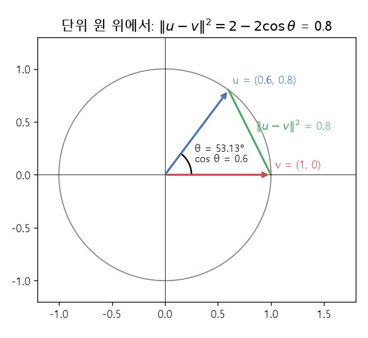

# 단위 구와 코사인 유사도 (Unit hypersphere, Cosine similarity)

[목차로 돌아가기](../../00_MIT%EB%94%A5%EB%9F%AC%EB%8B%9D_%EB%AA%A9%EC%B0%A8.md) · 먼저 볼 것: [MM03_벡터_표기와_전치](../../%EC%88%98%ED%95%99%EA%B0%9C%EB%85%90/03_%EC%84%A0%ED%98%95%EB%8C%80%EC%88%98/MM03_%EB%B2%A1%ED%84%B0_%ED%91%9C%EA%B8%B0%EC%99%80_%EC%A0%84%EC%B9%98.md), [MM11_립시츠_연속과_노름](../../%EC%88%98%ED%95%99%EA%B0%9C%EB%85%90/03_%EC%84%A0%ED%98%95%EB%8C%80%EC%88%98/MM11_%EB%A6%BD%EC%8B%9C%EC%B8%A0_%EC%97%B0%EC%86%8D%EA%B3%BC_%EB%85%B8%EB%A6%84.md) · 쓰는 곳: [Lec12 4.3](../../Lec12_%EC%9C%A0%EC%82%AC%EB%8F%84_%EA%B8%B0%EB%B0%98_%ED%91%9C%ED%98%84_%ED%95%99%EC%8A%B5.md#43-%EA%B9%8A%EC%9D%80-%EA%B1%B0%EB%A6%AC-%EC%B2%99%EB%8F%84-%ED%95%99%EC%8A%B5%EA%B3%BC-%EC%A0%95%EA%B7%9C%ED%99%94), [Lec12 6.1](../../Lec12_%EC%9C%A0%EC%82%AC%EB%8F%84_%EA%B8%B0%EB%B0%98_%ED%91%9C%ED%98%84_%ED%95%99%EC%8A%B5.md#61-infonce-%EC%86%90%EC%8B%A4)

📚 학습 순서 20/99 (3. 선형대수): ← 이전: [MM11_립시츠_연속과_노름](../../%EC%88%98%ED%95%99%EA%B0%9C%EB%85%90/03_%EC%84%A0%ED%98%95%EB%8C%80%EC%88%98/MM11_%EB%A6%BD%EC%8B%9C%EC%B8%A0_%EC%97%B0%EC%86%8D%EA%B3%BC_%EB%85%B8%EB%A6%84.md) · 다음: [MM69_선형_보간과_잠재_방향](../../%EC%88%98%ED%95%99%EA%B0%9C%EB%85%90/03_%EC%84%A0%ED%98%95%EB%8C%80%EC%88%98/MM69_%EC%84%A0%ED%98%95_%EB%B3%B4%EA%B0%84%EA%B3%BC_%EC%9E%A0%EC%9E%AC_%EB%B0%A9%ED%96%A5.md) →

> [!NOTE]
> **3줄 요약**
> - 벡터를 자기 [노름](../../00_%EB%94%A5%EB%9F%AC%EB%8B%9D_%EC%9A%A9%EC%96%B4%EC%82%AC%EC%A0%84.md#norm-%EB%85%B8%EB%A6%84)(길이)으로 나누면 길이 1인 벡터가 되어 **[단위 초구](../../00_%EB%94%A5%EB%9F%AC%EB%8B%9D_%EC%9A%A9%EC%96%B4%EC%82%AC%EC%A0%84.md#hypersphere-%EC%B4%88%EA%B5%AC)** 위에 놓인다. (3, 4) → (0.6, 0.8).
> - 단위 벡터끼리는 [내적](../../00_%EB%94%A5%EB%9F%AC%EB%8B%9D_%EC%9A%A9%EC%96%B4%EC%82%AC%EC%A0%84.md#dot-product-%EB%82%B4%EC%A0%81)이 곧 **[코사인 유사도](../../00_%EB%94%A5%EB%9F%AC%EB%8B%9D_%EC%9A%A9%EC%96%B4%EC%82%AC%EC%A0%84.md#cosine-similarity-%EC%BD%94%EC%82%AC%EC%9D%B8-%EC%9C%A0%EC%82%AC%EB%8F%84)** $\cos\theta$이고, 거리와 $\|\mathbf{u}-\mathbf{v}\|^2 = 2 - 2\cos\theta$로 묶인다. (0.6, 0.8)과 (1, 0)은 [내적](../../00_%EB%94%A5%EB%9F%AC%EB%8B%9D_%EC%9A%A9%EC%96%B4%EC%82%AC%EC%A0%84.md#dot-product-%EB%82%B4%EC%A0%81) 0.6, 거리 제곱 0.8.
> - 그래서 구 위에서는 "거리를 줄인다"와 "[내적](../../00_%EB%94%A5%EB%9F%AC%EB%8B%9D_%EC%9A%A9%EC%96%B4%EC%82%AC%EC%A0%84.md#dot-product-%EB%82%B4%EC%A0%81)(각도 유사도)을 키운다"가 같은 일이다. [대조 학습](../../00_%EB%94%A5%EB%9F%AC%EB%8B%9D_%EC%9A%A9%EC%96%B4%EC%82%AC%EC%A0%84.md#contrastive-learning-%EB%8C%80%EC%A1%B0-%ED%95%99%EC%8A%B5)이 표현을 정규화하는 이유다.

## 1. 개념 설명

비유: 나침반은 방향만 알려 주고 거리는 알려 주지 않는다. 표현 벡터의 길이를 모두 1로 맞추면 "어느 쪽을 가리키는가"만 남는다. 두 사진이 같은 쪽을 가리키면 비슷한 것이다.

- **[정규화](../../00_%EB%94%A5%EB%9F%AC%EB%8B%9D_%EC%9A%A9%EC%96%B4%EC%82%AC%EC%A0%84.md#normalization-%EC%A0%95%EA%B7%9C%ED%99%94)(normalization)**: $\hat{\mathbf{u}} = \mathbf{u} / \|\mathbf{u}\|$. 길이를 1로 만든다. 방향은 그대로다.
- **단위 [초구](../../00_%EB%94%A5%EB%9F%AC%EB%8B%9D_%EC%9A%A9%EC%96%B4%EC%82%AC%EC%A0%84.md#hypersphere-%EC%B4%88%EA%B5%AC)** $\mathbb{S}^{d-1}$: $d$차원에서 길이 1인 벡터 전체. 2차원이면 단위 원($\mathbb{S}^1$), 3차원이면 공 껍질($\mathbb{S}^2$)이다. 강의 슬라이드의 $f: \mathcal{X} \to \mathbb{S}^{d-1}$은 "인코더가 입력을 구 위로 보낸다"는 뜻이다.
- **[코사인 유사도](../../00_%EB%94%A5%EB%9F%AC%EB%8B%9D_%EC%9A%A9%EC%96%B4%EC%82%AC%EC%A0%84.md#cosine-similarity-%EC%BD%94%EC%82%AC%EC%9D%B8-%EC%9C%A0%EC%82%AC%EB%8F%84)**: $\cos\theta = \dfrac{\mathbf{u}^\top\mathbf{v}}{\|\mathbf{u}\|\|\mathbf{v}\|}$. 같은 방향 1, 직각 0, 반대 방향 -1. 단위 벡터면 분모가 1이라 [내적](../../00_%EB%94%A5%EB%9F%AC%EB%8B%9D_%EC%9A%A9%EC%96%B4%EC%82%AC%EC%A0%84.md#dot-product-%EB%82%B4%EC%A0%81) 그 자체다.
- **거리와 [내적](../../00_%EB%94%A5%EB%9F%AC%EB%8B%9D_%EC%9A%A9%EC%96%B4%EC%82%AC%EC%A0%84.md#dot-product-%EB%82%B4%EC%A0%81)의 관계**: $\|\mathbf{u}-\mathbf{v}\|^2 = \|\mathbf{u}\|^2 - 2\mathbf{u}^\top\mathbf{v} + \|\mathbf{v}\|^2$에 길이 1을 넣으면 $2 - 2\mathbf{u}^\top\mathbf{v}$다.

## 2. 필요한 이유

[Lec12 4.3](../../Lec12_%EC%9C%A0%EC%82%AC%EB%8F%84_%EA%B8%B0%EB%B0%98_%ED%91%9C%ED%98%84_%ED%95%99%EC%8A%B5.md#43-%EA%B9%8A%EC%9D%80-%EA%B1%B0%EB%A6%AC-%EC%B2%99%EB%8F%84-%ED%95%99%EC%8A%B5%EA%B3%BC-%EC%A0%95%EA%B7%9C%ED%99%94)에서 강사는 표현을 [초구](../../00_%EB%94%A5%EB%9F%AC%EB%8B%9D_%EC%9A%A9%EC%96%B4%EC%82%AC%EC%A0%84.md#hypersphere-%EC%B4%88%EA%B5%AC) 위로 정규화하면 "거리 대신 각도"를 볼 수 있고 크기(scale)에 휘둘리지 않는다고 말한다. [Lec12 6.1](../../Lec12_%EC%9C%A0%EC%82%AC%EB%8F%84_%EA%B8%B0%EB%B0%98_%ED%91%9C%ED%98%84_%ED%95%99%EC%8A%B5.md#61-infonce-%EC%86%90%EC%8B%A4)의 [InfoNCE 손실](../../00_%EB%94%A5%EB%9F%AC%EB%8B%9D_%EC%9A%A9%EC%96%B4%EC%82%AC%EC%A0%84.md#infonce-infonce-%EC%86%90%EC%8B%A4)은 거리 대신 $f(\mathbf{x})^\top f(\mathbf{x}^+)$ [내적](../../00_%EB%94%A5%EB%9F%AC%EB%8B%9D_%EC%9A%A9%EC%96%B4%EC%82%AC%EC%A0%84.md#dot-product-%EB%82%B4%EC%A0%81)을 쓰는데, [정규화](../../00_%EB%94%A5%EB%9F%AC%EB%8B%9D_%EC%9A%A9%EC%96%B4%EC%82%AC%EC%A0%84.md#normalization-%EC%A0%95%EA%B7%9C%ED%99%94) 덕분에 이것이 거리를 줄이는 것과 같아진다. [Lec12 7.2](../../Lec12_%EC%9C%A0%EC%82%AC%EB%8F%84_%EA%B8%B0%EB%B0%98_%ED%91%9C%ED%98%84_%ED%95%99%EC%8A%B5.md#72-%EC%A0%95%EB%A0%AC%EA%B3%BC-%EA%B7%A0%EC%9D%BC%EC%84%B1)의 "구 위에 고르게 퍼진다"도 이 구 위의 이야기다.

## 3. 숫자로 보기

**[정규화](../../00_%EB%94%A5%EB%9F%AC%EB%8B%9D_%EC%9A%A9%EC%96%B4%EC%82%AC%EC%A0%84.md#normalization-%EC%A0%95%EA%B7%9C%ED%99%94)** (한 줄에 한 동작)
- $\mathbf{u} = (3, 4)$ → 길이 $\sqrt{9 + 16} = 5$ → $\hat{\mathbf{u}} = (0.6, 0.8)$
- $\mathbf{v} = (2, 0)$ → 길이 2 → $\hat{\mathbf{v}} = (1, 0)$

**[내적](../../00_%EB%94%A5%EB%9F%AC%EB%8B%9D_%EC%9A%A9%EC%96%B4%EC%82%AC%EC%A0%84.md#dot-product-%EB%82%B4%EC%A0%81)과 각도**
- $\hat{\mathbf{u}}^\top\hat{\mathbf{v}} = 0.6 \times 1 + 0.8 \times 0 = 0.6$
- $\theta = \arccos 0.6 = 53.13°$

**거리**
- $\hat{\mathbf{u}} - \hat{\mathbf{v}} = (-0.4, 0.8)$ → 제곱합 $0.16 + 0.64 = 0.8$
- $2 - 2 \times 0.6 = 0.8$ → 같다

**크기에 휘둘리지 않음**

| 벡터 쌍 | [내적](../../00_%EB%94%A5%EB%9F%AC%EB%8B%9D_%EC%9A%A9%EC%96%B4%EC%82%AC%EC%A0%84.md#dot-product-%EB%82%B4%EC%A0%81) ([정규화](../../00_%EB%94%A5%EB%9F%AC%EB%8B%9D_%EC%9A%A9%EC%96%B4%EC%82%AC%EC%A0%84.md#normalization-%EC%A0%95%EA%B7%9C%ED%99%94) 전) | [코사인 유사도](../../00_%EB%94%A5%EB%9F%AC%EB%8B%9D_%EC%9A%A9%EC%96%B4%EC%82%AC%EC%A0%84.md#cosine-similarity-%EC%BD%94%EC%82%AC%EC%9D%B8-%EC%9C%A0%EC%82%AC%EB%8F%84) |
|---|---|---|
| (3, 4), (2, 0) | 6 | 0.6 |
| (30, 40), (2, 0) | 60 | 0.6 |

- 길이를 10배로 키우면 [내적](../../00_%EB%94%A5%EB%9F%AC%EB%8B%9D_%EC%9A%A9%EC%96%B4%EC%82%AC%EC%A0%84.md#dot-product-%EB%82%B4%EC%A0%81)은 10배가 되지만 [코사인 유사도](../../00_%EB%94%A5%EB%9F%AC%EB%8B%9D_%EC%9A%A9%EC%96%B4%EC%82%AC%EC%A0%84.md#cosine-similarity-%EC%BD%94%EC%82%AC%EC%9D%B8-%EC%9C%A0%EC%82%AC%EB%8F%84)는 그대로다. 정규화하지 않으면 망이 "길이를 키워서" [손실](../../00_%EB%94%A5%EB%9F%AC%EB%8B%9D_%EC%9A%A9%EC%96%B4%EC%82%AC%EC%A0%84.md#loss-function-%EC%86%90%EC%8B%A4-%ED%95%A8%EC%88%98)을 줄이는 꼼수를 쓸 수 있다.


*▲ 직접 그린 그림: 단위 원 위의 $\mathbf{u} = (0.6, 0.8)$, $\mathbf{v} = (1, 0)$. 사이각 53.13°, $\cos\theta = 0.6$, 현의 길이 제곱(초록) 0.8*

이 관계를 식으로 쓰면 다음과 같다.

$$
\|\mathbf{u} - \mathbf{v}\|^2 = 2 - 2\,\mathbf{u}^\top\mathbf{v} = 2 - 2\cos\theta \qquad (\|\mathbf{u}\| = \|\mathbf{v}\| = 1)
$$

<details><summary>기호 풀이</summary>

| 기호 | 읽는 법 | 뜻 | 예제 값 |
| --- | --- | --- | --- |
| $\mathbf{u}, \mathbf{v}$ | 유, 브이 | 길이 1로 정규화한 두 표현 | (0.6, 0.8), (1, 0) |
| $\|\cdot\|$ | [노름](../../00_%EB%94%A5%EB%9F%AC%EB%8B%9D_%EC%9A%A9%EC%96%B4%EC%82%AC%EC%A0%84.md#norm-%EB%85%B8%EB%A6%84) | 벡터의 길이 | 1 |
| $\mathbf{u}^\top\mathbf{v}$ | 유 [전치](../../00_%EB%94%A5%EB%9F%AC%EB%8B%9D_%EC%9A%A9%EC%96%B4%EC%82%AC%EC%A0%84.md#transpose-%EC%A0%84%EC%B9%98) 브이 | [내적](../../00_%EB%94%A5%EB%9F%AC%EB%8B%9D_%EC%9A%A9%EC%96%B4%EC%82%AC%EC%A0%84.md#dot-product-%EB%82%B4%EC%A0%81) | 0.6 |
| $\theta$ | 세타 | 두 벡터의 사이각 | 53.13° |
| $\cos\theta$ | 코사인 세타 | [코사인 유사도](../../00_%EB%94%A5%EB%9F%AC%EB%8B%9D_%EC%9A%A9%EC%96%B4%EC%82%AC%EC%A0%84.md#cosine-similarity-%EC%BD%94%EC%82%AC%EC%9D%B8-%EC%9C%A0%EC%82%AC%EB%8F%84) | 0.6 |
| $\|\mathbf{u}-\mathbf{v}\|^2$ | 거리 제곱 | 두 점 사이 직선거리의 제곱 | 0.8 |

</details>

<details><summary>예제와 풀이</summary>

**문제**: 벡터 $\mathbf{a} = (1, 1)$과 $\mathbf{b} = (1, 0)$을 길이 1로 정규화했을 때, 둘의 [코사인 유사도](../../00_%EB%94%A5%EB%9F%AC%EB%8B%9D_%EC%9A%A9%EC%96%B4%EC%82%AC%EC%A0%84.md#cosine-similarity-%EC%BD%94%EC%82%AC%EC%9D%B8-%EC%9C%A0%EC%82%AC%EB%8F%84)와 거리 제곱은?

**주어진 값**
- $\mathbf{a} = (1, 1)$: 첫째 벡터 ([정규화](../../00_%EB%94%A5%EB%9F%AC%EB%8B%9D_%EC%9A%A9%EC%96%B4%EC%82%AC%EC%A0%84.md#normalization-%EC%A0%95%EA%B7%9C%ED%99%94) 전)
- $\mathbf{b} = (1, 0)$: 둘째 벡터 ([정규화](../../00_%EB%94%A5%EB%9F%AC%EB%8B%9D_%EC%9A%A9%EC%96%B4%EC%82%AC%EC%A0%84.md#normalization-%EC%A0%95%EA%B7%9C%ED%99%94) 전)

**풀이**
1. 식을 그대로 쓴다: $\cos\theta = \dfrac{\mathbf{a}^\top\mathbf{b}}{\|\mathbf{a}\|\,\|\mathbf{b}\|}$, $\|\hat{\mathbf{a}} - \hat{\mathbf{b}}\|^2 = 2 - 2\cos\theta$
2. 값을 대입한다: $\cos\theta = \dfrac{(1, 1)^\top(1, 0)}{\|(1, 1)\|\,\|(1, 0)\|}$
3. [내적](../../00_%EB%94%A5%EB%9F%AC%EB%8B%9D_%EC%9A%A9%EC%96%B4%EC%82%AC%EC%A0%84.md#dot-product-%EB%82%B4%EC%A0%81)을 칸별로 곱해 더한다: $1\times1 + 1\times0 = 1 + 0 = 1$
4. [노름](../../00_%EB%94%A5%EB%9F%AC%EB%8B%9D_%EC%9A%A9%EC%96%B4%EC%82%AC%EC%A0%84.md#norm-%EB%85%B8%EB%A6%84)(길이)은 칸 제곱의 합에 √(제곱하면 그 수가 되는 양수)를 씌운 것이다. $\|\mathbf{a}\| = \sqrt{1^2 + 1^2} = \sqrt{2} = 1.4142$
5. $\|\mathbf{b}\| = \sqrt{1^2 + 0^2} = \sqrt{1} = 1$
6. 두 길이를 곱한다: $1.4142\times1 = 1.4142$
7. 나눈다: $1 / 1.4142 = 0.7071$ (cos는 사이각의 코사인. 0.7071이면 45°)
8. 2를 곱한다: $2\times0.7071 = 1.4142$
9. 2에서 뺀다: $2 - 1.4142 = 0.5858$
10. 직접 확인한다. 정규화한 벡터: $\hat{\mathbf{a}} = (1/1.4142,\ 1/1.4142) = (0.7071, 0.7071)$, $\hat{\mathbf{b}} = (1, 0)$
11. 칸별로 빼고 제곱해 더한다: $(0.7071 - 1)^2 + (0.7071 - 0)^2 = 0.0858 + 0.5 = 0.5858$

**답**: [코사인 유사도](../../00_%EB%94%A5%EB%9F%AC%EB%8B%9D_%EC%9A%A9%EC%96%B4%EC%82%AC%EC%A0%84.md#cosine-similarity-%EC%BD%94%EC%82%AC%EC%9D%B8-%EC%9C%A0%EC%82%AC%EB%8F%84) **0.7071**, 거리 제곱 **0.5858**.

</details>

<details><summary>내 이해</summary>


</details>

## 4. 코드로 확인

```python
# [함수] def unit(x): 벡터를 길이 1로 정규화해 돌려준다
def unit(x):
    # [함수] np.linalg.norm: 벡터의 길이(L2 노름)
    # [연결] 본문 1절의 정규화 식 u / ||u||
    return x / np.linalg.norm(x)
# [변수] u = (0.6, 0.8), v = (1, 0): (3, 4)와 (2, 0)을 정규화한 값
u, v = unit(np.array([3.0, 4.0])), unit(np.array([2.0, 0.0]))
# [연결] 본문 3절 "정규화" → [0.6 0.8] [1. 0.]
print(u, v)
# [변수] c = 0.6: 단위 벡터끼리의 내적 = 코사인 유사도
c = u @ v
# [함수] np.degrees(np.arccos(c)): 코사인 값에서 각도(도)로
# [연결] 본문 3절 "내적과 각도" → 0.6 53.13
print(round(c, 4), round(np.degrees(np.arccos(c)), 2))
# [함수] ((u - v) ** 2).sum(): 거리 제곱. 2 - 2c와 비교
# [연결] 본문의 식 → 둘 다 0.8
print(round(((u - v) ** 2).sum(), 4), round(2 - 2 * c, 4))
# [변수] big: 길이만 10배인 벡터 (30, 40)
big = np.array([30.0, 40.0])
# [연결] 본문 3절 표 → 정규화 전 내적 60, 코사인은 그대로 0.6
print(big @ np.array([2.0, 0.0]), round(unit(big) @ v, 4))
```

**실행 결과**:

```text
[0.6 0.8] [1. 0.]
0.6 53.13
0.8 0.8
60.0 0.6
```

> [!WARNING]
> **⚠ 주의**
> - $\|\mathbf{u}-\mathbf{v}\|^2 = 2 - 2\cos\theta$는 **둘 다 길이 1일 때만** 성립한다. 정규화하지 않은 벡터에 쓰면 틀린다.
> - [코사인 유사도](../../00_%EB%94%A5%EB%9F%AC%EB%8B%9D_%EC%9A%A9%EC%96%B4%EC%82%AC%EC%A0%84.md#cosine-similarity-%EC%BD%94%EC%82%AC%EC%9D%B8-%EC%9C%A0%EC%82%AC%EB%8F%84)는 거리가 아니라 유사도다. 클수록 가깝다. [손실](../../00_%EB%94%A5%EB%9F%AC%EB%8B%9D_%EC%9A%A9%EC%96%B4%EC%82%AC%EC%A0%84.md#loss-function-%EC%86%90%EC%8B%A4-%ED%95%A8%EC%88%98)에서 "최소화"할지 "최대화"할지 방향을 헷갈리지 말자.
> - [정규화](../../00_%EB%94%A5%EB%9F%AC%EB%8B%9D_%EC%9A%A9%EC%96%B4%EC%82%AC%EC%A0%84.md#normalization-%EC%A0%95%EA%B7%9C%ED%99%94)는 길이 정보를 버린다. 길이에 중요한 정보(예: 확신의 정도)가 있었다면 함께 사라진다.

## 5. 개념 재확인

<details><summary>1. $\mathbf{u} = (0, 5)$와 $\mathbf{v} = (-3, 0)$을 정규화하면 코사인 유사도와 거리 제곱은?</summary>

| 단계 | 하는 일 | 식 | 계산 | 결과 |
|---|---|---|---|---|
| 1 | [정규화](../../00_%EB%94%A5%EB%9F%AC%EB%8B%9D_%EC%9A%A9%EC%96%B4%EC%82%AC%EC%A0%84.md#normalization-%EC%A0%95%EA%B7%9C%ED%99%94) | $\mathbf{u}/\|\mathbf{u}\|$ | (0, 5)/5, (-3, 0)/3 | (0, 1), (-1, 0) |
| 2 | [내적](../../00_%EB%94%A5%EB%9F%AC%EB%8B%9D_%EC%9A%A9%EC%96%B4%EC%82%AC%EC%A0%84.md#dot-product-%EB%82%B4%EC%A0%81) | $\hat{\mathbf{u}}^\top\hat{\mathbf{v}}$ | $0 \times -1 + 1 \times 0$ | 0 |
| 3 | 거리 제곱 | $2 - 2\cos\theta$ | $2 - 0$ | 2 |

**① 쓰는 식**
$$\|\hat{\mathbf{u}} - \hat{\mathbf{v}}\|^2 = 2 - 2\,\hat{\mathbf{u}}^\top\hat{\mathbf{v}}$$
- 위 식 ← ③ (거리 제곱)에서 쓰고, ② ([정규화](../../00_%EB%94%A5%EB%9F%AC%EB%8B%9D_%EC%9A%A9%EC%96%B4%EC%82%AC%EC%A0%84.md#normalization-%EC%A0%95%EA%B7%9C%ED%99%94))와 ③ 앞부분 ([내적](../../00_%EB%94%A5%EB%9F%AC%EB%8B%9D_%EC%9A%A9%EC%96%B4%EC%82%AC%EC%A0%84.md#dot-product-%EB%82%B4%EC%A0%81))은 그 재료다.
```python
# [변수] 정규화 전 두 벡터
u, v = np.array([0.0, 5.0]), np.array([-3.0, 0.0])          # ①
# [변수] 길이로 나눠 단위 벡터로: (0, 1), (-1, 0)
u, v = u / np.linalg.norm(u), v / np.linalg.norm(v)          # ②
# [연결] 내적 0.0 (직각), 거리 제곱 2.0
print(u @ v, 2 - 2 * (u @ v))                                # ③
```

**주어진 값**
- $\mathbf{u} = (0, 5)$: 첫째 벡터 ([정규화](../../00_%EB%94%A5%EB%9F%AC%EB%8B%9D_%EC%9A%A9%EC%96%B4%EC%82%AC%EC%A0%84.md#normalization-%EC%A0%95%EA%B7%9C%ED%99%94) 전)
- $\mathbf{v} = (-3, 0)$: 둘째 벡터 ([정규화](../../00_%EB%94%A5%EB%9F%AC%EB%8B%9D_%EC%9A%A9%EC%96%B4%EC%82%AC%EC%A0%84.md#normalization-%EC%A0%95%EA%B7%9C%ED%99%94) 전)

**풀이**
1. 식을 그대로 쓴다: $\|\hat{\mathbf{u}} - \hat{\mathbf{v}}\|^2 = 2 - 2\,\hat{\mathbf{u}}^\top\hat{\mathbf{v}}$, $\hat{\mathbf{u}} = \mathbf{u} / \|\mathbf{u}\|$
2. 값을 대입한다: $\|\hat{\mathbf{u}} - \hat{\mathbf{v}}\|^2 = 2 - 2 \Big(\dfrac{(0, 5)}{\|(0, 5)\|}\Big)^{\!\top} \dfrac{(-3, 0)}{\|(-3, 0)\|}$
3. (②) $\mathbf{u}$의 길이(칸 제곱 합의 √): $\sqrt{0^2 + 5^2} = \sqrt{25} = 5$
4. (②) $\mathbf{v}$의 길이: $\sqrt{(-3)^2 + 0^2} = \sqrt{9} = 3$
5. (②) 길이로 나눈다: $\hat{\mathbf{u}} = (0/5,\ 5/5) = (0, 1)$, $\hat{\mathbf{v}} = (-3/3,\ 0/3) = (-1, 0)$
6. (③) [내적](../../00_%EB%94%A5%EB%9F%AC%EB%8B%9D_%EC%9A%A9%EC%96%B4%EC%82%AC%EC%A0%84.md#dot-product-%EB%82%B4%EC%A0%81)을 칸별로 곱해 더한다: $0\times(-1) + 1\times0 = 0 + 0 = 0$ (코사인 0 → 직각, 90°)
7. (③) 2를 곱한다: $2\times0 = 0$
8. (③) 2에서 뺀다: $2 - 0 = 2$

**답**: [코사인 유사도](../../00_%EB%94%A5%EB%9F%AC%EB%8B%9D_%EC%9A%A9%EC%96%B4%EC%82%AC%EC%A0%84.md#cosine-similarity-%EC%BD%94%EC%82%AC%EC%9D%B8-%EC%9C%A0%EC%82%AC%EB%8F%84) **0**, 거리 제곱 **2**. 직각이면 구 위에서 중간 거리다(반대 방향이면 4).

</details>

<details><summary>2. 단위 벡터 두 개의 거리 제곱이 0.5였다. 사이각은?</summary>

| 단계 | 하는 일 | 계산 | 결과 |
|---|---|---|---|
| 1 | 식 거꾸로 | $\cos\theta = 1 - \|\mathbf{u}-\mathbf{v}\|^2 / 2$ | $1 - 0.25 = 0.75$ |
| 2 | 각도 | $\arccos 0.75$ | 41.41° |

**① 쓰는 식**
$$\cos\theta = 1 - \frac{\|\mathbf{u}-\mathbf{v}\|^2}{2}$$
- 위 식 ← ② (식 거꾸로)에서 쓰고 ③ (각도)에서 각도로 바꾼다.
```python
# [변수] d2 = 0.5: 문제에서 준 거리 제곱
d2 = 0.5                                      # ①
# [변수] c = 0.75: 2 - 2c = d2를 c에 대해 푼 값
c = 1 - d2 / 2                                # ②
# [연결] 0.75 41.41
print(c, round(np.degrees(np.arccos(c)), 2))  # ③
```

**주어진 값**
- $\|\mathbf{u} - \mathbf{v}\|^2 = 0.5$: 두 단위 벡터 사이 거리 제곱

**풀이**
1. 식을 그대로 쓴다: $\cos\theta = 1 - \dfrac{\|\mathbf{u} - \mathbf{v}\|^2}{2}$ ($2 - 2\cos\theta = \|\mathbf{u}-\mathbf{v}\|^2$를 $\cos\theta$에 대해 푼 것)
2. 값을 대입한다: $\cos\theta = 1 - \dfrac{0.5}{2}$
3. (②) 나눈다: $0.5 / 2 = 0.25$
4. (②) 1에서 뺀다: $1 - 0.25 = 0.75$
5. (③) 각도로 바꾼다. arccos는 코사인 값이 주어진 수가 되는 각을 찾는 계산이다: $\arccos 0.75 = 41.41°$

**답**: 약 **41.41°** ([코사인 유사도](../../00_%EB%94%A5%EB%9F%AC%EB%8B%9D_%EC%9A%A9%EC%96%B4%EC%82%AC%EC%A0%84.md#cosine-similarity-%EC%BD%94%EC%82%AC%EC%9D%B8-%EC%9C%A0%EC%82%AC%EB%8F%84) 0.75).

</details>

## 예제 풀기

[예제 10문제 풀기](../../%EC%98%88%EC%A0%9C/03_%EC%84%A0%ED%98%95%EB%8C%80%EC%88%98/%EC%98%88%EC%A0%9C_MM44_%EB%8B%A8%EC%9C%84_%EA%B5%AC%EC%99%80_%EC%BD%94%EC%82%AC%EC%9D%B8_%EC%9C%A0%EC%82%AC%EB%8F%84.md)

<details><summary>내 이해</summary>


</details>
