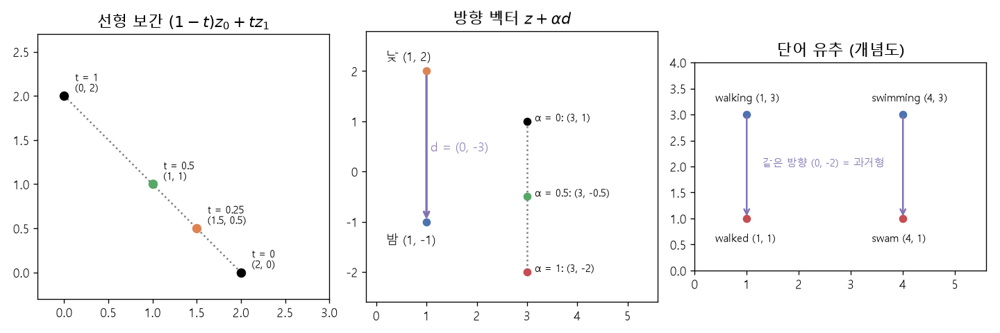

# 선형 보간과 잠재 방향 (Linear interpolation, Latent direction)

[목차로 돌아가기](../../00_MIT%EB%94%A5%EB%9F%AC%EB%8B%9D_%EB%AA%A9%EC%B0%A8.md) · 먼저 볼 것: [M05_벡터와_행렬](../../%EC%88%98%ED%95%99%EA%B0%9C%EB%85%90/03_%EC%84%A0%ED%98%95%EB%8C%80%EC%88%98/M05_%EB%B2%A1%ED%84%B0%EC%99%80_%ED%96%89%EB%A0%AC.md), [MM03_벡터_표기와_전치](../../%EC%88%98%ED%95%99%EA%B0%9C%EB%85%90/03_%EC%84%A0%ED%98%95%EB%8C%80%EC%88%98/MM03_%EB%B2%A1%ED%84%B0_%ED%91%9C%EA%B8%B0%EC%99%80_%EC%A0%84%EC%B9%98.md), [MM11_립시츠_연속과_노름](../../%EC%88%98%ED%95%99%EA%B0%9C%EB%85%90/03_%EC%84%A0%ED%98%95%EB%8C%80%EC%88%98/MM11_%EB%A6%BD%EC%8B%9C%EC%B8%A0_%EC%97%B0%EC%86%8D%EA%B3%BC_%EB%85%B8%EB%A6%84.md) · 쓰는 곳: [Lec19 3.2](../../Lec19_%EC%A0%84%EC%9D%B4_%ED%95%99%EC%8A%B5_%EB%8D%B0%EC%9D%B4%ED%84%B0.md#32-%EC%9E%A0%EC%9E%AC-%EB%B0%A9%ED%96%A5-%EC%B0%BE%EA%B8%B0), [Lec19 3.3](../../Lec19_%EC%A0%84%EC%9D%B4_%ED%95%99%EC%8A%B5_%EB%8D%B0%EC%9D%B4%ED%84%B0.md#33-%EC%96%B4%EB%94%94%EC%84%9C-%EB%B3%B4%EA%B0%84%ED%95%98%EB%82%98-z-%EA%B3%B5%EA%B0%84%EA%B3%BC-w-%EA%B3%B5%EA%B0%84)

📚 학습 순서 21/99 (3. 선형대수): ← 이전: [MM44_단위_구와_코사인_유사도](../../%EC%88%98%ED%95%99%EA%B0%9C%EB%85%90/03_%EC%84%A0%ED%98%95%EB%8C%80%EC%88%98/MM44_%EB%8B%A8%EC%9C%84_%EA%B5%AC%EC%99%80_%EC%BD%94%EC%82%AC%EC%9D%B8_%EC%9C%A0%EC%82%AC%EB%8F%84.md) · 다음: [MM43_마할라노비스_거리](../../%EC%88%98%ED%95%99%EA%B0%9C%EB%85%90/03_%EC%84%A0%ED%98%95%EB%8C%80%EC%88%98/MM43_%EB%A7%88%ED%95%A0%EB%9D%BC%EB%85%B8%EB%B9%84%EC%8A%A4_%EA%B1%B0%EB%A6%AC.md) →

> [!NOTE]
> **3줄 요약**
> - **선형 [보간](../../00_%EB%94%A5%EB%9F%AC%EB%8B%9D_%EC%9A%A9%EC%96%B4%EC%82%AC%EC%A0%84.md#interpolation-%EB%B3%B4%EA%B0%84)**은 두 점 $z_0$, $z_1$ 사이를 $(1-t)z_0 + t z_1$로 잇는다. $t = 0$이면 $z_0$, $t = 1$이면 $z_1$, $t = 0.5$면 한가운데다. $(2, 0)$과 $(0, 2)$의 가운데는 $(1, 1)$.
> - **[잠재 방향](../../00_%EB%94%A5%EB%9F%AC%EB%8B%9D_%EC%9A%A9%EC%96%B4%EC%82%AC%EC%A0%84.md#latent-direction-%EC%9E%A0%EC%9E%AC-%EB%B0%A9%ED%96%A5)**은 두 점의 차 $d = z_B - z_A$다. 낮 사진의 잠재 벡터에서 밤 사진의 잠재 벡터로 가는 방향을 구해 두면, 다른 사진의 잠재 벡터에 $\alpha d$를 더해 "밤으로 바꾸기"를 할 수 있다. 단어 [임베딩](../../00_%EB%94%A5%EB%9F%AC%EB%8B%9D_%EC%9A%A9%EC%96%B4%EC%82%AC%EC%A0%84.md#embedding-%EC%9E%84%EB%B2%A0%EB%94%A9)의 walking → walked 방향을 swimming에 더하면 swam이 나오는 것과 같다.
> - 픽셀 공간에서 선형 [보간](../../00_%EB%94%A5%EB%9F%AC%EB%8B%9D_%EC%9A%A9%EC%96%B4%EC%82%AC%EC%A0%84.md#interpolation-%EB%B3%B4%EA%B0%84)하면 자연 이미지의 다양체를 벗어나기 쉽다. 그래서 [잠재 공간](../../00_%EB%94%A5%EB%9F%AC%EB%8B%9D_%EC%9A%A9%EC%96%B4%EC%82%AC%EC%A0%84.md#latent-space-%EC%9E%A0%EC%9E%AC-%EA%B3%B5%EA%B0%84)에서 [보간](../../00_%EB%94%A5%EB%9F%AC%EB%8B%9D_%EC%9A%A9%EC%96%B4%EC%82%AC%EC%A0%84.md#interpolation-%EB%B3%B4%EA%B0%84)한 뒤 [생성기](../../00_%EB%94%A5%EB%9F%AC%EB%8B%9D_%EC%9A%A9%EC%96%B4%EC%82%AC%EC%A0%84.md#generator-discriminator-%EC%83%9D%EC%84%B1%EA%B8%B0%EC%99%80-%ED%8C%90%EB%B3%84%EA%B8%B0) $G$로 보낸다.

## 1. 개념 설명

비유: 서울과 부산 사이를 지도 위에 자로 그은 직선으로 가면 산과 바다를 뚫고 지나간다(픽셀 공간 [보간](../../00_%EB%94%A5%EB%9F%AC%EB%8B%9D_%EC%9A%A9%EC%96%B4%EC%82%AC%EC%A0%84.md#interpolation-%EB%B3%B4%EA%B0%84)). 대신 "경부선 몇 km 지점"이라는 좌표([잠재 변수](../../00_%EB%94%A5%EB%9F%AC%EB%8B%9D_%EC%9A%A9%EC%96%B4%EC%82%AC%EC%A0%84.md#latent-variable-%EC%9E%A0%EC%9E%AC-%EB%B3%80%EC%88%98))로 바꾼 뒤 그 숫자를 고르게 늘려 가면 언제나 철길 위에 있다([잠재 공간](../../00_%EB%94%A5%EB%9F%AC%EB%8B%9D_%EC%9A%A9%EC%96%B4%EC%82%AC%EC%A0%84.md#latent-space-%EC%9E%A0%EC%9E%AC-%EA%B3%B5%EA%B0%84) [보간](../../00_%EB%94%A5%EB%9F%AC%EB%8B%9D_%EC%9A%A9%EC%96%B4%EC%82%AC%EC%A0%84.md#interpolation-%EB%B3%B4%EA%B0%84)). [생성기](../../00_%EB%94%A5%EB%9F%AC%EB%8B%9D_%EC%9A%A9%EC%96%B4%EC%82%AC%EC%A0%84.md#generator-discriminator-%EC%83%9D%EC%84%B1%EA%B8%B0%EC%99%80-%ED%8C%90%EB%B3%84%EA%B8%B0) $G$는 "km 지점 → 지도 위 위치"를 바꿔 주는 함수다.

- **선형 [보간](../../00_%EB%94%A5%EB%9F%AC%EB%8B%9D_%EC%9A%A9%EC%96%B4%EC%82%AC%EC%A0%84.md#interpolation-%EB%B3%B4%EA%B0%84)**: $t$를 0에서 1로 바꾸면 점이 $z_0$에서 $z_1$로 곧게 움직인다. 두 점의 [가중합](../../00_%EB%94%A5%EB%9F%AC%EB%8B%9D_%EC%9A%A9%EC%96%B4%EC%82%AC%EC%A0%84.md#weighted-sum-%EA%B0%80%EC%A4%91%ED%95%A9)이고, [가중치](../../00_%EB%94%A5%EB%9F%AC%EB%8B%9D_%EC%9A%A9%EC%96%B4%EC%82%AC%EC%A0%84.md#weight-%EA%B0%80%EC%A4%91%EC%B9%98) $(1-t)$와 $t$의 합은 늘 1이다.
- **방향 벡터**: $d = z_B - z_A$는 "A에서 B로 가려면 각 성분을 얼마나 바꾸나"다. 같은 $d$를 다른 점에 더하면 같은 종류의 변화(낮→밤, 줌인, 과거형)를 준다. $\alpha$는 얼마나 세게 바꿀지 정하는 손잡이다.
- **왜 잠재 공간인가**: [생성기](../../00_%EB%94%A5%EB%9F%AC%EB%8B%9D_%EC%9A%A9%EC%96%B4%EC%82%AC%EC%A0%84.md#generator-discriminator-%EC%83%9D%EC%84%B1%EA%B8%B0%EC%99%80-%ED%8C%90%EB%B3%84%EA%B8%B0)를 학습하면 [잠재 공간](../../00_%EB%94%A5%EB%9F%AC%EB%8B%9D_%EC%9A%A9%EC%96%B4%EC%82%AC%EC%A0%84.md#latent-space-%EC%9E%A0%EC%9E%AC-%EA%B3%B5%EA%B0%84)의 어느 점이든 자연 이미지 다양체 위로 보내도록 만들어진다. 그래서 [잠재 공간](../../00_%EB%94%A5%EB%9F%AC%EB%8B%9D_%EC%9A%A9%EC%96%B4%EC%82%AC%EC%A0%84.md#latent-space-%EC%9E%A0%EC%9E%AC-%EA%B3%B5%EA%B0%84)에서 직선으로 움직이면 이미지 공간에서는 다양체를 따라 휘어진 길이 된다.


*▲ 직접 그린 그림: 왼쪽은 $(2, 0)$과 $(0, 2)$의 선형 [보간](../../00_%EB%94%A5%EB%9F%AC%EB%8B%9D_%EC%9A%A9%EC%96%B4%EC%82%AC%EC%A0%84.md#interpolation-%EB%B3%B4%EA%B0%84)($t = 0.25$이면 $(1.5, 0.5)$). 가운데는 낮 $(1, 2)$ → 밤 $(1, -1)$ 방향 $d = (0, -3)$을 $(3, 1)$에 더한 것. 오른쪽은 단어 유추 개념도(walking → walked 방향을 swimming에 더하면 swam)*

## 2. 필요한 이유

[Lec19 3.2](../../Lec19_%EC%A0%84%EC%9D%B4_%ED%95%99%EC%8A%B5_%EB%8D%B0%EC%9D%B4%ED%84%B0.md#32-%EC%9E%A0%EC%9E%AC-%EB%B0%A9%ED%96%A5-%EC%B0%BE%EA%B8%B0)에서 강사는 같은 장면의 낮 사진과 밤 사진을 [잠재 공간](../../00_%EB%94%A5%EB%9F%AC%EB%8B%9D_%EC%9A%A9%EC%96%B4%EC%82%AC%EC%A0%84.md#latent-space-%EC%9E%A0%EC%9E%AC-%EA%B3%B5%EA%B0%84)으로 보낸 뒤 둘을 잇는 방향 벡터를 계산해 "밤으로 바꾸기", "줌인", "밝게 하기" 같은 조작을 찾는다고 설명한다. word2vec의 시제 방향도 같은 계산이다. [Lec19 3.3](../../Lec19_%EC%A0%84%EC%9D%B4_%ED%95%99%EC%8A%B5_%EB%8D%B0%EC%9D%B4%ED%84%B0.md#33-%EC%96%B4%EB%94%94%EC%84%9C-%EB%B3%B4%EA%B0%84%ED%95%98%EB%82%98-z-%EA%B3%B5%EA%B0%84%EA%B3%BC-w-%EA%B3%B5%EA%B0%84)에서는 새와 파리 사진 사이를 픽셀로 [보간](../../00_%EB%94%A5%EB%9F%AC%EB%8B%9D_%EC%9A%A9%EC%96%B4%EC%82%AC%EC%A0%84.md#interpolation-%EB%B3%B4%EA%B0%84)하면 두 그림이 겹친 이상한 이미지가 나오지만, [잠재 공간](../../00_%EB%94%A5%EB%9F%AC%EB%8B%9D_%EC%9A%A9%EC%96%B4%EC%82%AC%EC%A0%84.md#latent-space-%EC%9E%A0%EC%9E%AC-%EA%B3%B5%EA%B0%84)에서 [보간](../../00_%EB%94%A5%EB%9F%AC%EB%8B%9D_%EC%9A%A9%EC%96%B4%EC%82%AC%EC%A0%84.md#interpolation-%EB%B3%B4%EA%B0%84)하면 (여전히 이상하지만) 자연 이미지처럼 보이는 그림이 나온다고 비교한다.

## 3. 숫자로 보기

**선형 [보간](../../00_%EB%94%A5%EB%9F%AC%EB%8B%9D_%EC%9A%A9%EC%96%B4%EC%82%AC%EC%A0%84.md#interpolation-%EB%B3%B4%EA%B0%84)** ($z_0 = (2, 0)$, $z_1 = (0, 2)$)

| $t$ | $(1-t)z_0$ | $t z_1$ | 합 |
|---|---|---|---|
| 0 | $(2, 0)$ | $(0, 0)$ | $(2, 0)$ |
| 0.25 | $(1.5, 0)$ | $(0, 0.5)$ | $(1.5, 0.5)$ |
| 0.5 | $(1, 0)$ | $(0, 1)$ | $(1, 1)$ |
| 1 | $(0, 0)$ | $(0, 2)$ | $(0, 2)$ |

$$
z(t) = (1 - t)\,z_0 + t\,z_1, \qquad 0 \le t \le 1
$$

<details><summary>기호 풀이</summary>

| 기호 | 읽는 법 | 뜻 | 예제 값 |
| --- | --- | --- | --- |
| $z_0$ | 제트 영 | 출발점 (첫 사진의 잠재 벡터) | $(2, 0)$ |
| $z_1$ | 제트 일 | 도착점 (둘째 사진의 잠재 벡터) | $(0, 2)$ |
| $t$ | 티 | 얼마나 왔나 (0이면 출발, 1이면 도착) | 0.25 |
| $1 - t$ | 일 빼기 티 | 출발점에 주는 [가중치](../../00_%EB%94%A5%EB%9F%AC%EB%8B%9D_%EC%9A%A9%EC%96%B4%EC%82%AC%EC%A0%84.md#weight-%EA%B0%80%EC%A4%91%EC%B9%98) | 0.75 |
| $z(t)$ | 제트 티 | $t$만큼 온 중간 점 | $(1.5, 0.5)$ |

</details>

<details><summary>예제와 풀이</summary>

**문제**: 첫 사진의 잠재 벡터가 $(2, 0)$, 둘째 사진의 잠재 벡터가 $(0, 2)$다. 첫 사진에서 둘째 사진 쪽으로 4분의 1만큼 간 잠재 벡터는?

**주어진 값**
- $z_0 = (2, 0)$ (출발점)
- $z_1 = (0, 2)$ (도착점)
- $t = 0.25$ (간 정도)

**풀이**
1. 식을 그대로 쓴다: $z(t) = (1 - t)\,z_0 + t\,z_1$
2. 값을 대입한다: $z(0.25) = (1 - 0.25)\,(2, 0) + 0.25\,(0, 2)$
3. 괄호를 계산한다: $1 - 0.25 = 0.75$ 이므로 $z = 0.75\,(2, 0) + 0.25\,(0, 2)$
4. 첫 벡터에 성분마다 곱한다: $0.75 \times 2 = 1.5$, $0.75 \times 0 = 0$ 이므로 $z = (1.5, 0) + 0.25\,(0, 2)$
5. 둘째 벡터에 성분마다 곱한다: $0.25 \times 0 = 0$, $0.25 \times 2 = 0.5$ 이므로 $z = (1.5, 0) + (0, 0.5)$
6. 성분끼리 더한다: $1.5 + 0 = 1.5$, $0 + 0.5 = 0.5$

**답**: $z(0.25) = $ **(1.5, 0.5)**. 출발점 쪽에 더 가깝다.

</details>

<details><summary>내 이해</summary>


</details>

**[잠재 방향](../../00_%EB%94%A5%EB%9F%AC%EB%8B%9D_%EC%9A%A9%EC%96%B4%EC%82%AC%EC%A0%84.md#latent-direction-%EC%9E%A0%EC%9E%AC-%EB%B0%A9%ED%96%A5)** (낮 $z_A = (1, 2)$, 밤 $z_B = (1, -1)$, 새 사진 $z = (3, 1)$)
- 방향: $d = (1 - 1, -1 - 2) = (0, -3)$
- $\alpha = 0.5$: $(3, 1) + (0, -1.5) = (3, -0.5)$
- $\alpha = 1$: $(3, 1) + (0, -3) = (3, -2)$

**단어 유추** (개념도: walking $(1, 3)$, walked $(1, 1)$, swimming $(4, 3)$)
- 과거형 방향: walked $-$ walking $= (0, -2)$
- swimming $+ (0, -2) = (4, 1)$ = swam

$$
d = z_B - z_A, \qquad z' = z + \alpha\, d
$$

<details><summary>기호 풀이</summary>

| 기호 | 읽는 법 | 뜻 | 예제 값 |
| --- | --- | --- | --- |
| $z_A$ | 제트 에이 | 바꾸기 전 상태(낮 사진)의 잠재 벡터 | $(1, 2)$ |
| $z_B$ | 제트 비 | 바꾼 뒤 상태(밤 사진)의 잠재 벡터 | $(1, -1)$ |
| $d$ | 디 | [잠재 방향](../../00_%EB%94%A5%EB%9F%AC%EB%8B%9D_%EC%9A%A9%EC%96%B4%EC%82%AC%EC%A0%84.md#latent-direction-%EC%9E%A0%EC%9E%AC-%EB%B0%A9%ED%96%A5) (낮 → 밤) | $(0, -3)$ |
| $z$ | 제트 | 바꾸고 싶은 새 사진의 잠재 벡터 | $(3, 1)$ |
| $\alpha$ | 알파 | 바꾸는 세기 | 0.5 |
| $z'$ | 제트 프라임 | 바꾼 뒤의 잠재 벡터 ($G$에 넣으면 밤 사진) | $(3, -0.5)$ |

</details>

<details><summary>예제와 풀이</summary>

**문제**: 낮 사진의 잠재 벡터가 $(1, 2)$, 같은 장면 밤 사진의 잠재 벡터가 $(1, -1)$이다. 다른 사진 $(3, 1)$을 "반쯤 밤으로" 바꾼 잠재 벡터는?

**주어진 값**
- $z_A = (1, 2)$ (낮)
- $z_B = (1, -1)$ (밤)
- $z = (3, 1)$ (바꿀 사진)
- $\alpha = 0.5$ (반쯤)

**풀이**
1. 식을 그대로 쓴다: $d = z_B - z_A$, $z' = z + \alpha\, d$
2. 값을 대입한다: $d = (1, -1) - (1, 2)$, $z' = (3, 1) + 0.5\, d$
3. 성분끼리 뺀다: $1 - 1 = 0$, $-1 - 2 = -3$ 이므로 $d = (0, -3)$
4. $\alpha$를 성분마다 곱한다: $0.5 \times 0 = 0$, $0.5 \times (-3) = -1.5$ 이므로 $z' = (3, 1) + (0, -1.5)$
5. 성분끼리 더한다: $3 + 0 = 3$, $1 + (-1.5) = -0.5$

**답**: $z' = $ **(3, -0.5)**. $\alpha = 1$이면 $(3, -2)$로 "완전히 밤"이 된다. 둘째 성분만 바뀌므로 이 예에서는 둘째 축이 "밝기" 축이다.

</details>

<details><summary>내 이해</summary>


</details>

## 4. 코드로 확인

```python
# [변수] z0, z1: 두 사진의 잠재 벡터 (3절 표)
z0, z1 = np.array([2.0, 0.0]), np.array([0.0, 2.0])
# [연결] 3절 표: t = 0.25 → (1.5, 0.5), t = 0.5 → (1, 1)
print([((1 - t) * z0 + t * z1).tolist() for t in (0.25, 0.5)])
# [변수] zA, zB, z: 낮, 밤, 바꿀 사진의 잠재 벡터
zA, zB, z = np.array([1.0, 2.0]), np.array([1.0, -1.0]), np.array([3.0, 1.0])
# [변수] d = (0, -3): 낮 → 밤 방향
d = zB - zA
# [연결] 3절: d, α = 0.5와 1의 결과 (3, -0.5), (3, -2)
print(d.tolist(), (z + 0.5 * d).tolist(), (z + 1.0 * d).tolist())
# [변수] 단어 개념도 좌표: walking, walked, swimming
walking, walked, swimming = np.array([1, 3]), np.array([1, 1]), np.array([4, 3])
# [연결] 3절 단어 유추: 과거형 방향 (0, -2), swam = (4, 1)
print((walked - walking).tolist(), (swimming + walked - walking).tolist())
# [변수] p0, p1: 원(다양체) 위 20도, 160도 점 (Lec19 3.3의 그림)
p0, p1 = np.array([np.cos(np.radians(20)), np.sin(np.radians(20))]), np.array([np.cos(np.radians(160)), np.sin(np.radians(160))])
# [함수] np.linalg.norm: 원점에서의 거리. 1이면 원 위, 1보다 작으면 원 안 (다양체 밖)
# [연결] 픽셀 중간점 (0, 0.342)의 거리 0.342 → 다양체 밖. 잠재 중간점(90도)은 거리 1
print(np.round((p0 + p1) / 2, 4).tolist(), round(float(np.linalg.norm((p0 + p1) / 2)), 4))
# [변수] rng: 시드 0 난수 생성기, Z0, Z1: 512차원 표준 정규 잠재 벡터 1만 쌍
rng = np.random.default_rng(0)
Z0, Z1 = rng.normal(size=(10000, 512)), rng.normal(size=(10000, 512))
# [연결] ⚠ 주의: 끝점의 길이 약 22.61 (√512 = 22.63), 중간점의 길이 약 15.98 (√256 = 16)
print(round(float(np.linalg.norm(Z0, axis=1).mean()), 4), round(float(np.linalg.norm((Z0 + Z1) / 2, axis=1).mean()), 4))
```

**실행 결과**:

```text
[[1.5, 0.5], [1.0, 1.0]]
[0.0, -3.0] [3.0, -0.5] [3.0, -2.0]
[0, -2] [4, 1]
[0.0, 0.342] 0.342
22.6131 15.9844
```

> [!WARNING]
> **⚠ 주의**
> - **[잠재 공간](../../00_%EB%94%A5%EB%9F%AC%EB%8B%9D_%EC%9A%A9%EC%96%B4%EC%82%AC%EC%A0%84.md#latent-space-%EC%9E%A0%EC%9E%AC-%EA%B3%B5%EA%B0%84)에서도 직선이 늘 안전하지는 않다**: 512차원 표준 [정규분포](../../00_%EB%94%A5%EB%9F%AC%EB%8B%9D_%EC%9A%A9%EC%96%B4%EC%82%AC%EC%A0%84.md#normal-distribution-%EC%A0%95%EA%B7%9C%EB%B6%84%ED%8F%AC) 잠재 벡터는 길이가 거의 다 $\sqrt{512} \approx 22.6$ 근처에 몰려 있다. 그런데 두 벡터의 중간점은 길이가 약 16($\sqrt{256}$)이라, [학습](../../00_%EB%94%A5%EB%9F%AC%EB%8B%9D_%EC%9A%A9%EC%96%B4%EC%82%AC%EC%A0%84.md#training-%ED%95%99%EC%8A%B5) 때 거의 보지 못한 "안쪽" 영역을 지난다. 그래서 [GAN](../../00_%EB%94%A5%EB%9F%AC%EB%8B%9D_%EC%9A%A9%EC%96%B4%EC%82%AC%EC%A0%84.md#gan-generative-adversarial-network-%EC%83%9D%EC%84%B1%EC%A0%81-%EC%A0%81%EB%8C%80-%EC%8B%A0%EA%B2%BD%EB%A7%9D)에서는 구면 [보간](../../00_%EB%94%A5%EB%9F%AC%EB%8B%9D_%EC%9A%A9%EC%96%B4%EC%82%AC%EC%A0%84.md#interpolation-%EB%B3%B4%EA%B0%84)(slerp)을 쓰기도 하고, [StyleGAN](../../00_%EB%94%A5%EB%9F%AC%EB%8B%9D_%EC%9A%A9%EC%96%B4%EC%82%AC%EC%A0%84.md#stylegan-%EC%8A%A4%ED%83%80%EC%9D%BCgan)은 덜 휘어진 중간 공간($w$)에서 [보간](../../00_%EB%94%A5%EB%9F%AC%EB%8B%9D_%EC%9A%A9%EC%96%B4%EC%82%AC%EC%A0%84.md#interpolation-%EB%B3%B4%EA%B0%84)한다([Lec19 3.3](../../Lec19_%EC%A0%84%EC%9D%B4_%ED%95%99%EC%8A%B5_%EB%8D%B0%EC%9D%B4%ED%84%B0.md#33-%EC%96%B4%EB%94%94%EC%84%9C-%EB%B3%B4%EA%B0%84%ED%95%98%EB%82%98-z-%EA%B3%B5%EA%B0%84%EA%B3%BC-w-%EA%B3%B5%EA%B0%84)).
> - **방향은 실험으로 찾은 근사다**: 낮→밤 방향 하나가 모든 사진에서 같은 뜻이라는 보장은 없다. 강의의 화산 예처럼 "어둡게" 방향에 "분화" 같은 데이터 [편향](../../00_%EB%94%A5%EB%9F%AC%EB%8B%9D_%EC%9A%A9%EC%96%B4%EC%82%AC%EC%A0%84.md#bias-%ED%8E%B8%ED%96%A5)이 섞여 들어간다.
> - **$\alpha$를 너무 키우면** 다양체 밖으로 나가 그림이 깨진다. 실제로는 여러 $\alpha$를 시도해 본다.

## 5. 개념 재확인

<details><summary>1. $z_0 = (4, 0)$, $z_1 = (0, 4)$일 때 $t = 0.75$인 선형 보간 점은?</summary>

| 단계 | 하는 일 | 계산 | 결과 |
|---|---|---|---|
| 1 | 출발점 몫 | $0.25 \times (4, 0)$ | $(1, 0)$ |
| 2 | 도착점 몫 | $0.75 \times (0, 4)$ | $(0, 3)$ |
| 3 | 더하기 | $(1, 0) + (0, 3)$ | $(1, 3)$ |

**① 쓰는 식**
$$z(t) = (1 - t)\,z_0 + t\,z_1$$
- 위 식 ← ② (출발점 몫), ③ (도착점 몫), ④ (합)에서 쓴다.
```python
# [변수] z0, z1, t: 출발점, 도착점, 간 정도
z0, z1, t = np.array([4.0, 0.0]), np.array([0.0, 4.0]), 0.75   # ①
# [변수] a = (1, 0): 출발점 몫
a = (1 - t) * z0                                                 # ②
# [변수] b = (0, 3): 도착점 몫
b = t * z1                                                       # ③
# [연결] [1.0, 0.0] [0.0, 3.0] [1.0, 3.0]
print(a.tolist(), b.tolist(), (a + b).tolist())                  # ④
```

**주어진 값**
- $z_0 = (4, 0)$ (출발점)
- $z_1 = (0, 4)$ (도착점)
- $t = 0.75$ (간 정도)

**풀이**
1. 식을 그대로 쓴다: $z(t) = (1 - t)\,z_0 + t\,z_1$
2. 값을 대입한다: $z(0.75) = (1 - 0.75)\,(4, 0) + 0.75\,(0, 4)$
3. 괄호를 계산한다: $1 - 0.75 = 0.25$ 이므로 $z = 0.25\,(4, 0) + 0.75\,(0, 4)$
4. (②) 첫 벡터에 곱한다: $0.25 \times 4 = 1$, $0.25 \times 0 = 0$ 이므로 $z = (1, 0) + 0.75\,(0, 4)$
5. (③) 둘째 벡터에 곱한다: $0.75 \times 0 = 0$, $0.75 \times 4 = 3$ 이므로 $z = (1, 0) + (0, 3)$
6. (④) 성분끼리 더한다: $1 + 0 = 1$, $0 + 3 = 3$

**답**: **(1, 3)**. 도착점 쪽으로 4분의 3을 왔다.

</details>

<details><summary>2. 단어 임베딩(개념도)이 king $(3, 5)$, man $(1, 4)$, woman $(1, 1)$이다. man → woman 방향을 king에 더하면?</summary>

| 단계 | 하는 일 | 계산 | 결과 |
|---|---|---|---|
| 1 | 방향 | $(1, 1) - (1, 4)$ | $(0, -3)$ |
| 2 | 더하기 | $(3, 5) + (0, -3)$ | $(3, 2)$ |

**① 쓰는 식**
$$d = z_B - z_A, \qquad z' = z + \alpha\, d$$
- 위 식 ← ② (방향), ③ (더하기)에서 쓴다.
```python
# [변수] king, man, woman: 개념도 좌표
king, man, woman = np.array([3, 5]), np.array([1, 4]), np.array([1, 1])   # ①
# [변수] d = (0, -3): man → woman 방향
d = woman - man                                                             # ②
# [연결] [0, -3] [3, 2]  (α = 1)
print(d.tolist(), (king + 1 * d).tolist())                                  # ③
```

**주어진 값**
- $z_A = (1, 4)$ (man)
- $z_B = (1, 1)$ (woman)
- $z = (3, 5)$ (king)
- $\alpha = 1$ (방향을 그대로 한 번 더함)

**풀이**
1. 식을 그대로 쓴다: $d = z_B - z_A$, $z' = z + \alpha\, d$
2. 값을 대입한다: $d = (1, 1) - (1, 4)$, $z' = (3, 5) + 1 \times d$
3. (②) 성분끼리 뺀다: $1 - 1 = 0$, $1 - 4 = -3$ 이므로 $d = (0, -3)$
4. (③) $\alpha$를 곱한다: $1 \times (0, -3) = (0, -3)$ 이므로 $z' = (3, 5) + (0, -3)$
5. (③) 성분끼리 더한다: $3 + 0 = 3$, $5 + (-3) = 2$

**답**: **(3, 2)**. 이 점과 가장 가까운 단어가 queen이면 유추가 맞은 것이다.

</details>

## 예제 풀기

[예제 10문제 풀기](../../%EC%98%88%EC%A0%9C/03_%EC%84%A0%ED%98%95%EB%8C%80%EC%88%98/%EC%98%88%EC%A0%9C_MM69_%EC%84%A0%ED%98%95_%EB%B3%B4%EA%B0%84%EA%B3%BC_%EC%9E%A0%EC%9E%AC_%EB%B0%A9%ED%96%A5.md)

<details><summary>내 이해</summary>


</details>
