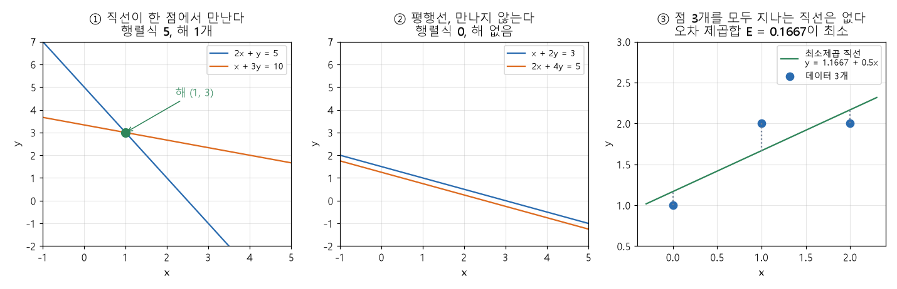

# 역행렬과 연립일차방정식 (Inverse matrix, Systems of linear equations)

[목차로 돌아가기](../../00_MIT%EB%94%A5%EB%9F%AC%EB%8B%9D_%EB%AA%A9%EC%B0%A8.md) · 먼저 볼 것: [M05_벡터와_행렬](../../%EC%88%98%ED%95%99%EA%B0%9C%EB%85%90/03_%EC%84%A0%ED%98%95%EB%8C%80%EC%88%98/M05_%EB%B2%A1%ED%84%B0%EC%99%80_%ED%96%89%EB%A0%AC.md), [MM03_벡터_표기와_전치](../../%EC%88%98%ED%95%99%EA%B0%9C%EB%85%90/03_%EC%84%A0%ED%98%95%EB%8C%80%EC%88%98/MM03_%EB%B2%A1%ED%84%B0_%ED%91%9C%EA%B8%B0%EC%99%80_%EC%A0%84%EC%B9%98.md) · 쓰는 곳: [MM23_최소_노름_해와_이중_하강](../../%EC%88%98%ED%95%99%EA%B0%9C%EB%85%90/08_%EC%9D%BC%EB%B0%98%ED%99%94/MM23_%EC%B5%9C%EC%86%8C_%EB%85%B8%EB%A6%84_%ED%95%B4%EC%99%80_%EC%9D%B4%EC%A4%91_%ED%95%98%EA%B0%95.md), [MM26_테일러_전개와_뉴턴_방법](../../%EC%88%98%ED%95%99%EA%B0%9C%EB%85%90/09_%EC%B5%9C%EC%A0%81%ED%99%94%EC%9D%98_%EA%B8%B0%ED%95%98/MM26_%ED%85%8C%EC%9D%BC%EB%9F%AC_%EC%A0%84%EA%B0%9C%EC%99%80_%EB%89%B4%ED%84%B4_%EB%B0%A9%EB%B2%95.md), [MM48_가우스_과정과_조건부_예측](../../%EC%88%98%ED%95%99%EA%B0%9C%EB%85%90/10_%ED%91%9C%ED%98%84_%ED%95%99%EC%8A%B5/MM48_%EA%B0%80%EC%9A%B0%EC%8A%A4_%EA%B3%BC%EC%A0%95%EA%B3%BC_%EC%A1%B0%EA%B1%B4%EB%B6%80_%EC%98%88%EC%B8%A1.md), [MM88_고윳값과_특잇값_분해](../../%EC%88%98%ED%95%99%EA%B0%9C%EB%85%90/03_%EC%84%A0%ED%98%95%EB%8C%80%EC%88%98/MM88_%EA%B3%A0%EC%9C%B3%EA%B0%92%EA%B3%BC_%ED%8A%B9%EC%9E%87%EA%B0%92_%EB%B6%84%ED%95%B4.md)

📚 학습 순서 17/99 (3. 선형대수): ← 이전: [MM04_평면과_결정_경계](../../%EC%88%98%ED%95%99%EA%B0%9C%EB%85%90/03_%EC%84%A0%ED%98%95%EB%8C%80%EC%88%98/MM04_%ED%8F%89%EB%A9%B4%EA%B3%BC_%EA%B2%B0%EC%A0%95_%EA%B2%BD%EA%B3%84.md) · 다음: [MM88_고윳값과_특잇값_분해](../../%EC%88%98%ED%95%99%EA%B0%9C%EB%85%90/03_%EC%84%A0%ED%98%95%EB%8C%80%EC%88%98/MM88_%EA%B3%A0%EC%9C%B3%EA%B0%92%EA%B3%BC_%ED%8A%B9%EC%9E%87%EA%B0%92_%EB%B6%84%ED%95%B4.md) →

> [!NOTE]
> **3줄 요약**
> - 연립방정식 $2x + y = 5,\ x + 3y = 10$은 행렬 한 줄 $A\mathbf{x} = \mathbf{b}$로 쓴다. 곱해서 단위행렬 $I$가 되는 행렬이 **역행렬** $A^{-1}$이고, $\mathbf{x} = A^{-1}\mathbf{b} = (1, 3)$으로 푼다.
> - 2×2 행렬 $\begin{pmatrix}a&b\\c&d\end{pmatrix}$의 역행렬은 $\frac{1}{ad-bc}\begin{pmatrix}d&-b\\-c&a\end{pmatrix}$이다. **행렬식** $ad-bc$가 0이면 역행렬이 없다(해가 없거나 무수히 많다).
> - 식이 미지수보다 많아 딱 맞는 해가 없으면 [오차](../../00_%EB%94%A5%EB%9F%AC%EB%8B%9D_%EC%9A%A9%EC%96%B4%EC%82%AC%EC%A0%84.md#error-%EC%98%A4%EC%B0%A8) 제곱합을 가장 작게 하는 **최소제곱**을 쓴다: $(X^\top X)\mathbf{w} = X^\top\mathbf{y}$. 점 (0, 1), (1, 2), (2, 2)에는 $\mathbf{w} = (1.1667,\ 0.5)$가 나온다.

## 1. 개념 설명

비유: 시장에서 영수증 두 장만 남았다. 첫 영수증은 "사과 2개와 귤 1개 = 5", 둘째는 "사과 1개와 귤 3개 = 10"이다. 사과 한 개와 귤 한 개의 값을 거꾸로 알아내는 일이 **연립일차방정식**이다. 숫자 하나의 방정식 $2x = 6$은 양쪽에 $\frac{1}{2}$(2의 역수)을 곱해 풀었다. 행렬의 방정식은 "역수"의 자리에 **역행렬**을 곱해 푼다.

- **연립일차방정식**: 미지수들의 일차식 여러 개를 동시에 만족하는 값을 찾는 문제. 계수를 모은 행렬 $A$, 미지수를 모은 벡터 $\mathbf{x}$, 오른쪽 값을 모은 벡터 $\mathbf{b}$를 쓰면 식 하나로 줄어든다. 왼쪽은 [행렬 곱](../../00_%EB%94%A5%EB%9F%AC%EB%8B%9D_%EC%9A%A9%EC%96%B4%EC%82%AC%EC%A0%84.md#matrix-multiplication-%ED%96%89%EB%A0%AC-%EA%B3%B1)이다.
- **단위행렬** $I$: 숫자 1의 행렬 버전. 대각선이 1이고 나머지가 0이라 어떤 벡터에 곱해도 그대로다($I\mathbf{x} = \mathbf{x}$).
- **역행렬** $A^{-1}$: $A A^{-1} = A^{-1}A = I$를 만족하는 행렬. 숫자의 $\frac{1}{2}$처럼 "곱하면 1"이 되는 짝이다.
- **행렬식**(determinant) $\det A$: 2×2에서는 $ad-bc$. 0이 아니면 역행렬이 있고, 0이면 없다.

$$
A\mathbf{x} = \mathbf{b}
$$

<details><summary>기호 풀이</summary>

| 기호 | 읽는 법 | 뜻 | 예제 값 |
| --- | --- | --- | --- |
| $A$ | 에이 | 계수 행렬. 행 하나가 식 하나, 열 하나가 미지수 하나 | $\begin{pmatrix}2&1\\1&3\end{pmatrix}$ |
| $\mathbf{x}$ | 엑스 벡터 | 구하려는 미지수를 모은 벡터 | $(x, y)$ |
| $\mathbf{b}$ | 비 벡터 | 식 오른쪽 값을 모은 벡터 | $(5, 10)$ |
| $A\mathbf{x}$ | 에이 엑스 | [행렬 곱](../../00_%EB%94%A5%EB%9F%AC%EB%8B%9D_%EC%9A%A9%EC%96%B4%EC%82%AC%EC%A0%84.md#matrix-multiplication-%ED%96%89%EB%A0%AC-%EA%B3%B1). 행마다 "계수 × 미지수"를 더한 값 | $(2x + y,\ x + 3y)$ |

</details>

<details><summary>예제와 풀이</summary>

**문제**: 두 식 $2x + y = 5$, $x + 3y = 10$을 $A\mathbf{x} = \mathbf{b}$ 모양으로 쓰고, $\mathbf{x} = (1, 3)$이 두 식을 모두 만족하는지 확인하라.

**주어진 값**:
- $A = \begin{pmatrix}2&1\\1&3\end{pmatrix}$ (식의 계수. 첫 줄은 첫 식, 둘째 줄은 둘째 식)
- $\mathbf{x} = (1, 3)$ (확인해 볼 후보. $x = 1$, $y = 3$)
- $\mathbf{b} = (5, 10)$ (두 식의 오른쪽 값)

**풀이**
1. 식을 그대로 쓴다: $A\mathbf{x} = \mathbf{b}$
2. 값을 대입한다(왼쪽을 계산해 오른쪽과 비교한다): $\begin{pmatrix}2&1\\1&3\end{pmatrix}\begin{pmatrix}1\\3\end{pmatrix} \overset{?}{=} \begin{pmatrix}5\\10\end{pmatrix}$
3. 첫째 줄을 펼친다(줄의 각 칸에 $\mathbf{x}$의 같은 자리 칸을 곱해 더한다): $2 \times 1 + 1 \times 3$
4. 곱셈을 한다: 2 × 1 = 2, 1 × 3 = 3 이므로 $2 + 3$
5. 덧셈을 한다: 2 + 3 = 5. 오른쪽 첫 칸 5와 같다.
6. 둘째 줄을 펼친다: $1 \times 1 + 3 \times 3$
7. 곱셈을 한다: 1 × 1 = 1, 3 × 3 = 9 이므로 $1 + 9$
8. 덧셈을 한다: 1 + 9 = 10. 오른쪽 둘째 칸 10과 같다.

**답**: $A\mathbf{x} = (5, 10) = \mathbf{b}$이므로 $\mathbf{x} = (1, 3)$은 두 식의 해다

</details>

<details><summary>내 이해</summary>


</details>

2×2 행렬의 역행렬은 네 칸만으로 바로 쓴다.

$$
A^{-1} = \frac{1}{ad - bc}\begin{pmatrix}d&-b\\-c&a\end{pmatrix}, \qquad \det A = ad - bc
$$

<details><summary>기호 풀이</summary>

| 기호 | 읽는 법 | 뜻 | 예제 값 |
| --- | --- | --- | --- |
| $A^{-1}$ | 에이 인버스 | $A$의 역행렬. $A A^{-1} = I$ | $\begin{pmatrix}0.6&-0.2\\-0.2&0.4\end{pmatrix}$ |
| $a, b, c, d$ | 에이, 비, 씨, 디 | $A = \begin{pmatrix}a&b\\c&d\end{pmatrix}$의 네 칸 | 2, 1, 1, 3 |
| $ad - bc$ | 에이디 마이너스 비씨 | 행렬식. 대각선 곱에서 반대 대각선 곱을 뺀 값. 0이면 역행렬 없음 | 5 |
| $\frac{1}{ad-bc}$ | 행렬식 분의 일 | 모든 칸에 곱하는 배율 | 0.2 |
| $\det A$ | 디터미넌트 에이 | 행렬식(determinant)의 기호 | 5 |

</details>

<details><summary>예제와 풀이</summary>

**문제**: $A = \begin{pmatrix}2&1\\1&3\end{pmatrix}$의 행렬식과 역행렬을 구하고, $A A^{-1}$이 단위행렬 $I$가 되는지 확인하라.

**주어진 값**:
- $a = 2,\ b = 1$ (첫 줄)
- $c = 1,\ d = 3$ (둘째 줄)

**풀이**
1. 식을 그대로 쓴다: $A^{-1} = \frac{1}{ad - bc}\begin{pmatrix}d&-b\\-c&a\end{pmatrix}$
2. 값을 대입한다: $A^{-1} = \frac{1}{2 \times 3 - 1 \times 1}\begin{pmatrix}3&-1\\-1&2\end{pmatrix}$
3. 분모의 곱셈을 한다: 2 × 3 = 6, 1 × 1 = 1 이므로 $A^{-1} = \frac{1}{6 - 1}\begin{pmatrix}3&-1\\-1&2\end{pmatrix}$
4. 분모의 뺄셈을 한다: 6 − 1 = 5 이므로 $\det A = 5$, $A^{-1} = \frac{1}{5}\begin{pmatrix}3&-1\\-1&2\end{pmatrix}$ (5가 0이 아니니 역행렬이 있다)
5. $\frac{1}{5} = 0.2$를 칸마다 곱한다: 0.2 × 3 = 0.6, 0.2 × (−1) = −0.2, 0.2 × 2 = 0.4 이므로 $A^{-1} = \begin{pmatrix}0.6&-0.2\\-0.2&0.4\end{pmatrix}$
6. 확인으로 $A A^{-1}$의 첫 줄·첫 열 칸: $2 \times 0.6 + 1 \times (-0.2) = 1.2 - 0.2 = 1$
7. 첫 줄·둘째 열 칸: $2 \times (-0.2) + 1 \times 0.4 = -0.4 + 0.4 = 0$
8. 둘째 줄·첫 열 칸: $1 \times 0.6 + 3 \times (-0.2) = 0.6 - 0.6 = 0$
9. 둘째 줄·둘째 열 칸: $1 \times (-0.2) + 3 \times 0.4 = -0.2 + 1.2 = 1$

**답**: $\det A = 5$, $A^{-1} = \begin{pmatrix}0.6&-0.2\\-0.2&0.4\end{pmatrix}$, $A A^{-1} = \begin{pmatrix}1&0\\0&1\end{pmatrix} = I$

</details>

<details><summary>내 이해</summary>


</details>

역행렬을 알면 $A\mathbf{x} = \mathbf{b}$의 양쪽 앞에 $A^{-1}$을 곱해 $\mathbf{x}$만 남긴다. ($A^{-1}A\mathbf{x} = I\mathbf{x} = \mathbf{x}$) 곱하는 순서가 중요해서 $A^{-1}$은 항상 $\mathbf{b}$의 **왼쪽**에 놓는다.

$$
\mathbf{x} = A^{-1}\mathbf{b}
$$

<details><summary>기호 풀이</summary>

| 기호 | 읽는 법 | 뜻 | 예제 값 |
| --- | --- | --- | --- |
| $\mathbf{x}$ | 엑스 벡터 | 구하려는 해 | $(1, 3)$ |
| $A^{-1}$ | 에이 인버스 | $A$의 역행렬 | $\begin{pmatrix}0.6&-0.2\\-0.2&0.4\end{pmatrix}$ |
| $\mathbf{b}$ | 비 벡터 | 식 오른쪽 값 | $(5, 10)$ |

</details>

<details><summary>예제와 풀이</summary>

**문제**: $2x + y = 5$, $x + 3y = 10$의 해 $(x, y)$를 역행렬로 구하라.

**주어진 값**:
- $A^{-1} = \begin{pmatrix}0.6&-0.2\\-0.2&0.4\end{pmatrix}$ (바로 위 예제에서 구한 역행렬)
- $\mathbf{b} = (5, 10)$ (식 오른쪽 값)

**풀이**
1. 식을 그대로 쓴다: $\mathbf{x} = A^{-1}\mathbf{b}$
2. 값을 대입한다: $\mathbf{x} = \begin{pmatrix}0.6&-0.2\\-0.2&0.4\end{pmatrix}\begin{pmatrix}5\\10\end{pmatrix}$
3. 첫째 줄을 펼친다: $0.6 \times 5 + (-0.2) \times 10$
4. 곱셈을 한다: 0.6 × 5 = 3, (−0.2) × 10 = −2 이므로 $3 + (-2)$
5. 덧셈을 한다: 3 − 2 = 1 이므로 $x = 1$
6. 둘째 줄을 펼친다: $(-0.2) \times 5 + 0.4 \times 10$
7. 곱셈을 한다: (−0.2) × 5 = −1, 0.4 × 10 = 4 이므로 $-1 + 4$
8. 덧셈을 한다: −1 + 4 = 3 이므로 $y = 3$

**답**: $\mathbf{x} = (1, 3)$, 즉 사과 1개 값 1, 귤 1개 값 3

</details>

<details><summary>내 이해</summary>


</details>

## 2. 필요한 이유

식이 미지수보다 많은 경우가 딥러닝에서는 훨씬 흔하다. 직선 $y = w_0 + w_1 x$의 두 값을 데이터 점 세 개로 정하려면 식이 3개, 미지수가 2개다. 세 점을 모두 지나는 직선이 없으니 $A\mathbf{x} = \mathbf{b}$에는 해가 없다. 그래서 "가장 덜 틀리는" 값을 찾는다. 예측과 [정답](../../00_%EB%94%A5%EB%9F%AC%EB%8B%9D_%EC%9A%A9%EC%96%B4%EC%82%AC%EC%A0%84.md#label-%EC%A0%95%EB%8B%B5)의 차이를 제곱해 더한 **[오차](../../00_%EB%94%A5%EB%9F%AC%EB%8B%9D_%EC%9A%A9%EC%96%B4%EC%82%AC%EC%A0%84.md#error-%EC%98%A4%EC%B0%A8) 제곱합**을 가장 작게 하는 $\mathbf{w}$다. 이것이 [선형 회귀](../../00_%EB%94%A5%EB%9F%AC%EB%8B%9D_%EC%9A%A9%EC%96%B4%EC%82%AC%EC%A0%84.md#linear-regression-%EC%84%A0%ED%98%95-%ED%9A%8C%EA%B7%80)의 최소제곱이다. 데이터 행렬을 $X$(한 줄이 데이터 하나), [정답](../../00_%EB%94%A5%EB%9F%AC%EB%8B%9D_%EC%9A%A9%EC%96%B4%EC%82%AC%EC%A0%84.md#label-%EC%A0%95%EB%8B%B5)을 $\mathbf{y}$라 하면 다음과 같다.

$$
E(\mathbf{w}) = \lVert X\mathbf{w} - \mathbf{y} \rVert^2
$$

<details><summary>기호 풀이</summary>

| 기호 | 읽는 법 | 뜻 | 예제 값 |
| --- | --- | --- | --- |
| $E(\mathbf{w})$ | 이 더블유 | [오차](../../00_%EB%94%A5%EB%9F%AC%EB%8B%9D_%EC%9A%A9%EC%96%B4%EC%82%AC%EC%A0%84.md#error-%EC%98%A4%EC%B0%A8) 제곱합 ([손실](../../00_%EB%94%A5%EB%9F%AC%EB%8B%9D_%EC%9A%A9%EC%96%B4%EC%82%AC%EC%A0%84.md#loss-function-%EC%86%90%EC%8B%A4-%ED%95%A8%EC%88%98)의 한 종류) | 0.25 |
| $X$ | 엑스 | 데이터 행렬. 첫 열 1은 [편향](../../00_%EB%94%A5%EB%9F%AC%EB%8B%9D_%EC%9A%A9%EC%96%B4%EC%82%AC%EC%A0%84.md#bias-%ED%8E%B8%ED%96%A5) 몫, 둘째 열은 입력 | $\begin{pmatrix}1&0\\1&1\\1&2\end{pmatrix}$ |
| $\mathbf{w}$ | 더블유 벡터 | 구하려는 값 ([편향](../../00_%EB%94%A5%EB%9F%AC%EB%8B%9D_%EC%9A%A9%EC%96%B4%EC%82%AC%EC%A0%84.md#bias-%ED%8E%B8%ED%96%A5) $w_0$, [기울기](../../00_%EB%94%A5%EB%9F%AC%EB%8B%9D_%EC%9A%A9%EC%96%B4%EC%82%AC%EC%A0%84.md#gradient-%EA%B8%B0%EC%9A%B8%EA%B8%B0) $w_1$) | $(1, 0.5)$ |
| $\mathbf{y}$ | 와이 벡터 | [정답](../../00_%EB%94%A5%EB%9F%AC%EB%8B%9D_%EC%9A%A9%EC%96%B4%EC%82%AC%EC%A0%84.md#label-%EC%A0%95%EB%8B%B5) | $(1, 2, 2)$ |
| $\lVert\cdot\rVert^2$ | [노름](../../00_%EB%94%A5%EB%9F%AC%EB%8B%9D_%EC%9A%A9%EC%96%B4%EC%82%AC%EC%A0%84.md#norm-%EB%85%B8%EB%A6%84) 제곱 | 칸마다 제곱해 더한 값 ([MM11_립시츠_연속과_노름](../../%EC%88%98%ED%95%99%EA%B0%9C%EB%85%90/03_%EC%84%A0%ED%98%95%EB%8C%80%EC%88%98/MM11_%EB%A6%BD%EC%8B%9C%EC%B8%A0_%EC%97%B0%EC%86%8D%EA%B3%BC_%EB%85%B8%EB%A6%84.md)) | - |

</details>

<details><summary>예제와 풀이</summary>

**문제**: 점 (0, 1), (1, 2), (2, 2)에 직선 $y = w_0 + w_1 x$를 맞춘다. $\mathbf{w} = (1, 0.5)$일 때 $E(\mathbf{w})$를 구하라.

**주어진 값**:
- $X = \begin{pmatrix}1&0\\1&1\\1&2\end{pmatrix}$ (첫 열은 [편향](../../00_%EB%94%A5%EB%9F%AC%EB%8B%9D_%EC%9A%A9%EC%96%B4%EC%82%AC%EC%A0%84.md#bias-%ED%8E%B8%ED%96%A5), 둘째 열은 $x = 0, 1, 2$)
- $\mathbf{w} = (1, 0.5)$ (후보. $w_0 = 1$, $w_1 = 0.5$)
- $\mathbf{y} = (1, 2, 2)$ ([정답](../../00_%EB%94%A5%EB%9F%AC%EB%8B%9D_%EC%9A%A9%EC%96%B4%EC%82%AC%EC%A0%84.md#label-%EC%A0%95%EB%8B%B5))

**풀이**
1. 식을 그대로 쓴다: $E(\mathbf{w}) = \lVert X\mathbf{w} - \mathbf{y} \rVert^2$
2. 값을 대입한다: $E = \left\lVert \begin{pmatrix}1&0\\1&1\\1&2\end{pmatrix}\begin{pmatrix}1\\0.5\end{pmatrix} - \begin{pmatrix}1\\2\\2\end{pmatrix} \right\rVert^2$
3. 첫째 줄의 곱을 펼친다: $1 \times 1 + 0 \times 0.5 = 1 + 0 = 1$
4. 둘째 줄의 곱을 펼친다: $1 \times 1 + 1 \times 0.5 = 1 + 0.5 = 1.5$
5. 셋째 줄의 곱을 펼친다: $1 \times 1 + 2 \times 0.5 = 1 + 1 = 2$ 이므로 $E = \lVert (1, 1.5, 2) - (1, 2, 2) \rVert^2$
6. 칸마다 뺀다: 1 − 1 = 0, 1.5 − 2 = −0.5, 2 − 2 = 0 이므로 $E = \lVert (0, -0.5, 0) \rVert^2$
7. 칸마다 제곱해 더한다: $0^2 + (-0.5)^2 + 0^2 = 0 + 0.25 + 0 = 0.25$

**답**: $E = 0.25$ (최솟값은 아니다. 3절에서 0.1667이 최소임을 본다)

</details>

<details><summary>내 이해</summary>


</details>

$E$가 가장 작은 곳에서는 [기울기](../../00_%EB%94%A5%EB%9F%AC%EB%8B%9D_%EC%9A%A9%EC%96%B4%EC%82%AC%EC%A0%84.md#gradient-%EA%B8%B0%EC%9A%B8%EA%B8%B0)가 0이다([MM02_그래디언트_벡터](../../%EC%88%98%ED%95%99%EA%B0%9C%EB%85%90/02_%EB%AF%B8%EB%B6%84/MM02_%EA%B7%B8%EB%9E%98%EB%94%94%EC%96%B8%ED%8A%B8_%EB%B2%A1%ED%84%B0.md)). $E$의 그래디언트 $2X^\top(X\mathbf{w} - \mathbf{y})$를 0으로 놓으면 다음 **정규방정식**이 나온다. 왼쪽 $X^\top X$는 정사각행렬이라 역행렬이 있으면 풀린다.

$$
(X^\top X)\,\mathbf{w} = X^\top \mathbf{y} \quad\Longrightarrow\quad \mathbf{w} = (X^\top X)^{-1} X^\top \mathbf{y}
$$

<details><summary>기호 풀이</summary>

| 기호 | 읽는 법 | 뜻 | 예제 값 |
| --- | --- | --- | --- |
| $X^\top$ | 엑스 [전치](../../00_%EB%94%A5%EB%9F%AC%EB%8B%9D_%EC%9A%A9%EC%96%B4%EC%82%AC%EC%A0%84.md#transpose-%EC%A0%84%EC%B9%98) | $X$의 행과 열을 맞바꾼 행렬 | $\begin{pmatrix}1&1&1\\0&1&2\end{pmatrix}$ |
| $X^\top X$ | 엑스 [전치](../../00_%EB%94%A5%EB%9F%AC%EB%8B%9D_%EC%9A%A9%EC%96%B4%EC%82%AC%EC%A0%84.md#transpose-%EC%A0%84%EC%B9%98) 엑스 | 정사각행렬(2×2). 열끼리 곱해 더한 값 | $\begin{pmatrix}3&3\\3&5\end{pmatrix}$ |
| $X^\top \mathbf{y}$ | 엑스 [전치](../../00_%EB%94%A5%EB%9F%AC%EB%8B%9D_%EC%9A%A9%EC%96%B4%EC%82%AC%EC%A0%84.md#transpose-%EC%A0%84%EC%B9%98) 와이 | 각 열과 [정답](../../00_%EB%94%A5%EB%9F%AC%EB%8B%9D_%EC%9A%A9%EC%96%B4%EC%82%AC%EC%A0%84.md#label-%EC%A0%95%EB%8B%B5)의 곱을 더한 벡터 | $(5, 6)$ |
| $(X^\top X)^{-1}$ | 역행렬 | $X^\top X$의 역행렬 | $\frac{1}{6}\begin{pmatrix}5&-3\\-3&3\end{pmatrix}$ |
| $\mathbf{w}$ | 더블유 벡터 | [오차](../../00_%EB%94%A5%EB%9F%AC%EB%8B%9D_%EC%9A%A9%EC%96%B4%EC%82%AC%EC%A0%84.md#error-%EC%98%A4%EC%B0%A8) 제곱합이 가장 작은 값 | $(1.1667, 0.5)$ |

</details>

<details><summary>예제와 풀이</summary>

**문제**: 점 (0, 1), (1, 2), (2, 2)의 최소제곱 직선 $\mathbf{w} = (w_0, w_1)$을 정규방정식으로 구하라.

**주어진 값**:
- $X = \begin{pmatrix}1&0\\1&1\\1&2\end{pmatrix}$ (데이터 행렬)
- $\mathbf{y} = (1, 2, 2)$ ([정답](../../00_%EB%94%A5%EB%9F%AC%EB%8B%9D_%EC%9A%A9%EC%96%B4%EC%82%AC%EC%A0%84.md#label-%EC%A0%95%EB%8B%B5))

**풀이**
1. 식을 그대로 쓴다: $\mathbf{w} = (X^\top X)^{-1} X^\top \mathbf{y}$
2. 값을 대입한다: $\mathbf{w} = \left(\begin{pmatrix}1&1&1\\0&1&2\end{pmatrix}\begin{pmatrix}1&0\\1&1\\1&2\end{pmatrix}\right)^{-1}\begin{pmatrix}1&1&1\\0&1&2\end{pmatrix}\begin{pmatrix}1\\2\\2\end{pmatrix}$
3. $X^\top X$의 첫 줄·첫 열: $1 \times 1 + 1 \times 1 + 1 \times 1 = 3$
4. 첫 줄·둘째 열: $1 \times 0 + 1 \times 1 + 1 \times 2 = 0 + 1 + 2 = 3$ (둘째 줄·첫 열도 같은 3)
5. 둘째 줄·둘째 열: $0 \times 0 + 1 \times 1 + 2 \times 2 = 0 + 1 + 4 = 5$ 이므로 $X^\top X = \begin{pmatrix}3&3\\3&5\end{pmatrix}$
6. $X^\top \mathbf{y}$의 첫 칸: $1 \times 1 + 1 \times 2 + 1 \times 2 = 1 + 2 + 2 = 5$
7. 둘째 칸: $0 \times 1 + 1 \times 2 + 2 \times 2 = 0 + 2 + 4 = 6$ 이므로 $X^\top \mathbf{y} = (5, 6)$
8. 2×2 공식으로 $X^\top X$의 행렬식을 구한다: $3 \times 5 - 3 \times 3 = 15 - 9 = 6$ 이므로 $(X^\top X)^{-1} = \frac{1}{6}\begin{pmatrix}5&-3\\-3&3\end{pmatrix}$
9. 역행렬을 $X^\top \mathbf{y}$에 곱한다. 첫 칸: $\frac{1}{6}\big(5 \times 5 + (-3) \times 6\big) = \frac{1}{6}(25 - 18) = \frac{7}{6}$
10. 둘째 칸: $\frac{1}{6}\big((-3) \times 5 + 3 \times 6\big) = \frac{1}{6}(-15 + 18) = \frac{3}{6} = 0.5$

**답**: $\mathbf{w} = \left(\frac{7}{6},\ 0.5\right) = (1.1667,\ 0.5)$, 직선 $y = 1.1667 + 0.5x$

</details>

<details><summary>내 이해</summary>


</details>

이 식이 다른 노트에서 이렇게 다시 나온다.

- [MM23_최소_노름_해와_이중_하강](../../%EC%88%98%ED%95%99%EA%B0%9C%EB%85%90/08_%EC%9D%BC%EB%B0%98%ED%99%94/MM23_%EC%B5%9C%EC%86%8C_%EB%85%B8%EB%A6%84_%ED%95%B4%EC%99%80_%EC%9D%B4%EC%A4%91_%ED%95%98%EA%B0%95.md): 식보다 미지수가 많으면 해가 무수히 많아 정규방정식의 $X^\top X$가 역행렬을 잃는다. 그때 쓰는 것이 [최소 노름 해](../../00_%EB%94%A5%EB%9F%AC%EB%8B%9D_%EC%9A%A9%EC%96%B4%EC%82%AC%EC%A0%84.md#minimum-norm-solution-%EC%B5%9C%EC%86%8C-%EB%85%B8%EB%A6%84-%ED%95%B4)와 유사역행렬 $A^{+}$다.
- [MM26_테일러_전개와_뉴턴_방법](../../%EC%88%98%ED%95%99%EA%B0%9C%EB%85%90/09_%EC%B5%9C%EC%A0%81%ED%99%94%EC%9D%98_%EA%B8%B0%ED%95%98/MM26_%ED%85%8C%EC%9D%BC%EB%9F%AC_%EC%A0%84%EA%B0%9C%EC%99%80_%EB%89%B4%ED%84%B4_%EB%B0%A9%EB%B2%95.md): [뉴턴 방법](../../00_%EB%94%A5%EB%9F%AC%EB%8B%9D_%EC%9A%A9%EC%96%B4%EC%82%AC%EC%A0%84.md#newtons-method-%EB%89%B4%ED%84%B4-%EB%B0%A9%EB%B2%95)의 한 걸음은 $H\mathbf{d} = \mathbf{g}$라는 연립방정식을 푸는 일이다($\mathbf{d} = H^{-1}\mathbf{g}$).
- [MM48_가우스_과정과_조건부_예측](../../%EC%88%98%ED%95%99%EA%B0%9C%EB%85%90/10_%ED%91%9C%ED%98%84_%ED%95%99%EC%8A%B5/MM48_%EA%B0%80%EC%9A%B0%EC%8A%A4_%EA%B3%BC%EC%A0%95%EA%B3%BC_%EC%A1%B0%EA%B1%B4%EB%B6%80_%EC%98%88%EC%B8%A1.md): 관측 점들의 [공분산 행렬](../../00_%EB%94%A5%EB%9F%AC%EB%8B%9D_%EC%9A%A9%EC%96%B4%EC%82%AC%EC%A0%84.md#covariance-matrix-%EA%B3%B5%EB%B6%84%EC%82%B0-%ED%96%89%EB%A0%AC) $K$에 대해 $K^{-1}\mathbf{y}$를 계산해 새 점의 값을 예측한다.
- [MM88_고윳값과_특잇값_분해](../../%EC%88%98%ED%95%99%EA%B0%9C%EB%85%90/03_%EC%84%A0%ED%98%95%EB%8C%80%EC%88%98/MM88_%EA%B3%A0%EC%9C%B3%EA%B0%92%EA%B3%BC_%ED%8A%B9%EC%9E%87%EA%B0%92_%EB%B6%84%ED%95%B4.md): [고윳값](../../00_%EB%94%A5%EB%9F%AC%EB%8B%9D_%EC%9A%A9%EC%96%B4%EC%82%AC%EC%A0%84.md#eigenvector-eigenvalue-%EA%B3%A0%EC%9C%A0%EB%B2%A1%ED%84%B0%EC%99%80-%EA%B3%A0%EC%9C%B3%EA%B0%92)은 "$(A - \lambda I)$의 행렬식이 0이 되는 $\lambda$"로 구한다.

## 3. 숫자로 보기

**1. 연립방정식을 손으로 푼다** (한 줄에 한 동작)
- 두 식: $2x + y = 5$ ... (가), $x + 3y = 10$ ... (나)
- (가)를 $y$에 대해 정리: $y = 5 - 2x$
- (나)의 $y$ 자리에 넣는다: $x + 3(5 - 2x) = 10$
- 괄호를 푼다: $x + 15 - 6x = 10$
- $x$끼리 모은다: $-5x + 15 = 10$, 즉 $-5x = -5$
- $x = 1$, 그러면 $y = 5 - 2 \times 1 = 3$
- 역행렬로 푼 결과 $(1, 3)$과 같다. 역행렬은 이 "정리해 넣기"를 모든 $\mathbf{b}$에 한꺼번에 해 둔 것이다.

**2. 역행렬이 있을 때와 없을 때**
- $A = \begin{pmatrix}2&1\\1&3\end{pmatrix}$: $\det A = 2 \times 3 - 1 \times 1 = 5 \neq 0$ → 역행렬 있음, 해 1개
- $S = \begin{pmatrix}1&2\\2&4\end{pmatrix}$: $\det S = 1 \times 4 - 2 \times 2 = 0$ → 역행렬 없음. 둘째 줄이 첫째 줄의 2배라 식 두 개가 사실상 한 개다([랭크](../../00_%EB%94%A5%EB%9F%AC%EB%8B%9D_%EC%9A%A9%EC%96%B4%EC%82%AC%EC%A0%84.md#rank-%EB%9E%AD%ED%81%AC) 1, [MM25_랭크와_유효_랭크](../../%EC%88%98%ED%95%99%EA%B0%9C%EB%85%90/04_%ED%99%95%EB%A5%A0%EA%B3%BC_%EC%A0%95%EB%B3%B4/MM25_%EB%9E%AD%ED%81%AC%EC%99%80_%EC%9C%A0%ED%9A%A8_%EB%9E%AD%ED%81%AC.md)).

| $\mathbf{b}$ | 두 식 | 해 |
|---|---|---|
| (3, 6) | $x + 2y = 3$, $2x + 4y = 6$ | 둘째 식이 첫째 식의 2배라 같은 직선. 해가 **무수히 많다** ((1, 1), (3, 0), (−1, 2), ...) |
| (3, 5) | $x + 2y = 3$, $2x + 4y = 5$ | 둘째 식을 2로 나누면 $x + 2y = 2.5$인데 첫째 식은 3이다. 모순이라 해가 **없다** (평행선) |

**3. 점 3개에 직선 맞추기** (점 (0, 1), (1, 2), (2, 2))
- 세 점을 모두 지나는 직선은 없다. $E(\mathbf{w})$가 작을수록 좋은 직선이다.

| 후보 $\mathbf{w} = (w_0, w_1)$ | 예측 $X\mathbf{w}$ | [오차](../../00_%EB%94%A5%EB%9F%AC%EB%8B%9D_%EC%9A%A9%EC%96%B4%EC%82%AC%EC%A0%84.md#error-%EC%98%A4%EC%B0%A8) $X\mathbf{w} - \mathbf{y}$ | $E$ |
|---|---|---|---|
| (1, 1) | (1, 2, 3) | (0, 0, 1) | 1 |
| (1.5, 0) | (1.5, 1.5, 1.5) | (0.5, −0.5, −0.5) | 0.75 |
| (1, 0.5) | (1, 1.5, 2) | (0, −0.5, 0) | 0.25 |
| (1.2, 0.5) | (1.2, 1.7, 2.2) | (0.2, −0.3, 0.2) | 0.17 |
| **(1.1667, 0.5)** | (1.1667, 1.6667, 2.1667) | (0.1667, −0.3333, 0.1667) | **0.1667** |

- 정규방정식으로 구한 $(1.1667, 0.5)$가 표에서 $E$가 가장 작다. 어느 쪽으로 조금 바꿔도 $E$가 커진다.



<details><summary>기호 풀이</summary>

| 기호 | 읽는 법 | 뜻 | 예제 값 |
| --- | --- | --- | --- |
| $\det A$ | 디터미넌트 에이 | 행렬식. 0이면 역행렬 없음 | 5 |
| $A\mathbf{x} = \mathbf{b}$ | 에이 엑스는 비 | 연립방정식의 행렬 표기 | - |
| $E$ | 이 | [오차](../../00_%EB%94%A5%EB%9F%AC%EB%8B%9D_%EC%9A%A9%EC%96%B4%EC%82%AC%EC%A0%84.md#error-%EC%98%A4%EC%B0%A8) 제곱합 | 0.1667 |
| $\mathbf{w}$ | 더블유 벡터 | 직선의 [편향](../../00_%EB%94%A5%EB%9F%AC%EB%8B%9D_%EC%9A%A9%EC%96%B4%EC%82%AC%EC%A0%84.md#bias-%ED%8E%B8%ED%96%A5)과 [기울기](../../00_%EB%94%A5%EB%9F%AC%EB%8B%9D_%EC%9A%A9%EC%96%B4%EC%82%AC%EC%A0%84.md#gradient-%EA%B8%B0%EC%9A%B8%EA%B8%B0) | (1.1667, 0.5) |

</details>

## 4. 코드로 확인

```python
# [함수] import numpy as np: 수치 계산 라이브러리 NumPy를 np라는 이름으로 불러온다. array, linalg.det, linalg.inv, linalg.solve가 여기서 온다
import numpy as np

# [변수] A = [[2, 1], [1, 3]]: 연립방정식 2x + y = 5, x + 3y = 10의 계수 행렬. 행 하나가 식 하나다
# [변수] b = [5, 10]: 두 식의 오른쪽 값
# [연결] 본문 1절의 Ax = b
A = np.array([[2.0, 1.0], [1.0, 3.0]])
b = np.array([5.0, 10.0])

# [함수] np.linalg.det(A): 2×2 행렬의 행렬식 ad - bc를 계산한다. round(값, 4): 소수 넷째 자리까지 반올림
# [쓸모] 0이 아니면 역행렬이 있다. 여기서는 2×3 - 1×1 = 5
print("det A =", round(float(np.linalg.det(A)), 4))

# [함수] np.linalg.inv(A): 역행렬 A⁻¹를 만든다. np.round(행렬, 4) + 0.0: 반올림하고 -0.0을 0.0으로 바꾼다. .tolist(): 보기 좋게 리스트로 바꾼다
# [연결] 본문 2×2 공식의 결과 (1/5)·[[3, -1], [-1, 2]] = [[0.6, -0.2], [-0.2, 0.4]]
A_inv = np.linalg.inv(A)
print("A의 역행렬 =", (np.round(A_inv, 4) + 0.0).tolist())

# [함수] A @ A_inv: 행렬 곱. 역행렬의 정의대로 단위행렬 I가 나오는지 확인한다
print("A @ A⁻¹ =", (np.round(A @ A_inv, 4) + 0.0).tolist())

# [변수] x = A⁻¹b: 역행렬을 b 앞에 곱해 구한 해 (x, y)
# [연결] 본문 3절의 손계산 결과 (1, 3)
x = A_inv @ b
print("x = A⁻¹b =", (np.round(x, 4) + 0.0).tolist())

# [함수] np.linalg.solve(A, b): 역행렬을 만들지 않고 Ax = b를 바로 푼다
# [쓸모] 실제 계산에서는 inv보다 solve를 쓴다 (더 빠르고 오차가 작다, MM26 참고)
print("solve(A, b) =", (np.round(np.linalg.solve(A, b), 4) + 0.0).tolist())

# [변수] S = [[1, 2], [2, 4]]: 둘째 행이 첫째 행의 2배인 행렬. 행렬식이 0이라 역행렬이 없다
# [함수] np.linalg.matrix_rank(S): 랭크(서로 다른 방향의 개수)를 센다
# [연결] 본문 3절 "역행렬이 없을 때", MM25 랭크
S = np.array([[1.0, 2.0], [2.0, 4.0]])
print("det S =", round(float(np.linalg.det(S)), 4), " rank S =", int(np.linalg.matrix_rank(S)))

# [변수] X: 데이터 3개의 입력. 첫 열 1은 편향 w0 몫, 둘째 열은 x = 0, 1, 2
# [변수] y = [1, 2, 2]: 맞히고 싶은 값. 식 3개에 미지수 w0, w1 2개라 딱 맞는 해가 없다
# [연결] 본문 3절 최소제곱 표
X = np.array([[1.0, 0.0], [1.0, 1.0], [1.0, 2.0]])
y = np.array([1.0, 2.0, 2.0])

# [함수] X.T: 전치(행과 열을 맞바꿈). @: 행렬 곱. np.linalg.solve(M, v): M w = v를 푼다
# [변수] w = (XᵀX)⁻¹Xᵀy: 오차 제곱합을 가장 작게 하는 [편향, 기울기]
# [연결] 본문 2절의 정규방정식 (XᵀX)w = Xᵀy
w = np.linalg.solve(X.T @ X, X.T @ y)
print("w =", (np.round(w, 4) + 0.0).tolist())

# [변수] r = Xw - y: 예측과 정답의 차이(잔차). r @ r은 제곱합 E
# [연결] 본문 3절 표의 E = 0.1667
r = X @ w - y
print("잔차 =", (np.round(r, 4) + 0.0).tolist(), " E =", round(float(r @ r), 4))

# [함수] np.linalg.lstsq(X, y, rcond=None): 최소제곱 해를 한 번에 구하는 NumPy 함수. [0]은 그중 해 w만 꺼낸다
# [쓸모] 직접 쓴 정규방정식 결과와 같은지 확인한다
print("lstsq =", (np.round(np.linalg.lstsq(X, y, rcond=None)[0], 4) + 0.0).tolist())
```

**실행 결과**:

```text
det A = 5.0
A의 역행렬 = [[0.6, -0.2], [-0.2, 0.4]]
A @ A⁻¹ = [[1.0, 0.0], [0.0, 1.0]]
x = A⁻¹b = [1.0, 3.0]
solve(A, b) = [1.0, 3.0]
det S = 0.0  rank S = 1
w = [1.1667, 0.5]
잔차 = [0.1667, -0.3333, 0.1667]  E = 0.1667
lstsq = [1.1667, 0.5]
```

> [!WARNING]
> **⚠ 주의**
> - 역행렬은 **정사각행렬**이면서 행렬식이 0이 아닐 때만 있다. 행렬식이 0이면 해가 없거나 무수히 많다. 어느 쪽인지는 $\mathbf{b}$가 정한다(3절 표).
> - 곱하는 순서가 중요하다. $\mathbf{x} = A^{-1}\mathbf{b}$이지 $\mathbf{b}A^{-1}$이 아니다. [행렬 곱](../../00_%EB%94%A5%EB%9F%AC%EB%8B%9D_%EC%9A%A9%EC%96%B4%EC%82%AC%EC%A0%84.md#matrix-multiplication-%ED%96%89%EB%A0%AC-%EA%B3%B1)은 순서를 바꾸면 값이 달라진다.
> - 행렬식이 0은 아니어도 0에 아주 가깝다면 역행렬의 칸이 매우 커져서 $\mathbf{b}$가 조금만 달라도 해가 크게 흔들린다. 컴퓨터로 풀 때 `np.linalg.inv`로 역행렬을 만들지 말고 `np.linalg.solve`를 쓴다.
> - 정규방정식의 $X^\top X$는 같은 특징이 두 번 들어 있거나 특징이 데이터보다 많으면 역행렬이 없다. 그때는 [MM23_최소_노름_해와_이중_하강](../../%EC%88%98%ED%95%99%EA%B0%9C%EB%85%90/08_%EC%9D%BC%EB%B0%98%ED%99%94/MM23_%EC%B5%9C%EC%86%8C_%EB%85%B8%EB%A6%84_%ED%95%B4%EC%99%80_%EC%9D%B4%EC%A4%91_%ED%95%98%EA%B0%95.md)의 유사역행렬을 쓴다.

## 5. 개념 재확인

<details><summary>1. $4x + 3y = 10$, $x + y = 3$의 해를 역행렬로 구하고, 해가 맞는지 대입해 확인하라.</summary>

| 단계 | 하는 일 | 식 | 계산 | 결과 |
|---|---|---|---|---|
| 1 | 행렬로 쓰기 | $A\mathbf{x} = \mathbf{b}$ | $A = \begin{pmatrix}4&3\\1&1\end{pmatrix}$, $\mathbf{b} = (10, 3)$ | 주어진 값 |
| 2 | 행렬식 | $ad - bc$ | $4 \times 1 - 3 \times 1$ | 1 |
| 3 | 역행렬 | $\frac{1}{ad-bc}\begin{pmatrix}d&-b\\-c&a\end{pmatrix}$ | $\frac{1}{1}\begin{pmatrix}1&-3\\-1&4\end{pmatrix}$ | $\begin{pmatrix}1&-3\\-1&4\end{pmatrix}$ |
| 4 | 해 | $A^{-1}\mathbf{b}$ | $(1 \times 10 + (-3) \times 3,\ -1 \times 10 + 4 \times 3)$ | (1, 2) |
| 5 | 확인 | $A\mathbf{x}$ | $(4 \times 1 + 3 \times 2,\ 1 \times 1 + 1 \times 2)$ | (10, 3) |

**① 쓰는 식**
$$A^{-1} = \frac{1}{ad - bc}\begin{pmatrix}d&-b\\-c&a\end{pmatrix}, \qquad \mathbf{x} = A^{-1}\mathbf{b}$$
- 왼쪽 식은 ② (행렬식)와 ③ (역행렬)에서, 오른쪽 식은 ④ (해)에서 쓰고, ⑤ (확인)는 $A\mathbf{x}$를 다시 계산해 $\mathbf{b}$와 비교한다.
```python
# [함수] import numpy as np: 행렬 계산용 NumPy. [연결] 이후 줄의 np.array, @
import numpy as np
# [변수] A, b: 문제에서 준 계수 행렬과 오른쪽 값
A = np.array([[4.0, 3.0], [1.0, 1.0]])   # ①
b = np.array([10.0, 3.0])                 # ①
# [변수] det = ad - bc = 4×1 - 3×1 = 1: 행렬식. 0이 아니라 역행렬이 있다
det = A[0, 0] * A[1, 1] - A[0, 1] * A[1, 0]   # ②
# [함수] np.array([[d, -b], [-c, a]]) / det: 2×2 공식 그대로. 대각선 두 칸은 자리를 바꾸고 나머지 두 칸은 부호를 바꾼 뒤 det로 나눈다
# [변수] A_inv = [[1, -3], [-1, 4]]
A_inv = np.array([[A[1, 1], -A[0, 1]], [-A[1, 0], A[0, 0]]]) / det   # ③
# [변수] x = A_inv @ b: 역행렬을 b의 왼쪽에 곱한 해 (1, 2)
x = A_inv @ b                              # ④
# [함수] A @ x: 행렬 곱. 해를 다시 넣어 b = (10, 3)이 나오는지 확인한다
# [연결] 출력 한 줄: 행렬식, 역행렬, 해, 확인
print(det, A_inv.tolist(), x.tolist(), (A @ x).tolist())   # ⑤
```

**② 행렬식**
- $4 \times 1 - 3 \times 1 = 4 - 3 = 1$ (0이 아니니 역행렬이 있다)

**③ 역행렬**
- 식을 쓴다: $A^{-1} = \frac{1}{ad-bc}\begin{pmatrix}d&-b\\-c&a\end{pmatrix}$
- 값을 넣는다: $A^{-1} = \frac{1}{1}\begin{pmatrix}1&-3\\-1&4\end{pmatrix}$
- $\frac{1}{1} = 1$을 곱해도 칸이 그대로다: $A^{-1} = \begin{pmatrix}1&-3\\-1&4\end{pmatrix}$

**④ 해**
- 식을 쓰고 값을 넣는다: $\mathbf{x} = \begin{pmatrix}1&-3\\-1&4\end{pmatrix}\begin{pmatrix}10\\3\end{pmatrix}$
- 첫째 줄: $1 \times 10 + (-3) \times 3 = 10 - 9 = 1$
- 둘째 줄: $(-1) \times 10 + 4 \times 3 = -10 + 12 = 2$

**⑤ 확인**
- 첫째 식: $4 \times 1 + 3 \times 2 = 4 + 6 = 10$
- 둘째 식: $1 \times 1 + 1 \times 2 = 1 + 2 = 3$ (둘 다 $\mathbf{b} = (10, 3)$과 같다)

**답**: $(x, y) = $ **(1, 2)**

</details>

<details><summary>2. 점 (0, 2), (1, 1), (2, 4)에 직선 $y = w_0 + w_1 x$를 최소제곱으로 맞춰라. $\mathbf{w}$와 $E$는?</summary>

| 단계 | 하는 일 | 식 | 계산 | 결과 |
|---|---|---|---|---|
| 1 | $X^\top X$ | 열끼리 곱해 더함 | $\begin{pmatrix}1+1+1 & 0+1+2\\0+1+2 & 0+1+4\end{pmatrix}$ | $\begin{pmatrix}3&3\\3&5\end{pmatrix}$ |
| 2 | $X^\top \mathbf{y}$ | 열과 $\mathbf{y}$를 곱해 더함 | $(2+1+4,\ 0+1+8)$ | (7, 9) |
| 3 | 역행렬 | 2×2 공식 | $\frac{1}{3 \times 5 - 3 \times 3}\begin{pmatrix}5&-3\\-3&3\end{pmatrix}$ | $\frac{1}{6}\begin{pmatrix}5&-3\\-3&3\end{pmatrix}$ |
| 4 | $\mathbf{w}$ | $(X^\top X)^{-1}X^\top\mathbf{y}$ | $\frac{1}{6}(5 \times 7 - 3 \times 9,\ -3 \times 7 + 3 \times 9)$ | (1.3333, 1) |
| 5 | [오차](../../00_%EB%94%A5%EB%9F%AC%EB%8B%9D_%EC%9A%A9%EC%96%B4%EC%82%AC%EC%A0%84.md#error-%EC%98%A4%EC%B0%A8) $E$ | $\lVert X\mathbf{w} - \mathbf{y}\rVert^2$ | $(-0.6667)^2 + 1.3333^2 + (-0.6667)^2$ | 2.6667 |

**① 쓰는 식**
$$\mathbf{w} = (X^\top X)^{-1} X^\top \mathbf{y}, \qquad E = \lVert X\mathbf{w} - \mathbf{y}\rVert^2$$
- 왼쪽 식은 ② ($X^\top X$, $X^\top\mathbf{y}$), ③ (역행렬), ④ ($\mathbf{w}$)에서, 오른쪽 식은 ⑤ ([오차](../../00_%EB%94%A5%EB%9F%AC%EB%8B%9D_%EC%9A%A9%EC%96%B4%EC%82%AC%EC%A0%84.md#error-%EC%98%A4%EC%B0%A8))에서 쓴다.
```python
# [함수] import numpy as np: 행렬 계산용 NumPy
import numpy as np
# [변수] X: 첫 열 1은 편향 몫, 둘째 열은 x = 0, 1, 2. y: 정답 (2, 1, 4)
X = np.array([[1.0, 0.0], [1.0, 1.0], [1.0, 2.0]])   # ①
y = np.array([2.0, 1.0, 4.0])                         # ①
# [함수] X.T @ X: 전치와의 행렬 곱. [변수] G = [[3, 3], [3, 5]], c = [7, 9]
G, c = X.T @ X, X.T @ y                               # ②
# [함수] np.linalg.inv(G): 역행렬. 2×2라 손계산 (1/6)[[5, -3], [-3, 3]]과 같다
G_inv = np.linalg.inv(G)                              # ③
# [변수] w = G_inv @ c: 정규방정식의 해 [편향, 기울기]
w = G_inv @ c                                         # ④
# [변수] r = Xw - y: 잔차. r @ r은 제곱합 E
r = X @ w - y                                         # ⑤
# [연결] 출력: G, c, w, 잔차, E. 표의 결과 열과 같다
print(G.tolist(), c.tolist(), (np.round(w, 4) + 0.0).tolist(), (np.round(r, 4) + 0.0).tolist(), round(float(r @ r), 4))
```

**② $X^\top X$와 $X^\top \mathbf{y}$**
- $X^\top X$는 3절과 같은 $\begin{pmatrix}3&3\\3&5\end{pmatrix}$ ($X$가 같다)
- $X^\top \mathbf{y}$의 첫 칸: $1 \times 2 + 1 \times 1 + 1 \times 4 = 2 + 1 + 4 = 7$
- 둘째 칸: $0 \times 2 + 1 \times 1 + 2 \times 4 = 0 + 1 + 8 = 9$

**③ 역행렬**
- 행렬식: $3 \times 5 - 3 \times 3 = 15 - 9 = 6$
- $(X^\top X)^{-1} = \frac{1}{6}\begin{pmatrix}5&-3\\-3&3\end{pmatrix}$

**④ $\mathbf{w}$**
- 식을 쓰고 값을 넣는다: $\mathbf{w} = \frac{1}{6}\begin{pmatrix}5&-3\\-3&3\end{pmatrix}\begin{pmatrix}7\\9\end{pmatrix}$
- 첫 칸: $\frac{1}{6}(5 \times 7 + (-3) \times 9) = \frac{1}{6}(35 - 27) = \frac{8}{6} = 1.3333$
- 둘째 칸: $\frac{1}{6}((-3) \times 7 + 3 \times 9) = \frac{1}{6}(-21 + 27) = \frac{6}{6} = 1$

**⑤ [오차](../../00_%EB%94%A5%EB%9F%AC%EB%8B%9D_%EC%9A%A9%EC%96%B4%EC%82%AC%EC%A0%84.md#error-%EC%98%A4%EC%B0%A8) $E$**
- 예측 $X\mathbf{w}$: 1.3333 + 0×1 = 1.3333, 1.3333 + 1×1 = 2.3333, 1.3333 + 2×1 = 3.3333
- 잔차: 1.3333 − 2 = −0.6667, 2.3333 − 1 = 1.3333, 3.3333 − 4 = −0.6667
- 제곱해 더한다: $0.4444 + 1.7778 + 0.4444 = 2.6667$

**답**: $\mathbf{w} = $ **(1.3333, 1)**, 직선 $y = 1.3333 + x$, $E = $ **2.6667**

</details>

## 예제 풀기

[예제 10문제 풀기](../../%EC%98%88%EC%A0%9C/03_%EC%84%A0%ED%98%95%EB%8C%80%EC%88%98/%EC%98%88%EC%A0%9C_MM87_%EC%97%AD%ED%96%89%EB%A0%AC%EA%B3%BC_%EC%97%B0%EB%A6%BD%EC%9D%BC%EC%B0%A8%EB%B0%A9%EC%A0%95%EC%8B%9D.md)

<details><summary>내 이해</summary>


</details>
