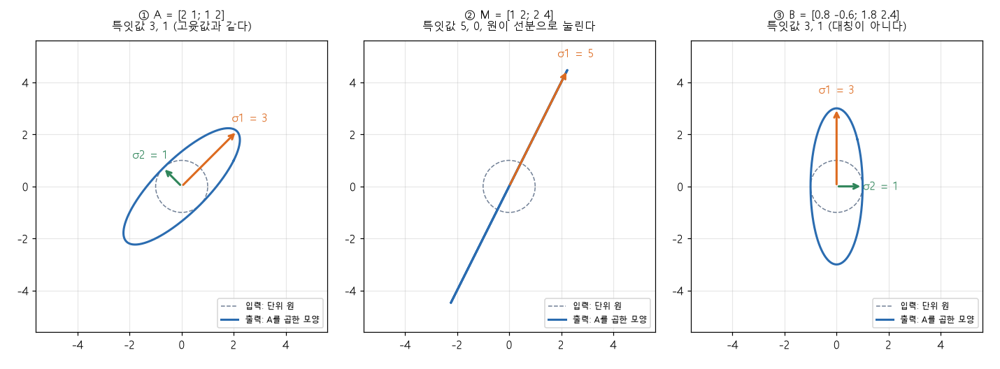

# 고윳값과 특잇값 분해 (Eigenvalues, Singular value decomposition)

[목차로 돌아가기](../../00_MIT%EB%94%A5%EB%9F%AC%EB%8B%9D_%EB%AA%A9%EC%B0%A8.md) · 먼저 볼 것: [M05_벡터와_행렬](../../%EC%88%98%ED%95%99%EA%B0%9C%EB%85%90/03_%EC%84%A0%ED%98%95%EB%8C%80%EC%88%98/M05_%EB%B2%A1%ED%84%B0%EC%99%80_%ED%96%89%EB%A0%AC.md), [MM03_벡터_표기와_전치](../../%EC%88%98%ED%95%99%EA%B0%9C%EB%85%90/03_%EC%84%A0%ED%98%95%EB%8C%80%EC%88%98/MM03_%EB%B2%A1%ED%84%B0_%ED%91%9C%EA%B8%B0%EC%99%80_%EC%A0%84%EC%B9%98.md), [MM87_역행렬과_연립일차방정식](../../%EC%88%98%ED%95%99%EA%B0%9C%EB%85%90/03_%EC%84%A0%ED%98%95%EB%8C%80%EC%88%98/MM87_%EC%97%AD%ED%96%89%EB%A0%AC%EA%B3%BC_%EC%97%B0%EB%A6%BD%EC%9D%BC%EC%B0%A8%EB%B0%A9%EC%A0%95%EC%8B%9D.md) · 쓰는 곳: [MM25_랭크와_유효_랭크](../../%EC%88%98%ED%95%99%EA%B0%9C%EB%85%90/04_%ED%99%95%EB%A5%A0%EA%B3%BC_%EC%A0%95%EB%B3%B4/MM25_%EB%9E%AD%ED%81%AC%EC%99%80_%EC%9C%A0%ED%9A%A8_%EB%9E%AD%ED%81%AC.md), [MM28_스펙트럼_노름과_RMS_연산자_노름](../../%EC%88%98%ED%95%99%EA%B0%9C%EB%85%90/09_%EC%B5%9C%EC%A0%81%ED%99%94%EC%9D%98_%EA%B8%B0%ED%95%98/MM28_%EC%8A%A4%ED%8E%99%ED%8A%B8%EB%9F%BC_%EB%85%B8%EB%A6%84%EA%B3%BC_RMS_%EC%97%B0%EC%82%B0%EC%9E%90_%EB%85%B8%EB%A6%84.md), [MM40_PCA와_선형_오토인코더](../../%EC%88%98%ED%95%99%EA%B0%9C%EB%85%90/10_%ED%91%9C%ED%98%84_%ED%95%99%EC%8A%B5/MM40_PCA%EC%99%80_%EC%84%A0%ED%98%95_%EC%98%A4%ED%86%A0%EC%9D%B8%EC%BD%94%EB%8D%94.md), [MM79_뉴턴_슐츠_반복과_직교화](../../%EC%88%98%ED%95%99%EA%B0%9C%EB%85%90/09_%EC%B5%9C%EC%A0%81%ED%99%94%EC%9D%98_%EA%B8%B0%ED%95%98/MM79_%EB%89%B4%ED%84%B4_%EC%8A%90%EC%B8%A0_%EB%B0%98%EB%B3%B5%EA%B3%BC_%EC%A7%81%EA%B5%90%ED%99%94.md)

📚 학습 순서 18/99 (3. 선형대수): ← 이전: [MM87_역행렬과_연립일차방정식](../../%EC%88%98%ED%95%99%EA%B0%9C%EB%85%90/03_%EC%84%A0%ED%98%95%EB%8C%80%EC%88%98/MM87_%EC%97%AD%ED%96%89%EB%A0%AC%EA%B3%BC_%EC%97%B0%EB%A6%BD%EC%9D%BC%EC%B0%A8%EB%B0%A9%EC%A0%95%EC%8B%9D.md) · 다음: [MM11_립시츠_연속과_노름](../../%EC%88%98%ED%95%99%EA%B0%9C%EB%85%90/03_%EC%84%A0%ED%98%95%EB%8C%80%EC%88%98/MM11_%EB%A6%BD%EC%8B%9C%EC%B8%A0_%EC%97%B0%EC%86%8D%EA%B3%BC_%EB%85%B8%EB%A6%84.md) →

> [!NOTE]
> **3줄 요약**
> - [고유벡터](../../00_%EB%94%A5%EB%9F%AC%EB%8B%9D_%EC%9A%A9%EC%96%B4%EC%82%AC%EC%A0%84.md#eigenvector-eigenvalue-%EA%B3%A0%EC%9C%A0%EB%B2%A1%ED%84%B0%EC%99%80-%EA%B3%A0%EC%9C%B3%EA%B0%92)는 행렬 $A$를 곱해도 **방향이 안 바뀌고 길이만 $\lambda$배**가 되는 벡터($A\mathbf{v} = \lambda\mathbf{v}$)다. $A = \begin{pmatrix}2&1\\1&2\end{pmatrix}$는 $(1, 1)$ 방향으로 3배($\lambda = 3$), $(1, -1)$ 방향으로 1배($\lambda = 1$)다. 2×2의 [고윳값](../../00_%EB%94%A5%EB%9F%AC%EB%8B%9D_%EC%9A%A9%EC%96%B4%EC%82%AC%EC%A0%84.md#eigenvector-eigenvalue-%EA%B3%A0%EC%9C%A0%EB%B2%A1%ED%84%B0%EC%99%80-%EA%B3%A0%EC%9C%B3%EA%B0%92)은 $\lambda^2 - (a+d)\lambda + (ad-bc) = 0$의 근이다.
> - 대칭행렬($A^\top = A$)은 [고윳값](../../00_%EB%94%A5%EB%9F%AC%EB%8B%9D_%EC%9A%A9%EC%96%B4%EC%82%AC%EC%A0%84.md#eigenvector-eigenvalue-%EA%B3%A0%EC%9C%A0%EB%B2%A1%ED%84%B0%EC%99%80-%EA%B3%A0%EC%9C%B3%EA%B0%92)이 실수이고 고유벡터끼리 직각이다. **모든** 행렬(직사각 포함)은 $A = U\Sigma V^\top$, 즉 "돌리기 → 축마다 늘이기 → 돌리기"로 쪼개진다. 이것이 [특잇값 분해](../../00_%EB%94%A5%EB%9F%AC%EB%8B%9D_%EC%9A%A9%EC%96%B4%EC%82%AC%EC%A0%84.md#singular-value-decomposition-%ED%8A%B9%EC%9E%87%EA%B0%92-%EB%B6%84%ED%95%B4)다.
> - **특잇값** $\sigma$는 늘이는 배율이다. 0이 아닌 개수가 [랭크](../../00_%EB%94%A5%EB%9F%AC%EB%8B%9D_%EC%9A%A9%EC%96%B4%EC%82%AC%EC%A0%84.md#rank-%EB%9E%AD%ED%81%AC), 가장 큰 값 $\sigma_1$이 [스펙트럼 노름](../../00_%EB%94%A5%EB%9F%AC%EB%8B%9D_%EC%9A%A9%EC%96%B4%EC%82%AC%EC%A0%84.md#spectral-norm-%EC%8A%A4%ED%8E%99%ED%8A%B8%EB%9F%BC-%EB%85%B8%EB%A6%84)이다. $\begin{pmatrix}1&2\\2&4\end{pmatrix}$의 특잇값은 (5, 0)이라 [랭크](../../00_%EB%94%A5%EB%9F%AC%EB%8B%9D_%EC%9A%A9%EC%96%B4%EC%82%AC%EC%A0%84.md#rank-%EB%9E%AD%ED%81%AC) 1, [스펙트럼 노름](../../00_%EB%94%A5%EB%9F%AC%EB%8B%9D_%EC%9A%A9%EC%96%B4%EC%82%AC%EC%A0%84.md#spectral-norm-%EC%8A%A4%ED%8E%99%ED%8A%B8%EB%9F%BC-%EB%85%B8%EB%A6%84) 5다.

## 1. 개념 설명

비유: 격자무늬 고무 천을 양 끝에서 잡아당긴다. 대부분의 선은 비스듬히 기울지만, 잡아당긴 방향의 선과 그와 직각인 선은 **방향이 그대로이고 길이만** 달라진다. 그 방향이 [고유벡터](../../00_%EB%94%A5%EB%9F%AC%EB%8B%9D_%EC%9A%A9%EC%96%B4%EC%82%AC%EC%A0%84.md#eigenvector-eigenvalue-%EA%B3%A0%EC%9C%A0%EB%B2%A1%ED%84%B0%EC%99%80-%EA%B3%A0%EC%9C%B3%EA%B0%92), 늘어난 배율이 [고윳값](../../00_%EB%94%A5%EB%9F%AC%EB%8B%9D_%EC%9A%A9%EC%96%B4%EC%82%AC%EC%A0%84.md#eigenvector-eigenvalue-%EA%B3%A0%EC%9C%A0%EB%B2%A1%ED%84%B0%EC%99%80-%EA%B3%A0%EC%9C%B3%EA%B0%92)이다. 원 모양 반죽을 천에 올려 함께 늘이면 타원이 된다. 타원의 긴 반지름과 짧은 반지름이 **특잇값**이고, 두 반지름의 방향이 늘어나는 축이다. 어떤 변형이든 "알맞게 돌리고 → 축 방향으로 늘이고 → 다시 돌리기"로 표현할 수 있다는 것이 [특잇값 분해](../../00_%EB%94%A5%EB%9F%AC%EB%8B%9D_%EC%9A%A9%EC%96%B4%EC%82%AC%EC%A0%84.md#singular-value-decomposition-%ED%8A%B9%EC%9E%87%EA%B0%92-%EB%B6%84%ED%95%B4)다.

- **[고유벡터](../../00_%EB%94%A5%EB%9F%AC%EB%8B%9D_%EC%9A%A9%EC%96%B4%EC%82%AC%EC%A0%84.md#eigenvector-eigenvalue-%EA%B3%A0%EC%9C%A0%EB%B2%A1%ED%84%B0%EC%99%80-%EA%B3%A0%EC%9C%B3%EA%B0%92) $\mathbf{v}$와 [고윳값](../../00_%EB%94%A5%EB%9F%AC%EB%8B%9D_%EC%9A%A9%EC%96%B4%EC%82%AC%EC%A0%84.md#eigenvector-eigenvalue-%EA%B3%A0%EC%9C%A0%EB%B2%A1%ED%84%B0%EC%99%80-%EA%B3%A0%EC%9C%B3%EA%B0%92) $\lambda$**: $A\mathbf{v} = \lambda\mathbf{v}$를 만족하는 0이 아닌 벡터와 그 배율. 정사각행렬에만 있다.
- **대칭행렬**: $A^\top = A$인 행렬([전치](../../00_%EB%94%A5%EB%9F%AC%EB%8B%9D_%EC%9A%A9%EC%96%B4%EC%82%AC%EC%A0%84.md#transpose-%EC%A0%84%EC%B9%98)해도 같다). [공분산 행렬](../../00_%EB%94%A5%EB%9F%AC%EB%8B%9D_%EC%9A%A9%EC%96%B4%EC%82%AC%EC%A0%84.md#covariance-matrix-%EA%B3%B5%EB%B6%84%EC%82%B0-%ED%96%89%EB%A0%AC)이 대표적이다. [고윳값](../../00_%EB%94%A5%EB%9F%AC%EB%8B%9D_%EC%9A%A9%EC%96%B4%EC%82%AC%EC%A0%84.md#eigenvector-eigenvalue-%EA%B3%A0%EC%9C%A0%EB%B2%A1%ED%84%B0%EC%99%80-%EA%B3%A0%EC%9C%B3%EA%B0%92)은 항상 실수이고, 서로 다른 [고유벡터](../../00_%EB%94%A5%EB%9F%AC%EB%8B%9D_%EC%9A%A9%EC%96%B4%EC%82%AC%EC%A0%84.md#eigenvector-eigenvalue-%EA%B3%A0%EC%9C%A0%EB%B2%A1%ED%84%B0%EC%99%80-%EA%B3%A0%EC%9C%B3%EA%B0%92)는 직각이다.
- **[특잇값 분해](../../00_%EB%94%A5%EB%9F%AC%EB%8B%9D_%EC%9A%A9%EC%96%B4%EC%82%AC%EC%A0%84.md#singular-value-decomposition-%ED%8A%B9%EC%9E%87%EA%B0%92-%EB%B6%84%ED%95%B4)**(SVD): $A = U\Sigma V^\top$. $V^\top$는 입력을 돌리고, $\Sigma$(대각선에 특잇값)는 축마다 늘이고, $U$는 출력을 돌린다. 정사각이 아니어도, 대칭이 아니어도 된다.
- **특잇값** $\sigma_1 \ge \sigma_2 \ge \cdots \ge 0$: 늘이는 배율(항상 0 이상). 대칭이며 [고윳값](../../00_%EB%94%A5%EB%9F%AC%EB%8B%9D_%EC%9A%A9%EC%96%B4%EC%82%AC%EC%A0%84.md#eigenvector-eigenvalue-%EA%B3%A0%EC%9C%A0%EB%B2%A1%ED%84%B0%EC%99%80-%EA%B3%A0%EC%9C%B3%EA%B0%92)이 모두 0 이상인 행렬에서는 [고윳값](../../00_%EB%94%A5%EB%9F%AC%EB%8B%9D_%EC%9A%A9%EC%96%B4%EC%82%AC%EC%A0%84.md#eigenvector-eigenvalue-%EA%B3%A0%EC%9C%A0%EB%B2%A1%ED%84%B0%EC%99%80-%EA%B3%A0%EC%9C%B3%EA%B0%92)과 같다.

$$
A\mathbf{v} = \lambda\mathbf{v}
$$

<details><summary>기호 풀이</summary>

| 기호 | 읽는 법 | 뜻 | 예제 값 |
| --- | --- | --- | --- |
| $A$ | 에이 | 정사각행렬 | $\begin{pmatrix}2&1\\1&2\end{pmatrix}$ |
| $\mathbf{v}$ | 브이 벡터 | [고유벡터](../../00_%EB%94%A5%EB%9F%AC%EB%8B%9D_%EC%9A%A9%EC%96%B4%EC%82%AC%EC%A0%84.md#eigenvector-eigenvalue-%EA%B3%A0%EC%9C%A0%EB%B2%A1%ED%84%B0%EC%99%80-%EA%B3%A0%EC%9C%B3%EA%B0%92). 방향이 안 바뀌는 벡터 (0벡터는 제외) | $(1, 1)$ |
| $\lambda$ | 람다 | [고윳값](../../00_%EB%94%A5%EB%9F%AC%EB%8B%9D_%EC%9A%A9%EC%96%B4%EC%82%AC%EC%A0%84.md#eigenvector-eigenvalue-%EA%B3%A0%EC%9C%A0%EB%B2%A1%ED%84%B0%EC%99%80-%EA%B3%A0%EC%9C%B3%EA%B0%92). 늘어나는 배율 (음수면 반대 방향) | 3 |
| $A\mathbf{v}$ | 에이 브이 | [행렬 곱](../../00_%EB%94%A5%EB%9F%AC%EB%8B%9D_%EC%9A%A9%EC%96%B4%EC%82%AC%EC%A0%84.md#matrix-multiplication-%ED%96%89%EB%A0%AC-%EA%B3%B1). 벡터 $\mathbf{v}$를 $A$로 보낸 결과 | $(3, 3)$ |

</details>

<details><summary>예제와 풀이</summary>

**문제**: $A = \begin{pmatrix}2&1\\1&2\end{pmatrix}$에 $\mathbf{v} = (1, 1)$을 곱했을 때 방향이 그대로인지 확인하고, 그렇다면 [고윳값](../../00_%EB%94%A5%EB%9F%AC%EB%8B%9D_%EC%9A%A9%EC%96%B4%EC%82%AC%EC%A0%84.md#eigenvector-eigenvalue-%EA%B3%A0%EC%9C%A0%EB%B2%A1%ED%84%B0%EC%99%80-%EA%B3%A0%EC%9C%B3%EA%B0%92) $\lambda$를 구하라.

**주어진 값**:
- $A = \begin{pmatrix}2&1\\1&2\end{pmatrix}$ (행렬)
- $\mathbf{v} = (1, 1)$ (후보 벡터)

**풀이**
1. 식을 그대로 쓴다: $A\mathbf{v} = \lambda\mathbf{v}$
2. 값을 대입한다: $\begin{pmatrix}2&1\\1&2\end{pmatrix}\begin{pmatrix}1\\1\end{pmatrix} = \lambda\begin{pmatrix}1\\1\end{pmatrix}$
3. 왼쪽 첫째 줄을 펼친다: $2 \times 1 + 1 \times 1 = 2 + 1 = 3$
4. 왼쪽 둘째 줄을 펼친다: $1 \times 1 + 2 \times 1 = 1 + 2 = 3$ 이므로 $A\mathbf{v} = (3, 3)$
5. $(3, 3)$이 $(1, 1)$의 몇 배인지 본다: $(3, 3) = 3 \times (1, 1)$ (두 칸 모두 3배라 방향이 같다)

**답**: 방향이 그대로이고 $\lambda = 3$이다

</details>

<details><summary>내 이해</summary>


</details>

[고윳값](../../00_%EB%94%A5%EB%9F%AC%EB%8B%9D_%EC%9A%A9%EC%96%B4%EC%82%AC%EC%A0%84.md#eigenvector-eigenvalue-%EA%B3%A0%EC%9C%A0%EB%B2%A1%ED%84%B0%EC%99%80-%EA%B3%A0%EC%9C%B3%EA%B0%92)은 $\mathbf{v}$를 모르고도 구할 수 있다. $A\mathbf{v} = \lambda\mathbf{v}$를 $(A - \lambda I)\mathbf{v} = \mathbf{0}$으로 옮겨 쓰면, 0이 아닌 $\mathbf{v}$가 있으려면 $A - \lambda I$의 역행렬이 없어야 한다([MM87_역행렬과_연립일차방정식](../../%EC%88%98%ED%95%99%EA%B0%9C%EB%85%90/03_%EC%84%A0%ED%98%95%EB%8C%80%EC%88%98/MM87_%EC%97%AD%ED%96%89%EB%A0%AC%EA%B3%BC_%EC%97%B0%EB%A6%BD%EC%9D%BC%EC%B0%A8%EB%B0%A9%EC%A0%95%EC%8B%9D.md)). 즉 행렬식이 0이다. 2×2에서 이를 펼치면 이차방정식이 나온다.

$$
\det(A - \lambda I) = \lambda^2 - (a + d)\lambda + (ad - bc) = 0
$$

<details><summary>기호 풀이</summary>

| 기호 | 읽는 법 | 뜻 | 예제 값 |
| --- | --- | --- | --- |
| $\det(\cdot)$ | 디터미넌트 | 행렬식. 2×2는 $ad - bc$ | - |
| $I$ | 아이 | 단위행렬 $\begin{pmatrix}1&0\\0&1\end{pmatrix}$ | - |
| $A - \lambda I$ | 에이 마이너스 람다 아이 | $A$의 대각선 두 칸에서 $\lambda$를 뺀 행렬 | $\begin{pmatrix}2-\lambda&1\\1&2-\lambda\end{pmatrix}$ |
| $a + d$ | 에이 플러스 디 | 대각선 합(trace, 트레이스) | 4 |
| $ad - bc$ | 에이디 마이너스 비씨 | 행렬식 | 3 |
| $\lambda$ | 람다 | 구하려는 [고윳값](../../00_%EB%94%A5%EB%9F%AC%EB%8B%9D_%EC%9A%A9%EC%96%B4%EC%82%AC%EC%A0%84.md#eigenvector-eigenvalue-%EA%B3%A0%EC%9C%A0%EB%B2%A1%ED%84%B0%EC%99%80-%EA%B3%A0%EC%9C%B3%EA%B0%92) (근이 최대 2개) | 3, 1 |

</details>

<details><summary>예제와 풀이</summary>

**문제**: $A = \begin{pmatrix}2&1\\1&2\end{pmatrix}$의 [고윳값](../../00_%EB%94%A5%EB%9F%AC%EB%8B%9D_%EC%9A%A9%EC%96%B4%EC%82%AC%EC%A0%84.md#eigenvector-eigenvalue-%EA%B3%A0%EC%9C%A0%EB%B2%A1%ED%84%B0%EC%99%80-%EA%B3%A0%EC%9C%B3%EA%B0%92)을 모두 구하라.

**주어진 값**:
- $a = 2,\ b = 1$ (첫 줄)
- $c = 1,\ d = 2$ (둘째 줄)

**풀이**
1. 식을 그대로 쓴다: $\lambda^2 - (a + d)\lambda + (ad - bc) = 0$
2. 값을 대입한다: $\lambda^2 - (2 + 2)\lambda + (2 \times 2 - 1 \times 1) = 0$
3. 괄호 안을 계산한다: 2 + 2 = 4, 2 × 2 = 4, 1 × 1 = 1 이므로 $\lambda^2 - 4\lambda + (4 - 1) = 0$
4. 뺄셈을 한다: 4 − 1 = 3 이므로 $\lambda^2 - 4\lambda + 3 = 0$
5. 이차방정식의 근의 공식을 쓴다($\lambda^2 + p\lambda + q = 0$의 근은 $\frac{-p \pm \sqrt{p^2 - 4q}}{2}$, 여기서 $p = -4$, $q = 3$): $\lambda = \frac{4 \pm \sqrt{(-4)^2 - 4 \times 3}}{2}$
6. 루트 안을 계산한다: (−4)² = 16, 4 × 3 = 12, 16 − 12 = 4 이므로 $\lambda = \frac{4 \pm \sqrt{4}}{2}$
7. 루트를 푼다(제곱해서 4가 되는 양수는 2): $\sqrt{4} = 2$ 이므로 $\lambda = \frac{4 \pm 2}{2}$
8. $+$ 쪽: $\frac{4 + 2}{2} = \frac{6}{2} = 3$
9. $-$ 쪽: $\frac{4 - 2}{2} = \frac{2}{2} = 1$

**답**: $\lambda = 3,\ 1$ (확인: 두 근의 합 3 + 1 = 4 = $a + d$, 곱 3 × 1 = 3 = $ad - bc$)

</details>

<details><summary>내 이해</summary>


</details>

**대칭행렬**은 특별히 깔끔하다. 길이 1인 [고유벡터](../../00_%EB%94%A5%EB%9F%AC%EB%8B%9D_%EC%9A%A9%EC%96%B4%EC%82%AC%EC%A0%84.md#eigenvector-eigenvalue-%EA%B3%A0%EC%9C%A0%EB%B2%A1%ED%84%B0%EC%99%80-%EA%B3%A0%EC%9C%B3%EA%B0%92)를 열로 모은 행렬 $Q$는 돌리기(직교행렬)라서 $Q^\top Q = I$이고, [고윳값](../../00_%EB%94%A5%EB%9F%AC%EB%8B%9D_%EC%9A%A9%EC%96%B4%EC%82%AC%EC%A0%84.md#eigenvector-eigenvalue-%EA%B3%A0%EC%9C%A0%EB%B2%A1%ED%84%B0%EC%99%80-%EA%B3%A0%EC%9C%B3%EA%B0%92)을 대각선에 둔 행렬을 $\Lambda$라 하면 다음처럼 쪼개진다. "[고유벡터](../../00_%EB%94%A5%EB%9F%AC%EB%8B%9D_%EC%9A%A9%EC%96%B4%EC%82%AC%EC%A0%84.md#eigenvector-eigenvalue-%EA%B3%A0%EC%9C%A0%EB%B2%A1%ED%84%B0%EC%99%80-%EA%B3%A0%EC%9C%B3%EA%B0%92) 방향으로 돌려서 → 축마다 $\lambda$배 → 다시 돌려놓기"다. [MM40_PCA와_선형_오토인코더](../../%EC%88%98%ED%95%99%EA%B0%9C%EB%85%90/10_%ED%91%9C%ED%98%84_%ED%95%99%EC%8A%B5/MM40_PCA%EC%99%80_%EC%84%A0%ED%98%95_%EC%98%A4%ED%86%A0%EC%9D%B8%EC%BD%94%EB%8D%94.md)에서 [공분산 행렬](../../00_%EB%94%A5%EB%9F%AC%EB%8B%9D_%EC%9A%A9%EC%96%B4%EC%82%AC%EC%A0%84.md#covariance-matrix-%EA%B3%B5%EB%B6%84%EC%82%B0-%ED%96%89%EB%A0%AC)을 이렇게 쪼갠다.

$$
A = Q\Lambda Q^\top \qquad (A^\top = A)
$$

<details><summary>기호 풀이</summary>

| 기호 | 읽는 법 | 뜻 | 예제 값 |
| --- | --- | --- | --- |
| $Q$ | 큐 | 길이 1인 [고유벡터](../../00_%EB%94%A5%EB%9F%AC%EB%8B%9D_%EC%9A%A9%EC%96%B4%EC%82%AC%EC%A0%84.md#eigenvector-eigenvalue-%EA%B3%A0%EC%9C%A0%EB%B2%A1%ED%84%B0%EC%99%80-%EA%B3%A0%EC%9C%B3%EA%B0%92)를 열로 모은 행렬. 열끼리 직각이라 $Q^\top Q = I$ | $\frac{1}{\sqrt{2}}\begin{pmatrix}1&1\\1&-1\end{pmatrix}$ |
| $\Lambda$ | 람다(대문자) | [고윳값](../../00_%EB%94%A5%EB%9F%AC%EB%8B%9D_%EC%9A%A9%EC%96%B4%EC%82%AC%EC%A0%84.md#eigenvector-eigenvalue-%EA%B3%A0%EC%9C%A0%EB%B2%A1%ED%84%B0%EC%99%80-%EA%B3%A0%EC%9C%B3%EA%B0%92)을 대각선에 둔 행렬 | $\begin{pmatrix}3&0\\0&1\end{pmatrix}$ |
| $Q^\top$ | 큐 [전치](../../00_%EB%94%A5%EB%9F%AC%EB%8B%9D_%EC%9A%A9%EC%96%B4%EC%82%AC%EC%A0%84.md#transpose-%EC%A0%84%EC%B9%98) | $Q$의 행과 열을 맞바꾼 행렬 | $\frac{1}{\sqrt{2}}\begin{pmatrix}1&1\\1&-1\end{pmatrix}$ |
| $\sqrt{2}$ | 루트 이 | 제곱해서 2가 되는 양수 (약 1.4142) | 1.4142 |

</details>

<details><summary>예제와 풀이</summary>

**문제**: $Q = \frac{1}{\sqrt{2}}\begin{pmatrix}1&1\\1&-1\end{pmatrix}$, $\Lambda = \begin{pmatrix}3&0\\0&1\end{pmatrix}$일 때 $Q\Lambda Q^\top$이 $A = \begin{pmatrix}2&1\\1&2\end{pmatrix}$가 되는지 확인하라.

**주어진 값**:
- $Q = \frac{1}{\sqrt{2}}\begin{pmatrix}1&1\\1&-1\end{pmatrix}$ ([고유벡터](../../00_%EB%94%A5%EB%9F%AC%EB%8B%9D_%EC%9A%A9%EC%96%B4%EC%82%AC%EC%A0%84.md#eigenvector-eigenvalue-%EA%B3%A0%EC%9C%A0%EB%B2%A1%ED%84%B0%EC%99%80-%EA%B3%A0%EC%9C%B3%EA%B0%92) $(1, 1)$, $(1, -1)$을 길이 1로 줄여 열로 모은 행렬. 대칭이라 $Q^\top = Q$)
- $\Lambda = \begin{pmatrix}3&0\\0&1\end{pmatrix}$ ([고윳값](../../00_%EB%94%A5%EB%9F%AC%EB%8B%9D_%EC%9A%A9%EC%96%B4%EC%82%AC%EC%A0%84.md#eigenvector-eigenvalue-%EA%B3%A0%EC%9C%A0%EB%B2%A1%ED%84%B0%EC%99%80-%EA%B3%A0%EC%9C%B3%EA%B0%92) 3, 1)

**풀이**
1. 식을 그대로 쓴다: $A = Q\Lambda Q^\top$
2. 값을 대입한다: $A = \frac{1}{\sqrt{2}}\begin{pmatrix}1&1\\1&-1\end{pmatrix}\begin{pmatrix}3&0\\0&1\end{pmatrix}\frac{1}{\sqrt{2}}\begin{pmatrix}1&1\\1&-1\end{pmatrix}$
3. 앞의 두 행렬부터 곱한다. 첫째 줄: $1 \times 3 + 1 \times 0 = 3$, $1 \times 0 + 1 \times 1 = 1$
4. 둘째 줄: $1 \times 3 + (-1) \times 0 = 3$, $1 \times 0 + (-1) \times 1 = -1$ 이므로 $A = \frac{1}{\sqrt{2}}\begin{pmatrix}3&1\\3&-1\end{pmatrix}\frac{1}{\sqrt{2}}\begin{pmatrix}1&1\\1&-1\end{pmatrix}$
5. 이어서 뒤의 행렬을 곱한다. 첫째 줄: $3 \times 1 + 1 \times 1 = 4$, $3 \times 1 + 1 \times (-1) = 2$
6. 둘째 줄: $3 \times 1 + (-1) \times 1 = 2$, $3 \times 1 + (-1) \times (-1) = 3 + 1 = 4$ 이므로 $A = \frac{1}{\sqrt{2}} \cdot \frac{1}{\sqrt{2}}\begin{pmatrix}4&2\\2&4\end{pmatrix}$
7. 앞의 배율을 곱한다: $\frac{1}{\sqrt{2}} \times \frac{1}{\sqrt{2}} = \frac{1}{2}$ 이므로 $A = \frac{1}{2}\begin{pmatrix}4&2\\2&4\end{pmatrix}$
8. 칸마다 2로 나눈다: 4 ÷ 2 = 2, 2 ÷ 2 = 1

**답**: $Q\Lambda Q^\top = \begin{pmatrix}2&1\\1&2\end{pmatrix} = A$

</details>

<details><summary>내 이해</summary>


</details>

대칭이 아닌 행렬이나 직사각 행렬에는 이 분해가 안 된다. 그래도 **어떤 행렬이든** 돌리기 두 번 사이에 늘이기 한 번을 끼운 모양으로 쓸 수 있다. 앞의 $V^\top$는 입력 쪽의 돌리기, 뒤의 $U$는 출력 쪽의 돌리기다. 두 돌리기가 서로 다를 수 있다는 점이 [고윳값](../../00_%EB%94%A5%EB%9F%AC%EB%8B%9D_%EC%9A%A9%EC%96%B4%EC%82%AC%EC%A0%84.md#eigenvector-eigenvalue-%EA%B3%A0%EC%9C%A0%EB%B2%A1%ED%84%B0%EC%99%80-%EA%B3%A0%EC%9C%B3%EA%B0%92) 분해와 다르다.

$$
A = U\Sigma V^\top
$$

<details><summary>기호 풀이</summary>

| 기호 | 읽는 법 | 뜻 | 예제 값 |
| --- | --- | --- | --- |
| $U$ | 유 | 출력 쪽 돌리기(직교행렬). 열이 서로 직각인 길이 1 벡터 | $\begin{pmatrix}0&-1\\1&0\end{pmatrix}$ |
| $\Sigma$ | 시그마(대문자) | 특잇값을 큰 것부터 대각선에 둔 행렬 | $\begin{pmatrix}3&0\\0&1\end{pmatrix}$ |
| $V^\top$ | 브이 [전치](../../00_%EB%94%A5%EB%9F%AC%EB%8B%9D_%EC%9A%A9%EC%96%B4%EC%82%AC%EC%A0%84.md#transpose-%EC%A0%84%EC%B9%98) | 입력 쪽 돌리기. $V$의 열은 입력의 축 방향 | $\begin{pmatrix}0.6&0.8\\-0.8&0.6\end{pmatrix}$ |
| $\sigma_i$ | 시그마 아이 | $i$번째 [특잇값](../../00_%EB%94%A5%EB%9F%AC%EB%8B%9D_%EC%9A%A9%EC%96%B4%EC%82%AC%EC%A0%84.md#singular-value-decomposition-%ED%8A%B9%EC%9E%87%EA%B0%92-%EB%B6%84%ED%95%B4). 그 축으로 늘이는 배율 | 3, 1 |

</details>

<details><summary>예제와 풀이</summary>

**문제**: $U = \begin{pmatrix}0&-1\\1&0\end{pmatrix}$, $\Sigma = \begin{pmatrix}3&0\\0&1\end{pmatrix}$, $V^\top = \begin{pmatrix}0.6&0.8\\-0.8&0.6\end{pmatrix}$일 때 $U\Sigma V^\top$를 구하라.

**주어진 값**:
- $U = \begin{pmatrix}0&-1\\1&0\end{pmatrix}$ (90도 돌리기)
- $\Sigma = \begin{pmatrix}3&0\\0&1\end{pmatrix}$ (특잇값 3, 1)
- $V^\top = \begin{pmatrix}0.6&0.8\\-0.8&0.6\end{pmatrix}$ (입력을 돌리는 행렬. $0.6^2 + 0.8^2 = 1$이라 길이를 바꾸지 않는다)

**풀이**
1. 식을 그대로 쓴다: $A = U\Sigma V^\top$
2. 값을 대입한다: $A = \begin{pmatrix}0&-1\\1&0\end{pmatrix}\begin{pmatrix}3&0\\0&1\end{pmatrix}\begin{pmatrix}0.6&0.8\\-0.8&0.6\end{pmatrix}$
3. $U\Sigma$ 첫째 줄: $0 \times 3 + (-1) \times 0 = 0$, $0 \times 0 + (-1) \times 1 = -1$
4. $U\Sigma$ 둘째 줄: $1 \times 3 + 0 \times 0 = 3$, $1 \times 0 + 0 \times 1 = 0$ 이므로 $A = \begin{pmatrix}0&-1\\3&0\end{pmatrix}\begin{pmatrix}0.6&0.8\\-0.8&0.6\end{pmatrix}$
5. 이어서 첫째 줄·첫째 칸: $0 \times 0.6 + (-1) \times (-0.8) = 0 + 0.8 = 0.8$
6. 첫째 줄·둘째 칸: $0 \times 0.8 + (-1) \times 0.6 = 0 - 0.6 = -0.6$
7. 둘째 줄·첫째 칸: $3 \times 0.6 + 0 \times (-0.8) = 1.8 + 0 = 1.8$
8. 둘째 줄·둘째 칸: $3 \times 0.8 + 0 \times 0.6 = 2.4 + 0 = 2.4$

**답**: $A = \begin{pmatrix}0.8&-0.6\\1.8&2.4\end{pmatrix}$ (이 행렬 $B$는 대칭이 아니다. 특잇값은 3, 1)

</details>

<details><summary>내 이해</summary>


</details>

$U$, $\Sigma$, $V$를 손으로 찾는 길은 대칭행렬 $A^\top A$를 거치는 것이다. $A^\top A$의 [고유벡터](../../00_%EB%94%A5%EB%9F%AC%EB%8B%9D_%EC%9A%A9%EC%96%B4%EC%82%AC%EC%A0%84.md#eigenvector-eigenvalue-%EA%B3%A0%EC%9C%A0%EB%B2%A1%ED%84%B0%EC%99%80-%EA%B3%A0%EC%9C%B3%EA%B0%92)가 $V$의 열이고, **$A^\top A$의 [고윳값](../../00_%EB%94%A5%EB%9F%AC%EB%8B%9D_%EC%9A%A9%EC%96%B4%EC%82%AC%EC%A0%84.md#eigenvector-eigenvalue-%EA%B3%A0%EC%9C%A0%EB%B2%A1%ED%84%B0%EC%99%80-%EA%B3%A0%EC%9C%B3%EA%B0%92)이 특잇값의 제곱**이다. 대칭행렬은 위에서 본 [고윳값](../../00_%EB%94%A5%EB%9F%AC%EB%8B%9D_%EC%9A%A9%EC%96%B4%EC%82%AC%EC%A0%84.md#eigenvector-eigenvalue-%EA%B3%A0%EC%9C%A0%EB%B2%A1%ED%84%B0%EC%99%80-%EA%B3%A0%EC%9C%B3%EA%B0%92) 구하기를 그대로 쓸 수 있다.

$$
\sigma_i = \sqrt{\lambda_i(A^\top A)}
$$

<details><summary>기호 풀이</summary>

| 기호 | 읽는 법 | 뜻 | 예제 값 |
| --- | --- | --- | --- |
| $A^\top A$ | 에이 [전치](../../00_%EB%94%A5%EB%9F%AC%EB%8B%9D_%EC%9A%A9%EC%96%B4%EC%82%AC%EC%A0%84.md#transpose-%EC%A0%84%EC%B9%98) 에이 | $A$의 열끼리 곱해 더한 정사각 대칭행렬 | $\begin{pmatrix}3.88&3.84\\3.84&6.12\end{pmatrix}$ |
| $\lambda_i(A^\top A)$ | 람다 아이 | $A^\top A$의 $i$번째 [고윳값](../../00_%EB%94%A5%EB%9F%AC%EB%8B%9D_%EC%9A%A9%EC%96%B4%EC%82%AC%EC%A0%84.md#eigenvector-eigenvalue-%EA%B3%A0%EC%9C%A0%EB%B2%A1%ED%84%B0%EC%99%80-%EA%B3%A0%EC%9C%B3%EA%B0%92) | 9, 1 |
| $\sigma_i$ | 시그마 아이 | $i$번째 특잇값 | 3, 1 |
| $\sqrt{\cdot}$ | 루트 | 제곱근 | $\sqrt{9} = 3$ |

</details>

<details><summary>예제와 풀이</summary>

**문제**: $B = \begin{pmatrix}0.8&-0.6\\1.8&2.4\end{pmatrix}$의 특잇값을 구하라.

**주어진 값**:
- $B = \begin{pmatrix}0.8&-0.6\\1.8&2.4\end{pmatrix}$ (행렬)
- $B^\top = \begin{pmatrix}0.8&1.8\\-0.6&2.4\end{pmatrix}$ (행과 열을 맞바꾼 행렬)

**풀이**
1. 식을 그대로 쓴다: $\sigma_i = \sqrt{\lambda_i(B^\top B)}$
2. 값을 대입한다: $B^\top B = \begin{pmatrix}0.8&1.8\\-0.6&2.4\end{pmatrix}\begin{pmatrix}0.8&-0.6\\1.8&2.4\end{pmatrix}$
3. 첫째 줄·첫째 칸: $0.8 \times 0.8 + 1.8 \times 1.8 = 0.64 + 3.24 = 3.88$
4. 첫째 줄·둘째 칸: $0.8 \times (-0.6) + 1.8 \times 2.4 = -0.48 + 4.32 = 3.84$ (둘째 줄·첫째 칸도 같은 3.84)
5. 둘째 줄·둘째 칸: $(-0.6) \times (-0.6) + 2.4 \times 2.4 = 0.36 + 5.76 = 6.12$
6. 대각선 합과 행렬식을 구한다: $3.88 + 6.12 = 10$, $3.88 \times 6.12 - 3.84 \times 3.84 = 23.7456 - 14.7456 = 9$ 이므로 $\lambda^2 - 10\lambda + 9 = 0$
7. 근의 공식을 쓴다: $\lambda = \frac{10 \pm \sqrt{10^2 - 4 \times 9}}{2} = \frac{10 \pm \sqrt{64}}{2}$
8. 루트를 푼다: $\sqrt{64} = 8$ 이므로 $\lambda = \frac{10 \pm 8}{2}$, 즉 $\lambda = 9$ 또는 $\lambda = 1$
9. 각각 제곱근을 취한다: $\sigma_1 = \sqrt{9} = 3$, $\sigma_2 = \sqrt{1} = 1$

**답**: $\sigma_1 = 3,\ \sigma_2 = 1$ (앞의 예제에서 $U\Sigma V^\top$를 만들 때 쓴 $\Sigma$와 같다)

</details>

<details><summary>내 이해</summary>


</details>

## 2. 필요한 이유

특잇값은 행렬이 가진 정보를 한 줄로 읽게 해 준다. 이 덕분에 다음 개념이 모두 특잇값 하나로 설명된다.

- [MM25_랭크와_유효_랭크](../../%EC%88%98%ED%95%99%EA%B0%9C%EB%85%90/04_%ED%99%95%EB%A5%A0%EA%B3%BC_%EC%A0%95%EB%B3%B4/MM25_%EB%9E%AD%ED%81%AC%EC%99%80_%EC%9C%A0%ED%9A%A8_%EB%9E%AD%ED%81%AC.md): [랭크](../../00_%EB%94%A5%EB%9F%AC%EB%8B%9D_%EC%9A%A9%EC%96%B4%EC%82%AC%EC%A0%84.md#rank-%EB%9E%AD%ED%81%AC)는 0이 아닌 특잇값의 개수다. 특잇값이 (5, 0)이면 방향이 하나뿐이다.
- [MM28_스펙트럼_노름과_RMS_연산자_노름](../../%EC%88%98%ED%95%99%EA%B0%9C%EB%85%90/09_%EC%B5%9C%EC%A0%81%ED%99%94%EC%9D%98_%EA%B8%B0%ED%95%98/MM28_%EC%8A%A4%ED%8E%99%ED%8A%B8%EB%9F%BC_%EB%85%B8%EB%A6%84%EA%B3%BC_RMS_%EC%97%B0%EC%82%B0%EC%9E%90_%EB%85%B8%EB%A6%84.md): 길이 1 벡터를 행렬이 가장 길게 늘인 값이 [스펙트럼 노름](../../00_%EB%94%A5%EB%9F%AC%EB%8B%9D_%EC%9A%A9%EC%96%B4%EC%82%AC%EC%A0%84.md#spectral-norm-%EC%8A%A4%ED%8E%99%ED%8A%B8%EB%9F%BC-%EB%85%B8%EB%A6%84)이고, 이것이 가장 큰 특잇값 $\sigma_1$이다.
- [MM40_PCA와_선형_오토인코더](../../%EC%88%98%ED%95%99%EA%B0%9C%EB%85%90/10_%ED%91%9C%ED%98%84_%ED%95%99%EC%8A%B5/MM40_PCA%EC%99%80_%EC%84%A0%ED%98%95_%EC%98%A4%ED%86%A0%EC%9D%B8%EC%BD%94%EB%8D%94.md): [PCA](../../00_%EB%94%A5%EB%9F%AC%EB%8B%9D_%EC%9A%A9%EC%96%B4%EC%82%AC%EC%A0%84.md#pca-principal-component-analysis-%EC%A3%BC%EC%84%B1%EB%B6%84-%EB%B6%84%EC%84%9D)의 주성분은 [공분산 행렬](../../00_%EB%94%A5%EB%9F%AC%EB%8B%9D_%EC%9A%A9%EC%96%B4%EC%82%AC%EC%A0%84.md#covariance-matrix-%EA%B3%B5%EB%B6%84%EC%82%B0-%ED%96%89%EB%A0%AC)의 [고유벡터](../../00_%EB%94%A5%EB%9F%AC%EB%8B%9D_%EC%9A%A9%EC%96%B4%EC%82%AC%EC%A0%84.md#eigenvector-eigenvalue-%EA%B3%A0%EC%9C%A0%EB%B2%A1%ED%84%B0%EC%99%80-%EA%B3%A0%EC%9C%B3%EA%B0%92)이고 [고윳값](../../00_%EB%94%A5%EB%9F%AC%EB%8B%9D_%EC%9A%A9%EC%96%B4%EC%82%AC%EC%A0%84.md#eigenvector-eigenvalue-%EA%B3%A0%EC%9C%A0%EB%B2%A1%ED%84%B0%EC%99%80-%EA%B3%A0%EC%9C%B3%EA%B0%92)이 그 방향의 [분산](../../00_%EB%94%A5%EB%9F%AC%EB%8B%9D_%EC%9A%A9%EC%96%B4%EC%82%AC%EC%A0%84.md#variance-%EB%B6%84%EC%82%B0)이다(대칭행렬 $A = Q\Lambda Q^\top$).
- [MM79_뉴턴_슐츠_반복과_직교화](../../%EC%88%98%ED%95%99%EA%B0%9C%EB%85%90/09_%EC%B5%9C%EC%A0%81%ED%99%94%EC%9D%98_%EA%B8%B0%ED%95%98/MM79_%EB%89%B4%ED%84%B4_%EC%8A%90%EC%B8%A0_%EB%B0%98%EB%B3%B5%EA%B3%BC_%EC%A7%81%EA%B5%90%ED%99%94.md): 특잇값을 모두 1로 바꾼 행렬 $UV^\top$가 직교화의 목표이고, [뉴턴-슐츠 반복](../../00_%EB%94%A5%EB%9F%AC%EB%8B%9D_%EC%9A%A9%EC%96%B4%EC%82%AC%EC%A0%84.md#newton-schulz-iteration-%EB%89%B4%ED%84%B4-%EC%8A%90%EC%B8%A0-%EB%B0%98%EB%B3%B5)은 SVD 없이 이를 근사한다.

$$
\operatorname{rank}(A) = \#\{\, i : \sigma_i > 0 \,\}, \qquad \lVert A \rVert_2 = \sigma_1 = \max_{\lVert \mathbf{v} \rVert = 1} \lVert A\mathbf{v} \rVert
$$

<details><summary>기호 풀이</summary>

| 기호 | 읽는 법 | 뜻 | 예제 값 |
| --- | --- | --- | --- |
| $\operatorname{rank}(A)$ | [랭크](../../00_%EB%94%A5%EB%9F%AC%EB%8B%9D_%EC%9A%A9%EC%96%B4%EC%82%AC%EC%A0%84.md#rank-%EB%9E%AD%ED%81%AC) 에이 | [랭크](../../00_%EB%94%A5%EB%9F%AC%EB%8B%9D_%EC%9A%A9%EC%96%B4%EC%82%AC%EC%A0%84.md#rank-%EB%9E%AD%ED%81%AC). 서로 다른 방향의 개수 | 1 |
| $\#\{i : \sigma_i > 0\}$ | 개수 | 0보다 큰 특잇값이 몇 개인지 센다 | 1 |
| $\lVert A \rVert_2$ | [노름](../../00_%EB%94%A5%EB%9F%AC%EB%8B%9D_%EC%9A%A9%EC%96%B4%EC%82%AC%EC%A0%84.md#norm-%EB%85%B8%EB%A6%84) 에이 투 | [스펙트럼 노름](../../00_%EB%94%A5%EB%9F%AC%EB%8B%9D_%EC%9A%A9%EC%96%B4%EC%82%AC%EC%A0%84.md#spectral-norm-%EC%8A%A4%ED%8E%99%ED%8A%B8%EB%9F%BC-%EB%85%B8%EB%A6%84) | 5 |
| $\sigma_1$ | 시그마 원 | 가장 큰 [특잇값](../../00_%EB%94%A5%EB%9F%AC%EB%8B%9D_%EC%9A%A9%EC%96%B4%EC%82%AC%EC%A0%84.md#singular-value-decomposition-%ED%8A%B9%EC%9E%87%EA%B0%92-%EB%B6%84%ED%95%B4) | 5 |
| $\max_{\lVert\mathbf{v}\rVert = 1}$ | 맥스 | 길이 1인 모든 $\mathbf{v}$ 중 가장 큰 값 | - |
| $\lVert A\mathbf{v} \rVert$ | [노름](../../00_%EB%94%A5%EB%9F%AC%EB%8B%9D_%EC%9A%A9%EC%96%B4%EC%82%AC%EC%A0%84.md#norm-%EB%85%B8%EB%A6%84) 에이 브이 | $A$를 곱한 벡터의 길이 (칸마다 제곱해 더한 값의 루트) | 5 |

</details>

<details><summary>예제와 풀이</summary>

**문제**: $M = \begin{pmatrix}1&2\\2&4\end{pmatrix}$의 특잇값이 (5, 0)일 때 [랭크](../../00_%EB%94%A5%EB%9F%AC%EB%8B%9D_%EC%9A%A9%EC%96%B4%EC%82%AC%EC%A0%84.md#rank-%EB%9E%AD%ED%81%AC)와 [스펙트럼 노름](../../00_%EB%94%A5%EB%9F%AC%EB%8B%9D_%EC%9A%A9%EC%96%B4%EC%82%AC%EC%A0%84.md#spectral-norm-%EC%8A%A4%ED%8E%99%ED%8A%B8%EB%9F%BC-%EB%85%B8%EB%A6%84)을 구하고, 길이 1인 벡터 $\mathbf{v} = \frac{1}{\sqrt{5}}(1, 2)$로 $\lVert M\mathbf{v} \rVert = 5$임을 확인하라.

**주어진 값**:
- $\sigma_1 = 5,\ \sigma_2 = 0$ (특잇값, 3절에서 구한다)
- $M = \begin{pmatrix}1&2\\2&4\end{pmatrix}$ (행렬)
- $\mathbf{v} = \frac{1}{\sqrt{5}}(1, 2)$ (길이 1인 벡터. 길이: $\frac{1}{\sqrt{5}}\sqrt{1 + 4} = 1$)

**풀이**
1. 식을 그대로 쓴다: $\operatorname{rank}(M) = \#\{i : \sigma_i > 0\}$, $\lVert M \rVert_2 = \sigma_1$
2. 값을 대입한다: $\#\{i : \sigma_i > 0\}$에서 $\sigma_1 = 5 > 0$, $\sigma_2 = 0$은 0보다 크지 않다
3. 0보다 큰 것을 센다: $\sigma_1$ 하나뿐이므로 $\operatorname{rank}(M) = 1$
4. [스펙트럼 노름](../../00_%EB%94%A5%EB%9F%AC%EB%8B%9D_%EC%9A%A9%EC%96%B4%EC%82%AC%EC%A0%84.md#spectral-norm-%EC%8A%A4%ED%8E%99%ED%8A%B8%EB%9F%BC-%EB%85%B8%EB%A6%84)은 가장 큰 특잇값이다: $\lVert M \rVert_2 = \sigma_1 = 5$
5. 확인: $M\mathbf{v}$의 첫째 줄을 펼친다: $\frac{1}{\sqrt{5}}(1 \times 1 + 2 \times 2) = \frac{1}{\sqrt{5}} \times 5$
6. 둘째 줄을 펼친다: $\frac{1}{\sqrt{5}}(2 \times 1 + 4 \times 2) = \frac{1}{\sqrt{5}} \times 10$ 이므로 $M\mathbf{v} = \frac{1}{\sqrt{5}}(5, 10)$
7. 길이를 잰다: $\frac{1}{\sqrt{5}}\sqrt{5^2 + 10^2} = \frac{1}{\sqrt{5}}\sqrt{125}$
8. 루트를 정리한다: $\sqrt{125} = 5\sqrt{5}$ 이므로 $\frac{5\sqrt{5}}{\sqrt{5}} = 5$

**답**: [랭크](../../00_%EB%94%A5%EB%9F%AC%EB%8B%9D_%EC%9A%A9%EC%96%B4%EC%82%AC%EC%A0%84.md#rank-%EB%9E%AD%ED%81%AC) 1, [스펙트럼 노름](../../00_%EB%94%A5%EB%9F%AC%EB%8B%9D_%EC%9A%A9%EC%96%B4%EC%82%AC%EC%A0%84.md#spectral-norm-%EC%8A%A4%ED%8E%99%ED%8A%B8%EB%9F%BC-%EB%85%B8%EB%A6%84) 5 (길이 1짜리 $\mathbf{v}$가 길이 5가 되어 나온다)

</details>

<details><summary>내 이해</summary>


</details>

$A = U\Sigma V^\top$에서 $\Sigma$를 단위행렬 $I$로 바꾸면 "돌리기만 남은" 행렬이 된다. 모든 특잇값이 1이라 벡터를 늘이지도 줄이지도 않는다. [기울기](../../00_%EB%94%A5%EB%9F%AC%EB%8B%9D_%EC%9A%A9%EC%96%B4%EC%82%AC%EC%A0%84.md#gradient-%EA%B8%B0%EC%9A%B8%EA%B8%B0) 행렬 $G$를 이 모양으로 바꿔 쓰는 것이 [MM79_뉴턴_슐츠_반복과_직교화](../../%EC%88%98%ED%95%99%EA%B0%9C%EB%85%90/09_%EC%B5%9C%EC%A0%81%ED%99%94%EC%9D%98_%EA%B8%B0%ED%95%98/MM79_%EB%89%B4%ED%84%B4_%EC%8A%90%EC%B8%A0_%EB%B0%98%EB%B3%B5%EA%B3%BC_%EC%A7%81%EA%B5%90%ED%99%94.md)의 주제다.

$$
\operatorname{orth}(G) = UV^\top
$$

<details><summary>기호 풀이</summary>

| 기호 | 읽는 법 | 뜻 | 예제 값 |
| --- | --- | --- | --- |
| $G$ | 지 | 직교화하려는 행렬 ($G = U\Sigma V^\top$) | $\begin{pmatrix}0.8&-0.6\\1.8&2.4\end{pmatrix}$ |
| $\operatorname{orth}(G)$ | 오쓰 지 | 특잇값을 모두 1로 바꾼 행렬 ([반직교 행렬](../../00_%EB%94%A5%EB%9F%AC%EB%8B%9D_%EC%9A%A9%EC%96%B4%EC%82%AC%EC%A0%84.md#semi-orthogonal-matrix-%EB%B0%98%EC%A7%81%EA%B5%90-%ED%96%89%EB%A0%AC)) | $\begin{pmatrix}0.8&-0.6\\0.6&0.8\end{pmatrix}$ |
| $U$, $V^\top$ | 유, 브이 [전치](../../00_%EB%94%A5%EB%9F%AC%EB%8B%9D_%EC%9A%A9%EC%96%B4%EC%82%AC%EC%A0%84.md#transpose-%EC%A0%84%EC%B9%98) | $G$의 SVD에서 나온 두 돌리기 | 위 예제의 값 |

</details>

<details><summary>예제와 풀이</summary>

**문제**: $G = \begin{pmatrix}0.8&-0.6\\1.8&2.4\end{pmatrix} = U\Sigma V^\top$의 $\operatorname{orth}(G) = UV^\top$를 구하라.

**주어진 값**:
- $U = \begin{pmatrix}0&-1\\1&0\end{pmatrix}$ (SVD의 출력 쪽 돌리기, 앞의 예제)
- $V^\top = \begin{pmatrix}0.6&0.8\\-0.8&0.6\end{pmatrix}$ (SVD의 입력 쪽 돌리기, 앞의 예제)

**풀이**
1. 식을 그대로 쓴다: $\operatorname{orth}(G) = UV^\top$
2. 값을 대입한다: $\operatorname{orth}(G) = \begin{pmatrix}0&-1\\1&0\end{pmatrix}\begin{pmatrix}0.6&0.8\\-0.8&0.6\end{pmatrix}$
3. 첫째 줄·첫째 칸: $0 \times 0.6 + (-1) \times (-0.8) = 0.8$
4. 첫째 줄·둘째 칸: $0 \times 0.8 + (-1) \times 0.6 = -0.6$
5. 둘째 줄·첫째 칸: $1 \times 0.6 + 0 \times (-0.8) = 0.6$
6. 둘째 줄·둘째 칸: $1 \times 0.8 + 0 \times 0.6 = 0.8$
7. 확인으로 첫 열의 길이를 잰다: $0.8^2 + 0.6^2 = 0.64 + 0.36 = 1$ (길이 1, 늘이지 않는다)

**답**: $\operatorname{orth}(G) = \begin{pmatrix}0.8&-0.6\\0.6&0.8\end{pmatrix}$ (특잇값이 3, 1에서 1, 1이 되었다)

</details>

<details><summary>내 이해</summary>


</details>

## 3. 숫자로 보기

세 행렬을 비교한다: $A = \begin{pmatrix}2&1\\1&2\end{pmatrix}$(대칭), $M = \begin{pmatrix}1&2\\2&4\end{pmatrix}$([랭크](../../00_%EB%94%A5%EB%9F%AC%EB%8B%9D_%EC%9A%A9%EC%96%B4%EC%82%AC%EC%A0%84.md#rank-%EB%9E%AD%ED%81%AC)가 모자란 대칭), $B = \begin{pmatrix}0.8&-0.6\\1.8&2.4\end{pmatrix}$(대칭이 아님).

**1. $A$의 [고유벡터](../../00_%EB%94%A5%EB%9F%AC%EB%8B%9D_%EC%9A%A9%EC%96%B4%EC%82%AC%EC%A0%84.md#eigenvector-eigenvalue-%EA%B3%A0%EC%9C%A0%EB%B2%A1%ED%84%B0%EC%99%80-%EA%B3%A0%EC%9C%B3%EA%B0%92)를 손으로 찾는다** (한 줄에 한 동작)
- [고윳값](../../00_%EB%94%A5%EB%9F%AC%EB%8B%9D_%EC%9A%A9%EC%96%B4%EC%82%AC%EC%A0%84.md#eigenvector-eigenvalue-%EA%B3%A0%EC%9C%A0%EB%B2%A1%ED%84%B0%EC%99%80-%EA%B3%A0%EC%9C%B3%EA%B0%92)은 위에서 구했다: $\lambda = 3,\ 1$
- $\lambda = 3$: $(A - 3I)\mathbf{v} = \mathbf{0}$, 즉 $\begin{pmatrix}-1&1\\1&-1\end{pmatrix}\mathbf{v} = \mathbf{0}$
- 첫 줄을 쓴다: $-v_1 + v_2 = 0$, 그러므로 $v_1 = v_2$, [고유벡터](../../00_%EB%94%A5%EB%9F%AC%EB%8B%9D_%EC%9A%A9%EC%96%B4%EC%82%AC%EC%A0%84.md#eigenvector-eigenvalue-%EA%B3%A0%EC%9C%A0%EB%B2%A1%ED%84%B0%EC%99%80-%EA%B3%A0%EC%9C%B3%EA%B0%92)는 $(1, 1)$ (몇 배를 해도 된다)
- $\lambda = 1$: $(A - I)\mathbf{v} = \mathbf{0}$, 즉 $\begin{pmatrix}1&1\\1&1\end{pmatrix}\mathbf{v} = \mathbf{0}$, 첫 줄 $v_1 + v_2 = 0$, [고유벡터](../../00_%EB%94%A5%EB%9F%AC%EB%8B%9D_%EC%9A%A9%EC%96%B4%EC%82%AC%EC%A0%84.md#eigenvector-eigenvalue-%EA%B3%A0%EC%9C%A0%EB%B2%A1%ED%84%B0%EC%99%80-%EA%B3%A0%EC%9C%B3%EA%B0%92)는 $(1, -1)$
- 두 [고유벡터](../../00_%EB%94%A5%EB%9F%AC%EB%8B%9D_%EC%9A%A9%EC%96%B4%EC%82%AC%EC%A0%84.md#eigenvector-eigenvalue-%EA%B3%A0%EC%9C%A0%EB%B2%A1%ED%84%B0%EC%99%80-%EA%B3%A0%EC%9C%B3%EA%B0%92)는 직각이다: $(1, 1) \cdot (1, -1) = 1 \times 1 + 1 \times (-1) = 0$ (대칭행렬의 성질)
- 길이를 1로 줄이면 $\frac{1}{\sqrt{2}}(1, 1) = (0.7071, 0.7071)$

| 벡터 $\mathbf{v}$ | $A\mathbf{v}$ | 방향 | 배율 |
|---|---|---|---|
| (1, 1) | (3, 3) | 그대로 | **3** ([고윳값](../../00_%EB%94%A5%EB%9F%AC%EB%8B%9D_%EC%9A%A9%EC%96%B4%EC%82%AC%EC%A0%84.md#eigenvector-eigenvalue-%EA%B3%A0%EC%9C%A0%EB%B2%A1%ED%84%B0%EC%99%80-%EA%B3%A0%EC%9C%B3%EA%B0%92)) |
| (1, −1) | (1, −1) | 그대로 | **1** ([고윳값](../../00_%EB%94%A5%EB%9F%AC%EB%8B%9D_%EC%9A%A9%EC%96%B4%EC%82%AC%EC%A0%84.md#eigenvector-eigenvalue-%EA%B3%A0%EC%9C%A0%EB%B2%A1%ED%84%B0%EC%99%80-%EA%B3%A0%EC%9C%B3%EA%B0%92)) |
| (1, 0) | (2, 1) | **바뀜** | [고유벡터](../../00_%EB%94%A5%EB%9F%AC%EB%8B%9D_%EC%9A%A9%EC%96%B4%EC%82%AC%EC%A0%84.md#eigenvector-eigenvalue-%EA%B3%A0%EC%9C%A0%EB%B2%A1%ED%84%B0%EC%99%80-%EA%B3%A0%EC%9C%B3%EA%B0%92)가 아니다 |

**2. [고유벡터](../../00_%EB%94%A5%EB%9F%AC%EB%8B%9D_%EC%9A%A9%EC%96%B4%EC%82%AC%EC%A0%84.md#eigenvector-eigenvalue-%EA%B3%A0%EC%9C%A0%EB%B2%A1%ED%84%B0%EC%99%80-%EA%B3%A0%EC%9C%B3%EA%B0%92)를 쓰면 곱셈이 쉬워진다**
- $\mathbf{x} = (2, 0)$은 [고유벡터](../../00_%EB%94%A5%EB%9F%AC%EB%8B%9D_%EC%9A%A9%EC%96%B4%EC%82%AC%EC%A0%84.md#eigenvector-eigenvalue-%EA%B3%A0%EC%9C%A0%EB%B2%A1%ED%84%B0%EC%99%80-%EA%B3%A0%EC%9C%B3%EA%B0%92)로 쪼갠다: $(2, 0) = 1 \times (1, 1) + 1 \times (1, -1)$
- $A$를 곱하면 각 조각이 자기 배율만 곱해진다: $A\mathbf{x} = 3 \times (1, 1) + 1 \times (1, -1) = (3, 3) + (1, -1) = (4, 2)$
- 직접 곱해 확인한다: $A\mathbf{x} = (2 \times 2 + 1 \times 0,\ 1 \times 2 + 2 \times 0) = (4, 2)$

**3. 특잇값, [랭크](../../00_%EB%94%A5%EB%9F%AC%EB%8B%9D_%EC%9A%A9%EC%96%B4%EC%82%AC%EC%A0%84.md#rank-%EB%9E%AD%ED%81%AC), [스펙트럼 노름](../../00_%EB%94%A5%EB%9F%AC%EB%8B%9D_%EC%9A%A9%EC%96%B4%EC%82%AC%EC%A0%84.md#spectral-norm-%EC%8A%A4%ED%8E%99%ED%8A%B8%EB%9F%BC-%EB%85%B8%EB%A6%84)**
- $A$: 대칭이고 [고윳값](../../00_%EB%94%A5%EB%9F%AC%EB%8B%9D_%EC%9A%A9%EC%96%B4%EC%82%AC%EC%A0%84.md#eigenvector-eigenvalue-%EA%B3%A0%EC%9C%A0%EB%B2%A1%ED%84%B0%EC%99%80-%EA%B3%A0%EC%9C%B3%EA%B0%92)이 모두 0 이상이라 특잇값은 [고윳값](../../00_%EB%94%A5%EB%9F%AC%EB%8B%9D_%EC%9A%A9%EC%96%B4%EC%82%AC%EC%A0%84.md#eigenvector-eigenvalue-%EA%B3%A0%EC%9C%A0%EB%B2%A1%ED%84%B0%EC%99%80-%EA%B3%A0%EC%9C%B3%EA%B0%92)과 같다. $\sigma = (3, 1)$
- $M$: $M^\top M = \begin{pmatrix}5&10\\10&20\end{pmatrix}$ ($1 \times 1 + 2 \times 2 = 5$, $1 \times 2 + 2 \times 4 = 10$, $2 \times 2 + 4 \times 4 = 20$). 대각선 합 25, 행렬식 $5 \times 20 - 10 \times 10 = 0$ 이므로 $\lambda^2 - 25\lambda = 0$, [고윳값](../../00_%EB%94%A5%EB%9F%AC%EB%8B%9D_%EC%9A%A9%EC%96%B4%EC%82%AC%EC%A0%84.md#eigenvector-eigenvalue-%EA%B3%A0%EC%9C%A0%EB%B2%A1%ED%84%B0%EC%99%80-%EA%B3%A0%EC%9C%B3%EA%B0%92) 25와 0, 특잇값 $\sigma = (\sqrt{25}, \sqrt{0}) = (5, 0)$. 0이 하나 있어 [랭크](../../00_%EB%94%A5%EB%9F%AC%EB%8B%9D_%EC%9A%A9%EC%96%B4%EC%82%AC%EC%A0%84.md#rank-%EB%9E%AD%ED%81%AC) 1이다.
- $B$: 2절 예제에서 구한 $\sigma = (3, 1)$

| 행렬 | [고윳값](../../00_%EB%94%A5%EB%9F%AC%EB%8B%9D_%EC%9A%A9%EC%96%B4%EC%82%AC%EC%A0%84.md#eigenvector-eigenvalue-%EA%B3%A0%EC%9C%A0%EB%B2%A1%ED%84%B0%EC%99%80-%EA%B3%A0%EC%9C%B3%EA%B0%92) | 특잇값 | [랭크](../../00_%EB%94%A5%EB%9F%AC%EB%8B%9D_%EC%9A%A9%EC%96%B4%EC%82%AC%EC%A0%84.md#rank-%EB%9E%AD%ED%81%AC) | [스펙트럼 노름](../../00_%EB%94%A5%EB%9F%AC%EB%8B%9D_%EC%9A%A9%EC%96%B4%EC%82%AC%EC%A0%84.md#spectral-norm-%EC%8A%A4%ED%8E%99%ED%8A%B8%EB%9F%BC-%EB%85%B8%EB%A6%84) |
|---|---|---|---|---|
| $A$ | 3, 1 | 3, 1 | 2 | 3 |
| $M$ | 5, 0 | 5, 0 | 1 | 5 |
| $B$ | 실수 없음 | 3, 1 | 2 | 3 |

- $M$의 [고윳값](../../00_%EB%94%A5%EB%9F%AC%EB%8B%9D_%EC%9A%A9%EC%96%B4%EC%82%AC%EC%A0%84.md#eigenvector-eigenvalue-%EA%B3%A0%EC%9C%A0%EB%B2%A1%ED%84%B0%EC%99%80-%EA%B3%A0%EC%9C%B3%EA%B0%92)은 대각선 합 5, 행렬식 0이라 $\lambda^2 - 5\lambda = 0$, 즉 5와 0이다.
- $B$의 [고윳값](../../00_%EB%94%A5%EB%9F%AC%EB%8B%9D_%EC%9A%A9%EC%96%B4%EC%82%AC%EC%A0%84.md#eigenvector-eigenvalue-%EA%B3%A0%EC%9C%A0%EB%B2%A1%ED%84%B0%EC%99%80-%EA%B3%A0%EC%9C%B3%EA%B0%92)은 대각선 합 3.2, 행렬식 $0.8 \times 2.4 - (-0.6) \times 1.8 = 1.92 + 1.08 = 3$ 이므로 $\lambda^2 - 3.2\lambda + 3 = 0$이다. 루트 안이 $3.2^2 - 4 \times 3 = 10.24 - 12 = -1.76 < 0$이라 실수 근이 없다(복소수). $B$에는 "방향이 안 바뀌는" 벡터가 없다. 그래도 특잇값은 3, 1로 늘 구해진다.



<details><summary>기호 풀이</summary>

| 기호 | 읽는 법 | 뜻 | 예제 값 |
| --- | --- | --- | --- |
| $\lambda$ | 람다 | [고윳값](../../00_%EB%94%A5%EB%9F%AC%EB%8B%9D_%EC%9A%A9%EC%96%B4%EC%82%AC%EC%A0%84.md#eigenvector-eigenvalue-%EA%B3%A0%EC%9C%A0%EB%B2%A1%ED%84%B0%EC%99%80-%EA%B3%A0%EC%9C%B3%EA%B0%92) | 3, 1 |
| $\sigma$ | 시그마 | [특잇값](../../00_%EB%94%A5%EB%9F%AC%EB%8B%9D_%EC%9A%A9%EC%96%B4%EC%82%AC%EC%A0%84.md#singular-value-decomposition-%ED%8A%B9%EC%9E%87%EA%B0%92-%EB%B6%84%ED%95%B4) (원이 타원이 될 때의 반지름) | 3, 1 |
| $M^\top M$ | 엠 [전치](../../00_%EB%94%A5%EB%9F%AC%EB%8B%9D_%EC%9A%A9%EC%96%B4%EC%82%AC%EC%A0%84.md#transpose-%EC%A0%84%EC%B9%98) 엠 | 열끼리 곱해 더한 대칭행렬. [고윳값](../../00_%EB%94%A5%EB%9F%AC%EB%8B%9D_%EC%9A%A9%EC%96%B4%EC%82%AC%EC%A0%84.md#eigenvector-eigenvalue-%EA%B3%A0%EC%9C%A0%EB%B2%A1%ED%84%B0%EC%99%80-%EA%B3%A0%EC%9C%B3%EA%B0%92)이 특잇값의 제곱 | $\begin{pmatrix}5&10\\10&20\end{pmatrix}$ |
| $(1, 1) \cdot (1, -1)$ | [내적](../../00_%EB%94%A5%EB%9F%AC%EB%8B%9D_%EC%9A%A9%EC%96%B4%EC%82%AC%EC%A0%84.md#dot-product-%EB%82%B4%EC%A0%81) | 칸마다 곱해 더한 값. 0이면 직각 | 0 |

</details>

## 4. 코드로 확인

```python
# [함수] import numpy as np: 수치 계산 라이브러리 NumPy를 np라는 이름으로 불러온다. array, linalg.eigh, linalg.svd가 여기서 온다
import numpy as np

# [변수] A = [[2, 1], [1, 2]]: 대칭행렬(A와 Aᵀ가 같다). 고윳값 3, 1
# [변수] M = [[1, 2], [2, 4]]: 둘째 행이 첫째 행의 2배인 행렬. 랭크 1
# [변수] B = [[0.8, -0.6], [1.8, 2.4]]: 대칭이 아닌 행렬. 특잇값 3, 1
# [연결] 본문 3절의 세 행렬
A = np.array([[2.0, 1.0], [1.0, 2.0]])
M = np.array([[1.0, 2.0], [2.0, 4.0]])
B = np.array([[0.8, -0.6], [1.8, 2.4]])

# [함수] np.linalg.eigh(A): 대칭행렬의 고윳값(작은 것부터)과 고유벡터(열마다 하나)를 구한다
# [변수] vals: 고윳값 [1, 3], vecs: 고유벡터를 열로 모은 행렬
# [연결] 본문 1절 Av = λv, 2×2 손계산 λ² - 4λ + 3 = 0의 근
vals, vecs = np.linalg.eigh(A)
print("A 고윳값 =", np.round(vals, 4).tolist())

# [변수] v = vecs[:, 1]: 큰 고윳값 3의 고유벡터(길이 1). np.abs: 부호는 구현마다 달라 절댓값만 본다
# [연결] 손계산 (1, 1)/√2 = (0.7071, 0.7071)
v = vecs[:, 1]
print("고유벡터 |v| =", np.round(np.abs(v), 4).tolist())

# [함수] np.allclose(x, y): 두 배열이 (오차 범위 안에서) 같은지 True/False로 알려 준다
# [쓸모] A v가 정말 3v인지, 즉 방향이 안 바뀌고 3배만 되었는지 확인한다
print("A v = 3 v ?", bool(np.allclose(A @ v, 3.0 * v)))

# [함수] np.linalg.svd(X): 특잇값 분해 X = U diag(s) Vᵀ. U, s(특잇값, 큰 것부터), Vt(Vᵀ)를 돌려준다
# [함수] np.linalg.matrix_rank(X): 랭크. np.linalg.norm(X, 2): 스펙트럼 노름(= 가장 큰 특잇값)
# [연결] 본문 3절 표의 특잇값·랭크·스펙트럼 노름 열
for name, X in [("A", A), ("M", M), ("B", B)]:
    U, s, Vt = np.linalg.svd(X)
    print(name, "특잇값", (np.round(s, 4) + 0.0).tolist(), "랭크", int(np.linalg.matrix_rank(X)),
          "스펙트럼 노름", round(float(np.linalg.norm(X, 2)), 4))

# [변수] U, s, Vt: B의 분해 결과. U @ np.diag(s) @ Vt는 세 조각을 다시 곱한 것
# [쓸모] 곱하면 원래 B로 돌아오는지(True) 확인한다
# [연결] 본문 1절 A = UΣVᵀ
U, s, Vt = np.linalg.svd(B)
print("U Σ Vᵀ = B ?", bool(np.allclose(U @ np.diag(s) @ Vt, B)))

# [변수] U @ Vt: Σ를 단위행렬로 바꾼 UVᵀ. 특잇값을 모두 1로 만든 "직교화"한 행렬
# [연결] 본문 2절 orth(G) = UVᵀ, MM79 뉴턴-슐츠 반복의 목표
print("UVᵀ =", (np.round(U @ Vt, 4) + 0.0).tolist())

# [함수] np.linalg.eigvalsh(X): 대칭행렬의 고윳값. B.T @ B는 대칭이다
# [연결] 본문 σ = √(BᵀB의 고윳값): 고윳값 [1, 9]의 제곱근이 특잇값 [1, 3]
print("BᵀB 고윳값 =", (np.round(np.linalg.eigvalsh(B.T @ B), 4) + 0.0).tolist())

# [함수] np.linalg.eigvals(B): 대칭이 아닌 행렬의 고윳값. 복소수일 수 있다. .real, .imag: 실수부, 허수부
# [연결] B는 실수 고윳값이 없다(회전이 섞여 있어서). 특잇값은 늘 있다
ev = np.linalg.eigvals(B)
print("B 고윳값 실수부", np.round(ev.real, 4).tolist(), "허수부 크기", np.round(np.abs(ev.imag), 4).tolist())

# [변수] t, circle: 단위 원 위의 점 3600개 (cos t, sin t). 각 열이 길이 1인 벡터 하나
# [함수] np.linalg.norm(B @ circle, axis=0): 열마다 길이를 잰다. .max(): 그중 가장 큰 값
# [연결] 길이 1 벡터를 B가 가장 길게 늘인 값 = 스펙트럼 노름 = σ₁ = 3
t = np.linspace(0, 2 * np.pi, 3600, endpoint=False)
circle = np.stack([np.cos(t), np.sin(t)])
print("max |B v| =", round(float(np.linalg.norm(B @ circle, axis=0).max()), 4))
```

**실행 결과**:

```text
A 고윳값 = [1.0, 3.0]
고유벡터 |v| = [0.7071, 0.7071]
A v = 3 v ? True
A 특잇값 [3.0, 1.0] 랭크 2 스펙트럼 노름 3.0
M 특잇값 [5.0, 0.0] 랭크 1 스펙트럼 노름 5.0
B 특잇값 [3.0, 1.0] 랭크 2 스펙트럼 노름 3.0
U Σ Vᵀ = B ? True
UVᵀ = [[0.8, -0.6], [0.6, 0.8]]
BᵀB 고윳값 = [1.0, 9.0]
B 고윳값 실수부 [1.6, 1.6] 허수부 크기 [0.6633, 0.6633]
max |B v| = 3.0
```

> [!WARNING]
> **⚠ 주의**
> - [고윳값](../../00_%EB%94%A5%EB%9F%AC%EB%8B%9D_%EC%9A%A9%EC%96%B4%EC%82%AC%EC%A0%84.md#eigenvector-eigenvalue-%EA%B3%A0%EC%9C%A0%EB%B2%A1%ED%84%B0%EC%99%80-%EA%B3%A0%EC%9C%B3%EA%B0%92) 분해는 **정사각행렬**에만 있고, 실수 [고윳값](../../00_%EB%94%A5%EB%9F%AC%EB%8B%9D_%EC%9A%A9%EC%96%B4%EC%82%AC%EC%A0%84.md#eigenvector-eigenvalue-%EA%B3%A0%EC%9C%A0%EB%B2%A1%ED%84%B0%EC%99%80-%EA%B3%A0%EC%9C%B3%EA%B0%92)이 없을 수도 있다($B$). [특잇값 분해](../../00_%EB%94%A5%EB%9F%AC%EB%8B%9D_%EC%9A%A9%EC%96%B4%EC%82%AC%EC%A0%84.md#singular-value-decomposition-%ED%8A%B9%EC%9E%87%EA%B0%92-%EB%B6%84%ED%95%B4)는 모든 행렬에 있고 특잇값은 늘 0 이상의 실수다.
> - [고윳값](../../00_%EB%94%A5%EB%9F%AC%EB%8B%9D_%EC%9A%A9%EC%96%B4%EC%82%AC%EC%A0%84.md#eigenvector-eigenvalue-%EA%B3%A0%EC%9C%A0%EB%B2%A1%ED%84%B0%EC%99%80-%EA%B3%A0%EC%9C%B3%EA%B0%92)과 특잇값이 같은 것은 대칭이면서 [고윳값](../../00_%EB%94%A5%EB%9F%AC%EB%8B%9D_%EC%9A%A9%EC%96%B4%EC%82%AC%EC%A0%84.md#eigenvector-eigenvalue-%EA%B3%A0%EC%9C%A0%EB%B2%A1%ED%84%B0%EC%99%80-%EA%B3%A0%EC%9C%B3%EA%B0%92)이 0 이상일 때뿐이다. [고윳값](../../00_%EB%94%A5%EB%9F%AC%EB%8B%9D_%EC%9A%A9%EC%96%B4%EC%82%AC%EC%A0%84.md#eigenvector-eigenvalue-%EA%B3%A0%EC%9C%A0%EB%B2%A1%ED%84%B0%EC%99%80-%EA%B3%A0%EC%9C%B3%EA%B0%92)이 음수($-2$)인 대칭행렬의 특잇값은 절댓값(2)이다. 행렬이 대칭이 아니면 둘은 보통 다르다.
> - [고유벡터](../../00_%EB%94%A5%EB%9F%AC%EB%8B%9D_%EC%9A%A9%EC%96%B4%EC%82%AC%EC%A0%84.md#eigenvector-eigenvalue-%EA%B3%A0%EC%9C%A0%EB%B2%A1%ED%84%B0%EC%99%80-%EA%B3%A0%EC%9C%B3%EA%B0%92)는 방향만 정해진다. $(1, 1)$, $(2, 2)$, $(-1, -1)$ 모두 같은 [고유벡터](../../00_%EB%94%A5%EB%9F%AC%EB%8B%9D_%EC%9A%A9%EC%96%B4%EC%82%AC%EC%A0%84.md#eigenvector-eigenvalue-%EA%B3%A0%EC%9C%A0%EB%B2%A1%ED%84%B0%EC%99%80-%EA%B3%A0%EC%9C%B3%EA%B0%92)이고, NumPy가 돌려주는 부호는 환경마다 다를 수 있다. 코드에서 절댓값을 쓴 이유다.
> - 손으로 $\mathbf{v}$를 구할 때 $\mathbf{v} = \mathbf{0}$은 답이 아니다. 항상 $A\mathbf{0} = \lambda\mathbf{0}$이므로 0이 아닌 벡터만 [고유벡터](../../00_%EB%94%A5%EB%9F%AC%EB%8B%9D_%EC%9A%A9%EC%96%B4%EC%82%AC%EC%A0%84.md#eigenvector-eigenvalue-%EA%B3%A0%EC%9C%A0%EB%B2%A1%ED%84%B0%EC%99%80-%EA%B3%A0%EC%9C%B3%EA%B0%92)로 친다.
> - [랭크](../../00_%EB%94%A5%EB%9F%AC%EB%8B%9D_%EC%9A%A9%EC%96%B4%EC%82%AC%EC%A0%84.md#rank-%EB%9E%AD%ED%81%AC)가 모자란 행렬 $M$의 특잇값 0은 "그 방향의 정보가 사라진다"는 뜻이다. 원이 선분으로 눌리므로 원래 벡터를 되돌릴 수 없다(역행렬이 없다, [MM87_역행렬과_연립일차방정식](../../%EC%88%98%ED%95%99%EA%B0%9C%EB%85%90/03_%EC%84%A0%ED%98%95%EB%8C%80%EC%88%98/MM87_%EC%97%AD%ED%96%89%EB%A0%AC%EA%B3%BC_%EC%97%B0%EB%A6%BD%EC%9D%BC%EC%B0%A8%EB%B0%A9%EC%A0%95%EC%8B%9D.md)).

## 5. 개념 재확인

<details><summary>1. $A = \begin{pmatrix}3&1\\1&3\end{pmatrix}$의 고윳값을 구하고, 각 고윳값의 고유벡터를 찾아 $A\mathbf{v} = \lambda\mathbf{v}$를 확인하라.</summary>

| 단계 | 하는 일 | 식 | 계산 | 결과 |
|---|---|---|---|---|
| 1 | 대각선 합과 행렬식 | $a + d,\ ad - bc$ | $3 + 3,\ 3 \times 3 - 1 \times 1$ | 6, 8 |
| 2 | 이차방정식 | $\lambda^2 - 6\lambda + 8 = 0$ | 근의 공식 $\frac{6 \pm \sqrt{36 - 32}}{2}$ | $\lambda = 4,\ 2$ |
| 3 | $\lambda = 4$의 [고유벡터](../../00_%EB%94%A5%EB%9F%AC%EB%8B%9D_%EC%9A%A9%EC%96%B4%EC%82%AC%EC%A0%84.md#eigenvector-eigenvalue-%EA%B3%A0%EC%9C%A0%EB%B2%A1%ED%84%B0%EC%99%80-%EA%B3%A0%EC%9C%B3%EA%B0%92) | $(A - 4I)\mathbf{v} = \mathbf{0}$ | $-v_1 + v_2 = 0$ | (1, 1) |
| 4 | $\lambda = 2$의 [고유벡터](../../00_%EB%94%A5%EB%9F%AC%EB%8B%9D_%EC%9A%A9%EC%96%B4%EC%82%AC%EC%A0%84.md#eigenvector-eigenvalue-%EA%B3%A0%EC%9C%A0%EB%B2%A1%ED%84%B0%EC%99%80-%EA%B3%A0%EC%9C%B3%EA%B0%92) | $(A - 2I)\mathbf{v} = \mathbf{0}$ | $v_1 + v_2 = 0$ | (1, −1) |
| 5 | 확인 | $A\mathbf{v}$ | $(3 + 1,\ 1 + 3)$, $(3 - 1,\ 1 - 3)$ | (4, 4), (2, −2) |

**① 쓰는 식**
$$\lambda^2 - (a + d)\lambda + (ad - bc) = 0, \qquad (A - \lambda I)\mathbf{v} = \mathbf{0}$$
- 왼쪽 식은 ① (값 정리)와 ② ([고윳값](../../00_%EB%94%A5%EB%9F%AC%EB%8B%9D_%EC%9A%A9%EC%96%B4%EC%82%AC%EC%A0%84.md#eigenvector-eigenvalue-%EA%B3%A0%EC%9C%A0%EB%B2%A1%ED%84%B0%EC%99%80-%EA%B3%A0%EC%9C%B3%EA%B0%92))에서, 오른쪽 식은 ③ ($\lambda = 4$)과 ④ ($\lambda = 2$)에서 쓰고, ⑤ (확인)는 $A\mathbf{v}$를 직접 곱해 $\lambda\mathbf{v}$와 비교한다.
```python
# [함수] import numpy as np: 행렬 곱 @ 와 배열을 쓰려고 NumPy를 불러온다
import numpy as np
# [변수] A: 문제에서 준 행렬
A = np.array([[3.0, 1.0], [1.0, 3.0]])   # ①
# [변수] tr = a + d = 6, dt = ad - bc = 8: 이차방정식의 계수를 만드는 두 값
tr, dt = A[0, 0] + A[1, 1], A[0, 0] * A[1, 1] - A[0, 1] * A[1, 0]   # ①
# [변수] disc = tr² - 4·dt = 36 - 32 = 4: 근의 공식의 루트 안
disc = tr ** 2 - 4 * dt                  # ②
# [함수] 값 ** 0.5: 제곱근. 근의 공식 (tr ± √disc)/2 의 두 근
# [변수] lam1 = 4, lam2 = 2: 고윳값
lam1, lam2 = (tr + disc ** 0.5) / 2, (tr - disc ** 0.5) / 2   # ②
# [변수] v1 = (1, 1): (A - 4I)v = 0에서 -v1 + v2 = 0이라 v1 = v2
v1 = np.array([1.0, 1.0])                # ③
# [변수] v2 = (1, -1): (A - 2I)v = 0에서 v1 + v2 = 0이라 v2 = -v1
v2 = np.array([1.0, -1.0])               # ④
# [연결] 출력: λ 두 개와 A@v1 = (4, 4) = 4·v1, A@v2 = (2, -2) = 2·v2 (표의 5단계)
print(lam1, lam2, (A @ v1).tolist(), (A @ v2).tolist())   # ⑤
```

**② [고윳값](../../00_%EB%94%A5%EB%9F%AC%EB%8B%9D_%EC%9A%A9%EC%96%B4%EC%82%AC%EC%A0%84.md#eigenvector-eigenvalue-%EA%B3%A0%EC%9C%A0%EB%B2%A1%ED%84%B0%EC%99%80-%EA%B3%A0%EC%9C%B3%EA%B0%92)**
- 식을 쓰고 값을 넣는다: $\lambda^2 - (3 + 3)\lambda + (3 \times 3 - 1 \times 1) = 0$
- 괄호를 계산한다: 3 + 3 = 6, 3 × 3 = 9, 1 × 1 = 1, 9 − 1 = 8 이므로 $\lambda^2 - 6\lambda + 8 = 0$
- 근의 공식: $\lambda = \frac{6 \pm \sqrt{6^2 - 4 \times 8}}{2} = \frac{6 \pm \sqrt{36 - 32}}{2} = \frac{6 \pm \sqrt{4}}{2} = \frac{6 \pm 2}{2}$
- $+$ 쪽 $\frac{6 + 2}{2} = 4$, $-$ 쪽 $\frac{6 - 2}{2} = 2$

**③ $\lambda = 4$의 [고유벡터](../../00_%EB%94%A5%EB%9F%AC%EB%8B%9D_%EC%9A%A9%EC%96%B4%EC%82%AC%EC%A0%84.md#eigenvector-eigenvalue-%EA%B3%A0%EC%9C%A0%EB%B2%A1%ED%84%B0%EC%99%80-%EA%B3%A0%EC%9C%B3%EA%B0%92)**
- $A - 4I = \begin{pmatrix}3 - 4&1\\1&3 - 4\end{pmatrix} = \begin{pmatrix}-1&1\\1&-1\end{pmatrix}$
- 첫 줄: $-v_1 + v_2 = 0$, 그러므로 $v_1 = v_2$. $\mathbf{v} = (1, 1)$

**④ $\lambda = 2$의 [고유벡터](../../00_%EB%94%A5%EB%9F%AC%EB%8B%9D_%EC%9A%A9%EC%96%B4%EC%82%AC%EC%A0%84.md#eigenvector-eigenvalue-%EA%B3%A0%EC%9C%A0%EB%B2%A1%ED%84%B0%EC%99%80-%EA%B3%A0%EC%9C%B3%EA%B0%92)**
- $A - 2I = \begin{pmatrix}3 - 2&1\\1&3 - 2\end{pmatrix} = \begin{pmatrix}1&1\\1&1\end{pmatrix}$
- 첫 줄: $v_1 + v_2 = 0$, 그러므로 $v_2 = -v_1$. $\mathbf{v} = (1, -1)$

**⑤ 확인**
- $A(1, 1) = (3 \times 1 + 1 \times 1,\ 1 \times 1 + 3 \times 1) = (4, 4) = 4 \times (1, 1)$
- $A(1, -1) = (3 \times 1 + 1 \times (-1),\ 1 \times 1 + 3 \times (-1)) = (2, -2) = 2 \times (1, -1)$

**답**: $\lambda = $ **4** ([고유벡터](../../00_%EB%94%A5%EB%9F%AC%EB%8B%9D_%EC%9A%A9%EC%96%B4%EC%82%AC%EC%A0%84.md#eigenvector-eigenvalue-%EA%B3%A0%EC%9C%A0%EB%B2%A1%ED%84%B0%EC%99%80-%EA%B3%A0%EC%9C%B3%EA%B0%92) (1, 1)), $\lambda = $ **2** ([고유벡터](../../00_%EB%94%A5%EB%9F%AC%EB%8B%9D_%EC%9A%A9%EC%96%B4%EC%82%AC%EC%A0%84.md#eigenvector-eigenvalue-%EA%B3%A0%EC%9C%A0%EB%B2%A1%ED%84%B0%EC%99%80-%EA%B3%A0%EC%9C%B3%EA%B0%92) (1, −1))

</details>

<details><summary>2. $G = \begin{pmatrix}3&0\\4&0\end{pmatrix}$의 특잇값, 랭크, 스펙트럼 노름을 구하라.</summary>

| 단계 | 하는 일 | 식 | 계산 | 결과 |
|---|---|---|---|---|
| 1 | $G^\top G$ | 열끼리 곱해 더함 | $\begin{pmatrix}3 \times 3 + 4 \times 4&0\\0&0\end{pmatrix}$ | $\begin{pmatrix}25&0\\0&0\end{pmatrix}$ |
| 2 | [고윳값](../../00_%EB%94%A5%EB%9F%AC%EB%8B%9D_%EC%9A%A9%EC%96%B4%EC%82%AC%EC%A0%84.md#eigenvector-eigenvalue-%EA%B3%A0%EC%9C%A0%EB%B2%A1%ED%84%B0%EC%99%80-%EA%B3%A0%EC%9C%B3%EA%B0%92) | $\lambda^2 - 25\lambda = 0$ | 대각선 합 25, 행렬식 0 | 25, 0 |
| 3 | 특잇값 | $\sigma = \sqrt{\lambda}$ | $\sqrt{25},\ \sqrt{0}$ | 5, 0 |
| 4 | [랭크](../../00_%EB%94%A5%EB%9F%AC%EB%8B%9D_%EC%9A%A9%EC%96%B4%EC%82%AC%EC%A0%84.md#rank-%EB%9E%AD%ED%81%AC) | 0이 아닌 $\sigma$ 개수 | $\sigma_1 = 5$ 하나 | 1 |
| 5 | [스펙트럼 노름](../../00_%EB%94%A5%EB%9F%AC%EB%8B%9D_%EC%9A%A9%EC%96%B4%EC%82%AC%EC%A0%84.md#spectral-norm-%EC%8A%A4%ED%8E%99%ED%8A%B8%EB%9F%BC-%EB%85%B8%EB%A6%84) | $\sigma_1$ | 가장 큰 값 | 5 |

**① 쓰는 식**
$$\sigma_i = \sqrt{\lambda_i(G^\top G)}, \qquad \operatorname{rank}(G) = \#\{i : \sigma_i > 0\}, \qquad \lVert G \rVert_2 = \sigma_1$$
- 왼쪽 식은 ② ($G^\top G$)와 ③ (특잇값)에서, 가운데 식은 ④ ([랭크](../../00_%EB%94%A5%EB%9F%AC%EB%8B%9D_%EC%9A%A9%EC%96%B4%EC%82%AC%EC%A0%84.md#rank-%EB%9E%AD%ED%81%AC))에서, 오른쪽 식은 ⑤ ([스펙트럼 노름](../../00_%EB%94%A5%EB%9F%AC%EB%8B%9D_%EC%9A%A9%EC%96%B4%EC%82%AC%EC%A0%84.md#spectral-norm-%EC%8A%A4%ED%8E%99%ED%8A%B8%EB%9F%BC-%EB%85%B8%EB%A6%84))에서 쓴다.
```python
# [함수] import numpy as np: 행렬 곱 @ 와 고윳값 계산에 쓴다
import numpy as np
# [변수] G: 문제에서 준 행렬. 둘째 열이 전부 0이다
G = np.array([[3.0, 0.0], [4.0, 0.0]])   # ①
# [함수] G.T @ G: 전치와 곱. [변수] GtG = [[25, 0], [0, 0]]
GtG = G.T @ G                              # ②
# [함수] np.linalg.eigvalsh(GtG): 대칭행렬의 고윳값(작은 것부터). [::-1]: 순서를 뒤집어 큰 것부터 [25, 0]
lam = np.linalg.eigvalsh(GtG)[::-1]       # ②
# [함수] np.sqrt: 제곱근. [변수] s = [5, 0]: 특잇값. + 0.0은 -0.0 방지
s = np.sqrt(lam) + 0.0                     # ③
# [변수] rank: 0보다 큰 특잇값의 개수. 1e-9보다 큰 것만 센다(계산 오차를 0으로 본다)
rank = int((s > 1e-9).sum())              # ④
# [연결] 출력: G^TG, 특잇값 [5, 0], 랭크 1, 스펙트럼 노름 5 (표의 결과 열)
print(GtG.tolist(), s.tolist(), rank, s[0])   # ⑤
```

**② $G^\top G$와 [고윳값](../../00_%EB%94%A5%EB%9F%AC%EB%8B%9D_%EC%9A%A9%EC%96%B4%EC%82%AC%EC%A0%84.md#eigenvector-eigenvalue-%EA%B3%A0%EC%9C%A0%EB%B2%A1%ED%84%B0%EC%99%80-%EA%B3%A0%EC%9C%B3%EA%B0%92)**
- $G^\top = \begin{pmatrix}3&4\\0&0\end{pmatrix}$ 이므로 $G^\top G$의 첫째 줄·첫째 칸: $3 \times 3 + 4 \times 4 = 9 + 16 = 25$
- 나머지 칸: 첫째 줄·둘째 칸 $3 \times 0 + 4 \times 0 = 0$, 둘째 줄은 $0 \times 3 + 0 \times 4 = 0$, $0 \times 0 + 0 \times 0 = 0$ 이므로 $G^\top G = \begin{pmatrix}25&0\\0&0\end{pmatrix}$
- 대각선 합 25 + 0 = 25, 행렬식 25 × 0 − 0 × 0 = 0 이므로 $\lambda^2 - 25\lambda + 0 = 0$, 즉 $\lambda(\lambda - 25) = 0$, $\lambda = 25$ 또는 $0$

**③ 특잇값**
- $\sigma_1 = \sqrt{25} = 5$, $\sigma_2 = \sqrt{0} = 0$

**④ [랭크](../../00_%EB%94%A5%EB%9F%AC%EB%8B%9D_%EC%9A%A9%EC%96%B4%EC%82%AC%EC%A0%84.md#rank-%EB%9E%AD%ED%81%AC)**
- 0보다 큰 특잇값은 $\sigma_1 = 5$ 하나뿐이다. [랭크](../../00_%EB%94%A5%EB%9F%AC%EB%8B%9D_%EC%9A%A9%EC%96%B4%EC%82%AC%EC%A0%84.md#rank-%EB%9E%AD%ED%81%AC) 1 (둘째 열이 0이라 열이 사실상 하나다)

**⑤ [스펙트럼 노름](../../00_%EB%94%A5%EB%9F%AC%EB%8B%9D_%EC%9A%A9%EC%96%B4%EC%82%AC%EC%A0%84.md#spectral-norm-%EC%8A%A4%ED%8E%99%ED%8A%B8%EB%9F%BC-%EB%85%B8%EB%A6%84)**
- 가장 큰 특잇값: $\lVert G \rVert_2 = \sigma_1 = 5$
- 확인: 길이 1인 $(1, 0)$을 곱하면 $G(1, 0) = (3 \times 1 + 0 \times 0,\ 4 \times 1 + 0 \times 0) = (3, 4)$, 길이 $\sqrt{3^2 + 4^2} = \sqrt{9 + 16} = \sqrt{25} = 5$ (길이 1이 5가 된다)

**답**: 특잇값 **(5, 0)**, [랭크](../../00_%EB%94%A5%EB%9F%AC%EB%8B%9D_%EC%9A%A9%EC%96%B4%EC%82%AC%EC%A0%84.md#rank-%EB%9E%AD%ED%81%AC) **1**, [스펙트럼 노름](../../00_%EB%94%A5%EB%9F%AC%EB%8B%9D_%EC%9A%A9%EC%96%B4%EC%82%AC%EC%A0%84.md#spectral-norm-%EC%8A%A4%ED%8E%99%ED%8A%B8%EB%9F%BC-%EB%85%B8%EB%A6%84) **5**

</details>

## 예제 풀기

[예제 10문제 풀기](../../%EC%98%88%EC%A0%9C/03_%EC%84%A0%ED%98%95%EB%8C%80%EC%88%98/%EC%98%88%EC%A0%9C_MM88_%EA%B3%A0%EC%9C%B3%EA%B0%92%EA%B3%BC_%ED%8A%B9%EC%9E%87%EA%B0%92_%EB%B6%84%ED%95%B4.md)

<details><summary>내 이해</summary>


</details>
