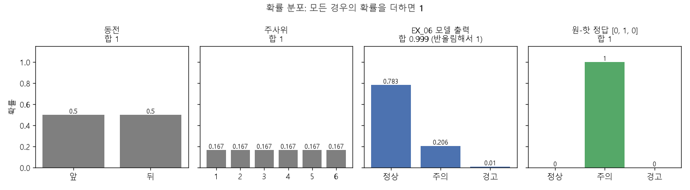

# 확률 기초

[MIT 딥러닝 목차](../../00_MIT%EB%94%A5%EB%9F%AC%EB%8B%9D_%EB%AA%A9%EC%B0%A8.md)

📚 학습 순서 23/99 (4. 확률과 정보): ← 이전: [MM43_마할라노비스_거리](../../%EC%88%98%ED%95%99%EA%B0%9C%EB%85%90/03_%EC%84%A0%ED%98%95%EB%8C%80%EC%88%98/MM43_%EB%A7%88%ED%95%A0%EB%9D%BC%EB%85%B8%EB%B9%84%EC%8A%A4_%EA%B1%B0%EB%A6%AC.md) · 다음: [M10_엔트로피](../../%EC%88%98%ED%95%99%EA%B0%9C%EB%85%90/04_%ED%99%95%EB%A5%A0%EA%B3%BC_%EC%A0%95%EB%B3%B4/M10_%EC%97%94%ED%8A%B8%EB%A1%9C%ED%94%BC.md) →

> [!NOTE]
> **3줄 요약**
> - [확률](../../00_%EB%94%A5%EB%9F%AC%EB%8B%9D_%EC%9A%A9%EC%96%B4%EC%82%AC%EC%A0%84.md#probability-%ED%99%95%EB%A5%A0)은 **0~1 사이 값**이고, 일어날 수 있는 경우를 전부 더하면 **1**이다.
> - [분류](../../00_%EB%94%A5%EB%9F%AC%EB%8B%9D_%EC%9A%A9%EC%96%B4%EC%82%AC%EC%A0%84.md#regression-classification-%ED%9A%8C%EA%B7%80%EC%99%80-%EB%B6%84%EB%A5%98) 모델의 출력([시그모이드](../../00_%EB%94%A5%EB%9F%AC%EB%8B%9D_%EC%9A%A9%EC%96%B4%EC%82%AC%EC%A0%84.md#sigmoid-%EC%8B%9C%EA%B7%B8%EB%AA%A8%EC%9D%B4%EB%93%9C), [소프트맥스](../../00_%EB%94%A5%EB%9F%AC%EB%8B%9D_%EC%9A%A9%EC%96%B4%EC%82%AC%EC%A0%84.md#softmax-%EC%86%8C%ED%94%84%ED%8A%B8%EB%A7%A5%EC%8A%A4))은 "각 정답일 [확률](../../00_%EB%94%A5%EB%9F%AC%EB%8B%9D_%EC%9A%A9%EC%96%B4%EC%82%AC%EC%A0%84.md#probability-%ED%99%95%EB%A5%A0)"이고, [정확도](../../00_%EB%94%A5%EB%9F%AC%EB%8B%9D_%EC%9A%A9%EC%96%B4%EC%82%AC%EC%A0%84.md#accuracy-%EC%A0%95%ED%99%95%EB%8F%84)는 "맞힌 비율"이다.
> - 따로따로 일어나는 일이 **둘 다** 일어날 [확률](../../00_%EB%94%A5%EB%9F%AC%EB%8B%9D_%EC%9A%A9%EC%96%B4%EC%82%AC%EC%A0%84.md#probability-%ED%99%95%EB%A5%A0)은 곱한다.
> - [드롭아웃](../../00_%EB%94%A5%EB%9F%AC%EB%8B%9D_%EC%9A%A9%EC%96%B4%EC%82%AC%EC%A0%84.md#dropout-%EB%93%9C%EB%A1%AD%EC%95%84%EC%9B%83)에서 여러 칸이 동시에 꺼질 [확률](../../00_%EB%94%A5%EB%9F%AC%EB%8B%9D_%EC%9A%A9%EC%96%B4%EC%82%AC%EC%A0%84.md#probability-%ED%99%95%EB%A5%A0)을 이 규칙으로 계산한다(칸마다 따로 꺼지므로).

## 1. 개념 설명

[확률](../../00_%EB%94%A5%EB%9F%AC%EB%8B%9D_%EC%9A%A9%EC%96%B4%EC%82%AC%EC%A0%84.md#probability-%ED%99%95%EB%A5%A0) = 어떤 일이 일어날 가능성을 0(절대 안 일어남) ~ 1(반드시 일어남) 사이 숫자로 나타낸 것.

## 2. 필요한 이유

- [분류](../../00_%EB%94%A5%EB%9F%AC%EB%8B%9D_%EC%9A%A9%EC%96%B4%EC%82%AC%EC%A0%84.md#regression-classification-%ED%9A%8C%EA%B7%80%EC%99%80-%EB%B6%84%EB%A5%98) 모델은 "7이다"라고 단정하지 않고 "7일 [확률](../../00_%EB%94%A5%EB%9F%AC%EB%8B%9D_%EC%9A%A9%EC%96%B4%EC%82%AC%EC%A0%84.md#probability-%ED%99%95%EB%A5%A0) 0.95"처럼 말한다.
- [손실 함수](../../00_%EB%94%A5%EB%9F%AC%EB%8B%9D_%EC%9A%A9%EC%96%B4%EC%82%AC%EC%A0%84.md#loss-function-%EC%86%90%EC%8B%A4-%ED%95%A8%EC%88%98)([교차 엔트로피](../../00_%EB%94%A5%EB%9F%AC%EB%8B%9D_%EC%9A%A9%EC%96%B4%EC%82%AC%EC%A0%84.md#cross-entropy-%EA%B5%90%EC%B0%A8-%EC%97%94%ED%8A%B8%EB%A1%9C%ED%94%BC))는 그 [확률](../../00_%EB%94%A5%EB%9F%AC%EB%8B%9D_%EC%9A%A9%EC%96%B4%EC%82%AC%EC%A0%84.md#probability-%ED%99%95%EB%A5%A0)로 벌점을 매긴다.
- [드롭아웃](../../00_%EB%94%A5%EB%9F%AC%EB%8B%9D_%EC%9A%A9%EC%96%B4%EC%82%AC%EC%A0%84.md#dropout-%EB%93%9C%EB%A1%AD%EC%95%84%EC%9B%83)은 "40% [확률](../../00_%EB%94%A5%EB%9F%AC%EB%8B%9D_%EC%9A%A9%EC%96%B4%EC%82%AC%EC%A0%84.md#probability-%ED%99%95%EB%A5%A0)로 끄기"다.

## 3. 숫자로 보기

### 비율로서의 확률

| 상황 | 계산 | [확률](../../00_%EB%94%A5%EB%9F%AC%EB%8B%9D_%EC%9A%A9%EC%96%B4%EC%82%AC%EC%A0%84.md#probability-%ED%99%95%EB%A5%A0) |
|---|---|---|
| 동전 앞면 | 1 ÷ 2 | 0.5 |
| 주사위 6 | 1 ÷ 6 | 0.167 |
| EX\_05에서 [정답](../../00_%EB%94%A5%EB%9F%AC%EB%8B%9D_%EC%9A%A9%EC%96%B4%EC%82%AC%EC%A0%84.md#label-%EC%A0%95%EB%8B%B5)이 1인 사람 | 9 ÷ 18 | 0.5 |
| EX\_07 시험 [정확도](../../00_%EB%94%A5%EB%9F%AC%EB%8B%9D_%EC%9A%A9%EC%96%B4%EC%82%AC%EC%A0%84.md#accuracy-%EC%A0%95%ED%99%95%EB%8F%84) | 9257 ÷ 10000 | 0.9257 |

[정확도](../../00_%EB%94%A5%EB%9F%AC%EB%8B%9D_%EC%9A%A9%EC%96%B4%EC%82%AC%EC%A0%84.md#accuracy-%EC%A0%95%ED%99%95%EB%8F%84)도 [확률](../../00_%EB%94%A5%EB%9F%AC%EB%8B%9D_%EC%9A%A9%EC%96%B4%EC%82%AC%EC%A0%84.md#probability-%ED%99%95%EB%A5%A0)처럼 읽을 수 있다: "이 모델에 새 그림을 주면 약 92.57% [확률](../../00_%EB%94%A5%EB%9F%AC%EB%8B%9D_%EC%9A%A9%EC%96%B4%EC%82%AC%EC%A0%84.md#probability-%ED%99%95%EB%A5%A0)로 맞힐 것으로 기대된다([시험 데이터](../../00_%EB%94%A5%EB%9F%AC%EB%8B%9D_%EC%9A%A9%EC%96%B4%EC%82%AC%EC%A0%84.md#training-data-test-data-%ED%95%99%EC%8A%B5-%EB%8D%B0%EC%9D%B4%ED%84%B0%EC%99%80-%EC%8B%9C%ED%97%98-%EB%8D%B0%EC%9D%B4%ED%84%B0) 기준)".

### 규칙 1: 모든 경우의 합은 1

| 상황 | 경우들 | 합 |
|---|---|---|
| 동전 | 앞 0.5 + 뒤 0.5 | 1 |
| EX\_05 출력 | 1일 [확률](../../00_%EB%94%A5%EB%9F%AC%EB%8B%9D_%EC%9A%A9%EC%96%B4%EC%82%AC%EC%A0%84.md#probability-%ED%99%95%EB%A5%A0) p + 0일 [확률](../../00_%EB%94%A5%EB%9F%AC%EB%8B%9D_%EC%9A%A9%EC%96%B4%EC%82%AC%EC%A0%84.md#probability-%ED%99%95%EB%A5%A0) (1 − p) | 1 |
| EX\_06 출력 | 정상 0.783 + 주의 0.206 + 경고 0.010 | (반올림해서) 1 |

- 그래서 EX\_05는 출력이 하나(p)뿐이어도 된다. 0일 [확률](../../00_%EB%94%A5%EB%9F%AC%EB%8B%9D_%EC%9A%A9%EC%96%B4%EC%82%AC%EC%A0%84.md#probability-%ED%99%95%EB%A5%A0)은 1 − p로 자동으로 정해진다.
- [소프트맥스](../../00_%EB%94%A5%EB%9F%AC%EB%8B%9D_%EC%9A%A9%EC%96%B4%EC%82%AC%EC%A0%84.md#softmax-%EC%86%8C%ED%94%84%ED%8A%B8%EB%A7%A5%EC%8A%A4)는 이 규칙이 지켜지도록 만든 함수다(D05_소프트맥스와_다중분류).

### 규칙 2: 동시에 일어날 확률은 곱

"따로"는 한쪽이 일어나든 말든 다른 쪽 [확률](../../00_%EB%94%A5%EB%9F%AC%EB%8B%9D_%EC%9A%A9%EC%96%B4%EC%82%AC%EC%A0%84.md#probability-%ED%99%95%EB%A5%A0)이 바뀌지 않는다는 뜻이다(이런 관계를 [독립](../../00_%EB%94%A5%EB%9F%AC%EB%8B%9D_%EC%9A%A9%EC%96%B4%EC%82%AC%EC%A0%84.md#independence-%EB%8F%85%EB%A6%BD)이라 한다). [드롭아웃](../../00_%EB%94%A5%EB%9F%AC%EB%8B%9D_%EC%9A%A9%EC%96%B4%EC%82%AC%EC%A0%84.md#dropout-%EB%93%9C%EB%A1%AD%EC%95%84%EC%9B%83)은 칸마다 따로 끄기 때문에, 여러 칸이 동시에 꺼질 [확률](../../00_%EB%94%A5%EB%9F%AC%EB%8B%9D_%EC%9A%A9%EC%96%B4%EC%82%AC%EC%A0%84.md#probability-%ED%99%95%EB%A5%A0)을 이 규칙으로 계산한다.

| 상황 | 계산 | [확률](../../00_%EB%94%A5%EB%9F%AC%EB%8B%9D_%EC%9A%A9%EC%96%B4%EC%82%AC%EC%A0%84.md#probability-%ED%99%95%EB%A5%A0) |
|---|---|---|
| 동전 두 번 모두 앞면 | 0.5 × 0.5 | 0.25 |
| [드롭아웃](../../00_%EB%94%A5%EB%9F%AC%EB%8B%9D_%EC%9A%A9%EC%96%B4%EC%82%AC%EC%A0%84.md#dropout-%EB%93%9C%EB%A1%AD%EC%95%84%EC%9B%83)(0.4)에서 두 칸이 모두 꺼짐 | 0.4 × 0.4 | 0.16 |
| 세 칸이 모두 켜져 있음 | 0.6 × 0.6 × 0.6 | 0.216 |

- 여러 번 곱하면 빠르게 작아진다. 이걸 다루려고 [로그](../../00_%EB%94%A5%EB%9F%AC%EB%8B%9D_%EC%9A%A9%EC%96%B4%EC%82%AC%EC%A0%84.md#log-ln-%EB%A1%9C%EA%B7%B8)를 쓴다([M07_로그](../../%EC%88%98%ED%95%99%EA%B0%9C%EB%85%90/01_%EC%88%98%EC%99%80_%ED%95%A8%EC%88%98/M07_%EB%A1%9C%EA%B7%B8.md) 6절).

## 4. 기호

<details><summary>기호 풀이</summary>

| 기호 | 읽는 법 | 뜻 | 예 |
| --- | --- | --- | --- |
| $P(A)$ | 피 에이 | A가 일어날 [확률](../../00_%EB%94%A5%EB%9F%AC%EB%8B%9D_%EC%9A%A9%EC%96%B4%EC%82%AC%EC%A0%84.md#probability-%ED%99%95%EB%A5%A0) | $P(\text{앞면}) = 0.5$ |
| $p$ | 피 | 모델이 낸 [확률](../../00_%EB%94%A5%EB%9F%AC%EB%8B%9D_%EC%9A%A9%EC%96%B4%EC%82%AC%EC%A0%84.md#probability-%ED%99%95%EB%A5%A0) (EX\_05) | 0.4251 |
| $1 - p$ | 일 빼기 피 | 일어나지 **않을** [확률](../../00_%EB%94%A5%EB%9F%AC%EB%8B%9D_%EC%9A%A9%EC%96%B4%EC%82%AC%EC%A0%84.md#probability-%ED%99%95%EB%A5%A0) | 0.5749 |

</details>

[M10_엔트로피](../../%EC%88%98%ED%95%99%EA%B0%9C%EB%85%90/04_%ED%99%95%EB%A5%A0%EA%B3%BC_%EC%A0%95%EB%B3%B4/M10_%EC%97%94%ED%8A%B8%EB%A1%9C%ED%94%BC.md)에서는 모델의 [확률](../../00_%EB%94%A5%EB%9F%AC%EB%8B%9D_%EC%9A%A9%EC%96%B4%EC%82%AC%EC%A0%84.md#probability-%ED%99%95%EB%A5%A0)을 q, [정답](../../00_%EB%94%A5%EB%9F%AC%EB%8B%9D_%EC%9A%A9%EC%96%B4%EC%82%AC%EC%A0%84.md#label-%EC%A0%95%EB%8B%B5) 분포를 p로 쓴다. 이 노트에서는 모델이 낸 [확률](../../00_%EB%94%A5%EB%9F%AC%EB%8B%9D_%EC%9A%A9%EC%96%B4%EC%82%AC%EC%A0%84.md#probability-%ED%99%95%EB%A5%A0)을 p로 쓴다.

## 5. 원-핫: 정답일 확률이 1인 분포

[원-핫](../../00_%EB%94%A5%EB%9F%AC%EB%8B%9D_%EC%9A%A9%EC%96%B4%EC%82%AC%EC%A0%84.md#one-hot-encoding-%EC%9B%90-%ED%95%AB-%EC%9D%B8%EC%BD%94%EB%94%A9) `[0, 1, 0]`은 "주의일 [확률](../../00_%EB%94%A5%EB%9F%AC%EB%8B%9D_%EC%9A%A9%EC%96%B4%EC%82%AC%EC%A0%84.md#probability-%ED%99%95%EB%A5%A0) 1, 나머지 0"이라는 [확률](../../00_%EB%94%A5%EB%9F%AC%EB%8B%9D_%EC%9A%A9%EC%96%B4%EC%82%AC%EC%A0%84.md#probability-%ED%99%95%EB%A5%A0) 분포(경우마다 [확률](../../00_%EB%94%A5%EB%9F%AC%EB%8B%9D_%EC%9A%A9%EC%96%B4%EC%82%AC%EC%A0%84.md#probability-%ED%99%95%EB%A5%A0)을 적은 목록)로 볼 수 있다. 모델의 출력 `[0.36, 0.44, 0.20]`과 **같은 모양**이라서, 둘이 얼마나 다른지를 [교차 엔트로피](../../00_%EB%94%A5%EB%9F%AC%EB%8B%9D_%EC%9A%A9%EC%96%B4%EC%82%AC%EC%A0%84.md#cross-entropy-%EA%B5%90%EC%B0%A8-%EC%97%94%ED%8A%B8%EB%A1%9C%ED%94%BC)로 잴 수 있다. [정답](../../00_%EB%94%A5%EB%9F%AC%EB%8B%9D_%EC%9A%A9%EC%96%B4%EC%82%AC%EC%A0%84.md#label-%EC%A0%95%EB%8B%B5) 칸이 1, 나머지가 0이라 결국 **[정답](../../00_%EB%94%A5%EB%9F%AC%EB%8B%9D_%EC%9A%A9%EC%96%B4%EC%82%AC%EC%A0%84.md#label-%EC%A0%95%EB%8B%B5) 칸의 [확률](../../00_%EB%94%A5%EB%9F%AC%EB%8B%9D_%EC%9A%A9%EC%96%B4%EC%82%AC%EC%A0%84.md#probability-%ED%99%95%EB%A5%A0)만** 벌점에 들어간다.



## 6. 평균 맞추기: 드롭아웃의 1.67배

[드롭아웃](../../00_%EB%94%A5%EB%9F%AC%EB%8B%9D_%EC%9A%A9%EC%96%B4%EC%82%AC%EC%A0%84.md#dropout-%EB%93%9C%EB%A1%AD%EC%95%84%EC%9B%83)(0.4)은 값 하나하나를 40% [확률](../../00_%EB%94%A5%EB%9F%AC%EB%8B%9D_%EC%9A%A9%EC%96%B4%EC%82%AC%EC%A0%84.md#probability-%ED%99%95%EB%A5%A0)로 0으로 만든다. 그대로 두면 평균이 0.6배로 줄어든다. 그래서 남은 값을 $\frac{1}{1 - 0.4} ≈ 1.667$배 키운다.

말로 먼저: 값이 1일 때, 60%는 남아서 1.667이 되고 40%는 꺼져서 0이 된다. 평균은 "[확률](../../00_%EB%94%A5%EB%9F%AC%EB%8B%9D_%EC%9A%A9%EC%96%B4%EC%82%AC%EC%A0%84.md#probability-%ED%99%95%EB%A5%A0) × 값"을 더한 것이다.

$$\text{평균} = 0.6 × (1 × 1.667) + 0.4 × 0 = 1.0$$

<details><summary>기호 풀이</summary>

| 기호 | 읽는 법 | 뜻 | 예제 값 |
| --- | --- | --- | --- |
| $\text{평균}$ | 평균 | 나올 수 있는 값마다 [확률](../../00_%EB%94%A5%EB%9F%AC%EB%8B%9D_%EC%9A%A9%EC%96%B4%EC%82%AC%EC%A0%84.md#probability-%ED%99%95%EB%A5%A0) × 값을 더한 것 | 1.0 |
| $0.6$ | 영점육 | 값이 남을 [확률](../../00_%EB%94%A5%EB%9F%AC%EB%8B%9D_%EC%9A%A9%EC%96%B4%EC%82%AC%EC%A0%84.md#probability-%ED%99%95%EB%A5%A0) ($1 - 0.4$) | 0.6 |
| $0.4$ | 영점사 | [드롭아웃](../../00_%EB%94%A5%EB%9F%AC%EB%8B%9D_%EC%9A%A9%EC%96%B4%EC%82%AC%EC%A0%84.md#dropout-%EB%93%9C%EB%A1%AD%EC%95%84%EC%9B%83)으로 꺼질 [확률](../../00_%EB%94%A5%EB%9F%AC%EB%8B%9D_%EC%9A%A9%EC%96%B4%EC%82%AC%EC%A0%84.md#probability-%ED%99%95%EB%A5%A0) | 0.4 |
| $1$ | 일 | 원래 값 | 1 |
| $1.667$ | 일점육육칠 | 남은 값을 키우는 배수 $\frac{1}{1 - 0.4}$ | 1.667 |
| $0$ | 영 | 꺼진 값 | 0 |

</details>

<details><summary>예제와 풀이</summary>

**문제**: 값을 0.5의 [확률](../../00_%EB%94%A5%EB%9F%AC%EB%8B%9D_%EC%9A%A9%EC%96%B4%EC%82%AC%EC%A0%84.md#probability-%ED%99%95%EB%A5%A0)로 끄는 [드롭아웃](../../00_%EB%94%A5%EB%9F%AC%EB%8B%9D_%EC%9A%A9%EC%96%B4%EC%82%AC%EC%A0%84.md#dropout-%EB%93%9C%EB%A1%AD%EC%95%84%EC%9B%83)에서, 원래 값 2를 남은 칸만 키웠을 때 평균이 얼마인지 구한다.

**주어진 값**:
- $0.5$ (꺼질 [확률](../../00_%EB%94%A5%EB%9F%AC%EB%8B%9D_%EC%9A%A9%EC%96%B4%EC%82%AC%EC%A0%84.md#probability-%ED%99%95%EB%A5%A0), [드롭아웃](../../00_%EB%94%A5%EB%9F%AC%EB%8B%9D_%EC%9A%A9%EC%96%B4%EC%82%AC%EC%A0%84.md#dropout-%EB%93%9C%EB%A1%AD%EC%95%84%EC%9B%83) 비율)
- $2$ (원래 값)
- $0$ (꺼진 칸의 값)

**풀이**
1. 식을 그대로 쓴다: $\text{평균} = 0.6 × (1 × 1.667) + 0.4 × 0 = 1.0$ (남을 [확률](../../00_%EB%94%A5%EB%9F%AC%EB%8B%9D_%EC%9A%A9%EC%96%B4%EC%82%AC%EC%A0%84.md#probability-%ED%99%95%EB%A5%A0) × (원래 값 × 배수) + 꺼질 [확률](../../00_%EB%94%A5%EB%9F%AC%EB%8B%9D_%EC%9A%A9%EC%96%B4%EC%82%AC%EC%A0%84.md#probability-%ED%99%95%EB%A5%A0) × 0)
2. 값을 대입한다: $\text{평균} = (1 - 0.5) × \left(2 × \frac{1}{1 - 0.5}\right) + 0.5 × 0$
3. 남을 [확률](../../00_%EB%94%A5%EB%9F%AC%EB%8B%9D_%EC%9A%A9%EC%96%B4%EC%82%AC%EC%A0%84.md#probability-%ED%99%95%EB%A5%A0)을 구한다(1에서 꺼질 [확률](../../00_%EB%94%A5%EB%9F%AC%EB%8B%9D_%EC%9A%A9%EC%96%B4%EC%82%AC%EC%A0%84.md#probability-%ED%99%95%EB%A5%A0)을 뺀다): $1 - 0.5 = 0.5$
4. 배수의 분모를 구한다(1에서 꺼질 [확률](../../00_%EB%94%A5%EB%9F%AC%EB%8B%9D_%EC%9A%A9%EC%96%B4%EC%82%AC%EC%A0%84.md#probability-%ED%99%95%EB%A5%A0)을 뺀다): $1 - 0.5 = 0.5$
5. 배수를 구한다(1을 분모로 나눈다): $1 ÷ 0.5 = 2$
6. 남은 값을 키운다(원래 값 × 배수): $2 × 2 = 4$
7. 남는 쪽 몫을 구한다(남을 [확률](../../00_%EB%94%A5%EB%9F%AC%EB%8B%9D_%EC%9A%A9%EC%96%B4%EC%82%AC%EC%A0%84.md#probability-%ED%99%95%EB%A5%A0) × 키운 값): $0.5 × 4 = 2$
8. 꺼지는 쪽 몫을 구한다(꺼질 [확률](../../00_%EB%94%A5%EB%9F%AC%EB%8B%9D_%EC%9A%A9%EC%96%B4%EC%82%AC%EC%A0%84.md#probability-%ED%99%95%EB%A5%A0) × 0): $0.5 × 0 = 0$
9. 두 몫을 더한다: $2 + 0 = 2$

**답**: 평균 = 2 (원래 값 2와 같다)

</details>

<details><summary>내 이해</summary>


</details>

(0.6 × 1.667 ≈ 1.0, 0.4 × 0 = 0이므로 합은 1.0)

```python
import numpy as np
rng = np.random.default_rng(0)            # 무작위 생성기 (0으로 고정해 매번 같은 결과)
a = np.ones(100000)                       # 1이 10만 개
keep = rng.random(100000) >= 0.4          # 0~1 무작위 수가 0.4 이상이면 남김 → 약 60% 남음
d = a * keep / (1 - 0.4)                  # 꺼진 칸은 0, 남은 칸은 1.667배
print(1 - keep.mean(), d.mean())          # 꺼진 비율, 평균
```

**실행 결과**:

```text
0.39854999999999996 1.0024166666666665
```

꺼진 비율은 약 0.4, 평균은 약 1.0으로 유지된다. 자세히: D08_ReLU와_드롭아웃

## 7. 개념 재확인

<details><summary>1. 모델이 "1일 확률 0.8"이라고 했다. 0일 확률은?</summary>

| 단계 | 하는 일 | 식 | 계산 | 결과 |
|---|---|---|---|---|
| 1 | 합이 1임을 쓰기 | $p + (\text{0일 확률}) = 1$ | 0.8 + ? = 1 | - |
| 2 | 1에서 빼기 | $1 - p$ | 1 − 0.8 | 0.2 |

결과는 1 또는 0 두 가지뿐이라 합이 1이다.

**① 쓰는 식**
$$p + (\text{0일 확률}) = 1 \quad\Longrightarrow\quad \text{0일 확률} = 1 - p$$
- 위 첫 식 ← ② (합이 1), 둘째 식 $1 - p$ ← ③ (1에서 빼기)
- $p$는 모델이 낸 "1일 [확률](../../00_%EB%94%A5%EB%9F%AC%EB%8B%9D_%EC%9A%A9%EC%96%B4%EC%82%AC%EC%A0%84.md#probability-%ED%99%95%EB%A5%A0)"(여기서는 0.8)이다. 일어날 수 있는 경우(1 또는 0)를 전부 더하면 1이다.

**주어진 값**
- $p = 0.8$ (모델이 낸 "1일 [확률](../../00_%EB%94%A5%EB%9F%AC%EB%8B%9D_%EC%9A%A9%EC%96%B4%EC%82%AC%EC%A0%84.md#probability-%ED%99%95%EB%A5%A0)")

**② 합이 1임을 쓰기** ($p + (\text{0일 확률}) = 1$)
- 식을 그대로 쓴다: $p + (\text{0일 확률}) = 1$ (결과는 1이거나 0, 두 가지뿐이라 합이 1이다)
- 값을 대입한다: $0.8 + (\text{0일 확률}) = 1$

**③ 1에서 빼기** ($1 - p$)
- 식을 그대로 쓴다: $\text{0일 확률} = 1 - p$
- 값을 대입한다: $\text{0일 확률} = 1 - 0.8$
- 뺄셈을 한다: 1 − 0.8 = 0.2 이므로 $\text{0일 확률} = 0.2$
- 확인한다 (두 [확률](../../00_%EB%94%A5%EB%9F%AC%EB%8B%9D_%EC%9A%A9%EC%96%B4%EC%82%AC%EC%A0%84.md#probability-%ED%99%95%EB%A5%A0)을 더한다): 0.8 + 0.2 = 1.0

**답**: 0일 [확률](../../00_%EB%94%A5%EB%9F%AC%EB%8B%9D_%EC%9A%A9%EC%96%B4%EC%82%AC%EC%A0%84.md#probability-%ED%99%95%EB%A5%A0)은 **0.2**

</details>

<details><summary>2. 소프트맥스 출력이 [0.5, 0.3, ?]이면 ?는?</summary>

| 단계 | 하는 일 | 식 | 계산 | 결과 |
|---|---|---|---|---|
| 1 | 아는 두 칸 더하기 | 0.5 + 0.3 | 0.5 + 0.3 | 0.8 |
| 2 | 1에서 빼기 | $? = 1 - 0.8$ | 1 − 0.8 | 0.2 |
| 3 | 합 확인 | 세 칸의 합 | 0.5 + 0.3 + 0.2 | 1.0 |

**① 쓰는 식**
$$0.5 + 0.3 + ? = 1$$
- 위 식 ← $0.5 + 0.3$은 ②, $? = 1 - 0.8$은 ③, 합 $= 1$ 확인은 ④
- [소프트맥스](../../00_%EB%94%A5%EB%9F%AC%EB%8B%9D_%EC%9A%A9%EC%96%B4%EC%82%AC%EC%A0%84.md#softmax-%EC%86%8C%ED%94%84%ED%8A%B8%EB%A7%A5%EC%8A%A4) 출력은 칸마다 "그 칸이 정답일 [확률](../../00_%EB%94%A5%EB%9F%AC%EB%8B%9D_%EC%9A%A9%EC%96%B4%EC%82%AC%EC%A0%84.md#probability-%ED%99%95%EB%A5%A0)"이고, 모든 칸을 더하면 1이 되도록 만든 함수다. 그래서 모르는 칸은 1에서 아는 칸을 빼면 나온다.

**주어진 값**
- 첫째 칸 0.5, 둘째 칸 0.3 ([소프트맥스](../../00_%EB%94%A5%EB%9F%AC%EB%8B%9D_%EC%9A%A9%EC%96%B4%EC%82%AC%EC%A0%84.md#softmax-%EC%86%8C%ED%94%84%ED%8A%B8%EB%A7%A5%EC%8A%A4) 출력 중 아는 두 칸)
- $?$ (셋째 칸, 구할 값)

**② 아는 두 칸 더하기** ($0.5 + 0.3$)
- 식을 그대로 쓴다: $0.5 + 0.3 + ? = 1$ (모든 칸을 더하면 1이다)
- 아는 두 칸을 먼저 더한다: 0.5 + 0.3 = 0.8 이므로 $0.8 + ? = 1$

**③ 1에서 빼기** ($? = 1 - 0.8$)
- 식을 그대로 쓴다: $? = 1 - 0.8$ (양변에서 0.8을 뺀 꼴)
- 뺄셈을 한다: 1 − 0.8 = 0.2 이므로 $? = 0.2$

**④ 합 확인** (세 칸의 합)
- 식을 그대로 쓴다: (첫째 칸) + (둘째 칸) + (셋째 칸) = 1
- 값을 대입한다: $0.5 + 0.3 + 0.2$
- 앞의 두 칸을 더한다: 0.5 + 0.3 = 0.8 이므로 $0.8 + 0.2$
- 마지막으로 더한다: 0.8 + 0.2 = 1.0 이므로 합이 1이 되어 맞다.

**답**: ? = **0.2**

</details>

<details><summary>3. Dropout(0.5)에서 두 칸이 모두 꺼질 확률은?</summary>

| 단계 | 하는 일 | 식 | 계산 | 결과 |
|---|---|---|---|---|
| 1 | 한 칸이 꺼질 [확률](../../00_%EB%94%A5%EB%9F%AC%EB%8B%9D_%EC%9A%A9%EC%96%B4%EC%82%AC%EC%A0%84.md#probability-%ED%99%95%EB%A5%A0) | Dropout(0.5) | - | 0.5 |
| 2 | 두 칸 [확률](../../00_%EB%94%A5%EB%9F%AC%EB%8B%9D_%EC%9A%A9%EC%96%B4%EC%82%AC%EC%A0%84.md#probability-%ED%99%95%EB%A5%A0) 곱하기 | $P(A) \times P(B)$ | 0.5 × 0.5 | 0.25 |

칸마다 따로 끄므로 서로 영향이 없어 곱할 수 있다. (같은 방식으로 Dropout(0.4)면 0.4 × 0.4 = 0.16)

**① 쓰는 식**
$$P(A \text{ 그리고 } B) = P(A) \times P(B)$$
- 위 식 ← $P(A)$, $P(B)$ 값은 ②, 곱하기는 ③
- $P(A)$는 첫째 칸이 꺼질 [확률](../../00_%EB%94%A5%EB%9F%AC%EB%8B%9D_%EC%9A%A9%EC%96%B4%EC%82%AC%EC%A0%84.md#probability-%ED%99%95%EB%A5%A0), $P(B)$는 둘째 칸이 꺼질 [확률](../../00_%EB%94%A5%EB%9F%AC%EB%8B%9D_%EC%9A%A9%EC%96%B4%EC%82%AC%EC%A0%84.md#probability-%ED%99%95%EB%A5%A0)이다. 두 칸은 따로(서로 영향 없이) 꺼지므로 곱할 수 있다.
- Dropout(0.5)는 "칸마다 50% [확률](../../00_%EB%94%A5%EB%9F%AC%EB%8B%9D_%EC%9A%A9%EC%96%B4%EC%82%AC%EC%A0%84.md#probability-%ED%99%95%EB%A5%A0)로 끄기"이다.

**주어진 값**
- $P(A) = 0.5$ (첫째 칸이 꺼질 [확률](../../00_%EB%94%A5%EB%9F%AC%EB%8B%9D_%EC%9A%A9%EC%96%B4%EC%82%AC%EC%A0%84.md#probability-%ED%99%95%EB%A5%A0), Dropout(0.5)가 칸마다 50%로 끈다)
- $P(B) = 0.5$ (둘째 칸이 꺼질 [확률](../../00_%EB%94%A5%EB%9F%AC%EB%8B%9D_%EC%9A%A9%EC%96%B4%EC%82%AC%EC%A0%84.md#probability-%ED%99%95%EB%A5%A0))

**② 한 칸이 꺼질 [확률](../../00_%EB%94%A5%EB%9F%AC%EB%8B%9D_%EC%9A%A9%EC%96%B4%EC%82%AC%EC%A0%84.md#probability-%ED%99%95%EB%A5%A0)** (Dropout(0.5))
- 칸마다 따로 꺼지므로 $P(A) = 0.5$, $P(B) = 0.5$이고, 두 칸은 서로 영향이 없어 곱할 수 있다.

**③ 두 칸 [확률](../../00_%EB%94%A5%EB%9F%AC%EB%8B%9D_%EC%9A%A9%EC%96%B4%EC%82%AC%EC%A0%84.md#probability-%ED%99%95%EB%A5%A0) 곱하기** ($P(A) \times P(B)$)
- 식을 그대로 쓴다: $P(A \text{ 그리고 } B) = P(A) \times P(B)$
- 값을 대입한다: $P(A \text{ 그리고 } B) = 0.5 \times 0.5$
- 소수점 없이 먼저 곱한다: 5 × 5 = 25
- 소수점 아래 자리가 한 자리씩 두 번이므로 두 자리를 되돌린다: 25 → 0.25 이므로 $P(A \text{ 그리고 } B) = 0.25$
- 확인: 0.5는 "반"이고, 반의 반은 $\frac{1}{4} = 0.25$이다.

**답**: **0.25**

</details>

## 예제 풀기

[예제 10문제 풀기](../../%EC%98%88%EC%A0%9C/04_%ED%99%95%EB%A5%A0%EA%B3%BC_%EC%A0%95%EB%B3%B4/%EC%98%88%EC%A0%9C_M08_%ED%99%95%EB%A5%A0_%EA%B8%B0%EC%B4%88.md)

<details><summary>내 이해</summary>


</details>
