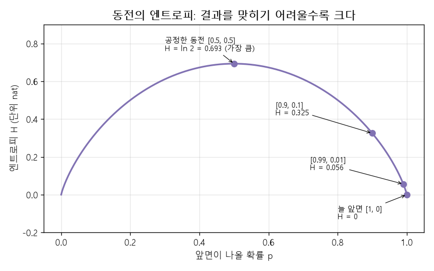
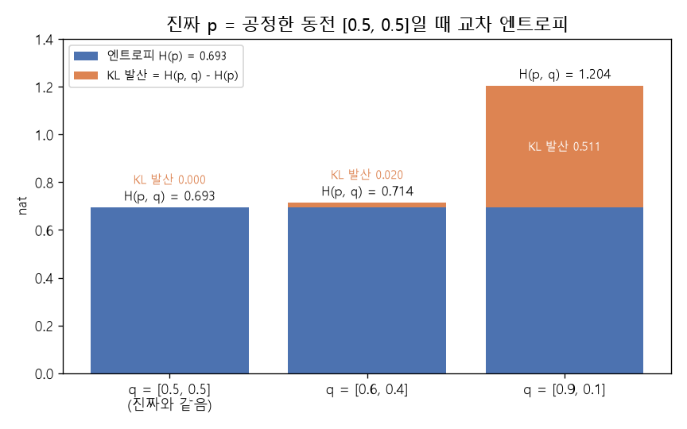

# 엔트로피 (Entropy)

[MIT 딥러닝 목차](../../00_MIT%EB%94%A5%EB%9F%AC%EB%8B%9D_%EB%AA%A9%EC%B0%A8.md) · 먼저 볼 것: [M07_로그](../../%EC%88%98%ED%95%99%EA%B0%9C%EB%85%90/01_%EC%88%98%EC%99%80_%ED%95%A8%EC%88%98/M07_%EB%A1%9C%EA%B7%B8.md), [M08_확률_기초](../../%EC%88%98%ED%95%99%EA%B0%9C%EB%85%90/04_%ED%99%95%EB%A5%A0%EA%B3%BC_%EC%A0%95%EB%B3%B4/M08_%ED%99%95%EB%A5%A0_%EA%B8%B0%EC%B4%88.md)

📚 학습 순서 24/99 (4. 확률과 정보): ← 이전: [M08_확률_기초](../../%EC%88%98%ED%95%99%EA%B0%9C%EB%85%90/04_%ED%99%95%EB%A5%A0%EA%B3%BC_%EC%A0%95%EB%B3%B4/M08_%ED%99%95%EB%A5%A0_%EA%B8%B0%EC%B4%88.md) · 다음: [M11_오즈와_로짓](../../%EC%88%98%ED%95%99%EA%B0%9C%EB%85%90/04_%ED%99%95%EB%A5%A0%EA%B3%BC_%EC%A0%95%EB%B3%B4/M11_%EC%98%A4%EC%A6%88%EC%99%80_%EB%A1%9C%EC%A7%93.md) →

> [!NOTE]
> **3줄 요약**
> - **자기 정보량**(self-information)은 [확률](../../00_%EB%94%A5%EB%9F%AC%EB%8B%9D_%EC%9A%A9%EC%96%B4%EC%82%AC%EC%A0%84.md#probability-%ED%99%95%EB%A5%A0) p인 일이 일어났을 때 $-\ln p$다. 흔한 일은 덜 놀랍고(작음), 드문 일은 많이 놀랍다(큼).
> - **[엔트로피](../../00_%EB%94%A5%EB%9F%AC%EB%8B%9D_%EC%9A%A9%EC%96%B4%EC%82%AC%EC%A0%84.md#entropy-%EC%97%94%ED%8A%B8%EB%A1%9C%ED%94%BC)**는 자기 정보량의 평균 = "결과가 얼마나 예측하기 어려운가"다. 공정한 동전은 ln 2 = 0.693, 늘 앞면만 나오는 동전은 0.
> - **[교차 엔트로피](../../00_%EB%94%A5%EB%9F%AC%EB%8B%9D_%EC%9A%A9%EC%96%B4%EC%82%AC%EC%A0%84.md#cross-entropy-%EA%B5%90%EC%B0%A8-%EC%97%94%ED%8A%B8%EB%A1%9C%ED%94%BC)**는 진짜 분포 대신 **모델의 [확률](../../00_%EB%94%A5%EB%9F%AC%EB%8B%9D_%EC%9A%A9%EC%96%B4%EC%82%AC%EC%A0%84.md#probability-%ED%99%95%EB%A5%A0)**로 자기 정보량을 잰 평균이다.
> - 모델이 진짜와 같을 때 가장 작아지므로, 이것을 줄이는 것이 [분류](../../00_%EB%94%A5%EB%9F%AC%EB%8B%9D_%EC%9A%A9%EC%96%B4%EC%82%AC%EC%A0%84.md#regression-classification-%ED%9A%8C%EA%B7%80%EC%99%80-%EB%B6%84%EB%A5%98) [학습](../../00_%EB%94%A5%EB%9F%AC%EB%8B%9D_%EC%9A%A9%EC%96%B4%EC%82%AC%EC%A0%84.md#training-%ED%95%99%EC%8A%B5)이다.

## 1. 개념 설명

[엔트로피](../../00_%EB%94%A5%EB%9F%AC%EB%8B%9D_%EC%9A%A9%EC%96%B4%EC%82%AC%EC%A0%84.md#entropy-%EC%97%94%ED%8A%B8%EB%A1%9C%ED%94%BC) = 불확실함의 크기. 결과를 맞히기 어려울수록 크다.

## 2. 필요한 이유

EX\_05·06의 [손실](../../00_%EB%94%A5%EB%9F%AC%EB%8B%9D_%EC%9A%A9%EC%96%B4%EC%82%AC%EC%A0%84.md#loss-function-%EC%86%90%EC%8B%A4-%ED%95%A8%EC%88%98) 이름이 **[교차 엔트로피](../../00_%EB%94%A5%EB%9F%AC%EB%8B%9D_%EC%9A%A9%EC%96%B4%EC%82%AC%EC%A0%84.md#cross-entropy-%EA%B5%90%EC%B0%A8-%EC%97%94%ED%8A%B8%EB%A1%9C%ED%94%BC)**다. 이름이 왜 그런지, 그리고 [학습](../../00_%EB%94%A5%EB%9F%AC%EB%8B%9D_%EC%9A%A9%EC%96%B4%EC%82%AC%EC%A0%84.md#training-%ED%95%99%EC%8A%B5) 첫 [손실](../../00_%EB%94%A5%EB%9F%AC%EB%8B%9D_%EC%9A%A9%EC%96%B4%EC%82%AC%EC%A0%84.md#loss-function-%EC%86%90%EC%8B%A4-%ED%95%A8%EC%88%98)이 왜 0.69 근처(EX\_05)와 1.1 근처(EX\_06)에서 시작하는지가 [엔트로피](../../00_%EB%94%A5%EB%9F%AC%EB%8B%9D_%EC%9A%A9%EC%96%B4%EC%82%AC%EC%A0%84.md#entropy-%EC%97%94%ED%8A%B8%EB%A1%9C%ED%94%BC)로 설명된다.

## 3. 숫자로 보기

### 3.1 자기 정보량: $-\ln p$

여기서 p는 그 일이 일어날 [확률](../../00_%EB%94%A5%EB%9F%AC%EB%8B%9D_%EC%9A%A9%EC%96%B4%EC%82%AC%EC%A0%84.md#probability-%ED%99%95%EB%A5%A0)이다. 결과가 여러 개일 때는 k번째 결과의 [확률](../../00_%EB%94%A5%EB%9F%AC%EB%8B%9D_%EC%9A%A9%EC%96%B4%EC%82%AC%EC%A0%84.md#probability-%ED%99%95%EB%A5%A0)을 $p_k$로 쓴다(3.2절).

| 일어난 일의 [확률](../../00_%EB%94%A5%EB%9F%AC%EB%8B%9D_%EC%9A%A9%EC%96%B4%EC%82%AC%EC%A0%84.md#probability-%ED%99%95%EB%A5%A0) p | 1 (반드시) | 0.5   | 0.1   | 0.01  |
| --------------------------------------------- | ------- | ----- | ----- | ----- |
| 자기 정보량 $-\ln p$                              | 0       | 0.693 | 2.303 | 4.605 |

- 해가 동쪽에서 떴다(p ≈ 1) → 놀랍지 않다, 자기 정보량 0
- 로또 당첨(p 아주 작음) → 아주 놀랍다, 자기 정보량 큼
- [M07_로그](../../%EC%88%98%ED%95%99%EA%B0%9C%EB%85%90/01_%EC%88%98%EC%99%80_%ED%95%A8%EC%88%98/M07_%EB%A1%9C%EA%B7%B8.md) 7절의 벌점 표와 같은 숫자다.
- 단위: 이 노트는 ln(밑이 e)을 써서 단위가 **nat(내트)**다. 밑이 2인 log₂를 쓰면 단위가 bit(비트)가 된다. 그래서 공정한 동전의 [엔트로피](../../00_%EB%94%A5%EB%9F%AC%EB%8B%9D_%EC%9A%A9%EC%96%B4%EC%82%AC%EC%A0%84.md#entropy-%EC%97%94%ED%8A%B8%EB%A1%9C%ED%94%BC)가 1비트가 아니라 0.693(nat)으로 나온다.

### 3.2 엔트로피 = 자기 정보량의 평균

말로 먼저: 각 결과의 자기 정보량에 그 결과가 나올 [확률](../../00_%EB%94%A5%EB%9F%AC%EB%8B%9D_%EC%9A%A9%EC%96%B4%EC%82%AC%EC%A0%84.md#probability-%ED%99%95%EB%A5%A0)을 곱해 더한다. 곧 자기 정보량의 평균이다.

$$H(p) = \sum_k p_k \times (-\ln p_k)$$

<details><summary>기호 풀이</summary>

| 기호 | 읽는 법 | 뜻 | 예 (공정한 동전) |
| --- | --- | --- | --- |
| $H(p)$ | 에이치 피 | [엔트로피](../../00_%EB%94%A5%EB%9F%AC%EB%8B%9D_%EC%9A%A9%EC%96%B4%EC%82%AC%EC%A0%84.md#entropy-%EC%97%94%ED%8A%B8%EB%A1%9C%ED%94%BC) (평균 정보량) | 0.693 |
| $k$ | 케이 | 결과의 번호 | 1번 = 앞, 2번 = 뒤 |
| $p_k$ | 피 케이 | k번째 결과의 [확률](../../00_%EB%94%A5%EB%9F%AC%EB%8B%9D_%EC%9A%A9%EC%96%B4%EC%82%AC%EC%A0%84.md#probability-%ED%99%95%EB%A5%A0) | $p_1 = 0.5$, $p_2 = 0.5$ |
| $\sum_k$ | 시그마(합) | 모든 k에 대해 더한다 | 1번 몫 + 2번 몫 |
| $\ln$ | 엘엔(자연로그) | e를 몇 번 곱해야 하나 | $\ln 2 = 0.693$ |

</details>

<details><summary>예제와 풀이</summary>

**문제**: 앞면이 나올 [확률](../../00_%EB%94%A5%EB%9F%AC%EB%8B%9D_%EC%9A%A9%EC%96%B4%EC%82%AC%EC%A0%84.md#probability-%ED%99%95%EB%A5%A0) 0.8, 뒷면이 나올 [확률](../../00_%EB%94%A5%EB%9F%AC%EB%8B%9D_%EC%9A%A9%EC%96%B4%EC%82%AC%EC%A0%84.md#probability-%ED%99%95%EB%A5%A0) 0.2인 동전의 [엔트로피](../../00_%EB%94%A5%EB%9F%AC%EB%8B%9D_%EC%9A%A9%EC%96%B4%EC%82%AC%EC%A0%84.md#entropy-%EC%97%94%ED%8A%B8%EB%A1%9C%ED%94%BC)(평균 놀람 정도) $H(p)$를 구한다.

**주어진 값**:
- $p_1 = 0.8$ (앞면이 나올 [확률](../../00_%EB%94%A5%EB%9F%AC%EB%8B%9D_%EC%9A%A9%EC%96%B4%EC%82%AC%EC%A0%84.md#probability-%ED%99%95%EB%A5%A0))
- $p_2 = 0.2$ (뒷면이 나올 [확률](../../00_%EB%94%A5%EB%9F%AC%EB%8B%9D_%EC%9A%A9%EC%96%B4%EC%82%AC%EC%A0%84.md#probability-%ED%99%95%EB%A5%A0))

**풀이**
1. 식을 그대로 쓴다: $H(p) = \sum_k p_k \times (-\ln p_k)$
2. 값을 대입한다(Σ를 k = 1, 2 두 항으로 풀어 쓴다): $H(p) = 0.8 \times (-\ln 0.8) + 0.2 \times (-\ln 0.2)$
3. ln이 뜻하는 것: $\ln x$는 e(약 2.718)를 몇 번 곱해야 x가 되는지를 나타낸다. 값은 계산기나 `np.log(x)`로 구한다
4. 앞면 [확률](../../00_%EB%94%A5%EB%9F%AC%EB%8B%9D_%EC%9A%A9%EC%96%B4%EC%82%AC%EC%A0%84.md#probability-%ED%99%95%EB%A5%A0)의 ln을 구한다: $\ln 0.8 = -0.2231$
5. 마이너스를 붙여 앞면 자기 정보량을 구한다: $-(-0.2231) = 0.2231$
6. 뒷면 [확률](../../00_%EB%94%A5%EB%9F%AC%EB%8B%9D_%EC%9A%A9%EC%96%B4%EC%82%AC%EC%A0%84.md#probability-%ED%99%95%EB%A5%A0)의 ln을 구한다: $\ln 0.2 = -1.6094$
7. 마이너스를 붙여 뒷면 자기 정보량을 구한다: $-(-1.6094) = 1.6094$
8. 앞면 몫을 구한다([확률](../../00_%EB%94%A5%EB%9F%AC%EB%8B%9D_%EC%9A%A9%EC%96%B4%EC%82%AC%EC%A0%84.md#probability-%ED%99%95%EB%A5%A0) × 자기 정보량): $0.8 × 0.2231 = 0.1785$
9. 뒷면 몫을 구한다([확률](../../00_%EB%94%A5%EB%9F%AC%EB%8B%9D_%EC%9A%A9%EC%96%B4%EC%82%AC%EC%A0%84.md#probability-%ED%99%95%EB%A5%A0) × 자기 정보량): $0.2 × 1.6094 = 0.3219$
10. 두 몫을 더한다: $0.1785 + 0.3219 = 0.5004$

**답**: $H(p) = 0.5004$ (공정한 동전의 0.693보다 작다)

</details>

<details><summary>내 이해</summary>


</details>

<details><summary>미니 복습: ln, Σ</summary>

$\ln p$는 "e를 몇 번 곱해야 p가 되나"이다. p가 0~1 사이면 $\ln p$가 음수라서 $-\ln p$는 양수가 된다. 예: $-\ln 0.5 = 0.693$.
Σ는 "번호를 바꿔 가며 전부 더해라"이다. 예: $\sum_k p_k(-\ln p_k)$에서 $p = [0.5, 0.5]$이면 0.5 × 0.693 + 0.5 × 0.693 = 0.693.
자세히: [M07_로그](../../%EC%88%98%ED%95%99%EA%B0%9C%EB%85%90/01_%EC%88%98%EC%99%80_%ED%95%A8%EC%88%98/M07_%EB%A1%9C%EA%B7%B8.md), [M02_시그마와_평균](../../%EC%88%98%ED%95%99%EA%B0%9C%EB%85%90/01_%EC%88%98%EC%99%80_%ED%95%A8%EC%88%98/M02_%EC%8B%9C%EA%B7%B8%EB%A7%88%EC%99%80_%ED%8F%89%EA%B7%A0.md)

</details>

| 상황 | [확률](../../00_%EB%94%A5%EB%9F%AC%EB%8B%9D_%EC%9A%A9%EC%96%B4%EC%82%AC%EC%A0%84.md#probability-%ED%99%95%EB%A5%A0) 분포 | [엔트로피](../../00_%EB%94%A5%EB%9F%AC%EB%8B%9D_%EC%9A%A9%EC%96%B4%EC%82%AC%EC%A0%84.md#entropy-%EC%97%94%ED%8A%B8%EB%A1%9C%ED%94%BC) H |
|---|---|---|
| 늘 앞면만 나오는 동전 | `[1, 0]` | **0** (맞히기 쉬움) |
| 거의 앞면 | `[0.99, 0.01]` | 0.056 |
| 앞면이 잘 나옴 | `[0.9, 0.1]` | 0.325 |
| 공정한 동전 | `[0.5, 0.5]` | **0.693** = ln 2 |
| 3등급 모두 같은 [확률](../../00_%EB%94%A5%EB%9F%AC%EB%8B%9D_%EC%9A%A9%EC%96%B4%EC%82%AC%EC%A0%84.md#probability-%ED%99%95%EB%A5%A0) | `[1/3, 1/3, 1/3]` | **1.099** = ln 3 |
| 주사위 | 1/6씩 6개 | 1.792 = ln 6 |
| 숫자 0~9 모두 같은 [확률](../../00_%EB%94%A5%EB%9F%AC%EB%8B%9D_%EC%9A%A9%EC%96%B4%EC%82%AC%EC%A0%84.md#probability-%ED%99%95%EB%A5%A0) | 1/10씩 10개 | 2.303 = ln 10 |

- 결과가 한쪽으로 쏠릴수록 작고, **모두 같은 확률일 때 가장 크다**(ln 경우의 수).
- 공정한 동전 손계산: 0.5 × 0.693 + 0.5 × 0.693 = 0.693



> 밑을 2로 쓰면($\log_2$) 단위가 **비트**가 된다. 공정한 동전 = 1비트. 딥러닝은 보통 ln을 쓴다.

### 3.3 교차 엔트로피 = 모델의 확률로 잰 자기 정보량의 평균

말로 먼저: 곱하는 [확률](../../00_%EB%94%A5%EB%9F%AC%EB%8B%9D_%EC%9A%A9%EC%96%B4%EC%82%AC%EC%A0%84.md#probability-%ED%99%95%EB%A5%A0)은 [정답](../../00_%EB%94%A5%EB%9F%AC%EB%8B%9D_%EC%9A%A9%EC%96%B4%EC%82%AC%EC%A0%84.md#label-%EC%A0%95%EB%8B%B5) 분포 p에서 가져오고, 자기 정보량은 모델의 [확률](../../00_%EB%94%A5%EB%9F%AC%EB%8B%9D_%EC%9A%A9%EC%96%B4%EC%82%AC%EC%A0%84.md#probability-%ED%99%95%EB%A5%A0) q로 계산해서 더한다.

$$H(p, q) = \sum_k p_k \times (-\ln q_k)$$

<details><summary>기호 풀이</summary>

| 기호 | 읽는 법 | 뜻 | 예 (아래 표) |
| --- | --- | --- | --- |
| $p$ | 피 | [정답](../../00_%EB%94%A5%EB%9F%AC%EB%8B%9D_%EC%9A%A9%EC%96%B4%EC%82%AC%EC%A0%84.md#label-%EC%A0%95%EB%8B%B5)(진짜) 분포 | `[0.5, 0.5]` |
| $q$ | 큐 | 모델의 [확률](../../00_%EB%94%A5%EB%9F%AC%EB%8B%9D_%EC%9A%A9%EC%96%B4%EC%82%AC%EC%A0%84.md#probability-%ED%99%95%EB%A5%A0) | `[0.9, 0.1]` |
| $p_k$, $q_k$ | 피 케이, 큐 케이 | k번째 결과의 [정답](../../00_%EB%94%A5%EB%9F%AC%EB%8B%9D_%EC%9A%A9%EC%96%B4%EC%82%AC%EC%A0%84.md#label-%EC%A0%95%EB%8B%B5) [확률](../../00_%EB%94%A5%EB%9F%AC%EB%8B%9D_%EC%9A%A9%EC%96%B4%EC%82%AC%EC%A0%84.md#probability-%ED%99%95%EB%A5%A0), 모델 [확률](../../00_%EB%94%A5%EB%9F%AC%EB%8B%9D_%EC%9A%A9%EC%96%B4%EC%82%AC%EC%A0%84.md#probability-%ED%99%95%EB%A5%A0) | $p_1 = 0.5$, $q_1 = 0.9$ |
| $H(p, q)$ | 에이치 피 큐 | [교차 엔트로피](../../00_%EB%94%A5%EB%9F%AC%EB%8B%9D_%EC%9A%A9%EC%96%B4%EC%82%AC%EC%A0%84.md#cross-entropy-%EA%B5%90%EC%B0%A8-%EC%97%94%ED%8A%B8%EB%A1%9C%ED%94%BC) | 1.204 |

</details>

<details><summary>예제와 풀이</summary>

**문제**: 진짜 분포가 공정한 동전 $p = [0.5, 0.5]$이고 모델이 $q = [0.8, 0.2]$를 냈을 때, 진짜 [확률](../../00_%EB%94%A5%EB%9F%AC%EB%8B%9D_%EC%9A%A9%EC%96%B4%EC%82%AC%EC%A0%84.md#probability-%ED%99%95%EB%A5%A0)로 평균 낸 모델의 놀람 정도([교차 엔트로피](../../00_%EB%94%A5%EB%9F%AC%EB%8B%9D_%EC%9A%A9%EC%96%B4%EC%82%AC%EC%A0%84.md#cross-entropy-%EA%B5%90%EC%B0%A8-%EC%97%94%ED%8A%B8%EB%A1%9C%ED%94%BC)) $H(p, q)$를 구한다.

**주어진 값**:
- $p_1 = 0.5$ (진짜로 앞면이 나올 [확률](../../00_%EB%94%A5%EB%9F%AC%EB%8B%9D_%EC%9A%A9%EC%96%B4%EC%82%AC%EC%A0%84.md#probability-%ED%99%95%EB%A5%A0))
- $p_2 = 0.5$ (진짜로 뒷면이 나올 [확률](../../00_%EB%94%A5%EB%9F%AC%EB%8B%9D_%EC%9A%A9%EC%96%B4%EC%82%AC%EC%A0%84.md#probability-%ED%99%95%EB%A5%A0))
- $q_1 = 0.8$ (모델이 앞면에 준 [확률](../../00_%EB%94%A5%EB%9F%AC%EB%8B%9D_%EC%9A%A9%EC%96%B4%EC%82%AC%EC%A0%84.md#probability-%ED%99%95%EB%A5%A0))
- $q_2 = 0.2$ (모델이 뒷면에 준 [확률](../../00_%EB%94%A5%EB%9F%AC%EB%8B%9D_%EC%9A%A9%EC%96%B4%EC%82%AC%EC%A0%84.md#probability-%ED%99%95%EB%A5%A0))

**풀이**
1. 식을 그대로 쓴다: $H(p, q) = \sum_k p_k \times (-\ln q_k)$
2. 값을 대입한다(Σ를 k = 1, 2 두 항으로 풀어 쓴다): $H(p, q) = 0.5 \times (-\ln 0.8) + 0.5 \times (-\ln 0.2)$
3. ln이 뜻하는 것: $\ln x$는 e(약 2.718)를 몇 번 곱해야 x가 되는지를 나타낸다. 값은 계산기나 `np.log(x)`로 구한다
4. 모델의 앞면 [확률](../../00_%EB%94%A5%EB%9F%AC%EB%8B%9D_%EC%9A%A9%EC%96%B4%EC%82%AC%EC%A0%84.md#probability-%ED%99%95%EB%A5%A0)의 ln을 구한다: $\ln 0.8 = -0.2231$
5. 마이너스를 붙인다: $-(-0.2231) = 0.2231$
6. 모델의 뒷면 [확률](../../00_%EB%94%A5%EB%9F%AC%EB%8B%9D_%EC%9A%A9%EC%96%B4%EC%82%AC%EC%A0%84.md#probability-%ED%99%95%EB%A5%A0)의 ln을 구한다: $\ln 0.2 = -1.6094$
7. 마이너스를 붙인다: $-(-1.6094) = 1.6094$
8. 앞면 몫을 구한다(진짜 [확률](../../00_%EB%94%A5%EB%9F%AC%EB%8B%9D_%EC%9A%A9%EC%96%B4%EC%82%AC%EC%A0%84.md#probability-%ED%99%95%EB%A5%A0) × 자기 정보량): $0.5 × 0.2231 = 0.1116$
9. 뒷면 몫을 구한다(진짜 [확률](../../00_%EB%94%A5%EB%9F%AC%EB%8B%9D_%EC%9A%A9%EC%96%B4%EC%82%AC%EC%A0%84.md#probability-%ED%99%95%EB%A5%A0) × 자기 정보량): $0.5 × 1.6094 = 0.8047$
10. 두 몫을 더한다: $0.1116 + 0.8047 = 0.9163$

**답**: $H(p, q) = 0.9163$ ($H(p) = 0.693$보다 크다)

</details>

<details><summary>내 이해</summary>


</details>

진짜가 공정한 동전 `[0.5, 0.5]`일 때, 모델이 낸 [확률](../../00_%EB%94%A5%EB%9F%AC%EB%8B%9D_%EC%9A%A9%EC%96%B4%EC%82%AC%EC%A0%84.md#probability-%ED%99%95%EB%A5%A0) q에 따라:

| 모델의 q | [교차 엔트로피](../../00_%EB%94%A5%EB%9F%AC%EB%8B%9D_%EC%9A%A9%EC%96%B4%EC%82%AC%EC%A0%84.md#cross-entropy-%EA%B5%90%EC%B0%A8-%EC%97%94%ED%8A%B8%EB%A1%9C%ED%94%BC) H(p, q) |
|---|---|
| `[0.5, 0.5]` (진짜와 같음) | **0.693** = H(p) |
| `[0.6, 0.4]` | 0.714 |
| `[0.9, 0.1]` | 1.204 |

- 모델이 진짜와 같을 때 **가장 작고**, 그때 값이 [엔트로피](../../00_%EB%94%A5%EB%9F%AC%EB%8B%9D_%EC%9A%A9%EC%96%B4%EC%82%AC%EC%A0%84.md#entropy-%EC%97%94%ED%8A%B8%EB%A1%9C%ED%94%BC) H(p)와 같다.
- 모델이 틀릴수록 커진다. 그래서 [교차 엔트로피](../../00_%EB%94%A5%EB%9F%AC%EB%8B%9D_%EC%9A%A9%EC%96%B4%EC%82%AC%EC%A0%84.md#cross-entropy-%EA%B5%90%EC%B0%A8-%EC%97%94%ED%8A%B8%EB%A1%9C%ED%94%BC)를 줄이면 모델의 [확률](../../00_%EB%94%A5%EB%9F%AC%EB%8B%9D_%EC%9A%A9%EC%96%B4%EC%82%AC%EC%A0%84.md#probability-%ED%99%95%EB%A5%A0)이 진짜에 가까워진다.
- 차이 H(p, q) − H(p)를 **[KL 발산](../../00_%EB%94%A5%EB%9F%AC%EB%8B%9D_%EC%9A%A9%EC%96%B4%EC%82%AC%EC%A0%84.md#kl-divergence-kl-%EB%B0%9C%EC%82%B0)**(Kullback-Leibler divergence, 두 분포가 얼마나 다른지)이라고 부른다. 위 `[0.9, 0.1]`이면 1.204 − 0.693 = 0.511이다.
- [KL 발산](../../00_%EB%94%A5%EB%9F%AC%EB%8B%9D_%EC%9A%A9%EC%96%B4%EC%82%AC%EC%A0%84.md#kl-divergence-kl-%EB%B0%9C%EC%82%B0)은 "모델이 진짜와 얼마나 다른가"의 순수한 크기다.



### 3.4 정답이 원-핫일 때

[분류](../../00_%EB%94%A5%EB%9F%AC%EB%8B%9D_%EC%9A%A9%EC%96%B4%EC%82%AC%EC%A0%84.md#regression-classification-%ED%9A%8C%EA%B7%80%EC%99%80-%EB%B6%84%EB%A5%98) 문제의 [정답](../../00_%EB%94%A5%EB%9F%AC%EB%8B%9D_%EC%9A%A9%EC%96%B4%EC%82%AC%EC%A0%84.md#label-%EC%A0%95%EB%8B%B5)은 [원-핫](../../00_%EB%94%A5%EB%9F%AC%EB%8B%9D_%EC%9A%A9%EC%96%B4%EC%82%AC%EC%A0%84.md#one-hot-encoding-%EC%9B%90-%ED%95%AB-%EC%9D%B8%EC%BD%94%EB%94%A9)(예: `[1, 0, 0]`)이라 [엔트로피](../../00_%EB%94%A5%EB%9F%AC%EB%8B%9D_%EC%9A%A9%EC%96%B4%EC%82%AC%EC%A0%84.md#entropy-%EC%97%94%ED%8A%B8%EB%A1%9C%ED%94%BC)가 **0**이다(결과가 정해져 있음). 그러면:

$$H(p, q) = 1 × (-\ln q_{\text{정답}}) + 0 + 0 = -\ln q_{\text{정답}}$$

<details><summary>기호 풀이</summary>

| 기호 | 읽는 법 | 뜻 | 예제 값 |
| --- | --- | --- | --- |
| $H(p, q)$ | 에이치 피 큐 | [교차 엔트로피](../../00_%EB%94%A5%EB%9F%AC%EB%8B%9D_%EC%9A%A9%EC%96%B4%EC%82%AC%EC%A0%84.md#cross-entropy-%EA%B5%90%EC%B0%A8-%EC%97%94%ED%8A%B8%EB%A1%9C%ED%94%BC) | 0.6931 |
| $q_{\text{정답}}$ | 큐 [정답](../../00_%EB%94%A5%EB%9F%AC%EB%8B%9D_%EC%9A%A9%EC%96%B4%EC%82%AC%EC%A0%84.md#label-%EC%A0%95%EB%8B%B5) | 모델이 [정답](../../00_%EB%94%A5%EB%9F%AC%EB%8B%9D_%EC%9A%A9%EC%96%B4%EC%82%AC%EC%A0%84.md#label-%EC%A0%95%EB%8B%B5) 칸에 준 [확률](../../00_%EB%94%A5%EB%9F%AC%EB%8B%9D_%EC%9A%A9%EC%96%B4%EC%82%AC%EC%A0%84.md#probability-%ED%99%95%EB%A5%A0) | 0.5 |
| $1$ | 일 | [원-핫](../../00_%EB%94%A5%EB%9F%AC%EB%8B%9D_%EC%9A%A9%EC%96%B4%EC%82%AC%EC%A0%84.md#one-hot-encoding-%EC%9B%90-%ED%95%AB-%EC%9D%B8%EC%BD%94%EB%94%A9) [정답](../../00_%EB%94%A5%EB%9F%AC%EB%8B%9D_%EC%9A%A9%EC%96%B4%EC%82%AC%EC%A0%84.md#label-%EC%A0%95%EB%8B%B5) 칸의 값 $p_{\text{정답}}$ | 1 |
| $0$ | 영 | 나머지 칸은 $p_k = 0$이라 그 칸 몫이 0 | 0 |
| $-\ln$ | 마이너스 엘엔 | 자기 정보량 (벌점) | $-\ln 0.5 = 0.6931$ |

</details>

<details><summary>예제와 풀이</summary>

**문제**: [정답](../../00_%EB%94%A5%EB%9F%AC%EB%8B%9D_%EC%9A%A9%EC%96%B4%EC%82%AC%EC%A0%84.md#label-%EC%A0%95%EB%8B%B5)이 [원-핫](../../00_%EB%94%A5%EB%9F%AC%EB%8B%9D_%EC%9A%A9%EC%96%B4%EC%82%AC%EC%A0%84.md#one-hot-encoding-%EC%9B%90-%ED%95%AB-%EC%9D%B8%EC%BD%94%EB%94%A9) `[0, 1, 0]`(2번 칸이 [정답](../../00_%EB%94%A5%EB%9F%AC%EB%8B%9D_%EC%9A%A9%EC%96%B4%EC%82%AC%EC%A0%84.md#label-%EC%A0%95%EB%8B%B5))이고 모델이 `[0.2, 0.5, 0.3]`을 냈을 때 [교차 엔트로피](../../00_%EB%94%A5%EB%9F%AC%EB%8B%9D_%EC%9A%A9%EC%96%B4%EC%82%AC%EC%A0%84.md#cross-entropy-%EA%B5%90%EC%B0%A8-%EC%97%94%ED%8A%B8%EB%A1%9C%ED%94%BC) $H(p, q)$를 구한다.

**주어진 값**:
- $p = [0, 1, 0]$ ([정답](../../00_%EB%94%A5%EB%9F%AC%EB%8B%9D_%EC%9A%A9%EC%96%B4%EC%82%AC%EC%A0%84.md#label-%EC%A0%95%EB%8B%B5) 분포: [정답](../../00_%EB%94%A5%EB%9F%AC%EB%8B%9D_%EC%9A%A9%EC%96%B4%EC%82%AC%EC%A0%84.md#label-%EC%A0%95%EB%8B%B5) 칸만 1)
- $q_{\text{정답}} = 0.5$ (모델이 [정답](../../00_%EB%94%A5%EB%9F%AC%EB%8B%9D_%EC%9A%A9%EC%96%B4%EC%82%AC%EC%A0%84.md#label-%EC%A0%95%EB%8B%B5) 칸에 준 [확률](../../00_%EB%94%A5%EB%9F%AC%EB%8B%9D_%EC%9A%A9%EC%96%B4%EC%82%AC%EC%A0%84.md#probability-%ED%99%95%EB%A5%A0))
- $0.2$, $0.3$ (모델이 나머지 두 칸에 준 [확률](../../00_%EB%94%A5%EB%9F%AC%EB%8B%9D_%EC%9A%A9%EC%96%B4%EC%82%AC%EC%A0%84.md#probability-%ED%99%95%EB%A5%A0))

**풀이**
1. 식을 그대로 쓴다: $H(p, q) = 1 × (-\ln q_{\text{정답}}) + 0 + 0 = -\ln q_{\text{정답}}$
2. 값을 대입한다([정답](../../00_%EB%94%A5%EB%9F%AC%EB%8B%9D_%EC%9A%A9%EC%96%B4%EC%82%AC%EC%A0%84.md#label-%EC%A0%95%EB%8B%B5) 칸을 맨 앞에, 나머지 두 칸의 0 몫을 뒤에 쓴다): $H(p, q) = 1 × (-\ln 0.5) + 0 × (-\ln 0.2) + 0 × (-\ln 0.3)$
3. ln이 뜻하는 것: $\ln x$는 e(약 2.718)를 몇 번 곱해야 x가 되는지를 나타낸다. 값은 계산기나 `np.log(x)`로 구한다
4. [정답](../../00_%EB%94%A5%EB%9F%AC%EB%8B%9D_%EC%9A%A9%EC%96%B4%EC%82%AC%EC%A0%84.md#label-%EC%A0%95%EB%8B%B5) 칸 [확률](../../00_%EB%94%A5%EB%9F%AC%EB%8B%9D_%EC%9A%A9%EC%96%B4%EC%82%AC%EC%A0%84.md#probability-%ED%99%95%EB%A5%A0)의 ln을 구한다: $\ln 0.5 = -0.6931$
5. 마이너스를 붙인다: $-(-0.6931) = 0.6931$
6. [정답](../../00_%EB%94%A5%EB%9F%AC%EB%8B%9D_%EC%9A%A9%EC%96%B4%EC%82%AC%EC%A0%84.md#label-%EC%A0%95%EB%8B%B5) 칸 몫을 구한다(1 × 자기 정보량): $1 × 0.6931 = 0.6931$
7. 1번 칸 몫을 구한다(0을 곱하면 0): $0 × 1.6094 = 0$
8. 3번 칸 몫을 구한다(0을 곱하면 0): $0 × 1.2040 = 0$
9. 세 몫을 더한다: $0.6931 + 0 + 0 = 0.6931$

**답**: $H(p, q) = -\ln q_{\text{정답}} = 0.6931$

</details>

<details><summary>내 이해</summary>


</details>

D05_소프트맥스와_다중분류의 '범주형 [교차 엔트로피](../../00_%EB%94%A5%EB%9F%AC%EB%8B%9D_%EC%9A%A9%EC%96%B4%EC%82%AC%EC%A0%84.md#cross-entropy-%EA%B5%90%EC%B0%A8-%EC%97%94%ED%8A%B8%EB%A1%9C%ED%94%BC)'의 "[정답](../../00_%EB%94%A5%EB%9F%AC%EB%8B%9D_%EC%9A%A9%EC%96%B4%EC%82%AC%EC%A0%84.md#label-%EC%A0%95%EB%8B%B5) 칸 [확률](../../00_%EB%94%A5%EB%9F%AC%EB%8B%9D_%EC%9A%A9%EC%96%B4%EC%82%AC%EC%A0%84.md#probability-%ED%99%95%EB%A5%A0)만 본다"가 바로 이것이다. 예: [정답](../../00_%EB%94%A5%EB%9F%AC%EB%8B%9D_%EC%9A%A9%EC%96%B4%EC%82%AC%EC%A0%84.md#label-%EC%A0%95%EB%8B%B5) `[1, 0, 0]`, 모델 `[0.7, 0.2, 0.1]` → −ln 0.7 = 0.357

## 4. 쓰이는 곳: 첫 손실의 의미

[학습](../../00_%EB%94%A5%EB%9F%AC%EB%8B%9D_%EC%9A%A9%EC%96%B4%EC%82%AC%EC%A0%84.md#training-%ED%95%99%EC%8A%B5) 직전의 모델은 아무것도 모르니 대체로 모든 등급에 비슷한 [확률](../../00_%EB%94%A5%EB%9F%AC%EB%8B%9D_%EC%9A%A9%EC%96%B4%EC%82%AC%EC%A0%84.md#probability-%ED%99%95%EB%A5%A0)을 준다. 등급 수를 K라 하고, 모델이 모든 칸에 같은 [확률](../../00_%EB%94%A5%EB%9F%AC%EB%8B%9D_%EC%9A%A9%EC%96%B4%EC%82%AC%EC%A0%84.md#probability-%ED%99%95%EB%A5%A0) q = 1/K를 준다고 하자. [정답](../../00_%EB%94%A5%EB%9F%AC%EB%8B%9D_%EC%9A%A9%EC%96%B4%EC%82%AC%EC%A0%84.md#label-%EC%A0%95%EB%8B%B5) p는 [원-핫](../../00_%EB%94%A5%EB%9F%AC%EB%8B%9D_%EC%9A%A9%EC%96%B4%EC%82%AC%EC%A0%84.md#one-hot-encoding-%EC%9B%90-%ED%95%AB-%EC%9D%B8%EC%BD%94%EB%94%A9)이므로 [정답](../../00_%EB%94%A5%EB%9F%AC%EB%8B%9D_%EC%9A%A9%EC%96%B4%EC%82%AC%EC%A0%84.md#label-%EC%A0%95%EB%8B%B5) 칸만 남아 [교차 엔트로피](../../00_%EB%94%A5%EB%9F%AC%EB%8B%9D_%EC%9A%A9%EC%96%B4%EC%82%AC%EC%A0%84.md#cross-entropy-%EA%B5%90%EC%B0%A8-%EC%97%94%ED%8A%B8%EB%A1%9C%ED%94%BC) = $-\ln\frac{1}{K}$ = ln K다("모두 같은 [확률](../../00_%EB%94%A5%EB%9F%AC%EB%8B%9D_%EC%9A%A9%EC%96%B4%EC%82%AC%EC%A0%84.md#probability-%ED%99%95%EB%A5%A0)"의 [엔트로피](../../00_%EB%94%A5%EB%9F%AC%EB%8B%9D_%EC%9A%A9%EC%96%B4%EC%82%AC%EC%A0%84.md#entropy-%EC%97%94%ED%8A%B8%EB%A1%9C%ED%94%BC)와 같은 값).

| 예제 | 등급 수 | 모두 같은 확률일 때 | 노트북의 첫 [손실](../../00_%EB%94%A5%EB%9F%AC%EB%8B%9D_%EC%9A%A9%EC%96%B4%EC%82%AC%EC%A0%84.md#loss-function-%EC%86%90%EC%8B%A4-%ED%95%A8%EC%88%98) |
|---|---|---|---|
| EX\_05 (이진) | 2 | ln 2 = 0.693 | 0.6566 |
| EX\_06 (3등급) | 3 | ln 3 = 1.099 | 1.1564 |

첫 [손실](../../00_%EB%94%A5%EB%9F%AC%EB%8B%9D_%EC%9A%A9%EC%96%B4%EC%82%AC%EC%A0%84.md#loss-function-%EC%86%90%EC%8B%A4-%ED%95%A8%EC%88%98)이 이 값 근처라면 "모델이 아직 찍는 수준"이라는 뜻이다. 여기서 얼마나 내려가는지가 [학습](../../00_%EB%94%A5%EB%9F%AC%EB%8B%9D_%EC%9A%A9%EC%96%B4%EC%82%AC%EC%A0%84.md#training-%ED%95%99%EC%8A%B5)이 된 정도다.

## 5. 코드로 확인

```python
import numpy as np
H  = lambda p: -(np.array(p) * np.log(np.array(p))).sum()                 # 엔트로피
CE = lambda p, q: -(np.array(p) * np.log(np.array(q))).sum()              # cross-entropy
print(H([0.5, 0.5]), H([0.9, 0.1]), H([1/3, 1/3, 1/3]))
print(CE([0.5, 0.5], [0.9, 0.1]), CE([1, 0, 0], [0.7, 0.2, 0.1]))
```

**실행 결과**:

```text
0.6931471805599453 0.3250829733914482 1.0986122886681096
1.203972804325936 0.35667494393873245
```

> [!WARNING]
> **⚠ [확률](../../00_%EB%94%A5%EB%9F%AC%EB%8B%9D_%EC%9A%A9%EC%96%B4%EC%82%AC%EC%A0%84.md#probability-%ED%99%95%EB%A5%A0) 0이 있으면**
> `H([1, 0])`처럼 0이 들어가면 0 × ln 0 계산에서 경고(`divide by zero encountered in log`, `invalid value encountered in multiply`)와 함께 `nan`이 나온다. 수학에서는 0 × ln 0을 0으로 약속한다. 코드에서는 0인 칸을 빼고 더하면 된다.

## 6. 개념 재확인

<details><summary>1. 엔트로피가 가장 큰 동전은?</summary>

| 단계 | 하는 일 | 식 | 계산 | 결과 |
|---|---|---|---|---|
| 1 | 공정한 동전 `[0.5, 0.5]` | $H(p) = \sum_k p_k \times (-\ln p_k)$ | 0.5 × 0.693 + 0.5 × 0.693 | 0.693 |
| 2 | 앞면 쏠린 동전 `[0.9, 0.1]` | $H(p) = \sum_k p_k \times (-\ln p_k)$ | 0.9 × 0.105 + 0.1 × 2.303 | 0.325 |
| 3 | 거의 앞면인 동전 `[0.99, 0.01]` | $H(p) = \sum_k p_k \times (-\ln p_k)$ | 0.99 × 0.0101 + 0.01 × 4.605 | 0.056 |
| 4 | 세 값 비교 | [엔트로피](../../00_%EB%94%A5%EB%9F%AC%EB%8B%9D_%EC%9A%A9%EC%96%B4%EC%82%AC%EC%A0%84.md#entropy-%EC%97%94%ED%8A%B8%EB%A1%9C%ED%94%BC) 크기 | 0.693 > 0.325 > 0.056 | 공정한 동전이 최대 |

한쪽으로 쏠릴수록 [엔트로피](../../00_%EB%94%A5%EB%9F%AC%EB%8B%9D_%EC%9A%A9%EC%96%B4%EC%82%AC%EC%A0%84.md#entropy-%EC%97%94%ED%8A%B8%EB%A1%9C%ED%94%BC)가 작아진다.

**① 쓰는 식**
$$H(p) = \sum_k p_k \times (-\ln p_k)$$
- 위 식 ← ② ③ ④ (동전마다 계산), 크기 비교는 ⑤
- $p_k$는 k번째 결과(앞면, 뒷면)의 [확률](../../00_%EB%94%A5%EB%9F%AC%EB%8B%9D_%EC%9A%A9%EC%96%B4%EC%82%AC%EC%A0%84.md#probability-%ED%99%95%EB%A5%A0), $-\ln p_k$는 그 결과가 일어났을 때의 자기 정보량, $\sum_k$는 결과별 몫을 전부 더하라는 뜻이다. 곧 자기 정보량의 평균이 [엔트로피](../../00_%EB%94%A5%EB%9F%AC%EB%8B%9D_%EC%9A%A9%EC%96%B4%EC%82%AC%EC%A0%84.md#entropy-%EC%97%94%ED%8A%B8%EB%A1%9C%ED%94%BC)이다.
- $-\ln p$는 "e를 몇 번 곱해야 p가 되나"의 부호를 바꾼 값이다. p가 0~1 사이면 $\ln p$는 음수라서 마이너스를 붙여 양수로 만든다.
```python
H = lambda p: -(np.array(p) * np.log(np.array(p))).sum()   # ② ③ ④ 칸마다 p × (−ln p)를 더함
print(H([0.5, 0.5]), H([0.9, 0.1]), H([0.99, 0.01]))       # ② 공정한 동전, ③ 앞면 쏠린 동전, ④ 거의 앞면인 동전
```

**주어진 값**
- `[0.5, 0.5]` (공정한 동전: 앞면 [확률](../../00_%EB%94%A5%EB%9F%AC%EB%8B%9D_%EC%9A%A9%EC%96%B4%EC%82%AC%EC%A0%84.md#probability-%ED%99%95%EB%A5%A0) 0.5, 뒷면 [확률](../../00_%EB%94%A5%EB%9F%AC%EB%8B%9D_%EC%9A%A9%EC%96%B4%EC%82%AC%EC%A0%84.md#probability-%ED%99%95%EB%A5%A0) 0.5)
- `[0.9, 0.1]` (앞면 쏠린 동전)
- `[0.99, 0.01]` (거의 앞면인 동전)
- ln은 e(약 2.718)를 몇 번 곱해야 그 수가 되는지를 나타낸다. 값은 계산기나 `np.log`로 구한다

**② 공정한 동전 `[0.5, 0.5]`**
- 식을 그대로 쓴다: $H(p) = \sum_k p_k \times (-\ln p_k)$
- 값을 대입한다 (Σ를 k = 1, 2 두 항으로 펼친다): $H(p) = 0.5 \times (-\ln 0.5) + 0.5 \times (-\ln 0.5)$
- 자기 정보량을 구한다: ln 0.5 = −0.693 이고 마이너스를 붙이면 0.693 이므로 $H(p) = 0.5 \times 0.693 + 0.5 \times 0.693$
- 앞면 몫을 곱한다: 0.5 × 0.693 = 0.3465 이므로 $H(p) = 0.3465 + 0.5 \times 0.693$
- 뒷면 몫을 곱한다: 0.5 × 0.693 = 0.3465 이므로 $H(p) = 0.3465 + 0.3465$
- 더한다: 0.3465 + 0.3465 = 0.693 이므로 $H(p) = 0.693$

**③ 앞면 쏠린 동전 `[0.9, 0.1]`**
- 식을 그대로 쓴다: $H(p) = \sum_k p_k \times (-\ln p_k)$
- 값을 대입한다: $H(p) = 0.9 \times (-\ln 0.9) + 0.1 \times (-\ln 0.1)$
- 앞면 자기 정보량을 구한다 (흔한 일이라 값이 작다): ln 0.9 = −0.10536 이므로 $H(p) = 0.9 \times 0.10536 + 0.1 \times (-\ln 0.1)$
- 뒷면 자기 정보량을 구한다 (드문 일이라 값이 크다): ln 0.1 = −2.30259 이므로 $H(p) = 0.9 \times 0.10536 + 0.1 \times 2.30259$
- 앞면 몫을 곱한다: 0.9 × 0.10536 = 0.09482 이므로 $H(p) = 0.09482 + 0.1 \times 2.30259$
- 뒷면 몫을 곱한다: 0.1 × 2.30259 = 0.23026 이므로 $H(p) = 0.09482 + 0.23026$
- 더한다: 0.09482 + 0.23026 = 0.32508 이므로 $H(p) \approx 0.325$

**④ 거의 앞면인 동전 `[0.99, 0.01]`**
- 식을 그대로 쓴다: $H(p) = \sum_k p_k \times (-\ln p_k)$
- 값을 대입한다: $H(p) = 0.99 \times (-\ln 0.99) + 0.01 \times (-\ln 0.01)$
- 앞면 자기 정보량을 구한다: ln 0.99 = −0.01005 이므로 $H(p) = 0.99 \times 0.01005 + 0.01 \times (-\ln 0.01)$
- 뒷면 자기 정보량을 구한다: ln 0.01 = −4.60517 이므로 $H(p) = 0.99 \times 0.01005 + 0.01 \times 4.60517$
- 앞면 몫을 곱한다: 0.99 × 0.01005 = 0.00995 이므로 $H(p) = 0.00995 + 0.01 \times 4.60517$
- 뒷면 몫을 곱한다: 0.01 × 4.60517 = 0.04605 이므로 $H(p) = 0.00995 + 0.04605$
- 더한다: 0.00995 + 0.04605 = 0.056 이므로 $H(p) = 0.056$

**⑤ 세 값 비교** ([엔트로피](../../00_%EB%94%A5%EB%9F%AC%EB%8B%9D_%EC%9A%A9%EC%96%B4%EC%82%AC%EC%A0%84.md#entropy-%EC%97%94%ED%8A%B8%EB%A1%9C%ED%94%BC) 크기)
- 0.693 > 0.325 > 0.056
- [확률](../../00_%EB%94%A5%EB%9F%AC%EB%8B%9D_%EC%9A%A9%EC%96%B4%EC%82%AC%EC%A0%84.md#probability-%ED%99%95%EB%A5%A0)이 반반일수록 어느 쪽이 나올지 맞히기 어렵고, 한쪽으로 쏠릴수록 쉽다. 그래서 공정한 동전의 [엔트로피](../../00_%EB%94%A5%EB%9F%AC%EB%8B%9D_%EC%9A%A9%EC%96%B4%EC%82%AC%EC%A0%84.md#entropy-%EC%97%94%ED%8A%B8%EB%A1%9C%ED%94%BC)가 가장 크다.

**답**: 앞뒤 [확률](../../00_%EB%94%A5%EB%9F%AC%EB%8B%9D_%EC%9A%A9%EC%96%B4%EC%82%AC%EC%A0%84.md#probability-%ED%99%95%EB%A5%A0)이 같은 **공정한 동전**이다 ([엔트로피](../../00_%EB%94%A5%EB%9F%AC%EB%8B%9D_%EC%9A%A9%EC%96%B4%EC%82%AC%EC%A0%84.md#entropy-%EC%97%94%ED%8A%B8%EB%A1%9C%ED%94%BC) ln 2 = 0.693).

</details>

<details><summary>2. 10등급 분류 모델의 학습 직전 손실은 대략 얼마일까?</summary>

| 단계 | 하는 일 | 식 | 계산 | 결과 |
|---|---|---|---|---|
| 1 | 칸마다 같은 [확률](../../00_%EB%94%A5%EB%9F%AC%EB%8B%9D_%EC%9A%A9%EC%96%B4%EC%82%AC%EC%A0%84.md#probability-%ED%99%95%EB%A5%A0) 주기 | $q = 1/K$ | 1 ÷ 10 | 0.1 |
| 2 | [정답](../../00_%EB%94%A5%EB%9F%AC%EB%8B%9D_%EC%9A%A9%EC%96%B4%EC%82%AC%EC%A0%84.md#label-%EC%A0%95%EB%8B%B5) 칸만 남기기 | $H(p, q) = \sum_k p_k \times (-\ln q_k)$ | 1 × (−ln 0.1) + 0 + … + 0 | $-\ln 0.1$ |
| 3 | 값 구하기 | $-\ln 0.1 = \ln 10$ | - | 2.303 |
| 4 | 코드로 확인 | `CE([1,0,0,...], [0.1,...])` | - | 2.302585… |

[원-핫](../../00_%EB%94%A5%EB%9F%AC%EB%8B%9D_%EC%9A%A9%EC%96%B4%EC%82%AC%EC%A0%84.md#one-hot-encoding-%EC%9B%90-%ED%95%AB-%EC%9D%B8%EC%BD%94%EB%94%A9)이라 [정답](../../00_%EB%94%A5%EB%9F%AC%EB%8B%9D_%EC%9A%A9%EC%96%B4%EC%82%AC%EC%A0%84.md#label-%EC%A0%95%EB%8B%B5)이 아닌 칸의 p는 0이다. 2등급은 ln 2 = 0.693, 3등급은 ln 3 = 1.099와 같은 방식이다.

**① 쓰는 식**
$$q = \frac{1}{K}$$
$$H(p, q) = \sum_k p_k \times (-\ln q_k)$$
- 첫 식 ← ② (칸마다 같은 [확률](../../00_%EB%94%A5%EB%9F%AC%EB%8B%9D_%EC%9A%A9%EC%96%B4%EC%82%AC%EC%A0%84.md#probability-%ED%99%95%EB%A5%A0) 주기), 둘째 식 ← ③ ([정답](../../00_%EB%94%A5%EB%9F%AC%EB%8B%9D_%EC%9A%A9%EC%96%B4%EC%82%AC%EC%A0%84.md#label-%EC%A0%95%EB%8B%B5) 칸만 남기기), ④ (값 구하기)
- $K$는 등급 수(여기서는 10), $q_k$는 모델이 k번째 칸에 준 [확률](../../00_%EB%94%A5%EB%9F%AC%EB%8B%9D_%EC%9A%A9%EC%96%B4%EC%82%AC%EC%A0%84.md#probability-%ED%99%95%EB%A5%A0), $p_k$는 [정답](../../00_%EB%94%A5%EB%9F%AC%EB%8B%9D_%EC%9A%A9%EC%96%B4%EC%82%AC%EC%A0%84.md#label-%EC%A0%95%EB%8B%B5) 분포([정답](../../00_%EB%94%A5%EB%9F%AC%EB%8B%9D_%EC%9A%A9%EC%96%B4%EC%82%AC%EC%A0%84.md#label-%EC%A0%95%EB%8B%B5) 칸만 1)이다. [교차 엔트로피](../../00_%EB%94%A5%EB%9F%AC%EB%8B%9D_%EC%9A%A9%EC%96%B4%EC%82%AC%EC%A0%84.md#cross-entropy-%EA%B5%90%EC%B0%A8-%EC%97%94%ED%8A%B8%EB%A1%9C%ED%94%BC)는 [정답](../../00_%EB%94%A5%EB%9F%AC%EB%8B%9D_%EC%9A%A9%EC%96%B4%EC%82%AC%EC%A0%84.md#label-%EC%A0%95%EB%8B%B5) 분포 몫에 모델 [확률](../../00_%EB%94%A5%EB%9F%AC%EB%8B%9D_%EC%9A%A9%EC%96%B4%EC%82%AC%EC%A0%84.md#probability-%ED%99%95%EB%A5%A0)로 잰 자기 정보량을 곱해 더한 값이다.
```python
CE = lambda p, q: -(np.array(p) * np.log(np.array(q))).sum()   # ③ 칸마다 p × (−ln q)를 더함
p = [1, 0, 0, 0, 0, 0, 0, 0, 0, 0]                              # ③ 정답 원-핫 (정답 칸만 1)
q = [0.1] * 10                                                  # ② 10칸 모두 1/10
print(CE(p, q))                                                 # ⑤ 코드로 확인 → 2.302585…
```

**주어진 값**
- $K = 10$ (등급 수)
- $q_k = \frac{1}{K}$ ([학습](../../00_%EB%94%A5%EB%9F%AC%EB%8B%9D_%EC%9A%A9%EC%96%B4%EC%82%AC%EC%A0%84.md#training-%ED%95%99%EC%8A%B5) 직전 모델이 모든 칸에 같은 [확률](../../00_%EB%94%A5%EB%9F%AC%EB%8B%9D_%EC%9A%A9%EC%96%B4%EC%82%AC%EC%A0%84.md#probability-%ED%99%95%EB%A5%A0)을 준다)
- $p = [1, 0, 0, 0, 0, 0, 0, 0, 0, 0]$ ([정답](../../00_%EB%94%A5%EB%9F%AC%EB%8B%9D_%EC%9A%A9%EC%96%B4%EC%82%AC%EC%A0%84.md#label-%EC%A0%95%EB%8B%B5) 분포: [정답](../../00_%EB%94%A5%EB%9F%AC%EB%8B%9D_%EC%9A%A9%EC%96%B4%EC%82%AC%EC%A0%84.md#label-%EC%A0%95%EB%8B%B5) 칸만 1인 [원-핫](../../00_%EB%94%A5%EB%9F%AC%EB%8B%9D_%EC%9A%A9%EC%96%B4%EC%82%AC%EC%A0%84.md#one-hot-encoding-%EC%9B%90-%ED%95%AB-%EC%9D%B8%EC%BD%94%EB%94%A9), [정답](../../00_%EB%94%A5%EB%9F%AC%EB%8B%9D_%EC%9A%A9%EC%96%B4%EC%82%AC%EC%A0%84.md#label-%EC%A0%95%EB%8B%B5)을 1번 칸으로 둔다)

**② 칸마다 같은 [확률](../../00_%EB%94%A5%EB%9F%AC%EB%8B%9D_%EC%9A%A9%EC%96%B4%EC%82%AC%EC%A0%84.md#probability-%ED%99%95%EB%A5%A0) 주기** ($q = 1/K$)
- 식을 그대로 쓴다: $q = \frac{1}{K}$ ([학습](../../00_%EB%94%A5%EB%9F%AC%EB%8B%9D_%EC%9A%A9%EC%96%B4%EC%82%AC%EC%A0%84.md#training-%ED%95%99%EC%8A%B5) 직전 모델은 아무것도 모르니 10칸에 똑같이 나눠 준다)
- 값을 대입한다: $q = \frac{1}{10}$
- 나눗셈을 한다: 1 ÷ 10 = 0.1 이므로 $q = 0.1$

**③ [정답](../../00_%EB%94%A5%EB%9F%AC%EB%8B%9D_%EC%9A%A9%EC%96%B4%EC%82%AC%EC%A0%84.md#label-%EC%A0%95%EB%8B%B5) 칸만 남기기** ($H(p, q)$)
- 식을 그대로 쓴다: $H(p, q) = \sum_k p_k \times (-\ln q_k)$
- 값을 대입한다 (Σ를 k = 1, ..., 10 열 항으로 펼친다): $H(p, q) = 1 \times (-\ln 0.1) + 0 \times (-\ln 0.1) + \cdots + 0 \times (-\ln 0.1)$
- 나머지 9칸 몫을 곱한다 (0에 무엇을 곱해도 0): 0 × (−ln 0.1) = 0 이므로 $H(p, q) = 1 \times (-\ln 0.1) + 0 + \cdots + 0$
- 더한다: 1 × (−ln 0.1) = −ln 0.1 이므로 $H(p, q) = -\ln 0.1$

**④ 값 구하기** ($-\ln 0.1$)
- 식을 그대로 쓴다: $H(p, q) = -\ln 0.1$
- 0.1을 분수로 바꾼다: 0.1 = $\frac{1}{10}$ 이므로 $H(p, q) = -\ln\frac{1}{10}$
- ln을 구한다 (e를 몇 번 곱해야 10이 되는지가 ln 10 = 2.303이고, 10으로 나누는 쪽은 음수 번이다): ln 0.1 = −2.303 이므로 $H(p, q) = -(-2.303)$
- 마이너스를 붙인다: −(−2.303) = 2.303 이므로 $H(p, q) = 2.303$ (곧 $\ln 10$)

**⑤ 코드로 확인** (`CE(p, q)`)
- [정답](../../00_%EB%94%A5%EB%9F%AC%EB%8B%9D_%EC%9A%A9%EC%96%B4%EC%82%AC%EC%A0%84.md#label-%EC%A0%95%EB%8B%B5) 칸 하나만 남으므로 결과는 2.302585…로 ④와 같다.

**답**: 모두 1/10이면 ln 10 ≈ **2.303**

</details>

<details><summary>3. 교차 엔트로피가 엔트로피보다 작아질 수 있나?</summary>

| 단계 | 하는 일 | 식 | 계산 | 결과 |
|---|---|---|---|---|
| 1 | 기준 [엔트로피](../../00_%EB%94%A5%EB%9F%AC%EB%8B%9D_%EC%9A%A9%EC%96%B4%EC%82%AC%EC%A0%84.md#entropy-%EC%97%94%ED%8A%B8%EB%A1%9C%ED%94%BC) (p = `[0.5, 0.5]`) | $H(p)$ | 0.5 × 0.693 + 0.5 × 0.693 | 0.693 |
| 2 | q가 같을 때 | $H(p, q)$, q = `[0.5, 0.5]` | 0.5 × 0.693 + 0.5 × 0.693 | 0.693 (차이 0) |
| 3 | q가 조금 다를 때 | $H(p, q)$, q = `[0.6, 0.4]` | 0.5 × 0.511 + 0.5 × 0.916 | 0.714 (차이 0.021) |
| 4 | q가 많이 다를 때 | $H(p, q)$, q = `[0.9, 0.1]` | 0.5 × 0.105 + 0.5 × 2.303 | 1.204 (차이 0.511) |

어느 q를 넣어도 0.693 아래로 내려가지 않는다. 차이는 [KL 발산](../../00_%EB%94%A5%EB%9F%AC%EB%8B%9D_%EC%9A%A9%EC%96%B4%EC%82%AC%EC%A0%84.md#kl-divergence-kl-%EB%B0%9C%EC%82%B0) $H(p, q) - H(p)$이며 0 이상이다.

**① 쓰는 식**
$$H(p) = \sum_k p_k \times (-\ln p_k)$$
$$H(p, q) = \sum_k p_k \times (-\ln q_k)$$
$$\text{차이} = H(p, q) - H(p)$$
- 첫 식 ← ② (기준 [엔트로피](../../00_%EB%94%A5%EB%9F%AC%EB%8B%9D_%EC%9A%A9%EC%96%B4%EC%82%AC%EC%A0%84.md#entropy-%EC%97%94%ED%8A%B8%EB%A1%9C%ED%94%BC)), 둘째 식 ← ③ ④ ⑤ (q를 바꿔 가며 계산), 셋째 식 ← ③ ④ ⑤ 각각의 "차이"와 ⑥ (결론)
- $p$는 [정답](../../00_%EB%94%A5%EB%9F%AC%EB%8B%9D_%EC%9A%A9%EC%96%B4%EC%82%AC%EC%A0%84.md#label-%EC%A0%95%EB%8B%B5)(진짜) 분포 `[0.5, 0.5]`, $q$는 모델의 [확률](../../00_%EB%94%A5%EB%9F%AC%EB%8B%9D_%EC%9A%A9%EC%96%B4%EC%82%AC%EC%A0%84.md#probability-%ED%99%95%EB%A5%A0)이다. 둘의 차이가 [KL 발산](../../00_%EB%94%A5%EB%9F%AC%EB%8B%9D_%EC%9A%A9%EC%96%B4%EC%82%AC%EC%A0%84.md#kl-divergence-kl-%EB%B0%9C%EC%82%B0)이다.
```python
H  = lambda p: -(np.array(p) * np.log(np.array(p))).sum()     # ② 엔트로피 (기준)
CE = lambda p, q: -(np.array(p) * np.log(np.array(q))).sum()  # ③ ④ ⑤ 교차 엔트로피
p = [0.5, 0.5]                                                # ② 진짜 분포 (공정한 동전)
print(H(p), CE(p, [0.5, 0.5]))                                # ② 기준 H(p), ③ q가 같을 때
print(CE(p, [0.6, 0.4]), CE(p, [0.9, 0.1]))                   # ④ q = [0.6, 0.4], ⑤ q = [0.9, 0.1]
```

**주어진 값**
- $p = [0.5, 0.5]$ ([정답](../../00_%EB%94%A5%EB%9F%AC%EB%8B%9D_%EC%9A%A9%EC%96%B4%EC%82%AC%EC%A0%84.md#label-%EC%A0%95%EB%8B%B5)(진짜) 분포: 공정한 동전)
- $q = [0.5, 0.5]$, $[0.6, 0.4]$, $[0.9, 0.1]$ (모델이 낸 [확률](../../00_%EB%94%A5%EB%9F%AC%EB%8B%9D_%EC%9A%A9%EC%96%B4%EC%82%AC%EC%A0%84.md#probability-%ED%99%95%EB%A5%A0) 세 가지)
- 차이 $= H(p, q) - H(p)$ ([KL 발산](../../00_%EB%94%A5%EB%9F%AC%EB%8B%9D_%EC%9A%A9%EC%96%B4%EC%82%AC%EC%A0%84.md#kl-divergence-kl-%EB%B0%9C%EC%82%B0))

**② 기준 [엔트로피](../../00_%EB%94%A5%EB%9F%AC%EB%8B%9D_%EC%9A%A9%EC%96%B4%EC%82%AC%EC%A0%84.md#entropy-%EC%97%94%ED%8A%B8%EB%A1%9C%ED%94%BC)** ($H(p)$, p = `[0.5, 0.5]`)
- 식을 그대로 쓴다: $H(p) = \sum_k p_k \times (-\ln p_k)$
- 값을 대입한다: $H(p) = 0.5 \times (-\ln 0.5) + 0.5 \times (-\ln 0.5)$
- 자기 정보량을 구한다: ln 0.5 = −0.693 이고 마이너스를 붙이면 0.693 이므로 $H(p) = 0.5 \times 0.693 + 0.5 \times 0.693$
- 두 몫을 곱한다: 0.5 × 0.693 = 0.3465 (두 번) 이므로 $H(p) = 0.3465 + 0.3465$
- 더한다: 0.3465 + 0.3465 = 0.693 이므로 $H(p) = 0.693$

**③ q가 같을 때** ($q = $ `[0.5, 0.5]`)
- 식을 그대로 쓴다: $H(p, q) = \sum_k p_k \times (-\ln q_k)$
- 값을 대입한다: $H(p, q) = 0.5 \times (-\ln 0.5) + 0.5 \times (-\ln 0.5)$
- p와 q가 같으니 계산이 ②와 똑같다: 0.5 × 0.693 + 0.5 × 0.693 = 0.693 이므로 $H(p, q) = 0.693$
- 차이를 구한다: $0.693 - 0.693 = 0$

**④ q가 조금 다를 때** ($q = $ `[0.6, 0.4]`)
- 식을 그대로 쓴다: $H(p, q) = \sum_k p_k \times (-\ln q_k)$ (곱하는 [확률](../../00_%EB%94%A5%EB%9F%AC%EB%8B%9D_%EC%9A%A9%EC%96%B4%EC%82%AC%EC%A0%84.md#probability-%ED%99%95%EB%A5%A0)은 [정답](../../00_%EB%94%A5%EB%9F%AC%EB%8B%9D_%EC%9A%A9%EC%96%B4%EC%82%AC%EC%A0%84.md#label-%EC%A0%95%EB%8B%B5) 분포 p이고, 자기 정보량만 모델의 q로 잰다)
- 값을 대입한다: $H(p, q) = 0.5 \times (-\ln 0.6) + 0.5 \times (-\ln 0.4)$
- 자기 정보량을 구한다: ln 0.6 = −0.511, ln 0.4 = −0.916 이므로 $H(p, q) = 0.5 \times 0.511 + 0.5 \times 0.916$
- 두 몫을 곱한다: 0.5 × 0.511 = 0.2555, 0.5 × 0.916 = 0.458 이므로 $H(p, q) = 0.2555 + 0.458$
- 더한다: 0.2555 + 0.458 = 0.7135 이므로 $H(p, q) \approx 0.714$ (표 기준 반올림)
- 차이를 구한다: $0.714 - 0.693 = 0.021$

**⑤ q가 많이 다를 때** ($q = $ `[0.9, 0.1]`)
- 식을 그대로 쓴다: $H(p, q) = \sum_k p_k \times (-\ln q_k)$
- 값을 대입한다: $H(p, q) = 0.5 \times (-\ln 0.9) + 0.5 \times (-\ln 0.1)$
- 자기 정보량을 구한다: ln 0.9 = −0.105, ln 0.1 = −2.303 이므로 $H(p, q) = 0.5 \times 0.105 + 0.5 \times 2.303$
- 두 몫을 곱한다: 0.5 × 0.105 = 0.0525, 0.5 × 2.303 = 1.1515 이므로 $H(p, q) = 0.0525 + 1.1515$
- 더한다: 0.0525 + 1.1515 = 1.204 이므로 $H(p, q) = 1.204$
- 차이를 구한다: $1.204 - 0.693 = 0.511$

**⑥ 결론**
- 차이는 0, 0.021, 0.511로 모두 0 이상이다. q가 p에서 멀어질수록 차이가 커진다.
- q가 p와 같을 때만 차이가 0이다. 그래서 [교차 엔트로피](../../00_%EB%94%A5%EB%9F%AC%EB%8B%9D_%EC%9A%A9%EC%96%B4%EC%82%AC%EC%A0%84.md#cross-entropy-%EA%B5%90%EC%B0%A8-%EC%97%94%ED%8A%B8%EB%A1%9C%ED%94%BC)는 [엔트로피](../../00_%EB%94%A5%EB%9F%AC%EB%8B%9D_%EC%9A%A9%EC%96%B4%EC%82%AC%EC%A0%84.md#entropy-%EC%97%94%ED%8A%B8%EB%A1%9C%ED%94%BC)보다 작아지지 않는다.

**답**: **없다.** 모델이 진짜와 같을 때 같아지고, 다르면 더 크다.

</details>

## 예제 풀기

[예제 10문제 풀기](../../%EC%98%88%EC%A0%9C/04_%ED%99%95%EB%A5%A0%EA%B3%BC_%EC%A0%95%EB%B3%B4/%EC%98%88%EC%A0%9C_M10_%EC%97%94%ED%8A%B8%EB%A1%9C%ED%94%BC.md)

<details><summary>내 이해</summary>


</details>
