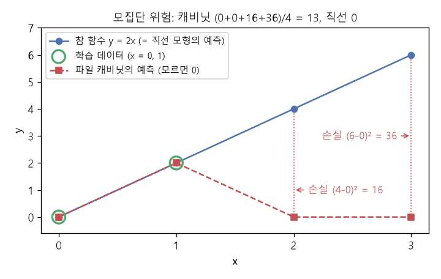

# 기댓값과 일반화 간극 (Expectation, Generalization gap)

[목차로 돌아가기](../../00_MIT%EB%94%A5%EB%9F%AC%EB%8B%9D_%EB%AA%A9%EC%B0%A8.md) · 먼저 볼 것: [M02_시그마와_평균](../../%EC%88%98%ED%95%99%EA%B0%9C%EB%85%90/01_%EC%88%98%EC%99%80_%ED%95%A8%EC%88%98/M02_%EC%8B%9C%EA%B7%B8%EB%A7%88%EC%99%80_%ED%8F%89%EA%B7%A0.md), [M08_확률_기초](../../%EC%88%98%ED%95%99%EA%B0%9C%EB%85%90/04_%ED%99%95%EB%A5%A0%EA%B3%BC_%EC%A0%95%EB%B3%B4/M08_%ED%99%95%EB%A5%A0_%EA%B8%B0%EC%B4%88.md), [MM85_분산과_표준편차와_공분산](../../%EC%88%98%ED%95%99%EA%B0%9C%EB%85%90/01_%EC%88%98%EC%99%80_%ED%95%A8%EC%88%98/MM85_%EB%B6%84%EC%82%B0%EA%B3%BC_%ED%91%9C%EC%A4%80%ED%8E%B8%EC%B0%A8%EC%99%80_%EA%B3%B5%EB%B6%84%EC%82%B0.md), [MM86_정적분과_넓이](../../%EC%88%98%ED%95%99%EA%B0%9C%EB%85%90/02_%EB%AF%B8%EB%B6%84/MM86_%EC%A0%95%EC%A0%81%EB%B6%84%EA%B3%BC_%EB%84%93%EC%9D%B4.md) · 쓰는 곳: [Lec06 1](../../Lec06_%EC%9D%BC%EB%B0%98%ED%99%94_%EC%9D%B4%EB%A1%A0.md#1-%EA%B7%BC%EC%82%AC-%EC%B5%9C%EC%A0%81%ED%99%94-%EC%9D%BC%EB%B0%98%ED%99%94), [Lec06 2.2](../../Lec06_%EC%9D%BC%EB%B0%98%ED%99%94_%EC%9D%B4%EB%A1%A0.md#22-%ED%8C%8C%EC%9D%BC-%EC%BA%90%EB%B9%84%EB%8B%9B-%EB%AA%A8%ED%98%95)

📚 학습 순서 26/99 (4. 확률과 정보): ← 이전: [M11_오즈와_로짓](../../%EC%88%98%ED%95%99%EA%B0%9C%EB%85%90/04_%ED%99%95%EB%A5%A0%EA%B3%BC_%EC%A0%95%EB%B3%B4/M11_%EC%98%A4%EC%A6%88%EC%99%80_%EB%A1%9C%EC%A7%93.md) · 다음: [MM39_확률의_연쇄법칙과_빔_서치](../../%EC%88%98%ED%95%99%EA%B0%9C%EB%85%90/04_%ED%99%95%EB%A5%A0%EA%B3%BC_%EC%A0%95%EB%B3%B4/MM39_%ED%99%95%EB%A5%A0%EC%9D%98_%EC%97%B0%EC%87%84%EB%B2%95%EC%B9%99%EA%B3%BC_%EB%B9%94_%EC%84%9C%EC%B9%98.md) →

> [!NOTE]
> **3줄 요약**
> - **[기댓값](../../00_%EB%94%A5%EB%9F%AC%EB%8B%9D_%EC%9A%A9%EC%96%B4%EC%82%AC%EC%A0%84.md#expectation-%EA%B8%B0%EB%8C%93%EA%B0%92)** $\mathbb{E}[g]$는 "값 × 그 값이 나올 [확률](../../00_%EB%94%A5%EB%9F%AC%EB%8B%9D_%EC%9A%A9%EC%96%B4%EC%82%AC%EC%A0%84.md#probability-%ED%99%95%EB%A5%A0)"을 모두 더한 것이다. [확률](../../00_%EB%94%A5%EB%9F%AC%EB%8B%9D_%EC%9A%A9%EC%96%B4%EC%82%AC%EC%A0%84.md#probability-%ED%99%95%EB%A5%A0)이 모두 같으면 그냥 평균이다.
> - **[경험적 위험](../../00_%EB%94%A5%EB%9F%AC%EB%8B%9D_%EC%9A%A9%EC%96%B4%EC%82%AC%EC%A0%84.md#empirical-risk-%EA%B2%BD%ED%97%98%EC%A0%81-%EC%9C%84%ED%97%98)** $\hat{\mathcal{R}}$은 가진 데이터에서 잰 [손실](../../00_%EB%94%A5%EB%9F%AC%EB%8B%9D_%EC%9A%A9%EC%96%B4%EC%82%AC%EC%A0%84.md#loss-function-%EC%86%90%EC%8B%A4-%ED%95%A8%EC%88%98)의 평균, **[모집단 위험](../../00_%EB%94%A5%EB%9F%AC%EB%8B%9D_%EC%9A%A9%EC%96%B4%EC%82%AC%EC%A0%84.md#population-risk-%EB%AA%A8%EC%A7%91%EB%8B%A8-%EC%9C%84%ED%97%98)** $\mathcal{R}$은 세상 전체에서 잰 [손실](../../00_%EB%94%A5%EB%9F%AC%EB%8B%9D_%EC%9A%A9%EC%96%B4%EC%82%AC%EC%A0%84.md#loss-function-%EC%86%90%EC%8B%A4-%ED%95%A8%EC%88%98)의 [기댓값](../../00_%EB%94%A5%EB%9F%AC%EB%8B%9D_%EC%9A%A9%EC%96%B4%EC%82%AC%EC%A0%84.md#expectation-%EA%B8%B0%EB%8C%93%EA%B0%92)이다.
> - 둘의 차이 $\mathcal{R} - \hat{\mathcal{R}}$가 **[일반화 간극](../../00_%EB%94%A5%EB%9F%AC%EB%8B%9D_%EC%9A%A9%EC%96%B4%EC%82%AC%EC%A0%84.md#generalization-gap-%EC%9D%BC%EB%B0%98%ED%99%94-%EA%B0%84%EA%B7%B9)**이다. [학습 데이터](../../00_%EB%94%A5%EB%9F%AC%EB%8B%9D_%EC%9A%A9%EC%96%B4%EC%82%AC%EC%A0%84.md#training-data-test-data-%ED%95%99%EC%8A%B5-%EB%8D%B0%EC%9D%B4%ED%84%B0%EC%99%80-%EC%8B%9C%ED%97%98-%EB%8D%B0%EC%9D%B4%ED%84%B0)를 외우기만 하는 파일 캐비닛은 $\hat{\mathcal{R}} = 0$, $\mathcal{R} = 13$이라 간극이 13이다.

## 1. 개념 설명

비유: 시험 범위의 예제 문제 두 개만 답을 외운 학생이 있다. 예제 두 개를 다시 내면 만점([경험적 위험](../../00_%EB%94%A5%EB%9F%AC%EB%8B%9D_%EC%9A%A9%EC%96%B4%EC%82%AC%EC%A0%84.md#empirical-risk-%EA%B2%BD%ED%97%98%EC%A0%81-%EC%9C%84%ED%97%98) 0)이지만, 실제 시험(세상의 모든 문제)에서는 나머지 문제를 다 틀린다. "예제 성적"과 "실제 시험 성적"의 차이가 [일반화 간극](../../00_%EB%94%A5%EB%9F%AC%EB%8B%9D_%EC%9A%A9%EC%96%B4%EC%82%AC%EC%A0%84.md#generalization-gap-%EC%9D%BC%EB%B0%98%ED%99%94-%EA%B0%84%EA%B7%B9)이다.

- **[기댓값](../../00_%EB%94%A5%EB%9F%AC%EB%8B%9D_%EC%9A%A9%EC%96%B4%EC%82%AC%EC%A0%84.md#expectation-%EA%B8%B0%EB%8C%93%EA%B0%92)**: [확률](../../00_%EB%94%A5%EB%9F%AC%EB%8B%9D_%EC%9A%A9%EC%96%B4%EC%82%AC%EC%A0%84.md#probability-%ED%99%95%EB%A5%A0) 변수 $X$가 값 $x$를 [확률](../../00_%EB%94%A5%EB%9F%AC%EB%8B%9D_%EC%9A%A9%EC%96%B4%EC%82%AC%EC%A0%84.md#probability-%ED%99%95%EB%A5%A0) $p(x)$로 가질 때 $\mathbb{E}[g(X)] = \sum_x p(x)\, g(x)$. 오래 반복하면 얻을 "장기 평균"이다.
- **[경험적 위험](../../00_%EB%94%A5%EB%9F%AC%EB%8B%9D_%EC%9A%A9%EC%96%B4%EC%82%AC%EC%A0%84.md#empirical-risk-%EA%B2%BD%ED%97%98%EC%A0%81-%EC%9C%84%ED%97%98)**: 데이터 $N$개에서 [손실](../../00_%EB%94%A5%EB%9F%AC%EB%8B%9D_%EC%9A%A9%EC%96%B4%EC%82%AC%EC%A0%84.md#loss-function-%EC%86%90%EC%8B%A4-%ED%95%A8%EC%88%98)을 재어 평균낸다. 모든 점에 같은 무게 $1/N$을 주는 [기댓값](../../00_%EB%94%A5%EB%9F%AC%EB%8B%9D_%EC%9A%A9%EC%96%B4%EC%82%AC%EC%A0%84.md#expectation-%EA%B8%B0%EB%8C%93%EA%B0%92)이다.

$$
\hat{\mathcal{R}}(\theta) = \frac{1}{N}\sum_{i=1}^{N} \mathcal{L}(f_\theta(\mathbf{x}_i), \mathbf{y}_i)
$$

<details><summary>기호 풀이</summary>

| 기호 | 읽는 법 | 뜻 | 예제 값 |
| --- | --- | --- | --- |
| $\hat{\mathcal{R}}(\theta)$ | 알 햇 세타 | [경험적 위험](../../00_%EB%94%A5%EB%9F%AC%EB%8B%9D_%EC%9A%A9%EC%96%B4%EC%82%AC%EC%A0%84.md#empirical-risk-%EA%B2%BD%ED%97%98%EC%A0%81-%EC%9C%84%ED%97%98): 가진 데이터에서 잰 [손실](../../00_%EB%94%A5%EB%9F%AC%EB%8B%9D_%EC%9A%A9%EC%96%B4%EC%82%AC%EC%A0%84.md#loss-function-%EC%86%90%EC%8B%A4-%ED%95%A8%EC%88%98)의 평균 | 0.5 |
| $\theta$ | 세타 | 모형의 [파라미터](../../00_%EB%94%A5%EB%9F%AC%EB%8B%9D_%EC%9A%A9%EC%96%B4%EC%82%AC%EC%A0%84.md#parameter-%ED%8C%8C%EB%9D%BC%EB%AF%B8%ED%84%B0) | [기울기](../../00_%EB%94%A5%EB%9F%AC%EB%8B%9D_%EC%9A%A9%EC%96%B4%EC%82%AC%EC%A0%84.md#gradient-%EA%B8%B0%EC%9A%B8%EA%B8%B0) 1 |
| $N$ | 엔 | [학습 데이터](../../00_%EB%94%A5%EB%9F%AC%EB%8B%9D_%EC%9A%A9%EC%96%B4%EC%82%AC%EC%A0%84.md#training-data-test-data-%ED%95%99%EC%8A%B5-%EB%8D%B0%EC%9D%B4%ED%84%B0%EC%99%80-%EC%8B%9C%ED%97%98-%EB%8D%B0%EC%9D%B4%ED%84%B0) 개수 | 2 |
| $\sum_{i=1}^{N}$ | 시그마 i는 1부터 N까지 | i = 1, …, N의 값을 모두 더하기 | 0 + 1 |
| $i$ | 아이 | 데이터 번호 | 1, 2 |
| $\mathcal{L}$ | 엘 | [손실 함수](../../00_%EB%94%A5%EB%9F%AC%EB%8B%9D_%EC%9A%A9%EC%96%B4%EC%82%AC%EC%A0%84.md#loss-function-%EC%86%90%EC%8B%A4-%ED%95%A8%EC%88%98), 여기서는 제곱 [오차](../../00_%EB%94%A5%EB%9F%AC%EB%8B%9D_%EC%9A%A9%EC%96%B4%EC%82%AC%EC%A0%84.md#error-%EC%98%A4%EC%B0%A8) $(y - \hat{y})^2$ | 0, 1 |
| $f_\theta$ | 에프 세타 | [파라미터](../../00_%EB%94%A5%EB%9F%AC%EB%8B%9D_%EC%9A%A9%EC%96%B4%EC%82%AC%EC%A0%84.md#parameter-%ED%8C%8C%EB%9D%BC%EB%AF%B8%ED%84%B0)가 θ인 모형(함수) | $f(x) = x$ |
| $\mathbf{x}_i$ | 엑스 아이 | i번째 입력 | 0, 1 |
| $\mathbf{y}_i$ | 와이 아이 | i번째 [정답](../../00_%EB%94%A5%EB%9F%AC%EB%8B%9D_%EC%9A%A9%EC%96%B4%EC%82%AC%EC%A0%84.md#label-%EC%A0%95%EB%8B%B5) | 0, 2 |

</details>

<details><summary>예제와 풀이</summary>

**문제**: 본문 3절의 세상([정답](../../00_%EB%94%A5%EB%9F%AC%EB%8B%9D_%EC%9A%A9%EC%96%B4%EC%82%AC%EC%A0%84.md#label-%EC%A0%95%EB%8B%B5) $y = 2x$)에서 모형 $f(x) = x$가 [학습 데이터](../../00_%EB%94%A5%EB%9F%AC%EB%8B%9D_%EC%9A%A9%EC%96%B4%EC%82%AC%EC%A0%84.md#training-data-test-data-%ED%95%99%EC%8A%B5-%EB%8D%B0%EC%9D%B4%ED%84%B0%EC%99%80-%EC%8B%9C%ED%97%98-%EB%8D%B0%EC%9D%B4%ED%84%B0) 두 개(입력 0·[정답](../../00_%EB%94%A5%EB%9F%AC%EB%8B%9D_%EC%9A%A9%EC%96%B4%EC%82%AC%EC%A0%84.md#label-%EC%A0%95%EB%8B%B5) 0, 입력 1·[정답](../../00_%EB%94%A5%EB%9F%AC%EB%8B%9D_%EC%9A%A9%EC%96%B4%EC%82%AC%EC%A0%84.md#label-%EC%A0%95%EB%8B%B5) 2)를 얼마나 잘 맞추는지, [손실](../../00_%EB%94%A5%EB%9F%AC%EB%8B%9D_%EC%9A%A9%EC%96%B4%EC%82%AC%EC%A0%84.md#loss-function-%EC%86%90%EC%8B%A4-%ED%95%A8%EC%88%98)의 평균인 [경험적 위험](../../00_%EB%94%A5%EB%9F%AC%EB%8B%9D_%EC%9A%A9%EC%96%B4%EC%82%AC%EC%A0%84.md#empirical-risk-%EA%B2%BD%ED%97%98%EC%A0%81-%EC%9C%84%ED%97%98)으로 잰다.

**주어진 값**:
- $N = 2$ ([학습 데이터](../../00_%EB%94%A5%EB%9F%AC%EB%8B%9D_%EC%9A%A9%EC%96%B4%EC%82%AC%EC%A0%84.md#training-data-test-data-%ED%95%99%EC%8A%B5-%EB%8D%B0%EC%9D%B4%ED%84%B0%EC%99%80-%EC%8B%9C%ED%97%98-%EB%8D%B0%EC%9D%B4%ED%84%B0) 개수)
- $f_\theta(x) = x$ (모형: 입력을 그대로 예측으로 낸다)
- $\mathbf{x}_1, \mathbf{x}_2 = 0, 1$ (입력)
- $\mathbf{y}_1, \mathbf{y}_2 = 0, 2$ ([정답](../../00_%EB%94%A5%EB%9F%AC%EB%8B%9D_%EC%9A%A9%EC%96%B4%EC%82%AC%EC%A0%84.md#label-%EC%A0%95%EB%8B%B5))
- $\mathcal{L}(\hat{y}, y) = (\hat{y} - y)^2$ ([손실](../../00_%EB%94%A5%EB%9F%AC%EB%8B%9D_%EC%9A%A9%EC%96%B4%EC%82%AC%EC%A0%84.md#loss-function-%EC%86%90%EC%8B%A4-%ED%95%A8%EC%88%98): 예측에서 [정답](../../00_%EB%94%A5%EB%9F%AC%EB%8B%9D_%EC%9A%A9%EC%96%B4%EC%82%AC%EC%A0%84.md#label-%EC%A0%95%EB%8B%B5)을 뺀 값의 제곱)

**풀이**
1. 식을 그대로 쓴다: $\hat{\mathcal{R}}(\theta) = \frac{1}{N}\sum_{i=1}^{N} \mathcal{L}(f_\theta(\mathbf{x}_i), \mathbf{y}_i)$
2. 값을 대입한다 ($\sum$는 i = 1, 2의 두 항을 더하라는 뜻이라 두 항으로 펼친다. 예측은 $f(0) = 0$, $f(1) = 1$): $\hat{\mathcal{R}} = \frac{1}{2}\big[(0 - 0)^2 + (1 - 2)^2\big]$
3. 괄호 안 뺄셈을 한다(예측 − [정답](../../00_%EB%94%A5%EB%9F%AC%EB%8B%9D_%EC%9A%A9%EC%96%B4%EC%82%AC%EC%A0%84.md#label-%EC%A0%95%EB%8B%B5)): $0 - 0 = 0$, $1 - 2 = -1$ 이므로 $\hat{\mathcal{R}} = \frac{1}{2}\big[0^2 + (-1)^2\big]$
4. 제곱한다: $0^2 = 0$, $(-1)^2 = 1$ 이므로 $\hat{\mathcal{R}} = \frac{1}{2}\big[0 + 1\big]$
5. 더한다: $0 + 1 = 1$ 이므로 $\hat{\mathcal{R}} = \frac{1}{2} \times 1$
6. 나눈다: $1 / 2 = 0.5$ 이므로 $\hat{\mathcal{R}} = 0.5$

**답**: $\hat{\mathcal{R}} = 0.5$

</details>

<details><summary>내 이해</summary>


</details>

- **[모집단 위험](../../00_%EB%94%A5%EB%9F%AC%EB%8B%9D_%EC%9A%A9%EC%96%B4%EC%82%AC%EC%A0%84.md#population-risk-%EB%AA%A8%EC%A7%91%EB%8B%A8-%EC%9C%84%ED%97%98)**: 데이터를 만드는 분포 $\mathcal{P}$ 전체에 대한 [기댓값](../../00_%EB%94%A5%EB%9F%AC%EB%8B%9D_%EC%9A%A9%EC%96%B4%EC%82%AC%EC%A0%84.md#expectation-%EA%B8%B0%EB%8C%93%EA%B0%92)이다. 직접 계산할 수 없어서 보통 [시험 데이터](../../00_%EB%94%A5%EB%9F%AC%EB%8B%9D_%EC%9A%A9%EC%96%B4%EC%82%AC%EC%A0%84.md#training-data-test-data-%ED%95%99%EC%8A%B5-%EB%8D%B0%EC%9D%B4%ED%84%B0%EC%99%80-%EC%8B%9C%ED%97%98-%EB%8D%B0%EC%9D%B4%ED%84%B0)의 평균으로 추정한다.

$$
\mathcal{R}(\theta) = \mathbb{E}_{(\mathbf{x}, \mathbf{y}) \sim \mathcal{P}}\, \mathcal{L}(f_\theta(\mathbf{x}), \mathbf{y})
$$

<details><summary>기호 풀이</summary>

| 기호 | 읽는 법 | 뜻 | 예제 값 |
| --- | --- | --- | --- |
| $\mathcal{R}(\theta)$ | 알 세타 | [모집단 위험](../../00_%EB%94%A5%EB%9F%AC%EB%8B%9D_%EC%9A%A9%EC%96%B4%EC%82%AC%EC%A0%84.md#population-risk-%EB%AA%A8%EC%A7%91%EB%8B%A8-%EC%9C%84%ED%97%98): 분포 전체에서 잰 [손실](../../00_%EB%94%A5%EB%9F%AC%EB%8B%9D_%EC%9A%A9%EC%96%B4%EC%82%AC%EC%A0%84.md#loss-function-%EC%86%90%EC%8B%A4-%ED%95%A8%EC%88%98)의 [기댓값](../../00_%EB%94%A5%EB%9F%AC%EB%8B%9D_%EC%9A%A9%EC%96%B4%EC%82%AC%EC%A0%84.md#expectation-%EA%B8%B0%EB%8C%93%EA%B0%92) | 3.5 |
| $\mathbb{E}$ | 이, [기댓값](../../00_%EB%94%A5%EB%9F%AC%EB%8B%9D_%EC%9A%A9%EC%96%B4%EC%82%AC%EC%A0%84.md#expectation-%EA%B8%B0%EB%8C%93%EA%B0%92) | [확률](../../00_%EB%94%A5%EB%9F%AC%EB%8B%9D_%EC%9A%A9%EC%96%B4%EC%82%AC%EC%A0%84.md#probability-%ED%99%95%EB%A5%A0)을 무게로 한 평균 | 0.25×(0 + 1 + 4 + 9) |
| $(\mathbf{x}, \mathbf{y}) \sim \mathcal{P}$ | 엑스 와이가 피를 따른다 | 입력과 [정답](../../00_%EB%94%A5%EB%9F%AC%EB%8B%9D_%EC%9A%A9%EC%96%B4%EC%82%AC%EC%A0%84.md#label-%EC%A0%95%EB%8B%B5) 쌍을 분포 P에서 뽑는다 | x = 0, 1, 2, 3 |
| $\mathcal{P}$ | 피 | 데이터를 만드는 분포 (입력별 [확률](../../00_%EB%94%A5%EB%9F%AC%EB%8B%9D_%EC%9A%A9%EC%96%B4%EC%82%AC%EC%A0%84.md#probability-%ED%99%95%EB%A5%A0)) | 넷 다 1/4 |
| $\mathcal{L}$ | 엘 | [손실 함수](../../00_%EB%94%A5%EB%9F%AC%EB%8B%9D_%EC%9A%A9%EC%96%B4%EC%82%AC%EC%A0%84.md#loss-function-%EC%86%90%EC%8B%A4-%ED%95%A8%EC%88%98), 여기서는 제곱 [오차](../../00_%EB%94%A5%EB%9F%AC%EB%8B%9D_%EC%9A%A9%EC%96%B4%EC%82%AC%EC%A0%84.md#error-%EC%98%A4%EC%B0%A8) | 0, 1, 4, 9 |
| $f_\theta$ | 에프 세타 | [파라미터](../../00_%EB%94%A5%EB%9F%AC%EB%8B%9D_%EC%9A%A9%EC%96%B4%EC%82%AC%EC%A0%84.md#parameter-%ED%8C%8C%EB%9D%BC%EB%AF%B8%ED%84%B0)가 θ인 모형(함수) | $f(x) = x$ |
| $\mathbf{x}$ | 엑스 | 입력 | 0, 1, 2, 3 |
| $\mathbf{y}$ | 와이 | [정답](../../00_%EB%94%A5%EB%9F%AC%EB%8B%9D_%EC%9A%A9%EC%96%B4%EC%82%AC%EC%A0%84.md#label-%EC%A0%95%EB%8B%B5) | 0, 2, 4, 6 |

</details>

<details><summary>예제와 풀이</summary>

**문제**: 본문 3절의 세상(입력 0, 1, 2, 3이 똑같이 자주 나오고 [정답](../../00_%EB%94%A5%EB%9F%AC%EB%8B%9D_%EC%9A%A9%EC%96%B4%EC%82%AC%EC%A0%84.md#label-%EC%A0%95%EB%8B%B5)은 $y = 2x$)에서 모형 $f(x) = x$가 세상 전체에서 평균적으로 얼마나 틀리는지([모집단 위험](../../00_%EB%94%A5%EB%9F%AC%EB%8B%9D_%EC%9A%A9%EC%96%B4%EC%82%AC%EC%A0%84.md#population-risk-%EB%AA%A8%EC%A7%91%EB%8B%A8-%EC%9C%84%ED%97%98)) 잰다.

**주어진 값**:
- $x = 0, 1, 2, 3$ (나올 수 있는 입력)
- $\mathcal{P}$: 네 입력 모두 [확률](../../00_%EB%94%A5%EB%9F%AC%EB%8B%9D_%EC%9A%A9%EC%96%B4%EC%82%AC%EC%A0%84.md#probability-%ED%99%95%EB%A5%A0) $0.25$ (각 입력이 나올 [확률](../../00_%EB%94%A5%EB%9F%AC%EB%8B%9D_%EC%9A%A9%EC%96%B4%EC%82%AC%EC%A0%84.md#probability-%ED%99%95%EB%A5%A0))
- $y = 2x$ ([정답](../../00_%EB%94%A5%EB%9F%AC%EB%8B%9D_%EC%9A%A9%EC%96%B4%EC%82%AC%EC%A0%84.md#label-%EC%A0%95%EB%8B%B5) 규칙)
- $f_\theta(x) = x$ (모형: 입력을 그대로 예측으로 낸다)
- $\mathcal{L}(\hat{y}, y) = (\hat{y} - y)^2$ ([손실](../../00_%EB%94%A5%EB%9F%AC%EB%8B%9D_%EC%9A%A9%EC%96%B4%EC%82%AC%EC%A0%84.md#loss-function-%EC%86%90%EC%8B%A4-%ED%95%A8%EC%88%98): 예측에서 [정답](../../00_%EB%94%A5%EB%9F%AC%EB%8B%9D_%EC%9A%A9%EC%96%B4%EC%82%AC%EC%A0%84.md#label-%EC%A0%95%EB%8B%B5)을 뺀 값의 제곱)

**풀이**
1. 식을 그대로 쓴다: $\mathcal{R}(\theta) = \mathbb{E}_{(\mathbf{x}, \mathbf{y}) \sim \mathcal{P}}\, \mathcal{L}(f_\theta(\mathbf{x}), \mathbf{y})$
2. 값을 대입한다 ($\mathbb{E}$는 '나올 수 있는 경우마다 [확률](../../00_%EB%94%A5%EB%9F%AC%EB%8B%9D_%EC%9A%A9%EC%96%B4%EC%82%AC%EC%A0%84.md#probability-%ED%99%95%EB%A5%A0) × [손실](../../00_%EB%94%A5%EB%9F%AC%EB%8B%9D_%EC%9A%A9%EC%96%B4%EC%82%AC%EC%A0%84.md#loss-function-%EC%86%90%EC%8B%A4-%ED%95%A8%EC%88%98)을 구해 모두 더한다'는 뜻이라 경우별 항의 합으로 펼친다): $\mathcal{R} = 0.25 \times (0 - 2 \times 0)^2 + 0.25 \times (1 - 2 \times 1)^2 + 0.25 \times (2 - 2 \times 2)^2 + 0.25 \times (3 - 2 \times 3)^2$
3. 괄호 안 곱셈을 먼저 한다([정답](../../00_%EB%94%A5%EB%9F%AC%EB%8B%9D_%EC%9A%A9%EC%96%B4%EC%82%AC%EC%A0%84.md#label-%EC%A0%95%EB%8B%B5)): $2 \times 0 = 0$, $2 \times 1 = 2$, $2 \times 2 = 4$, $2 \times 3 = 6$ 이므로 $\mathcal{R} = 0.25 \times (0 - 0)^2 + 0.25 \times (1 - 2)^2 + 0.25 \times (2 - 4)^2 + 0.25 \times (3 - 6)^2$
4. 괄호 안 뺄셈을 한다: $0$, $-1$, $-2$, $-3$ 이므로 $\mathcal{R} = 0.25 \times 0^2 + 0.25 \times (-1)^2 + 0.25 \times (-2)^2 + 0.25 \times (-3)^2$
5. 제곱한다: $0$, $1$, $4$, $9$ 이므로 $\mathcal{R} = 0.25 \times 0 + 0.25 \times 1 + 0.25 \times 4 + 0.25 \times 9$
6. 곱셈을 한다: $0$, $0.25$, $1$, $2.25$ 이므로 $\mathcal{R} = 0 + 0.25 + 1 + 2.25$
7. 더한다: $0 + 0.25 + 1 + 2.25 = 3.5$ 이므로 $\mathcal{R} = 3.5$

**답**: $\mathcal{R} = 3.5$ ([경험적 위험](../../00_%EB%94%A5%EB%9F%AC%EB%8B%9D_%EC%9A%A9%EC%96%B4%EC%82%AC%EC%A0%84.md#empirical-risk-%EA%B2%BD%ED%97%98%EC%A0%81-%EC%9C%84%ED%97%98) 0.5보다 크다)

</details>

<details><summary>내 이해</summary>


</details>

## 2. 필요한 이유

[Lec06 1절](../../Lec06_%EC%9D%BC%EB%B0%98%ED%99%94_%EC%9D%B4%EB%A1%A0.md#1-%EA%B7%BC%EC%82%AC-%EC%B5%9C%EC%A0%81%ED%99%94-%EC%9D%BC%EB%B0%98%ED%99%94)은 머신러닝을 세 질문으로 나눈다. **근사**(가장 좋은 $\theta^*$의 위험은 얼마인가), **최적화**($\hat{\mathcal{R}}$을 얼마나 잘 줄이는가), **[일반화](../../00_%EB%94%A5%EB%9F%AC%EB%8B%9D_%EC%9A%A9%EC%96%B4%EC%82%AC%EC%A0%84.md#generalization-%EC%9D%BC%EB%B0%98%ED%99%94)**($\hat{\mathcal{R}}$과 $\mathcal{R}$이 얼마나 다른가). 우리가 [학습](../../00_%EB%94%A5%EB%9F%AC%EB%8B%9D_%EC%9A%A9%EC%96%B4%EC%82%AC%EC%A0%84.md#training-%ED%95%99%EC%8A%B5)으로 줄이는 것은 $\hat{\mathcal{R}}$이지만, 실제로 원하는 것은 $\mathcal{R}$이 작은 것이다. 두 값이 어떻게 다를 수 있는지 숫자로 보려면 [기댓값](../../00_%EB%94%A5%EB%9F%AC%EB%8B%9D_%EC%9A%A9%EC%96%B4%EC%82%AC%EC%A0%84.md#expectation-%EA%B8%B0%EB%8C%93%EA%B0%92)을 알아야 한다.

## 3. 숫자로 보기

세상의 입력은 $x \in \{0, 1, 2, 3\}$이고 넷 다 [확률](../../00_%EB%94%A5%EB%9F%AC%EB%8B%9D_%EC%9A%A9%EC%96%B4%EC%82%AC%EC%A0%84.md#probability-%ED%99%95%EB%A5%A0) $\frac14$로 나온다. [정답](../../00_%EB%94%A5%EB%9F%AC%EB%8B%9D_%EC%9A%A9%EC%96%B4%EC%82%AC%EC%A0%84.md#label-%EC%A0%95%EB%8B%B5)은 $y = 2x$다. [손실](../../00_%EB%94%A5%EB%9F%AC%EB%8B%9D_%EC%9A%A9%EC%96%B4%EC%82%AC%EC%A0%84.md#loss-function-%EC%86%90%EC%8B%A4-%ED%95%A8%EC%88%98)은 제곱 [오차](../../00_%EB%94%A5%EB%9F%AC%EB%8B%9D_%EC%9A%A9%EC%96%B4%EC%82%AC%EC%A0%84.md#error-%EC%98%A4%EC%B0%A8) $(y - \hat{y})^2$이다. [학습 데이터](../../00_%EB%94%A5%EB%9F%AC%EB%8B%9D_%EC%9A%A9%EC%96%B4%EC%82%AC%EC%A0%84.md#training-data-test-data-%ED%95%99%EC%8A%B5-%EB%8D%B0%EC%9D%B4%ED%84%B0%EC%99%80-%EC%8B%9C%ED%97%98-%EB%8D%B0%EC%9D%B4%ED%84%B0)는 $(0, 0)$, $(1, 2)$ 두 개뿐이다.

**모형 A: 파일 캐비닛** (본 적 있는 x면 외운 답, 아니면 0)

| x | [정답](../../00_%EB%94%A5%EB%9F%AC%EB%8B%9D_%EC%9A%A9%EC%96%B4%EC%82%AC%EC%A0%84.md#label-%EC%A0%95%EB%8B%B5) y | 예측 ŷ | [손실](../../00_%EB%94%A5%EB%9F%AC%EB%8B%9D_%EC%9A%A9%EC%96%B4%EC%82%AC%EC%A0%84.md#loss-function-%EC%86%90%EC%8B%A4-%ED%95%A8%EC%88%98) (y − ŷ)² |
|---|---|---|---|
| 0 | 0 | 0 (외움) | 0 |
| 1 | 2 | 2 (외움) | 0 |
| 2 | 4 | 0 (모름) | 16 |
| 3 | 6 | 0 (모름) | 36 |

- [경험적 위험](../../00_%EB%94%A5%EB%9F%AC%EB%8B%9D_%EC%9A%A9%EC%96%B4%EC%82%AC%EC%A0%84.md#empirical-risk-%EA%B2%BD%ED%97%98%EC%A0%81-%EC%9C%84%ED%97%98) ([학습 데이터](../../00_%EB%94%A5%EB%9F%AC%EB%8B%9D_%EC%9A%A9%EC%96%B4%EC%82%AC%EC%A0%84.md#training-data-test-data-%ED%95%99%EC%8A%B5-%EB%8D%B0%EC%9D%B4%ED%84%B0%EC%99%80-%EC%8B%9C%ED%97%98-%EB%8D%B0%EC%9D%B4%ED%84%B0) x = 0, 1만): $(0 + 0) / 2 = 0$
- [모집단 위험](../../00_%EB%94%A5%EB%9F%AC%EB%8B%9D_%EC%9A%A9%EC%96%B4%EC%82%AC%EC%A0%84.md#population-risk-%EB%AA%A8%EC%A7%91%EB%8B%A8-%EC%9C%84%ED%97%98) (네 경우 모두, [확률](../../00_%EB%94%A5%EB%9F%AC%EB%8B%9D_%EC%9A%A9%EC%96%B4%EC%82%AC%EC%A0%84.md#probability-%ED%99%95%EB%A5%A0) 1/4씩): $\frac14 × 0 + \frac14 × 0 + \frac14 × 16 + \frac14 × 36 = 13$
- [일반화 간극](../../00_%EB%94%A5%EB%9F%AC%EB%8B%9D_%EC%9A%A9%EC%96%B4%EC%82%AC%EC%A0%84.md#generalization-gap-%EC%9D%BC%EB%B0%98%ED%99%94-%EA%B0%84%EA%B7%B9): $13 - 0 = 13$

**모형 B: 직선** $\hat{y} = 2x$ (두 점을 지나는 직선)
- [경험적 위험](../../00_%EB%94%A5%EB%9F%AC%EB%8B%9D_%EC%9A%A9%EC%96%B4%EC%82%AC%EC%A0%84.md#empirical-risk-%EA%B2%BD%ED%97%98%EC%A0%81-%EC%9C%84%ED%97%98) 0, [모집단 위험](../../00_%EB%94%A5%EB%9F%AC%EB%8B%9D_%EC%9A%A9%EC%96%B4%EC%82%AC%EC%A0%84.md#population-risk-%EB%AA%A8%EC%A7%91%EB%8B%A8-%EC%9C%84%ED%97%98) 0, 간극 0

두 모형 모두 [학습 데이터](../../00_%EB%94%A5%EB%9F%AC%EB%8B%9D_%EC%9A%A9%EC%96%B4%EC%82%AC%EC%A0%84.md#training-data-test-data-%ED%95%99%EC%8A%B5-%EB%8D%B0%EC%9D%B4%ED%84%B0%EC%99%80-%EC%8B%9C%ED%97%98-%EB%8D%B0%EC%9D%B4%ED%84%B0)에서는 완벽하다(근사 [오차](../../00_%EB%94%A5%EB%9F%AC%EB%8B%9D_%EC%9A%A9%EC%96%B4%EC%82%AC%EC%A0%84.md#error-%EC%98%A4%EC%B0%A8) 0). 차이는 **본 적 없는 점에서 무엇을 내놓느냐**에서만 난다.



<details><summary>기호 풀이</summary>

| 기호 | 읽는 법 | 뜻 | 예제 값 |
| --- | --- | --- | --- |
| $\mathbb{E}[\cdot]$ | [기댓값](../../00_%EB%94%A5%EB%9F%AC%EB%8B%9D_%EC%9A%A9%EC%96%B4%EC%82%AC%EC%A0%84.md#expectation-%EA%B8%B0%EB%8C%93%EA%B0%92) | [확률](../../00_%EB%94%A5%EB%9F%AC%EB%8B%9D_%EC%9A%A9%EC%96%B4%EC%82%AC%EC%A0%84.md#probability-%ED%99%95%EB%A5%A0)로 가중한 평균 | - |
| $(\mathbf{x}, \mathbf{y}) \sim \mathcal{P}$ | P를 따르는 x, y | 데이터 분포 $\mathcal{P}$에서 뽑은 입력과 [정답](../../00_%EB%94%A5%EB%9F%AC%EB%8B%9D_%EC%9A%A9%EC%96%B4%EC%82%AC%EC%A0%84.md#label-%EC%A0%95%EB%8B%B5) | x는 0~3 중 하나 |
| $\mathcal{L}$ | 엘 | [손실 함수](../../00_%EB%94%A5%EB%9F%AC%EB%8B%9D_%EC%9A%A9%EC%96%B4%EC%82%AC%EC%A0%84.md#loss-function-%EC%86%90%EC%8B%A4-%ED%95%A8%EC%88%98) | 제곱 [오차](../../00_%EB%94%A5%EB%9F%AC%EB%8B%9D_%EC%9A%A9%EC%96%B4%EC%82%AC%EC%A0%84.md#error-%EC%98%A4%EC%B0%A8) |
| $\hat{\mathcal{R}}(\theta)$ | 알 햇 | [경험적 위험](../../00_%EB%94%A5%EB%9F%AC%EB%8B%9D_%EC%9A%A9%EC%96%B4%EC%82%AC%EC%A0%84.md#empirical-risk-%EA%B2%BD%ED%97%98%EC%A0%81-%EC%9C%84%ED%97%98) (가진 데이터의 평균 [손실](../../00_%EB%94%A5%EB%9F%AC%EB%8B%9D_%EC%9A%A9%EC%96%B4%EC%82%AC%EC%A0%84.md#loss-function-%EC%86%90%EC%8B%A4-%ED%95%A8%EC%88%98)) | 캐비닛 0 |
| $\mathcal{R}(\theta)$ | 알 | [모집단 위험](../../00_%EB%94%A5%EB%9F%AC%EB%8B%9D_%EC%9A%A9%EC%96%B4%EC%82%AC%EC%A0%84.md#population-risk-%EB%AA%A8%EC%A7%91%EB%8B%A8-%EC%9C%84%ED%97%98) (분포 전체의 기대 [손실](../../00_%EB%94%A5%EB%9F%AC%EB%8B%9D_%EC%9A%A9%EC%96%B4%EC%82%AC%EC%A0%84.md#loss-function-%EC%86%90%EC%8B%A4-%ED%95%A8%EC%88%98)) | 캐비닛 13 |
| $\mathcal{R} - \hat{\mathcal{R}}$ | - | [일반화 간극](../../00_%EB%94%A5%EB%9F%AC%EB%8B%9D_%EC%9A%A9%EC%96%B4%EC%82%AC%EC%A0%84.md#generalization-gap-%EC%9D%BC%EB%B0%98%ED%99%94-%EA%B0%84%EA%B7%B9) | 13 |
| $N$ | 엔 | [학습 데이터](../../00_%EB%94%A5%EB%9F%AC%EB%8B%9D_%EC%9A%A9%EC%96%B4%EC%82%AC%EC%A0%84.md#training-data-test-data-%ED%95%99%EC%8A%B5-%EB%8D%B0%EC%9D%B4%ED%84%B0%EC%99%80-%EC%8B%9C%ED%97%98-%EB%8D%B0%EC%9D%B4%ED%84%B0) 수 | 2 |

</details>

## 4. 코드로 확인

```python
# [함수] np.arange(4): 0, 1, 2, 3을 담은 배열을 만든다
# [변수] xs = [0 1 2 3]: 세상에 나올 수 있는 입력 네 개 (확률은 모두 1/4)
# [연결] 본문 3절 표의 x 칸
xs = np.arange(4)
# [변수] ys = [0 2 4 6]: 참 함수 y = 2x의 정답
ys = 2 * xs
# [함수] np.where(조건, A, B): 조건이 참인 칸은 A, 거짓인 칸은 B를 고른다
# [변수] cab = [0 2 0 0]: 파일 캐비닛의 예측. 학습한 x = 0, 1만 외운 답, 나머지는 0
# [연결] Lec06 2.2절 슬라이드의 predict(x) 함수 (if x in cabinet ... else return 0)
cab = np.where(xs <= 1, ys, 0)
# [변수] loss = [0 0 16 36]: 입력마다의 제곱 오차
# [연결] 본문 3절 표의 마지막 칸
loss = (ys - cab) ** 2
# [변수] emp: 학습 데이터 두 점(x = 0, 1)의 평균 손실 = 경험적 위험. loss[:2]는 앞 두 칸
# [변수] pop: 네 경우 모두의 평균 = 확률이 모두 1/4인 기댓값 = 모집단 위험
# [쓸모] 둘의 차이로 일반화 간극을 잰다
emp, pop = loss[:2].mean(), loss.mean()
# [연결] 결과 0.0 13.0 13.0 → 본문 3절의 0, 13, 13
print(emp, pop, pop - emp)
```

**실행 결과**:

```text
0.0 13.0 13.0
```

> [!WARNING]
> **⚠ 주의**
> - [모집단 위험](../../00_%EB%94%A5%EB%9F%AC%EB%8B%9D_%EC%9A%A9%EC%96%B4%EC%82%AC%EC%A0%84.md#population-risk-%EB%AA%A8%EC%A7%91%EB%8B%A8-%EC%9C%84%ED%97%98)은 분포 $\mathcal{P}$를 알아야 정확히 계산할 수 있다. 현실에서는 모르기 때문에 [학습](../../00_%EB%94%A5%EB%9F%AC%EB%8B%9D_%EC%9A%A9%EC%96%B4%EC%82%AC%EC%A0%84.md#training-%ED%95%99%EC%8A%B5)에 쓰지 않은 [시험 데이터](../../00_%EB%94%A5%EB%9F%AC%EB%8B%9D_%EC%9A%A9%EC%96%B4%EC%82%AC%EC%A0%84.md#training-data-test-data-%ED%95%99%EC%8A%B5-%EB%8D%B0%EC%9D%B4%ED%84%B0%EC%99%80-%EC%8B%9C%ED%97%98-%EB%8D%B0%EC%9D%B4%ED%84%B0)의 평균("경험적 시험 위험")으로 추정한다. [시험 데이터](../../00_%EB%94%A5%EB%9F%AC%EB%8B%9D_%EC%9A%A9%EC%96%B4%EC%82%AC%EC%A0%84.md#training-data-test-data-%ED%95%99%EC%8A%B5-%EB%8D%B0%EC%9D%B4%ED%84%B0%EC%99%80-%EC%8B%9C%ED%97%98-%EB%8D%B0%EC%9D%B4%ED%84%B0)를 [학습](../../00_%EB%94%A5%EB%9F%AC%EB%8B%9D_%EC%9A%A9%EC%96%B4%EC%82%AC%EC%A0%84.md#training-%ED%95%99%EC%8A%B5)에 섞으면 이 추정이 틀어진다.
> - [경험적 위험](../../00_%EB%94%A5%EB%9F%AC%EB%8B%9D_%EC%9A%A9%EC%96%B4%EC%82%AC%EC%A0%84.md#empirical-risk-%EA%B2%BD%ED%97%98%EC%A0%81-%EC%9C%84%ED%97%98)이 0이라고 [일반화](../../00_%EB%94%A5%EB%9F%AC%EB%8B%9D_%EC%9A%A9%EC%96%B4%EC%82%AC%EC%A0%84.md#generalization-%EC%9D%BC%EB%B0%98%ED%99%94)가 잘 된 것이 아니다. 캐비닛과 직선은 [경험적 위험](../../00_%EB%94%A5%EB%9F%AC%EB%8B%9D_%EC%9A%A9%EC%96%B4%EC%82%AC%EC%A0%84.md#empirical-risk-%EA%B2%BD%ED%97%98%EC%A0%81-%EC%9C%84%ED%97%98)이 둘 다 0인데 [모집단 위험](../../00_%EB%94%A5%EB%9F%AC%EB%8B%9D_%EC%9A%A9%EC%96%B4%EC%82%AC%EC%A0%84.md#population-risk-%EB%AA%A8%EC%A7%91%EB%8B%A8-%EC%9C%84%ED%97%98)은 13과 0이다.

## 5. 개념 재확인

<details><summary>1. 위 세상에서 x가 나올 확률이 (0.4, 0.3, 0.2, 0.1)로 바뀌면 캐비닛의 모집단 위험은?</summary>

| 단계 | 하는 일 | 식 | 계산 | 결과 |
|---|---|---|---|---|
| 1 | 입력별 [손실](../../00_%EB%94%A5%EB%9F%AC%EB%8B%9D_%EC%9A%A9%EC%96%B4%EC%82%AC%EC%A0%84.md#loss-function-%EC%86%90%EC%8B%A4-%ED%95%A8%EC%88%98) | $(y-\hat{y})^2$ | 0, 0, 16, 36 | [0, 0, 16, 36] |
| 2 | [확률](../../00_%EB%94%A5%EB%9F%AC%EB%8B%9D_%EC%9A%A9%EC%96%B4%EC%82%AC%EC%A0%84.md#probability-%ED%99%95%EB%A5%A0) 곱하기 | $p(x)\,\mathcal{L}(x)$ | 0.4×0, 0.3×0, 0.2×16, 0.1×36 | 0, 0, 3.2, 3.6 |
| 3 | 모두 더하기 | $\sum_x p(x)\,\mathcal{L}(x)$ | 0 + 0 + 3.2 + 3.6 | 6.8 |

**① 쓰는 식**
$$\mathcal{R} = \mathbb{E}[\mathcal{L}] = \sum_x p(x)\,\mathcal{L}(x)$$
- 위 식 ← ② (입력별 [손실](../../00_%EB%94%A5%EB%9F%AC%EB%8B%9D_%EC%9A%A9%EC%96%B4%EC%82%AC%EC%A0%84.md#loss-function-%EC%86%90%EC%8B%A4-%ED%95%A8%EC%88%98))의 값을 넣고 ③ ([확률](../../00_%EB%94%A5%EB%9F%AC%EB%8B%9D_%EC%9A%A9%EC%96%B4%EC%82%AC%EC%A0%84.md#probability-%ED%99%95%EB%A5%A0) 곱하기), ④ (모두 더하기)에서 계산한다.
```python
# [변수] p: 입력 x = 0, 1, 2, 3이 나올 확률. 문제에서 준 값 (합 1)
p = np.array([0.4, 0.3, 0.2, 0.1])                # ①
# [변수] loss = [0 0 16 36]: 캐비닛의 입력별 손실 (본문 3절 표)
loss = np.array([0, 0, 16, 36])                   # ②
# [함수] *: 칸끼리 곱한다 → [0, 0, 3.2, 3.6]
weighted = p * loss                               # ③
# [함수] .sum(): 모두 더한다. round로 부동소수 찌꺼기(6.800000000000001)를 정리한다
# [연결] 결과 6.8 → 확률이 같을 때의 13보다 작다
print(round(weighted.sum(), 4))                   # ④
```

**문제**: 캐비닛의 입력별 [손실](../../00_%EB%94%A5%EB%9F%AC%EB%8B%9D_%EC%9A%A9%EC%96%B4%EC%82%AC%EC%A0%84.md#loss-function-%EC%86%90%EC%8B%A4-%ED%95%A8%EC%88%98)이 $(0, 0, 16, 36)$이고 x = 0, 1, 2, 3이 나올 [확률](../../00_%EB%94%A5%EB%9F%AC%EB%8B%9D_%EC%9A%A9%EC%96%B4%EC%82%AC%EC%A0%84.md#probability-%ED%99%95%EB%A5%A0)이 $(0.4, 0.3, 0.2, 0.1)$일 때 [모집단 위험](../../00_%EB%94%A5%EB%9F%AC%EB%8B%9D_%EC%9A%A9%EC%96%B4%EC%82%AC%EC%A0%84.md#population-risk-%EB%AA%A8%EC%A7%91%EB%8B%A8-%EC%9C%84%ED%97%98)은?

**주어진 값**:
- $p(x) = 0.4, 0.3, 0.2, 0.1$ (입력 x = 0, 1, 2, 3이 나올 [확률](../../00_%EB%94%A5%EB%9F%AC%EB%8B%9D_%EC%9A%A9%EC%96%B4%EC%82%AC%EC%A0%84.md#probability-%ED%99%95%EB%A5%A0), 합 1)
- $\mathcal{L}(x) = 0, 0, 16, 36$ (캐비닛의 입력별 [손실](../../00_%EB%94%A5%EB%9F%AC%EB%8B%9D_%EC%9A%A9%EC%96%B4%EC%82%AC%EC%A0%84.md#loss-function-%EC%86%90%EC%8B%A4-%ED%95%A8%EC%88%98), 본문 3절 표)

**풀이**
1. 식을 그대로 쓴다: $\mathcal{R} = \sum_x p(x)\,\mathcal{L}(x)$
2. 값을 대입한다 (Σ는 x = 0, 1, 2, 3 네 항을 더하라는 뜻): $\mathcal{R} = 0.4 \times 0 + 0.3 \times 0 + 0.2 \times 16 + 0.1 \times 36$
3. (②) 입력별 [손실](../../00_%EB%94%A5%EB%9F%AC%EB%8B%9D_%EC%9A%A9%EC%96%B4%EC%82%AC%EC%A0%84.md#loss-function-%EC%86%90%EC%8B%A4-%ED%95%A8%EC%88%98)은 문제에서 이미 주어졌다: x = 0, 1은 외운 답이라 0, x = 2는 $(4-0)^2 = 16$, x = 3은 $(6-0)^2 = 36$
4. (③) [확률](../../00_%EB%94%A5%EB%9F%AC%EB%8B%9D_%EC%9A%A9%EC%96%B4%EC%82%AC%EC%A0%84.md#probability-%ED%99%95%EB%A5%A0)을 곱한다: 0.4 × 0 = 0, 0.3 × 0 = 0, 0.2 × 16 = 3.2, 0.1 × 36 = 3.6 이므로 $\mathcal{R} = 0 + 0 + 3.2 + 3.6$
5. (④) 더한다: 0 + 0 + 3.2 + 3.6 = 6.8 이므로 $\mathcal{R} = 6.8$

**답**: **6.8**. 외운 입력(x = 0, 1)이 자주 나오는 세상이라 캐비닛의 피해가 줄었다. [일반화 간극](../../00_%EB%94%A5%EB%9F%AC%EB%8B%9D_%EC%9A%A9%EC%96%B4%EC%82%AC%EC%A0%84.md#generalization-gap-%EC%9D%BC%EB%B0%98%ED%99%94-%EA%B0%84%EA%B7%B9)은 데이터 분포에 따라 달라진다.

</details>

<details><summary>2. 시험 데이터로 x = 2, 3, 3, 0을 뽑았다. 캐비닛의 경험적 시험 위험은? 모집단 위험 13과 같은가?</summary>

| 단계 | 하는 일 | 계산 | 결과 |
|---|---|---|---|
| 1 | 뽑힌 입력의 [손실](../../00_%EB%94%A5%EB%9F%AC%EB%8B%9D_%EC%9A%A9%EC%96%B4%EC%82%AC%EC%A0%84.md#loss-function-%EC%86%90%EC%8B%A4-%ED%95%A8%EC%88%98) | 16, 36, 36, 0 | [16, 36, 36, 0] |
| 2 | 합 | 16 + 36 + 36 + 0 | 88 |
| 3 | 평균 | 88 / 4 | 22 |
| 4 | 비교 | 22 vs 13 | 다르다 |

**① 쓰는 식**
$$\hat{\mathcal{R}}_{\text{test}} = \frac{1}{M}\sum_{j=1}^{M} \mathcal{L}(f(x_j), y_j)$$
- 위 식 ← ② ([손실](../../00_%EB%94%A5%EB%9F%AC%EB%8B%9D_%EC%9A%A9%EC%96%B4%EC%82%AC%EC%A0%84.md#loss-function-%EC%86%90%EC%8B%A4-%ED%95%A8%EC%88%98) 찾기), ③ (합), ④ (평균)에서 쓰고 ⑤에서 [모집단 위험](../../00_%EB%94%A5%EB%9F%AC%EB%8B%9D_%EC%9A%A9%EC%96%B4%EC%82%AC%EC%A0%84.md#population-risk-%EB%AA%A8%EC%A7%91%EB%8B%A8-%EC%9C%84%ED%97%98)과 비교한다.
```python
# [변수] table: x별 캐비닛 손실 [0 0 16 36]. table[x]로 바로 찾으려고 배열로 둔다
table = np.array([0, 0, 16, 36])                  # ①
# [변수] test_x: 시험용으로 뽑힌 입력 네 개 (문제에서 준 값)
test_x = np.array([2, 3, 3, 0])
# [함수] table[test_x]: 배열 인덱싱. 입력마다 손실을 꺼낸다 → [16 36 36 0]
losses = table[test_x]                            # ②
# [함수] .sum(): 88
total = losses.sum()                              # ③
# [변수] test_risk = 88 / 4 = 22.0: 경험적 시험 위험 (M = 4)
test_risk = total / len(test_x)                   # ④
# [연결] 22.0 vs 모집단 위험 13 → 표본이 작으면 추정이 크게 흔들린다
print(test_risk, test_risk == 13)                 # ⑤
```

**문제**: 캐비닛의 입력별 [손실](../../00_%EB%94%A5%EB%9F%AC%EB%8B%9D_%EC%9A%A9%EC%96%B4%EC%82%AC%EC%A0%84.md#loss-function-%EC%86%90%EC%8B%A4-%ED%95%A8%EC%88%98)이 $(0, 0, 16, 36)$일 때, [시험 데이터](../../00_%EB%94%A5%EB%9F%AC%EB%8B%9D_%EC%9A%A9%EC%96%B4%EC%82%AC%EC%A0%84.md#training-data-test-data-%ED%95%99%EC%8A%B5-%EB%8D%B0%EC%9D%B4%ED%84%B0%EC%99%80-%EC%8B%9C%ED%97%98-%EB%8D%B0%EC%9D%B4%ED%84%B0)로 x = 2, 3, 3, 0을 뽑았다. 경험적 시험 위험은? [모집단 위험](../../00_%EB%94%A5%EB%9F%AC%EB%8B%9D_%EC%9A%A9%EC%96%B4%EC%82%AC%EC%A0%84.md#population-risk-%EB%AA%A8%EC%A7%91%EB%8B%A8-%EC%9C%84%ED%97%98) 13과 같은가?

**주어진 값**:
- $M = 4$ ([시험 데이터](../../00_%EB%94%A5%EB%9F%AC%EB%8B%9D_%EC%9A%A9%EC%96%B4%EC%82%AC%EC%A0%84.md#training-data-test-data-%ED%95%99%EC%8A%B5-%EB%8D%B0%EC%9D%B4%ED%84%B0%EC%99%80-%EC%8B%9C%ED%97%98-%EB%8D%B0%EC%9D%B4%ED%84%B0) 개수)
- $x_j = 2, 3, 3, 0$ (뽑힌 입력)
- $\mathcal{L}(x) = 0, 0, 16, 36$ (입력별 [손실](../../00_%EB%94%A5%EB%9F%AC%EB%8B%9D_%EC%9A%A9%EC%96%B4%EC%82%AC%EC%A0%84.md#loss-function-%EC%86%90%EC%8B%A4-%ED%95%A8%EC%88%98), x = 0, 1, 2, 3 순서)

**풀이**
1. 식을 그대로 쓴다: $\hat{\mathcal{R}}_{\text{test}} = \frac{1}{M}\sum_{j=1}^{M} \mathcal{L}(x_j)$
2. 값을 대입한다 (Σ는 j = 1, 2, 3, 4 네 항을 더하라는 뜻): $\hat{\mathcal{R}}_{\text{test}} = \frac{1}{4}\big[\mathcal{L}(2) + \mathcal{L}(3) + \mathcal{L}(3) + \mathcal{L}(0)\big]$
3. (②) 표에서 [손실](../../00_%EB%94%A5%EB%9F%AC%EB%8B%9D_%EC%9A%A9%EC%96%B4%EC%82%AC%EC%A0%84.md#loss-function-%EC%86%90%EC%8B%A4-%ED%95%A8%EC%88%98)을 찾아 넣는다: $\mathcal{L}(2) = 16$, $\mathcal{L}(3) = 36$, $\mathcal{L}(0) = 0$ 이므로 $\hat{\mathcal{R}}_{\text{test}} = \frac{1}{4}\big[16 + 36 + 36 + 0\big]$
4. (③) 더한다: 16 + 36 = 52, 52 + 36 = 88, 88 + 0 = 88 이므로 $\hat{\mathcal{R}}_{\text{test}} = \frac{1}{4} \times 88$
5. (④) 나눈다: 88 ÷ 4 = 22 이므로 $\hat{\mathcal{R}}_{\text{test}} = 22$
6. (⑤) 비교한다: 22 와 13 은 다르다. 시험 표본 네 개가 우연히 어려운 x = 3을 두 번 뽑았다.

**답**: **22**. [모집단 위험](../../00_%EB%94%A5%EB%9F%AC%EB%8B%9D_%EC%9A%A9%EC%96%B4%EC%82%AC%EC%A0%84.md#population-risk-%EB%AA%A8%EC%A7%91%EB%8B%A8-%EC%9C%84%ED%97%98)(13)의 추정값일 뿐이라 표본이 작으면 크게 빗나간다. 강의에서 시험 이미지 10,000장처럼 큰 시험 세트를 쓰는 이유다.

</details>

## 예제 풀기

[예제 10문제 풀기](../../%EC%98%88%EC%A0%9C/04_%ED%99%95%EB%A5%A0%EA%B3%BC_%EC%A0%95%EB%B3%B4/%EC%98%88%EC%A0%9C_MM22_%EA%B8%B0%EB%8C%93%EA%B0%92%EA%B3%BC_%EC%9D%BC%EB%B0%98%ED%99%94_%EA%B0%84%EA%B7%B9.md)

<details><summary>내 이해</summary>


</details>
