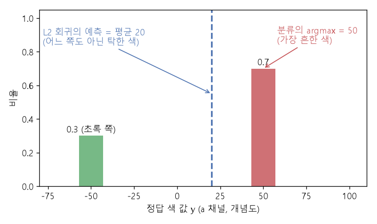

# L2 회귀와 범주 분포 (Mean prediction of L2 regression, Categorical distribution)

[목차로 돌아가기](../../00_MIT%EB%94%A5%EB%9F%AC%EB%8B%9D_%EB%AA%A9%EC%B0%A8.md) · 먼저 볼 것: [MM01_argmin과_argmax](../../%EC%88%98%ED%95%99%EA%B0%9C%EB%85%90/02_%EB%AF%B8%EB%B6%84/MM01_argmin%EA%B3%BC_argmax.md), [MM22_기댓값과_일반화_간극](../../%EC%88%98%ED%95%99%EA%B0%9C%EB%85%90/04_%ED%99%95%EB%A5%A0%EA%B3%BC_%EC%A0%95%EB%B3%B4/MM22_%EA%B8%B0%EB%8C%93%EA%B0%92%EA%B3%BC_%EC%9D%BC%EB%B0%98%ED%99%94_%EA%B0%84%EA%B7%B9.md), [M10_엔트로피](../../%EC%88%98%ED%95%99%EA%B0%9C%EB%85%90/04_%ED%99%95%EB%A5%A0%EA%B3%BC_%EC%A0%95%EB%B3%B4/M10_%EC%97%94%ED%8A%B8%EB%A1%9C%ED%94%BC.md) · 쓰는 곳: [Lec09 8.2](../../Lec09_%ED%95%B4%EC%BB%A4%EC%9D%98_%EB%94%A5%EB%9F%AC%EB%8B%9D_%EA%B0%80%EC%9D%B4%EB%93%9C.md#82-x%EC%97%90-%EC%A0%95%EB%B3%B4%EB%A5%BC-%EB%8D%94-%EB%84%A3%EA%B8%B0), [Lec09 10](../../Lec09_%ED%95%B4%EC%BB%A4%EC%9D%98_%EB%94%A5%EB%9F%AC%EB%8B%9D_%EA%B0%80%EC%9D%B4%EB%93%9C.md#10-%ED%92%80%EB%A6%B0-%EB%AC%B8%EC%A0%9C%EB%A1%9C-%EB%B0%94%EA%BE%B8%EA%B8%B0-%EC%83%89%EC%B9%A0%EC%9D%84-%EB%B6%84%EB%A5%98%EB%A1%9C)

📚 학습 순서 28/99 (4. 확률과 정보): ← 이전: [MM39_확률의_연쇄법칙과_빔_서치](../../%EC%88%98%ED%95%99%EA%B0%9C%EB%85%90/04_%ED%99%95%EB%A5%A0%EA%B3%BC_%EC%A0%95%EB%B3%B4/MM39_%ED%99%95%EB%A5%A0%EC%9D%98_%EC%97%B0%EC%87%84%EB%B2%95%EC%B9%99%EA%B3%BC_%EB%B9%94_%EC%84%9C%EC%B9%98.md) · 다음: [MM58_조건부_확률과_독립](../../%EC%88%98%ED%95%99%EA%B0%9C%EB%85%90/04_%ED%99%95%EB%A5%A0%EA%B3%BC_%EC%A0%95%EB%B3%B4/MM58_%EC%A1%B0%EA%B1%B4%EB%B6%80_%ED%99%95%EB%A5%A0%EA%B3%BC_%EB%8F%85%EB%A6%BD.md) →

> [!NOTE]
> **3줄 요약**
> - 제곱 [손실](../../00_%EB%94%A5%EB%9F%AC%EB%8B%9D_%EC%9A%A9%EC%96%B4%EC%82%AC%EC%A0%84.md#loss-function-%EC%86%90%EC%8B%A4-%ED%95%A8%EC%88%98)(L2)로 한 값을 예측하면 최선의 답은 [정답](../../00_%EB%94%A5%EB%9F%AC%EB%8B%9D_%EC%9A%A9%EC%96%B4%EC%82%AC%EC%A0%84.md#label-%EC%A0%95%EB%8B%B5)들의 **평균**이다. [정답](../../00_%EB%94%A5%EB%9F%AC%EB%8B%9D_%EC%9A%A9%EC%96%B4%EC%82%AC%EC%A0%84.md#label-%EC%A0%95%EB%8B%B5)이 -50(30%)과 50(70%)으로 갈리면 L2 예측은 20, 어느 정답과도 다른 값이다.
> - [소프트맥스](../../00_%EB%94%A5%EB%9F%AC%EB%8B%9D_%EC%9A%A9%EC%96%B4%EC%82%AC%EC%A0%84.md#softmax-%EC%86%8C%ED%94%84%ED%8A%B8%EB%A7%A5%EC%8A%A4) [분류](../../00_%EB%94%A5%EB%9F%AC%EB%8B%9D_%EC%9A%A9%EC%96%B4%EC%82%AC%EC%A0%84.md#regression-classification-%ED%9A%8C%EA%B7%80%EC%99%80-%EB%B6%84%EB%A5%98)는 각 구간에 [확률](../../00_%EB%94%A5%EB%9F%AC%EB%8B%9D_%EC%9A%A9%EC%96%B4%EC%82%AC%EC%A0%84.md#probability-%ED%99%95%EB%A5%A0)을 따로 주므로 (0.3, 0.7)을 **그대로** 나타낼 수 있다. 가장 큰 [확률](../../00_%EB%94%A5%EB%9F%AC%EB%8B%9D_%EC%9A%A9%EC%96%B4%EC%82%AC%EC%A0%84.md#probability-%ED%99%95%EB%A5%A0)([argmax](../../00_%EB%94%A5%EB%9F%AC%EB%8B%9D_%EC%9A%A9%EC%96%B4%EC%82%AC%EC%A0%84.md#argmax-%EC%B5%9C%EB%8C%93%EA%B0%92-%EC%9C%84%EC%B9%98))을 고르면 50이라는 실제로 있는 값이 나온다.
> - [원-핫](../../00_%EB%94%A5%EB%9F%AC%EB%8B%9D_%EC%9A%A9%EC%96%B4%EC%82%AC%EC%A0%84.md#one-hot-encoding-%EC%9B%90-%ED%95%AB-%EC%9D%B8%EC%BD%94%EB%94%A9) 벡터끼리의 거리는 모두 √2 = 1.4142로 같다. 클래스 사이에 "가깝다/멀다"는 [편향](../../00_%EB%94%A5%EB%9F%AC%EB%8B%9D_%EC%9A%A9%EC%96%B4%EC%82%AC%EC%A0%84.md#bias-%ED%8E%B8%ED%96%A5)을 넣지 않는다.

## 1. 개념 설명

비유: 친구에게 "점심 뭐 먹을래?" 물었더니 매번 30%는 짜장면, 70%는 짬뽕이라고 한다. 이것을 숫자 하나로 맞히라고 하면서 틀린 만큼 제곱으로 벌을 주면, 가장 덜 혼나는 답은 "짜장면 30% + 짬뽕 70%를 섞은 무언가"다. 그런 음식은 없다. 대신 "짜장 0.3, 짬뽕 0.7"이라는 **확률표**로 답하게 하면 두 가능성을 모두 담을 수 있다.

- **L2 [회귀](../../00_%EB%94%A5%EB%9F%AC%EB%8B%9D_%EC%9A%A9%EC%96%B4%EC%82%AC%EC%A0%84.md#regression-classification-%ED%9A%8C%EA%B7%80%EC%99%80-%EB%B6%84%EB%A5%98)(최소제곱)**: [손실](../../00_%EB%94%A5%EB%9F%AC%EB%8B%9D_%EC%9A%A9%EC%96%B4%EC%82%AC%EC%A0%84.md#loss-function-%EC%86%90%EC%8B%A4-%ED%95%A8%EC%88%98) $(y - c)^2$의 평균을 가장 작게 하는 예측 $c$는 [정답](../../00_%EB%94%A5%EB%9F%AC%EB%8B%9D_%EC%9A%A9%EC%96%B4%EC%82%AC%EC%A0%84.md#label-%EC%A0%95%EB%8B%B5)의 평균이다. 그래서 L2 [회귀](../../00_%EB%94%A5%EB%9F%AC%EB%8B%9D_%EC%9A%A9%EC%96%B4%EC%82%AC%EC%A0%84.md#regression-classification-%ED%9A%8C%EA%B7%80%EC%99%80-%EB%B6%84%EB%A5%98)는 "[정답](../../00_%EB%94%A5%EB%9F%AC%EB%8B%9D_%EC%9A%A9%EC%96%B4%EC%82%AC%EC%A0%84.md#label-%EC%A0%95%EB%8B%B5)들이 평균 주변에 종 모양(가우스)으로 퍼져 있다"고 가정하는 셈이다.
- **[범주 분포](../../00_%EB%94%A5%EB%9F%AC%EB%8B%9D_%EC%9A%A9%EC%96%B4%EC%82%AC%EC%A0%84.md#categorical-distribution-%EB%B2%94%EC%A3%BC-%EB%B6%84%ED%8F%AC)(categorical distribution)**: 정해진 K개 값 각각에 [확률](../../00_%EB%94%A5%EB%9F%AC%EB%8B%9D_%EC%9A%A9%EC%96%B4%EC%82%AC%EC%A0%84.md#probability-%ED%99%95%EB%A5%A0)을 주는 분포. [소프트맥스](../../00_%EB%94%A5%EB%9F%AC%EB%8B%9D_%EC%9A%A9%EC%96%B4%EC%82%AC%EC%A0%84.md#softmax-%EC%86%8C%ED%94%84%ED%8A%B8%EB%A7%A5%EC%8A%A4) 출력이 바로 이것이다. [확률](../../00_%EB%94%A5%EB%9F%AC%EB%8B%9D_%EC%9A%A9%EC%96%B4%EC%82%AC%EC%A0%84.md#probability-%ED%99%95%EB%A5%A0)의 모양에 제한이 없다(봉우리가 둘이어도 된다).
- **[양자화](../../00_%EB%94%A5%EB%9F%AC%EB%8B%9D_%EC%9A%A9%EC%96%B4%EC%82%AC%EC%A0%84.md#quantization-%EC%96%91%EC%9E%90%ED%99%94)(quantization)**: 연속 값을 구간으로 나눠 클래스 번호로 바꾸는 일. 연속 [회귀](../../00_%EB%94%A5%EB%9F%AC%EB%8B%9D_%EC%9A%A9%EC%96%B4%EC%82%AC%EC%A0%84.md#regression-classification-%ED%9A%8C%EA%B7%80%EC%99%80-%EB%B6%84%EB%A5%98) 문제를 [분류](../../00_%EB%94%A5%EB%9F%AC%EB%8B%9D_%EC%9A%A9%EC%96%B4%EC%82%AC%EC%A0%84.md#regression-classification-%ED%9A%8C%EA%B7%80%EC%99%80-%EB%B6%84%EB%A5%98) 문제로 바꾸는 첫 단계다.

$$
\hat c_{L2} = \arg\min_{c} \frac{1}{N}\sum_{i=1}^{N} (y_i - c)^2 = \frac{1}{N}\sum_{i=1}^{N} y_i
$$

<details><summary>기호 풀이</summary>

| 기호 | 읽는 법 | 뜻 | 예제 값 |
| --- | --- | --- | --- |
| $y_i$ | 와이 아이 | i번째 [정답](../../00_%EB%94%A5%EB%9F%AC%EB%8B%9D_%EC%9A%A9%EC%96%B4%EC%82%AC%EC%A0%84.md#label-%EC%A0%95%EB%8B%B5) | -50 또는 50 |
| $N$ | 엔 | [정답](../../00_%EB%94%A5%EB%9F%AC%EB%8B%9D_%EC%9A%A9%EC%96%B4%EC%82%AC%EC%A0%84.md#label-%EC%A0%95%EB%8B%B5) 개수 | 10 |
| $c$ | 씨 | 모델이 내놓는 한 개의 예측 | |
| $(y_i - c)^2$ | 제곱 [오차](../../00_%EB%94%A5%EB%9F%AC%EB%8B%9D_%EC%9A%A9%EC%96%B4%EC%82%AC%EC%A0%84.md#error-%EC%98%A4%EC%B0%A8) | [정답](../../00_%EB%94%A5%EB%9F%AC%EB%8B%9D_%EC%9A%A9%EC%96%B4%EC%82%AC%EC%A0%84.md#label-%EC%A0%95%EB%8B%B5)과 예측 차이의 제곱 | |
| $\arg\min_c$ | 아그민 | 가장 작게 만드는 c ([MM01_argmin과_argmax](../../%EC%88%98%ED%95%99%EA%B0%9C%EB%85%90/02_%EB%AF%B8%EB%B6%84/MM01_argmin%EA%B3%BC_argmax.md)) | |
| $\hat c_{L2}$ | 씨 햇 엘투 | L2 [손실](../../00_%EB%94%A5%EB%9F%AC%EB%8B%9D_%EC%9A%A9%EC%96%B4%EC%82%AC%EC%A0%84.md#loss-function-%EC%86%90%EC%8B%A4-%ED%95%A8%EC%88%98)의 최선 예측 = 평균 | 20 |

</details>

<details><summary>예제와 풀이</summary>

**문제**: 같은 회색 입력에 대해 [정답](../../00_%EB%94%A5%EB%9F%AC%EB%8B%9D_%EC%9A%A9%EC%96%B4%EC%82%AC%EC%A0%84.md#label-%EC%A0%95%EB%8B%B5) 색 값이 -50(초록 쪽)인 경우가 3번, 50(빨강 쪽)인 경우가 7번 나왔다. L2 [손실](../../00_%EB%94%A5%EB%9F%AC%EB%8B%9D_%EC%9A%A9%EC%96%B4%EC%82%AC%EC%A0%84.md#loss-function-%EC%86%90%EC%8B%A4-%ED%95%A8%EC%88%98)로 학습한 모델은 무엇을 예측하는가?

**주어진 값**:
- $y_i$: -50이 3개, 50이 7개 ([정답](../../00_%EB%94%A5%EB%9F%AC%EB%8B%9D_%EC%9A%A9%EC%96%B4%EC%82%AC%EC%A0%84.md#label-%EC%A0%95%EB%8B%B5) 색 값)
- $N = 10$ ([정답](../../00_%EB%94%A5%EB%9F%AC%EB%8B%9D_%EC%9A%A9%EC%96%B4%EC%82%AC%EC%A0%84.md#label-%EC%A0%95%EB%8B%B5) 수)

**풀이**
1. 식을 그대로 쓴다: $\hat c_{L2} = \frac1N \sum_{i=1}^{N} y_i$
2. Σ를 항 하나씩 펼친다: $\hat c_{L2} = \frac{1}{N}\big(y_1 + y_2 + \cdots + y_{10}\big)$
3. 값을 대입한다: $\hat c_{L2} = \frac{1}{10}\big((-50) + (-50) + (-50) + 50 + 50 + 50 + 50 + 50 + 50 + 50\big)$
4. 같은 수끼리 묶어 곱셈으로 쓴다: $-50$이 3개, $50$이 7개 이므로 $\frac{1}{10}\big((-50) × 3 + 50 × 7\big)$
5. 곱셈을 먼저 한다: $(-50) × 3 = -150$, $50 × 7 = 350$ 이므로 $\frac{1}{10}(-150 + 350)$
6. 괄호 안을 더한다: $-150 + 350 = 200$ 이므로 $\frac{1}{10} × 200$
7. 10으로 나눈다: $200 / 10 = 20$

**답**: 20. [정답](../../00_%EB%94%A5%EB%9F%AC%EB%8B%9D_%EC%9A%A9%EC%96%B4%EC%82%AC%EC%A0%84.md#label-%EC%A0%95%EB%8B%B5)에 한 번도 나오지 않은, 두 색 사이의 탁한 값이다.

</details>

<details><summary>내 이해</summary>


</details>

## 2. 필요한 이유

[Lec09 10절](../../Lec09_%ED%95%B4%EC%BB%A4%EC%9D%98_%EB%94%A5%EB%9F%AC%EB%8B%9D_%EA%B0%80%EC%9D%B4%EB%93%9C.md#10-%ED%92%80%EB%A6%B0-%EB%AC%B8%EC%A0%9C%EB%A1%9C-%EB%B0%94%EA%BE%B8%EA%B8%B0-%EC%83%89%EC%B9%A0%EC%9D%84-%EB%B6%84%EB%A5%98%EB%A1%9C)에서 강사는 흑백 사진 색칠을 "색 [회귀](../../00_%EB%94%A5%EB%9F%AC%EB%8B%9D_%EC%9A%A9%EC%96%B4%EC%82%AC%EC%A0%84.md#regression-classification-%ED%9A%8C%EA%B7%80%EC%99%80-%EB%B6%84%EB%A5%98)"가 아닌 "양자화한 색 클래스 [분류](../../00_%EB%94%A5%EB%9F%AC%EB%8B%9D_%EC%9A%A9%EC%96%B4%EC%82%AC%EC%A0%84.md#regression-classification-%ED%9A%8C%EA%B7%80%EC%99%80-%EB%B6%84%EB%A5%98)"로 풀었다. 이유 1번이 "예측 분포의 모양에 제한이 없다(최소제곱 [회귀](../../00_%EB%94%A5%EB%9F%AC%EB%8B%9D_%EC%9A%A9%EC%96%B4%EC%82%AC%EC%A0%84.md#regression-classification-%ED%9A%8C%EA%B7%80%EC%99%80-%EB%B6%84%EB%A5%98)는 가우스를 가정한다)"다. [8.2절](../../Lec09_%ED%95%B4%EC%BB%A4%EC%9D%98_%EB%94%A5%EB%9F%AC%EB%8B%9D_%EA%B0%80%EC%9D%B4%EB%93%9C.md#82-x%EC%97%90-%EC%A0%95%EB%B3%B4%EB%A5%BC-%EB%8D%94-%EB%84%A3%EA%B8%B0)의 "입력에 정보를 충분히 넣어 $p(y|x)$를 한 점(델타 함수)으로 만들면 단순한 [회귀](../../00_%EB%94%A5%EB%9F%AC%EB%8B%9D_%EC%9A%A9%EC%96%B4%EC%82%AC%EC%A0%84.md#regression-classification-%ED%9A%8C%EA%B7%80%EC%99%80-%EB%B6%84%EB%A5%98)로도 된다"는 말도 같은 계산이다. [정답](../../00_%EB%94%A5%EB%9F%AC%EB%8B%9D_%EC%9A%A9%EC%96%B4%EC%82%AC%EC%A0%84.md#label-%EC%A0%95%EB%8B%B5)이 하나뿐이면 평균이 곧 그 정답이기 때문이다.

## 3. 숫자로 보기

**(가) 어느 예측이 L2 [손실](../../00_%EB%94%A5%EB%9F%AC%EB%8B%9D_%EC%9A%A9%EC%96%B4%EC%82%AC%EC%A0%84.md#loss-function-%EC%86%90%EC%8B%A4-%ED%95%A8%EC%88%98)을 가장 작게 하나** ([정답](../../00_%EB%94%A5%EB%9F%AC%EB%8B%9D_%EC%9A%A9%EC%96%B4%EC%82%AC%EC%A0%84.md#label-%EC%A0%95%EB%8B%B5): -50이 3개, 50이 7개)

| 예측 c | [평균 제곱 오차](../../00_%EB%94%A5%EB%9F%AC%EB%8B%9D_%EC%9A%A9%EC%96%B4%EC%82%AC%EC%A0%84.md#mse-mean-squared-error-%ED%8F%89%EA%B7%A0-%EC%A0%9C%EA%B3%B1-%EC%98%A4%EC%B0%A8) |
|---|---|
| -50 | (0 × 3 + 100² × 7) / 10 = 7000 |
| 20 (평균) | (70² × 3 + 30² × 7) / 10 = 2100 |
| 50 | (100² × 3 + 0 × 7) / 10 = 3000 |

- 평균 20이 가장 작다. [정답](../../00_%EB%94%A5%EB%9F%AC%EB%8B%9D_%EC%9A%A9%EC%96%B4%EC%82%AC%EC%A0%84.md#label-%EC%A0%95%EB%8B%B5)이 좌우 대칭(-50, 50 반반)이면 평균 0, 색이 없는 회색이 된다. 초기 색칠 모델의 결과가 칙칙했던 이유다.

**(나) [분류](../../00_%EB%94%A5%EB%9F%AC%EB%8B%9D_%EC%9A%A9%EC%96%B4%EC%82%AC%EC%A0%84.md#regression-classification-%ED%9A%8C%EA%B7%80%EC%99%80-%EB%B6%84%EB%A5%98)로 풀면**: 구간 {-50, 50}에 [소프트맥스](../../00_%EB%94%A5%EB%9F%AC%EB%8B%9D_%EC%9A%A9%EC%96%B4%EC%82%AC%EC%A0%84.md#softmax-%EC%86%8C%ED%94%84%ED%8A%B8%EB%A7%A5%EC%8A%A4) [확률](../../00_%EB%94%A5%EB%9F%AC%EB%8B%9D_%EC%9A%A9%EC%96%B4%EC%82%AC%EC%A0%84.md#probability-%ED%99%95%EB%A5%A0)을 준다.

- [교차 엔트로피](../../00_%EB%94%A5%EB%9F%AC%EB%8B%9D_%EC%9A%A9%EC%96%B4%EC%82%AC%EC%A0%84.md#cross-entropy-%EA%B5%90%EC%B0%A8-%EC%97%94%ED%8A%B8%EB%A1%9C%ED%94%BC)를 가장 작게 하는 [확률](../../00_%EB%94%A5%EB%9F%AC%EB%8B%9D_%EC%9A%A9%EC%96%B4%EC%82%AC%EC%A0%84.md#probability-%ED%99%95%EB%A5%A0)은 실제 비율 (0.3, 0.7)이다. 그때 [손실](../../00_%EB%94%A5%EB%9F%AC%EB%8B%9D_%EC%9A%A9%EC%96%B4%EC%82%AC%EC%A0%84.md#loss-function-%EC%86%90%EC%8B%A4-%ED%95%A8%EC%88%98) $= -(0.3 \ln 0.3 + 0.7 \ln 0.7) = 0.6109$
- [argmax](../../00_%EB%94%A5%EB%9F%AC%EB%8B%9D_%EC%9A%A9%EC%96%B4%EC%82%AC%EC%A0%84.md#argmax-%EC%B5%9C%EB%8C%93%EA%B0%92-%EC%9C%84%EC%B9%98) → 50 (실제로 있는 색). [확률](../../00_%EB%94%A5%EB%9F%AC%EB%8B%9D_%EC%9A%A9%EC%96%B4%EC%82%AC%EC%A0%84.md#probability-%ED%99%95%EB%A5%A0)에서 뽑으면 30%는 초록, 70%는 빨강이 나온다.


*▲ 직접 그린 그림: [정답](../../00_%EB%94%A5%EB%9F%AC%EB%8B%9D_%EC%9A%A9%EC%96%B4%EC%82%AC%EC%A0%84.md#label-%EC%A0%95%EB%8B%B5)이 -50(30%)과 50(70%)으로 갈릴 때 L2 [회귀](../../00_%EB%94%A5%EB%9F%AC%EB%8B%9D_%EC%9A%A9%EC%96%B4%EC%82%AC%EC%A0%84.md#regression-classification-%ED%9A%8C%EA%B7%80%EC%99%80-%EB%B6%84%EB%A5%98)는 평균 20을, [분류](../../00_%EB%94%A5%EB%9F%AC%EB%8B%9D_%EC%9A%A9%EC%96%B4%EC%82%AC%EC%A0%84.md#regression-classification-%ED%9A%8C%EA%B7%80%EC%99%80-%EB%B6%84%EB%A5%98)의 [argmax](../../00_%EB%94%A5%EB%9F%AC%EB%8B%9D_%EC%9A%A9%EC%96%B4%EC%82%AC%EC%A0%84.md#argmax-%EC%B5%9C%EB%8C%93%EA%B0%92-%EC%9C%84%EC%B9%98)는 50을 고른다 (개념도, 숫자는 위 표와 같음)*

**(다) [원-핫](../../00_%EB%94%A5%EB%9F%AC%EB%8B%9D_%EC%9A%A9%EC%96%B4%EC%82%AC%EC%A0%84.md#one-hot-encoding-%EC%9B%90-%ED%95%AB-%EC%9D%B8%EC%BD%94%EB%94%A9) 거리**: 클래스 3개의 [원-핫](../../00_%EB%94%A5%EB%9F%AC%EB%8B%9D_%EC%9A%A9%EC%96%B4%EC%82%AC%EC%A0%84.md#one-hot-encoding-%EC%9B%90-%ED%95%AB-%EC%9D%B8%EC%BD%94%EB%94%A9) 벡터 (1,0,0), (0,1,0), (0,0,1)

- 1번과 3번의 거리: √((1-0)² + (0-0)² + (0-1)²) = √2 = 1.4142. 어느 쌍이든 같다.
- 클래스를 숫자 1, 2, 3으로 두면 1과 3의 거리는 2, 1과 2는 1이 되어 "1번은 3번보다 2번에 가깝다"는 근거 없는 가정이 들어간다.

<details><summary>기호 풀이 (이 노트 전체)</summary>

| 기호 | 읽는 법 | 뜻 | 예제 값 |
| --- | --- | --- | --- |
| $\hat c_{L2}$ | 씨 햇 | L2 [손실](../../00_%EB%94%A5%EB%9F%AC%EB%8B%9D_%EC%9A%A9%EC%96%B4%EC%82%AC%EC%A0%84.md#loss-function-%EC%86%90%EC%8B%A4-%ED%95%A8%EC%88%98)의 최선 예측 | 20 |
| $p_k$ | 피 케이 | k번째 구간의 [소프트맥스](../../00_%EB%94%A5%EB%9F%AC%EB%8B%9D_%EC%9A%A9%EC%96%B4%EC%82%AC%EC%A0%84.md#softmax-%EC%86%8C%ED%94%84%ED%8A%B8%EB%A7%A5%EC%8A%A4) [확률](../../00_%EB%94%A5%EB%9F%AC%EB%8B%9D_%EC%9A%A9%EC%96%B4%EC%82%AC%EC%A0%84.md#probability-%ED%99%95%EB%A5%A0) | 0.3, 0.7 |
| $-\sum p_k \ln p_k$ | [엔트로피](../../00_%EB%94%A5%EB%9F%AC%EB%8B%9D_%EC%9A%A9%EC%96%B4%EC%82%AC%EC%A0%84.md#entropy-%EC%97%94%ED%8A%B8%EB%A1%9C%ED%94%BC) | 실제 비율로 예측할 때의 최소 [교차 엔트로피](../../00_%EB%94%A5%EB%9F%AC%EB%8B%9D_%EC%9A%A9%EC%96%B4%EC%82%AC%EC%A0%84.md#cross-entropy-%EA%B5%90%EC%B0%A8-%EC%97%94%ED%8A%B8%EB%A1%9C%ED%94%BC) | 0.6109 |
| $p(y \mid x)$ | 피 와이 기븐 엑스 | 입력 x일 때 [정답](../../00_%EB%94%A5%EB%9F%AC%EB%8B%9D_%EC%9A%A9%EC%96%B4%EC%82%AC%EC%A0%84.md#label-%EC%A0%95%EB%8B%B5) y의 분포 | |
| $e_k$ | 이 케이 | k번째 [원-핫](../../00_%EB%94%A5%EB%9F%AC%EB%8B%9D_%EC%9A%A9%EC%96%B4%EC%82%AC%EC%A0%84.md#one-hot-encoding-%EC%9B%90-%ED%95%AB-%EC%9D%B8%EC%BD%94%EB%94%A9) 벡터 | (0,0,1) |

</details>

## 4. 코드로 확인

```python
# [함수] import numpy as np: 배열 계산 라이브러리 numpy를 np라는 이름으로 불러온다
import numpy as np
# [변수] y: 정답 색 값. -50이 3개, 50이 7개 (3절 (가))
y = np.array([-50] * 3 + [50] * 7, dtype=float)
# [함수] for c in ...: 세 후보 예측의 평균 제곱 오차를 비교한다
for c in [-50, y.mean(), 50]:
    # [연결] 출력 한 줄이 3절 (가) 표의 한 행 (7000, 2100, 3000)
    print(c, ((y - c) ** 2).mean())
# [변수] grid: -60부터 60까지 0.5 간격의 후보 예측 241개
grid = np.arange(-60, 60.5, 0.5)
# [함수] np.argmin: 평균 제곱 오차가 가장 작은 후보의 위치 → 그 값은 평균 20
# [연결] 1절의 식: argmin = 평균
print(grid[np.argmin([((y - c) ** 2).mean() for c in grid])])
# [변수] p: 분류로 학습한 최선의 확률 (실제 비율)
p = np.array([0.3, 0.7])
# [함수] -(p * log p).sum(): 그때의 교차 엔트로피 = 0.6109
# [연결] 3절 (나)
print(np.round(-(p * np.log(p)).sum(), 4))
# [변수] E: 클래스 3개의 원-핫 벡터 (단위행렬의 행)
E = np.eye(3)
# [함수] np.linalg.norm(E[0] - E[2]): 1번과 3번 원-핫의 거리 √2
# [연결] 3절 (다)
print(np.round(np.linalg.norm(E[0] - E[2]), 4), np.round(np.linalg.norm(E[0] - E[1]), 4))
```

**실행 결과**:

```text
-50 7000.0
20.0 2100.0
50 3000.0
20.0
0.6109
1.4142 1.4142
```

> [!WARNING]
> **⚠ 주의**
> - [분류](../../00_%EB%94%A5%EB%9F%AC%EB%8B%9D_%EC%9A%A9%EC%96%B4%EC%82%AC%EC%A0%84.md#regression-classification-%ED%9A%8C%EA%B7%80%EC%99%80-%EB%B6%84%EB%A5%98)로 바꾸면 **[양자화](../../00_%EB%94%A5%EB%9F%AC%EB%8B%9D_%EC%9A%A9%EC%96%B4%EC%82%AC%EC%A0%84.md#quantization-%EC%96%91%EC%9E%90%ED%99%94) [오차](../../00_%EB%94%A5%EB%9F%AC%EB%8B%9D_%EC%9A%A9%EC%96%B4%EC%82%AC%EC%A0%84.md#error-%EC%98%A4%EC%B0%A8)**가 생긴다. 구간이 10 단위면 실제 값 23과 27이 같은 클래스가 된다. 색칠 논문(Zhang, Isola, Efros 2016)은 색 공간을 간격 10의 격자로 나눠 313개 클래스를 썼다.
> - 클래스가 많으면 [출력층](../../00_%EB%94%A5%EB%9F%AC%EB%8B%9D_%EC%9A%A9%EC%96%B4%EC%82%AC%EC%A0%84.md#output-layer-%EC%B6%9C%EB%A0%A5%EC%B8%B5)이 커지고, 흔한 색(하늘색, 회색)에 [확률](../../00_%EB%94%A5%EB%9F%AC%EB%8B%9D_%EC%9A%A9%EC%96%B4%EC%82%AC%EC%A0%84.md#probability-%ED%99%95%EB%A5%A0)이 몰린다. 그 논문은 드문 색에 [가중치](../../00_%EB%94%A5%EB%9F%AC%EB%8B%9D_%EC%9A%A9%EC%96%B4%EC%82%AC%EC%A0%84.md#weight-%EA%B0%80%EC%A4%91%EC%B9%98)를 더 주는 [손실](../../00_%EB%94%A5%EB%9F%AC%EB%8B%9D_%EC%9A%A9%EC%96%B4%EC%82%AC%EC%A0%84.md#loss-function-%EC%86%90%EC%8B%A4-%ED%95%A8%EC%88%98)로 이를 보정했다.
> - [원-핫](../../00_%EB%94%A5%EB%9F%AC%EB%8B%9D_%EC%9A%A9%EC%96%B4%EC%82%AC%EC%A0%84.md#one-hot-encoding-%EC%9B%90-%ED%95%AB-%EC%9D%B8%EC%BD%94%EB%94%A9)은 "모든 클래스는 똑같이 다르다"는 가정이다. 색처럼 실제로 가까운 클래스가 있을 때는 이 가정이 정보를 버리는 것일 수도 있다.

## 5. 개념 재확인

<details><summary>1. 정답이 (0, 0, 0, 100)일 때 L2 회귀의 예측과 분류(argmax)의 예측은?</summary>

| 단계 | 하는 일 | 식 | 계산 | 결과 |
|---|---|---|---|---|
| 1 | L2 예측 | 평균 | (0 + 0 + 0 + 100) / 4 | 25 |
| 2 | 그때의 [손실](../../00_%EB%94%A5%EB%9F%AC%EB%8B%9D_%EC%9A%A9%EC%96%B4%EC%82%AC%EC%A0%84.md#loss-function-%EC%86%90%EC%8B%A4-%ED%95%A8%EC%88%98) | [평균 제곱 오차](../../00_%EB%94%A5%EB%9F%AC%EB%8B%9D_%EC%9A%A9%EC%96%B4%EC%82%AC%EC%A0%84.md#mse-mean-squared-error-%ED%8F%89%EA%B7%A0-%EC%A0%9C%EA%B3%B1-%EC%98%A4%EC%B0%A8) | (625 × 3 + 75²) / 4 | 1875 |
| 3 | 비율 | 값별 개수 / 4 | 0: 3개, 100: 1개 | (0.75, 0.25) |
| 4 | [argmax](../../00_%EB%94%A5%EB%9F%AC%EB%8B%9D_%EC%9A%A9%EC%96%B4%EC%82%AC%EC%A0%84.md#argmax-%EC%B5%9C%EB%8C%93%EA%B0%92-%EC%9C%84%EC%B9%98) | 가장 큰 [확률](../../00_%EB%94%A5%EB%9F%AC%EB%8B%9D_%EC%9A%A9%EC%96%B4%EC%82%AC%EC%A0%84.md#probability-%ED%99%95%EB%A5%A0) | 0.75 | 0 |

**① 쓰는 식**
$$\hat c_{L2} = \frac1N\sum_i y_i, \qquad \hat c_{\text{cls}} = \arg\max_k p_k$$
```python
# [변수] y: 문제의 정답
y = np.array([0, 0, 0, 100.0])                       # ①
# [함수] mean: L2 예측 25
c = y.mean()                                         # ②
# [함수] 평균 제곱 오차 1875
mse = ((y - c) ** 2).mean()                          # ②
# [함수] np.unique(..., return_counts=True): 값과 개수 → 비율 (0.75, 0.25)
vals, cnt = np.unique(y, return_counts=True)         # ③
# [연결] 출력: 25.0 1875.0 0.0 (argmax로 고른 값)
print(c, mse, vals[np.argmax(cnt / cnt.sum())])      # ④
```

**문제**: 같은 입력에 대한 [정답](../../00_%EB%94%A5%EB%9F%AC%EB%8B%9D_%EC%9A%A9%EC%96%B4%EC%82%AC%EC%A0%84.md#label-%EC%A0%95%EB%8B%B5) 4개가 (0, 0, 0, 100)일 때, L2 [회귀](../../00_%EB%94%A5%EB%9F%AC%EB%8B%9D_%EC%9A%A9%EC%96%B4%EC%82%AC%EC%A0%84.md#regression-classification-%ED%9A%8C%EA%B7%80%EC%99%80-%EB%B6%84%EB%A5%98)가 내는 값과 [분류](../../00_%EB%94%A5%EB%9F%AC%EB%8B%9D_%EC%9A%A9%EC%96%B4%EC%82%AC%EC%A0%84.md#regression-classification-%ED%9A%8C%EA%B7%80%EC%99%80-%EB%B6%84%EB%A5%98)가 [argmax](../../00_%EB%94%A5%EB%9F%AC%EB%8B%9D_%EC%9A%A9%EC%96%B4%EC%82%AC%EC%A0%84.md#argmax-%EC%B5%9C%EB%8C%93%EA%B0%92-%EC%9C%84%EC%B9%98)로 고르는 값을 구한다.

**주어진 값**:
- $y_1 = 0$, $y_2 = 0$, $y_3 = 0$, $y_4 = 100$ ([정답](../../00_%EB%94%A5%EB%9F%AC%EB%8B%9D_%EC%9A%A9%EC%96%B4%EC%82%AC%EC%A0%84.md#label-%EC%A0%95%EB%8B%B5) 값)
- $N = 4$ ([정답](../../00_%EB%94%A5%EB%9F%AC%EB%8B%9D_%EC%9A%A9%EC%96%B4%EC%82%AC%EC%A0%84.md#label-%EC%A0%95%EB%8B%B5) 수)

**② L2 예측**
1. 식을 그대로 쓴다: $\hat c_{L2} = \frac1N (y_1 + y_2 + y_3 + y_4)$
2. 값을 대입한다: $\hat c_{L2} = \frac14 (0 + 0 + 0 + 100)$
3. 괄호 안을 더한다: $0 + 0 + 0 + 100 = 100$ 이므로 $\frac14 × 100$
4. 4로 나눈다: $100 / 4 = 25$
5. 그때의 [손실](../../00_%EB%94%A5%EB%9F%AC%EB%8B%9D_%EC%9A%A9%EC%96%B4%EC%82%AC%EC%A0%84.md#loss-function-%EC%86%90%EC%8B%A4-%ED%95%A8%EC%88%98) 식을 그대로 쓴다: $\text{MSE} = \frac1N\big((y_1-c)^2 + (y_2-c)^2 + (y_3-c)^2 + (y_4-c)^2\big)$
6. 값을 대입한다: $\text{MSE} = \frac14\big((0-25)^2 + (0-25)^2 + (0-25)^2 + (100-25)^2\big)$
7. 괄호 안 뺄셈을 한다: $\frac14\big((-25)^2 × 3 + 75^2\big)$
8. 제곱을 한다: $(-25)^2 = 625$, $75^2 = 5625$ 이므로 $\frac14(625 × 3 + 5625)$
9. 곱셈을 한다: $625 × 3 = 1875$ 이므로 $\frac14(1875 + 5625)$
10. 더한다: $1875 + 5625 = 7500$ 이므로 $\frac14 × 7500$
11. 4로 나눈다: $7500 / 4 = 1875$

**③ 비율**
1. 식을 그대로 쓴다: $p_k = \dfrac{\text{값 } k \text{가 나온 수}}{N}$
2. 값을 대입한다: $p_0 = \dfrac{3}{4}$, $p_{100} = \dfrac{1}{4}$
3. 나눈다: $p_0 = 0.75$, $p_{100} = 0.25$

**④ [argmax](../../00_%EB%94%A5%EB%9F%AC%EB%8B%9D_%EC%9A%A9%EC%96%B4%EC%82%AC%EC%A0%84.md#argmax-%EC%B5%9C%EB%8C%93%EA%B0%92-%EC%9C%84%EC%B9%98)**
1. 식을 그대로 쓴다: $\hat c_{\text{cls}} = \arg\max_k p_k$
2. 값을 대입한다: $\hat c_{\text{cls}} = \arg\max \{0: 0.75,\ 100: 0.25\}$
3. 가장 큰 [확률](../../00_%EB%94%A5%EB%9F%AC%EB%8B%9D_%EC%9A%A9%EC%96%B4%EC%82%AC%EC%A0%84.md#probability-%ED%99%95%EB%A5%A0)을 고른다: $0.75 > 0.25$ 이므로 값 0

**답**: L2 [회귀](../../00_%EB%94%A5%EB%9F%AC%EB%8B%9D_%EC%9A%A9%EC%96%B4%EC%82%AC%EC%A0%84.md#regression-classification-%ED%9A%8C%EA%B7%80%EC%99%80-%EB%B6%84%EB%A5%98)는 **25**(한 번도 없던 값), [분류](../../00_%EB%94%A5%EB%9F%AC%EB%8B%9D_%EC%9A%A9%EC%96%B4%EC%82%AC%EC%A0%84.md#regression-classification-%ED%9A%8C%EA%B7%80%EC%99%80-%EB%B6%84%EB%A5%98)는 **0**(가장 흔한 값)을 고른다.

</details>

<details><summary>2. 클래스 3개를 숫자 1, 2, 3으로 둘 때와 원-핫으로 둘 때 1번과 3번 사이의 거리는?</summary>

| 단계 | 하는 일 | 계산 | 결과 |
|---|---|---|---|
| 1 | 숫자 거리 | \|3 - 1\| | 2 |
| 2 | [원-핫](../../00_%EB%94%A5%EB%9F%AC%EB%8B%9D_%EC%9A%A9%EC%96%B4%EC%82%AC%EC%A0%84.md#one-hot-encoding-%EC%9B%90-%ED%95%AB-%EC%9D%B8%EC%BD%94%EB%94%A9) 차이 | (1,0,0) - (0,0,1) | (1, 0, -1) |
| 3 | [원-핫](../../00_%EB%94%A5%EB%9F%AC%EB%8B%9D_%EC%9A%A9%EC%96%B4%EC%82%AC%EC%A0%84.md#one-hot-encoding-%EC%9B%90-%ED%95%AB-%EC%9D%B8%EC%BD%94%EB%94%A9) 거리 | √(1 + 0 + 1) | 1.4142 |

**① 쓰는 식**
$$\lVert e_i - e_j \rVert = \sqrt{\textstyle\sum_k (e_{i,k} - e_{j,k})^2}$$
```python
# [변수] E: 원-핫 벡터 3개
E = np.eye(3)                                        # ①
# [함수] abs: 숫자 표현의 거리 2
d_num = abs(3 - 1)                                   # ②
# [변수] diff: 원-핫 차이 (1, 0, -1)
diff = E[0] - E[2]                                   # ③
# [연결] 출력: 2와 1.4142
print(d_num, np.round(np.sqrt((diff ** 2).sum()), 4))   # ④
```

**문제**: 클래스 1번과 3번을 숫자 1, 3으로 둘 때와 [원-핫](../../00_%EB%94%A5%EB%9F%AC%EB%8B%9D_%EC%9A%A9%EC%96%B4%EC%82%AC%EC%A0%84.md#one-hot-encoding-%EC%9B%90-%ED%95%AB-%EC%9D%B8%EC%BD%94%EB%94%A9) 벡터 (1,0,0), (0,0,1)로 둘 때 두 클래스 사이 거리를 비교한다.

**주어진 값**:
- 숫자 표현: 1번 = 1, 3번 = 3
- [원-핫](../../00_%EB%94%A5%EB%9F%AC%EB%8B%9D_%EC%9A%A9%EC%96%B4%EC%82%AC%EC%A0%84.md#one-hot-encoding-%EC%9B%90-%ED%95%AB-%EC%9D%B8%EC%BD%94%EB%94%A9) 표현: $e_1 = (1, 0, 0)$, $e_3 = (0, 0, 1)$

**② 숫자 거리**
1. 식을 그대로 쓴다: 거리 $= |a - b|$
2. 값을 대입한다: 거리 $= |3 - 1|$
3. 뺄셈을 하고 절댓값(부호를 뗀 크기)을 취한다: $|2| = 2$

**③ [원-핫](../../00_%EB%94%A5%EB%9F%AC%EB%8B%9D_%EC%9A%A9%EC%96%B4%EC%82%AC%EC%A0%84.md#one-hot-encoding-%EC%9B%90-%ED%95%AB-%EC%9D%B8%EC%BD%94%EB%94%A9) 차이**
1. 식을 그대로 쓴다: $e_1 - e_3 = (e_{1,1} - e_{3,1},\ e_{1,2} - e_{3,2},\ e_{1,3} - e_{3,3})$
2. 값을 대입한다: $e_1 - e_3 = (1 - 0,\ 0 - 0,\ 0 - 1)$
3. 칸마다 뺄셈을 한다: $(1, 0, -1)$

**④ [원-핫](../../00_%EB%94%A5%EB%9F%AC%EB%8B%9D_%EC%9A%A9%EC%96%B4%EC%82%AC%EC%A0%84.md#one-hot-encoding-%EC%9B%90-%ED%95%AB-%EC%9D%B8%EC%BD%94%EB%94%A9) 거리**
1. 식을 그대로 쓴다: $\lVert e_1 - e_3 \rVert = \sqrt{d_1^2 + d_2^2 + d_3^2}$
2. 값을 대입한다: $\sqrt{1^2 + 0^2 + (-1)^2}$
3. 제곱을 한다: $1^2 = 1$, $0^2 = 0$, $(-1)^2 = 1$ 이므로 $\sqrt{1 + 0 + 1}$
4. 더한다: $1 + 0 + 1 = 2$ 이므로 $\sqrt{2}$
5. 제곱근을 구한다. √는 "제곱해서 그 수가 되는 양수"다: $1.4142 × 1.4142 = 2$ 이므로 $\sqrt2 = 1.4142$

**답**: 숫자로는 **2**(쌍마다 다름), [원-핫](../../00_%EB%94%A5%EB%9F%AC%EB%8B%9D_%EC%9A%A9%EC%96%B4%EC%82%AC%EC%A0%84.md#one-hot-encoding-%EC%9B%90-%ED%95%AB-%EC%9D%B8%EC%BD%94%EB%94%A9)으로는 **1.4142**(모든 쌍이 같음).

</details>

## 예제 풀기

[예제 10문제 풀기](../../%EC%98%88%EC%A0%9C/04_%ED%99%95%EB%A5%A0%EA%B3%BC_%EC%A0%95%EB%B3%B4/%EC%98%88%EC%A0%9C_MM35_L2_%ED%9A%8C%EA%B7%80%EC%99%80_%EB%B2%94%EC%A3%BC_%EB%B6%84%ED%8F%AC.md)

<details><summary>내 이해</summary>


</details>
