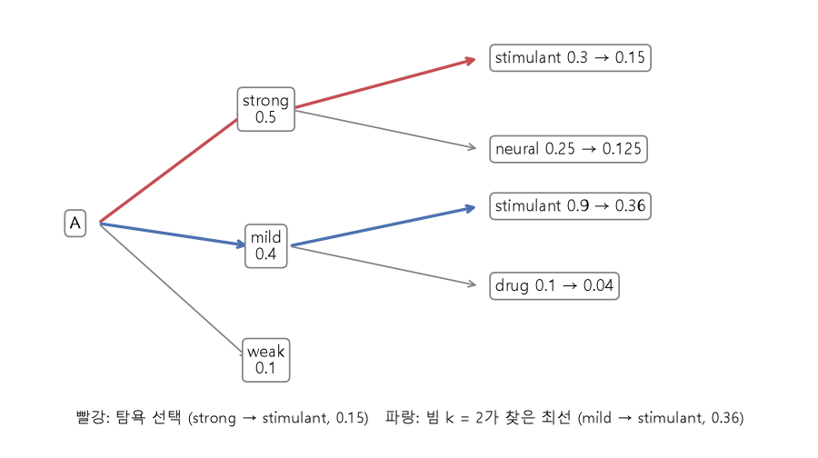

# 확률의 연쇄법칙과 빔 서치 (Chain rule of probability, beam search)

[목차로 돌아가기](../../00_MIT%EB%94%A5%EB%9F%AC%EB%8B%9D_%EB%AA%A9%EC%B0%A8.md) · 먼저 볼 것: [M08_확률_기초](../../%EC%88%98%ED%95%99%EA%B0%9C%EB%85%90/04_%ED%99%95%EB%A5%A0%EA%B3%BC_%EC%A0%95%EB%B3%B4/M08_%ED%99%95%EB%A5%A0_%EA%B8%B0%EC%B4%88.md), [M07_로그](../../%EC%88%98%ED%95%99%EA%B0%9C%EB%85%90/01_%EC%88%98%EC%99%80_%ED%95%A8%EC%88%98/M07_%EB%A1%9C%EA%B7%B8.md), [M10_엔트로피](../../%EC%88%98%ED%95%99%EA%B0%9C%EB%85%90/04_%ED%99%95%EB%A5%A0%EA%B3%BC_%EC%A0%95%EB%B3%B4/M10_%EC%97%94%ED%8A%B8%EB%A1%9C%ED%94%BC.md) · 쓰는 곳: [Lec10 7.2](../../Lec10_%EA%B8%B0%EC%96%B5%EA%B3%BC_%EC%8B%9C%ED%80%80%EC%8A%A4.md#72-%ED%99%95%EB%A5%A0%EC%9D%98-%EC%97%B0%EC%87%84%EB%B2%95%EC%B9%99), [Lec10 8.1](../../Lec10_%EA%B8%B0%EC%96%B5%EA%B3%BC_%EC%8B%9C%ED%80%80%EC%8A%A4.md#81-%EC%B5%9C%EB%8C%80-%EC%9A%B0%EB%8F%84-%ED%95%99%EC%8A%B5%EA%B3%BC-%EA%B5%90%EC%82%AC-%EA%B0%95%EC%9A%94), [Lec10 8.2](../../Lec10_%EA%B8%B0%EC%96%B5%EA%B3%BC_%EC%8B%9C%ED%80%80%EC%8A%A4.md#82-%EB%B9%94-%EC%84%9C%EC%B9%98)

📚 학습 순서 27/99 (4. 확률과 정보): ← 이전: [MM22_기댓값과_일반화_간극](../../%EC%88%98%ED%95%99%EA%B0%9C%EB%85%90/04_%ED%99%95%EB%A5%A0%EA%B3%BC_%EC%A0%95%EB%B3%B4/MM22_%EA%B8%B0%EB%8C%93%EA%B0%92%EA%B3%BC_%EC%9D%BC%EB%B0%98%ED%99%94_%EA%B0%84%EA%B7%B9.md) · 다음: [MM35_L2_회귀와_범주_분포](../../%EC%88%98%ED%95%99%EA%B0%9C%EB%85%90/04_%ED%99%95%EB%A5%A0%EA%B3%BC_%EC%A0%95%EB%B3%B4/MM35_L2_%ED%9A%8C%EA%B7%80%EC%99%80_%EB%B2%94%EC%A3%BC_%EB%B6%84%ED%8F%AC.md) →

> [!NOTE]
> **3줄 요약**
> - 문장 전체의 [확률](../../00_%EB%94%A5%EB%9F%AC%EB%8B%9D_%EC%9A%A9%EC%96%B4%EC%82%AC%EC%A0%84.md#probability-%ED%99%95%EB%A5%A0)은 **앞 단어들이 주어졌을 때 다음 단어의 [확률](../../00_%EB%94%A5%EB%9F%AC%EB%8B%9D_%EC%9A%A9%EC%96%B4%EC%82%AC%EC%A0%84.md#probability-%ED%99%95%EB%A5%A0)**을 차례로 곱한 것이다([확률의 연쇄법칙](../../00_%EB%94%A5%EB%9F%AC%EB%8B%9D_%EC%9A%A9%EC%96%B4%EC%82%AC%EC%A0%84.md#chain-rule-of-probability-%ED%99%95%EB%A5%A0%EC%9D%98-%EC%97%B0%EC%87%84%EB%B2%95%EC%B9%99)). $p(\text{once upon a time}) = 0.1 × 0.8 × 0.9 × 0.95 = 0.0684$.
> - 곱은 금방 아주 작아지므로 [로그](../../00_%EB%94%A5%EB%9F%AC%EB%8B%9D_%EC%9A%A9%EC%96%B4%EC%82%AC%EC%A0%84.md#log-ln-%EB%A1%9C%EA%B7%B8)를 씌워 **합**으로 다룬다. $\log 0.0684 = -2.6824$. 이 값에 마이너스를 붙인 것이 [교차 엔트로피](../../00_%EB%94%A5%EB%9F%AC%EB%8B%9D_%EC%9A%A9%EC%96%B4%EC%82%AC%EC%A0%84.md#cross-entropy-%EA%B5%90%EC%B0%A8-%EC%97%94%ED%8A%B8%EB%A1%9C%ED%94%BC) [손실](../../00_%EB%94%A5%EB%9F%AC%EB%8B%9D_%EC%9A%A9%EC%96%B4%EC%82%AC%EC%A0%84.md#loss-function-%EC%86%90%EC%8B%A4-%ED%95%A8%EC%88%98)이다.
> - 매 단계 가장 큰 것만 고르는 **[탐욕 선택](../../00_%EB%94%A5%EB%9F%AC%EB%8B%9D_%EC%9A%A9%EC%96%B4%EC%82%AC%EC%A0%84.md#greedy-decoding-%ED%83%90%EC%9A%95-%EB%94%94%EC%BD%94%EB%94%A9)**은 전체로는 최선이 아닐 수 있다. 후보 k개를 들고 가는 **[빔 서치](../../00_%EB%94%A5%EB%9F%AC%EB%8B%9D_%EC%9A%A9%EC%96%B4%EC%82%AC%EC%A0%84.md#beam-search-%EB%B9%94-%EC%84%9C%EC%B9%98)**는 strong→stimulant(0.15) 대신 mild→stimulant(0.36)를 찾는다.

## 1. 개념 설명

비유: 자동 완성 키보드. "once"를 치면 다음 단어 후보가 뜨고, "upon"을 고르면 다시 다음 후보가 뜬다. 문장 전체가 나올 [확률](../../00_%EB%94%A5%EB%9F%AC%EB%8B%9D_%EC%9A%A9%EC%96%B4%EC%82%AC%EC%A0%84.md#probability-%ED%99%95%EB%A5%A0)은 각 순간 "그 단어가 뜰 [확률](../../00_%EB%94%A5%EB%9F%AC%EB%8B%9D_%EC%9A%A9%EC%96%B4%EC%82%AC%EC%A0%84.md#probability-%ED%99%95%EB%A5%A0)"을 모두 곱한 값이다. 앞에서 조금 덜 그럴듯한 단어를 골랐는데 뒤가 아주 자연스럽게 이어질 수도 있다. 그래서 순간순간 1등만 고르면 놓치는 문장이 생긴다.

$$
p(x_1, x_2, \dots, x_n) = \prod_{i=1}^{n} p(x_i \mid x_1, \dots, x_{i-1})
$$

<details><summary>기호 풀이</summary>

| 기호 | 읽는 법 | 뜻 | 예제 값 |
| --- | --- | --- | --- |
| $p(x_1, \dots, x_n)$ | 피 엑스 일부터 엑스 엔까지 | n개 [토큰](../../00_%EB%94%A5%EB%9F%AC%EB%8B%9D_%EC%9A%A9%EC%96%B4%EC%82%AC%EC%A0%84.md#token-%ED%86%A0%ED%81%B0)이 이 순서로 나올 [확률](../../00_%EB%94%A5%EB%9F%AC%EB%8B%9D_%EC%9A%A9%EC%96%B4%EC%82%AC%EC%A0%84.md#probability-%ED%99%95%EB%A5%A0) | 0.0684 |
| $\prod_{i=1}^{n}$ | 파이, i는 1부터 n까지 | 괄호 안 값을 모두 곱함 | 4개 곱 |
| $p(x_i \mid x_1, \dots, x_{i-1})$ | 피 엑스 아이 기븐 앞의 것들 | 앞 [토큰](../../00_%EB%94%A5%EB%9F%AC%EB%8B%9D_%EC%9A%A9%EC%96%B4%EC%82%AC%EC%A0%84.md#token-%ED%86%A0%ED%81%B0)들이 주어졌을 때 i번째 [토큰](../../00_%EB%94%A5%EB%9F%AC%EB%8B%9D_%EC%9A%A9%EC%96%B4%EC%82%AC%EC%A0%84.md#token-%ED%86%A0%ED%81%B0)의 조건부 [확률](../../00_%EB%94%A5%EB%9F%AC%EB%8B%9D_%EC%9A%A9%EC%96%B4%EC%82%AC%EC%A0%84.md#probability-%ED%99%95%EB%A5%A0) | $p(\text{upon} \mid \text{once}) = 0.8$ |
| $\mid$ | 기븐 (given) | 세로선 오른쪽이 주어졌다는 조건 | - |

</details>

<details><summary>예제와 풀이</summary>

**문제**: 단어마다 "앞 단어들이 주어졌을 때 그 단어가 나올 [확률](../../00_%EB%94%A5%EB%9F%AC%EB%8B%9D_%EC%9A%A9%EC%96%B4%EC%82%AC%EC%A0%84.md#probability-%ED%99%95%EB%A5%A0)"이 주어질 때, 문장 "the cat sat" 전체의 [확률](../../00_%EB%94%A5%EB%9F%AC%EB%8B%9D_%EC%9A%A9%EC%96%B4%EC%82%AC%EC%A0%84.md#probability-%ED%99%95%EB%A5%A0)을 구한다.

**주어진 값**:
- $p(\text{the}) = 0.2$ (첫 단어가 the일 [확률](../../00_%EB%94%A5%EB%9F%AC%EB%8B%9D_%EC%9A%A9%EC%96%B4%EC%82%AC%EC%A0%84.md#probability-%ED%99%95%EB%A5%A0))
- $p(\text{cat} \mid \text{the}) = 0.5$ (the 다음에 cat이 올 [확률](../../00_%EB%94%A5%EB%9F%AC%EB%8B%9D_%EC%9A%A9%EC%96%B4%EC%82%AC%EC%A0%84.md#probability-%ED%99%95%EB%A5%A0))
- $p(\text{sat} \mid \text{the cat}) = 0.4$ (the cat 다음에 sat이 올 [확률](../../00_%EB%94%A5%EB%9F%AC%EB%8B%9D_%EC%9A%A9%EC%96%B4%EC%82%AC%EC%A0%84.md#probability-%ED%99%95%EB%A5%A0))
- $n = 3$ (단어 수)

**풀이**
1. 식을 그대로 쓴다: $p(x_1, x_2, x_3) = \prod_{i=1}^{3} p(x_i \mid x_1, \dots, x_{i-1})$
2. 값을 대입한다: $p(\text{the cat sat}) = p(\text{the}) \times p(\text{cat} \mid \text{the}) \times p(\text{sat} \mid \text{the cat}) = 0.2 \times 0.5 \times 0.4$
3. 앞의 두 개를 곱한다: $0.2 \times 0.5 = 0.1$
4. 남은 하나를 곱한다: $0.1 \times 0.4 = 0.04$

**답**: $p(\text{the cat sat}) = 0.04$

</details>

<details><summary>내 이해</summary>


</details>

- 이 식은 어떤 [확률](../../00_%EB%94%A5%EB%9F%AC%EB%8B%9D_%EC%9A%A9%EC%96%B4%EC%82%AC%EC%A0%84.md#probability-%ED%99%95%EB%A5%A0) 분포에서도 성립한다. 근사가 아니라 조건부 [확률](../../00_%EB%94%A5%EB%9F%AC%EB%8B%9D_%EC%9A%A9%EC%96%B4%EC%82%AC%EC%A0%84.md#probability-%ED%99%95%EB%A5%A0)의 정의를 되풀이해 쓴 것이다.
- [자기회귀 모델](../../00_%EB%94%A5%EB%9F%AC%EB%8B%9D_%EC%9A%A9%EC%96%B4%EC%82%AC%EC%A0%84.md#autoregressive-model-%EC%9E%90%EA%B8%B0%ED%9A%8C%EA%B7%80-%EB%AA%A8%EB%8D%B8)은 오른쪽의 조건부 [확률](../../00_%EB%94%A5%EB%9F%AC%EB%8B%9D_%EC%9A%A9%EC%96%B4%EC%82%AC%EC%A0%84.md#probability-%ED%99%95%EB%A5%A0) 하나하나를 신경망 "다음 [토큰](../../00_%EB%94%A5%EB%9F%AC%EB%8B%9D_%EC%9A%A9%EC%96%B4%EC%82%AC%EC%A0%84.md#token-%ED%86%A0%ED%81%B0) 분류기"로 배운다.

## 2. 필요한 이유

[Lec10 7.2](../../Lec10_%EA%B8%B0%EC%96%B5%EA%B3%BC_%EC%8B%9C%ED%80%80%EC%8A%A4.md#72-%ED%99%95%EB%A5%A0%EC%9D%98-%EC%97%B0%EC%87%84%EB%B2%95%EC%B9%99)에서 강사는 $p(\text{Once upon a time})$을 이 곱으로 풀어 보입니다. [8.1](../../Lec10_%EA%B8%B0%EC%96%B5%EA%B3%BC_%EC%8B%9C%ED%80%80%EC%8A%A4.md#81-%EC%B5%9C%EB%8C%80-%EC%9A%B0%EB%8F%84-%ED%95%99%EC%8A%B5%EA%B3%BC-%EA%B5%90%EC%82%AC-%EA%B0%95%EC%9A%94)의 [최대 우도](../../00_%EB%94%A5%EB%9F%AC%EB%8B%9D_%EC%9A%A9%EC%96%B4%EC%82%AC%EC%A0%84.md#maximum-likelihood-%EC%B5%9C%EB%8C%80-%EC%9A%B0%EB%8F%84) [학습](../../00_%EB%94%A5%EB%9F%AC%EB%8B%9D_%EC%9A%A9%EC%96%B4%EC%82%AC%EC%A0%84.md#training-%ED%95%99%EC%8A%B5)은 이 곱을 크게 만드는 것이고(= [로그](../../00_%EB%94%A5%EB%9F%AC%EB%8B%9D_%EC%9A%A9%EC%96%B4%EC%82%AC%EC%A0%84.md#log-ln-%EB%A1%9C%EA%B7%B8) 합의 마이너스, [교차 엔트로피](../../00_%EB%94%A5%EB%9F%AC%EB%8B%9D_%EC%9A%A9%EC%96%B4%EC%82%AC%EC%A0%84.md#cross-entropy-%EA%B5%90%EC%B0%A8-%EC%97%94%ED%8A%B8%EB%A1%9C%ED%94%BC)를 작게), [8.2](../../Lec10_%EA%B8%B0%EC%96%B5%EA%B3%BC_%EC%8B%9C%ED%80%80%EC%8A%A4.md#82-%EB%B9%94-%EC%84%9C%EC%B9%98)의 [빔 서치](../../00_%EB%94%A5%EB%9F%AC%EB%8B%9D_%EC%9A%A9%EC%96%B4%EC%82%AC%EC%A0%84.md#beam-search-%EB%B9%94-%EC%84%9C%EC%B9%98)는 이 곱이 가장 큰 문장을 찾으려는 탐색입니다.

## 3. 숫자로 보기

**곱을 [로그](../../00_%EB%94%A5%EB%9F%AC%EB%8B%9D_%EC%9A%A9%EC%96%B4%EC%82%AC%EC%A0%84.md#log-ln-%EB%A1%9C%EA%B7%B8) 합으로**

| 단계 | 조건부 [확률](../../00_%EB%94%A5%EB%9F%AC%EB%8B%9D_%EC%9A%A9%EC%96%B4%EC%82%AC%EC%A0%84.md#probability-%ED%99%95%EB%A5%A0) | 누적 곱 | $\log$ (자연로그) |
|---|---|---|---|
| once | 0.1 | 0.1 | −2.3026 |
| upon \| once | 0.8 | 0.08 | −0.2231 |
| a \| once upon | 0.9 | 0.072 | −0.1054 |
| time \| once upon a | 0.95 | **0.0684** | −0.0513 |
| 합 | | | **−2.6824** |

$$
\log p(x_1, \dots, x_n) = \sum_{i=1}^{n} \log p(x_i \mid x_{<i}), \qquad \mathcal{L} = -\sum_{i=1}^{n} \log p(x_i \mid x_{<i})
$$

<details><summary>기호 풀이</summary>

| 기호 | 읽는 법 | 뜻 | 예제 값 |
| --- | --- | --- | --- |
| $\log$ | [로그](../../00_%EB%94%A5%EB%9F%AC%EB%8B%9D_%EC%9A%A9%EC%96%B4%EC%82%AC%EC%A0%84.md#log-ln-%EB%A1%9C%EA%B7%B8) | 자연로그. 곱을 합으로 바꾼다 ([M07_로그](../../%EC%88%98%ED%95%99%EA%B0%9C%EB%85%90/01_%EC%88%98%EC%99%80_%ED%95%A8%EC%88%98/M07_%EB%A1%9C%EA%B7%B8.md)) | $\log 0.1 = -2.3026$ |
| $x_{<i}$ | 엑스 아이보다 앞 | $x_1, \dots, x_{i-1}$을 줄여 쓴 것 | once upon |
| $\sum_{i=1}^{n}$ | 시그마 | 단계별 [로그](../../00_%EB%94%A5%EB%9F%AC%EB%8B%9D_%EC%9A%A9%EC%96%B4%EC%82%AC%EC%A0%84.md#log-ln-%EB%A1%9C%EA%B7%B8)를 모두 더함 | 4개 합 |
| $\mathcal{L}$ | 엘 | 음의 [로그](../../00_%EB%94%A5%EB%9F%AC%EB%8B%9D_%EC%9A%A9%EC%96%B4%EC%82%AC%EC%A0%84.md#log-ln-%EB%A1%9C%EA%B7%B8) [우도](../../00_%EB%94%A5%EB%9F%AC%EB%8B%9D_%EC%9A%A9%EC%96%B4%EC%82%AC%EC%A0%84.md#likelihood-%EC%9A%B0%EB%8F%84) = 토큰별 [교차 엔트로피](../../00_%EB%94%A5%EB%9F%AC%EB%8B%9D_%EC%9A%A9%EC%96%B4%EC%82%AC%EC%A0%84.md#cross-entropy-%EA%B5%90%EC%B0%A8-%EC%97%94%ED%8A%B8%EB%A1%9C%ED%94%BC)의 합 ([손실](../../00_%EB%94%A5%EB%9F%AC%EB%8B%9D_%EC%9A%A9%EC%96%B4%EC%82%AC%EC%A0%84.md#loss-function-%EC%86%90%EC%8B%A4-%ED%95%A8%EC%88%98)) | 2.6824 |

</details>

<details><summary>예제와 풀이</summary>

**문제**: [정답](../../00_%EB%94%A5%EB%9F%AC%EB%8B%9D_%EC%9A%A9%EC%96%B4%EC%82%AC%EC%A0%84.md#label-%EC%A0%95%EB%8B%B5) 문장의 세 [토큰](../../00_%EB%94%A5%EB%9F%AC%EB%8B%9D_%EC%9A%A9%EC%96%B4%EC%82%AC%EC%A0%84.md#token-%ED%86%A0%ED%81%B0)에 모델이 준 [확률](../../00_%EB%94%A5%EB%9F%AC%EB%8B%9D_%EC%9A%A9%EC%96%B4%EC%82%AC%EC%A0%84.md#probability-%ED%99%95%EB%A5%A0)로 [손실](../../00_%EB%94%A5%EB%9F%AC%EB%8B%9D_%EC%9A%A9%EC%96%B4%EC%82%AC%EC%A0%84.md#loss-function-%EC%86%90%EC%8B%A4-%ED%95%A8%EC%88%98)(음의 [로그](../../00_%EB%94%A5%EB%9F%AC%EB%8B%9D_%EC%9A%A9%EC%96%B4%EC%82%AC%EC%A0%84.md#log-ln-%EB%A1%9C%EA%B7%B8) [우도](../../00_%EB%94%A5%EB%9F%AC%EB%8B%9D_%EC%9A%A9%EC%96%B4%EC%82%AC%EC%A0%84.md#likelihood-%EC%9A%B0%EB%8F%84)) $\mathcal{L}$을 구한다.

**주어진 값**:
- $p(x_1) = 0.5$ (1번 [정답](../../00_%EB%94%A5%EB%9F%AC%EB%8B%9D_%EC%9A%A9%EC%96%B4%EC%82%AC%EC%A0%84.md#label-%EC%A0%95%EB%8B%B5) [토큰](../../00_%EB%94%A5%EB%9F%AC%EB%8B%9D_%EC%9A%A9%EC%96%B4%EC%82%AC%EC%A0%84.md#token-%ED%86%A0%ED%81%B0)에 모델이 준 [확률](../../00_%EB%94%A5%EB%9F%AC%EB%8B%9D_%EC%9A%A9%EC%96%B4%EC%82%AC%EC%A0%84.md#probability-%ED%99%95%EB%A5%A0))
- $p(x_2 \mid x_1) = 0.8$ (2번 [정답](../../00_%EB%94%A5%EB%9F%AC%EB%8B%9D_%EC%9A%A9%EC%96%B4%EC%82%AC%EC%A0%84.md#label-%EC%A0%95%EB%8B%B5) [토큰](../../00_%EB%94%A5%EB%9F%AC%EB%8B%9D_%EC%9A%A9%EC%96%B4%EC%82%AC%EC%A0%84.md#token-%ED%86%A0%ED%81%B0)에 준 [확률](../../00_%EB%94%A5%EB%9F%AC%EB%8B%9D_%EC%9A%A9%EC%96%B4%EC%82%AC%EC%A0%84.md#probability-%ED%99%95%EB%A5%A0))
- $p(x_3 \mid x_1, x_2) = 0.9$ (3번 [정답](../../00_%EB%94%A5%EB%9F%AC%EB%8B%9D_%EC%9A%A9%EC%96%B4%EC%82%AC%EC%A0%84.md#label-%EC%A0%95%EB%8B%B5) [토큰](../../00_%EB%94%A5%EB%9F%AC%EB%8B%9D_%EC%9A%A9%EC%96%B4%EC%82%AC%EC%A0%84.md#token-%ED%86%A0%ED%81%B0)에 준 [확률](../../00_%EB%94%A5%EB%9F%AC%EB%8B%9D_%EC%9A%A9%EC%96%B4%EC%82%AC%EC%A0%84.md#probability-%ED%99%95%EB%A5%A0))
- $n = 3$ ([토큰](../../00_%EB%94%A5%EB%9F%AC%EB%8B%9D_%EC%9A%A9%EC%96%B4%EC%82%AC%EC%A0%84.md#token-%ED%86%A0%ED%81%B0) 수)

**풀이**
1. 식을 그대로 쓴다: $\mathcal{L} = -\sum_{i=1}^{3} \log p(x_i \mid x_{<i})$
2. 값을 대입한다: $\mathcal{L} = -(\log 0.5 + \log 0.8 + \log 0.9)$
3. [로그](../../00_%EB%94%A5%EB%9F%AC%EB%8B%9D_%EC%9A%A9%EC%96%B4%EC%82%AC%EC%A0%84.md#log-ln-%EB%A1%9C%EA%B7%B8) 뜻: $\log$는 자연로그(ln)로, "e(약 2.718)를 몇 제곱해야 그 수가 되나"이다. 1보다 작은 수의 [로그](../../00_%EB%94%A5%EB%9F%AC%EB%8B%9D_%EC%9A%A9%EC%96%B4%EC%82%AC%EC%A0%84.md#log-ln-%EB%A1%9C%EA%B7%B8)는 음수다
4. 첫째 [로그](../../00_%EB%94%A5%EB%9F%AC%EB%8B%9D_%EC%9A%A9%EC%96%B4%EC%82%AC%EC%A0%84.md#log-ln-%EB%A1%9C%EA%B7%B8): $\log 0.5 = -0.6931$
5. 둘째 [로그](../../00_%EB%94%A5%EB%9F%AC%EB%8B%9D_%EC%9A%A9%EC%96%B4%EC%82%AC%EC%A0%84.md#log-ln-%EB%A1%9C%EA%B7%B8): $\log 0.8 = -0.2231$
6. 셋째 [로그](../../00_%EB%94%A5%EB%9F%AC%EB%8B%9D_%EC%9A%A9%EC%96%B4%EC%82%AC%EC%A0%84.md#log-ln-%EB%A1%9C%EA%B7%B8): $\log 0.9 = -0.1054$
7. 셋을 더한다: $-0.6931 - 0.2231 - 0.1054 = -1.0217$
8. 마이너스를 붙인다: $\mathcal{L} = 1.0217$

**답**: $\mathcal{L} = 1.0217$

</details>

<details><summary>내 이해</summary>


</details>

**탐욕 선택과 [빔 서치](../../00_%EB%94%A5%EB%9F%AC%EB%8B%9D_%EC%9A%A9%EC%96%B4%EC%82%AC%EC%A0%84.md#beam-search-%EB%B9%94-%EC%84%9C%EC%B9%98)** (강의의 분자 설명 예를 숫자로 바꾼 장난감 예)

| 첫 단어 | [확률](../../00_%EB%94%A5%EB%9F%AC%EB%8B%9D_%EC%9A%A9%EC%96%B4%EC%82%AC%EC%A0%84.md#probability-%ED%99%95%EB%A5%A0) | 다음 단어 | 조건부 [확률](../../00_%EB%94%A5%EB%9F%AC%EB%8B%9D_%EC%9A%A9%EC%96%B4%EC%82%AC%EC%A0%84.md#probability-%ED%99%95%EB%A5%A0) | 문장 [확률](../../00_%EB%94%A5%EB%9F%AC%EB%8B%9D_%EC%9A%A9%EC%96%B4%EC%82%AC%EC%A0%84.md#probability-%ED%99%95%EB%A5%A0) |
|---|---|---|---|---|
| strong | 0.5 | stimulant | 0.3 | 0.15 |
| strong | 0.5 | neural | 0.25 | 0.125 |
| mild | 0.4 | stimulant | 0.9 | **0.36** |
| mild | 0.4 | drug | 0.1 | 0.04 |
| weak | 0.1 | (생략) | | 0.1 이하 |

- **탐욕**: 첫 단계 1등 strong(0.5) → 그다음 1등 stimulant(0.3) → 0.15.
- **빔 k = 2**: 첫 단계 상위 2개 strong, mild를 모두 들고 간다 → 네 후보 중 최고 mild stimulant 0.36.
- weak 뒤는 아무리 좋아도 0.1을 넘지 못하므로 버려도 손해가 없다.

$$
\text{score}(y_1, \dots, y_T) = \sum_{t=1}^{T} \log p(y_t \mid y_{<t}, \mathbf{x})
$$

<details><summary>기호 풀이</summary>

| 기호 | 읽는 법 | 뜻 | 예제 값 |
| --- | --- | --- | --- |
| $\text{score}$ | 점수 | 후보 문장 전체의 [로그](../../00_%EB%94%A5%EB%9F%AC%EB%8B%9D_%EC%9A%A9%EC%96%B4%EC%82%AC%EC%A0%84.md#log-ln-%EB%A1%9C%EA%B7%B8) [확률](../../00_%EB%94%A5%EB%9F%AC%EB%8B%9D_%EC%9A%A9%EC%96%B4%EC%82%AC%EC%A0%84.md#probability-%ED%99%95%EB%A5%A0) (클수록 좋음) | mild stimulant: −1.0217 |
| $y_t$ | 와이 티 | 생성한 t번째 [토큰](../../00_%EB%94%A5%EB%9F%AC%EB%8B%9D_%EC%9A%A9%EC%96%B4%EC%82%AC%EC%A0%84.md#token-%ED%86%A0%ED%81%B0) | stimulant |
| $y_{<t}$ | 와이 티보다 앞 | 지금까지 생성한 [토큰](../../00_%EB%94%A5%EB%9F%AC%EB%8B%9D_%EC%9A%A9%EC%96%B4%EC%82%AC%EC%A0%84.md#token-%ED%86%A0%ED%81%B0)들 | mild |
| $\mathbf{x}$ | 엑스 | 조건이 되는 입력 (강의에서는 분자) | 카페인 분자 |
| $T$ | 티 | 문장 길이 | 2 |

</details>

<details><summary>예제와 풀이</summary>

**문제**: 위 표의 두 후보 문장 strong stimulant와 mild stimulant의 점수([로그](../../00_%EB%94%A5%EB%9F%AC%EB%8B%9D_%EC%9A%A9%EC%96%B4%EC%82%AC%EC%A0%84.md#log-ln-%EB%A1%9C%EA%B7%B8) [확률](../../00_%EB%94%A5%EB%9F%AC%EB%8B%9D_%EC%9A%A9%EC%96%B4%EC%82%AC%EC%A0%84.md#probability-%ED%99%95%EB%A5%A0) 합)를 구해 어느 쪽이 더 나은지 비교한다.

**주어진 값**:
- $p(\text{strong}) = 0.5$, $p(\text{stimulant} \mid \text{strong}) = 0.3$ (첫째 후보의 두 단계 [확률](../../00_%EB%94%A5%EB%9F%AC%EB%8B%9D_%EC%9A%A9%EC%96%B4%EC%82%AC%EC%A0%84.md#probability-%ED%99%95%EB%A5%A0))
- $p(\text{mild}) = 0.4$, $p(\text{stimulant} \mid \text{mild}) = 0.9$ (둘째 후보의 두 단계 [확률](../../00_%EB%94%A5%EB%9F%AC%EB%8B%9D_%EC%9A%A9%EC%96%B4%EC%82%AC%EC%A0%84.md#probability-%ED%99%95%EB%A5%A0))
- $T = 2$ (문장 길이)

**풀이**
1. 식을 그대로 쓴다: $\text{score} = \sum_{t=1}^{2} \log p(y_t \mid y_{<t}, \mathbf{x})$
2. 첫째 후보 값을 대입한다: $\text{score}_1 = \log 0.5 + \log 0.3$
3. [로그](../../00_%EB%94%A5%EB%9F%AC%EB%8B%9D_%EC%9A%A9%EC%96%B4%EC%82%AC%EC%A0%84.md#log-ln-%EB%A1%9C%EA%B7%B8)를 계산한다 ($\log$는 자연로그, 1보다 작은 수면 음수): $-0.6931 + (-1.2040)$
4. 더한다: $\text{score}_1 = -1.8971$
5. 둘째 후보 값을 대입한다: $\text{score}_2 = \log 0.4 + \log 0.9$
6. [로그](../../00_%EB%94%A5%EB%9F%AC%EB%8B%9D_%EC%9A%A9%EC%96%B4%EC%82%AC%EC%A0%84.md#log-ln-%EB%A1%9C%EA%B7%B8)를 계산한다: $-0.9163 + (-0.1054)$
7. 더한다: $\text{score}_2 = -1.0217$
8. 비교한다: $-1.0217$이 $-1.8971$보다 0에 가까우므로 더 크다

**답**: mild stimulant(**−1.0217**)가 strong stimulant(−1.8971)보다 점수가 높다.

</details>

<details><summary>내 이해</summary>


</details>


*▲ 직접 그린 그림: 위 표의 탐색 나무. 탐욕 선택(빨강)은 0.15, 빔 k = 2(파랑)는 0.36짜리 문장을 찾는다 (개념도의 숫자는 이 노트의 장난감 예)*

<details><summary>기호 풀이</summary>

| 기호 | 읽는 법 | 뜻 | 예제 값 |
| --- | --- | --- | --- |
| $p(a \mid b)$ | 피 에이 기븐 비 | b가 주어졌을 때 a의 [확률](../../00_%EB%94%A5%EB%9F%AC%EB%8B%9D_%EC%9A%A9%EC%96%B4%EC%82%AC%EC%A0%84.md#probability-%ED%99%95%EB%A5%A0) | 0.8 |
| $\prod$ | 파이 | 모두 곱하기 | 0.0684 |
| $\log$ | [로그](../../00_%EB%94%A5%EB%9F%AC%EB%8B%9D_%EC%9A%A9%EC%96%B4%EC%82%AC%EC%A0%84.md#log-ln-%EB%A1%9C%EA%B7%B8) | 곱을 합으로 | −2.6824 |
| $k$ | 케이 | 빔 너비 (들고 가는 후보 수) | 2 |
| 탐욕 | greedy | 매 단계 1등만 고르기 (= 빔 k = 1) | 0.15 |

</details>

## 4. 코드로 확인

```python
# [함수] import math: log, prod 같은 수학 함수 모음
import math
# [변수] ps: once, upon|once, a|once upon, time|once upon a의 조건부 확률
# [연결] 본문 3절 첫 표
ps = [0.1, 0.8, 0.9, 0.95]
# [함수] math.prod: 모두 곱한다. round(..., 4)로 반올림
# [변수] 문장 확률 0.0684. 연쇄법칙의 곱
print(round(math.prod(ps), 4))
# [함수] math.log: 자연로그. sum으로 단계별 로그를 더한다
# [연결] log 0.0684와 같은 -2.6824. 곱 대신 합으로 계산해도 같다
print(round(sum(math.log(p) for p in ps), 4))
# [변수] first: 첫 단어 확률, nxt: 첫 단어별 다음 단어 확률
# [연결] 본문 3절 둘째 표, 그림의 나무
first = {"strong": 0.5, "mild": 0.4, "weak": 0.1}
nxt = {"strong": {"stimulant": 0.3, "neural": 0.25}, "mild": {"stimulant": 0.9, "drug": 0.1}}
# [함수] max(first, key=first.get): 확률이 가장 큰 키를 고른다 → strong
# [변수] g1, g2: 탐욕으로 고른 첫 단어와 둘째 단어
g1 = max(first, key=first.get)
g2 = max(nxt[g1], key=nxt[g1].get)
# [연결] 탐욕 결과 strong stimulant 0.15
print(g1, g2, round(first[g1] * nxt[g1][g2], 4))
# [함수] sorted(..., reverse=True)[:2]: 확률이 큰 순서로 상위 2개만 → 빔 k = 2
# [변수] beam: 들고 갈 첫 단어 후보 ['strong', 'mild']
beam = sorted(first, key=first.get, reverse=True)[:2]
# [변수] cands: 빔의 각 후보를 한 단계 늘린 (문장 확률, 첫 단어, 둘째 단어) 목록
cands = [(first[a] * p, a, b) for a in beam for b, p in nxt[a].items()]
# [함수] max(cands): 첫 칸(문장 확률)이 가장 큰 것 → (0.36, 'mild', 'stimulant')
best = max(cands)
# [연결] 빔 서치 결과 mild stimulant 0.36. 탐욕의 0.15보다 크다
print(best[1], best[2], round(best[0], 4))
```

**실행 결과**:

```text
0.0684
-2.6824
strong stimulant 0.15
mild stimulant 0.36
```

> [!WARNING]
> **⚠ 주의**
> - [빔 서치](../../00_%EB%94%A5%EB%9F%AC%EB%8B%9D_%EC%9A%A9%EC%96%B4%EC%82%AC%EC%A0%84.md#beam-search-%EB%B9%94-%EC%84%9C%EC%B9%98)도 **최선을 보장하지 않는다**. k 밖으로 밀려난 후보 뒤에 더 좋은 문장이 있을 수 있다. k를 키울수록 계산이 늘어난다(단계마다 k × 어휘 크기 후보).
> - [로그](../../00_%EB%94%A5%EB%9F%AC%EB%8B%9D_%EC%9A%A9%EC%96%B4%EC%82%AC%EC%A0%84.md#log-ln-%EB%A1%9C%EA%B7%B8) [확률](../../00_%EB%94%A5%EB%9F%AC%EB%8B%9D_%EC%9A%A9%EC%96%B4%EC%82%AC%EC%A0%84.md#probability-%ED%99%95%EB%A5%A0) 합은 길수록 작아지므로(음수가 더해짐) [빔 서치](../../00_%EB%94%A5%EB%9F%AC%EB%8B%9D_%EC%9A%A9%EC%96%B4%EC%82%AC%EC%A0%84.md#beam-search-%EB%B9%94-%EC%84%9C%EC%B9%98)는 짧은 문장을 편애한다. 실제로는 길이로 나눠 정규화하기도 한다.
> - 요즘 대화형 [언어 모델](../../00_%EB%94%A5%EB%9F%AC%EB%8B%9D_%EC%9A%A9%EC%96%B4%EC%82%AC%EC%A0%84.md#language-model-%EC%96%B8%EC%96%B4-%EB%AA%A8%EB%8D%B8)은 [빔 서치](../../00_%EB%94%A5%EB%9F%AC%EB%8B%9D_%EC%9A%A9%EC%96%B4%EC%82%AC%EC%A0%84.md#beam-search-%EB%B9%94-%EC%84%9C%EC%B9%98)보다 [확률](../../00_%EB%94%A5%EB%9F%AC%EB%8B%9D_%EC%9A%A9%EC%96%B4%EC%82%AC%EC%A0%84.md#probability-%ED%99%95%EB%A5%A0) 분포에서 **표본을 뽑는(sampling)** 방식을 주로 쓴다([Lec10 8.2](../../Lec10_%EA%B8%B0%EC%96%B5%EA%B3%BC_%EC%8B%9C%ED%80%80%EC%8A%A4.md#82-%EB%B9%94-%EC%84%9C%EC%B9%98)의 업데이트 참고).

## 5. 개념 재확인

<details><summary>1. $p(\text{the}) = 0.2$, $p(\text{cat} \mid \text{the}) = 0.5$, $p(\text{sat} \mid \text{the cat}) = 0.4$이면 문장 확률과 로그 확률은?</summary>

| 단계 | 하는 일 | 식 | 계산 | 결과 |
|---|---|---|---|---|
| 1 | [확률](../../00_%EB%94%A5%EB%9F%AC%EB%8B%9D_%EC%9A%A9%EC%96%B4%EC%82%AC%EC%A0%84.md#probability-%ED%99%95%EB%A5%A0) 곱 | $\prod p$ | $0.2 × 0.5 × 0.4$ | 0.04 |
| 2 | [로그](../../00_%EB%94%A5%EB%9F%AC%EB%8B%9D_%EC%9A%A9%EC%96%B4%EC%82%AC%EC%A0%84.md#log-ln-%EB%A1%9C%EA%B7%B8) 합 | $\sum \log p$ | $-1.6094 - 0.6931 - 0.9163$ | −3.2189 |
| 3 | 확인 | $\log 0.04$ | - | −3.2189 |

**① 쓰는 식**
$$p(x_1, \dots, x_n) = \prod_{i=1}^{n} p(x_i \mid x_{<i}), \qquad \log p = \sum_{i=1}^{n} \log p(x_i \mid x_{<i})$$
- 왼쪽 식 ← ② ([확률](../../00_%EB%94%A5%EB%9F%AC%EB%8B%9D_%EC%9A%A9%EC%96%B4%EC%82%AC%EC%A0%84.md#probability-%ED%99%95%EB%A5%A0) 곱), 오른쪽 식 ← ③ ([로그](../../00_%EB%94%A5%EB%9F%AC%EB%8B%9D_%EC%9A%A9%EC%96%B4%EC%82%AC%EC%A0%84.md#log-ln-%EB%A1%9C%EA%B7%B8) 합)
```python
# [함수] import math: prod, log
import math
# [변수] ps: 세 조건부 확률. 문제에서 준 값
ps = [0.2, 0.5, 0.4]                         # ①
# [변수] p: 문장 확률 0.04
p = math.prod(ps)                            # ②
# [변수] lp: 로그 합 -3.2189 = log 0.04
lp = sum(math.log(q) for q in ps)            # ③
# [연결] 두 값이 log로 이어지는지 확인 → 0.04 -3.2189 -3.2189
print(round(p, 4), round(lp, 4), round(math.log(p), 4))
```

**문제**: 세 조건부 [확률](../../00_%EB%94%A5%EB%9F%AC%EB%8B%9D_%EC%9A%A9%EC%96%B4%EC%82%AC%EC%A0%84.md#probability-%ED%99%95%EB%A5%A0)로 문장 "the cat sat"의 [확률](../../00_%EB%94%A5%EB%9F%AC%EB%8B%9D_%EC%9A%A9%EC%96%B4%EC%82%AC%EC%A0%84.md#probability-%ED%99%95%EB%A5%A0)을 곱으로 구하고, [로그](../../00_%EB%94%A5%EB%9F%AC%EB%8B%9D_%EC%9A%A9%EC%96%B4%EC%82%AC%EC%A0%84.md#log-ln-%EB%A1%9C%EA%B7%B8) 합으로도 구해 둘이 이어지는지 확인한다.

**주어진 값**:
- $p(\text{the}) = 0.2$ (첫 단어 [확률](../../00_%EB%94%A5%EB%9F%AC%EB%8B%9D_%EC%9A%A9%EC%96%B4%EC%82%AC%EC%A0%84.md#probability-%ED%99%95%EB%A5%A0))
- $p(\text{cat} \mid \text{the}) = 0.5$ (둘째 단어 [확률](../../00_%EB%94%A5%EB%9F%AC%EB%8B%9D_%EC%9A%A9%EC%96%B4%EC%82%AC%EC%A0%84.md#probability-%ED%99%95%EB%A5%A0))
- $p(\text{sat} \mid \text{the cat}) = 0.4$ (셋째 단어 [확률](../../00_%EB%94%A5%EB%9F%AC%EB%8B%9D_%EC%9A%A9%EC%96%B4%EC%82%AC%EC%A0%84.md#probability-%ED%99%95%EB%A5%A0))

**② [확률](../../00_%EB%94%A5%EB%9F%AC%EB%8B%9D_%EC%9A%A9%EC%96%B4%EC%82%AC%EC%A0%84.md#probability-%ED%99%95%EB%A5%A0) 곱**
1. 식을 그대로 쓴다: $p(x_1, x_2, x_3) = \prod_{i=1}^{3} p(x_i \mid x_{<i})$
2. 값을 대입한다: $p = 0.2 \times 0.5 \times 0.4$
3. 앞의 두 개를 곱한다: $0.2 \times 0.5 = 0.1$
4. 남은 하나를 곱한다: $0.1 \times 0.4 = 0.04$

**③ [로그](../../00_%EB%94%A5%EB%9F%AC%EB%8B%9D_%EC%9A%A9%EC%96%B4%EC%82%AC%EC%A0%84.md#log-ln-%EB%A1%9C%EA%B7%B8) 합**
1. 식을 그대로 쓴다: $\log p = \sum_{i=1}^{3} \log p(x_i \mid x_{<i})$
2. 값을 대입한다: $\log p = \log 0.2 + \log 0.5 + \log 0.4$
3. [로그](../../00_%EB%94%A5%EB%9F%AC%EB%8B%9D_%EC%9A%A9%EC%96%B4%EC%82%AC%EC%A0%84.md#log-ln-%EB%A1%9C%EA%B7%B8)를 하나씩 계산한다 ($\log$는 자연로그 ln): $-1.6094$, $-0.6931$, $-0.9163$
4. 더한다: $-1.6094 - 0.6931 - 0.9163 = -3.2189$
5. 확인한다: $\log 0.04 = -3.2189$로 같다

**답**: 문장 [확률](../../00_%EB%94%A5%EB%9F%AC%EB%8B%9D_%EC%9A%A9%EC%96%B4%EC%82%AC%EC%A0%84.md#probability-%ED%99%95%EB%A5%A0) **0.04**, [로그](../../00_%EB%94%A5%EB%9F%AC%EB%8B%9D_%EC%9A%A9%EC%96%B4%EC%82%AC%EC%A0%84.md#log-ln-%EB%A1%9C%EA%B7%B8) [확률](../../00_%EB%94%A5%EB%9F%AC%EB%8B%9D_%EC%9A%A9%EC%96%B4%EC%82%AC%EC%A0%84.md#probability-%ED%99%95%EB%A5%A0) **−3.2189**

</details>

<details><summary>2. 첫 단어 A(0.6), B(0.4). A 뒤 x(0.4)·y(0.35), B 뒤 x(0.95)·z(0.05). 탐욕과 빔 k = 2의 결과는?</summary>

| 단계 | 하는 일 | 계산 | 결과 |
|---|---|---|---|
| 1 | 탐욕 첫 단어 | 0.6 > 0.4 | A |
| 2 | 탐욕 둘째 단어 | 0.4 > 0.35 | A x = 0.24 |
| 3 | 빔 후보 넷 | 0.24, 0.21, 0.38, 0.02 | - |
| 4 | 빔 최고 | 가장 큰 값 | B x = 0.38 |

**① 쓰는 식**
$$\text{score}(y_1, y_2) = p(y_1)\, p(y_2 \mid y_1)$$
- 위 식 ← ② (탐욕), ③ (빔의 후보 넷), ④ (빔 최고)
```python
# [변수] tree: 첫 단어별 (확률, 다음 단어 확률표). 문제에서 준 값
tree = {"A": (0.6, {"x": 0.4, "y": 0.35}), "B": (0.4, {"x": 0.95, "z": 0.05})}   # ①
# [변수] a: 탐욕 첫 단어 A, b: A 뒤의 1등 x
a = max(tree, key=lambda k: tree[k][0])
b = max(tree[a][1], key=tree[a][1].get)
# [연결] 탐욕 결과 A x 0.24
print(a, b, round(tree[a][0] * tree[a][1][b], 4))   # ②
# [변수] cands: 두 첫 단어를 모두 들고 가 만든 후보 넷 (빔 k = 2)
cands = [(round(pa * pb, 4), k, w) for k, (pa, d) in tree.items() for w, pb in d.items()]   # ③
# [함수] max(cands): 가장 큰 문장 확률 → (0.38, 'B', 'x')
print(max(cands))                                   # ④
```

**문제**: 두 단어짜리 문장을 생성할 때 탐욕 선택과 빔 k = 2가 각각 어떤 문장을 고르는지, 문장 [확률](../../00_%EB%94%A5%EB%9F%AC%EB%8B%9D_%EC%9A%A9%EC%96%B4%EC%82%AC%EC%A0%84.md#probability-%ED%99%95%EB%A5%A0)로 비교한다.

**주어진 값**:
- $p(A) = 0.6$, $p(B) = 0.4$ (첫 단어 [확률](../../00_%EB%94%A5%EB%9F%AC%EB%8B%9D_%EC%9A%A9%EC%96%B4%EC%82%AC%EC%A0%84.md#probability-%ED%99%95%EB%A5%A0))
- $p(x \mid A) = 0.4$, $p(y \mid A) = 0.35$ (A 다음 단어 [확률](../../00_%EB%94%A5%EB%9F%AC%EB%8B%9D_%EC%9A%A9%EC%96%B4%EC%82%AC%EC%A0%84.md#probability-%ED%99%95%EB%A5%A0))
- $p(x \mid B) = 0.95$, $p(z \mid B) = 0.05$ (B 다음 단어 [확률](../../00_%EB%94%A5%EB%9F%AC%EB%8B%9D_%EC%9A%A9%EC%96%B4%EC%82%AC%EC%A0%84.md#probability-%ED%99%95%EB%A5%A0))
- $k = 2$ (빔 너비, 들고 갈 후보 수)

**② 탐욕**
1. 식을 그대로 쓴다: $\text{score}(y_1, y_2) = p(y_1)\, p(y_2 \mid y_1)$
2. 첫 단계에서 1등을 고른다: $0.6 > 0.4$이므로 A
3. A 다음에서 1등을 고른다: $0.4 > 0.35$이므로 x
4. 값을 대입한다: $\text{score}(A, x) = 0.6 \times 0.4$
5. 곱한다: $0.24$

**③ 빔 후보 넷**
1. 첫 단계 상위 2개를 모두 들고 간다: A, B
2. A x를 대입해 곱한다: $0.6 \times 0.4 = 0.24$
3. A y를 대입해 곱한다: $0.6 \times 0.35 = 0.21$
4. B x를 대입해 곱한다: $0.4 \times 0.95 = 0.38$
5. B z를 대입해 곱한다: $0.4 \times 0.05 = 0.02$

**④ 빔 최고**
1. 네 값을 비교한다: $0.38 > 0.24 > 0.21 > 0.02$
2. 가장 큰 값을 고른다: B x (0.38)

**답**: 탐욕은 **A x (0.24)**, 빔 k = 2는 **B x (0.38)**. 첫 단계에서 2등이던 B가 전체로는 이긴다.

</details>

## 예제 풀기

[예제 10문제 풀기](../../%EC%98%88%EC%A0%9C/04_%ED%99%95%EB%A5%A0%EA%B3%BC_%EC%A0%95%EB%B3%B4/%EC%98%88%EC%A0%9C_MM39_%ED%99%95%EB%A5%A0%EC%9D%98_%EC%97%B0%EC%87%84%EB%B2%95%EC%B9%99%EA%B3%BC_%EB%B9%94_%EC%84%9C%EC%B9%98.md)

<details><summary>내 이해</summary>


</details>
