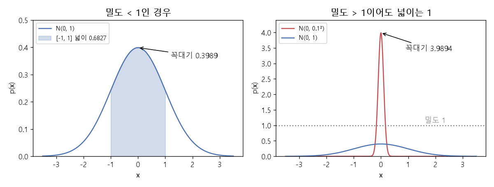

# 확률 밀도와 정규분포 (Probability mass function, Probability density function, Normal distribution)

[목차로 돌아가기](../../00_MIT%EB%94%A5%EB%9F%AC%EB%8B%9D_%EB%AA%A9%EC%B0%A8.md) · 먼저 볼 것: [M08_확률_기초](../../%EC%88%98%ED%95%99%EA%B0%9C%EB%85%90/04_%ED%99%95%EB%A5%A0%EA%B3%BC_%EC%A0%95%EB%B3%B4/M08_%ED%99%95%EB%A5%A0_%EA%B8%B0%EC%B4%88.md), [M06_지수와_e](../../%EC%88%98%ED%95%99%EA%B0%9C%EB%85%90/01_%EC%88%98%EC%99%80_%ED%95%A8%EC%88%98/M06_%EC%A7%80%EC%88%98%EC%99%80_e.md), [MM35_L2_회귀와_범주_분포](../../%EC%88%98%ED%95%99%EA%B0%9C%EB%85%90/04_%ED%99%95%EB%A5%A0%EA%B3%BC_%EC%A0%95%EB%B3%B4/MM35_L2_%ED%9A%8C%EA%B7%80%EC%99%80_%EB%B2%94%EC%A3%BC_%EB%B6%84%ED%8F%AC.md), [MM85_분산과_표준편차와_공분산](../../%EC%88%98%ED%95%99%EA%B0%9C%EB%85%90/01_%EC%88%98%EC%99%80_%ED%95%A8%EC%88%98/MM85_%EB%B6%84%EC%82%B0%EA%B3%BC_%ED%91%9C%EC%A4%80%ED%8E%B8%EC%B0%A8%EC%99%80_%EA%B3%B5%EB%B6%84%EC%82%B0.md), [MM86_정적분과_넓이](../../%EC%88%98%ED%95%99%EA%B0%9C%EB%85%90/02_%EB%AF%B8%EB%B6%84/MM86_%EC%A0%95%EC%A0%81%EB%B6%84%EA%B3%BC_%EB%84%93%EC%9D%B4.md) · 쓰는 곳: [Lec14 2.2](../../Lec14_%EC%83%9D%EC%84%B1_%EB%AA%A8%EB%8D%B8_%EA%B8%B0%EC%B4%88.md#22-%ED%99%95%EB%A5%A0-%EB%B3%80%EC%88%98%EC%99%80-%EC%A7%88%EB%9F%89%EB%B0%80%EB%8F%84-%ED%95%A8%EC%88%98), [Lec14 7](../../Lec14_%EC%83%9D%EC%84%B1_%EB%AA%A8%EB%8D%B8_%EA%B8%B0%EC%B4%88.md#7-%EC%9E%90%EA%B8%B0%ED%9A%8C%EA%B7%80-%EB%AA%A8%EB%8D%B8), [Lec14 8.2](../../Lec14_%EC%83%9D%EC%84%B1_%EB%AA%A8%EB%8D%B8_%EA%B8%B0%EC%B4%88.md#82-%EA%B0%80%EC%9A%B0%EC%8B%9C%EC%95%88-%ED%99%95%EC%82%B0%EC%9D%98-%EC%88%98%EC%8B%9D)

📚 학습 순서 33/99 (4. 확률과 정보): ← 이전: [MM24_경우의_수와_VC_한계](../../%EC%88%98%ED%95%99%EA%B0%9C%EB%85%90/04_%ED%99%95%EB%A5%A0%EA%B3%BC_%EC%A0%95%EB%B3%B4/MM24_%EA%B2%BD%EC%9A%B0%EC%9D%98_%EC%88%98%EC%99%80_VC_%ED%95%9C%EA%B3%84.md) · 다음: [MM51_KL_발산과_최대_우도](../../%EC%88%98%ED%95%99%EA%B0%9C%EB%85%90/04_%ED%99%95%EB%A5%A0%EA%B3%BC_%EC%A0%95%EB%B3%B4/MM51_KL_%EB%B0%9C%EC%82%B0%EA%B3%BC_%EC%B5%9C%EB%8C%80_%EC%9A%B0%EB%8F%84.md) →

> [!NOTE]
> **3줄 요약**
> - **[확률 질량 함수](../../00_%EB%94%A5%EB%9F%AC%EB%8B%9D_%EC%9A%A9%EC%96%B4%EC%82%AC%EC%A0%84.md#probability-mass-function-%ED%99%95%EB%A5%A0-%EC%A7%88%EB%9F%89-%ED%95%A8%EC%88%98)(PMF)**는 셀 수 있는 값마다 [확률](../../00_%EB%94%A5%EB%9F%AC%EB%8B%9D_%EC%9A%A9%EC%96%B4%EC%82%AC%EC%A0%84.md#probability-%ED%99%95%EB%A5%A0)을 준다. 값은 0~1이고 모두 **더하면 1**이다. **[확률 밀도 함수](../../00_%EB%94%A5%EB%9F%AC%EB%8B%9D_%EC%9A%A9%EC%96%B4%EC%82%AC%EC%A0%84.md#probability-density-function-%ED%99%95%EB%A5%A0-%EB%B0%80%EB%8F%84-%ED%95%A8%EC%88%98)(PDF)**는 연속인 값에 "밀도"를 주고, 곡선 아래 **넓이가 1**이다. 밀도 자체는 1보다 클 수 있다(폭 0.5인 균등 분포의 밀도는 2).
> - **[정규분포](../../00_%EB%94%A5%EB%9F%AC%EB%8B%9D_%EC%9A%A9%EC%96%B4%EC%82%AC%EC%A0%84.md#normal-distribution-%EC%A0%95%EA%B7%9C%EB%B6%84%ED%8F%AC)(가우스 분포)** $\mathcal{N}(\mu, \sigma^2)$는 평균 $\mu$에서 가장 높은 종 모양이다. $\mathcal{N}(0, 1)$의 밀도는 0에서 0.3989, 폭을 $\sigma = 0.1$로 좁히면 3.9894로 1을 넘는다. $-1$과 $1$ 사이에 들어갈 [확률](../../00_%EB%94%A5%EB%9F%AC%EB%8B%9D_%EC%9A%A9%EC%96%B4%EC%82%AC%EC%A0%84.md#probability-%ED%99%95%EB%A5%A0)은 넓이 0.6827이다.
> - [정규분포](../../00_%EB%94%A5%EB%9F%AC%EB%8B%9D_%EC%9A%A9%EC%96%B4%EC%82%AC%EC%A0%84.md#normal-distribution-%EC%A0%95%EA%B7%9C%EB%B6%84%ED%8F%AC) 표본은 표준 정규 표본 $\epsilon$으로 $x = \mu + \sigma\epsilon$처럼 만든다($\mu = 3, \sigma = 2, \epsilon = 0.5$이면 4). [범주 분포](../../00_%EB%94%A5%EB%9F%AC%EB%8B%9D_%EC%9A%A9%EC%96%B4%EC%82%AC%EC%A0%84.md#categorical-distribution-%EB%B2%94%EC%A3%BC-%EB%B6%84%ED%8F%AC) 표본은 0~1 사이 난수 $u$가 누적 [확률](../../00_%EB%94%A5%EB%9F%AC%EB%8B%9D_%EC%9A%A9%EC%96%B4%EC%82%AC%EC%A0%84.md#probability-%ED%99%95%EB%A5%A0)의 어느 칸에 떨어지는지로 고른다.

## 1. 개념 설명

비유: **질량**은 구슬 몇 개를 칸에 나눠 담은 것이다. 칸마다 구슬의 비율이 [확률](../../00_%EB%94%A5%EB%9F%AC%EB%8B%9D_%EC%9A%A9%EC%96%B4%EC%82%AC%EC%A0%84.md#probability-%ED%99%95%EB%A5%A0)이고, 모두 합치면 1이다. **밀도**는 모래를 바닥에 뿌린 것이다. 한 점에 있는 모래의 "양"은 0이지만, 어느 곳이 얼마나 두껍게 쌓였는지(밀도)는 말할 수 있다. 어느 구간에 든 모래의 양 = 그 구간의 넓이다.

- **[확률 변수](../../00_%EB%94%A5%EB%9F%AC%EB%8B%9D_%EC%9A%A9%EC%96%B4%EC%82%AC%EC%A0%84.md#random-variable-%ED%99%95%EB%A5%A0-%EB%B3%80%EC%88%98)**(random variable) $X$: 실험할 때마다 값이 달라지는 양. 대문자 $X$는 변수(분포 전체), 소문자 $x$는 실제로 나온 값(실현값)이다. 강의 표기에서 $p(X)$는 분포, $p(x)$는 그 값 하나의 [확률](../../00_%EB%94%A5%EB%9F%AC%EB%8B%9D_%EC%9A%A9%EC%96%B4%EC%82%AC%EC%A0%84.md#probability-%ED%99%95%EB%A5%A0)(또는 밀도)이다.
- **[확률 질량 함수](../../00_%EB%94%A5%EB%9F%AC%EB%8B%9D_%EC%9A%A9%EC%96%B4%EC%82%AC%EC%A0%84.md#probability-mass-function-%ED%99%95%EB%A5%A0-%EC%A7%88%EB%9F%89-%ED%95%A8%EC%88%98)**(PMF): 이산 값 $x$마다 $0 \le p(x) \le 1$, 모두 더하면 1. [소프트맥스](../../00_%EB%94%A5%EB%9F%AC%EB%8B%9D_%EC%9A%A9%EC%96%B4%EC%82%AC%EC%A0%84.md#softmax-%EC%86%8C%ED%94%84%ED%8A%B8%EB%A7%A5%EC%8A%A4) 출력이 바로 PMF다([범주 분포](../../00_%EB%94%A5%EB%9F%AC%EB%8B%9D_%EC%9A%A9%EC%96%B4%EC%82%AC%EC%A0%84.md#categorical-distribution-%EB%B2%94%EC%A3%BC-%EB%B6%84%ED%8F%AC)).
- **[확률 밀도 함수](../../00_%EB%94%A5%EB%9F%AC%EB%8B%9D_%EC%9A%A9%EC%96%B4%EC%82%AC%EC%A0%84.md#probability-density-function-%ED%99%95%EB%A5%A0-%EB%B0%80%EB%8F%84-%ED%95%A8%EC%88%98)**(PDF): 연속 값 $x$마다 $p(x) \ge 0$, 곡선 아래 전체 넓이(적분)가 1. 위쪽 한계는 없다. [확률](../../00_%EB%94%A5%EB%9F%AC%EB%8B%9D_%EC%9A%A9%EC%96%B4%EC%82%AC%EC%A0%84.md#probability-%ED%99%95%EB%A5%A0)은 **구간의 넓이**로만 정해진다.
- **[정규분포](../../00_%EB%94%A5%EB%9F%AC%EB%8B%9D_%EC%9A%A9%EC%96%B4%EC%82%AC%EC%A0%84.md#normal-distribution-%EC%A0%95%EA%B7%9C%EB%B6%84%ED%8F%AC)** $\mathcal{N}(\mu, \sigma^2)$: 평균 $\mu$, 표준편차 $\sigma$([분산](../../00_%EB%94%A5%EB%9F%AC%EB%8B%9D_%EC%9A%A9%EC%96%B4%EC%82%AC%EC%A0%84.md#variance-%EB%B6%84%EC%82%B0) $\sigma^2$)인 종 모양 밀도. [생성 모델](../../00_%EB%94%A5%EB%9F%AC%EB%8B%9D_%EC%9A%A9%EC%96%B4%EC%82%AC%EC%A0%84.md#generative-model-%EC%83%9D%EC%84%B1-%EB%AA%A8%EB%8D%B8)에서 잡음 $z$, [확산 모델](../../00_%EB%94%A5%EB%9F%AC%EB%8B%9D_%EC%9A%A9%EC%96%B4%EC%82%AC%EC%A0%84.md#diffusion-model-%ED%99%95%EC%82%B0-%EB%AA%A8%EB%8D%B8)의 잡음 $\epsilon$이 모두 표준 [정규분포](../../00_%EB%94%A5%EB%9F%AC%EB%8B%9D_%EC%9A%A9%EC%96%B4%EC%82%AC%EC%A0%84.md#normal-distribution-%EC%A0%95%EA%B7%9C%EB%B6%84%ED%8F%AC) $\mathcal{N}(0, 1)$에서 뽑힌다.

## 2. 필요한 이유

[Lec14 2.2](../../Lec14_%EC%83%9D%EC%84%B1_%EB%AA%A8%EB%8D%B8_%EA%B8%B0%EC%B4%88.md#22-%ED%99%95%EB%A5%A0-%EB%B3%80%EC%88%98%EC%99%80-%EC%A7%88%EB%9F%89%EB%B0%80%EB%8F%84-%ED%95%A8%EC%88%98)에서 강사는 [생성 모델](../../00_%EB%94%A5%EB%9F%AC%EB%8B%9D_%EC%9A%A9%EC%96%B4%EC%82%AC%EC%A0%84.md#generative-model-%EC%83%9D%EC%84%B1-%EB%AA%A8%EB%8D%B8)이 "[확률](../../00_%EB%94%A5%EB%9F%AC%EB%8B%9D_%EC%9A%A9%EC%96%B4%EC%82%AC%EC%A0%84.md#probability-%ED%99%95%EB%A5%A0)의 언어"로 말한다며 질량 함수와 밀도 함수를 정의하고, "밀도가 무한대로 갈 수 있는데 어떻게 넓이가 1인가"라는 질문에 답한다. [Lec14 7](../../Lec14_%EC%83%9D%EC%84%B1_%EB%AA%A8%EB%8D%B8_%EA%B8%B0%EC%B4%88.md#7-%EC%9E%90%EA%B8%B0%ED%9A%8C%EA%B7%80-%EB%AA%A8%EB%8D%B8)의 다음 픽셀 고르기는 [범주 분포](../../00_%EB%94%A5%EB%9F%AC%EB%8B%9D_%EC%9A%A9%EC%96%B4%EC%82%AC%EC%A0%84.md#categorical-distribution-%EB%B2%94%EC%A3%BC-%EB%B6%84%ED%8F%AC)에서 표본을 뽑는 일이고, [Lec14 8.2](../../Lec14_%EC%83%9D%EC%84%B1_%EB%AA%A8%EB%8D%B8_%EA%B8%B0%EC%B4%88.md#82-%EA%B0%80%EC%9A%B0%EC%8B%9C%EC%95%88-%ED%99%95%EC%82%B0%EC%9D%98-%EC%88%98%EC%8B%9D)의 [확산 모델](../../00_%EB%94%A5%EB%9F%AC%EB%8B%9D_%EC%9A%A9%EC%96%B4%EC%82%AC%EC%A0%84.md#diffusion-model-%ED%99%95%EC%82%B0-%EB%AA%A8%EB%8D%B8)은 [정규분포](../../00_%EB%94%A5%EB%9F%AC%EB%8B%9D_%EC%9A%A9%EC%96%B4%EC%82%AC%EC%A0%84.md#normal-distribution-%EC%A0%95%EA%B7%9C%EB%B6%84%ED%8F%AC) 잡음을 더하고 [정규분포](../../00_%EB%94%A5%EB%9F%AC%EB%8B%9D_%EC%9A%A9%EC%96%B4%EC%82%AC%EC%A0%84.md#normal-distribution-%EC%A0%95%EA%B7%9C%EB%B6%84%ED%8F%AC)의 평균을 예측한다. 또 L2 [회귀](../../00_%EB%94%A5%EB%9F%AC%EB%8B%9D_%EC%9A%A9%EC%96%B4%EC%82%AC%EC%A0%84.md#regression-classification-%ED%9A%8C%EA%B7%80%EC%99%80-%EB%B6%84%EB%A5%98)가 "평균을 예측하는 [정규분포](../../00_%EB%94%A5%EB%9F%AC%EB%8B%9D_%EC%9A%A9%EC%96%B4%EC%82%AC%EC%A0%84.md#normal-distribution-%EC%A0%95%EA%B7%9C%EB%B6%84%ED%8F%AC) 모델"이라는 해석(질의응답)도 이 노트의 식에서 나온다.

## 3. 숫자로 보기

**(가) 질량과 밀도의 조건**

$$
\text{PMF: } \sum_{x} p(x) = 1,\ \ 0 \le p(x) \le 1 \qquad\qquad \text{PDF: } \int p(x)\, dx = 1,\ \ p(x) \ge 0
$$

<details><summary>기호 풀이</summary>

| 기호 | 읽는 법 | 뜻 | 예제 값 |
| --- | --- | --- | --- |
| $x$ | 엑스 | [확률 변수](../../00_%EB%94%A5%EB%9F%AC%EB%8B%9D_%EC%9A%A9%EC%96%B4%EC%82%AC%EC%A0%84.md#random-variable-%ED%99%95%EB%A5%A0-%EB%B3%80%EC%88%98)가 가질 수 있는 값 하나 | 1, 2, 3 / 0.3 |
| $p(x)$ | 피 오브 엑스 | 그 값의 [확률](../../00_%EB%94%A5%EB%9F%AC%EB%8B%9D_%EC%9A%A9%EC%96%B4%EC%82%AC%EC%A0%84.md#probability-%ED%99%95%EB%A5%A0)(PMF) 또는 밀도(PDF) | 0.2 / 2 |
| $\sum_x$ | 시그마 | 가능한 모든 값에 대해 더한다 | |
| $\int \cdots dx$ | 적분 | 곡선 아래 넓이를 잰다 (연속판 Σ) | |

</details>

<details><summary>예제와 풀이</summary>

**문제**: 0과 0.5 사이에서 고르게 나오는 값(균등 분포)의 밀도가 2라고 한다. 곡선 아래 넓이가 1인지, 그리고 0.1~0.3에 들어갈 [확률](../../00_%EB%94%A5%EB%9F%AC%EB%8B%9D_%EC%9A%A9%EC%96%B4%EC%82%AC%EC%A0%84.md#probability-%ED%99%95%EB%A5%A0)은 얼마인지 구하라.

**주어진 값**
- $p(x) = 2$ (0 ≤ x ≤ 0.5에서의 밀도, 밖에서는 0)
- 구간 [0, 0.5] (값이 나올 수 있는 범위)
- 구간 [0.1, 0.3] ([확률](../../00_%EB%94%A5%EB%9F%AC%EB%8B%9D_%EC%9A%A9%EC%96%B4%EC%82%AC%EC%A0%84.md#probability-%ED%99%95%EB%A5%A0)을 묻는 범위)

**풀이**
1. 식을 그대로 쓴다: $\int p(x)\, dx = 1$
2. 값을 대입한다: $\int_0^{0.5} 2\, dx = 1$ ?
3. 높이가 일정한 곡선의 넓이는 직사각형 넓이(높이 × 폭)다. 폭을 구한다: $0.5 - 0 = 0.5$
4. 높이와 폭을 곱한다: $2 \times 0.5 = 1$ → 조건을 만족한다
5. 0.1~0.3 구간의 폭을 구한다: $0.3 - 0.1 = 0.2$
6. 높이와 폭을 곱한다: $2 \times 0.2 = 0.4$

**답**: 넓이는 **1**(밀도 2가 1보다 커도 된다), 0.1~0.3에 들어갈 [확률](../../00_%EB%94%A5%EB%9F%AC%EB%8B%9D_%EC%9A%A9%EC%96%B4%EC%82%AC%EC%A0%84.md#probability-%ED%99%95%EB%A5%A0)은 **0.4**.

</details>

<details><summary>내 이해</summary>


</details>

**(나) [정규분포](../../00_%EB%94%A5%EB%9F%AC%EB%8B%9D_%EC%9A%A9%EC%96%B4%EC%82%AC%EC%A0%84.md#normal-distribution-%EC%A0%95%EA%B7%9C%EB%B6%84%ED%8F%AC)의 밀도**

$$
\mathcal{N}(x;\ \mu, \sigma^2) = \frac{1}{\sqrt{2\pi\sigma^2}} \exp\!\left(-\frac{(x - \mu)^2}{2\sigma^2}\right)
$$

<details><summary>기호 풀이</summary>

| 기호 | 읽는 법 | 뜻 | 예제 값 |
| --- | --- | --- | --- |
| $\mathcal{N}(x; \mu, \sigma^2)$ | 엔 | 평균 $\mu$, [분산](../../00_%EB%94%A5%EB%9F%AC%EB%8B%9D_%EC%9A%A9%EC%96%B4%EC%82%AC%EC%A0%84.md#variance-%EB%B6%84%EC%82%B0) $\sigma^2$인 [정규분포](../../00_%EB%94%A5%EB%9F%AC%EB%8B%9D_%EC%9A%A9%EC%96%B4%EC%82%AC%EC%A0%84.md#normal-distribution-%EC%A0%95%EA%B7%9C%EB%B6%84%ED%8F%AC)의 $x$에서의 밀도 | 0.3989 |
| $\mu$ | 뮤 | 평균. 종의 꼭대기 위치 | 0 |
| $\sigma$ | 시그마 | 표준편차. 종의 폭 | 1 |
| $\sigma^2$ | 시그마 제곱 | [분산](../../00_%EB%94%A5%EB%9F%AC%EB%8B%9D_%EC%9A%A9%EC%96%B4%EC%82%AC%EC%A0%84.md#variance-%EB%B6%84%EC%82%B0) | 1 |
| $\pi$ | 파이 | 원주율 3.1416 | |
| $\exp(a)$ | 익스포넨셜 | $e^a$, $e$ = 2.718의 $a$제곱 | $e^0 = 1$ |

</details>

<details><summary>예제와 풀이</summary>

**문제**: 평균 1, 표준편차 0.5인 [정규분포](../../00_%EB%94%A5%EB%9F%AC%EB%8B%9D_%EC%9A%A9%EC%96%B4%EC%82%AC%EC%A0%84.md#normal-distribution-%EC%A0%95%EA%B7%9C%EB%B6%84%ED%8F%AC)의 밀도를 꼭대기 $x = 1$에서 구하라.

**주어진 값**
- $x = 1$ (밀도를 잴 위치)
- $\mu = 1$ (평균)
- $\sigma = 0.5$ (표준편차)

**풀이**
1. 식을 그대로 쓴다: $\mathcal{N}(x; \mu, \sigma^2) = \dfrac{1}{\sqrt{2\pi\sigma^2}} \exp\!\left(-\dfrac{(x - \mu)^2}{2\sigma^2}\right)$
2. 값을 대입한다: $\mathcal{N}(1; 1, 0.5^2) = \dfrac{1}{\sqrt{2\pi \times 0.5^2}} \exp\!\left(-\dfrac{(1 - 1)^2}{2 \times 0.5^2}\right)$
3. 괄호 안을 뺀다: $1 - 1 = 0$, 제곱해도 $0^2 = 0$
4. [지수](../../00_%EB%94%A5%EB%9F%AC%EB%8B%9D_%EC%9A%A9%EC%96%B4%EC%82%AC%EC%A0%84.md#e-exponent-e%EC%99%80-%EC%A7%80%EC%88%98) 안을 계산한다: $-0 / (2 \times 0.25) = 0$
5. $\exp$를 계산한다. $\exp(a) = e^a$이고 $e$는 약 2.718인 수다. 어떤 수든 0제곱은 1이다: $e^0 = 1$
6. [분산](../../00_%EB%94%A5%EB%9F%AC%EB%8B%9D_%EC%9A%A9%EC%96%B4%EC%82%AC%EC%A0%84.md#variance-%EB%B6%84%EC%82%B0)을 구한다: $0.5^2 = 0.25$
7. $2\pi$를 곱한다: $2 \times 3.1416 \times 0.25 = 1.5708$
8. 제곱근을 구한다. $\sqrt{a}$는 제곱해서 $a$가 되는 양수다: $\sqrt{1.5708} = 1.2533$
9. 나눈다: $1 / 1.2533 = 0.7979$
10. 곱한다: $0.7979 \times 1 = 0.7979$

**답**: 꼭대기 밀도는 **0.7979**. 폭이 $\sigma = 1$일 때(0.3989)의 두 배다. 폭을 반으로 줄이면 넓이 1을 지키려고 키가 두 배가 된다.

</details>

<details><summary>내 이해</summary>


</details>

| 분포 | 꼭대기 밀도 | 뜻 |
|---|---|---|
| $\mathcal{N}(0, 1)$ | 0.3989 | $1/\sqrt{2\pi}$. $x = 1$에서는 0.242 |
| $\mathcal{N}(0, 0.1^2)$ | 3.9894 | 폭이 10분의 1 → 키가 10배. **밀도는 1을 넘을 수 있다** |
| $\mathcal{N}(0, 1)$, 구간 $[-1, 1]$ | 넓이 0.6827 | 이것이 **[확률](../../00_%EB%94%A5%EB%9F%AC%EB%8B%9D_%EC%9A%A9%EC%96%B4%EC%82%AC%EC%A0%84.md#probability-%ED%99%95%EB%A5%A0)**이다 |


*▲ 직접 그린 그림: $\mathcal{N}(0, 1)$(꼭대기 0.3989)과 $\mathcal{N}(0, 0.1^2)$(꼭대기 3.9894). 두 곡선 모두 넓이는 1이고, 칠한 [-1, 1] 구간의 넓이 0.6827이 [확률](../../00_%EB%94%A5%EB%9F%AC%EB%8B%9D_%EC%9A%A9%EC%96%B4%EC%82%AC%EC%A0%84.md#probability-%ED%99%95%EB%A5%A0)이다*

**(다) 표본 뽑기**
- [정규분포](../../00_%EB%94%A5%EB%9F%AC%EB%8B%9D_%EC%9A%A9%EC%96%B4%EC%82%AC%EC%A0%84.md#normal-distribution-%EC%A0%95%EA%B7%9C%EB%B6%84%ED%8F%AC): 표준 정규 표본 $\epsilon \sim \mathcal{N}(0, 1)$을 뽑아 늘리고(×σ) 옮긴다(+μ). $\mu = 3$, $\sigma = 2$, $\epsilon = 0.5$ → $3 + 2 \times 0.5 = 4$.
- [범주 분포](../../00_%EB%94%A5%EB%9F%AC%EB%8B%9D_%EC%9A%A9%EC%96%B4%EC%82%AC%EC%A0%84.md#categorical-distribution-%EB%B2%94%EC%A3%BC-%EB%B6%84%ED%8F%AC) $(0.2, 0.5, 0.3)$: 누적 [확률](../../00_%EB%94%A5%EB%9F%AC%EB%8B%9D_%EC%9A%A9%EC%96%B4%EC%82%AC%EC%A0%84.md#probability-%ED%99%95%EB%A5%A0) $(0.2, 0.7, 1.0)$을 만든다. 0~1 균등 난수 $u = 0.63$은 0.2보다 크고 0.7 이하이므로 **2번** 칸이 뽑힌다. 강의의 "단위 구간을 걸어가며 칸을 찾는다"가 이것이다.

**(라) L2 [회귀](../../00_%EB%94%A5%EB%9F%AC%EB%8B%9D_%EC%9A%A9%EC%96%B4%EC%82%AC%EC%A0%84.md#regression-classification-%ED%9A%8C%EA%B7%80%EC%99%80-%EB%B6%84%EB%A5%98) = [정규분포](../../00_%EB%94%A5%EB%9F%AC%EB%8B%9D_%EC%9A%A9%EC%96%B4%EC%82%AC%EC%A0%84.md#normal-distribution-%EC%A0%95%EA%B7%9C%EB%B6%84%ED%8F%AC)의 [최대 우도](../../00_%EB%94%A5%EB%9F%AC%EB%8B%9D_%EC%9A%A9%EC%96%B4%EC%82%AC%EC%A0%84.md#maximum-likelihood-%EC%B5%9C%EB%8C%80-%EC%9A%B0%EB%8F%84)**
- $\sigma = 1$인 [정규분포](../../00_%EB%94%A5%EB%9F%AC%EB%8B%9D_%EC%9A%A9%EC%96%B4%EC%82%AC%EC%A0%84.md#normal-distribution-%EC%A0%95%EA%B7%9C%EB%B6%84%ED%8F%AC)의 음의 [로그](../../00_%EB%94%A5%EB%9F%AC%EB%8B%9D_%EC%9A%A9%EC%96%B4%EC%82%AC%EC%A0%84.md#log-ln-%EB%A1%9C%EA%B7%B8) 밀도는 $-\ln \mathcal{N}(y; \mu, 1) = \tfrac{1}{2}(y - \mu)^2 + 0.9189$다(0.9189 = $\tfrac{1}{2}\ln 2\pi$).
- [정답](../../00_%EB%94%A5%EB%9F%AC%EB%8B%9D_%EC%9A%A9%EC%96%B4%EC%82%AC%EC%A0%84.md#label-%EC%A0%95%EB%8B%B5) $y = 2$, 예측 $\mu = 1.5$ → $0.5 \times 0.25 + 0.9189 = 1.0439$. 상수 0.9189를 빼면 제곱 [오차](../../00_%EB%94%A5%EB%9F%AC%EB%8B%9D_%EC%9A%A9%EC%96%B4%EC%82%AC%EC%A0%84.md#error-%EC%98%A4%EC%B0%A8)의 절반이다. 그래서 제곱 [오차](../../00_%EB%94%A5%EB%9F%AC%EB%8B%9D_%EC%9A%A9%EC%96%B4%EC%82%AC%EC%A0%84.md#error-%EC%98%A4%EC%B0%A8)를 줄이는 것 = 이 [정규분포](../../00_%EB%94%A5%EB%9F%AC%EB%8B%9D_%EC%9A%A9%EC%96%B4%EC%82%AC%EC%A0%84.md#normal-distribution-%EC%A0%95%EA%B7%9C%EB%B6%84%ED%8F%AC)에서 [정답](../../00_%EB%94%A5%EB%9F%AC%EB%8B%9D_%EC%9A%A9%EC%96%B4%EC%82%AC%EC%A0%84.md#label-%EC%A0%95%EB%8B%B5)의 밀도를 높이는 것이다.

## 4. 코드로 확인

```python
# [함수] import math: sqrt, exp, pi, erf 같은 수학 함수 모음
import math
# [함수] def npdf(x, mu, s): 정규분포 N(mu, s^2)의 x에서의 밀도를 돌려준다
# [연결] 본문 3절 (나)의 식
def npdf(x, mu, s):
    # [함수] math.exp: e의 거듭제곱. math.sqrt: 제곱근
    return 1 / math.sqrt(2 * math.pi * s * s) * math.exp(-(x - mu) ** 2 / (2 * s * s))
# [변수] 균등 분포 [0, 0.5]의 밀도 2 × 폭 0.5 = 넓이 1.0
# [연결] 본문 3절 (가)의 예제
print(2 * 0.5)
# [연결] 본문 3절 표 → N(0,1) 꼭대기 0.3989, x = 1에서 0.242, 폭 0.1이면 3.9894
print(round(npdf(0, 0, 1), 4), round(npdf(1, 0, 1), 4), round(npdf(0, 0, 0.1), 4))
# [함수] math.erf: 정규분포 넓이를 구하는 오차 함수. erf(1/√2)가 [-1, 1]의 넓이
# [연결] 본문 3절 표의 0.6827
print(round(math.erf(1 / math.sqrt(2)), 4))
# [연결] 본문 3절 (나)의 예제 → N(1, 0.5^2)의 꼭대기 0.7979
print(round(npdf(1, 1, 0.5), 4))
# [변수] mu, sigma, eps: 평균 3, 표준편차 2, 표준 정규 표본 0.5
mu, sigma, eps = 3, 2, 0.5
# [연결] 본문 3절 (다) → x = mu + sigma × eps = 4.0
print(mu + sigma * eps)
# [변수] cum: 범주 분포 (0.2, 0.5, 0.3)의 누적 확률 [0.2, 0.7, 1.0]
cum = [0.2, 0.7, 1.0]
# [함수] next(...): u = 0.63 이하인 누적값을 처음 만나는 칸 번호(1부터)를 찾는다
# [연결] 본문 3절 (다) → 2번 칸
print(next(k + 1 for k, c in enumerate(cum) if 0.63 <= c))
# [함수] math.log: 자연로그. 음의 로그 밀도 = 제곱 오차의 절반 + 0.9189
# [연결] 본문 3절 (라) → 1.0439
print(round(-math.log(npdf(2, 1.5, 1)), 4), round(0.5 * math.log(2 * math.pi), 4))
```

**실행 결과**:

```text
1.0
0.3989 0.242 3.9894
0.6827
0.7979
4.0
2
1.0439 0.9189
```

> [!WARNING]
> **⚠ 주의**
> - **밀도는 [확률](../../00_%EB%94%A5%EB%9F%AC%EB%8B%9D_%EC%9A%A9%EC%96%B4%EC%82%AC%EC%A0%84.md#probability-%ED%99%95%EB%A5%A0)이 아니다.** 밀도 3.9894는 "그 점이 일어날 [확률](../../00_%EB%94%A5%EB%9F%AC%EB%8B%9D_%EC%9A%A9%EC%96%B4%EC%82%AC%EC%A0%84.md#probability-%ED%99%95%EB%A5%A0)"이 아니라 "그 근처가 얼마나 빽빽한가"다. 한 점의 [확률](../../00_%EB%94%A5%EB%9F%AC%EB%8B%9D_%EC%9A%A9%EC%96%B4%EC%82%AC%EC%A0%84.md#probability-%ED%99%95%EB%A5%A0)은 0이고, [확률](../../00_%EB%94%A5%EB%9F%AC%EB%8B%9D_%EC%9A%A9%EC%96%B4%EC%82%AC%EC%A0%84.md#probability-%ED%99%95%EB%A5%A0)은 구간의 넓이로만 말한다.
> - 그래서 연속 데이터의 [로그](../../00_%EB%94%A5%EB%9F%AC%EB%8B%9D_%EC%9A%A9%EC%96%B4%EC%82%AC%EC%A0%84.md#log-ln-%EB%A1%9C%EA%B7%B8) [우도](../../00_%EB%94%A5%EB%9F%AC%EB%8B%9D_%EC%9A%A9%EC%96%B4%EC%82%AC%EC%A0%84.md#likelihood-%EC%9A%B0%EB%8F%84)([로그](../../00_%EB%94%A5%EB%9F%AC%EB%8B%9D_%EC%9A%A9%EC%96%B4%EC%82%AC%EC%A0%84.md#log-ln-%EB%A1%9C%EA%B7%B8) 밀도)는 **양수일 수도** 있다. [확률](../../00_%EB%94%A5%EB%9F%AC%EB%8B%9D_%EC%9A%A9%EC%96%B4%EC%82%AC%EC%A0%84.md#probability-%ED%99%95%EB%A5%A0)(PMF)의 [로그](../../00_%EB%94%A5%EB%9F%AC%EB%8B%9D_%EC%9A%A9%EC%96%B4%EC%82%AC%EC%A0%84.md#log-ln-%EB%A1%9C%EA%B7%B8)는 늘 0 이하지만 밀도의 [로그](../../00_%EB%94%A5%EB%9F%AC%EB%8B%9D_%EC%9A%A9%EC%96%B4%EC%82%AC%EC%A0%84.md#log-ln-%EB%A1%9C%EA%B7%B8)는 아니다.
> - $\mathcal{N}(\mu, \sigma^2)$의 두 번째 칸은 **[분산](../../00_%EB%94%A5%EB%9F%AC%EB%8B%9D_%EC%9A%A9%EC%96%B4%EC%82%AC%EC%A0%84.md#variance-%EB%B6%84%EC%82%B0)**이다. 코드 라이브러리(예: `np.random.normal(loc, scale)`)는 표준편차를 받는 경우가 많아 헷갈리기 쉽다.

## 5. 개념 재확인

<details><summary>1. 평균 2, 표준편차 0.5인 정규분포의 밀도를 $x = 2.5$에서 구하라.</summary>

| 단계 | 하는 일 | 계산 | 결과 |
|---|---|---|---|
| 1 | 거리 제곱 | $(2.5 - 2)^2$ | 0.25 |
| 2 | [지수](../../00_%EB%94%A5%EB%9F%AC%EB%8B%9D_%EC%9A%A9%EC%96%B4%EC%82%AC%EC%A0%84.md#e-exponent-e%EC%99%80-%EC%A7%80%EC%88%98) 안 | $-0.25 / (2 \times 0.25)$ | -0.5 |
| 3 | [지수](../../00_%EB%94%A5%EB%9F%AC%EB%8B%9D_%EC%9A%A9%EC%96%B4%EC%82%AC%EC%A0%84.md#e-exponent-e%EC%99%80-%EC%A7%80%EC%88%98) | $e^{-0.5}$ | 0.6065 |
| 4 | 앞의 계수 | $1/\sqrt{2\pi \times 0.25}$ | 0.7979 |
| 5 | 곱 | $0.7979 \times 0.6065$ | 0.4839 |

**① 쓰는 식**
$$\mathcal{N}(x; \mu, \sigma^2) = \frac{1}{\sqrt{2\pi\sigma^2}} \exp\!\left(-\frac{(x - \mu)^2}{2\sigma^2}\right)$$
- 위 식 ← ② (거리 제곱), ③ ([지수](../../00_%EB%94%A5%EB%9F%AC%EB%8B%9D_%EC%9A%A9%EC%96%B4%EC%82%AC%EC%A0%84.md#e-exponent-e%EC%99%80-%EC%A7%80%EC%88%98) 안), ④ ([지수](../../00_%EB%94%A5%EB%9F%AC%EB%8B%9D_%EC%9A%A9%EC%96%B4%EC%82%AC%EC%A0%84.md#e-exponent-e%EC%99%80-%EC%A7%80%EC%88%98)), ⑤ (계수), ⑥ (곱)에서 쓴다.
```python
# [함수] import math: exp, sqrt, pi를 쓰기 위해 불러온다
import math                                               # ①
# [변수] x, mu, s: 위치 2.5, 평균 2, 표준편차 0.5
x, mu, s = 2.5, 2, 0.5
# [변수] d2 = 0.25: 평균에서의 거리 제곱
d2 = (x - mu) ** 2                                        # ②
# [변수] a = -0.5: 지수 안의 값
a = -d2 / (2 * s * s)                                     # ③
# [변수] c = 0.7979: 앞의 계수 1/√(2π·0.25)
c = 1 / math.sqrt(2 * math.pi * s * s)                    # ⑤
# [연결] 0.6065 0.7979 0.4839
print(round(math.exp(a), 4), round(c, 4), round(c * math.exp(a), 4))   # ④⑥
```

**주어진 값**
- $x = 2.5$ (밀도를 잴 위치)
- $\mu = 2$ (평균)
- $\sigma = 0.5$ (표준편차)

**풀이**
1. 식을 그대로 쓴다: $\mathcal{N}(x; \mu, \sigma^2) = \dfrac{1}{\sqrt{2\pi\sigma^2}} \exp\!\left(-\dfrac{(x - \mu)^2}{2\sigma^2}\right)$
2. 값을 대입한다: $\mathcal{N}(2.5; 2, 0.5^2) = \dfrac{1}{\sqrt{2\pi \times 0.5^2}} \exp\!\left(-\dfrac{(2.5 - 2)^2}{2 \times 0.5^2}\right)$
3. (②) 괄호 안을 뺀다: $2.5 - 2 = 0.5$
4. (②) 제곱한다: $0.5^2 = 0.25$
5. (③) 분모를 구한다: $2 \times 0.5^2 = 2 \times 0.25 = 0.5$
6. (③) 나누고 마이너스를 붙인다: $-0.25 / 0.5 = -0.5$
7. (④) [지수](../../00_%EB%94%A5%EB%9F%AC%EB%8B%9D_%EC%9A%A9%EC%96%B4%EC%82%AC%EC%A0%84.md#e-exponent-e%EC%99%80-%EC%A7%80%EC%88%98)를 계산한다($e^{a}$는 약 2.718의 $a$제곱, 계산기로 구한다): $e^{-0.5} = 0.6065$
8. (⑤) $2\pi\sigma^2$를 구한다: $2 \times 3.1416 \times 0.25 = 1.5708$
9. (⑤) 제곱근을 구한다: $\sqrt{1.5708} = 1.2533$
10. (⑤) 1을 나눈다: $1 / 1.2533 = 0.7979$
11. (⑥) 곱한다: $0.7979 \times 0.6065 = 0.4839$

**답**: **0.4839**. 꼭대기(0.7979)에서 $\sigma$ 하나만큼 떨어지면 밀도가 $e^{-0.5} = 0.6065$배로 준다.

</details>

<details><summary>2. 범주 분포 $(0.1, 0.6, 0.3)$에서 균등 난수 $u = 0.75$가 나왔다. 몇 번 칸이 뽑히는가?</summary>

| 단계 | 하는 일 | 계산 | 결과 |
|---|---|---|---|
| 1 | 첫 누적 | 0.1 | 0.1 |
| 2 | 둘째 누적 | $0.1 + 0.6$ | 0.7 |
| 3 | 셋째 누적 | $0.7 + 0.3$ | 1.0 |
| 4 | $u$의 자리 | $0.7 < 0.75 \le 1.0$ | 3번 |

**① 쓰는 식**
$$k = \text{가장 작은 } k \text{ such that } u \le \sum_{j=1}^{k} p_j$$
- 위 식 ← ②③④ (누적 [확률](../../00_%EB%94%A5%EB%9F%AC%EB%8B%9D_%EC%9A%A9%EC%96%B4%EC%82%AC%EC%A0%84.md#probability-%ED%99%95%EB%A5%A0)), ⑤ (칸 찾기)에서 쓴다.
```python
# [변수] p: 세 칸의 확률, u: 0~1 균등 난수
p, u = [0.1, 0.6, 0.3], 0.75                              # ①
# [변수] cum = [0.1, 0.7, 1.0]: 누적 확률. round로 부동소수 오차를 없앤다
cum = [round(sum(p[:k + 1]), 4) for k in range(3)]        # ②③④
# [함수] next(...): u 이하인 누적값을 처음 만나는 칸 번호(1부터)
# [연결] [0.1, 0.7, 1.0] 3
print(cum, next(k + 1 for k, c in enumerate(cum) if u <= c))   # ⑤
```

**주어진 값**
- $p_1 = 0.1, p_2 = 0.6, p_3 = 0.3$ (세 칸의 [확률](../../00_%EB%94%A5%EB%9F%AC%EB%8B%9D_%EC%9A%A9%EC%96%B4%EC%82%AC%EC%A0%84.md#probability-%ED%99%95%EB%A5%A0))
- $u = 0.75$ (0~1 사이에서 고르게 뽑은 난수)

**풀이**
1. 식을 그대로 쓴다: $u \le \sum_{j=1}^{k} p_j$를 만족하는 가장 작은 $k$
2. 값을 대입한다: $0.75 \le \sum_{j=1}^{k} p_j$ (단, $p = (0.1, 0.6, 0.3)$)
3. (②) $k = 1$의 Σ를 풀어 쓴다: $p_1 = 0.1$ → $0.75 \le 0.1$은 거짓
4. (③) $k = 2$의 Σ를 풀어 쓴다: $p_1 + p_2 = 0.1 + 0.6 = 0.7$ → $0.75 \le 0.7$은 거짓
5. (④) $k = 3$의 Σ를 풀어 쓴다: $0.7 + p_3 = 0.7 + 0.3 = 1.0$ → $0.75 \le 1.0$은 참
6. (⑤) 처음 참이 된 $k$를 고른다: $k = 3$

**답**: **3번** 칸. 칸의 길이가 그 칸의 [확률](../../00_%EB%94%A5%EB%9F%AC%EB%8B%9D_%EC%9A%A9%EC%96%B4%EC%82%AC%EC%A0%84.md#probability-%ED%99%95%EB%A5%A0)이라, $u$를 많이 뽑으면 각 칸이 정확히 그 [확률](../../00_%EB%94%A5%EB%9F%AC%EB%8B%9D_%EC%9A%A9%EC%96%B4%EC%82%AC%EC%A0%84.md#probability-%ED%99%95%EB%A5%A0)만큼 뽑힌다.

</details>

## 예제 풀기

[예제 10문제 풀기](../../%EC%98%88%EC%A0%9C/04_%ED%99%95%EB%A5%A0%EA%B3%BC_%EC%A0%95%EB%B3%B4/%EC%98%88%EC%A0%9C_MM50_%ED%99%95%EB%A5%A0_%EB%B0%80%EB%8F%84%EC%99%80_%EC%A0%95%EA%B7%9C%EB%B6%84%ED%8F%AC.md)

<details><summary>내 이해</summary>


</details>
