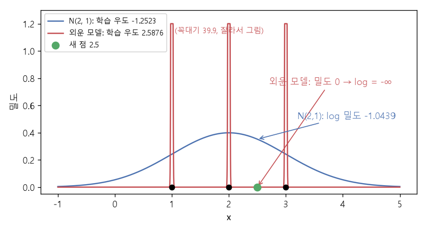

# KL 발산과 최대 우도 (KL divergence, Maximum likelihood)

[목차로 돌아가기](../../00_MIT%EB%94%A5%EB%9F%AC%EB%8B%9D_%EB%AA%A9%EC%B0%A8.md) · 먼저 볼 것: [M10_엔트로피](../../%EC%88%98%ED%95%99%EA%B0%9C%EB%85%90/04_%ED%99%95%EB%A5%A0%EA%B3%BC_%EC%A0%95%EB%B3%B4/M10_%EC%97%94%ED%8A%B8%EB%A1%9C%ED%94%BC.md), [M07_로그](../../%EC%88%98%ED%95%99%EA%B0%9C%EB%85%90/01_%EC%88%98%EC%99%80_%ED%95%A8%EC%88%98/M07_%EB%A1%9C%EA%B7%B8.md), [MM22_기댓값과_일반화_간극](../../%EC%88%98%ED%95%99%EA%B0%9C%EB%85%90/04_%ED%99%95%EB%A5%A0%EA%B3%BC_%EC%A0%95%EB%B3%B4/MM22_%EA%B8%B0%EB%8C%93%EA%B0%92%EA%B3%BC_%EC%9D%BC%EB%B0%98%ED%99%94_%EA%B0%84%EA%B7%B9.md), [MM50_확률_밀도와_정규분포](../../%EC%88%98%ED%95%99%EA%B0%9C%EB%85%90/04_%ED%99%95%EB%A5%A0%EA%B3%BC_%EC%A0%95%EB%B3%B4/MM50_%ED%99%95%EB%A5%A0_%EB%B0%80%EB%8F%84%EC%99%80_%EC%A0%95%EA%B7%9C%EB%B6%84%ED%8F%AC.md) · 쓰는 곳: [Lec14 5.1](../../Lec14_%EC%83%9D%EC%84%B1_%EB%AA%A8%EB%8D%B8_%EA%B8%B0%EC%B4%88.md#51-kl-%EB%B0%9C%EC%82%B0%EC%97%90%EC%84%9C-%EC%B5%9C%EB%8C%80-%EC%9A%B0%EB%8F%84%EB%A1%9C), [Lec14 5.2](../../Lec14_%EC%83%9D%EC%84%B1_%EB%AA%A8%EB%8D%B8_%EA%B8%B0%EC%B4%88.md#52-%ED%8C%8C%EC%9D%BC-%EC%BA%90%EB%B9%84%EB%8B%9B-%EC%83%9D%EC%84%B1-%EB%AA%A8%EB%8D%B8%EC%9D%98-%EA%B3%BC%EC%A0%81%ED%95%A9), [Lec14 7](../../Lec14_%EC%83%9D%EC%84%B1_%EB%AA%A8%EB%8D%B8_%EA%B8%B0%EC%B4%88.md#7-%EC%9E%90%EA%B8%B0%ED%9A%8C%EA%B7%80-%EB%AA%A8%EB%8D%B8)

📚 학습 순서 34/99 (4. 확률과 정보): ← 이전: [MM50_확률_밀도와_정규분포](../../%EC%88%98%ED%95%99%EA%B0%9C%EB%85%90/04_%ED%99%95%EB%A5%A0%EA%B3%BC_%EC%A0%95%EB%B3%B4/MM50_%ED%99%95%EB%A5%A0_%EB%B0%80%EB%8F%84%EC%99%80_%EC%A0%95%EA%B7%9C%EB%B6%84%ED%8F%AC.md) · 다음: [MM25_랭크와_유효_랭크](../../%EC%88%98%ED%95%99%EA%B0%9C%EB%85%90/04_%ED%99%95%EB%A5%A0%EA%B3%BC_%EC%A0%95%EB%B3%B4/MM25_%EB%9E%AD%ED%81%AC%EC%99%80_%EC%9C%A0%ED%9A%A8_%EB%9E%AD%ED%81%AC.md) →

> [!NOTE]
> **3줄 요약**
> - **[KL 발산](../../00_%EB%94%A5%EB%9F%AC%EB%8B%9D_%EC%9A%A9%EC%96%B4%EC%82%AC%EC%A0%84.md#kl-divergence-kl-%EB%B0%9C%EC%82%B0)** $D_{KL}(p \,\|\, q) = \sum_x p(x)\log\frac{p(x)}{q(x)}$은 "진짜 분포 $p$ 대신 $q$를 쓰면 얼마나 손해인가"를 잰다. 0 이상이고, $p = q$일 때만 0이다. $p = (0.5, 0.5)$, $q = (0.9, 0.1)$이면 0.5108인데, 순서를 바꾸면 0.3681이라 **대칭이 아니다**.
> - $D_{KL}(p_{\text{data}} \,\|\, p_\theta)$를 풀면 $\mathbb{E}[\log p_{\text{data}}]$(모델과 무관한 상수) $- \mathbb{E}[\log p_\theta]$다. 그래서 KL을 줄이는 것 = 데이터의 평균 [로그](../../00_%EB%94%A5%EB%9F%AC%EB%8B%9D_%EC%9A%A9%EC%96%B4%EC%82%AC%EC%A0%84.md#log-ln-%EB%A1%9C%EA%B7%B8) [우도](../../00_%EB%94%A5%EB%9F%AC%EB%8B%9D_%EC%9A%A9%EC%96%B4%EC%82%AC%EC%A0%84.md#likelihood-%EC%9A%B0%EB%8F%84)를 키우는 것 = **[최대 우도](../../00_%EB%94%A5%EB%9F%AC%EB%8B%9D_%EC%9A%A9%EC%96%B4%EC%82%AC%EC%A0%84.md#maximum-likelihood-%EC%B5%9C%EB%8C%80-%EC%9A%B0%EB%8F%84)**다. 모르는 $p_{\text{data}}$는 계산할 필요가 없다.
> - 데이터 (1, 2, 3)에 $\sigma = 1$인 [정규분포](../../00_%EB%94%A5%EB%9F%AC%EB%8B%9D_%EC%9A%A9%EC%96%B4%EC%82%AC%EC%A0%84.md#normal-distribution-%EC%A0%95%EA%B7%9C%EB%B6%84%ED%8F%AC)를 맞추면 평균 [로그](../../00_%EB%94%A5%EB%9F%AC%EB%8B%9D_%EC%9A%A9%EC%96%B4%EC%82%AC%EC%A0%84.md#log-ln-%EB%A1%9C%EA%B7%B8) [우도](../../00_%EB%94%A5%EB%9F%AC%EB%8B%9D_%EC%9A%A9%EC%96%B4%EC%82%AC%EC%A0%84.md#likelihood-%EC%9A%B0%EB%8F%84)는 $\mu = 2$에서 -1.2523으로 가장 크다($\mu = 1$이면 -1.7523). [학습 데이터](../../00_%EB%94%A5%EB%9F%AC%EB%8B%9D_%EC%9A%A9%EC%96%B4%EC%82%AC%EC%A0%84.md#training-data-test-data-%ED%95%99%EC%8A%B5-%EB%8D%B0%EC%9D%B4%ED%84%B0%EC%99%80-%EC%8B%9C%ED%97%98-%EB%8D%B0%EC%9D%B4%ED%84%B0)만 외우는 모델은 [학습](../../00_%EB%94%A5%EB%9F%AC%EB%8B%9D_%EC%9A%A9%EC%96%B4%EC%82%AC%EC%A0%84.md#training-%ED%95%99%EC%8A%B5) [우도](../../00_%EB%94%A5%EB%9F%AC%EB%8B%9D_%EC%9A%A9%EC%96%B4%EC%82%AC%EC%A0%84.md#likelihood-%EC%9A%B0%EB%8F%84) 2.5876으로 더 크지만 새 점 2.5에 밀도 0, [로그](../../00_%EB%94%A5%EB%9F%AC%EB%8B%9D_%EC%9A%A9%EC%96%B4%EC%82%AC%EC%A0%84.md#log-ln-%EB%A1%9C%EA%B7%B8) [우도](../../00_%EB%94%A5%EB%9F%AC%EB%8B%9D_%EC%9A%A9%EC%96%B4%EC%82%AC%EC%A0%84.md#likelihood-%EC%9A%B0%EB%8F%84) $-\infty$를 준다. 이것이 [생성 모델](../../00_%EB%94%A5%EB%9F%AC%EB%8B%9D_%EC%9A%A9%EC%96%B4%EC%82%AC%EC%A0%84.md#generative-model-%EC%83%9D%EC%84%B1-%EB%AA%A8%EB%8D%B8)의 [과적합](../../00_%EB%94%A5%EB%9F%AC%EB%8B%9D_%EC%9A%A9%EC%96%B4%EC%82%AC%EC%A0%84.md#overfitting-%EA%B3%BC%EC%A0%81%ED%95%A9)이다.

## 1. 개념 설명

비유: 날씨 예보관 $q$가 "비 올 [확률](../../00_%EB%94%A5%EB%9F%AC%EB%8B%9D_%EC%9A%A9%EC%96%B4%EC%82%AC%EC%A0%84.md#probability-%ED%99%95%EB%A5%A0) 90%"라고 늘 말하는데, 실제(진짜 분포 $p$)로는 반반이다. 비가 안 온 날마다 예보관은 크게 "놀란다". [KL 발산](../../00_%EB%94%A5%EB%9F%AC%EB%8B%9D_%EC%9A%A9%EC%96%B4%EC%82%AC%EC%A0%84.md#kl-divergence-kl-%EB%B0%9C%EC%82%B0)은 **진짜 세상에서 겪는 평균 놀람이, 진짜 분포를 정확히 알았을 때보다 얼마나 더 큰가**다. [M10](../../%EC%88%98%ED%95%99%EA%B0%9C%EB%85%90/04_%ED%99%95%EB%A5%A0%EA%B3%BC_%EC%A0%95%EB%B3%B4/M10_%EC%97%94%ED%8A%B8%EB%A1%9C%ED%94%BC.md)의 말로는 [교차 엔트로피](../../00_%EB%94%A5%EB%9F%AC%EB%8B%9D_%EC%9A%A9%EC%96%B4%EC%82%AC%EC%A0%84.md#cross-entropy-%EA%B5%90%EC%B0%A8-%EC%97%94%ED%8A%B8%EB%A1%9C%ED%94%BC) $H(p, q)$ − [엔트로피](../../00_%EB%94%A5%EB%9F%AC%EB%8B%9D_%EC%9A%A9%EC%96%B4%EC%82%AC%EC%A0%84.md#entropy-%EC%97%94%ED%8A%B8%EB%A1%9C%ED%94%BC) $H(p)$다.

- **[KL 발산](../../00_%EB%94%A5%EB%9F%AC%EB%8B%9D_%EC%9A%A9%EC%96%B4%EC%82%AC%EC%A0%84.md#kl-divergence-kl-%EB%B0%9C%EC%82%B0)**(Kullback-Leibler divergence): $D_{KL}(p \,\|\, q) = \mathbb{E}_{x \sim p}\big[\log p(x) - \log q(x)\big]$. 거리처럼 쓰지만 $p$와 $q$를 바꾸면 값이 달라진다.
- **[우도](../../00_%EB%94%A5%EB%9F%AC%EB%8B%9D_%EC%9A%A9%EC%96%B4%EC%82%AC%EC%A0%84.md#likelihood-%EC%9A%B0%EB%8F%84)**(likelihood): 모델 $p_\theta$가 실제로 관측된 데이터에 주는 [확률](../../00_%EB%94%A5%EB%9F%AC%EB%8B%9D_%EC%9A%A9%EC%96%B4%EC%82%AC%EC%A0%84.md#probability-%ED%99%95%EB%A5%A0)(또는 밀도). 데이터 여러 개면 곱하고, [로그](../../00_%EB%94%A5%EB%9F%AC%EB%8B%9D_%EC%9A%A9%EC%96%B4%EC%82%AC%EC%A0%84.md#log-ln-%EB%A1%9C%EA%B7%B8)를 씌우면 합(평균)이 된다.
- **[최대 우도](../../00_%EB%94%A5%EB%9F%AC%EB%8B%9D_%EC%9A%A9%EC%96%B4%EC%82%AC%EC%A0%84.md#maximum-likelihood-%EC%B5%9C%EB%8C%80-%EC%9A%B0%EB%8F%84)**: 평균 [로그](../../00_%EB%94%A5%EB%9F%AC%EB%8B%9D_%EC%9A%A9%EC%96%B4%EC%82%AC%EC%A0%84.md#log-ln-%EB%A1%9C%EA%B7%B8) [우도](../../00_%EB%94%A5%EB%9F%AC%EB%8B%9D_%EC%9A%A9%EC%96%B4%EC%82%AC%EC%A0%84.md#likelihood-%EC%9A%B0%EB%8F%84) $\frac{1}{N}\sum_i \log p_\theta(x^{(i)})$를 가장 크게 하는 $\theta$를 찾는다. KL을 가장 작게 하는 것과 같다.
- **시험 [우도](../../00_%EB%94%A5%EB%9F%AC%EB%8B%9D_%EC%9A%A9%EC%96%B4%EC%82%AC%EC%A0%84.md#likelihood-%EC%9A%B0%EB%8F%84)**: [학습](../../00_%EB%94%A5%EB%9F%AC%EB%8B%9D_%EC%9A%A9%EC%96%B4%EC%82%AC%EC%A0%84.md#training-%ED%95%99%EC%8A%B5)에 쓰지 않은 데이터에서 잰 평균 [로그](../../00_%EB%94%A5%EB%9F%AC%EB%8B%9D_%EC%9A%A9%EC%96%B4%EC%82%AC%EC%A0%84.md#log-ln-%EB%A1%9C%EA%B7%B8) [우도](../../00_%EB%94%A5%EB%9F%AC%EB%8B%9D_%EC%9A%A9%EC%96%B4%EC%82%AC%EC%A0%84.md#likelihood-%EC%9A%B0%EB%8F%84). [생성 모델](../../00_%EB%94%A5%EB%9F%AC%EB%8B%9D_%EC%9A%A9%EC%96%B4%EC%82%AC%EC%A0%84.md#generative-model-%EC%83%9D%EC%84%B1-%EB%AA%A8%EB%8D%B8)이 잘 일반화했는지 재는 [검증](../../00_%EB%94%A5%EB%9F%AC%EB%8B%9D_%EC%9A%A9%EC%96%B4%EC%82%AC%EC%A0%84.md#validation-data-%EA%B2%80%EC%A6%9D-%EB%8D%B0%EC%9D%B4%ED%84%B0) 점수다.

## 2. 필요한 이유

[Lec14 5.1](../../Lec14_%EC%83%9D%EC%84%B1_%EB%AA%A8%EB%8D%B8_%EA%B8%B0%EC%B4%88.md#51-kl-%EB%B0%9C%EC%82%B0%EC%97%90%EC%84%9C-%EC%B5%9C%EB%8C%80-%EC%9A%B0%EB%8F%84%EB%A1%9C)에서 강사는 "모델 분포를 자연의 분포 $p_{\text{data}}$에 가깝게"라는 목표를 [KL 발산](../../00_%EB%94%A5%EB%9F%AC%EB%8B%9D_%EC%9A%A9%EC%96%B4%EC%82%AC%EC%A0%84.md#kl-divergence-kl-%EB%B0%9C%EC%82%B0)으로 쓰고, 모르는 항을 떨어뜨려 [최대 우도](../../00_%EB%94%A5%EB%9F%AC%EB%8B%9D_%EC%9A%A9%EC%96%B4%EC%82%AC%EC%A0%84.md#maximum-likelihood-%EC%B5%9C%EB%8C%80-%EC%9A%B0%EB%8F%84) 목적함수를 끌어낸다. [Lec14 5.2](../../Lec14_%EC%83%9D%EC%84%B1_%EB%AA%A8%EB%8D%B8_%EA%B8%B0%EC%B4%88.md#52-%ED%8C%8C%EC%9D%BC-%EC%BA%90%EB%B9%84%EB%8B%9B-%EC%83%9D%EC%84%B1-%EB%AA%A8%EB%8D%B8%EC%9D%98-%EA%B3%BC%EC%A0%81%ED%95%A9)는 [학습 데이터](../../00_%EB%94%A5%EB%9F%AC%EB%8B%9D_%EC%9A%A9%EC%96%B4%EC%82%AC%EC%A0%84.md#training-data-test-data-%ED%95%99%EC%8A%B5-%EB%8D%B0%EC%9D%B4%ED%84%B0%EC%99%80-%EC%8B%9C%ED%97%98-%EB%8D%B0%EC%9D%B4%ED%84%B0)를 외운 모델이 [학습](../../00_%EB%94%A5%EB%9F%AC%EB%8B%9D_%EC%9A%A9%EC%96%B4%EC%82%AC%EC%A0%84.md#training-%ED%95%99%EC%8A%B5) [우도](../../00_%EB%94%A5%EB%9F%AC%EB%8B%9D_%EC%9A%A9%EC%96%B4%EC%82%AC%EC%A0%84.md#likelihood-%EC%9A%B0%EB%8F%84)는 최고지만 시험 [우도](../../00_%EB%94%A5%EB%9F%AC%EB%8B%9D_%EC%9A%A9%EC%96%B4%EC%82%AC%EC%A0%84.md#likelihood-%EC%9A%B0%EB%8F%84)가 나쁜 이유를 설명하고, [Lec14 7](../../Lec14_%EC%83%9D%EC%84%B1_%EB%AA%A8%EB%8D%B8_%EA%B8%B0%EC%B4%88.md#7-%EC%9E%90%EA%B8%B0%ED%9A%8C%EA%B7%80-%EB%AA%A8%EB%8D%B8)의 [자기회귀 모델](../../00_%EB%94%A5%EB%9F%AC%EB%8B%9D_%EC%9A%A9%EC%96%B4%EC%82%AC%EC%A0%84.md#autoregressive-model-%EC%9E%90%EA%B8%B0%ED%9A%8C%EA%B7%80-%EB%AA%A8%EB%8D%B8)은 이 [최대 우도](../../00_%EB%94%A5%EB%9F%AC%EB%8B%9D_%EC%9A%A9%EC%96%B4%EC%82%AC%EC%A0%84.md#maximum-likelihood-%EC%B5%9C%EB%8C%80-%EC%9A%B0%EB%8F%84)를 "다음 [토큰](../../00_%EB%94%A5%EB%9F%AC%EB%8B%9D_%EC%9A%A9%EC%96%B4%EC%82%AC%EC%A0%84.md#token-%ED%86%A0%ED%81%B0) [교차 엔트로피](../../00_%EB%94%A5%EB%9F%AC%EB%8B%9D_%EC%9A%A9%EC%96%B4%EC%82%AC%EC%A0%84.md#cross-entropy-%EA%B5%90%EC%B0%A8-%EC%97%94%ED%8A%B8%EB%A1%9C%ED%94%BC)"로 푼다.

## 3. 숫자로 보기

**(가) [KL 발산](../../00_%EB%94%A5%EB%9F%AC%EB%8B%9D_%EC%9A%A9%EC%96%B4%EC%82%AC%EC%A0%84.md#kl-divergence-kl-%EB%B0%9C%EC%82%B0)의 정의**

$$
D_{KL}(p \,\|\, q) = \sum_{x} p(x) \log \frac{p(x)}{q(x)}
$$

<details><summary>기호 풀이</summary>

| 기호 | 읽는 법 | 뜻 | 예제 값 |
| --- | --- | --- | --- |
| $p$ | 피 | 진짜(기준) 분포 | (0.5, 0.5) |
| $q$ | 큐 | 비교할 분포 (모델) | (0.9, 0.1) |
| $D_{KL}(p \,\|\, q)$ | 케이엘 피 큐 | $p$ 대신 $q$를 쓸 때의 평균 손해 | 0.5108 |
| $\sum_x$ | 시그마 | 가능한 모든 값에 대해 더한다 | 두 칸 |
| $\log$ | [로그](../../00_%EB%94%A5%EB%9F%AC%EB%8B%9D_%EC%9A%A9%EC%96%B4%EC%82%AC%EC%A0%84.md#log-ln-%EB%A1%9C%EA%B7%B8) | 자연로그 $\ln$ | $\ln 5 = 1.6094$ |

</details>

<details><summary>예제와 풀이</summary>

**문제**: 진짜 동전은 공정하다($p$ = 앞 0.5, 뒤 0.5). 모델 $q$는 앞 0.9, 뒤 0.1로 믿는다. $D_{KL}(p \,\|\, q)$를 구하라.

**주어진 값**
- $p(\text{앞}) = 0.5$, $p(\text{뒤}) = 0.5$ (진짜 [확률](../../00_%EB%94%A5%EB%9F%AC%EB%8B%9D_%EC%9A%A9%EC%96%B4%EC%82%AC%EC%A0%84.md#probability-%ED%99%95%EB%A5%A0))
- $q(\text{앞}) = 0.9$, $q(\text{뒤}) = 0.1$ (모델이 믿는 [확률](../../00_%EB%94%A5%EB%9F%AC%EB%8B%9D_%EC%9A%A9%EC%96%B4%EC%82%AC%EC%A0%84.md#probability-%ED%99%95%EB%A5%A0))

**풀이**
1. 식을 그대로 쓴다: $D_{KL}(p \,\|\, q) = \sum_{x} p(x) \log \dfrac{p(x)}{q(x)}$
2. 값을 대입한다: $D_{KL} = 0.5 \log \dfrac{0.5}{0.9} + 0.5 \log \dfrac{0.5}{0.1}$ (Σ를 앞, 뒤 두 항으로 풀어 썼다)
3. 첫 항의 나눗셈을 한다: $0.5 / 0.9 = 0.5556$
4. [로그](../../00_%EB%94%A5%EB%9F%AC%EB%8B%9D_%EC%9A%A9%EC%96%B4%EC%82%AC%EC%A0%84.md#log-ln-%EB%A1%9C%EA%B7%B8)를 구한다. $\ln a$는 "$e$(약 2.718)를 몇 제곱하면 $a$가 되는가"이고 계산기로 구한다. 1보다 작은 수의 [로그](../../00_%EB%94%A5%EB%9F%AC%EB%8B%9D_%EC%9A%A9%EC%96%B4%EC%82%AC%EC%A0%84.md#log-ln-%EB%A1%9C%EA%B7%B8)는 음수다: $\ln 0.5556 = -0.5878$
5. 둘째 항의 나눗셈을 한다: $0.5 / 0.1 = 5$
6. [로그](../../00_%EB%94%A5%EB%9F%AC%EB%8B%9D_%EC%9A%A9%EC%96%B4%EC%82%AC%EC%A0%84.md#log-ln-%EB%A1%9C%EA%B7%B8)를 구한다: $\ln 5 = 1.6094$
7. 각 [로그](../../00_%EB%94%A5%EB%9F%AC%EB%8B%9D_%EC%9A%A9%EC%96%B4%EC%82%AC%EC%A0%84.md#log-ln-%EB%A1%9C%EA%B7%B8)에 $p$를 곱한다: $0.5 \times (-0.5878) = -0.2939$, $0.5 \times 1.6094 = 0.8047$
8. 더한다: $-0.2939 + 0.8047 = 0.5108$

**답**: **0.5108**. [M10](../../%EC%88%98%ED%95%99%EA%B0%9C%EB%85%90/04_%ED%99%95%EB%A5%A0%EA%B3%BC_%EC%A0%95%EB%B3%B4/M10_%EC%97%94%ED%8A%B8%EB%A1%9C%ED%94%BC.md)의 $H(p, q) - H(p) = 1.204 - 0.693$과 같은 값이다.

</details>

<details><summary>내 이해</summary>


</details>

순서를 바꾸면 $D_{KL}(q \,\|\, p) = 0.9 \ln\frac{0.9}{0.5} + 0.1 \ln\frac{0.1}{0.5} = 0.9 \times 0.5878 + 0.1 \times (-1.6094) = 0.3681$이다. 0.5108과 다르다.

**(나) KL에서 [최대 우도](../../00_%EB%94%A5%EB%9F%AC%EB%8B%9D_%EC%9A%A9%EC%96%B4%EC%82%AC%EC%A0%84.md#maximum-likelihood-%EC%B5%9C%EB%8C%80-%EC%9A%B0%EB%8F%84)로** (강의 슬라이드의 유도)

$$
\begin{aligned}
\theta^* &= \arg\min_\theta\ D_{KL}(p_{\text{data}} \,\|\, p_\theta) = \arg\min_\theta\ \mathbb{E}_{x \sim p_{\text{data}}}\big[\log p_{\text{data}}(x) - \log p_\theta(x)\big] \\
&= \arg\max_\theta\ \mathbb{E}_{x \sim p_{\text{data}}}\big[\log p_\theta(x)\big] \approx \arg\max_\theta\ \frac{1}{N}\sum_{i=1}^{N} \log p_\theta(x^{(i)})
\end{aligned}
$$

<details><summary>기호 풀이</summary>

| 기호 | 읽는 법 | 뜻 | 예제 값 |
| --- | --- | --- | --- |
| $p_{\text{data}}$ | 피 데이터 | [학습 데이터](../../00_%EB%94%A5%EB%9F%AC%EB%8B%9D_%EC%9A%A9%EC%96%B4%EC%82%AC%EC%A0%84.md#training-data-test-data-%ED%95%99%EC%8A%B5-%EB%8D%B0%EC%9D%B4%ED%84%B0%EC%99%80-%EC%8B%9C%ED%97%98-%EB%8D%B0%EC%9D%B4%ED%84%B0)를 만든 자연의 분포 (모른다) | |
| $p_\theta$ | 피 세타 | 매개변수 $\theta$인 모델 분포 | $\mathcal{N}(\mu, 1)$ |
| $\theta$, $\theta^*$ | 세타, 세타 스타 | 모델의 매개변수, 가장 좋은 값 | $\mu$, 2 |
| $\arg\min$, $\arg\max$ | 아그민, 아그맥스 | 가장 작게/크게 만드는 값 ([MM01](../../%EC%88%98%ED%95%99%EA%B0%9C%EB%85%90/02_%EB%AF%B8%EB%B6%84/MM01_argmin%EA%B3%BC_argmax.md)) | |
| $\mathbb{E}_{x \sim p_{\text{data}}}$ | [기댓값](../../00_%EB%94%A5%EB%9F%AC%EB%8B%9D_%EC%9A%A9%EC%96%B4%EC%82%AC%EC%A0%84.md#expectation-%EA%B8%B0%EB%8C%93%EA%B0%92) | 자연의 분포에서 뽑은 $x$에 대한 평균 | |
| $x^{(i)}$, $N$ | 엑스 아이, 엔 | $i$번째 [학습 데이터](../../00_%EB%94%A5%EB%9F%AC%EB%8B%9D_%EC%9A%A9%EC%96%B4%EC%82%AC%EC%A0%84.md#training-data-test-data-%ED%95%99%EC%8A%B5-%EB%8D%B0%EC%9D%B4%ED%84%B0%EC%99%80-%EC%8B%9C%ED%97%98-%EB%8D%B0%EC%9D%B4%ED%84%B0), 데이터 수 | 1, 2, 3 / 3 |
| $\frac{1}{N}\sum_i \log p_\theta(x^{(i)})$ | 평균 [로그](../../00_%EB%94%A5%EB%9F%AC%EB%8B%9D_%EC%9A%A9%EC%96%B4%EC%82%AC%EC%A0%84.md#log-ln-%EB%A1%9C%EA%B7%B8) [우도](../../00_%EB%94%A5%EB%9F%AC%EB%8B%9D_%EC%9A%A9%EC%96%B4%EC%82%AC%EC%A0%84.md#likelihood-%EC%9A%B0%EB%8F%84) | [기댓값](../../00_%EB%94%A5%EB%9F%AC%EB%8B%9D_%EC%9A%A9%EC%96%B4%EC%82%AC%EC%A0%84.md#expectation-%EA%B8%B0%EB%8C%93%EA%B0%92)을 [학습 데이터](../../00_%EB%94%A5%EB%9F%AC%EB%8B%9D_%EC%9A%A9%EC%96%B4%EC%82%AC%EC%A0%84.md#training-data-test-data-%ED%95%99%EC%8A%B5-%EB%8D%B0%EC%9D%B4%ED%84%B0%EC%99%80-%EC%8B%9C%ED%97%98-%EB%8D%B0%EC%9D%B4%ED%84%B0) 평균으로 바꾼 것 | -1.2523 |

</details>

<details><summary>예제와 풀이</summary>

**문제**: [학습 데이터](../../00_%EB%94%A5%EB%9F%AC%EB%8B%9D_%EC%9A%A9%EC%96%B4%EC%82%AC%EC%A0%84.md#training-data-test-data-%ED%95%99%EC%8A%B5-%EB%8D%B0%EC%9D%B4%ED%84%B0%EC%99%80-%EC%8B%9C%ED%97%98-%EB%8D%B0%EC%9D%B4%ED%84%B0) 1, 2, 3에 표준편차 1인 [정규분포](../../00_%EB%94%A5%EB%9F%AC%EB%8B%9D_%EC%9A%A9%EC%96%B4%EC%82%AC%EC%A0%84.md#normal-distribution-%EC%A0%95%EA%B7%9C%EB%B6%84%ED%8F%AC) 모델 $\mathcal{N}(\mu, 1)$을 맞춘다. $\mu = 2$일 때 평균 [로그](../../00_%EB%94%A5%EB%9F%AC%EB%8B%9D_%EC%9A%A9%EC%96%B4%EC%82%AC%EC%A0%84.md#log-ln-%EB%A1%9C%EA%B7%B8) [우도](../../00_%EB%94%A5%EB%9F%AC%EB%8B%9D_%EC%9A%A9%EC%96%B4%EC%82%AC%EC%A0%84.md#likelihood-%EC%9A%B0%EB%8F%84)를 구하라.

**주어진 값**
- $x^{(1)} = 1, x^{(2)} = 2, x^{(3)} = 3$ ([학습 데이터](../../00_%EB%94%A5%EB%9F%AC%EB%8B%9D_%EC%9A%A9%EC%96%B4%EC%82%AC%EC%A0%84.md#training-data-test-data-%ED%95%99%EC%8A%B5-%EB%8D%B0%EC%9D%B4%ED%84%B0%EC%99%80-%EC%8B%9C%ED%97%98-%EB%8D%B0%EC%9D%B4%ED%84%B0))
- $N = 3$ (데이터 수)
- $\mu = 2$, $\sigma = 1$ (모델의 평균과 표준편차)
- $\log \mathcal{N}(x; \mu, 1) = -0.9189 - \tfrac{1}{2}(x - \mu)^2$ ([MM50](../../%EC%88%98%ED%95%99%EA%B0%9C%EB%85%90/04_%ED%99%95%EB%A5%A0%EA%B3%BC_%EC%A0%95%EB%B3%B4/MM50_%ED%99%95%EB%A5%A0_%EB%B0%80%EB%8F%84%EC%99%80_%EC%A0%95%EA%B7%9C%EB%B6%84%ED%8F%AC.md)의 정규 밀도에 [로그](../../00_%EB%94%A5%EB%9F%AC%EB%8B%9D_%EC%9A%A9%EC%96%B4%EC%82%AC%EC%A0%84.md#log-ln-%EB%A1%9C%EA%B7%B8)를 씌운 것, 0.9189 = $\tfrac12 \ln 2\pi$)

**풀이**
1. 식을 그대로 쓴다: $\dfrac{1}{N}\sum_{i=1}^{N} \log p_\theta(x^{(i)})$
2. 값을 대입한다: $\dfrac{1}{3}\big(\log \mathcal{N}(1; 2, 1) + \log \mathcal{N}(2; 2, 1) + \log \mathcal{N}(3; 2, 1)\big)$ (Σ를 세 항으로 풀어 썼다)
3. 첫 항의 거리 제곱을 구한다: $(1 - 2)^2 = 1$ → $-0.9189 - 0.5 \times 1 = -1.4189$
4. 둘째 항: $(2 - 2)^2 = 0$ → $-0.9189 - 0 = -0.9189$
5. 셋째 항: $(3 - 2)^2 = 1$ → $-0.9189 - 0.5 = -1.4189$
6. 세 항을 더한다: $-1.4189 + (-0.9189) + (-1.4189) = -3.7567$
7. 3으로 나눈다: $-3.7567 / 3 = -1.2522$ (반올림 전 값으로 계산하면 -1.2523)

**답**: **-1.2523**. $\mu = 1$이나 $\mu = 3$이면 -1.7523으로 더 작다. 데이터의 평균 2가 [최대 우도](../../00_%EB%94%A5%EB%9F%AC%EB%8B%9D_%EC%9A%A9%EC%96%B4%EC%82%AC%EC%A0%84.md#maximum-likelihood-%EC%B5%9C%EB%8C%80-%EC%9A%B0%EB%8F%84) 해다.

</details>

<details><summary>내 이해</summary>


</details>

**(다) 파일 캐비닛: [학습](../../00_%EB%94%A5%EB%9F%AC%EB%8B%9D_%EC%9A%A9%EC%96%B4%EC%82%AC%EC%A0%84.md#training-%ED%95%99%EC%8A%B5) [우도](../../00_%EB%94%A5%EB%9F%AC%EB%8B%9D_%EC%9A%A9%EC%96%B4%EC%82%AC%EC%A0%84.md#likelihood-%EC%9A%B0%EB%8F%84)는 최고, 시험 [우도](../../00_%EB%94%A5%EB%9F%AC%EB%8B%9D_%EC%9A%A9%EC%96%B4%EC%82%AC%EC%A0%84.md#likelihood-%EC%9A%B0%EB%8F%84)는 최악**

| 모델 | [학습 데이터](../../00_%EB%94%A5%EB%9F%AC%EB%8B%9D_%EC%9A%A9%EC%96%B4%EC%82%AC%EC%A0%84.md#training-data-test-data-%ED%95%99%EC%8A%B5-%EB%8D%B0%EC%9D%B4%ED%84%B0%EC%99%80-%EC%8B%9C%ED%97%98-%EB%8D%B0%EC%9D%B4%ED%84%B0) (1, 2, 3) 평균 [로그](../../00_%EB%94%A5%EB%9F%AC%EB%8B%9D_%EC%9A%A9%EC%96%B4%EC%82%AC%EC%A0%84.md#log-ln-%EB%A1%9C%EA%B7%B8) [우도](../../00_%EB%94%A5%EB%9F%AC%EB%8B%9D_%EC%9A%A9%EC%96%B4%EC%82%AC%EC%A0%84.md#likelihood-%EC%9A%B0%EB%8F%84) | 새 점 2.5의 [로그](../../00_%EB%94%A5%EB%9F%AC%EB%8B%9D_%EC%9A%A9%EC%96%B4%EC%82%AC%EC%A0%84.md#log-ln-%EB%A1%9C%EA%B7%B8) [우도](../../00_%EB%94%A5%EB%9F%AC%EB%8B%9D_%EC%9A%A9%EC%96%B4%EC%82%AC%EC%A0%84.md#likelihood-%EC%9A%B0%EB%8F%84) |
|---|---|---|
| $\mathcal{N}(2, 1)$ | -1.2523 | -1.0439 |
| 외우기: [학습](../../00_%EB%94%A5%EB%9F%AC%EB%8B%9D_%EC%9A%A9%EC%96%B4%EC%82%AC%EC%A0%84.md#training-%ED%95%99%EC%8A%B5) 점마다 폭 0.01인 좁은 종 | **2.5876** | 밀도 0 → $-\infty$ |

외운 모델은 [학습 데이터](../../00_%EB%94%A5%EB%9F%AC%EB%8B%9D_%EC%9A%A9%EC%96%B4%EC%82%AC%EC%A0%84.md#training-data-test-data-%ED%95%99%EC%8A%B5-%EB%8D%B0%EC%9D%B4%ED%84%B0%EC%99%80-%EC%8B%9C%ED%97%98-%EB%8D%B0%EC%9D%B4%ED%84%B0)에서 훨씬 높은 점수를 받지만, [학습](../../00_%EB%94%A5%EB%9F%AC%EB%8B%9D_%EC%9A%A9%EC%96%B4%EC%82%AC%EC%A0%84.md#training-%ED%95%99%EC%8A%B5) 점 사이에 떨어진 새 표본에는 [확률](../../00_%EB%94%A5%EB%9F%AC%EB%8B%9D_%EC%9A%A9%EC%96%B4%EC%82%AC%EC%A0%84.md#probability-%ED%99%95%EB%A5%A0)을 전혀 주지 않는다. [생성 모델](../../00_%EB%94%A5%EB%9F%AC%EB%8B%9D_%EC%9A%A9%EC%96%B4%EC%82%AC%EC%A0%84.md#generative-model-%EC%83%9D%EC%84%B1-%EB%AA%A8%EB%8D%B8)도 **[시험 데이터](../../00_%EB%94%A5%EB%9F%AC%EB%8B%9D_%EC%9A%A9%EC%96%B4%EC%82%AC%EC%A0%84.md#training-data-test-data-%ED%95%99%EC%8A%B5-%EB%8D%B0%EC%9D%B4%ED%84%B0%EC%99%80-%EC%8B%9C%ED%97%98-%EB%8D%B0%EC%9D%B4%ED%84%B0)의 [우도](../../00_%EB%94%A5%EB%9F%AC%EB%8B%9D_%EC%9A%A9%EC%96%B4%EC%82%AC%EC%A0%84.md#likelihood-%EC%9A%B0%EB%8F%84)**로 평가해야 한다.


*▲ 직접 그린 그림: [학습 데이터](../../00_%EB%94%A5%EB%9F%AC%EB%8B%9D_%EC%9A%A9%EC%96%B4%EC%82%AC%EC%A0%84.md#training-data-test-data-%ED%95%99%EC%8A%B5-%EB%8D%B0%EC%9D%B4%ED%84%B0%EC%99%80-%EC%8B%9C%ED%97%98-%EB%8D%B0%EC%9D%B4%ED%84%B0) 1, 2, 3에 맞춘 $\mathcal{N}(2, 1)$(파랑)과 [학습](../../00_%EB%94%A5%EB%9F%AC%EB%8B%9D_%EC%9A%A9%EC%96%B4%EC%82%AC%EC%A0%84.md#training-%ED%95%99%EC%8A%B5) 점만 외운 좁은 종(빨강, 꼭대기만 그림). 새 점 2.5(초록)에 [정규분포](../../00_%EB%94%A5%EB%9F%AC%EB%8B%9D_%EC%9A%A9%EC%96%B4%EC%82%AC%EC%A0%84.md#normal-distribution-%EC%A0%95%EA%B7%9C%EB%B6%84%ED%8F%AC)는 밀도를 주지만 외운 모델은 0을 준다*

## 4. 코드로 확인

```python
# [함수] import math: log, sqrt, exp, pi를 쓰기 위해 불러온다
import math
# [함수] def kl(p, q): 두 이산 분포의 KL 발산 Σ p log(p/q)
# [연결] 본문 3절 (가)의 식
def kl(p, q):
    return sum(a * math.log(a / b) for a, b in zip(p, q) if a > 0)
# [연결] 본문 3절 (가) → KL(p||q) = 0.5108, KL(q||p) = 0.3681 (대칭이 아님)
print(round(kl([0.5, 0.5], [0.9, 0.1]), 4), round(kl([0.9, 0.1], [0.5, 0.5]), 4))
# [함수] def npdf: 정규분포 밀도 (MM50)
def npdf(x, mu, s):
    return 1 / math.sqrt(2 * math.pi * s * s) * math.exp(-(x - mu) ** 2 / (2 * s * s))
# [변수] xs: 학습 데이터 1, 2, 3
xs = [1.0, 2.0, 3.0]
# [함수] def avg_ll: 평균 로그 우도 (1/N) Σ log p(x)
# [연결] 본문 3절 (나)의 마지막 항
def avg_ll(dens):
    return sum(math.log(dens(x)) for x in xs) / len(xs)
# [연결] 본문 3절 (나) → μ = 2: -1.2523, μ = 1: -1.7523, μ = 3: -1.7523
print([round(avg_ll(lambda x, m=m: npdf(x, m, 1)), 4) for m in (2, 1, 3)])
# [변수] cab: 학습 점마다 폭 0.01인 좁은 종을 같은 비율로 섞은 "외운" 모델
cab = lambda x: sum(npdf(x, c, 0.01) for c in xs) / len(xs)
# [연결] 본문 3절 (다) → 외운 모델의 학습 우도 2.5876
print(round(avg_ll(cab), 4))
# [연결] 본문 3절 (다) → 새 점 2.5: 외운 모델 밀도 0.0, 정규분포 로그 우도 -1.0439
print(cab(2.5), round(math.log(npdf(2.5, 2, 1)), 4))
```

**실행 결과**:

```text
0.5108 0.3681
[-1.2523, -1.7523, -1.7523]
2.5876
0.0 -1.0439
```

> [!WARNING]
> **⚠ 주의**
> - KL은 **대칭이 아니다**. [생성 모델](../../00_%EB%94%A5%EB%9F%AC%EB%8B%9D_%EC%9A%A9%EC%96%B4%EC%82%AC%EC%A0%84.md#generative-model-%EC%83%9D%EC%84%B1-%EB%AA%A8%EB%8D%B8)에서 보통 쓰는 $D_{KL}(p_{\text{data}} \,\|\, p_\theta)$는 "데이터가 있는 곳에 모델이 [확률](../../00_%EB%94%A5%EB%9F%AC%EB%8B%9D_%EC%9A%A9%EC%96%B4%EC%82%AC%EC%A0%84.md#probability-%ED%99%95%EB%A5%A0)을 안 주면" 크게 벌한다(그래서 [최대 우도](../../00_%EB%94%A5%EB%9F%AC%EB%8B%9D_%EC%9A%A9%EC%96%B4%EC%82%AC%EC%A0%84.md#maximum-likelihood-%EC%B5%9C%EB%8C%80-%EC%9A%B0%EB%8F%84) 모델은 데이터를 빠짐없이 덮으려 한다).
> - [최대 우도](../../00_%EB%94%A5%EB%9F%AC%EB%8B%9D_%EC%9A%A9%EC%96%B4%EC%82%AC%EC%A0%84.md#maximum-likelihood-%EC%B5%9C%EB%8C%80-%EC%9A%B0%EB%8F%84)에서 떨어뜨린 항 $\mathbb{E}[\log p_{\text{data}}]$는 "모델과 무관"할 뿐 0은 아니다. 그래서 [로그](../../00_%EB%94%A5%EB%9F%AC%EB%8B%9D_%EC%9A%A9%EC%96%B4%EC%82%AC%EC%A0%84.md#log-ln-%EB%A1%9C%EA%B7%B8) [우도](../../00_%EB%94%A5%EB%9F%AC%EB%8B%9D_%EC%9A%A9%EC%96%B4%EC%82%AC%EC%A0%84.md#likelihood-%EC%9A%B0%EB%8F%84) 값만으로는 KL이 얼마인지 알 수 없고, **모델끼리 비교**만 할 수 있다.
> - 연속 데이터의 [로그](../../00_%EB%94%A5%EB%9F%AC%EB%8B%9D_%EC%9A%A9%EC%96%B4%EC%82%AC%EC%A0%84.md#log-ln-%EB%A1%9C%EA%B7%B8) [우도](../../00_%EB%94%A5%EB%9F%AC%EB%8B%9D_%EC%9A%A9%EC%96%B4%EC%82%AC%EC%A0%84.md#likelihood-%EC%9A%B0%EB%8F%84)는 밀도의 [로그](../../00_%EB%94%A5%EB%9F%AC%EB%8B%9D_%EC%9A%A9%EC%96%B4%EC%82%AC%EC%A0%84.md#log-ln-%EB%A1%9C%EA%B7%B8)라 양수일 수 있다(외운 모델 2.5876). 높을수록 좋지만 [학습 데이터](../../00_%EB%94%A5%EB%9F%AC%EB%8B%9D_%EC%9A%A9%EC%96%B4%EC%82%AC%EC%A0%84.md#training-data-test-data-%ED%95%99%EC%8A%B5-%EB%8D%B0%EC%9D%B4%ED%84%B0%EC%99%80-%EC%8B%9C%ED%97%98-%EB%8D%B0%EC%9D%B4%ED%84%B0)에서 잰 값은 [과적합](../../00_%EB%94%A5%EB%9F%AC%EB%8B%9D_%EC%9A%A9%EC%96%B4%EC%82%AC%EC%A0%84.md#overfitting-%EA%B3%BC%EC%A0%81%ED%95%A9)을 숨긴다.

## 5. 개념 재확인

<details><summary>1. 진짜 분포 $p = (0.25, 0.75)$, 모델 $q = (0.5, 0.5)$일 때 $D_{KL}(p \,\|\, q)$는?</summary>

| 단계 | 하는 일 | 계산 | 결과 |
|---|---|---|---|
| 1 | 첫 비율의 [로그](../../00_%EB%94%A5%EB%9F%AC%EB%8B%9D_%EC%9A%A9%EC%96%B4%EC%82%AC%EC%A0%84.md#log-ln-%EB%A1%9C%EA%B7%B8) | $\ln(0.25/0.5)$ | -0.6931 |
| 2 | 둘째 비율의 [로그](../../00_%EB%94%A5%EB%9F%AC%EB%8B%9D_%EC%9A%A9%EC%96%B4%EC%82%AC%EC%A0%84.md#log-ln-%EB%A1%9C%EA%B7%B8) | $\ln(0.75/0.5)$ | 0.4055 |
| 3 | $p$로 [가중합](../../00_%EB%94%A5%EB%9F%AC%EB%8B%9D_%EC%9A%A9%EC%96%B4%EC%82%AC%EC%A0%84.md#weighted-sum-%EA%B0%80%EC%A4%91%ED%95%A9) | $0.25 \times (-0.6931) + 0.75 \times 0.4055$ | 0.1308 |

**① 쓰는 식**
$$D_{KL}(p \,\|\, q) = \sum_{x} p(x) \log \frac{p(x)}{q(x)}$$
- 위 식 ← ②③ (비율의 [로그](../../00_%EB%94%A5%EB%9F%AC%EB%8B%9D_%EC%9A%A9%EC%96%B4%EC%82%AC%EC%A0%84.md#log-ln-%EB%A1%9C%EA%B7%B8)), ④ ([가중합](../../00_%EB%94%A5%EB%9F%AC%EB%8B%9D_%EC%9A%A9%EC%96%B4%EC%82%AC%EC%A0%84.md#weighted-sum-%EA%B0%80%EC%A4%91%ED%95%A9))에서 쓴다.
```python
# [함수] import math: 자연로그 math.log
import math                                               # ①
# [변수] l1 = -0.6931, l2 = 0.4055: 칸별 log(p/q)
l1, l2 = math.log(0.25 / 0.5), math.log(0.75 / 0.5)       # ②③
# [연결] -0.6931 0.4055 0.1308
print(round(l1, 4), round(l2, 4), round(0.25 * l1 + 0.75 * l2, 4))   # ④
```

**주어진 값**
- $p(1) = 0.25$, $p(2) = 0.75$ (진짜 [확률](../../00_%EB%94%A5%EB%9F%AC%EB%8B%9D_%EC%9A%A9%EC%96%B4%EC%82%AC%EC%A0%84.md#probability-%ED%99%95%EB%A5%A0))
- $q(1) = 0.5$, $q(2) = 0.5$ (모델 [확률](../../00_%EB%94%A5%EB%9F%AC%EB%8B%9D_%EC%9A%A9%EC%96%B4%EC%82%AC%EC%A0%84.md#probability-%ED%99%95%EB%A5%A0))

**풀이**
1. 식을 그대로 쓴다: $D_{KL}(p \,\|\, q) = \sum_{x} p(x) \log \dfrac{p(x)}{q(x)}$
2. 값을 대입한다: $D_{KL} = 0.25 \log \dfrac{0.25}{0.5} + 0.75 \log \dfrac{0.75}{0.5}$ (Σ를 두 항으로 풀어 썼다)
3. (②) 첫 나눗셈: $0.25 / 0.5 = 0.5$, [로그](../../00_%EB%94%A5%EB%9F%AC%EB%8B%9D_%EC%9A%A9%EC%96%B4%EC%82%AC%EC%A0%84.md#log-ln-%EB%A1%9C%EA%B7%B8): $\ln 0.5 = -0.6931$
4. (③) 둘째 나눗셈: $0.75 / 0.5 = 1.5$, [로그](../../00_%EB%94%A5%EB%9F%AC%EB%8B%9D_%EC%9A%A9%EC%96%B4%EC%82%AC%EC%A0%84.md#log-ln-%EB%A1%9C%EA%B7%B8): $\ln 1.5 = 0.4055$
5. (④) 첫 항에 $p$를 곱한다: $0.25 \times (-0.6931) = -0.1733$
6. (④) 둘째 항에 $p$를 곱한다: $0.75 \times 0.4055 = 0.3041$
7. (④) 더한다: $-0.1733 + 0.3041 = 0.1308$

**답**: **0.1308**. 0보다 크므로 두 분포는 다르다.

</details>

<details><summary>2. 학습 데이터가 0과 2일 때 모델 $\mathcal{N}(1, 1)$의 평균 로그 우도는?</summary>

| 단계 | 하는 일 | 계산 | 결과 |
|---|---|---|---|
| 1 | 0의 [로그](../../00_%EB%94%A5%EB%9F%AC%EB%8B%9D_%EC%9A%A9%EC%96%B4%EC%82%AC%EC%A0%84.md#log-ln-%EB%A1%9C%EA%B7%B8) 밀도 | $-0.9189 - 0.5 \times 1$ | -1.4189 |
| 2 | 2의 [로그](../../00_%EB%94%A5%EB%9F%AC%EB%8B%9D_%EC%9A%A9%EC%96%B4%EC%82%AC%EC%A0%84.md#log-ln-%EB%A1%9C%EA%B7%B8) 밀도 | $-0.9189 - 0.5 \times 1$ | -1.4189 |
| 3 | 평균 | $(-1.4189 - 1.4189)/2$ | -1.4189 |

**① 쓰는 식**
$$\frac{1}{N}\sum_{i=1}^{N} \log \mathcal{N}(x^{(i)}; \mu, 1), \qquad \log \mathcal{N}(x; \mu, 1) = -\tfrac{1}{2}\ln 2\pi - \tfrac{1}{2}(x - \mu)^2$$
- 위 식 ← ② (상수), ③④ (점별 [로그](../../00_%EB%94%A5%EB%9F%AC%EB%8B%9D_%EC%9A%A9%EC%96%B4%EC%82%AC%EC%A0%84.md#log-ln-%EB%A1%9C%EA%B7%B8) 밀도), ⑤ (평균)에서 쓴다.
```python
# [함수] import math: log, pi
import math                                               # ①
# [변수] c = 0.9189: ½ ln 2π
c = 0.5 * math.log(2 * math.pi)                           # ②
# [변수] l0, l2: 데이터 0과 2의 로그 밀도 (μ = 1)
l0, l2 = -c - 0.5 * (0 - 1) ** 2, -c - 0.5 * (2 - 1) ** 2   # ③④
# [연결] 0.9189 -1.4189 -1.4189
print(round(c, 4), round(l0, 4), round((l0 + l2) / 2, 4))   # ⑤
```

**주어진 값**
- $x^{(1)} = 0$, $x^{(2)} = 2$ ([학습 데이터](../../00_%EB%94%A5%EB%9F%AC%EB%8B%9D_%EC%9A%A9%EC%96%B4%EC%82%AC%EC%A0%84.md#training-data-test-data-%ED%95%99%EC%8A%B5-%EB%8D%B0%EC%9D%B4%ED%84%B0%EC%99%80-%EC%8B%9C%ED%97%98-%EB%8D%B0%EC%9D%B4%ED%84%B0))
- $N = 2$ (데이터 수)
- $\mu = 1$ (모델 평균, 표준편차 1)

**풀이**
1. 식을 그대로 쓴다: $\dfrac{1}{N}\sum_{i=1}^{N} \log \mathcal{N}(x^{(i)}; \mu, 1)$
2. 값을 대입한다: $\dfrac{1}{2}\big(\log \mathcal{N}(0; 1, 1) + \log \mathcal{N}(2; 1, 1)\big)$
3. (②) 상수를 구한다: $2\pi = 6.2832$, $\ln 6.2832 = 1.8379$, 절반 $= 0.9189$
4. (③) 첫 점의 거리 제곱: $(0 - 1)^2 = 1$ → $-0.9189 - 0.5 \times 1 = -1.4189$
5. (④) 둘째 점의 거리 제곱: $(2 - 1)^2 = 1$ → $-0.9189 - 0.5 = -1.4189$
6. (⑤) 더한다: $-1.4189 + (-1.4189) = -2.8379$
7. (⑤) 2로 나눈다: $-2.8379 / 2 = -1.4189$

**답**: **-1.4189**. 평균 $\mu = 1$은 데이터 0, 2의 평균이라 이 값이 $\mathcal{N}(\mu, 1)$ 중 가장 크다.

</details>

## 예제 풀기

[예제 10문제 풀기](../../%EC%98%88%EC%A0%9C/04_%ED%99%95%EB%A5%A0%EA%B3%BC_%EC%A0%95%EB%B3%B4/%EC%98%88%EC%A0%9C_MM51_KL_%EB%B0%9C%EC%82%B0%EA%B3%BC_%EC%B5%9C%EB%8C%80_%EC%9A%B0%EB%8F%84.md)

<details><summary>내 이해</summary>


</details>
