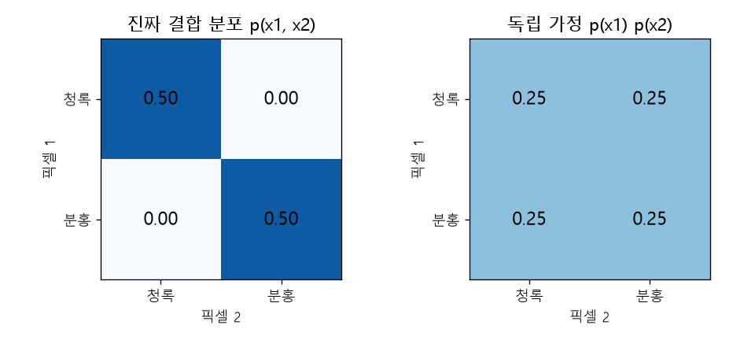

# 조건부 확률과 독립 (Conditional probability, Independence, Bayes' rule)

[목차로 돌아가기](../../00_MIT%EB%94%A5%EB%9F%AC%EB%8B%9D_%EB%AA%A9%EC%B0%A8.md) · 먼저 볼 것: [M08_확률_기초](../../%EC%88%98%ED%95%99%EA%B0%9C%EB%85%90/04_%ED%99%95%EB%A5%A0%EA%B3%BC_%EC%A0%95%EB%B3%B4/M08_%ED%99%95%EB%A5%A0_%EA%B8%B0%EC%B4%88.md), [MM39_확률의_연쇄법칙과_빔_서치](../../%EC%88%98%ED%95%99%EA%B0%9C%EB%85%90/04_%ED%99%95%EB%A5%A0%EA%B3%BC_%EC%A0%95%EB%B3%B4/MM39_%ED%99%95%EB%A5%A0%EC%9D%98_%EC%97%B0%EC%87%84%EB%B2%95%EC%B9%99%EA%B3%BC_%EB%B9%94_%EC%84%9C%EC%B9%98.md), [MM35_L2_회귀와_범주_분포](../../%EC%88%98%ED%95%99%EA%B0%9C%EB%85%90/04_%ED%99%95%EB%A5%A0%EA%B3%BC_%EC%A0%95%EB%B3%B4/MM35_L2_%ED%9A%8C%EA%B7%80%EC%99%80_%EB%B2%94%EC%A3%BC_%EB%B6%84%ED%8F%AC.md) · 쓰는 곳: [Lec16 1](../../Lec16_%EC%A1%B0%EA%B1%B4%EB%B6%80_%EC%83%9D%EC%84%B1_%EB%AA%A8%EB%8D%B8.md#1-%EA%B5%AC%EC%A1%B0%EC%A0%81-%EC%98%88%EC%B8%A1), [Lec16 2.2](../../Lec16_%EC%A1%B0%EA%B1%B4%EB%B6%80_%EC%83%9D%EC%84%B1_%EB%AA%A8%EB%8D%B8.md#22-%ED%94%BD%EC%85%80%EB%A7%88%EB%8B%A4-%EB%94%B0%EB%A1%9C-%EB%B6%84%EB%A5%98%ED%95%98%EB%A9%B4), [Lec16 3.2](../../Lec16_%EC%A1%B0%EA%B1%B4%EB%B6%80_%EC%83%9D%EC%84%B1_%EB%AA%A8%EB%8D%B8.md#32-%EC%A0%9C%EA%B3%B1-%EC%98%A4%EC%B0%A8%EB%8A%94-%ED%94%BD%EC%85%80%EC%9D%B4-%EB%8F%85%EB%A6%BD%EC%9D%B4%EB%9D%BC%EA%B3%A0-%EA%B0%80%EC%A0%95%ED%95%9C%EB%8B%A4), [Lec16 8.3](../../Lec16_%EC%A1%B0%EA%B1%B4%EB%B6%80_%EC%83%9D%EC%84%B1_%EB%AA%A8%EB%8D%B8.md#83-%EC%A1%B0%EA%B1%B4%EB%B6%80-%ED%99%95%EC%82%B0-%EB%AA%A8%EB%8D%B8)

📚 학습 순서 29/99 (4. 확률과 정보): ← 이전: [MM35_L2_회귀와_범주_분포](../../%EC%88%98%ED%95%99%EA%B0%9C%EB%85%90/04_%ED%99%95%EB%A5%A0%EA%B3%BC_%EC%A0%95%EB%B3%B4/MM35_L2_%ED%9A%8C%EA%B7%80%EC%99%80_%EB%B2%94%EC%A3%BC_%EB%B6%84%ED%8F%AC.md) · 다음: [MM34_우연_수준_손실과_기준선](../../%EC%88%98%ED%95%99%EA%B0%9C%EB%85%90/04_%ED%99%95%EB%A5%A0%EA%B3%BC_%EC%A0%95%EB%B3%B4/MM34_%EC%9A%B0%EC%97%B0_%EC%88%98%EC%A4%80_%EC%86%90%EC%8B%A4%EA%B3%BC_%EA%B8%B0%EC%A4%80%EC%84%A0.md) →

> [!NOTE]
> **3줄 요약**
> - **[조건부 확률](../../00_%EB%94%A5%EB%9F%AC%EB%8B%9D_%EC%9A%A9%EC%96%B4%EC%82%AC%EC%A0%84.md#conditional-probability-%EC%A1%B0%EA%B1%B4%EB%B6%80-%ED%99%95%EB%A5%A0)** $p(y \mid x) = p(x, y) / p(x)$는 "$x$를 알고 났을 때 $y$의 [확률](../../00_%EB%94%A5%EB%9F%AC%EB%8B%9D_%EC%9A%A9%EC%96%B4%EC%82%AC%EC%A0%84.md#probability-%ED%99%95%EB%A5%A0)"이다. 셔츠의 두 픽셀이 (청록, 청록) 0.5, (분홍, 분홍) 0.5로만 나오면, 첫 픽셀이 청록일 때 둘째도 청록일 [확률](../../00_%EB%94%A5%EB%9F%AC%EB%8B%9D_%EC%9A%A9%EC%96%B4%EC%82%AC%EC%A0%84.md#probability-%ED%99%95%EB%A5%A0)은 $0.5 / 0.5 = 1$이다.
> - **[독립](../../00_%EB%94%A5%EB%9F%AC%EB%8B%9D_%EC%9A%A9%EC%96%B4%EC%82%AC%EC%A0%84.md#independence-%EB%8F%85%EB%A6%BD)**이면 [결합 분포](../../00_%EB%94%A5%EB%9F%AC%EB%8B%9D_%EC%9A%A9%EC%96%B4%EC%82%AC%EC%A0%84.md#joint-distribution-%EA%B2%B0%ED%95%A9-%EB%B6%84%ED%8F%AC)가 곱으로 쪼개진다: $p(x_1, x_2) = p(x_1)\,p(x_2)$. 위 셔츠를 [독립](../../00_%EB%94%A5%EB%9F%AC%EB%8B%9D_%EC%9A%A9%EC%96%B4%EC%82%AC%EC%A0%84.md#independence-%EB%8F%85%EB%A6%BD)으로 잘못 보면 (청록, 분홍)에도 0.25를 주어, 두 픽셀 색이 어긋날 [확률](../../00_%EB%94%A5%EB%9F%AC%EB%8B%9D_%EC%9A%A9%EC%96%B4%EC%82%AC%EC%A0%84.md#probability-%ED%99%95%EB%A5%A0)이 0.5가 된다. 픽셀 10개면 모두 같은 색일 [확률](../../00_%EB%94%A5%EB%9F%AC%EB%8B%9D_%EC%9A%A9%EC%96%B4%EC%82%AC%EC%A0%84.md#probability-%ED%99%95%EB%A5%A0)이 0.002로 줄어든다.
> - **[베이즈 정리](../../00_%EB%94%A5%EB%9F%AC%EB%8B%9D_%EC%9A%A9%EC%96%B4%EC%82%AC%EC%A0%84.md#bayes-rule-%EB%B2%A0%EC%9D%B4%EC%A6%88-%EC%A0%95%EB%A6%AC)** $p(x \mid c) = p(c \mid x)\,p(x) / p(c)$는 조건(예: 글 설명 $c$)이 생기면 믿음이 어떻게 바뀌는지 알려 준다. 배경이 노랑·분홍 반반인데 글이 "노랑"이라고 하면([정확도](../../00_%EB%94%A5%EB%9F%AC%EB%8B%9D_%EC%9A%A9%EC%96%B4%EC%82%AC%EC%A0%84.md#accuracy-%EC%A0%95%ED%99%95%EB%8F%84) 0.9) 노랑일 [확률](../../00_%EB%94%A5%EB%9F%AC%EB%8B%9D_%EC%9A%A9%EC%96%B4%EC%82%AC%EC%A0%84.md#probability-%ED%99%95%EB%A5%A0)은 0.9가 된다.

## 1. 개념 설명

비유: 반 학생 100명 중 안경 쓴 학생이 40명, 그중 수학 동아리가 30명이라면 "안경 쓴 학생 중 수학 동아리 비율"은 30/40이다. 전체(100명)가 아니라 **조건에 맞는 학생(40명)만 새로운 전체로 보는 것**이 [조건부 확률](../../00_%EB%94%A5%EB%9F%AC%EB%8B%9D_%EC%9A%A9%EC%96%B4%EC%82%AC%EC%A0%84.md#conditional-probability-%EC%A1%B0%EA%B1%B4%EB%B6%80-%ED%99%95%EB%A5%A0)이다.

- **[결합 분포](../../00_%EB%94%A5%EB%9F%AC%EB%8B%9D_%EC%9A%A9%EC%96%B4%EC%82%AC%EC%A0%84.md#joint-distribution-%EA%B2%B0%ED%95%A9-%EB%B6%84%ED%8F%AC) $p(x, y)$**: 두 값이 **동시에** 그렇게 나올 [확률](../../00_%EB%94%A5%EB%9F%AC%EB%8B%9D_%EC%9A%A9%EC%96%B4%EC%82%AC%EC%A0%84.md#probability-%ED%99%95%EB%A5%A0). 표의 칸 하나하나다.
- **주변 분포 $p(x)$**: 한 값만 볼 때의 [확률](../../00_%EB%94%A5%EB%9F%AC%EB%8B%9D_%EC%9A%A9%EC%96%B4%EC%82%AC%EC%A0%84.md#probability-%ED%99%95%EB%A5%A0). [결합 분포](../../00_%EB%94%A5%EB%9F%AC%EB%8B%9D_%EC%9A%A9%EC%96%B4%EC%82%AC%EC%A0%84.md#joint-distribution-%EA%B2%B0%ED%95%A9-%EB%B6%84%ED%8F%AC) 표에서 그 행을 모두 더한 값이다.
- **[조건부 확률](../../00_%EB%94%A5%EB%9F%AC%EB%8B%9D_%EC%9A%A9%EC%96%B4%EC%82%AC%EC%A0%84.md#conditional-probability-%EC%A1%B0%EA%B1%B4%EB%B6%80-%ED%99%95%EB%A5%A0) $p(y \mid x)$**: 결합 [확률](../../00_%EB%94%A5%EB%9F%AC%EB%8B%9D_%EC%9A%A9%EC%96%B4%EC%82%AC%EC%A0%84.md#probability-%ED%99%95%EB%A5%A0)을 조건의 [확률](../../00_%EB%94%A5%EB%9F%AC%EB%8B%9D_%EC%9A%A9%EC%96%B4%EC%82%AC%EC%A0%84.md#probability-%ED%99%95%EB%A5%A0)로 나눈 값. "그 행만 떼어 내 합이 1이 되게 다시 맞춘 것"이다.
- **[독립](../../00_%EB%94%A5%EB%9F%AC%EB%8B%9D_%EC%9A%A9%EC%96%B4%EC%82%AC%EC%A0%84.md#independence-%EB%8F%85%EB%A6%BD)**: $x$를 알아도 $y$에 대한 믿음이 바뀌지 않으면($p(y \mid x) = p(y)$) [독립](../../00_%EB%94%A5%EB%9F%AC%EB%8B%9D_%EC%9A%A9%EC%96%B4%EC%82%AC%EC%A0%84.md#independence-%EB%8F%85%EB%A6%BD)이다. 이때 [결합 분포](../../00_%EB%94%A5%EB%9F%AC%EB%8B%9D_%EC%9A%A9%EC%96%B4%EC%82%AC%EC%A0%84.md#joint-distribution-%EA%B2%B0%ED%95%A9-%EB%B6%84%ED%8F%AC)는 주변 분포의 곱이다. 여러 차원이면 $p(x_1, \dots, x_n) = \prod_i p(x_i)$.
- **구조적 예측과의 관계**: 출력 $\mathbf{x}$의 차원들이 [독립](../../00_%EB%94%A5%EB%9F%AC%EB%8B%9D_%EC%9A%A9%EC%96%B4%EC%82%AC%EC%A0%84.md#independence-%EB%8F%85%EB%A6%BD)이라고 가정하고 차원마다 따로 맞추는 것이 "비구조적" 예측이다. 실제 이미지·문장·궤적은 차원끼리 강하게 엮여 있어 이 가정이 틀린다. 엮인 구조를 그대로 다루려면 [확률의 연쇄법칙](../../00_%EB%94%A5%EB%9F%AC%EB%8B%9D_%EC%9A%A9%EC%96%B4%EC%82%AC%EC%A0%84.md#chain-rule-of-probability-%ED%99%95%EB%A5%A0%EC%9D%98-%EC%97%B0%EC%87%84%EB%B2%95%EC%B9%99)처럼 곱을 **[조건부 확률](../../00_%EB%94%A5%EB%9F%AC%EB%8B%9D_%EC%9A%A9%EC%96%B4%EC%82%AC%EC%A0%84.md#conditional-probability-%EC%A1%B0%EA%B1%B4%EB%B6%80-%ED%99%95%EB%A5%A0)의 곱**으로 써야 한다.
- **[베이즈 정리](../../00_%EB%94%A5%EB%9F%AC%EB%8B%9D_%EC%9A%A9%EC%96%B4%EC%82%AC%EC%A0%84.md#bayes-rule-%EB%B2%A0%EC%9D%B4%EC%A6%88-%EC%A0%95%EB%A6%AC)**: $p(x \mid c)$와 $p(c \mid x)$를 서로 바꿔 준다. "이미지가 이러면 설명은 이럴 것"($p(c \mid x)$)을 알면 "설명이 이러면 이미지는 이럴 것"($p(x \mid c)$)을 얻는다.

## 2. 필요한 이유

[Lec16 1](../../Lec16_%EC%A1%B0%EA%B1%B4%EB%B6%80_%EC%83%9D%EC%84%B1_%EB%AA%A8%EB%8D%B8.md#1-%EA%B5%AC%EC%A1%B0%EC%A0%81-%EC%98%88%EC%B8%A1)은 [구조적 예측](../../00_%EB%94%A5%EB%9F%AC%EB%8B%9D_%EC%9A%A9%EC%96%B4%EC%82%AC%EC%A0%84.md#structured-prediction-%EA%B5%AC%EC%A1%B0%EC%A0%81-%EC%98%88%EC%B8%A1)을 "[결합 분포](../../00_%EB%94%A5%EB%9F%AC%EB%8B%9D_%EC%9A%A9%EC%96%B4%EC%82%AC%EC%A0%84.md#joint-distribution-%EA%B2%B0%ED%95%A9-%EB%B6%84%ED%8F%AC) $P(\mathbf{X} \mid \mathbf{Y} = \mathbf{y})$를 모델링하는 것", 비구조적 예측을 "차원별 조건부 분포의 곱 $\prod_i p(X_i \mid \mathbf{Y} = \mathbf{y})$로 근사하는 것"으로 정의한다. [Lec16 2.2](../../Lec16_%EC%A1%B0%EA%B1%B4%EB%B6%80_%EC%83%9D%EC%84%B1_%EB%AA%A8%EB%8D%B8.md#22-%ED%94%BD%EC%85%80%EB%A7%88%EB%8B%A4-%EB%94%B0%EB%A1%9C-%EB%B6%84%EB%A5%98%ED%95%98%EB%A9%B4)의 얼룩덜룩한 셔츠, [Lec16 3.2](../../Lec16_%EC%A1%B0%EA%B1%B4%EB%B6%80_%EC%83%9D%EC%84%B1_%EB%AA%A8%EB%8D%B8.md#32-%EC%A0%9C%EA%B3%B1-%EC%98%A4%EC%B0%A8%EB%8A%94-%ED%94%BD%EC%85%80%EC%9D%B4-%EB%8F%85%EB%A6%BD%EC%9D%B4%EB%9D%BC%EA%B3%A0-%EA%B0%80%EC%A0%95%ED%95%9C%EB%8B%A4)의 흐릿한 위성 사진은 모두 이 [독립](../../00_%EB%94%A5%EB%9F%AC%EB%8B%9D_%EC%9A%A9%EC%96%B4%EC%82%AC%EC%A0%84.md#independence-%EB%8F%85%EB%A6%BD) 가정이 틀려서 생긴다. [Lec16 8.3](../../Lec16_%EC%A1%B0%EA%B1%B4%EB%B6%80_%EC%83%9D%EC%84%B1_%EB%AA%A8%EB%8D%B8.md#83-%EC%A1%B0%EA%B1%B4%EB%B6%80-%ED%99%95%EC%82%B0-%EB%AA%A8%EB%8D%B8)에서 글 설명이 잡음 제거를 돕는 이유는 [베이즈 정리](../../00_%EB%94%A5%EB%9F%AC%EB%8B%9D_%EC%9A%A9%EC%96%B4%EC%82%AC%EC%A0%84.md#bayes-rule-%EB%B2%A0%EC%9D%B4%EC%A6%88-%EC%A0%95%EB%A6%AC)로 설명된다.

## 3. 숫자로 보기

**셔츠의 두 픽셀** (진짜 세상: 셔츠 전체가 청록이거나 전체가 분홍, 반반)

| | 픽셀 2 = 청록 | 픽셀 2 = 분홍 | 행 합 $p(x_1)$ |
|---|---|---|---|
| 픽셀 1 = 청록 | 0.5 | 0 | 0.5 |
| 픽셀 1 = 분홍 | 0 | 0.5 | 0.5 |

- 조건부: $p(\text{픽셀 2 = 청록} \mid \text{픽셀 1 = 청록}) = 0.5 / 0.5 = 1$
- [독립](../../00_%EB%94%A5%EB%9F%AC%EB%8B%9D_%EC%9A%A9%EC%96%B4%EC%82%AC%EC%A0%84.md#independence-%EB%8F%85%EB%A6%BD)이라고 가정하면 모든 칸이 $0.5 \times 0.5 = 0.25$가 된다. 어긋난 칸 둘의 합은 $0.25 + 0.25 = 0.5$
- 픽셀이 $n$개이고 각자 [독립](../../00_%EB%94%A5%EB%9F%AC%EB%8B%9D_%EC%9A%A9%EC%96%B4%EC%82%AC%EC%A0%84.md#independence-%EB%8F%85%EB%A6%BD)으로 반반이면, 모두 청록이거나 모두 분홍일 [확률](../../00_%EB%94%A5%EB%9F%AC%EB%8B%9D_%EC%9A%A9%EC%96%B4%EC%82%AC%EC%A0%84.md#probability-%ED%99%95%EB%A5%A0)은 $2 \times 0.5^n$: $n = 2$이면 0.5, $n = 10$이면 0.002, $n = 100$이면 사실상 0

이 내용을 식으로 쓰면 다음과 같다.

$$
p(y \mid x) = \frac{p(x, y)}{p(x)}
$$

<details><summary>기호 풀이</summary>

| 기호 | 읽는 법 | 뜻 | 예제 값 |
| --- | --- | --- | --- |
| $p(x, y)$ | 피 엑스 와이 | $x$와 $y$가 동시에 나올 [확률](../../00_%EB%94%A5%EB%9F%AC%EB%8B%9D_%EC%9A%A9%EC%96%B4%EC%82%AC%EC%A0%84.md#probability-%ED%99%95%EB%A5%A0) ([결합 분포](../../00_%EB%94%A5%EB%9F%AC%EB%8B%9D_%EC%9A%A9%EC%96%B4%EC%82%AC%EC%A0%84.md#joint-distribution-%EA%B2%B0%ED%95%A9-%EB%B6%84%ED%8F%AC)) | (청록, 청록) 0.5 |
| $p(x)$ | 피 엑스 | $x$만 볼 때의 [확률](../../00_%EB%94%A5%EB%9F%AC%EB%8B%9D_%EC%9A%A9%EC%96%B4%EC%82%AC%EC%A0%84.md#probability-%ED%99%95%EB%A5%A0) (주변 분포) | 픽셀 1 = 청록 0.5 |
| $p(y \mid x)$ | 피 와이 기븐 엑스 | $x$를 알 때 $y$의 [조건부 확률](../../00_%EB%94%A5%EB%9F%AC%EB%8B%9D_%EC%9A%A9%EC%96%B4%EC%82%AC%EC%A0%84.md#conditional-probability-%EC%A1%B0%EA%B1%B4%EB%B6%80-%ED%99%95%EB%A5%A0) | 1 |
| $\mid$ | 기븐(given) | 세로줄 오른쪽을 이미 안다는 표시 | |

</details>

<details><summary>예제와 풀이</summary>

**문제**: 사진 속 물체가 새이면서 노란색일 [확률](../../00_%EB%94%A5%EB%9F%AC%EB%8B%9D_%EC%9A%A9%EC%96%B4%EC%82%AC%EC%A0%84.md#probability-%ED%99%95%EB%A5%A0)이 0.12, 물체가 새일 [확률](../../00_%EB%94%A5%EB%9F%AC%EB%8B%9D_%EC%9A%A9%EC%96%B4%EC%82%AC%EC%A0%84.md#probability-%ED%99%95%EB%A5%A0)이 0.3이다. 새라는 것을 알 때 노란색일 [확률](../../00_%EB%94%A5%EB%9F%AC%EB%8B%9D_%EC%9A%A9%EC%96%B4%EC%82%AC%EC%A0%84.md#probability-%ED%99%95%EB%A5%A0)은?

**주어진 값**
- $p(x, y) = 0.12$ (새이면서 노란색일 결합 [확률](../../00_%EB%94%A5%EB%9F%AC%EB%8B%9D_%EC%9A%A9%EC%96%B4%EC%82%AC%EC%A0%84.md#probability-%ED%99%95%EB%A5%A0))
- $p(x) = 0.3$ (새일 [확률](../../00_%EB%94%A5%EB%9F%AC%EB%8B%9D_%EC%9A%A9%EC%96%B4%EC%82%AC%EC%A0%84.md#probability-%ED%99%95%EB%A5%A0), 조건)

**풀이**
1. 식을 그대로 쓴다: $p(y \mid x) = \dfrac{p(x, y)}{p(x)}$
2. 값을 대입한다: $p(y \mid x) = \dfrac{0.12}{0.3}$
3. 나눗셈을 한다: $0.12 \div 0.3 = 0.4$

**답**: **0.4**. 전체 사진 중에서는 12%지만, 새 사진만 놓고 보면 40%가 노란색이다.

</details>

<details><summary>내 이해</summary>


</details>

독립일 때의 곱 분해는 다음과 같다.

$$
p(x_1, x_2, \dots, x_n) = \prod_{i=1}^{n} p(x_i) \quad \text{(독립일 때만)}
$$

<details><summary>기호 풀이</summary>

| 기호 | 읽는 법 | 뜻 | 예제 값 |
| --- | --- | --- | --- |
| $x_1, \dots, x_n$ | 엑스 일 ... 엑스 엔 | 출력의 각 차원 (예: 픽셀 색) | 픽셀 3개 |
| $n$ | 엔 | 차원 수 | 3 |
| $p(x_i)$ | 피 엑스 아이 | $i$번째 차원 하나의 [확률](../../00_%EB%94%A5%EB%9F%AC%EB%8B%9D_%EC%9A%A9%EC%96%B4%EC%82%AC%EC%A0%84.md#probability-%ED%99%95%EB%A5%A0) | 0.5 |
| $\prod_{i=1}^{n}$ | 파이, 곱 | $i = 1$부터 $n$까지 모두 곱함 | |

</details>

<details><summary>예제와 풀이</summary>

**문제**: 셔츠 픽셀 3개가 서로 [독립](../../00_%EB%94%A5%EB%9F%AC%EB%8B%9D_%EC%9A%A9%EC%96%B4%EC%82%AC%EC%A0%84.md#independence-%EB%8F%85%EB%A6%BD)이고 각각 청록일 [확률](../../00_%EB%94%A5%EB%9F%AC%EB%8B%9D_%EC%9A%A9%EC%96%B4%EC%82%AC%EC%A0%84.md#probability-%ED%99%95%EB%A5%A0)이 0.5라고 (잘못) 가정한 모델이 있다. 이 모델에서 세 픽셀이 모두 청록일 [확률](../../00_%EB%94%A5%EB%9F%AC%EB%8B%9D_%EC%9A%A9%EC%96%B4%EC%82%AC%EC%A0%84.md#probability-%ED%99%95%EB%A5%A0)은?

**주어진 값**
- $n = 3$ (픽셀 수)
- $p(x_1 = \text{청록}) = p(x_2 = \text{청록}) = p(x_3 = \text{청록}) = 0.5$ (픽셀마다 청록일 [확률](../../00_%EB%94%A5%EB%9F%AC%EB%8B%9D_%EC%9A%A9%EC%96%B4%EC%82%AC%EC%A0%84.md#probability-%ED%99%95%EB%A5%A0))

**풀이**
1. 식을 그대로 쓴다: $p(x_1, x_2, x_3) = \prod_{i=1}^{3} p(x_i)$
2. 값을 대입한다: $p(\text{청록}, \text{청록}, \text{청록}) = \prod_{i=1}^{3} 0.5$
3. ∏를 풀어 쓴다 ($i = 1, 2, 3$을 차례로 곱함): $0.5 \times 0.5 \times 0.5$
4. 앞의 두 수를 곱한다: $0.5 \times 0.5 = 0.25$
5. 남은 수를 곱한다: $0.25 \times 0.5 = 0.125$

**답**: **0.125**. 진짜 세상에서는 셔츠 전체가 청록일 [확률](../../00_%EB%94%A5%EB%9F%AC%EB%8B%9D_%EC%9A%A9%EC%96%B4%EC%82%AC%EC%A0%84.md#probability-%ED%99%95%EB%A5%A0)이 0.5인데, [독립](../../00_%EB%94%A5%EB%9F%AC%EB%8B%9D_%EC%9A%A9%EC%96%B4%EC%82%AC%EC%A0%84.md#independence-%EB%8F%85%EB%A6%BD) 모델은 그 4분의 1만 준다. 나머지는 색이 섞인 "있을 수 없는 셔츠"에 [확률](../../00_%EB%94%A5%EB%9F%AC%EB%8B%9D_%EC%9A%A9%EC%96%B4%EC%82%AC%EC%A0%84.md#probability-%ED%99%95%EB%A5%A0)이 새어 나간다.

</details>

<details><summary>내 이해</summary>


</details>

**[베이즈 정리](../../00_%EB%94%A5%EB%9F%AC%EB%8B%9D_%EC%9A%A9%EC%96%B4%EC%82%AC%EC%A0%84.md#bayes-rule-%EB%B2%A0%EC%9D%B4%EC%A6%88-%EC%A0%95%EB%A6%AC)로 글 설명 반영하기** (배경색 $x$ ∈ {노랑, 분홍}, 글 $c$ = "노랑 배경")
- 사전 [확률](../../00_%EB%94%A5%EB%9F%AC%EB%8B%9D_%EC%9A%A9%EC%96%B4%EC%82%AC%EC%A0%84.md#probability-%ED%99%95%EB%A5%A0): $p(\text{노랑}) = 0.5$, $p(\text{분홍}) = 0.5$
- [우도](../../00_%EB%94%A5%EB%9F%AC%EB%8B%9D_%EC%9A%A9%EC%96%B4%EC%82%AC%EC%A0%84.md#likelihood-%EC%9A%B0%EB%8F%84): $p(c \mid \text{노랑}) = 0.9$, $p(c \mid \text{분홍}) = 0.1$ (글이 가끔 틀림)
- 분모: $p(c) = 0.5 \times 0.9 + 0.5 \times 0.1 = 0.45 + 0.05 = 0.5$
- 사후 [확률](../../00_%EB%94%A5%EB%9F%AC%EB%8B%9D_%EC%9A%A9%EC%96%B4%EC%82%AC%EC%A0%84.md#probability-%ED%99%95%EB%A5%A0): $p(\text{노랑} \mid c) = 0.45 / 0.5 = 0.9$

$$
p(x \mid c) = \frac{p(c \mid x)\, p(x)}{p(c)}, \qquad p(c) = \sum_{x} p(c \mid x)\, p(x)
$$

<details><summary>기호 풀이</summary>

| 기호 | 읽는 법 | 뜻 | 예제 값 |
| --- | --- | --- | --- |
| $x$ | 엑스 | 알고 싶은 것 (배경색) | 노랑 |
| $c$ | 씨 | 관찰한 조건 (글 설명) | "노랑 배경" |
| $p(x)$ | 사전 [확률](../../00_%EB%94%A5%EB%9F%AC%EB%8B%9D_%EC%9A%A9%EC%96%B4%EC%82%AC%EC%A0%84.md#probability-%ED%99%95%EB%A5%A0) | 조건을 보기 전의 믿음 | 0.5 |
| $p(c \mid x)$ | [우도](../../00_%EB%94%A5%EB%9F%AC%EB%8B%9D_%EC%9A%A9%EC%96%B4%EC%82%AC%EC%A0%84.md#likelihood-%EC%9A%B0%EB%8F%84) | $x$가 맞을 때 그런 글이 나올 [확률](../../00_%EB%94%A5%EB%9F%AC%EB%8B%9D_%EC%9A%A9%EC%96%B4%EC%82%AC%EC%A0%84.md#probability-%ED%99%95%EB%A5%A0) | 0.9 |
| $p(c)$ | 증거 | 그런 글이 나올 전체 [확률](../../00_%EB%94%A5%EB%9F%AC%EB%8B%9D_%EC%9A%A9%EC%96%B4%EC%82%AC%EC%A0%84.md#probability-%ED%99%95%EB%A5%A0) | 0.5 |
| $p(x \mid c)$ | 사후 [확률](../../00_%EB%94%A5%EB%9F%AC%EB%8B%9D_%EC%9A%A9%EC%96%B4%EC%82%AC%EC%A0%84.md#probability-%ED%99%95%EB%A5%A0) | 글을 본 뒤의 믿음 | 0.9 |
| $\sum_x$ | 시그마 | 가능한 $x$ 모두에 대해 더함 | 노랑, 분홍 |

</details>

<details><summary>예제와 풀이</summary>

**문제**: 데이터에서 노랑 배경은 20%, 분홍 배경은 80%다. 글 설명이 "노랑 배경"이라고 할 때 실제로 노랑일 [확률](../../00_%EB%94%A5%EB%9F%AC%EB%8B%9D_%EC%9A%A9%EC%96%B4%EC%82%AC%EC%A0%84.md#probability-%ED%99%95%EB%A5%A0)은? 글은 노랑일 때 0.9, 분홍일 때 0.1의 [확률](../../00_%EB%94%A5%EB%9F%AC%EB%8B%9D_%EC%9A%A9%EC%96%B4%EC%82%AC%EC%A0%84.md#probability-%ED%99%95%EB%A5%A0)로 "노랑"이라고 쓴다.

**주어진 값**
- $p(\text{노랑}) = 0.2$ (노랑 배경의 사전 [확률](../../00_%EB%94%A5%EB%9F%AC%EB%8B%9D_%EC%9A%A9%EC%96%B4%EC%82%AC%EC%A0%84.md#probability-%ED%99%95%EB%A5%A0))
- $p(\text{분홍}) = 0.8$ (분홍 배경의 사전 [확률](../../00_%EB%94%A5%EB%9F%AC%EB%8B%9D_%EC%9A%A9%EC%96%B4%EC%82%AC%EC%A0%84.md#probability-%ED%99%95%EB%A5%A0))
- $p(c \mid \text{노랑}) = 0.9$ (노랑일 때 "노랑"이라 쓸 [확률](../../00_%EB%94%A5%EB%9F%AC%EB%8B%9D_%EC%9A%A9%EC%96%B4%EC%82%AC%EC%A0%84.md#probability-%ED%99%95%EB%A5%A0))
- $p(c \mid \text{분홍}) = 0.1$ (분홍일 때 잘못 "노랑"이라 쓸 [확률](../../00_%EB%94%A5%EB%9F%AC%EB%8B%9D_%EC%9A%A9%EC%96%B4%EC%82%AC%EC%A0%84.md#probability-%ED%99%95%EB%A5%A0))

**풀이**
1. 식을 그대로 쓴다: $p(x \mid c) = \dfrac{p(c \mid x)\, p(x)}{p(c)}$, $p(c) = \sum_x p(c \mid x)\, p(x)$
2. 값을 대입한다: $p(\text{노랑} \mid c) = \dfrac{0.9 \times 0.2}{0.9 \times 0.2 + 0.1 \times 0.8}$
3. 분자의 곱셈을 한다: $0.9 \times 0.2 = 0.18$
4. 분모 둘째 항의 곱셈을 한다: $0.1 \times 0.8 = 0.08$
5. 분모를 더한다 (Σ를 풀어 쓴 것): $0.18 + 0.08 = 0.26$
6. 나눗셈을 한다: $0.18 \div 0.26 = 0.6923$

**답**: **0.6923**. 사전 [확률](../../00_%EB%94%A5%EB%9F%AC%EB%8B%9D_%EC%9A%A9%EC%96%B4%EC%82%AC%EC%A0%84.md#probability-%ED%99%95%EB%A5%A0) 0.2에서 크게 올랐지만, 노랑 배경이 원래 드물어서 0.9까지는 가지 못한다.

</details>

<details><summary>내 이해</summary>


</details>


*▲ 직접 그린 그림: 셔츠 두 픽셀의 진짜 [결합 분포](../../00_%EB%94%A5%EB%9F%AC%EB%8B%9D_%EC%9A%A9%EC%96%B4%EC%82%AC%EC%A0%84.md#joint-distribution-%EA%B2%B0%ED%95%A9-%EB%B6%84%ED%8F%AC)(왼쪽)와 [독립](../../00_%EB%94%A5%EB%9F%AC%EB%8B%9D_%EC%9A%A9%EC%96%B4%EC%82%AC%EC%A0%84.md#independence-%EB%8F%85%EB%A6%BD)을 가정한 곱(오른쪽). [독립](../../00_%EB%94%A5%EB%9F%AC%EB%8B%9D_%EC%9A%A9%EC%96%B4%EC%82%AC%EC%A0%84.md#independence-%EB%8F%85%EB%A6%BD) 모델은 어긋난 칸(청록-분홍, 분홍-청록)에 0.25씩, 합 0.5를 준다*

## 4. 코드로 확인

```python
# [변수] J: 두 픽셀의 결합 분포 표. 행 = 픽셀 1(청록, 분홍), 열 = 픽셀 2 (3절 표)
J = np.array([[0.5, 0.0], [0.0, 0.5]])
# [함수] J.sum(1): 각 행을 더한다 → 픽셀 1의 주변 분포
# [변수] m1 = (0.5, 0.5)
m1 = J.sum(1)
# [변수] m2: 각 열을 더한 픽셀 2의 주변 분포 (0.5, 0.5)
m2 = J.sum(0)
# [함수] J[0, 0] / m1[0]: 결합 확률 ÷ 조건의 확률 = 조건부 확률
# [연결] 3절 "조건부" 줄 → 1.0
print(J[0, 0] / m1[0])
# [함수] np.outer: 두 벡터의 모든 칸끼리 곱한 표 → 독립 가정의 결합 분포
# [쓸모] 진짜 표 J와 비교하면 독립 가정이 틀린 칸이 보인다
print(np.outer(m1, m2))
# [함수] for n in ...: 픽셀 수 2, 10, 100
for n in [2, 10, 100]:
    # [변수] 2 * 0.5**n: 모두 청록 또는 모두 분홍일 확률 (독립 모델)
    # [연결] 3절 마지막 줄 → 0.5, 0.002, 0.0
    print(n, round(2 * 0.5 ** n, 4))
# [변수] prior: 노랑·분홍의 사전 확률, lik: 각 경우 글이 "노랑"이라 쓸 확률
prior, lik = np.array([0.5, 0.5]), np.array([0.9, 0.1])
# [함수] (prior * lik).sum(): 칸별 곱의 합 = 증거 p(c)
# [변수] ev = 0.5
ev = (prior * lik).sum()
# [연결] 베이즈 정리 → 사후 확률 (0.9, 0.1)
print(ev, prior * lik / ev)
```

**실행 결과**:

```text
1.0
[[0.25 0.25]
 [0.25 0.25]]
2 0.5
10 0.002
100 0.0
0.5 [0.9 0.1]
```

> [!WARNING]
> **⚠ 주의**
> - [조건부 확률](../../00_%EB%94%A5%EB%9F%AC%EB%8B%9D_%EC%9A%A9%EC%96%B4%EC%82%AC%EC%A0%84.md#conditional-probability-%EC%A1%B0%EA%B1%B4%EB%B6%80-%ED%99%95%EB%A5%A0)은 **방향이 있다**. $p(\text{노랑} \mid c)$와 $p(c \mid \text{노랑})$은 다른 값이다(예제에서 0.6923 대 0.9). 둘을 헷갈리는 것이 가장 흔한 실수다.
> - "차원마다 [확률](../../00_%EB%94%A5%EB%9F%AC%EB%8B%9D_%EC%9A%A9%EC%96%B4%EC%82%AC%EC%A0%84.md#probability-%ED%99%95%EB%A5%A0)이 맞다"(주변 분포가 맞다)고 해서 [결합 분포](../../00_%EB%94%A5%EB%9F%AC%EB%8B%9D_%EC%9A%A9%EC%96%B4%EC%82%AC%EC%A0%84.md#joint-distribution-%EA%B2%B0%ED%95%A9-%EB%B6%84%ED%8F%AC)가 맞는 것은 아니다. 셔츠 예에서 [독립](../../00_%EB%94%A5%EB%9F%AC%EB%8B%9D_%EC%9A%A9%EC%96%B4%EC%82%AC%EC%A0%84.md#independence-%EB%8F%85%EB%A6%BD) 모델은 픽셀마다 0.5로 정확하지만, 셔츠 전체로는 절반이 틀린 셔츠다.
> - [독립](../../00_%EB%94%A5%EB%9F%AC%EB%8B%9D_%EC%9A%A9%EC%96%B4%EC%82%AC%EC%A0%84.md#independence-%EB%8F%85%EB%A6%BD) 가정을 버리면 곱 대신 $p(x_1)\,p(x_2 \mid x_1)\,p(x_3 \mid x_1, x_2) \cdots$([확률의 연쇄법칙](../../%EC%88%98%ED%95%99%EA%B0%9C%EB%85%90/04_%ED%99%95%EB%A5%A0%EA%B3%BC_%EC%A0%95%EB%B3%B4/MM39_%ED%99%95%EB%A5%A0%EC%9D%98_%EC%97%B0%EC%87%84%EB%B2%95%EC%B9%99%EA%B3%BC_%EB%B9%94_%EC%84%9C%EC%B9%98.md))처럼 앞의 값을 조건으로 넣어야 한다. 이것은 근사가 아니라 항상 성립하는 식이다.

## 5. 개념 재확인

<details><summary>1. 두 픽셀의 결합 분포가 (청록, 청록) 0.4, (청록, 분홍) 0.1, (분홍, 청록) 0.1, (분홍, 분홍) 0.4다. 두 픽셀은 독립인가?</summary>

| 단계 | 하는 일 | 식 | 계산 | 결과 |
|---|---|---|---|---|
| 1 | 픽셀 1 = 청록의 주변 [확률](../../00_%EB%94%A5%EB%9F%AC%EB%8B%9D_%EC%9A%A9%EC%96%B4%EC%82%AC%EC%A0%84.md#probability-%ED%99%95%EB%A5%A0) | 행 합 | $0.4 + 0.1$ | 0.5 |
| 2 | 픽셀 2 = 청록의 주변 [확률](../../00_%EB%94%A5%EB%9F%AC%EB%8B%9D_%EC%9A%A9%EC%96%B4%EC%82%AC%EC%A0%84.md#probability-%ED%99%95%EB%A5%A0) | 열 합 | $0.4 + 0.1$ | 0.5 |
| 3 | 독립이라면 (청록, 청록) | $p(x_1)\,p(x_2)$ | $0.5 \times 0.5$ | 0.25 |
| 4 | 비교 | 실제 0.4 대 0.25 | | [독립](../../00_%EB%94%A5%EB%9F%AC%EB%8B%9D_%EC%9A%A9%EC%96%B4%EC%82%AC%EC%A0%84.md#independence-%EB%8F%85%EB%A6%BD) 아님 |

**① 쓰는 식**
$$p(x_1, x_2) \overset{?}{=} p(x_1)\,p(x_2)$$
- 위 식 ← ④에서 실제 표와 곱을 비교한다.
```python
# [변수] J: 결합 분포 표 (행 = 픽셀 1, 열 = 픽셀 2)
J = np.array([[0.4, 0.1], [0.1, 0.4]])        # ①
# [변수] m1: 행 합 (0.5, 0.5)
m1 = J.sum(1)                                  # ②
# [변수] m2: 열 합 (0.5, 0.5)
m2 = J.sum(0)                                  # ③
# [연결] 0.4 0.25 False → 독립이 아니다
print(J[0, 0], m1[0] * m2[0], np.allclose(J, np.outer(m1, m2)))   # ④
```

**주어진 값**
- $p(\text{청록}, \text{청록}) = 0.4$, $p(\text{청록}, \text{분홍}) = 0.1$ (첫 행)
- $p(\text{분홍}, \text{청록}) = 0.1$, $p(\text{분홍}, \text{분홍}) = 0.4$ (둘째 행)

**풀이**
1. 식을 그대로 쓴다: $p(x_1, x_2) \overset{?}{=} p(x_1)\,p(x_2)$
2. 값을 대입한다 ((청록, 청록) 칸): $0.4 \overset{?}{=} p(x_1 = \text{청록}) \times p(x_2 = \text{청록})$
3. (②) 첫 행을 더해 픽셀 1의 주변 [확률](../../00_%EB%94%A5%EB%9F%AC%EB%8B%9D_%EC%9A%A9%EC%96%B4%EC%82%AC%EC%A0%84.md#probability-%ED%99%95%EB%A5%A0)을 구한다: $0.4 + 0.1 = 0.5$
4. (③) 첫 열을 더해 픽셀 2의 주변 [확률](../../00_%EB%94%A5%EB%9F%AC%EB%8B%9D_%EC%9A%A9%EC%96%B4%EC%82%AC%EC%A0%84.md#probability-%ED%99%95%EB%A5%A0)을 구한다: $0.4 + 0.1 = 0.5$
5. (④) 두 주변 [확률](../../00_%EB%94%A5%EB%9F%AC%EB%8B%9D_%EC%9A%A9%EC%96%B4%EC%82%AC%EC%A0%84.md#probability-%ED%99%95%EB%A5%A0)을 곱한다: $0.5 \times 0.5 = 0.25$
6. (④) 실제 값과 비교한다: $0.4 \ne 0.25$

**답**: **[독립](../../00_%EB%94%A5%EB%9F%AC%EB%8B%9D_%EC%9A%A9%EC%96%B4%EC%82%AC%EC%A0%84.md#independence-%EB%8F%85%EB%A6%BD)이 아니다**. 같은 색일 [확률](../../00_%EB%94%A5%EB%9F%AC%EB%8B%9D_%EC%9A%A9%EC%96%B4%EC%82%AC%EC%A0%84.md#probability-%ED%99%95%EB%A5%A0)이 독립일 때(0.25)보다 높다. 이웃 픽셀은 같은 색이 되려는 경향이 있다는 뜻이다.

</details>

<details><summary>2. 위 표에서 픽셀 1이 분홍일 때 픽셀 2도 분홍일 조건부 확률은?</summary>

| 단계 | 하는 일 | 식 | 계산 | 결과 |
|---|---|---|---|---|
| 1 | 조건의 [확률](../../00_%EB%94%A5%EB%9F%AC%EB%8B%9D_%EC%9A%A9%EC%96%B4%EC%82%AC%EC%A0%84.md#probability-%ED%99%95%EB%A5%A0) | 둘째 행 합 | $0.1 + 0.4$ | 0.5 |
| 2 | 결합 [확률](../../00_%EB%94%A5%EB%9F%AC%EB%8B%9D_%EC%9A%A9%EC%96%B4%EC%82%AC%EC%A0%84.md#probability-%ED%99%95%EB%A5%A0) | (분홍, 분홍) 칸 | | 0.4 |
| 3 | 나누기 | $p(x_1, x_2) / p(x_1)$ | $0.4 / 0.5$ | 0.8 |

**① 쓰는 식**
$$p(x_2 \mid x_1) = \frac{p(x_1, x_2)}{p(x_1)}$$
- 위 식 ← ③에서 쓴다.
```python
# [변수] J: 개념 재확인 1과 같은 표
J = np.array([[0.4, 0.1], [0.1, 0.4]])        # ①
# [변수] px1: 픽셀 1 = 분홍의 확률 0.5
px1 = J[1].sum()                               # ②
# [연결] 0.8 → 픽셀 1을 알고 나면 픽셀 2가 같은 색일 확률이 0.5에서 0.8로 오른다
print(round(J[1, 1] / px1, 4))                 # ③
```

**주어진 값**
- $p(\text{분홍}, \text{분홍}) = 0.4$ (둘 다 분홍일 결합 [확률](../../00_%EB%94%A5%EB%9F%AC%EB%8B%9D_%EC%9A%A9%EC%96%B4%EC%82%AC%EC%A0%84.md#probability-%ED%99%95%EB%A5%A0))
- $p(\text{분홍}, \text{청록}) = 0.1$ (픽셀 1 분홍, 픽셀 2 청록)

**풀이**
1. 식을 그대로 쓴다: $p(x_2 \mid x_1) = \dfrac{p(x_1, x_2)}{p(x_1)}$
2. 값을 대입한다: $p(\text{분홍} \mid \text{분홍}) = \dfrac{0.4}{p(x_1 = \text{분홍})}$
3. (②) 둘째 행을 더해 분모를 구한다: $0.1 + 0.4 = 0.5$
4. (③) 나눗셈을 한다: $0.4 \div 0.5 = 0.8$

**답**: **0.8**. 한 픽셀이 분홍이면 이웃도 80% [확률](../../00_%EB%94%A5%EB%9F%AC%EB%8B%9D_%EC%9A%A9%EC%96%B4%EC%82%AC%EC%A0%84.md#probability-%ED%99%95%EB%A5%A0)로 분홍이다. 픽셀마다 따로 예측하는 모델은 이 정보를 쓰지 못한다.

</details>

## 예제 풀기

[예제 10문제 풀기](../../%EC%98%88%EC%A0%9C/04_%ED%99%95%EB%A5%A0%EA%B3%BC_%EC%A0%95%EB%B3%B4/%EC%98%88%EC%A0%9C_MM58_%EC%A1%B0%EA%B1%B4%EB%B6%80_%ED%99%95%EB%A5%A0%EA%B3%BC_%EB%8F%85%EB%A6%BD.md)

<details><summary>내 이해</summary>


</details>
