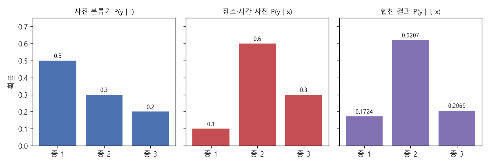

# 베이즈 규칙과 사전 확률 보정 (Bayes' rule, Prior correction)

[목차로 돌아가기](../../00_MIT%EB%94%A5%EB%9F%AC%EB%8B%9D_%EB%AA%A9%EC%B0%A8.md) · 먼저 볼 것: [M08_확률_기초](../../%EC%88%98%ED%95%99%EA%B0%9C%EB%85%90/04_%ED%99%95%EB%A5%A0%EA%B3%BC_%EC%A0%95%EB%B3%B4/M08_%ED%99%95%EB%A5%A0_%EA%B8%B0%EC%B4%88.md), [MM39_확률의_연쇄법칙과_빔_서치](../../%EC%88%98%ED%95%99%EA%B0%9C%EB%85%90/04_%ED%99%95%EB%A5%A0%EA%B3%BC_%EC%A0%95%EB%B3%B4/MM39_%ED%99%95%EB%A5%A0%EC%9D%98_%EC%97%B0%EC%87%84%EB%B2%95%EC%B9%99%EA%B3%BC_%EB%B9%94_%EC%84%9C%EC%B9%98.md), [MM34_우연_수준_손실과_기준선](../../%EC%88%98%ED%95%99%EA%B0%9C%EB%85%90/04_%ED%99%95%EB%A5%A0%EA%B3%BC_%EC%A0%95%EB%B3%B4/MM34_%EC%9A%B0%EC%97%B0_%EC%88%98%EC%A4%80_%EC%86%90%EC%8B%A4%EA%B3%BC_%EA%B8%B0%EC%A4%80%EC%84%A0.md) · 쓰는 곳: [Lec17 10.3](../../Lec17_%EB%B6%84%ED%8F%AC_%EB%B0%96_%EC%9D%BC%EB%B0%98%ED%99%94.md#103-%ED%95%98%EC%9C%84-%EC%A7%91%EB%8B%A8-%EC%9D%B4%EB%8F%99), [Lec17 12.1](../../Lec17_%EB%B6%84%ED%8F%AC_%EB%B0%96_%EC%9D%BC%EB%B0%98%ED%99%94.md#121-%ED%95%98%EC%9C%84-%EC%A7%91%EB%8B%A8-%EC%9D%B4%EB%8F%99%EC%97%90-%EC%82%AC%EC%A0%84-%ED%99%95%EB%A5%A0-%EC%93%B0%EA%B8%B0)

📚 학습 순서 31/99 (4. 확률과 정보): ← 이전: [MM34_우연_수준_손실과_기준선](../../%EC%88%98%ED%95%99%EA%B0%9C%EB%85%90/04_%ED%99%95%EB%A5%A0%EA%B3%BC_%EC%A0%95%EB%B3%B4/MM34_%EC%9A%B0%EC%97%B0_%EC%88%98%EC%A4%80_%EC%86%90%EC%8B%A4%EA%B3%BC_%EA%B8%B0%EC%A4%80%EC%84%A0.md) · 다음: [MM24_경우의_수와_VC_한계](../../%EC%88%98%ED%95%99%EA%B0%9C%EB%85%90/04_%ED%99%95%EB%A5%A0%EA%B3%BC_%EC%A0%95%EB%B3%B4/MM24_%EA%B2%BD%EC%9A%B0%EC%9D%98_%EC%88%98%EC%99%80_VC_%ED%95%9C%EA%B3%84.md) →

> [!NOTE]
> **3줄 요약**
> - **[베이즈 규칙](../../00_%EB%94%A5%EB%9F%AC%EB%8B%9D_%EC%9A%A9%EC%96%B4%EC%82%AC%EC%A0%84.md#bayes-rule-%EB%B2%A0%EC%9D%B4%EC%A6%88-%EC%A0%95%EB%A6%AC)**: 사후 [확률](../../00_%EB%94%A5%EB%9F%AC%EB%8B%9D_%EC%9A%A9%EC%96%B4%EC%82%AC%EC%A0%84.md#probability-%ED%99%95%EB%A5%A0) $P(y \mid x)$ ∝ 가능도 $P(x \mid y)$ × 사전 [확률](../../00_%EB%94%A5%EB%9F%AC%EB%8B%9D_%EC%9A%A9%EC%96%B4%EC%82%AC%EC%A0%84.md#probability-%ED%99%95%EB%A5%A0) $P(y)$. 밤에 찍힐 [확률](../../00_%EB%94%A5%EB%9F%AC%EB%8B%9D_%EC%9A%A9%EC%96%B4%EC%82%AC%EC%A0%84.md#probability-%ED%99%95%EB%A5%A0)이 너구리 0.9, 고양이 0.3이고 이 동네 너구리 비율이 0.2면, 밤 사진이 너구리일 [확률](../../00_%EB%94%A5%EB%9F%AC%EB%8B%9D_%EC%9A%A9%EC%96%B4%EC%82%AC%EC%A0%84.md#probability-%ED%99%95%EB%A5%A0)은 $0.18 / (0.18 + 0.24) = 0.4286$이다.
> - 범주 비율(사전 [확률](../../00_%EB%94%A5%EB%9F%AC%EB%8B%9D_%EC%9A%A9%EC%96%B4%EC%82%AC%EC%A0%84.md#probability-%ED%99%95%EB%A5%A0))만 바뀌고 겉모습 $P(x \mid y)$는 그대로인 **[하위 집단 이동](../../00_%EB%94%A5%EB%9F%AC%EB%8B%9D_%EC%9A%A9%EC%96%B4%EC%82%AC%EC%A0%84.md#subpopulation-shift-%ED%95%98%EC%9C%84-%EC%A7%91%EB%8B%A8-%EC%9D%B4%EB%8F%99)**에서는 다시 학습하지 않고 $P_{\text{new}}(y \mid x) \propto P_{\text{old}}(y \mid x) \cdot q(y)/p(y)$로 고친다. 반반으로 학습한 분류기가 (0.4, 0.6)을 내도, 이 카메라의 너구리 비율이 0.8이면 (0.7273, 0.2727)로 예측이 뒤집힌다.
> - Lec17의 시공간 사전도 같은 생각이다: $P(y \mid I, \mathbf{x}) \propto P(y \mid I)\,P(y \mid \mathbf{x})$. (0.5, 0.3, 0.2)와 (0.1, 0.6, 0.3)을 곱해 합 0.29로 나누면 (0.1724, 0.6207, 0.2069).

## 1. 개념 설명

비유: 어두운 골목에서 "야옹 비슷한 소리"를 들었다. 소리만 보면 고양이 같지만, 이 동네에 고양이가 거의 없고 너구리가 많다는 것을 알면 판단이 바뀐다. 소리가 주는 증거(가능도)와 동네 사정(사전 [확률](../../00_%EB%94%A5%EB%9F%AC%EB%8B%9D_%EC%9A%A9%EC%96%B4%EC%82%AC%EC%A0%84.md#probability-%ED%99%95%EB%A5%A0))을 **곱해서** 판단하는 것이 베이즈 규칙이다.

- **사전 [확률](../../00_%EB%94%A5%EB%9F%AC%EB%8B%9D_%EC%9A%A9%EC%96%B4%EC%82%AC%EC%A0%84.md#probability-%ED%99%95%EB%A5%A0)** $P(y)$: 데이터를 보기 전에 범주 $y$가 나올 [확률](../../00_%EB%94%A5%EB%9F%AC%EB%8B%9D_%EC%9A%A9%EC%96%B4%EC%82%AC%EC%A0%84.md#probability-%ED%99%95%EB%A5%A0). [학습 데이터](../../00_%EB%94%A5%EB%9F%AC%EB%8B%9D_%EC%9A%A9%EC%96%B4%EC%82%AC%EC%A0%84.md#training-data-test-data-%ED%95%99%EC%8A%B5-%EB%8D%B0%EC%9D%B4%ED%84%B0%EC%99%80-%EC%8B%9C%ED%97%98-%EB%8D%B0%EC%9D%B4%ED%84%B0)의 범주 비율이 사실상 이것이다.
- **가능도** $P(x \mid y)$: 범주가 $y$일 때 이런 입력 $x$가 나올 [확률](../../00_%EB%94%A5%EB%9F%AC%EB%8B%9D_%EC%9A%A9%EC%96%B4%EC%82%AC%EC%A0%84.md#probability-%ED%99%95%EB%A5%A0)(겉모습).
- **사후 [확률](../../00_%EB%94%A5%EB%9F%AC%EB%8B%9D_%EC%9A%A9%EC%96%B4%EC%82%AC%EC%A0%84.md#probability-%ED%99%95%EB%A5%A0)** $P(y \mid x)$: 입력을 본 뒤 범주가 $y$일 [확률](../../00_%EB%94%A5%EB%9F%AC%EB%8B%9D_%EC%9A%A9%EC%96%B4%EC%82%AC%EC%A0%84.md#probability-%ED%99%95%EB%A5%A0). 분류기가 내는 값이다.
- **베이즈 규칙**: $P(y \mid x) = P(x \mid y) P(y) / P(x)$. 분모 $P(x)$는 모든 범주에 같으므로, 곱한 뒤 합이 1이 되게 나누기만 하면 된다($\propto$, "비례").
- **사전 [확률](../../00_%EB%94%A5%EB%9F%AC%EB%8B%9D_%EC%9A%A9%EC%96%B4%EC%82%AC%EC%A0%84.md#probability-%ED%99%95%EB%A5%A0) 보정**: 분류기는 [학습 데이터](../../00_%EB%94%A5%EB%9F%AC%EB%8B%9D_%EC%9A%A9%EC%96%B4%EC%82%AC%EC%A0%84.md#training-data-test-data-%ED%95%99%EC%8A%B5-%EB%8D%B0%EC%9D%B4%ED%84%B0%EC%99%80-%EC%8B%9C%ED%97%98-%EB%8D%B0%EC%9D%B4%ED%84%B0)의 사전 [확률](../../00_%EB%94%A5%EB%9F%AC%EB%8B%9D_%EC%9A%A9%EC%96%B4%EC%82%AC%EC%A0%84.md#probability-%ED%99%95%EB%A5%A0) $p(y)$를 품고 있다. 배포 장소의 사전 [확률](../../00_%EB%94%A5%EB%9F%AC%EB%8B%9D_%EC%9A%A9%EC%96%B4%EC%82%AC%EC%A0%84.md#probability-%ED%99%95%EB%A5%A0) $q(y)$가 다르고 겉모습 $P(x \mid y)$는 같다면, $p(y)$를 나눠 빼고 $q(y)$를 곱해 넣으면 된다. [학습](../../00_%EB%94%A5%EB%9F%AC%EB%8B%9D_%EC%9A%A9%EC%96%B4%EC%82%AC%EC%A0%84.md#training-%ED%95%99%EC%8A%B5)을 다시 할 필요가 없다.

## 2. 필요한 이유

[Lec17 10.3](../../Lec17_%EB%B6%84%ED%8F%AC_%EB%B0%96_%EC%9D%BC%EB%B0%98%ED%99%94.md#103-%ED%95%98%EC%9C%84-%EC%A7%91%EB%8B%A8-%EC%9D%B4%EB%8F%99)은 카메라와 도시마다 범주 비율이 다르고, 모형이 [학습 데이터](../../00_%EB%94%A5%EB%9F%AC%EB%8B%9D_%EC%9A%A9%EC%96%B4%EC%82%AC%EC%A0%84.md#training-data-test-data-%ED%95%99%EC%8A%B5-%EB%8D%B0%EC%9D%B4%ED%84%B0%EC%99%80-%EC%8B%9C%ED%97%98-%EB%8D%B0%EC%9D%B4%ED%84%B0)의 비율을 사전 [확률](../../00_%EB%94%A5%EB%9F%AC%EB%8B%9D_%EC%9A%A9%EC%96%B4%EC%82%AC%EC%A0%84.md#probability-%ED%99%95%EB%A5%A0)처럼 품고 있어서 비율이 비슷한 곳에서만 잘 맞는다고 말한다. 강사는 시험 장소의 범주 비율을 안다면 "추가 [학습](../../00_%EB%94%A5%EB%9F%AC%EB%8B%9D_%EC%9A%A9%EC%96%B4%EC%82%AC%EC%A0%84.md#training-%ED%95%99%EC%8A%B5) 없이 간단한 베이즈 재보정"으로 고칠 수 있다고 하고, [12.1](../../Lec17_%EB%B6%84%ED%8F%AC_%EB%B0%96_%EC%9D%BC%EB%B0%98%ED%99%94.md#121-%ED%95%98%EC%9C%84-%EC%A7%91%EB%8B%A8-%EC%9D%B4%EB%8F%99%EC%97%90-%EC%82%AC%EC%A0%84-%ED%99%95%EB%A5%A0-%EC%93%B0%EA%B8%B0)은 장소·시간으로 배운 사전 [확률](../../00_%EB%94%A5%EB%9F%AC%EB%8B%9D_%EC%9A%A9%EC%96%B4%EC%82%AC%EC%A0%84.md#probability-%ED%99%95%EB%A5%A0)을 사진 분류기와 곱하는 방법을 보여 준다.

## 3. 숫자로 보기

**(1) 베이즈 규칙** (밤 사진, 너구리 대 고양이)
- 가능도: P(밤 | 너구리) = 0.9, P(밤 | 고양이) = 0.3
- 사전 [확률](../../00_%EB%94%A5%EB%9F%AC%EB%8B%9D_%EC%9A%A9%EC%96%B4%EC%82%AC%EC%A0%84.md#probability-%ED%99%95%EB%A5%A0): P(너구리) = 0.2, P(고양이) = 0.8
- 곱: 너구리 $0.9 \times 0.2 = 0.18$, 고양이 $0.3 \times 0.8 = 0.24$
- 합: $0.18 + 0.24 = 0.42$
- 나누기: 너구리 $0.18 / 0.42 = 0.4286$, 고양이 $0.24 / 0.42 = 0.5714$
- 밤 사진이어도 고양이가 훨씬 흔한 동네라 고양이 쪽이 조금 더 높다.

**(2) 사전 [확률](../../00_%EB%94%A5%EB%9F%AC%EB%8B%9D_%EC%9A%A9%EC%96%B4%EC%82%AC%EC%A0%84.md#probability-%ED%99%95%EB%A5%A0) 보정** (반반으로 학습한 분류기를 너구리가 80%인 카메라에 쓴다)
- 분류기 출력: $P_{\text{old}}$ = (너구리 0.4, 고양이 0.6)
- 배율 $q(y)/p(y)$: $0.8 / 0.5 = 1.6$, $0.2 / 0.5 = 0.4$
- 곱: $0.4 \times 1.6 = 0.64$, $0.6 \times 0.4 = 0.24$
- 합: $0.88$ → 나누기: $0.64 / 0.88 = 0.7273$, $0.24 / 0.88 = 0.2727$
- 예측이 고양이(0.6)에서 너구리(0.7273)로 바뀐다.

**(3) 시공간 사전과 합치기** (Lec17 12.1, 종 3개)

| | 종 1 | 종 2 | 종 3 |
|---|---|---|---|
| 사진 분류기 $P(y \mid I)$ | 0.5 | 0.3 | 0.2 |
| 장소·시간 사전 $P(y \mid \mathbf{x})$ | 0.1 | 0.6 | 0.3 |
| 곱 | 0.05 | 0.18 | 0.06 |
| 합 0.29로 나눔 | 0.1724 | 0.6207 | 0.2069 |


*▲ 직접 그린 그림: 사진 분류기 [확률](../../00_%EB%94%A5%EB%9F%AC%EB%8B%9D_%EC%9A%A9%EC%96%B4%EC%82%AC%EC%A0%84.md#probability-%ED%99%95%EB%A5%A0)(파랑)과 장소·시간 사전 [확률](../../00_%EB%94%A5%EB%9F%AC%EB%8B%9D_%EC%9A%A9%EC%96%B4%EC%82%AC%EC%A0%84.md#probability-%ED%99%95%EB%A5%A0)(빨강)을 곱해 합친 결과(보라). 예측이 종 1에서 종 2로 바뀐다*

베이즈 규칙을 식으로 쓰면 다음과 같다.

$$
P(y \mid x) = \frac{P(x \mid y)\,P(y)}{\sum_{y'} P(x \mid y')\,P(y')}
$$

<details><summary>기호 풀이</summary>

| 기호 | 읽는 법 | 뜻 | 예제 값 |
| --- | --- | --- | --- |
| $y$ | 와이 | 범주 (너구리, 고양이) | |
| $x$ | 엑스 | 관찰 (여기서는 "낮에 찍힘") | |
| $P(x \mid y)$ | 가능도 | 범주가 $y$일 때 이 관찰이 나올 [확률](../../00_%EB%94%A5%EB%9F%AC%EB%8B%9D_%EC%9A%A9%EC%96%B4%EC%82%AC%EC%A0%84.md#probability-%ED%99%95%EB%A5%A0) | 0.1, 0.6 |
| $P(y)$ | 사전 [확률](../../00_%EB%94%A5%EB%9F%AC%EB%8B%9D_%EC%9A%A9%EC%96%B4%EC%82%AC%EC%A0%84.md#probability-%ED%99%95%EB%A5%A0) | 관찰 전 범주 비율 | 0.5, 0.5 |
| $\sum_{y'}$ | 모든 범주에 대한 합 | 분모 = 이 관찰이 나올 전체 [확률](../../00_%EB%94%A5%EB%9F%AC%EB%8B%9D_%EC%9A%A9%EC%96%B4%EC%82%AC%EC%A0%84.md#probability-%ED%99%95%EB%A5%A0) $P(x)$ | 0.35 |
| $P(y \mid x)$ | 사후 [확률](../../00_%EB%94%A5%EB%9F%AC%EB%8B%9D_%EC%9A%A9%EC%96%B4%EC%82%AC%EC%A0%84.md#probability-%ED%99%95%EB%A5%A0) | 관찰 뒤 범주 [확률](../../00_%EB%94%A5%EB%9F%AC%EB%8B%9D_%EC%9A%A9%EC%96%B4%EC%82%AC%EC%A0%84.md#probability-%ED%99%95%EB%A5%A0) | 0.1429, 0.8571 |

</details>

<details><summary>예제와 풀이</summary>

**문제**: 낮에 찍힌 동물 사진이 있다. 너구리는 낮에 찍힐 [확률](../../00_%EB%94%A5%EB%9F%AC%EB%8B%9D_%EC%9A%A9%EC%96%B4%EC%82%AC%EC%A0%84.md#probability-%ED%99%95%EB%A5%A0)이 0.1, 고양이는 0.6이다. 두 동물이 반반으로 산다면, 이 사진이 너구리일 [확률](../../00_%EB%94%A5%EB%9F%AC%EB%8B%9D_%EC%9A%A9%EC%96%B4%EC%82%AC%EC%A0%84.md#probability-%ED%99%95%EB%A5%A0)은?

**주어진 값**
- $P(\text{낮} \mid \text{너구리}) = 0.1$ (너구리가 낮에 찍힐 [확률](../../00_%EB%94%A5%EB%9F%AC%EB%8B%9D_%EC%9A%A9%EC%96%B4%EC%82%AC%EC%A0%84.md#probability-%ED%99%95%EB%A5%A0))
- $P(\text{낮} \mid \text{고양이}) = 0.6$ (고양이가 낮에 찍힐 [확률](../../00_%EB%94%A5%EB%9F%AC%EB%8B%9D_%EC%9A%A9%EC%96%B4%EC%82%AC%EC%A0%84.md#probability-%ED%99%95%EB%A5%A0))
- $P(\text{너구리}) = 0.5$, $P(\text{고양이}) = 0.5$ (사전 [확률](../../00_%EB%94%A5%EB%9F%AC%EB%8B%9D_%EC%9A%A9%EC%96%B4%EC%82%AC%EC%A0%84.md#probability-%ED%99%95%EB%A5%A0))

**풀이**
1. 식을 그대로 쓴다: $P(\text{너구리} \mid \text{낮}) = \dfrac{P(\text{낮} \mid \text{너구리})P(\text{너구리})}{P(\text{낮} \mid \text{너구리})P(\text{너구리}) + P(\text{낮} \mid \text{고양이})P(\text{고양이})}$ (분모의 Σ를 두 항으로 펼침)
2. 값을 대입한다: $P(\text{너구리} \mid \text{낮}) = \dfrac{0.1 \times 0.5}{0.1 \times 0.5 + 0.6 \times 0.5}$
3. 곱셈을 한다: $0.1 \times 0.5 = 0.05$, $0.6 \times 0.5 = 0.3$
4. 분모를 더한다: $0.05 + 0.3 = 0.35$
5. 나눈다: $0.05 / 0.35 = 0.1429$
6. 고양이 쪽도 확인한다: $0.3 / 0.35 = 0.8571$ (둘의 합 1)

**답**: **0.1429**. 낮 사진이라는 증거가 고양이 쪽을 강하게 가리킨다. 모형이 "낮 → 너구리 아님"이라는 지름길을 배우는 이유이기도 하다(Lec17 8절).

</details>

<details><summary>내 이해</summary>


</details>

[학습](../../00_%EB%94%A5%EB%9F%AC%EB%8B%9D_%EC%9A%A9%EC%96%B4%EC%82%AC%EC%A0%84.md#training-%ED%95%99%EC%8A%B5) 때와 배포 때 사전 [확률](../../00_%EB%94%A5%EB%9F%AC%EB%8B%9D_%EC%9A%A9%EC%96%B4%EC%82%AC%EC%A0%84.md#probability-%ED%99%95%EB%A5%A0)이 다르면 다음처럼 고친다.

$$
P_{\text{new}}(y \mid x) = \frac{P_{\text{old}}(y \mid x)\, \dfrac{q(y)}{p(y)}}{\sum_{y'} P_{\text{old}}(y' \mid x)\, \dfrac{q(y')}{p(y')}}
$$

<details><summary>기호 풀이</summary>

| 기호 | 읽는 법 | 뜻 | 예제 값 |
| --- | --- | --- | --- |
| $P_{\text{old}}(y \mid x)$ | 피 올드 | [학습](../../00_%EB%94%A5%EB%9F%AC%EB%8B%9D_%EC%9A%A9%EC%96%B4%EC%82%AC%EC%A0%84.md#training-%ED%95%99%EC%8A%B5) 분포로 학습한 분류기의 출력 | (0.4, 0.6) |
| $p(y)$ | 소문자 피 | [학습 데이터](../../00_%EB%94%A5%EB%9F%AC%EB%8B%9D_%EC%9A%A9%EC%96%B4%EC%82%AC%EC%A0%84.md#training-data-test-data-%ED%95%99%EC%8A%B5-%EB%8D%B0%EC%9D%B4%ED%84%B0%EC%99%80-%EC%8B%9C%ED%97%98-%EB%8D%B0%EC%9D%B4%ED%84%B0)의 범주 비율 ([학습](../../00_%EB%94%A5%EB%9F%AC%EB%8B%9D_%EC%9A%A9%EC%96%B4%EC%82%AC%EC%A0%84.md#training-%ED%95%99%EC%8A%B5) 때 사전 [확률](../../00_%EB%94%A5%EB%9F%AC%EB%8B%9D_%EC%9A%A9%EC%96%B4%EC%82%AC%EC%A0%84.md#probability-%ED%99%95%EB%A5%A0)) | (0.5, 0.5) |
| $q(y)$ | 큐 | 배포 장소의 범주 비율 (새 사전 [확률](../../00_%EB%94%A5%EB%9F%AC%EB%8B%9D_%EC%9A%A9%EC%96%B4%EC%82%AC%EC%A0%84.md#probability-%ED%99%95%EB%A5%A0)) | (0.8, 0.2) |
| $q(y)/p(y)$ | 배율 | 그 범주가 배포 장소에서 몇 배 흔한가 | (1.6, 0.4) |
| 분모 $\sum_{y'}$ | 합 | 합이 1이 되게 나눌 값 | 0.88 |
| $P_{\text{new}}(y \mid x)$ | 피 뉴 | 배포 장소에 맞게 고친 [확률](../../00_%EB%94%A5%EB%9F%AC%EB%8B%9D_%EC%9A%A9%EC%96%B4%EC%82%AC%EC%A0%84.md#probability-%ED%99%95%EB%A5%A0) | (0.7273, 0.2727) |

</details>

<details><summary>예제와 풀이</summary>

**문제**: 너구리·고양이를 반반으로 학습한 분류기가 어떤 사진에 (너구리 0.4, 고양이 0.6)을 냈다. 이 카메라 위치에서는 너구리가 80%, 고양이가 20%다. 고친 [확률](../../00_%EB%94%A5%EB%9F%AC%EB%8B%9D_%EC%9A%A9%EC%96%B4%EC%82%AC%EC%A0%84.md#probability-%ED%99%95%EB%A5%A0)은?

**주어진 값**
- $P_{\text{old}} = (0.4, 0.6)$ (분류기 출력: 너구리, 고양이)
- $p = (0.5, 0.5)$ ([학습 데이터](../../00_%EB%94%A5%EB%9F%AC%EB%8B%9D_%EC%9A%A9%EC%96%B4%EC%82%AC%EC%A0%84.md#training-data-test-data-%ED%95%99%EC%8A%B5-%EB%8D%B0%EC%9D%B4%ED%84%B0%EC%99%80-%EC%8B%9C%ED%97%98-%EB%8D%B0%EC%9D%B4%ED%84%B0) 비율)
- $q = (0.8, 0.2)$ (이 카메라의 비율)

**풀이**
1. 식을 그대로 쓴다: $P_{\text{new}}(y \mid x) = \dfrac{P_{\text{old}}(y \mid x)\, q(y)/p(y)}{P_{\text{old}}(\text{너구리} \mid x)\, q(\text{너구리})/p(\text{너구리}) + P_{\text{old}}(\text{고양이} \mid x)\, q(\text{고양이})/p(\text{고양이})}$
2. 값을 대입한다: $P_{\text{new}}(\text{너구리} \mid x) = \dfrac{0.4 \times 0.8/0.5}{0.4 \times 0.8/0.5 + 0.6 \times 0.2/0.5}$
3. 배율을 나눈다: $0.8 / 0.5 = 1.6$, $0.2 / 0.5 = 0.4$
4. 곱한다: $0.4 \times 1.6 = 0.64$, $0.6 \times 0.4 = 0.24$
5. 분모를 더한다: $0.64 + 0.24 = 0.88$
6. 너구리를 나눈다: $0.64 / 0.88 = 0.7273$
7. 고양이를 나눈다: $0.24 / 0.88 = 0.2727$

**답**: **(0.7273, 0.2727)**. 다시 학습하지 않고 예측이 고양이에서 너구리로 바뀌었다.

</details>

<details><summary>내 이해</summary>


</details>

## 4. 코드로 확인

```python
# [변수] lik: P(밤 | 너구리), P(밤 | 고양이) / pri: 사전 확률 (너구리, 고양이)
lik, pri = np.array([0.9, 0.3]), np.array([0.2, 0.8])
# [변수] u: 가능도 × 사전 확률 (나누기 전)
u = lik * pri
# [함수] u / u.sum(): 합이 1이 되게 나누기 = 베이즈 규칙의 분모
# [연결] 본문 3절 (1) → [0.18 0.24], 0.42, [0.4286 0.5714]
print(u.round(4), round(u.sum(), 4), (u / u.sum()).round(4))
# [변수] po: 분류기 출력, p_tr: 학습 비율, q_te: 카메라 비율
po, p_tr, q_te = np.array([0.4, 0.6]), np.array([0.5, 0.5]), np.array([0.8, 0.2])
# [변수] u: 출력 × 배율 q/p
u = po * q_te / p_tr
# [연결] 본문 3절 (2)와 둘째 식 예제 → 배율 [1.6 0.4], [0.64 0.24], 0.88, [0.7273 0.2727]
print(q_te / p_tr, u.round(4), round(u.sum(), 4), (u / u.sum()).round(4))
# [변수] pI: 사진 분류기 확률, px: 장소·시간 사전 확률 (Lec17 12.1)
pI, px = np.array([0.5, 0.3, 0.2]), np.array([0.1, 0.6, 0.3])
# [변수] u: 종마다 곱한 값
u = pI * px
# [연결] 본문 3절 (3) 표 → [0.05 0.18 0.06], 0.29, [0.1724 0.6207 0.2069]
print(u.round(4), round(u.sum(), 4), (u / u.sum()).round(4))
# [변수] u: 첫 식 예제 (낮 사진, 반반 사전 확률)
u = np.array([0.1, 0.6]) * np.array([0.5, 0.5])
# [연결] 첫 식 예제와 풀이 → [0.05 0.3], 0.35, [0.1429 0.8571]
print(u.round(4), round(u.sum(), 4), (u / u.sum()).round(4))
```

**실행 결과**:

```text
[0.18 0.24] 0.42 [0.4286 0.5714]
[1.6 0.4] [0.64 0.24] 0.88 [0.7273 0.2727]
[0.05 0.18 0.06] 0.29 [0.1724 0.6207 0.2069]
[0.05 0.3 ] 0.35 [0.1429 0.8571]
```

> [!WARNING]
> **⚠ 주의**
> - 사전 [확률](../../00_%EB%94%A5%EB%9F%AC%EB%8B%9D_%EC%9A%A9%EC%96%B4%EC%82%AC%EC%A0%84.md#probability-%ED%99%95%EB%A5%A0) 보정은 **겉모습 $P(x \mid y)$가 그대로**이고 범주 비율만 바뀔 때(라벨 이동) 맞다. 눈이 쌓이거나 카메라가 바뀌어 겉모습까지 달라지면 이것만으로는 부족하다.
> - 분류기 출력이 실제 [확률](../../00_%EB%94%A5%EB%9F%AC%EB%8B%9D_%EC%9A%A9%EC%96%B4%EC%82%AC%EC%A0%84.md#probability-%ED%99%95%EB%A5%A0)처럼 잘 보정되어 있어야 한다. 과신하는 신경망(예: 늘 0.99를 내는 모형)에는 배율을 곱해도 거의 바뀌지 않는다.
> - 배포 장소의 비율 $q(y)$를 모르면 추정해야 한다. 라벨 없는 [시험 데이터](../../00_%EB%94%A5%EB%9F%AC%EB%8B%9D_%EC%9A%A9%EC%96%B4%EC%82%AC%EC%A0%84.md#training-data-test-data-%ED%95%99%EC%8A%B5-%EB%8D%B0%EC%9D%B4%ED%84%B0%EC%99%80-%EC%8B%9C%ED%97%98-%EB%8D%B0%EC%9D%B4%ED%84%B0)의 예측으로 비율을 추정하는 방법(Saerens 등 2002의 EM 등)이 있다.
> - Lec17의 $P(y \mid I, \mathbf{x}) \propto P(y \mid I) P(y \mid \mathbf{x})$는 사진과 장소가 범주가 주어지면 서로 [독립](../../00_%EB%94%A5%EB%9F%AC%EB%8B%9D_%EC%9A%A9%EC%96%B4%EC%82%AC%EC%A0%84.md#independence-%EB%8F%85%EB%A6%BD)이라고 보고, [학습 데이터](../../00_%EB%94%A5%EB%9F%AC%EB%8B%9D_%EC%9A%A9%EC%96%B4%EC%82%AC%EC%A0%84.md#training-data-test-data-%ED%95%99%EC%8A%B5-%EB%8D%B0%EC%9D%B4%ED%84%B0%EC%99%80-%EC%8B%9C%ED%97%98-%EB%8D%B0%EC%9D%B4%ED%84%B0)의 범주 비율이 고르다고 본 간단한 형태다. 엄밀히는 $P(y)$로 한 번 나눠야 한다($\propto P(y \mid I) P(y \mid \mathbf{x}) / P(y)$).

## 5. 개념 재확인

<details><summary>1. 사슴·여우를 반반으로 학습한 분류기가 (사슴 0.4, 여우 0.6)을 냈다. 이 카메라에서는 사슴이 70%다. 고친 확률은?</summary>

| 단계 | 하는 일 | 계산 | 결과 |
|---|---|---|---|
| 1 | 배율 | $0.7/0.5,\ 0.3/0.5$ | 1.4, 0.6 |
| 2 | 곱하기 | $0.4 \times 1.4,\ 0.6 \times 0.6$ | 0.56, 0.36 |
| 3 | 합 | $0.56 + 0.36$ | 0.92 |
| 4 | 나누기 | $0.56/0.92,\ 0.36/0.92$ | 0.6087, 0.3913 |

**① 쓰는 식**
$$P_{\text{new}}(y \mid x) = \frac{P_{\text{old}}(y \mid x)\, q(y)/p(y)}{\sum_{y'} P_{\text{old}}(y' \mid x)\, q(y')/p(y')}$$
- 위 식 ← ②(배율 곱), ③(합), ④(나누기)에서 쓴다.
```python
# [변수] po: 분류기 출력, q: 카메라 비율, p: 학습 비율 0.5
po, q, p = np.array([0.4, 0.6]), np.array([0.7, 0.3]), 0.5   # ①
# [변수] u: 출력 × 배율 → [0.56 0.36]
u = po * q / p                                              # ②
# [연결] [0.56 0.36] 0.92 [0.6087 0.3913]
print(u.round(4), round(u.sum(), 4), (u / u.sum()).round(4))   # ③④
```

**주어진 값**
- $P_{\text{old}} = (0.4, 0.6)$ (분류기 출력: 사슴, 여우)
- $p = (0.5, 0.5)$ ([학습](../../00_%EB%94%A5%EB%9F%AC%EB%8B%9D_%EC%9A%A9%EC%96%B4%EC%82%AC%EC%A0%84.md#training-%ED%95%99%EC%8A%B5) 비율)
- $q = (0.7, 0.3)$ (이 카메라의 비율)

**풀이**
1. 식을 그대로 쓴다: $P_{\text{new}}(y \mid x) = \dfrac{P_{\text{old}}(y \mid x)\, q(y)/p(y)}{\sum_{y'} P_{\text{old}}(y' \mid x)\, q(y')/p(y')}$
2. 값을 대입한다: $P_{\text{new}}(\text{사슴} \mid x) = \dfrac{0.4 \times 0.7/0.5}{0.4 \times 0.7/0.5 + 0.6 \times 0.3/0.5}$
3. (②) 배율을 나눈다: $0.7/0.5 = 1.4$, $0.3/0.5 = 0.6$
4. (②) 곱한다: $0.4 \times 1.4 = 0.56$, $0.6 \times 0.6 = 0.36$
5. (③) 더한다: $0.56 + 0.36 = 0.92$
6. (④) 사슴을 나눈다: $0.56 / 0.92 = 0.6087$
7. (④) 여우를 나눈다: $0.36 / 0.92 = 0.3913$

**답**: **(0.6087, 0.3913)**. 예측이 여우에서 사슴으로 바뀐다.

</details>

<details><summary>2. 낮 사진의 가능도가 P(낮 | 너구리) = 0.1, P(낮 | 고양이) = 0.6이다. 너구리가 90%인 숲속 카메라에서 낮 사진이 너구리일 확률은? (반반일 때는 0.1429였다)</summary>

| 단계 | 하는 일 | 계산 | 결과 |
|---|---|---|---|
| 1 | 가능도 × 사전 | $0.1 \times 0.9,\ 0.6 \times 0.1$ | 0.09, 0.06 |
| 2 | 합 | $0.09 + 0.06$ | 0.15 |
| 3 | 나누기 | $0.09/0.15$ | 0.6 |

**① 쓰는 식**
$$P(y \mid x) = \frac{P(x \mid y)\,P(y)}{\sum_{y'} P(x \mid y')\,P(y')}$$
- 위 식 ← ②(곱), ③(합과 나누기)에서 쓴다.
```python
# [변수] lik: 낮에 찍힐 확률, pri: 숲속 카메라의 사전 확률
lik, pri = np.array([0.1, 0.6]), np.array([0.9, 0.1])   # ①
# [변수] u: 가능도 × 사전 → [0.09 0.06]
u = lik * pri                                           # ②
# [연결] [0.09 0.06] 0.15 [0.6 0.4]
print(u.round(4), round(u.sum(), 4), (u / u.sum()).round(4))   # ③
```

**주어진 값**
- $P(\text{낮} \mid \text{너구리}) = 0.1$, $P(\text{낮} \mid \text{고양이}) = 0.6$ (가능도)
- $P(\text{너구리}) = 0.9$, $P(\text{고양이}) = 0.1$ (숲속 카메라의 사전 [확률](../../00_%EB%94%A5%EB%9F%AC%EB%8B%9D_%EC%9A%A9%EC%96%B4%EC%82%AC%EC%A0%84.md#probability-%ED%99%95%EB%A5%A0))

**풀이**
1. 식을 그대로 쓴다: $P(\text{너구리} \mid \text{낮}) = \dfrac{P(\text{낮} \mid \text{너구리})P(\text{너구리})}{P(\text{낮} \mid \text{너구리})P(\text{너구리}) + P(\text{낮} \mid \text{고양이})P(\text{고양이})}$
2. 값을 대입한다: $\dfrac{0.1 \times 0.9}{0.1 \times 0.9 + 0.6 \times 0.1}$
3. (②) 곱셈을 한다: $0.1 \times 0.9 = 0.09$, $0.6 \times 0.1 = 0.06$
4. (③) 분모를 더한다: $0.09 + 0.06 = 0.15$
5. (③) 나눈다: $0.09 / 0.15 = 0.6$

**답**: **0.6**. 같은 낮 사진이라도 너구리가 흔한 곳에서는 너구리일 [확률](../../00_%EB%94%A5%EB%9F%AC%EB%8B%9D_%EC%9A%A9%EC%96%B4%EC%82%AC%EC%A0%84.md#probability-%ED%99%95%EB%A5%A0)이 0.1429에서 0.6으로 오른다. 사전 [확률](../../00_%EB%94%A5%EB%9F%AC%EB%8B%9D_%EC%9A%A9%EC%96%B4%EC%82%AC%EC%A0%84.md#probability-%ED%99%95%EB%A5%A0)이 판단을 크게 바꾼다.

</details>

## 예제 풀기

[예제 10문제 풀기](../../%EC%98%88%EC%A0%9C/04_%ED%99%95%EB%A5%A0%EA%B3%BC_%EC%A0%95%EB%B3%B4/%EC%98%88%EC%A0%9C_MM64_%EB%B2%A0%EC%9D%B4%EC%A6%88_%EA%B7%9C%EC%B9%99%EA%B3%BC_%EC%82%AC%EC%A0%84_%ED%99%95%EB%A5%A0_%EB%B3%B4%EC%A0%95.md)

<details><summary>내 이해</summary>


</details>
