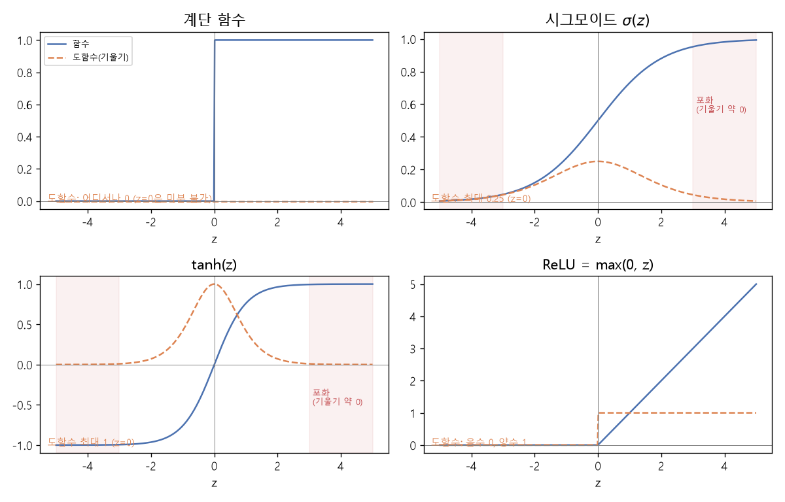

# 활성화 함수의 미분 (Derivatives of activation functions)

[목차로 돌아가기](../../00_MIT%EB%94%A5%EB%9F%AC%EB%8B%9D_%EB%AA%A9%EC%B0%A8.md) · 먼저 볼 것: [M03_미분_기울기](../../%EC%88%98%ED%95%99%EA%B0%9C%EB%85%90/02_%EB%AF%B8%EB%B6%84/M03_%EB%AF%B8%EB%B6%84_%EA%B8%B0%EC%9A%B8%EA%B8%B0.md), [M06_지수와_e](../../%EC%88%98%ED%95%99%EA%B0%9C%EB%85%90/01_%EC%88%98%EC%99%80_%ED%95%A8%EC%88%98/M06_%EC%A7%80%EC%88%98%EC%99%80_e.md), [M11_오즈와_로짓](../../%EC%88%98%ED%95%99%EA%B0%9C%EB%85%90/04_%ED%99%95%EB%A5%A0%EA%B3%BC_%EC%A0%95%EB%B3%B4/M11_%EC%98%A4%EC%A6%88%EC%99%80_%EB%A1%9C%EC%A7%93.md) · 쓰는 곳: [Lec01 5.3 비선형 활성화 함수](../../Lec01_%EB%94%A5%EB%9F%AC%EB%8B%9D_%EC%86%8C%EA%B0%9C.md#53-%EB%B9%84%EC%84%A0%ED%98%95-%ED%99%9C%EC%84%B1%ED%99%94-%ED%95%A8%EC%88%98)

📚 학습 순서 36/99 (5. 신경망의 계산): ← 이전: [MM25_랭크와_유효_랭크](../../%EC%88%98%ED%95%99%EA%B0%9C%EB%85%90/04_%ED%99%95%EB%A5%A0%EA%B3%BC_%EC%A0%95%EB%B3%B4/MM25_%EB%9E%AD%ED%81%AC%EC%99%80_%EC%9C%A0%ED%9A%A8_%EB%9E%AD%ED%81%AC.md) · 다음: [MM06_합성함수와_비선형성](../../%EC%88%98%ED%95%99%EA%B0%9C%EB%85%90/05_%EC%8B%A0%EA%B2%BD%EB%A7%9D%EC%9D%98_%EA%B3%84%EC%82%B0/MM06_%ED%95%A9%EC%84%B1%ED%95%A8%EC%88%98%EC%99%80_%EB%B9%84%EC%84%A0%ED%98%95%EC%84%B1.md) →

> [!NOTE]
> **3줄 요약**
> - [역전파](../../00_%EB%94%A5%EB%9F%AC%EB%8B%9D_%EC%9A%A9%EC%96%B4%EC%82%AC%EC%A0%84.md#backpropagation-%EC%97%AD%EC%A0%84%ED%8C%8C)는 [활성화 함수](../../00_%EB%94%A5%EB%9F%AC%EB%8B%9D_%EC%9A%A9%EC%96%B4%EC%82%AC%EC%A0%84.md#activation-function-%ED%99%9C%EC%84%B1%ED%99%94-%ED%95%A8%EC%88%98)의 **도함수([기울기](../../00_%EB%94%A5%EB%9F%AC%EB%8B%9D_%EC%9A%A9%EC%96%B4%EC%82%AC%EC%A0%84.md#gradient-%EA%B8%B0%EC%9A%B8%EA%B8%B0))**를 곱해 가며 [오차](../../00_%EB%94%A5%EB%9F%AC%EB%8B%9D_%EC%9A%A9%EC%96%B4%EC%82%AC%EC%A0%84.md#error-%EC%98%A4%EC%B0%A8)를 전달한다. 그래서 도함수가 0이거나 0에 가까우면 [학습](../../00_%EB%94%A5%EB%9F%AC%EB%8B%9D_%EC%9A%A9%EC%96%B4%EC%82%AC%EC%A0%84.md#training-%ED%95%99%EC%8A%B5) 신호가 끊긴다.
> - [시그모이드](../../00_%EB%94%A5%EB%9F%AC%EB%8B%9D_%EC%9A%A9%EC%96%B4%EC%82%AC%EC%A0%84.md#sigmoid-%EC%8B%9C%EA%B7%B8%EB%AA%A8%EC%9D%B4%EB%93%9C)의 도함수는 $\sigma(z)(1 - \sigma(z))$로 **최대 0.25**, [tanh](../../00_%EB%94%A5%EB%9F%AC%EB%8B%9D_%EC%9A%A9%EC%96%B4%EC%82%AC%EC%A0%84.md#tanh-%EC%8C%8D%EA%B3%A1%ED%83%84%EC%A0%A0%ED%8A%B8)의 도함수는 $1 - \tanh^2 z$로 **최대 1**이다. 둘 다 $|z|$가 크면 0에 가까워진다([포화](../../00_%EB%94%A5%EB%9F%AC%EB%8B%9D_%EC%9A%A9%EC%96%B4%EC%82%AC%EC%A0%84.md#saturation-%ED%8F%AC%ED%99%94)).
> - [ReLU](../../00_%EB%94%A5%EB%9F%AC%EB%8B%9D_%EC%9A%A9%EC%96%B4%EC%82%AC%EC%A0%84.md#relu-%EB%A0%90%EB%A3%A8)의 도함수는 $z > 0$이면 1, $z < 0$이면 0이다. 양수 쪽에서 [기울기](../../00_%EB%94%A5%EB%9F%AC%EB%8B%9D_%EC%9A%A9%EC%96%B4%EC%82%AC%EC%A0%84.md#gradient-%EA%B8%B0%EC%9A%B8%EA%B8%B0)가 줄지 않아 [학습](../../00_%EB%94%A5%EB%9F%AC%EB%8B%9D_%EC%9A%A9%EC%96%B4%EC%82%AC%EC%A0%84.md#training-%ED%95%99%EC%8A%B5)이 빠르지만, 음수에 갇힌 유닛은 [기울기](../../00_%EB%94%A5%EB%9F%AC%EB%8B%9D_%EC%9A%A9%EC%96%B4%EC%82%AC%EC%A0%84.md#gradient-%EA%B8%B0%EC%9A%B8%EA%B8%B0)가 0이라 다시 살아나지 못한다([죽은 유닛](../../00_%EB%94%A5%EB%9F%AC%EB%8B%9D_%EC%9A%A9%EC%96%B4%EC%82%AC%EC%A0%84.md#dead-unit-%EC%A3%BD%EC%9D%80-%EC%9C%A0%EB%8B%9B)).

## 1. 개념 설명

비유: 여러 사람이 줄지어 귓속말로 말을 전한다. 각자 들은 말을 몇 배로 키우거나 줄여서 다음 사람에게 전하는데, 그 배율이 도함수다. 배율이 0.25인 사람이 다섯 명 이어지면 원래 말은 약 1000분의 1로 작아진다. 맨 앞사람(앞쪽 [층](../../00_%EB%94%A5%EB%9F%AC%EB%8B%9D_%EC%9A%A9%EC%96%B4%EC%82%AC%EC%A0%84.md#layer-%EC%B8%B5))에게는 거의 아무 말도 도착하지 않는다. 이것이 [기울기 소실](../../00_%EB%94%A5%EB%9F%AC%EB%8B%9D_%EC%9A%A9%EC%96%B4%EC%82%AC%EC%A0%84.md#vanishing-gradient-%EA%B8%B0%EC%9A%B8%EA%B8%B0-%EC%86%8C%EC%8B%A4)이다.

강의에서 본 네 함수와 도함수를 한 표로 정리한다.

| 함수 | 식 $g(z)$ | 도함수 $g'(z)$ | 도함수 최댓값 |
|---|---|---|---|
| 계단 | $z > 0$이면 1, 아니면 0 | 0 ($z = 0$에서는 [미분](../../00_%EB%94%A5%EB%9F%AC%EB%8B%9D_%EC%9A%A9%EC%96%B4%EC%82%AC%EC%A0%84.md#derivative-%EB%AF%B8%EB%B6%84) 불가) | 0 |
| [시그모이드](../../00_%EB%94%A5%EB%9F%AC%EB%8B%9D_%EC%9A%A9%EC%96%B4%EC%82%AC%EC%A0%84.md#sigmoid-%EC%8B%9C%EA%B7%B8%EB%AA%A8%EC%9D%B4%EB%93%9C) | $\sigma(z) = \dfrac{1}{1+e^{-z}}$ | $\sigma(z)(1 - \sigma(z))$ | 0.25 ($z = 0$) |
| [tanh](../../00_%EB%94%A5%EB%9F%AC%EB%8B%9D_%EC%9A%A9%EC%96%B4%EC%82%AC%EC%A0%84.md#tanh-%EC%8C%8D%EA%B3%A1%ED%83%84%EC%A0%A0%ED%8A%B8) | $\dfrac{e^z - e^{-z}}{e^z + e^{-z}} = 2\sigma(2z) - 1$ | $1 - \tanh^2 z$ | 1 ($z = 0$) |
| [ReLU](../../00_%EB%94%A5%EB%9F%AC%EB%8B%9D_%EC%9A%A9%EC%96%B4%EC%82%AC%EC%A0%84.md#relu-%EB%A0%90%EB%A3%A8) | $\max(0, z)$ | $z > 0$이면 1, $z < 0$이면 0 | 1 |

## 2. 필요한 이유

[Lec01 5.3](../../Lec01_%EB%94%A5%EB%9F%AC%EB%8B%9D_%EC%86%8C%EA%B0%9C.md#53-%EB%B9%84%EC%84%A0%ED%98%95-%ED%99%9C%EC%84%B1%ED%99%94-%ED%95%A8%EC%88%98)에서 강사는 [활성화 함수](../../00_%EB%94%A5%EB%9F%AC%EB%8B%9D_%EC%9A%A9%EC%96%B4%EC%82%AC%EC%A0%84.md#activation-function-%ED%99%9C%EC%84%B1%ED%99%94-%ED%95%A8%EC%88%98)마다 "[기울기](../../00_%EB%94%A5%EB%9F%AC%EB%8B%9D_%EC%9A%A9%EC%96%B4%EC%82%AC%EC%A0%84.md#gradient-%EA%B8%B0%EC%9A%B8%EA%B8%B0)가 0이라 [역전파](../../00_%EB%94%A5%EB%9F%AC%EB%8B%9D_%EC%9A%A9%EC%96%B4%EC%82%AC%EC%A0%84.md#backpropagation-%EC%97%AD%EC%A0%84%ED%8C%8C)가 안 된다"(계단), "[포화](../../00_%EB%94%A5%EB%9F%AC%EB%8B%9D_%EC%9A%A9%EC%96%B4%EC%82%AC%EC%A0%84.md#saturation-%ED%8F%AC%ED%99%94)로 [기울기](../../00_%EB%94%A5%EB%9F%AC%EB%8B%9D_%EC%9A%A9%EC%96%B4%EC%82%AC%EC%A0%84.md#gradient-%EA%B8%B0%EC%9A%B8%EA%B8%B0)가 0에 가까워진다"([tanh](../../00_%EB%94%A5%EB%9F%AC%EB%8B%9D_%EC%9A%A9%EC%96%B4%EC%82%AC%EC%A0%84.md#tanh-%EC%8C%8D%EA%B3%A1%ED%83%84%EC%A0%A0%ED%8A%B8), [시그모이드](../../00_%EB%94%A5%EB%9F%AC%EB%8B%9D_%EC%9A%A9%EC%96%B4%EC%82%AC%EC%A0%84.md#sigmoid-%EC%8B%9C%EA%B7%B8%EB%AA%A8%EC%9D%B4%EB%93%9C)), "음수 쪽이면 [기울기](../../00_%EB%94%A5%EB%9F%AC%EB%8B%9D_%EC%9A%A9%EC%96%B4%EC%82%AC%EC%A0%84.md#gradient-%EA%B8%B0%EC%9A%B8%EA%B8%B0)가 없다"([ReLU](../../00_%EB%94%A5%EB%9F%AC%EB%8B%9D_%EC%9A%A9%EC%96%B4%EC%82%AC%EC%A0%84.md#relu-%EB%A0%90%EB%A3%A8))고 평가한다. 이 평가는 모두 **도함수의 값**에 대한 이야기다.

## 3. 숫자로 보기

### 3.1 도함수 값 표

| $z$ | $\sigma(z)$ | $\sigma'(z)$ | $\tanh z$ | $\tanh' z$ | [ReLU](../../00_%EB%94%A5%EB%9F%AC%EB%8B%9D_%EC%9A%A9%EC%96%B4%EC%82%AC%EC%A0%84.md#relu-%EB%A0%90%EB%A3%A8)′ |
|---|---|---|---|---|---|
| 0 | 0.5 | **0.25** | 0 | **1** | 정의 나름 (보통 0) |
| 1 | 0.7311 | 0.1966 | 0.7616 | 0.42 | 1 |
| 2 | 0.8808 | 0.105 | 0.964 | 0.0707 | 1 |
| 5 | 0.9933 | **0.0066** | 0.9999 | **0.00018** | 1 |

- [시그모이드](../../00_%EB%94%A5%EB%9F%AC%EB%8B%9D_%EC%9A%A9%EC%96%B4%EC%82%AC%EC%A0%84.md#sigmoid-%EC%8B%9C%EA%B7%B8%EB%AA%A8%EC%9D%B4%EB%93%9C)와 [tanh](../../00_%EB%94%A5%EB%9F%AC%EB%8B%9D_%EC%9A%A9%EC%96%B4%EC%82%AC%EC%A0%84.md#tanh-%EC%8C%8D%EA%B3%A1%ED%83%84%EC%A0%A0%ED%8A%B8)는 $z$가 커질수록 출력은 1에 붙고 도함수는 0으로 줄어든다. 이 구간이 **[포화](../../00_%EB%94%A5%EB%9F%AC%EB%8B%9D_%EC%9A%A9%EC%96%B4%EC%82%AC%EC%A0%84.md#saturation-%ED%8F%AC%ED%99%94)**다.
- [ReLU](../../00_%EB%94%A5%EB%9F%AC%EB%8B%9D_%EC%9A%A9%EC%96%B4%EC%82%AC%EC%A0%84.md#relu-%EB%A0%90%EB%A3%A8)는 $z$가 아무리 커도 도함수가 1이다.

### 3.2 시그모이드 도함수 유도 (한 줄에 한 동작)

- 시작: $\sigma(z) = (1 + e^{-z})^{-1}$
- 바깥 [미분](../../00_%EB%94%A5%EB%9F%AC%EB%8B%9D_%EC%9A%A9%EC%96%B4%EC%82%AC%EC%A0%84.md#derivative-%EB%AF%B8%EB%B6%84) × 안쪽 [미분](../../00_%EB%94%A5%EB%9F%AC%EB%8B%9D_%EC%9A%A9%EC%96%B4%EC%82%AC%EC%A0%84.md#derivative-%EB%AF%B8%EB%B6%84)([연쇄법칙](../../00_%EB%94%A5%EB%9F%AC%EB%8B%9D_%EC%9A%A9%EC%96%B4%EC%82%AC%EC%A0%84.md#chain-rule-%EC%97%B0%EC%87%84%EB%B2%95%EC%B9%99)): $\sigma'(z) = -(1 + e^{-z})^{-2} \times (-e^{-z})$
- 부호 정리: $\sigma'(z) = \dfrac{e^{-z}}{(1 + e^{-z})^2}$
- 두 분수의 곱으로 쪼개기: $\sigma'(z) = \dfrac{1}{1 + e^{-z}} \times \dfrac{e^{-z}}{1 + e^{-z}}$
- 두 번째 분수 $= 1 - \dfrac{1}{1+e^{-z}} = 1 - \sigma(z)$이므로: $\sigma'(z) = \sigma(z)(1 - \sigma(z))$
- $z = 0$이면 $0.5 × 0.5 = 0.25$. $\sigma$가 0.5일 때 곱이 가장 크므로 이것이 최댓값이다.

### 3.3 tanh = 2σ(2z) − 1 확인 (한 줄에 한 동작)

- 시작: $2\sigma(2z) - 1 = \dfrac{2}{1 + e^{-2z}} - 1$
- 통분: $= \dfrac{2 - (1 + e^{-2z})}{1 + e^{-2z}} = \dfrac{1 - e^{-2z}}{1 + e^{-2z}}$
- 분자·분모에 $e^{z}$ 곱하기: $= \dfrac{e^{z} - e^{-z}}{e^{z} + e^{-z}} = \tanh z$
- 숫자로: $\tanh 1 = 0.7616$, $2\sigma(2) - 1 = 2 × 0.8808 - 1 = 0.7616$ ✓

[tanh](../../00_%EB%94%A5%EB%9F%AC%EB%8B%9D_%EC%9A%A9%EC%96%B4%EC%82%AC%EC%A0%84.md#tanh-%EC%8C%8D%EA%B3%A1%ED%83%84%EC%A0%A0%ED%8A%B8)는 [시그모이드](../../00_%EB%94%A5%EB%9F%AC%EB%8B%9D_%EC%9A%A9%EC%96%B4%EC%82%AC%EC%A0%84.md#sigmoid-%EC%8B%9C%EA%B7%B8%EB%AA%A8%EC%9D%B4%EB%93%9C)를 가로로 반 줄이고(2z) 세로로 두 배 늘려(×2) 아래로 1 내린(−1) 것이다. 그래서 출력 범위가 0~1에서 −1~1로 바뀌고 중심이 0이 된다.



<details><summary>기호 풀이</summary>

| 기호 | 읽는 법 | 뜻 | 예제 값 |
| --- | --- | --- | --- |
| $g(z)$ | 지 오브 지 | [활성화 함수](../../00_%EB%94%A5%EB%9F%AC%EB%8B%9D_%EC%9A%A9%EC%96%B4%EC%82%AC%EC%A0%84.md#activation-function-%ED%99%9C%EC%84%B1%ED%99%94-%ED%95%A8%EC%88%98) | - |
| $g'(z)$ | 지 프라임 | [활성화 함수](../../00_%EB%94%A5%EB%9F%AC%EB%8B%9D_%EC%9A%A9%EC%96%B4%EC%82%AC%EC%A0%84.md#activation-function-%ED%99%9C%EC%84%B1%ED%99%94-%ED%95%A8%EC%88%98)의 도함수 ([기울기](../../00_%EB%94%A5%EB%9F%AC%EB%8B%9D_%EC%9A%A9%EC%96%B4%EC%82%AC%EC%A0%84.md#gradient-%EA%B8%B0%EC%9A%B8%EA%B8%B0)) | - |
| $\sigma(z)$ | 시그마 오브 지 | [시그모이드](../../00_%EB%94%A5%EB%9F%AC%EB%8B%9D_%EC%9A%A9%EC%96%B4%EC%82%AC%EC%A0%84.md#sigmoid-%EC%8B%9C%EA%B7%B8%EB%AA%A8%EC%9D%B4%EB%93%9C) | $\sigma(0) = 0.5$ |
| $\sigma'(z)$ | 시그마 프라임 | [시그모이드](../../00_%EB%94%A5%EB%9F%AC%EB%8B%9D_%EC%9A%A9%EC%96%B4%EC%82%AC%EC%A0%84.md#sigmoid-%EC%8B%9C%EA%B7%B8%EB%AA%A8%EC%9D%B4%EB%93%9C)의 도함수 | $\sigma'(0) = 0.25$ |
| $\tanh z$ | 탠에이치 지 | [쌍곡탄젠트](../../00_%EB%94%A5%EB%9F%AC%EB%8B%9D_%EC%9A%A9%EC%96%B4%EC%82%AC%EC%A0%84.md#tanh-%EC%8C%8D%EA%B3%A1%ED%83%84%EC%A0%A0%ED%8A%B8) | $\tanh 1 = 0.7616$ |
| $\tanh^2 z$ | 탠에이치 제곱 | $(\tanh z)^2$ | - |
| $\max(0, z)$ | 맥스 영 지 | 0과 z 중 큰 값 ([ReLU](../../00_%EB%94%A5%EB%9F%AC%EB%8B%9D_%EC%9A%A9%EC%96%B4%EC%82%AC%EC%A0%84.md#relu-%EB%A0%90%EB%A3%A8)) | $\max(0, -2) = 0$ |

</details>

## 4. 코드로 확인

```python
# [함수] import: NumPy를 np로 불러온다. np.exp, np.tanh가 여기서 온다
import numpy as np

# [함수] lambda z: ...: 시그모이드 σ(z) = 1/(1+e⁻ᶻ)를 짧은 함수로 만든다. np.exp는 칸마다 e의 거듭제곱
# [변수] sig: 시그모이드 함수. 여러 번 부르려고 이름을 붙인다
# [연결] 시그모이드의 유래는 M11_오즈와_로짓, e는 M06_지수와_e
sig = lambda z: 1 / (1 + np.exp(-z))
# [변수] z = [0 1 2 5]: 도함수를 잴 입력들. 0(가운데)부터 5(포화 구간)까지 고른다
z = np.array([0, 1, 2, 5])
# [함수] np.tanh: 칸마다 쌍곡탄젠트
# [변수] s: z마다의 σ(z), t: z마다의 tanh z. 도함수 공식에 넣으려고 먼저 구한다
s, t = sig(z), np.tanh(z)
# [함수] .round(4): 소수 넷째 자리로 반올림
# [연결] σ'(z) = σ(z)(1-σ(z)) (본문 3.2 유도) → 최댓값 0.25에서 0.0066까지 줄어듦 = 포화
print((s * (1 - s)).round(4))
# [함수] .tolist(): 배열을 파이썬 목록으로 바꾼다. 값 크기가 크게 차이 나도 1e-04 같은 지수 표기 없이 보이게 하려고 쓴다
# [연결] tanh'(z) = 1 - tanh²z → 1에서 0.00018까지. 본문 3.1 표의 tanh′ 칸
print((1 - t ** 2).round(5).tolist())
# [연결] tanh 1과 2σ(2) - 1이 같은지 확인 (본문 3.3) → 둘 다 0.7616
print(np.tanh(1).round(4), (2 * sig(2) - 1).round(4))
```

**실행 결과**:

```text
[0.25   0.1966 0.105  0.0066]
[1.0, 0.41997, 0.07065, 0.00018]
0.7616 0.7616
```

> [!WARNING]
> **⚠ 주의**
> - [ReLU](../../00_%EB%94%A5%EB%9F%AC%EB%8B%9D_%EC%9A%A9%EC%96%B4%EC%82%AC%EC%A0%84.md#relu-%EB%A0%90%EB%A3%A8)는 $z = 0$에서 꺾여 엄밀히는 미분할 수 없다. 실제 구현은 그 점의 [기울기](../../00_%EB%94%A5%EB%9F%AC%EB%8B%9D_%EC%9A%A9%EC%96%B4%EC%82%AC%EC%A0%84.md#gradient-%EA%B8%B0%EC%9A%B8%EA%B8%B0)를 정해 두고 쓴다. 강의 슬라이드는 $z \ge 0$이면 1로 적었고, [PyTorch](../../00_%EB%94%A5%EB%9F%AC%EB%8B%9D_%EC%9A%A9%EC%96%B4%EC%82%AC%EC%A0%84.md#pytorch-%ED%8C%8C%EC%9D%B4%ED%86%A0%EC%B9%98)는 0을 쓴다. 정확히 0이 나올 일이 드물어 결과에는 거의 영향이 없다.
> - "[죽은 유닛](../../00_%EB%94%A5%EB%9F%AC%EB%8B%9D_%EC%9A%A9%EC%96%B4%EC%82%AC%EC%A0%84.md#dead-unit-%EC%A3%BD%EC%9D%80-%EC%9C%A0%EB%8B%9B)"은 입력이 들어올 때마다 $z < 0$이 되는 유닛이다. [기울기](../../00_%EB%94%A5%EB%9F%AC%EB%8B%9D_%EC%9A%A9%EC%96%B4%EC%82%AC%EC%A0%84.md#gradient-%EA%B8%B0%EC%9A%B8%EA%B8%B0)가 0이라 [가중치](../../00_%EB%94%A5%EB%9F%AC%EB%8B%9D_%EC%9A%A9%EC%96%B4%EC%82%AC%EC%A0%84.md#weight-%EA%B0%80%EC%A4%91%EC%B9%98)가 바뀌지 않고, 그래서 계속 $z < 0$에 머문다.

## 5. 개념 재확인

<details><summary>1. $z = -3$에서 시그모이드의 값과 도함수는?</summary>

| 단계 | 하는 일 | 계산 | 결과 |
|---|---|---|---|
| 1 | $e^{-z}$ | $e^{3}$ | 20.0855 |
| 2 | $\sigma(-3)$ | $1 ÷ (1 + 20.0855)$ | 0.0474 |
| 3 | $1 - \sigma$ | $1 - 0.0474$ | 0.9526 |
| 4 | $\sigma'(-3)$ | $0.0474 × 0.9526$ | 0.0452 |

**① 쓰는 식**
$$\sigma(z) = \frac{1}{1 + e^{-z}}, \qquad \sigma'(z) = \sigma(z)(1 - \sigma(z))$$
- 위 식 ← 왼쪽 식은 ② ($e^{-z}$)와 ③ ($\sigma$), 오른쪽 식은 ④ ($1-\sigma$)와 ⑤ (도함수)에서 쓴다.
```python
# [변수] z = -3: 문제에서 준 입력 (시그모이드의 왼쪽 포화 구간 쪽)
z = -3                         # ①
# [함수] np.exp(-z): e의 (-z)제곱 = e³
# [변수] e = 20.0855: 시그모이드 분모에 들어갈 값. 단계를 나눠 보려고 따로 구한다
e = np.exp(-z)                 # ②
# [변수] s = 0.0474: σ(-3). 1/(1 + e⁻ᶻ)
s = 1 / (1 + e)                # ③
# [함수] round(값, 4): 소수 넷째 자리로 반올림
# [연결] 단계 ④ 1 - σ = 0.9526
print(round(1 - s, 4))         # ④
# [연결] 단계 ⑤ σ'(-3) = σ(1-σ) = 0.0452. 최댓값 0.25의 약 5분의 1
print(round(s * (1 - s), 4))   # ⑤
```

**주어진 값**
- $z = -3$ (입력, [시그모이드](../../00_%EB%94%A5%EB%9F%AC%EB%8B%9D_%EC%9A%A9%EC%96%B4%EC%82%AC%EC%A0%84.md#sigmoid-%EC%8B%9C%EA%B7%B8%EB%AA%A8%EC%9D%B4%EB%93%9C)의 왼쪽 [포화](../../00_%EB%94%A5%EB%9F%AC%EB%8B%9D_%EC%9A%A9%EC%96%B4%EC%82%AC%EC%A0%84.md#saturation-%ED%8F%AC%ED%99%94) 구간 쪽)

**② $e^{-z}$**
- 식을 그대로 쓴다: $\sigma(z) = \frac{1}{1 + e^{-z}}$
- 값을 대입한다: $\sigma(-3) = \frac{1}{1 + e^{-(-3)}}$
- 부호를 정리한다: −(−3) = 3 이므로 $\sigma(-3) = \frac{1}{1 + e^{3}}$
- e의 거듭제곱을 구한다 (e는 약 2.718이고 $e^3$은 e를 세 번 곱한 값, 계산기나 `np.exp(3)`): $e^{3} = 20.0855$ 이므로 $\sigma(-3) = \frac{1}{1 + 20.0855}$

**③ $\sigma(-3)$**
- 분모를 더한다: 1 + 20.0855 = 21.0855 이므로 $\sigma(-3) = \frac{1}{21.0855}$
- 나눗셈을 한다: 1 ÷ 21.0855 = 0.0474 이므로 $\sigma(-3) = 0.0474$

**④ $1 - \sigma$**
- 식을 그대로 쓴다: $1 - \sigma(-3)$
- 값을 대입한다: $1 - 0.0474$
- 뺄셈을 한다: 1 − 0.0474 = 0.9526

**⑤ 도함수**
- 식을 그대로 쓴다: $\sigma'(z) = \sigma(z)(1 - \sigma(z))$
- 값을 대입한다 (③, ④에서 구한 값): $\sigma'(-3) = 0.0474 \times 0.9526$
- 곱셈을 한다: 0.0474 × 0.9526 = 0.0452 이므로 $\sigma'(-3) = 0.0452$ (최댓값 0.25의 약 5분의 1)

**답**: $\sigma(-3)$ = **0.0474**, $\sigma'(-3)$ = **0.0452**

</details>

<details><summary>2. 층 4개에서 활성화 함수의 도함수를 곱해 오차가 전달된다고 하자. 각 층의 도함수가 최댓값일 때, 시그모이드와 ReLU($z > 0$)는 곱이 얼마인가?</summary>

| 단계 | 하는 일 | 계산 | 결과 |
|---|---|---|---|
| 1 | [시그모이드](../../00_%EB%94%A5%EB%9F%AC%EB%8B%9D_%EC%9A%A9%EC%96%B4%EC%82%AC%EC%A0%84.md#sigmoid-%EC%8B%9C%EA%B7%B8%EB%AA%A8%EC%9D%B4%EB%93%9C) 최댓값 | $\sigma'(0)$ | 0.25 |
| 2 | 4층 곱 | $0.25^4$ | 0.0039 |
| 3 | [ReLU](../../00_%EB%94%A5%EB%9F%AC%EB%8B%9D_%EC%9A%A9%EC%96%B4%EC%82%AC%EC%A0%84.md#relu-%EB%A0%90%EB%A3%A8) 양수 쪽 | 도함수 | 1 |
| 4 | 4층 곱 | $1^4$ | 1 |

**① 쓰는 식**
$$\text{전달 배율} = g'(z_1) \times g'(z_2) \times g'(z_3) \times g'(z_4)$$
- 위 식 ← ③ ([시그모이드](../../00_%EB%94%A5%EB%9F%AC%EB%8B%9D_%EC%9A%A9%EC%96%B4%EC%82%AC%EC%A0%84.md#sigmoid-%EC%8B%9C%EA%B7%B8%EB%AA%A8%EC%9D%B4%EB%93%9C) 4층 곱)과 ⑤ ([ReLU](../../00_%EB%94%A5%EB%9F%AC%EB%8B%9D_%EC%9A%A9%EC%96%B4%EC%82%AC%EC%A0%84.md#relu-%EB%A0%90%EB%A3%A8) 4층 곱)에서 쓰고, 각 [층](../../00_%EB%94%A5%EB%9F%AC%EB%8B%9D_%EC%9A%A9%EC%96%B4%EC%82%AC%EC%A0%84.md#layer-%EC%B8%B5) 값은 ② ([시그모이드](../../00_%EB%94%A5%EB%9F%AC%EB%8B%9D_%EC%9A%A9%EC%96%B4%EC%82%AC%EC%A0%84.md#sigmoid-%EC%8B%9C%EA%B7%B8%EB%AA%A8%EC%9D%B4%EB%93%9C) 최댓값)와 ④ ([ReLU](../../00_%EB%94%A5%EB%9F%AC%EB%8B%9D_%EC%9A%A9%EC%96%B4%EC%82%AC%EC%A0%84.md#relu-%EB%A0%90%EB%A3%A8) 양수 쪽)에서 구한다.
- 실제 [역전파](../../00_%EB%94%A5%EB%9F%AC%EB%8B%9D_%EC%9A%A9%EC%96%B4%EC%82%AC%EC%A0%84.md#backpropagation-%EC%97%AD%EC%A0%84%ED%8C%8C)에서는 [가중치](../../00_%EB%94%A5%EB%9F%AC%EB%8B%9D_%EC%9A%A9%EC%96%B4%EC%82%AC%EC%A0%84.md#weight-%EA%B0%80%EC%A4%91%EC%B9%98)도 함께 곱해지지만, 여기서는 [활성화 함수](../../00_%EB%94%A5%EB%9F%AC%EB%8B%9D_%EC%9A%A9%EC%96%B4%EC%82%AC%EC%A0%84.md#activation-function-%ED%99%9C%EC%84%B1%ED%99%94-%ED%95%A8%EC%88%98) 몫만 본다.
```python
# [함수] **: 거듭제곱. 0.25를 4번 곱한다 (층 4개를 지나며 도함수가 곱해지는 것)
# [연결] 단계 ②③ → 0.00390625. 기울기 소실이 생기는 이유 (Lec01 5.3)
print(0.25 ** 4)               # ②③
# [연결] 단계 ④⑤ ReLU 양수 쪽 도함수 1을 4번 곱함 → 1. 줄지 않고 그대로 전달
print(1 ** 4)                  # ④⑤
```

**주어진 값**
- [층](../../00_%EB%94%A5%EB%9F%AC%EB%8B%9D_%EC%9A%A9%EC%96%B4%EC%82%AC%EC%A0%84.md#layer-%EC%B8%B5) 4개 (도함수가 4번 곱해진다)
- [시그모이드](../../00_%EB%94%A5%EB%9F%AC%EB%8B%9D_%EC%9A%A9%EC%96%B4%EC%82%AC%EC%A0%84.md#sigmoid-%EC%8B%9C%EA%B7%B8%EB%AA%A8%EC%9D%B4%EB%93%9C)의 도함수가 가장 클 때 (z = 0)
- [ReLU](../../00_%EB%94%A5%EB%9F%AC%EB%8B%9D_%EC%9A%A9%EC%96%B4%EC%82%AC%EC%A0%84.md#relu-%EB%A0%90%EB%A3%A8)의 도함수 (z > 0이면 1)

**② [시그모이드](../../00_%EB%94%A5%EB%9F%AC%EB%8B%9D_%EC%9A%A9%EC%96%B4%EC%82%AC%EC%A0%84.md#sigmoid-%EC%8B%9C%EA%B7%B8%EB%AA%A8%EC%9D%B4%EB%93%9C) 최댓값**
- 식을 그대로 쓴다: $\sigma'(z) = \sigma(z)(1 - \sigma(z))$
- 값을 대입한다 (z = 0이면 $\sigma(0) = \frac{1}{1 + e^{0}} = \frac{1}{1 + 1} = 0.5$): $\sigma'(0) = 0.5 \times (1 - 0.5)$
- 괄호를 계산한다: 1 − 0.5 = 0.5 이므로 $\sigma'(0) = 0.5 \times 0.5$
- 곱셈을 한다: 0.5 × 0.5 = 0.25 이므로 $\sigma'(0) = 0.25$

**③ [시그모이드](../../00_%EB%94%A5%EB%9F%AC%EB%8B%9D_%EC%9A%A9%EC%96%B4%EC%82%AC%EC%A0%84.md#sigmoid-%EC%8B%9C%EA%B7%B8%EB%AA%A8%EC%9D%B4%EB%93%9C) 4층 곱**
- 식을 그대로 쓴다: $\text{전달 배율} = g'(z_1) \times g'(z_2) \times g'(z_3) \times g'(z_4)$
- 값을 대입한다: $\text{전달 배율} = 0.25 \times 0.25 \times 0.25 \times 0.25$
- 앞의 둘을 곱한다: 0.25 × 0.25 = 0.0625 이므로 $\text{전달 배율} = 0.0625 \times 0.25 \times 0.25$
- 이어서 곱한다: 0.0625 × 0.25 = 0.015625 이므로 $\text{전달 배율} = 0.015625 \times 0.25$
- 마지막으로 곱한다: 0.015625 × 0.25 = 0.00390625 이므로 $\text{전달 배율} \approx 0.0039$ (가장 좋은 경우에도 약 256분의 1)

**④ [ReLU](../../00_%EB%94%A5%EB%9F%AC%EB%8B%9D_%EC%9A%A9%EC%96%B4%EC%82%AC%EC%A0%84.md#relu-%EB%A0%90%EB%A3%A8) 양수 쪽**
- z > 0이면 도함수가 1이다: $g'(z) = 1$

**⑤ [ReLU](../../00_%EB%94%A5%EB%9F%AC%EB%8B%9D_%EC%9A%A9%EC%96%B4%EC%82%AC%EC%A0%84.md#relu-%EB%A0%90%EB%A3%A8) 4층 곱**
- 식을 그대로 쓴다: $\text{전달 배율} = g'(z_1) \times g'(z_2) \times g'(z_3) \times g'(z_4)$
- 값을 대입한다: $\text{전달 배율} = 1 \times 1 \times 1 \times 1$
- 곱셈을 한다: 1을 몇 번 곱해도 1 이므로 $\text{전달 배율} = 1$ (줄지 않음)

**답**: [시그모이드](../../00_%EB%94%A5%EB%9F%AC%EB%8B%9D_%EC%9A%A9%EC%96%B4%EC%82%AC%EC%A0%84.md#sigmoid-%EC%8B%9C%EA%B7%B8%EB%AA%A8%EC%9D%B4%EB%93%9C) **0.0039**, [ReLU](../../00_%EB%94%A5%EB%9F%AC%EB%8B%9D_%EC%9A%A9%EC%96%B4%EC%82%AC%EC%A0%84.md#relu-%EB%A0%90%EB%A3%A8) **1**. [시그모이드](../../00_%EB%94%A5%EB%9F%AC%EB%8B%9D_%EC%9A%A9%EC%96%B4%EC%82%AC%EC%A0%84.md#sigmoid-%EC%8B%9C%EA%B7%B8%EB%AA%A8%EC%9D%B4%EB%93%9C)는 [층](../../00_%EB%94%A5%EB%9F%AC%EB%8B%9D_%EC%9A%A9%EC%96%B4%EC%82%AC%EC%A0%84.md#layer-%EC%B8%B5)이 깊을수록 [기울기](../../00_%EB%94%A5%EB%9F%AC%EB%8B%9D_%EC%9A%A9%EC%96%B4%EC%82%AC%EC%A0%84.md#gradient-%EA%B8%B0%EC%9A%B8%EA%B8%B0)가 빠르게 사라지고, [ReLU](../../00_%EB%94%A5%EB%9F%AC%EB%8B%9D_%EC%9A%A9%EC%96%B4%EC%82%AC%EC%A0%84.md#relu-%EB%A0%90%EB%A3%A8)는 양수 쪽에서 그대로 전달된다.

</details>

## 예제 풀기

[예제 10문제 풀기](../../%EC%98%88%EC%A0%9C/05_%EC%8B%A0%EA%B2%BD%EB%A7%9D%EC%9D%98_%EA%B3%84%EC%82%B0/%EC%98%88%EC%A0%9C_MM05_%ED%99%9C%EC%84%B1%ED%99%94_%ED%95%A8%EC%88%98%EC%9D%98_%EB%AF%B8%EB%B6%84.md)

<details><summary>내 이해</summary>


</details>
