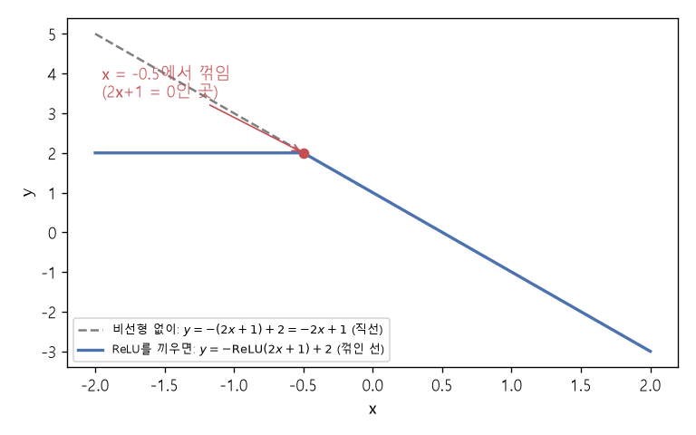

# 합성함수와 비선형성 (Function composition, Nonlinearity)

[목차로 돌아가기](../../00_MIT%EB%94%A5%EB%9F%AC%EB%8B%9D_%EB%AA%A9%EC%B0%A8.md) · 먼저 볼 것: [M01_함수와_일차함수](../../%EC%88%98%ED%95%99%EA%B0%9C%EB%85%90/01_%EC%88%98%EC%99%80_%ED%95%A8%EC%88%98/M01_%ED%95%A8%EC%88%98%EC%99%80_%EC%9D%BC%EC%B0%A8%ED%95%A8%EC%88%98.md), [M05_벡터와_행렬](../../%EC%88%98%ED%95%99%EA%B0%9C%EB%85%90/03_%EC%84%A0%ED%98%95%EB%8C%80%EC%88%98/M05_%EB%B2%A1%ED%84%B0%EC%99%80_%ED%96%89%EB%A0%AC.md), [MM03_벡터_표기와_전치](../../%EC%88%98%ED%95%99%EA%B0%9C%EB%85%90/03_%EC%84%A0%ED%98%95%EB%8C%80%EC%88%98/MM03_%EB%B2%A1%ED%84%B0_%ED%91%9C%EA%B8%B0%EC%99%80_%EC%A0%84%EC%B9%98.md) · 쓰는 곳: [Lec01 5.5 층 쌓기](../../Lec01_%EB%94%A5%EB%9F%AC%EB%8B%9D_%EC%86%8C%EA%B0%9C.md#55-%EC%B8%B5-%EC%8C%93%EA%B8%B0), [6.1 근사 이론](../../Lec01_%EB%94%A5%EB%9F%AC%EB%8B%9D_%EC%86%8C%EA%B0%9C.md#61-%EA%B7%BC%EC%82%AC-%EC%9D%B4%EB%A1%A0-%EB%AC%B4%EC%97%87%EC%9D%84-%ED%91%9C%ED%98%84%ED%95%A0-%EC%88%98-%EC%9E%88%EB%82%98), [6.2 아키텍처](../../Lec01_%EB%94%A5%EB%9F%AC%EB%8B%9D_%EC%86%8C%EA%B0%9C.md#62-%EC%95%84%ED%82%A4%ED%85%8D%EC%B2%98)

📚 학습 순서 37/99 (5. 신경망의 계산): ← 이전: [MM05_활성화_함수의_미분](../../%EC%88%98%ED%95%99%EA%B0%9C%EB%85%90/05_%EC%8B%A0%EA%B2%BD%EB%A7%9D%EC%9D%98_%EA%B3%84%EC%82%B0/MM05_%ED%99%9C%EC%84%B1%ED%99%94_%ED%95%A8%EC%88%98%EC%9D%98_%EB%AF%B8%EB%B6%84.md) · 다음: [MM09_야코비안과_연쇄법칙](../../%EC%88%98%ED%95%99%EA%B0%9C%EB%85%90/05_%EC%8B%A0%EA%B2%BD%EB%A7%9D%EC%9D%98_%EA%B3%84%EC%82%B0/MM09_%EC%95%BC%EC%BD%94%EB%B9%84%EC%95%88%EA%B3%BC_%EC%97%B0%EC%87%84%EB%B2%95%EC%B9%99.md) →

> [!NOTE]
> **3줄 요약**
> - [합성함수](../../00_%EB%94%A5%EB%9F%AC%EB%8B%9D_%EC%9A%A9%EC%96%B4%EC%82%AC%EC%A0%84.md#function-composition-%ED%95%A9%EC%84%B1%ED%95%A8%EC%88%98) $g(f(x))$는 "f를 먼저 하고 그 결과에 g를 한다"는 뜻이다. 신경망은 층마다의 함수를 이어 붙인 [합성함수](../../00_%EB%94%A5%EB%9F%AC%EB%8B%9D_%EC%9A%A9%EC%96%B4%EC%82%AC%EC%A0%84.md#function-composition-%ED%95%A9%EC%84%B1%ED%95%A8%EC%88%98) $f_L(\cdots f_2(f_1(\mathbf{x})))$다.
> - **선형 함수를 아무리 합성해도 선형**이다. $\mathbf{W}_2(\mathbf{W}_1\mathbf{x} + \mathbf{b}_1) + \mathbf{b}_2 = (\mathbf{W}_2\mathbf{W}_1)\mathbf{x} + (\mathbf{W}_2\mathbf{b}_1 + \mathbf{b}_2)$로 한 [층](../../00_%EB%94%A5%EB%9F%AC%EB%8B%9D_%EC%9A%A9%EC%96%B4%EC%82%AC%EC%A0%84.md#layer-%EC%B8%B5)과 같다.
> - [층](../../00_%EB%94%A5%EB%9F%AC%EB%8B%9D_%EC%9A%A9%EC%96%B4%EC%82%AC%EC%A0%84.md#layer-%EC%B8%B5) 사이에 [ReLU](../../00_%EB%94%A5%EB%9F%AC%EB%8B%9D_%EC%9A%A9%EC%96%B4%EC%82%AC%EC%A0%84.md#relu-%EB%A0%90%EB%A3%A8) 같은 비선형 함수를 끼우면 [꺾임](../../00_%EB%94%A5%EB%9F%AC%EB%8B%9D_%EC%9A%A9%EC%96%B4%EC%82%AC%EC%A0%84.md#kink-%EA%BA%BE%EC%9E%84)이 생겨 더 이상 한 [층](../../00_%EB%94%A5%EB%9F%AC%EB%8B%9D_%EC%9A%A9%EC%96%B4%EC%82%AC%EC%A0%84.md#layer-%EC%B8%B5)으로 줄일 수 없다. 그래서 2층 망은 XOR을 풀 수 있다.

## 1. 개념 설명

비유: 공장 컨베이어 벨트. 첫 기계(f)가 재료를 자르고, 둘째 기계(g)가 자른 조각을 칠한다. 완성품은 $g(f(\text{재료}))$다. 기계 순서를 바꾸면 결과도 바뀐다.

- **[합성함수](../../00_%EB%94%A5%EB%9F%AC%EB%8B%9D_%EC%9A%A9%EC%96%B4%EC%82%AC%EC%A0%84.md#function-composition-%ED%95%A9%EC%84%B1%ED%95%A8%EC%88%98)**: $(g \circ f)(x) = g(f(x))$. 안쪽부터 계산한다.
- **신경망과의 관계**: 강의 슬라이드는 깊은 망을 $f(\mathbf{x}) = f_L(f_{L-1}(\cdots f_2(f_1(\mathbf{x}))))$로 적는다. [층](../../00_%EB%94%A5%EB%9F%AC%EB%8B%9D_%EC%9A%A9%EC%96%B4%EC%82%AC%EC%A0%84.md#layer-%EC%B8%B5) 하나가 $f_\ell(\mathbf{h}) = g(\mathbf{W}_\ell\mathbf{h} + \mathbf{b}_\ell)$이다.
- **선형의 합성은 선형**: "곱하고 더하기"를 두 번 해도 결국 "곱하고 더하기" 한 번으로 정리된다. 그래서 비선형 함수가 없으면 [층](../../00_%EB%94%A5%EB%9F%AC%EB%8B%9D_%EC%9A%A9%EC%96%B4%EC%82%AC%EC%A0%84.md#layer-%EC%B8%B5)을 쌓는 의미가 없다.

## 2. 필요한 이유

- [Lec01 5.5](../../Lec01_%EB%94%A5%EB%9F%AC%EB%8B%9D_%EC%86%8C%EA%B0%9C.md#55-%EC%B8%B5-%EC%8C%93%EA%B8%B0)의 $\mathbf{y} = g(\mathbf{W}_2 \cdot g(\mathbf{W}_1\mathbf{x} + \mathbf{b}_1) + \mathbf{b}_2)$는 [합성함수](../../00_%EB%94%A5%EB%9F%AC%EB%8B%9D_%EC%9A%A9%EC%96%B4%EC%82%AC%EC%A0%84.md#function-composition-%ED%95%A9%EC%84%B1%ED%95%A8%EC%88%98)다.
- [Lec01 6.1](../../Lec01_%EB%94%A5%EB%9F%AC%EB%8B%9D_%EC%86%8C%EA%B0%9C.md#61-%EA%B7%BC%EC%82%AC-%EC%9D%B4%EB%A1%A0-%EB%AC%B4%EC%97%87%EC%9D%84-%ED%91%9C%ED%98%84%ED%95%A0-%EC%88%98-%EC%9E%88%EB%82%98)에서 강사는 "[층](../../00_%EB%94%A5%EB%9F%AC%EB%8B%9D_%EC%9A%A9%EC%96%B4%EC%82%AC%EC%A0%84.md#layer-%EC%B8%B5) 사이에 비선형 함수가 없으면 [선형층](../../00_%EB%94%A5%EB%9F%AC%EB%8B%9D_%EC%9A%A9%EC%96%B4%EC%82%AC%EC%A0%84.md#linear-layer-%EC%84%A0%ED%98%95%EC%B8%B5) 두 개는 여전히 선형"이라고 강조한다. 이 노트의 3.2가 그 계산이다.
- [역전파](../../00_%EB%94%A5%EB%9F%AC%EB%8B%9D_%EC%9A%A9%EC%96%B4%EC%82%AC%EC%A0%84.md#backpropagation-%EC%97%AD%EC%A0%84%ED%8C%8C)는 [합성함수](../../00_%EB%94%A5%EB%9F%AC%EB%8B%9D_%EC%9A%A9%EC%96%B4%EC%82%AC%EC%A0%84.md#function-composition-%ED%95%A9%EC%84%B1%ED%95%A8%EC%88%98)의 [미분](../../00_%EB%94%A5%EB%9F%AC%EB%8B%9D_%EC%9A%A9%EC%96%B4%EC%82%AC%EC%A0%84.md#derivative-%EB%AF%B8%EB%B6%84) 규칙인 [연쇄법칙](../../00_%EB%94%A5%EB%9F%AC%EB%8B%9D_%EC%9A%A9%EC%96%B4%EC%82%AC%EC%A0%84.md#chain-rule-%EC%97%B0%EC%87%84%EB%B2%95%EC%B9%99)으로 [층](../../00_%EB%94%A5%EB%9F%AC%EB%8B%9D_%EC%9A%A9%EC%96%B4%EC%82%AC%EC%A0%84.md#layer-%EC%B8%B5)을 거꾸로 거슬러 [기울기](../../00_%EB%94%A5%EB%9F%AC%EB%8B%9D_%EC%9A%A9%EC%96%B4%EC%82%AC%EC%A0%84.md#gradient-%EA%B8%B0%EC%9A%B8%EA%B8%B0)를 구한다.

## 3. 숫자로 보기

### 3.1 순서가 중요하다

$f(x) = 2x + 1$, $g(x) = x^2$, $x = 3$

| 순서 | 계산 | 결과 |
|---|---|---|
| $g(f(3))$ | $f(3) = 7$ → $7^2$ | **49** |
| $f(g(3))$ | $g(3) = 9$ → $2×9 + 1$ | **19** |

**[합성함수](../../00_%EB%94%A5%EB%9F%AC%EB%8B%9D_%EC%9A%A9%EC%96%B4%EC%82%AC%EC%A0%84.md#function-composition-%ED%95%A9%EC%84%B1%ED%95%A8%EC%88%98)의 [미분](../../00_%EB%94%A5%EB%9F%AC%EB%8B%9D_%EC%9A%A9%EC%96%B4%EC%82%AC%EC%A0%84.md#derivative-%EB%AF%B8%EB%B6%84) ([연쇄법칙](../../00_%EB%94%A5%EB%9F%AC%EB%8B%9D_%EC%9A%A9%EC%96%B4%EC%82%AC%EC%A0%84.md#chain-rule-%EC%97%B0%EC%87%84%EB%B2%95%EC%B9%99))**: $\dfrac{d}{dx}g(f(x)) = g'(f(x)) \times f'(x)$
- $x = 3$에서 $g'(7) = 2×7 = 14$, $f'(3) = 2$ → $14 × 2 = 28$
- 확인: $g(f(x)) = (2x+1)^2$을 바로 미분하면 $2(2x+1)×2 = 4×7 = 28$ ✓

### 3.2 선형층 두 개는 선형층 하나

$\mathbf{W}_1 = \begin{pmatrix} 1 & 2 \\ 0 & 1 \end{pmatrix}$, $\mathbf{b}_1 = (1, 0)$, $\mathbf{W}_2 = \begin{pmatrix} 1 & -1 \end{pmatrix}$, $b_2 = 2$

한 줄에 한 동작으로 정리한다.
- 두 [층](../../00_%EB%94%A5%EB%9F%AC%EB%8B%9D_%EC%9A%A9%EC%96%B4%EC%82%AC%EC%A0%84.md#layer-%EC%B8%B5)을 이어 쓰기: $y = \mathbf{W}_2(\mathbf{W}_1\mathbf{x} + \mathbf{b}_1) + b_2$
- 괄호 풀기: $y = \mathbf{W}_2\mathbf{W}_1\mathbf{x} + \mathbf{W}_2\mathbf{b}_1 + b_2$
- 새 [가중치](../../00_%EB%94%A5%EB%9F%AC%EB%8B%9D_%EC%9A%A9%EC%96%B4%EC%82%AC%EC%A0%84.md#weight-%EA%B0%80%EC%A4%91%EC%B9%98): $\mathbf{W}_2\mathbf{W}_1 = (1×1 + (−1)×0,\ 1×2 + (−1)×1) = (1, 1)$
- 새 [편향](../../00_%EB%94%A5%EB%9F%AC%EB%8B%9D_%EC%9A%A9%EC%96%B4%EC%82%AC%EC%A0%84.md#bias-%ED%8E%B8%ED%96%A5): $\mathbf{W}_2\mathbf{b}_1 + b_2 = (1×1 + (−1)×0) + 2 = 3$
- 결론: $y = x_1 + x_2 + 3$, **[층](../../00_%EB%94%A5%EB%9F%AC%EB%8B%9D_%EC%9A%A9%EC%96%B4%EC%82%AC%EC%A0%84.md#layer-%EC%B8%B5) 하나**와 같다.

| 입력 $\mathbf{x}$ | 은닉 $\mathbf{W}_1\mathbf{x} + \mathbf{b}_1$ | 두 [층](../../00_%EB%94%A5%EB%9F%AC%EB%8B%9D_%EC%9A%A9%EC%96%B4%EC%82%AC%EC%A0%84.md#layer-%EC%B8%B5) 그대로 | 한 [층](../../00_%EB%94%A5%EB%9F%AC%EB%8B%9D_%EC%9A%A9%EC%96%B4%EC%82%AC%EC%A0%84.md#layer-%EC%B8%B5)으로 줄인 식 | 사이에 [ReLU](../../00_%EB%94%A5%EB%9F%AC%EB%8B%9D_%EC%9A%A9%EC%96%B4%EC%82%AC%EC%A0%84.md#relu-%EB%A0%90%EB%A3%A8) |
|---|---|---|---|---|
| (1, 1) | (4, 1) | 4 − 1 + 2 = **5** | 1 + 1 + 3 = **5** | [ReLU](../../00_%EB%94%A5%EB%9F%AC%EB%8B%9D_%EC%9A%A9%EC%96%B4%EC%82%AC%EC%A0%84.md#relu-%EB%A0%90%EB%A3%A8)(4, 1) = (4, 1) → **5** |
| (−4, 1) | (−1, 1) | −1 − 1 + 2 = **0** | −4 + 1 + 3 = **0** | [ReLU](../../00_%EB%94%A5%EB%9F%AC%EB%8B%9D_%EC%9A%A9%EC%96%B4%EC%82%AC%EC%A0%84.md#relu-%EB%A0%90%EB%A3%A8)(−1, 1) = (0, 1) → **1** |

- 비선형 함수가 없으면 두 방법의 답이 언제나 같다.
- [ReLU](../../00_%EB%94%A5%EB%9F%AC%EB%8B%9D_%EC%9A%A9%EC%96%B4%EC%82%AC%EC%A0%84.md#relu-%EB%A0%90%EB%A3%A8)를 끼우면 은닉값이 음수인 입력에서 답이 달라진다(0 → 1). 이제 $x_1 + x_2 + 3$ 같은 한 줄 식으로는 나타낼 수 없다.



<details><summary>기호 풀이</summary>

| 기호 | 읽는 법 | 뜻 | 예제 값 |
| --- | --- | --- | --- |
| $g(f(x))$ | 지 오브 에프 오브 엑스 | f 다음에 g를 하는 [합성함수](../../00_%EB%94%A5%EB%9F%AC%EB%8B%9D_%EC%9A%A9%EC%96%B4%EC%82%AC%EC%A0%84.md#function-composition-%ED%95%A9%EC%84%B1%ED%95%A8%EC%88%98) | $g(f(3)) = 49$ |
| $g \circ f$ | 지 서클 에프 | [합성함수](../../00_%EB%94%A5%EB%9F%AC%EB%8B%9D_%EC%9A%A9%EC%96%B4%EC%82%AC%EC%A0%84.md#function-composition-%ED%95%A9%EC%84%B1%ED%95%A8%EC%88%98)를 짧게 쓴 것 | - |
| $f_\ell$ | 에프 엘 | $\ell$번째 [층](../../00_%EB%94%A5%EB%9F%AC%EB%8B%9D_%EC%9A%A9%EC%96%B4%EC%82%AC%EC%A0%84.md#layer-%EC%B8%B5)의 함수 | - |
| $L$ | 엘 | [층](../../00_%EB%94%A5%EB%9F%AC%EB%8B%9D_%EC%9A%A9%EC%96%B4%EC%82%AC%EC%A0%84.md#layer-%EC%B8%B5)의 개수 | - |
| $\mathbf{W}_2\mathbf{W}_1$ | 더블유 투 더블유 원 | 두 [가중치](../../00_%EB%94%A5%EB%9F%AC%EB%8B%9D_%EC%9A%A9%EC%96%B4%EC%82%AC%EC%A0%84.md#weight-%EA%B0%80%EC%A4%91%EC%B9%98) 행렬의 곱 (합친 [가중치](../../00_%EB%94%A5%EB%9F%AC%EB%8B%9D_%EC%9A%A9%EC%96%B4%EC%82%AC%EC%A0%84.md#weight-%EA%B0%80%EC%A4%91%EC%B9%98)) | (1, 1) |
| $g'(f(x))$ | 지 프라임 오브 에프 엑스 | 바깥 함수의 [기울기](../../00_%EB%94%A5%EB%9F%AC%EB%8B%9D_%EC%9A%A9%EC%96%B4%EC%82%AC%EC%A0%84.md#gradient-%EA%B8%B0%EC%9A%B8%EA%B8%B0)를 안쪽 값에서 잰 것 | 14 |

</details>

## 4. 코드로 확인

```python
# [함수] import: NumPy를 np로 불러온다
import numpy as np

# [함수] np.maximum(0, z): 칸마다 0과 z 중 큰 값 = ReLU
# [변수] relu: ReLU 함수. 층 사이에 끼울 비선형 함수로 쓰려고 이름을 붙인다
# [연결] ReLU의 도함수와 성질은 MM05_활성화_함수의_미분
relu = lambda z: np.maximum(0, z)
# [변수] W1 (2×2), b1: 첫째 층의 가중치와 편향. 입력 2칸 → 은닉 2칸
# [연결] 본문 3.2의 𝐖₁, 𝐛₁
W1, b1 = np.array([[1, 2], [0, 1]]), np.array([1, 0])
# [변수] W2 (1×2), b2: 둘째 층의 가중치와 편향. 은닉 2칸 → 출력 1칸
W2, b2 = np.array([[1, -1]]), np.array([2])
# [함수] @: 행렬 곱
# [연결] 두 층을 한 층으로 합친 가중치 𝐖₂𝐖₁ = [[1 1]]와 편향 𝐖₂𝐛₁ + b₂ = [3] (본문 3.2의 정리)
print(W2 @ W1, W2 @ b1 + b2)
# [변수] x: 시험할 입력 두 개. (1, 1)은 은닉값이 모두 양수, (-4, 1)은 하나가 음수라 ReLU 차이가 드러난다
for x in (np.array([1, 1]), np.array([-4, 1])):
    # [변수] h: 첫째 층의 출력(비선형 함수 전). 세 방법이 같은 h에서 출발하게 하려고 먼저 구한다
    h = W1 @ x + b1
    # [연결] 출력 세 개 = 본문 3.2 표의 "두 층 그대로", "한 층으로 줄인 식", "사이에 ReLU" 칸
    # 앞의 둘은 언제나 같고, 셋째는 h에 음수가 있을 때만 달라진다
    print(W2 @ h + b2, (W2 @ W1) @ x + W2 @ b1 + b2, W2 @ relu(h) + b2)
```

**실행 결과**:

```text
[[1 1]] [3]
[5] [5] [5]
[0] [0] [1]
```

> [!WARNING]
> **⚠ 주의**
> - "선형"은 엄밀히 $\mathbf{W}\mathbf{x}$ 꼴이고, [편향](../../00_%EB%94%A5%EB%9F%AC%EB%8B%9D_%EC%9A%A9%EC%96%B4%EC%82%AC%EC%A0%84.md#bias-%ED%8E%B8%ED%96%A5)을 더한 $\mathbf{W}\mathbf{x} + \mathbf{b}$는 "아핀(affine)"이다. 딥러닝에서는 둘을 묶어 [선형층](../../00_%EB%94%A5%EB%9F%AC%EB%8B%9D_%EC%9A%A9%EC%96%B4%EC%82%AC%EC%A0%84.md#linear-layer-%EC%84%A0%ED%98%95%EC%B8%B5)이라 부른다. 아핀끼리 합성해도 아핀이라 결론은 같다.
> - 비선형 함수는 "구부러지기만 하면" 된다. 강의 표현으로는 "의미 있는(non-trivial) [비선형성](../../00_%EB%94%A5%EB%9F%AC%EB%8B%9D_%EC%9A%A9%EC%96%B4%EC%82%AC%EC%A0%84.md#nonlinearity-%EB%B9%84%EC%84%A0%ED%98%95%EC%84%B1)"이 필요하다.

## 5. 개념 재확인

<details><summary>1. $f(x) = 3x - 2$, $g(x) = x^2 + 1$일 때 $g(f(2))$와 $f(g(2))$, 그리고 $x = 2$에서 $g(f(x))$의 기울기는?</summary>

| 단계 | 하는 일 | 계산 | 결과 |
|---|---|---|---|
| 1 | $f(2)$ | 3×2 − 2 | 4 |
| 2 | $g(f(2))$ | $4^2 + 1$ | 17 |
| 3 | $g(2)$, $f(g(2))$ | $2^2 + 1 = 5$ → 3×5 − 2 | 13 |
| 4 | [기울기](../../00_%EB%94%A5%EB%9F%AC%EB%8B%9D_%EC%9A%A9%EC%96%B4%EC%82%AC%EC%A0%84.md#gradient-%EA%B8%B0%EC%9A%B8%EA%B8%B0) | $g'(4) × f'(2) = 8 × 3$ | 24 |

**① 쓰는 식**
$$(g \circ f)(x) = g(f(x)), \qquad \frac{d}{dx}g(f(x)) = g'(f(x)) \times f'(x)$$
- 위 식 ← 왼쪽 식은 ② ($f(2)$)와 ③ ($g(f(2))$), ④ (순서를 바꾼 $f(g(2))$), 오른쪽 식은 ⑤ ([기울기](../../00_%EB%94%A5%EB%9F%AC%EB%8B%9D_%EC%9A%A9%EC%96%B4%EC%82%AC%EC%A0%84.md#gradient-%EA%B8%B0%EC%9A%B8%EA%B8%B0))에서 쓴다.
- $g'(x) = 2x$, $f'(x) = 3$이다.
```python
# [함수] lambda: 짧은 함수를 만든다
# [변수] f(x) = 3x - 2 (안쪽 함수), g(x) = x² + 1 (바깥 함수). 문제에서 준 함수
f = lambda x: 3 * x - 2; g = lambda x: x ** 2 + 1      # ①
# [연결] 단계 ② 안쪽 먼저 → 4
print(f(2))                     # ②
# [연결] 단계 ③ f의 결과 4를 g에 넣음 → 17
print(g(f(2)))                  # ③
# [연결] 단계 ④ 순서를 바꾸면 → 13 (합성은 순서가 중요)
print(f(g(2)))                  # ④
# [연결] 단계 ⑤ 연쇄법칙 g'(f(2)) × f'(2). g'(x) = 2x라 2 × f(2) = 8, f'(x) = 3 → 24
print(2 * f(2) * 3)             # ⑤
```

**주어진 값**
- $f(x) = 3x - 2$ (안쪽 함수)
- $g(x) = x^2 + 1$ (바깥 함수)
- $x = 2$ (입력)
- $g'(x) = 2x$, $f'(x) = 3$ (두 함수의 [기울기](../../00_%EB%94%A5%EB%9F%AC%EB%8B%9D_%EC%9A%A9%EC%96%B4%EC%82%AC%EC%A0%84.md#gradient-%EA%B8%B0%EC%9A%B8%EA%B8%B0) 식)

**② $f(2)$**
1. 식을 그대로 쓴다: $f(x) = 3x - 2$
2. 값을 대입한다: $f(2) = 3 \times 2 - 2$
3. 곱셈을 먼저 한다: 3 × 2 = 6 이므로 $f(2) = 6 - 2$
4. 뺄셈을 한다: 6 − 2 = 4 이므로 $f(2) = 4$

**③ $g(f(2))$**
1. 식을 그대로 쓴다: $g(x) = x^2 + 1$ (안쪽 결과 $f(2) = 4$를 x 자리에 넣는다)
2. 값을 대입한다: $g(f(2)) = g(4) = 4^2 + 1$
3. 거듭제곱을 먼저 한다: $4^2 = 4 \times 4 = 16$ 이므로 $g(4) = 16 + 1$
4. 덧셈을 한다: 16 + 1 = 17 이므로 $g(f(2)) = 17$

**④ $f(g(2))$**
1. 식을 그대로 쓴다: 이번에는 $g$를 먼저, 그 결과를 $f$에 넣는다. $g(x) = x^2 + 1$
2. 값을 대입한다: $g(2) = 2^2 + 1$
3. 거듭제곱을 한다: $2^2 = 4$ 이므로 $g(2) = 4 + 1$
4. 덧셈을 한다: 4 + 1 = 5 이므로 $g(2) = 5$
5. $f$에 넣는다: $f(5) = 3 \times 5 - 2$
6. 곱셈을 한다: 3 × 5 = 15 이므로 $f(5) = 15 - 2$
7. 뺄셈을 한다: 15 − 2 = 13 이므로 $f(g(2)) = 13$ (순서가 바뀌면 답이 다르다)

**⑤ [기울기](../../00_%EB%94%A5%EB%9F%AC%EB%8B%9D_%EC%9A%A9%EC%96%B4%EC%82%AC%EC%A0%84.md#gradient-%EA%B8%B0%EC%9A%B8%EA%B8%B0)**
1. 식을 그대로 쓴다: $\frac{d}{dx}g(f(x)) = g'(f(x)) \times f'(x)$
2. 값을 대입한다: $g'(f(2)) \times f'(2) = g'(4) \times 3$ ($f(2) = 4$는 ②에서 구했다)
3. 바깥 [기울기](../../00_%EB%94%A5%EB%9F%AC%EB%8B%9D_%EC%9A%A9%EC%96%B4%EC%82%AC%EC%A0%84.md#gradient-%EA%B8%B0%EC%9A%B8%EA%B8%B0)를 구한다: $g'(x) = 2x$ 이므로 $g'(4) = 2 \times 4 = 8$, 식은 $8 \times 3$
4. 곱셈을 한다: 8 × 3 = 24

**답**: $g(f(2))$ = **17**, $f(g(2))$ = **13**, [기울기](../../00_%EB%94%A5%EB%9F%AC%EB%8B%9D_%EC%9A%A9%EC%96%B4%EC%82%AC%EC%A0%84.md#gradient-%EA%B8%B0%EC%9A%B8%EA%B8%B0) **24**

</details>

<details><summary>2. 2층 망 $h_1 = \mathrm{ReLU}(x_1 + x_2)$, $h_2 = \mathrm{ReLU}(x_1 + x_2 - 1)$, $y = h_1 - 2h_2$가 XOR을 푸는지 확인하라. (MM04_평면과_결정_경계의 재확인 2에서 직선 하나로는 못 풀었던 문제)</summary>

| 입력 | $x_1 + x_2$ | $h_1$ | $h_2$ | $y = h_1 - 2h_2$ | XOR [정답](../../00_%EB%94%A5%EB%9F%AC%EB%8B%9D_%EC%9A%A9%EC%96%B4%EC%82%AC%EC%A0%84.md#label-%EC%A0%95%EB%8B%B5) |
|---|---|---|---|---|---|
| (0, 0) | 0 | 0 | 0 | 0 | 0 ✓ |
| (1, 0) | 1 | 1 | 0 | 1 | 1 ✓ |
| (0, 1) | 1 | 1 | 0 | 1 | 1 ✓ |
| (1, 1) | 2 | 2 | 1 | 0 | 0 ✓ |

**① 쓰는 식**
$$h_1 = \mathrm{ReLU}(x_1 + x_2), \quad h_2 = \mathrm{ReLU}(x_1 + x_2 - 1), \quad y = h_1 - 2h_2$$
- 위 식 ← 첫 식은 ② ($h_1$), 둘째 식은 ③ ($h_2$), 셋째 식은 ④ (출력)에서 쓰고, ⑤ ([정답](../../00_%EB%94%A5%EB%9F%AC%EB%8B%9D_%EC%9A%A9%EC%96%B4%EC%82%AC%EC%A0%84.md#label-%EC%A0%95%EB%8B%B5)과 비교)에서 확인한다.
```python
# [함수] np.maximum(0, z): ReLU. [변수] relu: 은닉 유닛의 비선형 함수
relu = lambda z: np.maximum(0, z)
# [변수] X: XOR 입력 4개를 행으로 쌓은 (4 × 2) 행렬
X = np.array([[0, 0], [1, 0], [0, 1], [1, 1]])   # ①
# [함수] .sum(axis=1): 행마다 칸을 더한다
# [변수] s = [0 1 1 2]: 입력마다의 x₁ + x₂. 두 은닉 유닛이 같은 합을 쓰므로 한 번만 구한다
s = X.sum(axis=1)
# [변수] h1 = [0 1 1 2]: 첫째 은닉 유닛 ReLU(x₁ + x₂)
h1 = relu(s)                                      # ②
# [변수] h2 = [0 0 0 1]: 둘째 은닉 유닛 ReLU(x₁ + x₂ - 1). (1, 1)에서만 켜진다
h2 = relu(s - 1)                                  # ③
# [변수] y = [0 1 1 0]: 출력. h2가 켜진 (1, 1)만 2만큼 깎여 0이 된다
# [연결] 직선 하나로 못 풀던 MM04_평면과_결정_경계 재확인 2의 해결
y = h1 - 2 * h2                                   # ④
# [연결] 단계 ⑤ XOR 정답 [0 1 1 0]과 같다
print(y)                                          # ⑤
```

**주어진 값**
- $h_1 = \mathrm{ReLU}(x_1 + x_2)$ (첫째 은닉 유닛)
- $h_2 = \mathrm{ReLU}(x_1 + x_2 - 1)$ (둘째 은닉 유닛)
- $y = h_1 - 2h_2$ (출력)
- 입력 네 개: (0, 0), (1, 0), (0, 1), (1, 1)
- $\mathrm{ReLU}(z)$: z가 0보다 작으면 0, 아니면 z 그대로

**② $h_1$** (입력 네 개를 하나씩)
1. 식을 그대로 쓴다: $h_1 = \mathrm{ReLU}(x_1 + x_2)$
2. 값을 대입한다: (0, 0) → $\mathrm{ReLU}(0 + 0)$, (1, 0) → $\mathrm{ReLU}(1 + 0)$, (0, 1) → $\mathrm{ReLU}(0 + 1)$, (1, 1) → $\mathrm{ReLU}(1 + 1)$
3. 더한다: 0 + 0 = 0, 1 + 0 = 1, 0 + 1 = 1, 1 + 1 = 2 이므로 $\mathrm{ReLU}(0), \mathrm{ReLU}(1), \mathrm{ReLU}(1), \mathrm{ReLU}(2)$
4. 모두 0 이상이라 그대로다: $h_1 = 0, 1, 1, 2$

**③ $h_2$**
1. 식을 그대로 쓴다: $h_2 = \mathrm{ReLU}(x_1 + x_2 - 1)$
2. 값을 대입한다: (0, 0) → $\mathrm{ReLU}(0 + 0 - 1)$, (1, 0) → $\mathrm{ReLU}(1 + 0 - 1)$, (0, 1) → $\mathrm{ReLU}(0 + 1 - 1)$, (1, 1) → $\mathrm{ReLU}(1 + 1 - 1)$
3. 계산한다: 0 + 0 − 1 = −1, 1 + 0 − 1 = 0, 0 + 1 − 1 = 0, 1 + 1 − 1 = 1 이므로 $\mathrm{ReLU}(-1), \mathrm{ReLU}(0), \mathrm{ReLU}(0), \mathrm{ReLU}(1)$
4. 음수는 0으로 바꾼다: $h_2 = 0, 0, 0, 1$

**④ 출력**
1. 식을 그대로 쓴다: $y = h_1 - 2h_2$
2. 값을 대입한다: (0, 0) → $0 - 2 \times 0$, (1, 0) → $1 - 2 \times 0$, (0, 1) → $1 - 2 \times 0$, (1, 1) → $2 - 2 \times 1$
3. 곱셈을 한다: 2 × 0 = 0, 2 × 0 = 0, 2 × 0 = 0, 2 × 1 = 2 이므로 $y$는 $0 - 0$, $1 - 0$, $1 - 0$, $2 - 2$
4. 뺄셈을 한다: $y = 0, 1, 1, 0$

**⑤ [정답](../../00_%EB%94%A5%EB%9F%AC%EB%8B%9D_%EC%9A%A9%EC%96%B4%EC%82%AC%EC%A0%84.md#label-%EC%A0%95%EB%8B%B5)과 비교**
- XOR [정답](../../00_%EB%94%A5%EB%9F%AC%EB%8B%9D_%EC%9A%A9%EC%96%B4%EC%82%AC%EC%A0%84.md#label-%EC%A0%95%EB%8B%B5)은 (0, 0)→0, (1, 0)→1, (0, 1)→1, (1, 1)→0 이고 $y = 0, 1, 1, 0$과 네 칸 모두 같다.

**답**: **푼다**. $h_2$의 [ReLU](../../00_%EB%94%A5%EB%9F%AC%EB%8B%9D_%EC%9A%A9%EC%96%B4%EC%82%AC%EC%A0%84.md#relu-%EB%A0%90%EB%A3%A8)가 $x_1 + x_2 = 1$에서 [꺾임](../../00_%EB%94%A5%EB%9F%AC%EB%8B%9D_%EC%9A%A9%EC%96%B4%EC%82%AC%EC%A0%84.md#kink-%EA%BA%BE%EC%9E%84)을 만들어, 직선 하나로는 못 하던 "가운데만 1"을 만든다.

</details>

## 예제 풀기

[예제 10문제 풀기](../../%EC%98%88%EC%A0%9C/05_%EC%8B%A0%EA%B2%BD%EB%A7%9D%EC%9D%98_%EA%B3%84%EC%82%B0/%EC%98%88%EC%A0%9C_MM06_%ED%95%A9%EC%84%B1%ED%95%A8%EC%88%98%EC%99%80_%EB%B9%84%EC%84%A0%ED%98%95%EC%84%B1.md)

<details><summary>내 이해</summary>


</details>
