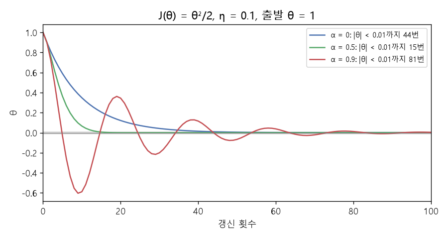

# 미니배치 기울기와 모멘텀 (Mini-batch gradient, Momentum, Clipping)

[목차로 돌아가기](../../00_MIT%EB%94%A5%EB%9F%AC%EB%8B%9D_%EB%AA%A9%EC%B0%A8.md) · 먼저 볼 것: [MM02_그래디언트_벡터](../../%EC%88%98%ED%95%99%EA%B0%9C%EB%85%90/02_%EB%AF%B8%EB%B6%84/MM02_%EA%B7%B8%EB%9E%98%EB%94%94%EC%96%B8%ED%8A%B8_%EB%B2%A1%ED%84%B0.md), [M02_시그마와_평균](../../%EC%88%98%ED%95%99%EA%B0%9C%EB%85%90/01_%EC%88%98%EC%99%80_%ED%95%A8%EC%88%98/M02_%EC%8B%9C%EA%B7%B8%EB%A7%88%EC%99%80_%ED%8F%89%EA%B7%A0.md) · 쓰는 곳: [Lec02 2.2](../../Lec02_%EC%8B%A0%EA%B2%BD%EB%A7%9D_%ED%95%99%EC%8A%B5.md#22-%ED%99%95%EB%A5%A0%EC%A0%81-%EA%B2%BD%EC%82%AC%ED%95%98%EA%B0%95%EB%B2%95), [Lec02 2.3](../../Lec02_%EC%8B%A0%EA%B2%BD%EB%A7%9D_%ED%95%99%EC%8A%B5.md#23-%EB%AA%A8%EB%A9%98%ED%85%80), [Lec02 3.2](../../Lec02_%EC%8B%A0%EA%B2%BD%EB%A7%9D_%ED%95%99%EC%8A%B5.md#32-%EC%A7%84%ED%99%94-%EC%A0%84%EB%9E%B5%EA%B3%BC-%EA%B7%B8%EB%9E%98%EB%94%94%EC%96%B8%ED%8A%B8-%ED%81%B4%EB%A6%AC%ED%95%91)

📚 학습 순서 40/99 (5. 신경망의 계산): ← 이전: [MM10_선형층과_ReLU의_역전파](../../%EC%88%98%ED%95%99%EA%B0%9C%EB%85%90/05_%EC%8B%A0%EA%B2%BD%EB%A7%9D%EC%9D%98_%EA%B3%84%EC%82%B0/MM10_%EC%84%A0%ED%98%95%EC%B8%B5%EA%B3%BC_ReLU%EC%9D%98_%EC%97%AD%EC%A0%84%ED%8C%8C.md) · 다음: [MM36_지수_이동_평균](../../%EC%88%98%ED%95%99%EA%B0%9C%EB%85%90/05_%EC%8B%A0%EA%B2%BD%EB%A7%9D%EC%9D%98_%EA%B3%84%EC%82%B0/MM36_%EC%A7%80%EC%88%98_%EC%9D%B4%EB%8F%99_%ED%8F%89%EA%B7%A0.md) →

> [!NOTE]
> **3줄 요약**
> - 전체 [기울기](../../00_%EB%94%A5%EB%9F%AC%EB%8B%9D_%EC%9A%A9%EC%96%B4%EC%82%AC%EC%A0%84.md#gradient-%EA%B8%B0%EC%9A%B8%EA%B8%B0)는 데이터별 [기울기](../../00_%EB%94%A5%EB%9F%AC%EB%8B%9D_%EC%9A%A9%EC%96%B4%EC%82%AC%EC%A0%84.md#gradient-%EA%B8%B0%EC%9A%B8%EA%B8%B0)의 **평균**이다. 배치 하나의 [기울기](../../00_%EB%94%A5%EB%9F%AC%EB%8B%9D_%EC%9A%A9%EC%96%B4%EC%82%AC%EC%A0%84.md#gradient-%EA%B8%B0%EC%9A%B8%EA%B8%B0)는 그 평균의 잡음 섞인 추정이다. 데이터 (1, 2, 3, 6), θ = 0에서 전체 −6, 배치 {1, 2}는 −3, 배치 {3, 6}은 −9.
> - [모멘텀](../../00_%EB%94%A5%EB%9F%AC%EB%8B%9D_%EC%9A%A9%EC%96%B4%EC%82%AC%EC%A0%84.md#momentum-%EB%AA%A8%EB%A9%98%ED%85%80)은 속도 $v \leftarrow \alpha v - \eta\nabla J$를 두고 $\theta \leftarrow \theta + v$로 움직인다. J = θ²/2, η = 0.1에서 바닥 근처에 들기까지 α = 0이면 44번, 0.5면 15번, 0.9면 지나쳐 출렁이느라 81번.
> - [클리핑](../../00_%EB%94%A5%EB%9F%AC%EB%8B%9D_%EC%9A%A9%EC%96%B4%EC%82%AC%EC%A0%84.md#gradient-clipping-%EA%B7%B8%EB%9E%98%EB%94%94%EC%96%B8%ED%8A%B8-%ED%81%B4%EB%A6%AC%ED%95%91)은 [기울기](../../00_%EB%94%A5%EB%9F%AC%EB%8B%9D_%EC%9A%A9%EC%96%B4%EC%82%AC%EC%A0%84.md#gradient-%EA%B8%B0%EC%9A%B8%EA%B8%B0) 크기를 한도로 자른다. (30, 40)을 한도 5로 칸마다 자르면 (5, 5)로 방향이 바뀌고, 길이로 자르면 (3, 4)로 방향이 유지된다.

## 1. 개념 설명

비유: 산에서 안개 속을 내려간다고 하자.

- **[미니배치](../../00_%EB%94%A5%EB%9F%AC%EB%8B%9D_%EC%9A%A9%EC%96%B4%EC%82%AC%EC%A0%84.md#mini-batch-%EB%AF%B8%EB%8B%88%EB%B0%B0%EC%B9%98)**: 산 전체 지도를 보는 대신 발밑 몇 군데만 짚어 보고 내리막을 짐작한다. 짐작은 조금씩 틀리지만 훨씬 빨리 한 걸음을 뗄 수 있다.
- **[모멘텀](../../00_%EB%94%A5%EB%9F%AC%EB%8B%9D_%EC%9A%A9%EC%96%B4%EC%82%AC%EC%A0%84.md#momentum-%EB%AA%A8%EB%A9%98%ED%85%80)**: 무거운 공처럼 굴러간다. 방금 굴러온 방향으로 계속 가려는 관성이 있어, 같은 방향이 이어지면 점점 빨라지고 방향이 자주 바뀌면 흔들림이 줄어든다. 너무 무거우면(α가 크면) 바닥을 지나쳐 반대편 비탈로 올라갔다 돌아온다.
- **클리핑**: 낭떠러지 근처에서 발밑 경사가 엄청나게 가파르게 느껴져도, 한 걸음의 크기에 상한을 둔다.

$$
\frac{\partial J}{\partial \theta} = \frac{1}{N}\sum_{i=1}^{N} \frac{\partial J_i}{\partial \theta}, \qquad v \leftarrow \alpha v - \eta \nabla J(\theta),\quad \theta \leftarrow \theta + v
$$

<details><summary>기호 풀이</summary>

| 기호 | 읽는 법 | 뜻 | 예제 값 |
| --- | --- | --- | --- |
| $\frac{\partial J}{\partial \theta}$ | 파셜 제이 파셜 세타 | 전체 비용의 [기울기](../../00_%EB%94%A5%EB%9F%AC%EB%8B%9D_%EC%9A%A9%EC%96%B4%EC%82%AC%EC%A0%84.md#gradient-%EA%B8%B0%EC%9A%B8%EA%B8%B0) | −6 |
| $N$ | 엔 | 데이터 개수 | 2 |
| $\frac{1}{N}\sum_{i=1}^{N}$ | 엔분의 일 시그마 | N개 값의 평균 | (−2 − 10) / 2 |
| $J_i$ | 제이 아이 | 데이터 i 하나의 [손실](../../00_%EB%94%A5%EB%9F%AC%EB%8B%9D_%EC%9A%A9%EC%96%B4%EC%82%AC%EC%A0%84.md#loss-function-%EC%86%90%EC%8B%A4-%ED%95%A8%EC%88%98) | $(\theta - x_i)^2$ |
| $v$ | 브이, 속도 | 지금까지 쌓인 이동량 | −1 → 0.1 |
| $\alpha$ | 알파 | [모멘텀](../../00_%EB%94%A5%EB%9F%AC%EB%8B%9D_%EC%9A%A9%EC%96%B4%EC%82%AC%EC%A0%84.md#momentum-%EB%AA%A8%EB%A9%98%ED%85%80) 세기 | 0.5 |
| $\eta$ | 에타 | [학습률](../../00_%EB%94%A5%EB%9F%AC%EB%8B%9D_%EC%9A%A9%EC%96%B4%EC%82%AC%EC%A0%84.md#learning-rate-%ED%95%99%EC%8A%B5%EB%A5%A0) | 0.1 |
| $\nabla J(\theta)$ | 나블라 제이 | 위에서 구한 평균 [기울기](../../00_%EB%94%A5%EB%9F%AC%EB%8B%9D_%EC%9A%A9%EC%96%B4%EC%82%AC%EC%A0%84.md#gradient-%EA%B8%B0%EC%9A%B8%EA%B8%B0) | −6 |
| $\theta$ | 세타 | [파라미터](../../00_%EB%94%A5%EB%9F%AC%EB%8B%9D_%EC%9A%A9%EC%96%B4%EC%82%AC%EC%A0%84.md#parameter-%ED%8C%8C%EB%9D%BC%EB%AF%B8%ED%84%B0) | 0 → 0.1 |

</details>

<details><summary>예제와 풀이</summary>

**문제**: 데이터 두 개 (1, 5)로 평균 [기울기](../../00_%EB%94%A5%EB%9F%AC%EB%8B%9D_%EC%9A%A9%EC%96%B4%EC%82%AC%EC%A0%84.md#gradient-%EA%B8%B0%EC%9A%B8%EA%B8%B0)를 구한 뒤, 직전 속도 −1을 남기는 [모멘텀](../../00_%EB%94%A5%EB%9F%AC%EB%8B%9D_%EC%9A%A9%EC%96%B4%EC%82%AC%EC%A0%84.md#momentum-%EB%AA%A8%EB%A9%98%ED%85%80)으로 θ = 0을 한 번 갱신하면 새 θ는?

**주어진 값**:
- $x_1 = 1,\ x_2 = 5$ (데이터)
- $N = 2$ (데이터 개수)
- $\frac{\partial J_i}{\partial \theta} = 2(\theta - x_i)$ (데이터 하나의 [기울기](../../00_%EB%94%A5%EB%9F%AC%EB%8B%9D_%EC%9A%A9%EC%96%B4%EC%82%AC%EC%A0%84.md#gradient-%EA%B8%B0%EC%9A%B8%EA%B8%B0), $J_i = (\theta - x_i)^2$)
- $\theta = 0$ (지금 [파라미터](../../00_%EB%94%A5%EB%9F%AC%EB%8B%9D_%EC%9A%A9%EC%96%B4%EC%82%AC%EC%A0%84.md#parameter-%ED%8C%8C%EB%9D%BC%EB%AF%B8%ED%84%B0))
- $v = -1$ (직전 속도)
- $\alpha = 0.5$ ([모멘텀](../../00_%EB%94%A5%EB%9F%AC%EB%8B%9D_%EC%9A%A9%EC%96%B4%EC%82%AC%EC%A0%84.md#momentum-%EB%AA%A8%EB%A9%98%ED%85%80) 세기)
- $\eta = 0.1$ ([학습률](../../00_%EB%94%A5%EB%9F%AC%EB%8B%9D_%EC%9A%A9%EC%96%B4%EC%82%AC%EC%A0%84.md#learning-rate-%ED%95%99%EC%8A%B5%EB%A5%A0))

**풀이**
1. 식을 그대로 쓴다: $\frac{\partial J}{\partial \theta} = \frac{1}{N}\sum_{i=1}^{N} \frac{\partial J_i}{\partial \theta}, \qquad v \leftarrow \alpha v - \eta \nabla J(\theta),\quad \theta \leftarrow \theta + v$
2. 값을 대입한다 (Σ를 두 항으로 펼침): $\nabla J = \frac{1}{2}\big(2(0 - 1) + 2(0 - 5)\big), \qquad v = 0.5 \times (-1) - 0.1 \times \nabla J,\quad \theta = 0 + v$
3. 괄호 안 뺄셈을 한다: $\nabla J = \frac{1}{2}\big(2 \times (-1) + 2 \times (-5)\big)$
4. 곱셈을 한다: $\nabla J = \frac{1}{2}\big((-2) + (-10)\big)$
5. 더한다: $\nabla J = \frac{1}{2} \times (-12)$
6. 2로 나눈다: $\nabla J = -6$ 이므로 $v = 0.5 \times (-1) - 0.1 \times (-6)$
7. 직전 속도에 α를 곱한다: $0.5 \times (-1) = -0.5$
8. [기울기](../../00_%EB%94%A5%EB%9F%AC%EB%8B%9D_%EC%9A%A9%EC%96%B4%EC%82%AC%EC%A0%84.md#gradient-%EA%B8%B0%EC%9A%B8%EA%B8%B0)에 [학습률](../../00_%EB%94%A5%EB%9F%AC%EB%8B%9D_%EC%9A%A9%EC%96%B4%EC%82%AC%EC%A0%84.md#learning-rate-%ED%95%99%EC%8A%B5%EB%A5%A0)을 곱한다: $0.1 \times (-6) = -0.6$ 이므로 $v = -0.5 - (-0.6)$
9. 음수를 빼는 것은 더하는 것과 같다: $v = -0.5 + 0.6 = 0.1$
10. 새 속도만큼 움직인다: $\theta = 0 + 0.1 = 0.1$

**답**: $\theta = 0.1$ (직전 속도는 음수 쪽이었지만 [기울기](../../00_%EB%94%A5%EB%9F%AC%EB%8B%9D_%EC%9A%A9%EC%96%B4%EC%82%AC%EC%A0%84.md#gradient-%EA%B8%B0%EC%9A%B8%EA%B8%B0)가 더 세게 양수 쪽으로 밀었다)

</details>

<details><summary>내 이해</summary>


</details>

## 2. 필요한 이유

- [Lec02 2.2](../../Lec02_%EC%8B%A0%EA%B2%BD%EB%A7%9D_%ED%95%99%EC%8A%B5.md#22-%ED%99%95%EB%A5%A0%EC%A0%81-%EA%B2%BD%EC%82%AC%ED%95%98%EA%B0%95%EB%B2%95): 데이터가 수십억 개라 전체 [기울기](../../00_%EB%94%A5%EB%9F%AC%EB%8B%9D_%EC%9A%A9%EC%96%B4%EC%82%AC%EC%A0%84.md#gradient-%EA%B8%B0%EC%9A%B8%EA%B8%B0)를 매번 구할 수 없다. [SGD](../../00_%EB%94%A5%EB%9F%AC%EB%8B%9D_%EC%9A%A9%EC%96%B4%EC%82%AC%EC%A0%84.md#stochastic-gradient-descent-%ED%99%95%EB%A5%A0%EC%A0%81-%EA%B2%BD%EC%82%AC%ED%95%98%EA%B0%95%EB%B2%95)는 배치 [기울기](../../00_%EB%94%A5%EB%9F%AC%EB%8B%9D_%EC%9A%A9%EC%96%B4%EC%82%AC%EC%A0%84.md#gradient-%EA%B8%B0%EC%9A%B8%EA%B8%B0)로 대신한다. 배치 [기울기](../../00_%EB%94%A5%EB%9F%AC%EB%8B%9D_%EC%9A%A9%EC%96%B4%EC%82%AC%EC%A0%84.md#gradient-%EA%B8%B0%EC%9A%B8%EA%B8%B0)가 전체와 얼마나 다른지 숫자로 보면 "잡음"의 뜻이 분명해진다.
- [Lec02 2.3](../../Lec02_%EC%8B%A0%EA%B2%BD%EB%A7%9D_%ED%95%99%EC%8A%B5.md#23-%EB%AA%A8%EB%A9%98%ED%85%80): 슬라이드는 [모멘텀](../../00_%EB%94%A5%EB%9F%AC%EB%8B%9D_%EC%9A%A9%EC%96%B4%EC%82%AC%EC%A0%84.md#momentum-%EB%AA%A8%EB%A9%98%ED%85%80) 0, 0.5, 0.95를 비교하며 "도움이 될 수도 해가 될 수도" 있다고 한다. 같은 실험을 작은 식으로 해 본다.
- [Lec02 3.2](../../Lec02_%EC%8B%A0%EA%B2%BD%EB%A7%9D_%ED%95%99%EC%8A%B5.md#32-%EC%A7%84%ED%99%94-%EC%A0%84%EB%9E%B5%EA%B3%BC-%EA%B7%B8%EB%9E%98%EB%94%94%EC%96%B8%ED%8A%B8-%ED%81%B4%EB%A6%AC%ED%95%91): [기울기 폭주](../../00_%EB%94%A5%EB%9F%AC%EB%8B%9D_%EC%9A%A9%EC%96%B4%EC%82%AC%EC%A0%84.md#exploding-gradient-%EA%B8%B0%EC%9A%B8%EA%B8%B0-%ED%8F%AD%EC%A3%BC)를 막는 클리핑의 두 방식(칸별, 길이)을 비교한다.

## 3. 숫자로 보기

**(가) [미니배치](../../00_%EB%94%A5%EB%9F%AC%EB%8B%9D_%EC%9A%A9%EC%96%B4%EC%82%AC%EC%A0%84.md#mini-batch-%EB%AF%B8%EB%8B%88%EB%B0%B0%EC%B9%98) [기울기](../../00_%EB%94%A5%EB%9F%AC%EB%8B%9D_%EC%9A%A9%EC%96%B4%EC%82%AC%EC%A0%84.md#gradient-%EA%B8%B0%EC%9A%B8%EA%B8%B0)**

데이터 $x = (1, 2, 3, 6)$, 데이터 하나의 [손실](../../00_%EB%94%A5%EB%9F%AC%EB%8B%9D_%EC%9A%A9%EC%96%B4%EC%82%AC%EC%A0%84.md#loss-function-%EC%86%90%EC%8B%A4-%ED%95%A8%EC%88%98) $J_i = (\theta - x_i)^2$, 비용 $J$는 그 평균이다. [기울기](../../00_%EB%94%A5%EB%9F%AC%EB%8B%9D_%EC%9A%A9%EC%96%B4%EC%82%AC%EC%A0%84.md#gradient-%EA%B8%B0%EC%9A%B8%EA%B8%B0)는 $\partial J_i/\partial\theta = 2(\theta - x_i)$.

θ = 0에서 (한 줄에 한 동작)
- 데이터별 [기울기](../../00_%EB%94%A5%EB%9F%AC%EB%8B%9D_%EC%9A%A9%EC%96%B4%EC%82%AC%EC%A0%84.md#gradient-%EA%B8%B0%EC%9A%B8%EA%B8%B0): $2(0-1) = -2$, $2(0-2) = -4$, $2(0-3) = -6$, $2(0-6) = -12$
- 전체 [기울기](../../00_%EB%94%A5%EB%9F%AC%EB%8B%9D_%EC%9A%A9%EC%96%B4%EC%82%AC%EC%A0%84.md#gradient-%EA%B8%B0%EC%9A%B8%EA%B8%B0): $(-2 - 4 - 6 - 12) / 4 = -24/4 = -6$
- 배치 {1, 2}: $(-2 - 4)/2 = -3$
- 배치 {3, 6}: $(-6 - 12)/2 = -9$
- 두 배치 [기울기](../../00_%EB%94%A5%EB%9F%AC%EB%8B%9D_%EC%9A%A9%EC%96%B4%EC%82%AC%EC%A0%84.md#gradient-%EA%B8%B0%EC%9A%B8%EA%B8%B0)의 평균: $(-3 - 9)/2 = -6$ → 전체와 같다

| 무엇으로 구했나 | [기울기](../../00_%EB%94%A5%EB%9F%AC%EB%8B%9D_%EC%9A%A9%EC%96%B4%EC%82%AC%EC%A0%84.md#gradient-%EA%B8%B0%EC%9A%B8%EA%B8%B0) | 전체와의 차이 |
|---|---|---|
| 전체 4개 | −6 | 0 |
| 배치 {1, 2} | −3 | +3 |
| 배치 {3, 6} | −9 | −3 |
| 데이터 하나 (6) | −12 | −6 |

- 배치가 작을수록 전체 [기울기](../../00_%EB%94%A5%EB%9F%AC%EB%8B%9D_%EC%9A%A9%EC%96%B4%EC%82%AC%EC%A0%84.md#gradient-%EA%B8%B0%EC%9A%B8%EA%B8%B0)에서 더 멀리 벗어날 수 있다. 이것이 SGD의 잡음이다. 그래도 배치들의 평균은 전체 [기울기](../../00_%EB%94%A5%EB%9F%AC%EB%8B%9D_%EC%9A%A9%EC%96%B4%EC%82%AC%EC%A0%84.md#gradient-%EA%B8%B0%EC%9A%B8%EA%B8%B0)와 같다.

**(나) [모멘텀](../../00_%EB%94%A5%EB%9F%AC%EB%8B%9D_%EC%9A%A9%EC%96%B4%EC%82%AC%EC%A0%84.md#momentum-%EB%AA%A8%EB%A9%98%ED%85%80)**

$J(\theta) = \theta^2/2$ ([기울기](../../00_%EB%94%A5%EB%9F%AC%EB%8B%9D_%EC%9A%A9%EC%96%B4%EC%82%AC%EC%A0%84.md#gradient-%EA%B8%B0%EC%9A%B8%EA%B8%B0) $= \theta$), $\eta = 0.1$, 출발 $\theta_0 = 1$, $v_0 = 0$.

α = 0.5일 때
- 1번: $v_1 = 0.5 × 0 - 0.1 × 1 = -0.1$, $\theta_1 = 1 - 0.1 = 0.9$
- 2번: $v_2 = 0.5 × (-0.1) - 0.1 × 0.9 = -0.05 - 0.09 = -0.14$, $\theta_2 = 0.9 - 0.14 = 0.76$
- 3번: $v_3 = 0.5 × (-0.14) - 0.1 × 0.76 = -0.07 - 0.076 = -0.146$, $\theta_3 = 0.76 - 0.146 = 0.614$

| α | θ₁ | θ₂ | θ₃ | \|θ\| < 0.01에 머물기까지 | 가장 낮게 간 θ |
|---|---|---|---|---|---|
| 0 (보통 경사하강) | 0.9 | 0.81 | 0.729 | 44번 | 0 (지나치지 않음) |
| 0.5 | 0.9 | 0.76 | 0.614 | **15번** | −0.0005 |
| 0.9 | 0.9 | 0.72 | 0.486 | 81번 | −0.6037 (크게 지나침) |

- 알맞은 [모멘텀](../../00_%EB%94%A5%EB%9F%AC%EB%8B%9D_%EC%9A%A9%EC%96%B4%EC%82%AC%EC%A0%84.md#momentum-%EB%AA%A8%EB%A9%98%ED%85%80)(0.5)은 세 배 가까이 빠르다. 너무 큰 [모멘텀](../../00_%EB%94%A5%EB%9F%AC%EB%8B%9D_%EC%9A%A9%EC%96%B4%EC%82%AC%EC%A0%84.md#momentum-%EB%AA%A8%EB%A9%98%ED%85%80)(0.9)은 바닥을 지나쳐 −0.6까지 갔다가 출렁이며 오히려 느려진다. 강의 슬라이드(0, 0.5, 0.95)와 같은 모습이다.


*▲ 직접 그린 그림: α = 0, 0.5, 0.9일 때 θ의 변화. 회색 띠가 |θ| < 0.01*

**(다) [그래디언트 클리핑](../../00_%EB%94%A5%EB%9F%AC%EB%8B%9D_%EC%9A%A9%EC%96%B4%EC%82%AC%EC%A0%84.md#gradient-clipping-%EA%B7%B8%EB%9E%98%EB%94%94%EC%96%B8%ED%8A%B8-%ED%81%B4%EB%A6%AC%ED%95%91)**

[기울기](../../00_%EB%94%A5%EB%9F%AC%EB%8B%9D_%EC%9A%A9%EC%96%B4%EC%82%AC%EC%A0%84.md#gradient-%EA%B8%B0%EC%9A%B8%EA%B8%B0) $g = (30, 40)$, 한도 $m = 5$.
- 칸별 클리핑: $\mathrm{clip}(30, -5, 5) = 5$, $\mathrm{clip}(40, -5, 5) = 5$ → $(5, 5)$. 원래 방향(3 : 4)이 1 : 1로 바뀐다.
- 길이([노름](../../00_%EB%94%A5%EB%9F%AC%EB%8B%9D_%EC%9A%A9%EC%96%B4%EC%82%AC%EC%A0%84.md#norm-%EB%85%B8%EB%A6%84)) 클리핑: $\|g\| = \sqrt{30^2 + 40^2} = \sqrt{2500} = 50$ → $g × 5/50 = (3, 4)$. 길이만 5로 줄고 방향은 그대로다.

<details><summary>기호 풀이</summary>

| 기호 | 읽는 법 | 뜻 | 예제 값 |
| --- | --- | --- | --- |
| $J_i$ | 제이 아이 | 데이터 i 하나의 [손실](../../00_%EB%94%A5%EB%9F%AC%EB%8B%9D_%EC%9A%A9%EC%96%B4%EC%82%AC%EC%A0%84.md#loss-function-%EC%86%90%EC%8B%A4-%ED%95%A8%EC%88%98) | $(\theta - x_i)^2$ |
| $\frac{1}{N}\sum$ | 엔분의 일 시그마 | 평균 | 전체 [기울기](../../00_%EB%94%A5%EB%9F%AC%EB%8B%9D_%EC%9A%A9%EC%96%B4%EC%82%AC%EC%A0%84.md#gradient-%EA%B8%B0%EC%9A%B8%EA%B8%B0) −6 |
| $v$ | 브이, 속도 | 지금까지 쌓인 이동량 | $v_2 = -0.14$ |
| $\alpha$ | 알파 | [모멘텀](../../00_%EB%94%A5%EB%9F%AC%EB%8B%9D_%EC%9A%A9%EC%96%B4%EC%82%AC%EC%A0%84.md#momentum-%EB%AA%A8%EB%A9%98%ED%85%80) 세기, 이전 속도를 얼마나 남길지 | 0.5 |
| $\eta$ | 에타 | [학습률](../../00_%EB%94%A5%EB%9F%AC%EB%8B%9D_%EC%9A%A9%EC%96%B4%EC%82%AC%EC%A0%84.md#learning-rate-%ED%95%99%EC%8A%B5%EB%A5%A0) | 0.1 |
| $\mathrm{clip}(v, -m, m)$ | [클립](../../00_%EB%94%A5%EB%9F%AC%EB%8B%9D_%EC%9A%A9%EC%96%B4%EC%82%AC%EC%A0%84.md#clip-%ED%81%B4%EB%A6%BD) | v를 −m ~ m 범위로 자름 | clip(40, −5, 5) = 5 |
| $\|g\|$ | [노름](../../00_%EB%94%A5%EB%9F%AC%EB%8B%9D_%EC%9A%A9%EC%96%B4%EC%82%AC%EC%A0%84.md#norm-%EB%85%B8%EB%A6%84) g | 벡터의 길이 | 50 |

</details>

## 4. 코드로 확인

```python
# [함수] import numpy as np: 배열 계산 라이브러리 numpy를 np라는 이름으로 불러온다
import numpy as np
# [변수] x: 데이터 4개 (1, 2, 3, 6). 손실 J(θ) = 평균 (θ - x_i)²의 바닥은 평균 3이다
# [연결] 본문 3절 (가) 미니배치 기울기의 데이터
x = np.array([1.0, 2.0, 3.0, 6.0])
# [변수] th = 0.0: 기울기를 잴 위치 θ
th = 0.0
# [함수] np.mean: 평균. 2 * (th - x)는 데이터마다의 기울기 dJ_i/dθ = 2(θ - x_i)를 한꺼번에 구한다
# [변수] full: 전체 데이터의 기울기 = -6.0
# [연결] Lec02 6.3 "전체 기울기는 데이터별 기울기의 평균"
full = np.mean(2 * (th - x))
# [변수] b1, b2: 배치 {1, 2}와 {3, 6}에서 구한 기울기 -3.0, -9.0. 전체(-6)와 다르다 = SGD의 잡음
# [연결] Lec02 2.2 확률적 경사하강법
b1, b2 = np.mean(2 * (th - x[:2])), np.mean(2 * (th - x[2:]))
# [연결] 출력 1행: 전체, 배치1, 배치2, 두 배치 기울기의 평균(-6.0, 전체와 같다)
print(full, b1, b2, (b1 + b2) / 2)

# [함수] def run(alpha, n): 모멘텀 경사하강을 n번 하고 θ 기록을 돌려주는 함수를 만든다
# [변수] alpha: 모멘텀 세기 α, n: 갱신 횟수
def run(alpha, n):
    # [변수] th = 1.0: 출발점, v = 0.0: 처음 속도, hist: θ 기록 (출발점 포함)
    th, v, hist = 1.0, 0.0, [1.0]
    # [함수] range(n): 0부터 n-1까지 n번 되풀이
    for _ in range(n):
        # [변수] v: 새 속도 = α × 이전 속도 - η × 기울기. J = θ²/2라 기울기는 θ, η = 0.1
        # [연결] 본문 1절 식 v ← αv - η∇J
        v = alpha * v - 0.1 * th
        # [변수] th: 속도만큼 움직인 새 θ
        th = th + v
        # [함수] append: 기록 끝에 새 θ를 붙인다
        hist.append(th)
    # [쓸모] 기록으로 몇 번 만에 바닥 근처(|θ| < 0.01)에 머무는지 셀 수 있다
    return hist

# [함수] for a in [...]: α 세 값을 차례로 시험한다
for a in [0, 0.5, 0.9]:
    # [변수] h: 갱신 200번의 θ 기록
    h = run(a, 200)
    # [함수] next(...): 조건을 처음 만족하는 i. all(...): 그 뒤 모든 θ가 |θ| < 0.01인지
    # [변수] steps: 바닥 근처에 들어가 계속 머물기 시작한 갱신 횟수 (44, 15, 81)
    # [연결] 본문 3절 (나) 표와 그림 MM08_fig_momentum
    steps = next(i for i in range(len(h)) if all(abs(t) < 0.01 for t in h[i:]))
    # [함수] round(값, 4): 소수 넷째 자리로 반올림
    # [연결] 출력 2~4행: α, 처음 네 θ, 걸린 횟수, 가장 낮게 내려간 θ (α = 0.9는 -0.6037까지 지나친다)
    print(a, [round(t, 4) for t in h[:4]], steps, round(min(h), 4))

# [변수] g: 기울기 벡터 (30, 40), m = 5.0: 클리핑 한도
# [연결] 본문 3절 (다) 클리핑
g, m = np.array([30.0, 40.0]), 5.0
# [함수] np.clip(g, -m, m): 칸마다 -m ~ m 범위로 자른다 (Lec02 3.2 슬라이드 방식)
# [변수] each: (5, 5). 방향이 (3:4)에서 (1:1)로 바뀐다
each = np.clip(g, -m, m)
# [함수] np.linalg.norm: 벡터 길이 √(30² + 40²) = 50
# [변수] norm_c: 길이를 5로 줄인 (3, 4). 방향은 그대로
# [연결] Lec02 3.2의 🆕 노름 클리핑 (PyTorch clip_grad_norm_)
norm_c = g * min(1, m / np.linalg.norm(g))
# [연결] 출력 5행: 칸별 클리핑, 노름 클리핑
print(each, norm_c)
```

**실행 결과**:

```text
-6.0 -3.0 -9.0 -6.0
0 [1.0, 0.9, 0.81, 0.729] 44 0.0
0.5 [1.0, 0.9, 0.76, 0.614] 15 -0.0005
0.9 [1.0, 0.9, 0.72, 0.486] 81 -0.6037
[5. 5.] [3. 4.]
```

> [!WARNING]
> **⚠ 주의**
> - 배치 [기울기](../../00_%EB%94%A5%EB%9F%AC%EB%8B%9D_%EC%9A%A9%EC%96%B4%EC%82%AC%EC%A0%84.md#gradient-%EA%B8%B0%EC%9A%B8%EA%B8%B0)의 평균이 전체 [기울기](../../00_%EB%94%A5%EB%9F%AC%EB%8B%9D_%EC%9A%A9%EC%96%B4%EC%82%AC%EC%A0%84.md#gradient-%EA%B8%B0%EC%9A%B8%EA%B8%B0)와 정확히 같은 것은 배치 크기가 모두 같고 데이터를 겹치지 않게 나눴을 때다. 실제 SGD는 매 배치마다 갱신하므로 θ가 바뀌는 중에 [기울기](../../00_%EB%94%A5%EB%9F%AC%EB%8B%9D_%EC%9A%A9%EC%96%B4%EC%82%AC%EC%A0%84.md#gradient-%EA%B8%B0%EC%9A%B8%EA%B8%B0)를 구한다는 점도 다르다.
> - [모멘텀](../../00_%EB%94%A5%EB%9F%AC%EB%8B%9D_%EC%9A%A9%EC%96%B4%EC%82%AC%EC%A0%84.md#momentum-%EB%AA%A8%EB%A9%98%ED%85%80) 식은 책마다 모양이 다르다. 강의 슬라이드는 $\theta^{t+1} \leftarrow \theta^t - \eta\nabla f(\theta^t) - \alpha m^t$로 쓰고, [PyTorch](../../00_%EB%94%A5%EB%9F%AC%EB%8B%9D_%EC%9A%A9%EC%96%B4%EC%82%AC%EC%A0%84.md#pytorch-%ED%8C%8C%EC%9D%B4%ED%86%A0%EC%B9%98) SGD는 $v \leftarrow \alpha v + \nabla J$, $\theta \leftarrow \theta - \eta v$로 쓴다. 생각(이전 방향을 일부 남긴다)은 같지만 α와 η의 숫자 뜻이 조금씩 다르다.
> - "0.5가 가장 좋다"는 이 식에서의 결과다. 최적의 α는 지형과 η에 따라 다르다.

## 5. 개념 재확인

<details><summary>1. J(θ) = θ²/2, η = 0.1, α = 0.5, θ₀ = 1, v₀ = 0일 때 세 번 갱신한 θ₃는?</summary>

| 단계 | 하는 일 | 식 | 계산 | 결과 |
|---|---|---|---|---|
| 1 | 1번 갱신 | $v = \alpha v - \eta\theta$, $\theta = \theta + v$ | $v = 0 - 0.1$, $\theta = 1 - 0.1$ | 0.9 |
| 2 | 2번 갱신 | 같은 식 | $v = -0.05 - 0.09$, $\theta = 0.9 - 0.14$ | 0.76 |
| 3 | 3번 갱신 | 같은 식 | $v = -0.07 - 0.076$, $\theta = 0.76 - 0.146$ | 0.614 |
| 4 | 비교 | [모멘텀](../../00_%EB%94%A5%EB%9F%AC%EB%8B%9D_%EC%9A%A9%EC%96%B4%EC%82%AC%EC%A0%84.md#momentum-%EB%AA%A8%EB%A9%98%ED%85%80) 없을 때 θ₃ | $0.9^3$ | 0.729 |

**① 쓰는 식**
$$v \leftarrow \alpha v - \eta \nabla J(\theta), \qquad \theta \leftarrow \theta + v, \qquad \nabla J(\theta) = \theta$$
- 위 식 ← ② (1번 갱신), ③ (2번 갱신), ④ (3번 갱신)에서 그대로 되풀이하고, ⑤ (비교)는 α = 0을 넣은 경우다.
```python
# [변수] th = 1.0: 출발점, v = 0.0: 처음 속도, a = 0.5: 모멘텀, eta = 0.1: 학습률
th, v, a, eta = 1.0, 0.0, 0.5, 0.1        # ①
# [함수] range(3): 세 번 되풀이 (②, ③, ④)
for _ in range(3):
    # [변수] v: 새 속도 -0.1 → -0.14 → -0.146. 기울기 ∇J = θ
    v = a * v - eta * th                  # ②③④
    # [변수] th: 0.9 → 0.76 → 0.614
    th = th + v                           # ②③④
    # [함수] round(th, 4): 소수 넷째 자리로 반올림해 출력
    print(round(th, 4))
# [연결] 모멘텀이 없으면 θ₃ = 0.9³ = 0.729. 모멘텀 쪽(0.614)이 바닥 0에 더 가깝다
print(round(0.9 ** 3, 4))                 # ⑤
```

**주어진 값**
- $J(\theta) = \theta^2/2$ 이므로 $\nabla J(\theta) = \theta$ ([기울기](../../00_%EB%94%A5%EB%9F%AC%EB%8B%9D_%EC%9A%A9%EC%96%B4%EC%82%AC%EC%A0%84.md#gradient-%EA%B8%B0%EC%9A%B8%EA%B8%B0) 식)
- $\eta = 0.1$ ([학습률](../../00_%EB%94%A5%EB%9F%AC%EB%8B%9D_%EC%9A%A9%EC%96%B4%EC%82%AC%EC%A0%84.md#learning-rate-%ED%95%99%EC%8A%B5%EB%A5%A0))
- $\alpha = 0.5$ ([모멘텀](../../00_%EB%94%A5%EB%9F%AC%EB%8B%9D_%EC%9A%A9%EC%96%B4%EC%82%AC%EC%A0%84.md#momentum-%EB%AA%A8%EB%A9%98%ED%85%80) 세기)
- $\theta_0 = 1$ (출발점), $v_0 = 0$ (처음 속도)

**② 1번 갱신**
1. 식을 그대로 쓴다: $v \leftarrow \alpha v - \eta \nabla J(\theta), \quad \theta \leftarrow \theta + v$
2. 값을 대입한다: $v_1 = 0.5 \times 0 - 0.1 \times 1, \quad \theta_1 = 1 + v_1$
3. 곱셈을 한다: 0.5 × 0 = 0, 0.1 × 1 = 0.1 이므로 $v_1 = 0 - 0.1$
4. 뺄셈을 한다: 0 − 0.1 = −0.1 이므로 $v_1 = -0.1$
5. 속도만큼 움직인다: $\theta_1 = 1 + (-0.1) = 0.9$

**③ 2번 갱신**
1. 식을 그대로 쓴다: $v \leftarrow \alpha v - \eta \nabla J(\theta), \quad \theta \leftarrow \theta + v$
2. 값을 대입한다: $v_2 = 0.5 \times (-0.1) - 0.1 \times 0.9, \quad \theta_2 = 0.9 + v_2$
3. 곱셈을 한다: 0.5 × (−0.1) = −0.05, 0.1 × 0.9 = 0.09 이므로 $v_2 = -0.05 - 0.09$
4. 뺄셈을 한다: −0.05 − 0.09 = −0.14 이므로 $v_2 = -0.14$
5. 속도만큼 움직인다: $\theta_2 = 0.9 + (-0.14) = 0.76$

**④ 3번 갱신**
1. 식을 그대로 쓴다: $v \leftarrow \alpha v - \eta \nabla J(\theta), \quad \theta \leftarrow \theta + v$
2. 값을 대입한다: $v_3 = 0.5 \times (-0.14) - 0.1 \times 0.76, \quad \theta_3 = 0.76 + v_3$
3. 곱셈을 한다: 0.5 × (−0.14) = −0.07, 0.1 × 0.76 = 0.076 이므로 $v_3 = -0.07 - 0.076$
4. 뺄셈을 한다: −0.07 − 0.076 = −0.146 이므로 $v_3 = -0.146$
5. 속도만큼 움직인다: $\theta_3 = 0.76 + (-0.146) = 0.614$

**⑤ 비교**
1. 식을 그대로 쓴다: α = 0이면 $v = -\eta\theta$, $\theta \leftarrow \theta - 0.1\theta$
2. 값을 대입한다: $\theta_1 = 1 - 0.1 \times 1$
3. 곱셈과 뺄셈을 한다: 0.1 × 1 = 0.1, 1 − 0.1 = 0.9 이므로 매번 0.9배가 된다 ($\theta \leftarrow 0.9\theta$)
4. 세 번 되풀이한다: $\theta_3 = 0.9 \times 0.9 \times 0.9 = 0.9^3$
5. 거듭제곱을 한다: 0.9 × 0.9 = 0.81, 0.81 × 0.9 = 0.729. [모멘텀](../../00_%EB%94%A5%EB%9F%AC%EB%8B%9D_%EC%9A%A9%EC%96%B4%EC%82%AC%EC%A0%84.md#momentum-%EB%AA%A8%EB%A9%98%ED%85%80)이 이전 속도를 남겨 두어 더 많이 내려왔다.

**답**: θ₃ = **0.614** ([모멘텀](../../00_%EB%94%A5%EB%9F%AC%EB%8B%9D_%EC%9A%A9%EC%96%B4%EC%82%AC%EC%A0%84.md#momentum-%EB%AA%A8%EB%A9%98%ED%85%80) 없이는 0.729)

</details>

<details><summary>2. 기울기 g = (6, −8), 한도 m = 5로 칸별 클리핑과 노름 클리핑을 하면 각각? 방향은 어떻게 되나?</summary>

| 단계 | 하는 일 | 식 | 계산 | 결과 |
|---|---|---|---|---|
| 1 | 칸별 클리핑 | $\mathrm{clip}(g_i, -5, 5)$ | clip(6) = 5, clip(−8) = −5 | (5, −5) |
| 2 | 길이 | $\sqrt{g_1^2 + g_2^2}$ | $\sqrt{36 + 64}$ | 10 |
| 3 | [노름](../../00_%EB%94%A5%EB%9F%AC%EB%8B%9D_%EC%9A%A9%EC%96%B4%EC%82%AC%EC%A0%84.md#norm-%EB%85%B8%EB%A6%84) 클리핑 | $g × m / \|g\|$ | $(6, -8) × 0.5$ | (3, −4) |
| 4 | 방향 비교 | 두 칸의 비 | 5 : −5 vs 3 : −4 | 칸별은 방향이 바뀜 |

**① 쓰는 식**
$$\mathrm{clip}(v, -m, m) = \min(\max(v, -m), m), \qquad g \leftarrow g \cdot \min\!\left(1, \frac{m}{\|g\|}\right)$$
- 위 식 ← 왼쪽 식은 ② (칸별 클리핑), 오른쪽 식은 ③ (길이)과 ④ ([노름](../../00_%EB%94%A5%EB%9F%AC%EB%8B%9D_%EC%9A%A9%EC%96%B4%EC%82%AC%EC%A0%84.md#norm-%EB%85%B8%EB%A6%84) 클리핑)에서 쓰고, ⑤ (방향 비교)는 두 결과의 비를 본다.
```python
# [함수] import numpy as np: 배열 계산 라이브러리
import numpy as np
# [변수] g = (6, -8): 기울기, m = 5.0: 한도. 문제에서 준 값
g, m = np.array([6.0, -8.0]), 5.0         # ①
# [함수] np.clip: 칸마다 -5 ~ 5로 자른다 → [5, -5]
print(np.clip(g, -m, m))                  # ②
# [변수] n: 길이 √(36 + 64) = 10.0
n = np.linalg.norm(g)                     # ③
# [함수] min(1, m / n): 길이가 한도보다 길 때만 줄이는 배율 0.5
# [연결] 결과 [3, -4]. 길이 5, 방향은 원래와 같다
print(n, g * min(1, m / n))               # ④
# [연결] 비 g1/g2: 칸별 -1.0, 노름 -0.75 (원래 6/-8 = -0.75와 같음)
print(5 / -5, 3 / -4)                     # ⑤
```

**주어진 값**
- $g = (6, -8)$ ([기울기](../../00_%EB%94%A5%EB%9F%AC%EB%8B%9D_%EC%9A%A9%EC%96%B4%EC%82%AC%EC%A0%84.md#gradient-%EA%B8%B0%EC%9A%B8%EA%B8%B0) 벡터)
- $m = 5$ (한도)

**② 칸별 클리핑**
1. 식을 그대로 쓴다: $\mathrm{clip}(v, -m, m) = \min(\max(v, -m), m)$ (−m보다 작으면 −m, m보다 크면 m)
2. 값을 대입한다: $\mathrm{clip}(6, -5, 5)$, $\mathrm{clip}(-8, -5, 5)$
3. 첫째 칸을 자른다: 6은 5보다 크므로 5
4. 둘째 칸을 자른다: −8은 −5보다 작으므로 −5
5. 칸을 모은다: (5, −5)

**③ 길이**
1. 식을 그대로 쓴다: $\|g\| = \sqrt{g_1^2 + g_2^2}$ (√는 제곱하면 안의 수가 되는 양수)
2. 값을 대입한다: $\|g\| = \sqrt{6^2 + (-8)^2}$
3. 제곱을 한다: 6² = 36, (−8)² = 64 이므로 $\sqrt{36 + 64}$
4. 더한다: 36 + 64 = 100 이므로 $\sqrt{100}$
5. 제곱근을 구한다: 10 × 10 = 100 이므로 $\|g\| = 10$

**④ [노름](../../00_%EB%94%A5%EB%9F%AC%EB%8B%9D_%EC%9A%A9%EC%96%B4%EC%82%AC%EC%A0%84.md#norm-%EB%85%B8%EB%A6%84) 클리핑**
1. 식을 그대로 쓴다: $g \leftarrow g \cdot \min\!\left(1, \frac{m}{\|g\|}\right)$
2. 값을 대입한다: $(6, -8) \cdot \min\!\left(1, \frac{5}{10}\right)$
3. 나눗셈을 한다: 5 ÷ 10 = 0.5 이므로 $(6, -8) \cdot \min(1, 0.5)$
4. 작은 쪽을 고른다: min(1, 0.5) = 0.5 이므로 $(6, -8) \cdot 0.5$
5. 칸마다 곱한다: 6 × 0.5 = 3, −8 × 0.5 = −4 이므로 (3, −4)

**⑤ 방향 비교**
1. 식을 쓴다: 방향은 두 칸의 비 $g_1 / g_2$로 본다.
2. 원래 값: 6 ÷ (−8) = −0.75
3. [노름](../../00_%EB%94%A5%EB%9F%AC%EB%8B%9D_%EC%9A%A9%EC%96%B4%EC%82%AC%EC%A0%84.md#norm-%EB%85%B8%EB%A6%84) 클리핑 값: 3 ÷ (−4) = −0.75 (같다)
4. 칸별 클리핑 값: 5 ÷ (−5) = −1 (달라졌다)

**답**: 칸별 **(5, −5)** (방향이 바뀜), [노름](../../00_%EB%94%A5%EB%9F%AC%EB%8B%9D_%EC%9A%A9%EC%96%B4%EC%82%AC%EC%A0%84.md#norm-%EB%85%B8%EB%A6%84) **(3, −4)** (방향 유지, 길이 5)

</details>

## 예제 풀기

[예제 10문제 풀기](../../%EC%98%88%EC%A0%9C/05_%EC%8B%A0%EA%B2%BD%EB%A7%9D%EC%9D%98_%EA%B3%84%EC%82%B0/%EC%98%88%EC%A0%9C_MM08_SGD%EC%99%80_%EB%AA%A8%EB%A9%98%ED%85%80.md)

<details><summary>내 이해</summary>


</details>
