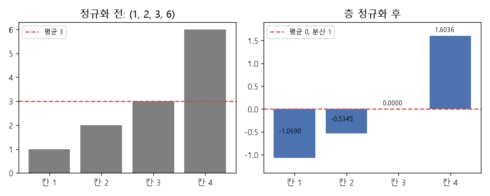

# 층 정규화 (Layer normalization, RMSNorm)

[목차로 돌아가기](../../00_MIT%EB%94%A5%EB%9F%AC%EB%8B%9D_%EB%AA%A9%EC%B0%A8.md) · 먼저 볼 것: [M02_시그마와_평균](../../%EC%88%98%ED%95%99%EA%B0%9C%EB%85%90/01_%EC%88%98%EC%99%80_%ED%95%A8%EC%88%98/M02_%EC%8B%9C%EA%B7%B8%EB%A7%88%EC%99%80_%ED%8F%89%EA%B7%A0.md), D03_Dense층과_정규화, [MM11_립시츠_연속과_노름](../../%EC%88%98%ED%95%99%EA%B0%9C%EB%85%90/03_%EC%84%A0%ED%98%95%EB%8C%80%EC%88%98/MM11_%EB%A6%BD%EC%8B%9C%EC%B8%A0_%EC%97%B0%EC%86%8D%EA%B3%BC_%EB%85%B8%EB%A6%84.md) · 쓰는 곳: [Lec08 6.2](../../Lec08_%ED%8A%B8%EB%9E%9C%EC%8A%A4%ED%8F%AC%EB%A8%B8.md#62-vit-%EB%B8%94%EB%A1%9D-%EC%9E%94%EC%B0%A8-%EC%97%B0%EA%B2%B0%EA%B3%BC-%EC%B8%B5-%EC%A0%95%EA%B7%9C%ED%99%94)

📚 학습 순서 44/99 (5. 신경망의 계산): ← 이전: [MM33_표준화와_최소최대_정규화](../../%EC%88%98%ED%95%99%EA%B0%9C%EB%85%90/05_%EC%8B%A0%EA%B2%BD%EB%A7%9D%EC%9D%98_%EA%B3%84%EC%82%B0/MM33_%ED%91%9C%EC%A4%80%ED%99%94%EC%99%80_%EC%B5%9C%EC%86%8C%EC%B5%9C%EB%8C%80_%EC%A0%95%EA%B7%9C%ED%99%94.md) · 다음: [MM07_리만_합과_보편_근사](../../%EC%88%98%ED%95%99%EA%B0%9C%EB%85%90/06_%EA%B7%BC%EC%82%AC_%EC%9D%B4%EB%A1%A0/MM07_%EB%A6%AC%EB%A7%8C_%ED%95%A9%EA%B3%BC_%EB%B3%B4%ED%8E%B8_%EA%B7%BC%EC%82%AC.md) →

> [!NOTE]
> **3줄 요약**
> - [층 정규화](../../00_%EB%94%A5%EB%9F%AC%EB%8B%9D_%EC%9A%A9%EC%96%B4%EC%82%AC%EC%A0%84.md#layer-normalization-%EC%B8%B5-%EC%A0%95%EA%B7%9C%ED%99%94)(LayerNorm)는 **[토큰](../../00_%EB%94%A5%EB%9F%AC%EB%8B%9D_%EC%9A%A9%EC%96%B4%EC%82%AC%EC%A0%84.md#token-%ED%86%A0%ED%81%B0) 벡터 하나 안의 칸들**을 평균 0, [분산](../../00_%EB%94%A5%EB%9F%AC%EB%8B%9D_%EC%9A%A9%EC%96%B4%EC%82%AC%EC%A0%84.md#variance-%EB%B6%84%EC%82%B0) 1로 맞춘다: 평균을 빼고 표준편차로 나눈다. (1, 2, 3, 6)은 평균 3, [분산](../../00_%EB%94%A5%EB%9F%AC%EB%8B%9D_%EC%9A%A9%EC%96%B4%EC%82%AC%EC%A0%84.md#variance-%EB%B6%84%EC%82%B0) 3.5라 (-1.069, -0.5345, 0, 1.6036)이 된다.
> - [토큰](../../00_%EB%94%A5%EB%9F%AC%EB%8B%9D_%EC%9A%A9%EC%96%B4%EC%82%AC%EC%A0%84.md#token-%ED%86%A0%ED%81%B0)마다 따로 계산하므로 (1, 2, 3, 6)과 10배인 (10, 20, 30, 60)은 같은 결과가 된다. 활성값의 크기가 [층](../../00_%EB%94%A5%EB%9F%AC%EB%8B%9D_%EC%9A%A9%EC%96%B4%EC%82%AC%EC%A0%84.md#layer-%EC%B8%B5)을 지나며 커지거나 줄어도 다음 [층](../../00_%EB%94%A5%EB%9F%AC%EB%8B%9D_%EC%9A%A9%EC%96%B4%EC%82%AC%EC%A0%84.md#layer-%EC%B8%B5)은 늘 비슷한 범위의 입력을 받는다.
> - 마지막에 학습하는 배율 $\gamma$와 이동 $\beta$를 곱하고 더해, 필요하면 원래 크기를 되찾게 한다. 최근 LLM은 평균 빼기를 생략한 **[RMSNorm](../../00_%EB%94%A5%EB%9F%AC%EB%8B%9D_%EC%9A%A9%EC%96%B4%EC%82%AC%EC%A0%84.md#rmsnorm-rms-%EC%A0%95%EA%B7%9C%ED%99%94)** $x / \text{RMS}(x)$을 많이 쓴다.

## 1. 개념 설명

비유: 반마다 시험 난이도가 달라 점수만으로는 비교가 어렵다. 그래서 반 평균을 빼고 반 표준편차로 나눈 "표준 점수"로 바꾼다. [층 정규화](../../00_%EB%94%A5%EB%9F%AC%EB%8B%9D_%EC%9A%A9%EC%96%B4%EC%82%AC%EC%A0%84.md#layer-normalization-%EC%B8%B5-%EC%A0%95%EA%B7%9C%ED%99%94)는 이 일을 **[토큰](../../00_%EB%94%A5%EB%9F%AC%EB%8B%9D_%EC%9A%A9%EC%96%B4%EC%82%AC%EC%A0%84.md#token-%ED%86%A0%ED%81%B0) 하나의 칸들**에 대해 한다. 한 [토큰](../../00_%EB%94%A5%EB%9F%AC%EB%8B%9D_%EC%9A%A9%EC%96%B4%EC%82%AC%EC%A0%84.md#token-%ED%86%A0%ED%81%B0)의 $d$개 칸이 "한 반"이다.

- 평균 $\mu$: [토큰](../../00_%EB%94%A5%EB%9F%AC%EB%8B%9D_%EC%9A%A9%EC%96%B4%EC%82%AC%EC%A0%84.md#token-%ED%86%A0%ED%81%B0) 벡터 $d$칸의 평균
- [분산](../../00_%EB%94%A5%EB%9F%AC%EB%8B%9D_%EC%9A%A9%EC%96%B4%EC%82%AC%EC%A0%84.md#variance-%EB%B6%84%EC%82%B0) $\sigma^2$: 각 칸이 평균에서 벗어난 거리의 제곱 평균
- [정규화](../../00_%EB%94%A5%EB%9F%AC%EB%8B%9D_%EC%9A%A9%EC%96%B4%EC%82%AC%EC%A0%84.md#normalization-%EC%A0%95%EA%B7%9C%ED%99%94): $(x_k - \mu)/\sqrt{\sigma^2 + \epsilon}$. $\epsilon$은 0으로 나누는 것을 막는 아주 작은 수(보통 $10^{-5}$)
- 배율·이동: 칸마다 학습하는 $\gamma_k$, $\beta_k$로 $\gamma_k \hat{x}_k + \beta_k$

강의 슬라이드는 이 [층](../../00_%EB%94%A5%EB%9F%AC%EB%8B%9D_%EC%9A%A9%EC%96%B4%EC%82%AC%EC%A0%84.md#layer-%EC%B8%B5)을 "[토큰](../../00_%EB%94%A5%EB%9F%AC%EB%8B%9D_%EC%9A%A9%EC%96%B4%EC%82%AC%EC%A0%84.md#token-%ED%86%A0%ED%81%B0) [노름](../../00_%EB%94%A5%EB%9F%AC%EB%8B%9D_%EC%9A%A9%EC%96%B4%EC%82%AC%EC%A0%84.md#norm-%EB%85%B8%EB%A6%84)(token norm)"이라고 부른다. [층](../../00_%EB%94%A5%EB%9F%AC%EB%8B%9D_%EC%9A%A9%EC%96%B4%EC%82%AC%EC%A0%84.md#layer-%EC%B8%B5) 전체가 아니라 [토큰](../../00_%EB%94%A5%EB%9F%AC%EB%8B%9D_%EC%9A%A9%EC%96%B4%EC%82%AC%EC%A0%84.md#token-%ED%86%A0%ED%81%B0) 하나하나를 정규화한다는 뜻을 살린 이름이다.

$$
\mu = \frac{1}{d}\sum_{k=1}^{d} x_k,\qquad
\sigma^2 = \frac{1}{d}\sum_{k=1}^{d} (x_k - \mu)^2,\qquad
\text{LN}(\mathbf{x})_k = \gamma_k\,\frac{x_k - \mu}{\sqrt{\sigma^2 + \epsilon}} + \beta_k
$$

<details><summary>기호 풀이</summary>

| 기호 | 읽는 법 | 뜻 | 예제 값 |
| --- | --- | --- | --- |
| $\mathbf{x}$ | 엑스 | 정규화할 [토큰](../../00_%EB%94%A5%EB%9F%AC%EB%8B%9D_%EC%9A%A9%EC%96%B4%EC%82%AC%EC%A0%84.md#token-%ED%86%A0%ED%81%B0) 벡터 하나 | (2, 4, 6) |
| $x_k$ | 엑스 케이 | $\mathbf{x}$의 $k$번째 칸 | $x_1 = 2$ |
| $d$ | 디 | [토큰](../../00_%EB%94%A5%EB%9F%AC%EB%8B%9D_%EC%9A%A9%EC%96%B4%EC%82%AC%EC%A0%84.md#token-%ED%86%A0%ED%81%B0) 벡터의 칸 수 | 3 |
| $\sum_{k=1}^{d}$ | 시그마 케이는 일부터 디까지 | 모든 칸에 대해 더함 | 2 + 4 + 6 |
| $\mu$ | 뮤 | 칸들의 평균 | 4 |
| $\sigma^2$ | 시그마 제곱 | 칸들의 [분산](../../00_%EB%94%A5%EB%9F%AC%EB%8B%9D_%EC%9A%A9%EC%96%B4%EC%82%AC%EC%A0%84.md#variance-%EB%B6%84%EC%82%B0) | 2.6667 |
| $\epsilon$ | 엡실론 | 0으로 나누기를 막는 작은 수 | 0.00001 |
| $\gamma_k, \beta_k$ | 감마 케이, 베타 케이 | 학습하는 배율과 이동 | 1, 0 |
| $\text{LN}(\mathbf{x})_k$ | 엘엔 엑스 케이 | [층 정규화](../../00_%EB%94%A5%EB%9F%AC%EB%8B%9D_%EC%9A%A9%EC%96%B4%EC%82%AC%EC%A0%84.md#layer-normalization-%EC%B8%B5-%EC%A0%95%EA%B7%9C%ED%99%94) 출력의 $k$번째 칸 | (-1.2247, 0, 1.2247) |

</details>

<details><summary>예제와 풀이</summary>

**문제**: 칸이 3개인 [토큰](../../00_%EB%94%A5%EB%9F%AC%EB%8B%9D_%EC%9A%A9%EC%96%B4%EC%82%AC%EC%A0%84.md#token-%ED%86%A0%ED%81%B0) $\mathbf{x} = (2, 4, 6)$을, 배율 $\gamma = 1$, 이동 $\beta = 0$, 0 나누기 방지용 $\epsilon = 0.00001$로 층 정규화한 출력 $\text{LN}(\mathbf{x})$를 구한다.

**주어진 값**:
- $\mathbf{x} = (2, 4, 6)$ (정규화할 [토큰](../../00_%EB%94%A5%EB%9F%AC%EB%8B%9D_%EC%9A%A9%EC%96%B4%EC%82%AC%EC%A0%84.md#token-%ED%86%A0%ED%81%B0) 벡터)
- $d = 3$ (칸 수)
- $\gamma_k = 1$, $\beta_k = 0$ (학습하는 배율과 이동. 여기서는 아무것도 바꾸지 않는 값)
- $\epsilon = 0.00001$ (0으로 나누기를 막는 작은 수)

**풀이**
1. 식을 그대로 쓴다: $\mu = \frac{1}{d}\sum_{k=1}^{d} x_k$, $\sigma^2 = \frac{1}{d}\sum_{k=1}^{d}(x_k - \mu)^2$, $\text{LN}(\mathbf{x})_k = \gamma_k\,\dfrac{x_k - \mu}{\sqrt{\sigma^2 + \epsilon}} + \beta_k$
2. 값을 대입한다: $\mu = \frac{1}{3}(2 + 4 + 6)$, $\sigma^2 = \frac{1}{3}\big((2 - \mu)^2 + (4 - \mu)^2 + (6 - \mu)^2\big)$, $\text{LN}(\mathbf{x})_k = 1 \times \dfrac{x_k - \mu}{\sqrt{\sigma^2 + 0.00001}} + 0$
3. $\sum$(시그마)의 뜻: 모든 칸을 차례로 더한다. 덧셈을 한다: $2 + 4 + 6 = 12$ 이므로 $\mu = \frac{1}{3} \times 12$
4. 나눗셈을 한다: $\mu = 12 \div 3 = 4$
5. 칸마다 평균을 뺀다: $(2 - 4,\ 4 - 4,\ 6 - 4) = (-2, 0, 2)$
6. 제곱을 한다: $(-2)^2 = 4$, $0^2 = 0$, $2^2 = 4$ 이므로 $\sigma^2 = \frac{1}{3}(4 + 0 + 4)$
7. 덧셈을 한다: $\sigma^2 = \frac{1}{3} \times 8$
8. 나눗셈을 한다: $\sigma^2 = 8 \div 3 = 2.6667$
9. $\epsilon$을 더한다: $2.6667 + 0.00001 = 2.66671$
10. $\sqrt{\ }$의 뜻: 제곱하면 그 수가 되는 양수(코드 `np.sqrt`). $\sqrt{2.66671} = 1.6330$
11. 칸마다 나눗셈을 한다: $-2 \div 1.6330 = -1.2247$, $0 \div 1.6330 = 0$, $2 \div 1.6330 = 1.2247$
12. 배율 1을 곱하고 이동 0을 더한다: $1 \times (-1.2247) + 0 = -1.2247$ 등, 값이 그대로다

**답**: $\text{LN}(\mathbf{x}) = (-1.2247,\ 0,\ 1.2247)$

</details>

<details><summary>내 이해</summary>


</details>

**[RMSNorm](../../00_%EB%94%A5%EB%9F%AC%EB%8B%9D_%EC%9A%A9%EC%96%B4%EC%82%AC%EC%A0%84.md#rmsnorm-rms-%EC%A0%95%EA%B7%9C%ED%99%94)** (Zhang·Sennrich 2019). 평균을 빼지 않고, 칸들의 제곱 평균의 제곱근(RMS, [RMS 노름](../../00_%EB%94%A5%EB%9F%AC%EB%8B%9D_%EC%9A%A9%EC%96%B4%EC%82%AC%EC%A0%84.md#rms-norm-rms-%EB%85%B8%EB%A6%84))으로만 나눈다. 계산이 조금 더 가볍고, Llama 같은 최근 [언어 모델](../../00_%EB%94%A5%EB%9F%AC%EB%8B%9D_%EC%9A%A9%EC%96%B4%EC%82%AC%EC%A0%84.md#language-model-%EC%96%B8%EC%96%B4-%EB%AA%A8%EB%8D%B8)이 [층 정규화](../../00_%EB%94%A5%EB%9F%AC%EB%8B%9D_%EC%9A%A9%EC%96%B4%EC%82%AC%EC%A0%84.md#layer-normalization-%EC%B8%B5-%EC%A0%95%EA%B7%9C%ED%99%94) 대신 쓴다.

$$
\text{RMSNorm}(\mathbf{x})_k = \gamma_k\,\frac{x_k}{\sqrt{\frac{1}{d}\sum_{j=1}^{d} x_j^2 + \epsilon}}
$$

<details><summary>기호 풀이</summary>

| 기호 | 읽는 법 | 뜻 | 예제 값 |
| --- | --- | --- | --- |
| $\mathbf{x}$ | 엑스 | [토큰](../../00_%EB%94%A5%EB%9F%AC%EB%8B%9D_%EC%9A%A9%EC%96%B4%EC%82%AC%EC%A0%84.md#token-%ED%86%A0%ED%81%B0) 벡터 | (3, 4) |
| $\frac{1}{d}\sum x_j^2$ | 제곱 평균 | 칸들의 제곱을 평균한 값 | 12.5 |
| $\sqrt{\cdot}$ | 루트 | 제곱 평균의 제곱근 = RMS | 3.5355 |
| $\gamma_k$ | 감마 케이 | 학습하는 배율 | 1 |
| $\epsilon$ | 엡실론 | 0으로 나누기 방지 | 0.00001 |

</details>

<details><summary>예제와 풀이</summary>

**문제**: 칸이 2개인 [토큰](../../00_%EB%94%A5%EB%9F%AC%EB%8B%9D_%EC%9A%A9%EC%96%B4%EC%82%AC%EC%A0%84.md#token-%ED%86%A0%ED%81%B0) $\mathbf{x} = (3, 4)$를 배율 $\gamma = 1$로 [RMSNorm](../../00_%EB%94%A5%EB%9F%AC%EB%8B%9D_%EC%9A%A9%EC%96%B4%EC%82%AC%EC%A0%84.md#rmsnorm-rms-%EC%A0%95%EA%B7%9C%ED%99%94) 한 출력을 구한다.

**주어진 값**:
- $\mathbf{x} = (3, 4)$ (정규화할 [토큰](../../00_%EB%94%A5%EB%9F%AC%EB%8B%9D_%EC%9A%A9%EC%96%B4%EC%82%AC%EC%A0%84.md#token-%ED%86%A0%ED%81%B0) 벡터)
- $d = 2$ (칸 수)
- $\gamma_k = 1$ (학습하는 배율, 여기서는 그대로 두는 값)
- $\epsilon = 0.00001$ (0으로 나누기 방지, 결과에 거의 영향 없음)

**풀이**
1. 식을 그대로 쓴다: $\text{RMSNorm}(\mathbf{x})_k = \gamma_k\,\dfrac{x_k}{\sqrt{\frac{1}{d}\sum_{j=1}^{d} x_j^2 + \epsilon}}$
2. 값을 대입한다: $\text{RMSNorm}(\mathbf{x})_k = 1 \times \dfrac{x_k}{\sqrt{\frac{1}{2}(3^2 + 4^2) + 0.00001}}$
3. 제곱을 한다: $3^2 = 9$, $4^2 = 16$ 이므로 분모 안은 $\frac{1}{2}(9 + 16) + 0.00001$
4. 덧셈을 한다: $9 + 16 = 25$ 이므로 $\frac{1}{2} \times 25 + 0.00001$
5. 나눗셈을 한다: $25 \div 2 = 12.5$ 이므로 $12.5 + 0.00001 = 12.50001$
6. $\sqrt{\ }$의 뜻: 제곱하면 그 수가 되는 양수(코드 `np.sqrt`). $\sqrt{12.50001} = 3.5355$
7. 칸마다 나눗셈을 한다: $3 \div 3.5355 = 0.8485$, $4 \div 3.5355 = 1.1314$
8. 배율 1을 곱한다: 그대로

**답**: $(0.8485,\ 1.1314)$. 평균을 빼지 않았으므로 평균이 0이 아니다(두 값 모두 양수).

</details>

<details><summary>내 이해</summary>


</details>

## 2. 필요한 이유

[Lec08 6.2](../../Lec08_%ED%8A%B8%EB%9E%9C%EC%8A%A4%ED%8F%AC%EB%A8%B8.md#62-vit-%EB%B8%94%EB%A1%9D-%EC%9E%94%EC%B0%A8-%EC%97%B0%EA%B2%B0%EA%B3%BC-%EC%B8%B5-%EC%A0%95%EA%B7%9C%ED%99%94)의 ViT 블록에는 [어텐션](../../00_%EB%94%A5%EB%9F%AC%EB%8B%9D_%EC%9A%A9%EC%96%B4%EC%82%AC%EC%A0%84.md#attention-%EC%96%B4%ED%85%90%EC%85%98) 앞과 MLP 앞에 "token norm"이 하나씩 있다. 강사는 활성값을 정규화하면 [역전파](../../00_%EB%94%A5%EB%9F%AC%EB%8B%9D_%EC%9A%A9%EC%96%B4%EC%82%AC%EC%A0%84.md#backpropagation-%EC%97%AD%EC%A0%84%ED%8C%8C) 때 [가중치](../../00_%EB%94%A5%EB%9F%AC%EB%8B%9D_%EC%9A%A9%EC%96%B4%EC%82%AC%EC%A0%84.md#weight-%EA%B0%80%EC%A4%91%EC%B9%98) 갱신의 크기도 활성값 크기의 영향을 덜 받아 최적화가 안정된다고 설명하면서도, **정확히 왜 잘 되는지는 아직 열린 문제**라고 말한다. 블록을 $L$번 쌓으면 [잔차 연결](../../00_%EB%94%A5%EB%9F%AC%EB%8B%9D_%EC%9A%A9%EC%96%B4%EC%82%AC%EC%A0%84.md#residual-connection-%EC%9E%94%EC%B0%A8-%EC%97%B0%EA%B2%B0)로 값이 계속 더해지므로, 각 [층](../../00_%EB%94%A5%EB%9F%AC%EB%8B%9D_%EC%9A%A9%EC%96%B4%EC%82%AC%EC%A0%84.md#layer-%EC%B8%B5) 입력의 크기를 맞춰 주는 이 장치가 깊은 [트랜스포머](../../00_%EB%94%A5%EB%9F%AC%EB%8B%9D_%EC%9A%A9%EC%96%B4%EC%82%AC%EC%A0%84.md#transformer-%ED%8A%B8%EB%9E%9C%EC%8A%A4%ED%8F%AC%EB%A8%B8)를 학습시키는 데 거의 필수다.

## 3. 숫자로 보기

[토큰](../../00_%EB%94%A5%EB%9F%AC%EB%8B%9D_%EC%9A%A9%EC%96%B4%EC%82%AC%EC%A0%84.md#token-%ED%86%A0%ED%81%B0) $\mathbf{x} = (1, 2, 3, 6)$, $\gamma = 1$, $\beta = 0$ (한 줄에 한 동작)
- 합: 1 + 2 + 3 + 6 = 12
- 평균: $\mu = 12/4 = 3$
- 차: (-2, -1, 0, 3)
- 제곱: (4, 1, 0, 9), 합 14
- [분산](../../00_%EB%94%A5%EB%9F%AC%EB%8B%9D_%EC%9A%A9%EC%96%B4%EC%82%AC%EC%A0%84.md#variance-%EB%B6%84%EC%82%B0): $\sigma^2 = 14/4 = 3.5$
- 표준편차: $\sqrt{3.5} = 1.8708$
- 나누기: (-1.069, -0.5345, 0, 1.6036)


*▲ 직접 그린 그림: (1, 2, 3, 6)을 층 정규화하면 평균 0, [분산](../../00_%EB%94%A5%EB%9F%AC%EB%8B%9D_%EC%9A%A9%EC%96%B4%EC%82%AC%EC%A0%84.md#variance-%EB%B6%84%EC%82%B0) 1인 (-1.069, -0.5345, 0, 1.6036)이 된다*

**크기를 바꿔도 같다**

| [토큰](../../00_%EB%94%A5%EB%9F%AC%EB%8B%9D_%EC%9A%A9%EC%96%B4%EC%82%AC%EC%A0%84.md#token-%ED%86%A0%ED%81%B0) | 평균 | 표준편차 | [층 정규화](../../00_%EB%94%A5%EB%9F%AC%EB%8B%9D_%EC%9A%A9%EC%96%B4%EC%82%AC%EC%A0%84.md#layer-normalization-%EC%B8%B5-%EC%A0%95%EA%B7%9C%ED%99%94) 결과 | [RMSNorm](../../00_%EB%94%A5%EB%9F%AC%EB%8B%9D_%EC%9A%A9%EC%96%B4%EC%82%AC%EC%A0%84.md#rmsnorm-rms-%EC%A0%95%EA%B7%9C%ED%99%94) 결과 |
|---|---|---|---|---|
| (1, 2, 3, 6) | 3 | 1.8708 | (-1.069, -0.5345, 0, 1.6036) | (0.2828, 0.5657, 0.8485, 1.6971) |
| (10, 20, 30, 60) | 30 | 18.7083 | (-1.069, -0.5345, 0, 1.6036) | (0.2828, 0.5657, 0.8485, 1.6971) |

- 10배 한 [토큰](../../00_%EB%94%A5%EB%9F%AC%EB%8B%9D_%EC%9A%A9%EC%96%B4%EC%82%AC%EC%A0%84.md#token-%ED%86%A0%ED%81%B0)도 평균과 표준편차가 함께 10배가 되어 결과가 같다.

<details><summary>기호 풀이</summary>

| 기호 | 읽는 법 | 뜻 | 예제 값 |
| --- | --- | --- | --- |
| $\mu$ | 뮤 | [토큰](../../00_%EB%94%A5%EB%9F%AC%EB%8B%9D_%EC%9A%A9%EC%96%B4%EC%82%AC%EC%A0%84.md#token-%ED%86%A0%ED%81%B0) 한 개 안의 평균 | 3 |
| $\sigma^2$ | 시그마 제곱 | [토큰](../../00_%EB%94%A5%EB%9F%AC%EB%8B%9D_%EC%9A%A9%EC%96%B4%EC%82%AC%EC%A0%84.md#token-%ED%86%A0%ED%81%B0) 한 개 안의 [분산](../../00_%EB%94%A5%EB%9F%AC%EB%8B%9D_%EC%9A%A9%EC%96%B4%EC%82%AC%EC%A0%84.md#variance-%EB%B6%84%EC%82%B0) | 3.5 |
| $\sigma$ | 시그마 | 표준편차 | 1.8708 |
| $\hat{x}_k$ | 엑스 햇 케이 | 정규화한 $k$번째 칸 | $\hat{x}_4 = 1.6036$ |
| $\text{RMS}$ | 알엠에스 | 제곱 평균의 제곱근 | $\sqrt{12.5} = 3.5355$ |

</details>

## 4. 코드로 확인

```python
# [함수] def layernorm(X, eps): 행(토큰)마다 평균 0, 분산 1로 맞추는 함수
def layernorm(X, eps=1e-5):
    # [변수] mu: 행마다 평균. keepdims=True로 열 하나짜리 모양을 유지해 X에서 바로 뺄 수 있다
    mu = X.mean(axis=-1, keepdims=True)
    # [변수] var: 행마다 분산 (1/d로 나눈 값)
    var = X.var(axis=-1, keepdims=True)
    # [함수] (X - mu) / √(var + eps): 본문 1절 LN 식 (γ = 1, β = 0)
    return (X - mu) / np.sqrt(var + eps)
# [함수] def rmsnorm(X, eps): 평균을 빼지 않고 RMS로만 나누는 함수
def rmsnorm(X, eps=1e-5):
    # [함수] (X**2).mean: 행마다 제곱 평균, np.sqrt로 RMS
    # [연결] 본문 1절 RMSNorm 식 (γ = 1)
    return X / np.sqrt((X ** 2).mean(axis=-1, keepdims=True) + eps)
# [변수] T: 토큰 두 개. 둘째는 첫째의 10배
# [연결] 본문 3절 "크기를 바꿔도 같다" 표
T = np.array([[1.0, 2, 3, 6], [10, 20, 30, 60]])
# [연결] 두 행이 같은 (-1.069, -0.5345, 0, 1.6036)
print(layernorm(T).round(4))
# [연결] 두 행이 같은 (0.2828, 0.5657, 0.8485, 1.6971)
print(rmsnorm(T).round(4))
# [변수] Z: 첫 토큰의 층 정규화 결과
Z = layernorm(T)[0]
# [함수] mean, var: 정규화 뒤 평균 0, 분산 1인지 확인 (eps 때문에 분산은 1보다 아주 조금 작다)
# [함수] abs: 반올림한 평균이 -0.0(아주 작은 음수)으로 찍히지 않게 부호를 없앤다
# [쓸모] 다음 층이 늘 같은 범위의 입력을 받는다는 확인
print(abs(round(Z.mean(), 4)), round(Z.var(), 4))
```

**실행 결과**:

```text
[[-1.069  -0.5345  0.      1.6036]
 [-1.069  -0.5345  0.      1.6036]]
[[0.2828 0.5657 0.8485 1.6971]
 [0.2828 0.5657 0.8485 1.6971]]
0.0 1.0
```

> [!WARNING]
> **⚠ 주의**
> - **[층 정규화](../../00_%EB%94%A5%EB%9F%AC%EB%8B%9D_%EC%9A%A9%EC%96%B4%EC%82%AC%EC%A0%84.md#layer-normalization-%EC%B8%B5-%EC%A0%95%EA%B7%9C%ED%99%94)**는 [토큰](../../00_%EB%94%A5%EB%9F%AC%EB%8B%9D_%EC%9A%A9%EC%96%B4%EC%82%AC%EC%A0%84.md#token-%ED%86%A0%ED%81%B0) 하나 안의 칸들로 평균·[분산](../../00_%EB%94%A5%EB%9F%AC%EB%8B%9D_%EC%9A%A9%EC%96%B4%EC%82%AC%EC%A0%84.md#variance-%EB%B6%84%EC%82%B0)을 낸다. 합성곱망에서 흔한 **[배치 정규화](../../00_%EB%94%A5%EB%9F%AC%EB%8B%9D_%EC%9A%A9%EC%96%B4%EC%82%AC%EC%A0%84.md#batch-normalization-%EB%B0%B0%EC%B9%98-%EC%A0%95%EA%B7%9C%ED%99%94)**(batch normalization)는 [미니배치](../../00_%EB%94%A5%EB%9F%AC%EB%8B%9D_%EC%9A%A9%EC%96%B4%EC%82%AC%EC%A0%84.md#mini-batch-%EB%AF%B8%EB%8B%88%EB%B0%B0%EC%B9%98) 안의 여러 데이터에 걸쳐 칸 하나의 평균·[분산](../../00_%EB%94%A5%EB%9F%AC%EB%8B%9D_%EC%9A%A9%EC%96%B4%EC%82%AC%EC%A0%84.md#variance-%EB%B6%84%EC%82%B0)을 낸다. [트랜스포머](../../00_%EB%94%A5%EB%9F%AC%EB%8B%9D_%EC%9A%A9%EC%96%B4%EC%82%AC%EC%A0%84.md#transformer-%ED%8A%B8%EB%9E%9C%EC%8A%A4%ED%8F%AC%EB%A8%B8)는 문장 길이와 배치 크기가 들쑥날쑥해 [층 정규화](../../00_%EB%94%A5%EB%9F%AC%EB%8B%9D_%EC%9A%A9%EC%96%B4%EC%82%AC%EC%A0%84.md#layer-normalization-%EC%B8%B5-%EC%A0%95%EA%B7%9C%ED%99%94)를 쓴다.
> - D03_Dense층과_정규화의 Min-Max [정규화](../../00_%EB%94%A5%EB%9F%AC%EB%8B%9D_%EC%9A%A9%EC%96%B4%EC%82%AC%EC%A0%84.md#normalization-%EC%A0%95%EA%B7%9C%ED%99%94)는 **입력 데이터**를 [학습](../../00_%EB%94%A5%EB%9F%AC%EB%8B%9D_%EC%9A%A9%EC%96%B4%EC%82%AC%EC%A0%84.md#training-%ED%95%99%EC%8A%B5) 전에 한 번 바꾸는 것이고, [층 정규화](../../00_%EB%94%A5%EB%9F%AC%EB%8B%9D_%EC%9A%A9%EC%96%B4%EC%82%AC%EC%A0%84.md#layer-normalization-%EC%B8%B5-%EC%A0%95%EA%B7%9C%ED%99%94)는 망 **안의 활성값**을 매번 바꾸는 [층](../../00_%EB%94%A5%EB%9F%AC%EB%8B%9D_%EC%9A%A9%EC%96%B4%EC%82%AC%EC%A0%84.md#layer-%EC%B8%B5)이다.
> - 칸이 모두 같은 [토큰](../../00_%EB%94%A5%EB%9F%AC%EB%8B%9D_%EC%9A%A9%EC%96%B4%EC%82%AC%EC%A0%84.md#token-%ED%86%A0%ED%81%B0)(예: (5, 5, 5))은 [분산](../../00_%EB%94%A5%EB%9F%AC%EB%8B%9D_%EC%9A%A9%EC%96%B4%EC%82%AC%EC%A0%84.md#variance-%EB%B6%84%EC%82%B0)이 0이라 $\epsilon$이 없으면 0으로 나누게 된다. 결과는 (0, 0, 0)이다.
> - 원래 [트랜스포머](../../00_%EB%94%A5%EB%9F%AC%EB%8B%9D_%EC%9A%A9%EC%96%B4%EC%82%AC%EC%A0%84.md#transformer-%ED%8A%B8%EB%9E%9C%EC%8A%A4%ED%8F%AC%EB%A8%B8)(2017)는 잔차 덧셈 **뒤**에 [정규화](../../00_%EB%94%A5%EB%9F%AC%EB%8B%9D_%EC%9A%A9%EC%96%B4%EC%82%AC%EC%A0%84.md#normalization-%EC%A0%95%EA%B7%9C%ED%99%94)(post-norm)했고, ViT와 최근 LLM은 [어텐션](../../00_%EB%94%A5%EB%9F%AC%EB%8B%9D_%EC%9A%A9%EC%96%B4%EC%82%AC%EC%A0%84.md#attention-%EC%96%B4%ED%85%90%EC%85%98)·MLP **앞**에 [정규화](../../00_%EB%94%A5%EB%9F%AC%EB%8B%9D_%EC%9A%A9%EC%96%B4%EC%82%AC%EC%A0%84.md#normalization-%EC%A0%95%EA%B7%9C%ED%99%94)(pre-norm)한다. 강의 슬라이드의 ViT 블록은 pre-norm이다.

## 5. 개념 재확인

<details><summary>1. 토큰 (0, 4, 8)을 층 정규화하라. (2, 4, 6)의 결과 (-1.2247, 0, 1.2247)과 비교하라.</summary>

| 단계 | 하는 일 | 식 | 계산 | 결과 |
|---|---|---|---|---|
| 1 | 평균 | $\mu = \frac1d\sum x_k$ | 12/3 | 4 |
| 2 | 차 | $x_k - \mu$ | (-4, 0, 4) | (-4, 0, 4) |
| 3 | [분산](../../00_%EB%94%A5%EB%9F%AC%EB%8B%9D_%EC%9A%A9%EC%96%B4%EC%82%AC%EC%A0%84.md#variance-%EB%B6%84%EC%82%B0) | $\frac1d\sum (x_k-\mu)^2$ | (16+0+16)/3 | 10.6667 |
| 4 | 나누기 | $\div\sqrt{\sigma^2}$ | $\div 3.266$ | (-1.2247, 0, 1.2247) |

**① 쓰는 식**
$$\text{LN}(\mathbf{x})_k = \frac{x_k - \mu}{\sqrt{\sigma^2 + \epsilon}}$$
- 위 식 ← ② (평균), ③ (차), ④ ([분산](../../00_%EB%94%A5%EB%9F%AC%EB%8B%9D_%EC%9A%A9%EC%96%B4%EC%82%AC%EC%A0%84.md#variance-%EB%B6%84%EC%82%B0)), ⑤ (나누기)
```python
# [변수] x: 문제의 토큰
x = np.array([0.0, 4, 8])                                   # ①
# [변수] mu: 평균 4
mu = x.mean()                                               # ②
# [변수] c: 평균과의 차 (-4, 0, 4)
c = x - mu                                                  # ③
# [변수] var: 분산 10.6667
var = (c ** 2).mean()                                       # ④
# [연결] [-1.2247  0.  1.2247] → (2, 4, 6)과 같은 결과
print(round(var, 4), (c / np.sqrt(var + 1e-5)).round(4))   # ⑤
```

**주어진 값**:
- $\mathbf{x} = (0, 4, 8)$ (정규화할 [토큰](../../00_%EB%94%A5%EB%9F%AC%EB%8B%9D_%EC%9A%A9%EC%96%B4%EC%82%AC%EC%A0%84.md#token-%ED%86%A0%ED%81%B0) 벡터, 칸 3개)
- $\gamma = 1$, $\beta = 0$, $\epsilon = 0.00001$ (배율·이동 없음, 0 나누기 방지)

**② 평균**
1. 식을 그대로 쓴다: $\mu = \frac{1}{d}\sum_k x_k$
2. 값을 대입한다: $\mu = \frac{1}{3}(0 + 4 + 8)$
3. 덧셈을 한다: $0 + 4 + 8 = 12$ 이므로 $\mu = \frac{1}{3} \times 12$
4. 나눗셈을 한다: $\mu = 12 \div 3 = 4$

**③ 차**
1. 칸마다 평균을 뺀다: $(0 - 4,\ 4 - 4,\ 8 - 4) = (-4, 0, 4)$

**④ [분산](../../00_%EB%94%A5%EB%9F%AC%EB%8B%9D_%EC%9A%A9%EC%96%B4%EC%82%AC%EC%A0%84.md#variance-%EB%B6%84%EC%82%B0)**
1. 식을 그대로 쓴다: $\sigma^2 = \frac{1}{d}\sum_k (x_k - \mu)^2$
2. 값을 대입한다: $\sigma^2 = \frac{1}{3}\big((-4)^2 + 0^2 + 4^2\big)$
3. 제곱을 한다: $\frac{1}{3}(16 + 0 + 16)$
4. 덧셈을 한다: $\frac{1}{3} \times 32$
5. 나눗셈을 한다: $\sigma^2 = 32 \div 3 = 10.6667$

**⑤ 나누기**
1. 식에 대입한다: $\text{LN}(\mathbf{x})_k = \dfrac{x_k - 4}{\sqrt{10.6667 + 0.00001}}$
2. 제곱근을 구한다 (제곱하면 그 수가 되는 양수): $\sqrt{10.66671} = 3.266$
3. 칸마다 나눗셈을 한다: $-4 \div 3.266 = -1.2247$, $0 \div 3.266 = 0$, $4 \div 3.266 = 1.2247$

**답**: **(-1.2247, 0, 1.2247)**로 (2, 4, 6)과 같다. [층 정규화](../../00_%EB%94%A5%EB%9F%AC%EB%8B%9D_%EC%9A%A9%EC%96%B4%EC%82%AC%EC%A0%84.md#layer-normalization-%EC%B8%B5-%EC%A0%95%EA%B7%9C%ED%99%94)는 "고르게 벌어진 세 칸"이라는 모양만 남기고 위치(평균)와 폭(표준편차)은 지운다.

</details>

<details><summary>2. (2, 4, 6)을 $\gamma = (2, 2, 2)$, $\beta = (1, 1, 1)$로 층 정규화하면?</summary>

| 단계 | 하는 일 | 식 | 계산 | 결과 |
|---|---|---|---|---|
| 1 | [정규화](../../00_%EB%94%A5%EB%9F%AC%EB%8B%9D_%EC%9A%A9%EC%96%B4%EC%82%AC%EC%A0%84.md#normalization-%EC%A0%95%EA%B7%9C%ED%99%94) | $\hat{x}$ | 1절 예제 | (-1.2247, 0, 1.2247) |
| 2 | 배율 | $\gamma_k \hat{x}_k$ | × 2 | (-2.4495, 0, 2.4495) |
| 3 | 이동 | $+\beta_k$ | + 1 | (-1.4495, 1, 3.4495) |

**① 쓰는 식**
$$\text{LN}(\mathbf{x})_k = \gamma_k \hat{x}_k + \beta_k$$
- 위 식 ← ② ([정규화](../../00_%EB%94%A5%EB%9F%AC%EB%8B%9D_%EC%9A%A9%EC%96%B4%EC%82%AC%EC%A0%84.md#normalization-%EC%A0%95%EA%B7%9C%ED%99%94)), ③ (배율), ④ (이동)
```python
# [변수] x, gamma, beta: 토큰과 학습된 배율·이동 (여기서는 문제에서 준 값)
x = np.array([2.0, 4, 6]); gamma = np.full(3, 2.0); beta = np.ones(3)   # ①
# [변수] xh: 정규화만 한 값 (-1.2247, 0, 1.2247)
xh = (x - x.mean()) / np.sqrt(x.var() + 1e-5)                           # ②
# [변수] y: 배율을 곱하고 이동을 더한 최종 출력
y = gamma * xh + beta                                                    # ③④
# [연결] [-1.4495  1.  3.4495]
print(y.round(4))
```

**주어진 값**:
- $\mathbf{x} = (2, 4, 6)$ (정규화할 [토큰](../../00_%EB%94%A5%EB%9F%AC%EB%8B%9D_%EC%9A%A9%EC%96%B4%EC%82%AC%EC%A0%84.md#token-%ED%86%A0%ED%81%B0) 벡터)
- $\gamma = (2, 2, 2)$ (칸마다 곱하는 학습된 배율)
- $\beta = (1, 1, 1)$ (칸마다 더하는 학습된 이동)

**② [정규화](../../00_%EB%94%A5%EB%9F%AC%EB%8B%9D_%EC%9A%A9%EC%96%B4%EC%82%AC%EC%A0%84.md#normalization-%EC%A0%95%EA%B7%9C%ED%99%94)**
1. 1절 예제와 같은 계산이다: 평균 $(2 + 4 + 6) \div 3 = 4$, 차 $(-2, 0, 2)$, [분산](../../00_%EB%94%A5%EB%9F%AC%EB%8B%9D_%EC%9A%A9%EC%96%B4%EC%82%AC%EC%A0%84.md#variance-%EB%B6%84%EC%82%B0) $(4 + 0 + 4) \div 3 = 2.6667$, 표준편차 $\sqrt{2.6667} = 1.633$
2. 나눗셈을 한다: $\hat{\mathbf{x}} = (-2 \div 1.633,\ 0 \div 1.633,\ 2 \div 1.633) = (-1.2247, 0, 1.2247)$

**③ 배율**
1. 식을 그대로 쓴다: $\text{LN}(\mathbf{x})_k = \gamma_k \hat{x}_k + \beta_k$
2. 값을 대입한다: $\text{LN}(\mathbf{x}) = \big(2 \times (-1.2247) + 1,\ 2 \times 0 + 1,\ 2 \times 1.2247 + 1\big)$
3. 곱셈을 먼저 한다: $2 \times (-1.2247) = -2.4495$, $2 \times 0 = 0$, $2 \times 1.2247 = 2.4495$ (반올림 전 값으로 곱함) 이므로 $(-2.4495 + 1,\ 0 + 1,\ 2.4495 + 1)$

**④ 이동**
1. 덧셈을 한다: $-2.4495 + 1 = -1.4495$, $0 + 1 = 1$, $2.4495 + 1 = 3.4495$

**답**: **(-1.4495, 1, 3.4495)**. 출력의 평균은 $\beta = 1$, 표준편차는 $\gamma = 2$가 된다. 망이 필요하면 [정규화](../../00_%EB%94%A5%EB%9F%AC%EB%8B%9D_%EC%9A%A9%EC%96%B4%EC%82%AC%EC%A0%84.md#normalization-%EC%A0%95%EA%B7%9C%ED%99%94)를 "되돌릴" 수 있게 하는 장치다.

</details>

## 예제 풀기

[예제 10문제 풀기](../../%EC%98%88%EC%A0%9C/05_%EC%8B%A0%EA%B2%BD%EB%A7%9D%EC%9D%98_%EA%B3%84%EC%82%B0/%EC%98%88%EC%A0%9C_MM32_%EC%B8%B5_%EC%A0%95%EA%B7%9C%ED%99%94.md)

<details><summary>내 이해</summary>


</details>
