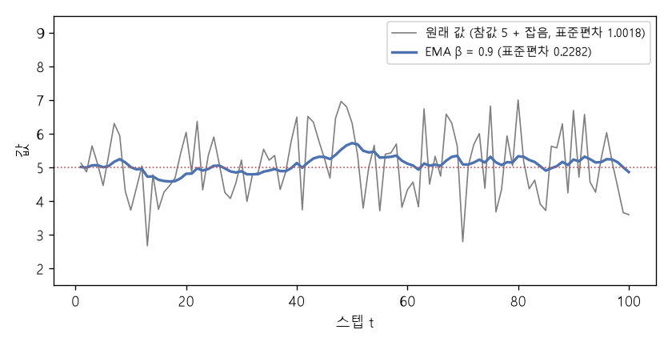

# 지수 이동 평균 (Exponential moving average, EMA)

[목차로 돌아가기](../../00_MIT%EB%94%A5%EB%9F%AC%EB%8B%9D_%EB%AA%A9%EC%B0%A8.md) · 먼저 볼 것: [M02_시그마와_평균](../../%EC%88%98%ED%95%99%EA%B0%9C%EB%85%90/01_%EC%88%98%EC%99%80_%ED%95%A8%EC%88%98/M02_%EC%8B%9C%EA%B7%B8%EB%A7%88%EC%99%80_%ED%8F%89%EA%B7%A0.md), [M06_지수와_e](../../%EC%88%98%ED%95%99%EA%B0%9C%EB%85%90/01_%EC%88%98%EC%99%80_%ED%95%A8%EC%88%98/M06_%EC%A7%80%EC%88%98%EC%99%80_e.md), [MM08_SGD와_모멘텀](../../%EC%88%98%ED%95%99%EA%B0%9C%EB%85%90/05_%EC%8B%A0%EA%B2%BD%EB%A7%9D%EC%9D%98_%EA%B3%84%EC%82%B0/MM08_SGD%EC%99%80_%EB%AA%A8%EB%A9%98%ED%85%80.md) · 쓰는 곳: [Lec09 14.3](../../Lec09_%ED%95%B4%EC%BB%A4%EC%9D%98_%EB%94%A5%EB%9F%AC%EB%8B%9D_%EA%B0%80%EC%9D%B4%EB%93%9C.md#143-%EC%A7%80%EC%88%98-%EC%9D%B4%EB%8F%99-%ED%8F%89%EA%B7%A0)

📚 학습 순서 41/99 (5. 신경망의 계산): ← 이전: [MM08_SGD와_모멘텀](../../%EC%88%98%ED%95%99%EA%B0%9C%EB%85%90/05_%EC%8B%A0%EA%B2%BD%EB%A7%9D%EC%9D%98_%EA%B3%84%EC%82%B0/MM08_SGD%EC%99%80_%EB%AA%A8%EB%A9%98%ED%85%80.md) · 다음: [MM83_Adam_업데이트_규칙](../../%EC%88%98%ED%95%99%EA%B0%9C%EB%85%90/05_%EC%8B%A0%EA%B2%BD%EB%A7%9D%EC%9D%98_%EA%B3%84%EC%82%B0/MM83_Adam_%EC%97%85%EB%8D%B0%EC%9D%B4%ED%8A%B8_%EA%B7%9C%EC%B9%99.md) →

> [!NOTE]
> **3줄 요약**
> - EMA는 새 값이 들어올 때마다 $\text{EMA} \leftarrow \beta \cdot \text{EMA} + (1-\beta) \cdot \text{새 값}$으로 갱신한다. 지난 값의 영향이 한 스텝마다 β배로 줄어든다. β = 0.9면 [가중치](../../00_%EB%94%A5%EB%9F%AC%EB%8B%9D_%EC%9A%A9%EC%96%B4%EC%82%AC%EC%A0%84.md#weight-%EA%B0%80%EC%A4%91%EC%B9%98)가 0.1, 0.09, 0.081, ...
> - 대략 최근 $1/(1-\beta)$개 값의 평균처럼 행동한다. β = 0.9면 약 10개. 잡음의 표준편차가 1.0018 → 0.2282로 줄었다.
> - 0에서 시작하면 초반 값이 작게 치우친다(10, 10, 10 → 1, 1.9, 2.71). $1-\beta^t$로 나누면([편향](../../00_%EB%94%A5%EB%9F%AC%EB%8B%9D_%EC%9A%A9%EC%96%B4%EC%82%AC%EC%A0%84.md#bias-%ED%8E%B8%ED%96%A5) 보정) 10, 10, 10으로 돌아온다. [Adam](../../00_%EB%94%A5%EB%9F%AC%EB%8B%9D_%EC%9A%A9%EC%96%B4%EC%82%AC%EC%A0%84.md#adam-%EC%95%84%EB%8B%B4-%EC%98%B5%ED%8B%B0%EB%A7%88%EC%9D%B4%EC%A0%80)이 쓰는 방법이다.

## 1. 개념 설명

비유: 매일 기분 점수를 매기는데, 오늘 하루의 일로 "요즘 기분"이 확 바뀌지는 않는다. "요즘 기분 = 어제까지의 요즘 기분 90% + 오늘 10%"로 매일 고치면, 오래된 날일수록 영향이 조금씩 옅어지며 남는다. 이것이 [지수 이동 평균](../../00_%EB%94%A5%EB%9F%AC%EB%8B%9D_%EC%9A%A9%EC%96%B4%EC%82%AC%EC%A0%84.md#exponential-moving-average-%EC%A7%80%EC%88%98-%EC%9D%B4%EB%8F%99-%ED%8F%89%EA%B7%A0)이다.

- **이동 평균**: 최근 값 몇 개의 평균. 창(window) 밖의 값은 갑자기 0의 영향을 받는다.
- **[지수 이동 평균](../../00_%EB%94%A5%EB%9F%AC%EB%8B%9D_%EC%9A%A9%EC%96%B4%EC%82%AC%EC%A0%84.md#exponential-moving-average-%EC%A7%80%EC%88%98-%EC%9D%B4%EB%8F%99-%ED%8F%89%EA%B7%A0)**: 창을 자르지 않고, k 스텝 전 값에 $(1-\beta)\beta^k$의 [가중치](../../00_%EB%94%A5%EB%9F%AC%EB%8B%9D_%EC%9A%A9%EC%96%B4%EC%82%AC%EC%A0%84.md#weight-%EA%B0%80%EC%A4%91%EC%B9%98)를 준다. [가중치](../../00_%EB%94%A5%EB%9F%AC%EB%8B%9D_%EC%9A%A9%EC%96%B4%EC%82%AC%EC%A0%84.md#weight-%EA%B0%80%EC%A4%91%EC%B9%98)가 지수적으로 줄어서 이름이 이렇다. 저장할 것은 현재 EMA 값 하나뿐이다.
- [모멘텀](../../%EC%88%98%ED%95%99%EA%B0%9C%EB%85%90/05_%EC%8B%A0%EA%B2%BD%EB%A7%9D%EC%9D%98_%EA%B3%84%EC%82%B0/MM08_SGD%EC%99%80_%EB%AA%A8%EB%A9%98%ED%85%80.md)은 [기울기](../../00_%EB%94%A5%EB%9F%AC%EB%8B%9D_%EC%9A%A9%EC%96%B4%EC%82%AC%EC%A0%84.md#gradient-%EA%B8%B0%EC%9A%B8%EA%B8%B0)의 EMA(에 가까운 것)를 쓰는 방법이다. 강의는 이를 "공간(배치) 평균을 시간 평균으로 바꾸는 것"이라고 설명한다.

$$
\theta^{t}_{\text{EMA}} = \beta\, \theta^{t-1}_{\text{EMA}} + (1-\beta)\, \theta^{t}
$$

<details><summary>기호 풀이</summary>

| 기호 | 읽는 법 | 뜻 | 예제 값 |
| --- | --- | --- | --- |
| $\theta^t$ | 세타 티 | t번째 스텝의 새 값 ([가중치](../../00_%EB%94%A5%EB%9F%AC%EB%8B%9D_%EC%9A%A9%EC%96%B4%EC%82%AC%EC%A0%84.md#weight-%EA%B0%80%EC%A4%91%EC%B9%98), [기울기](../../00_%EB%94%A5%EB%9F%AC%EB%8B%9D_%EC%9A%A9%EC%96%B4%EC%82%AC%EC%A0%84.md#gradient-%EA%B8%B0%EC%9A%B8%EA%B8%B0), [손실](../../00_%EB%94%A5%EB%9F%AC%EB%8B%9D_%EC%9A%A9%EC%96%B4%EC%82%AC%EC%A0%84.md#loss-function-%EC%86%90%EC%8B%A4-%ED%95%A8%EC%88%98) 등) | 8 |
| $\theta^{t}_{\text{EMA}}$ | 세타 이엠에이 티 | t번째 스텝까지의 [지수 이동 평균](../../00_%EB%94%A5%EB%9F%AC%EB%8B%9D_%EC%9A%A9%EC%96%B4%EC%82%AC%EC%A0%84.md#exponential-moving-average-%EC%A7%80%EC%88%98-%EC%9D%B4%EB%8F%99-%ED%8F%89%EA%B7%A0) | 5 |
| $\theta^{t-1}_{\text{EMA}}$ | 세타 이엠에이 티 빼기 1 | 바로 전 스텝의 EMA | 2 |
| $\beta$ | 베타 | 감쇠 계수 (0~1). 클수록 과거를 오래 기억 | 0.5 |
| $1-\beta$ | 1 빼기 베타 | 새 값에 주는 비중 | 0.5 |

</details>

<details><summary>예제와 풀이</summary>

**문제**: β = 0.5, 시작 EMA = 0이다. 값 4, 8, 6이 차례로 들어오면 두 번째 스텝(값 8)의 EMA는 얼마인가?

**주어진 값**:
- $\beta = 0.5$ (감쇠 계수)
- $\theta^{0}_{\text{EMA}} = 0$ (시작 값)
- $\theta^1 = 4$, $\theta^2 = 8$ (첫째, 둘째 값)

**풀이**
1. 식을 그대로 쓴다: $\theta^{t}_{\text{EMA}} = \beta\, \theta^{t-1}_{\text{EMA}} + (1-\beta)\, \theta^{t}$
2. 값을 대입한다 (t = 1): $\theta^{1}_{\text{EMA}} = 0.5 × 0 + (1 - 0.5) × 4$
3. 괄호를 먼저 계산한다: $1 - 0.5 = 0.5$ 이므로 $\theta^{1}_{\text{EMA}} = 0.5 × 0 + 0.5 × 4$
4. 곱셈을 한다: $0.5 × 0 = 0$, $0.5 × 4 = 2$ 이므로 $\theta^{1}_{\text{EMA}} = 0 + 2 = 2$
5. 값을 대입한다 (t = 2): $\theta^{2}_{\text{EMA}} = 0.5 × 2 + (1 - 0.5) × 8$
6. 괄호를 먼저 계산한다: $1 - 0.5 = 0.5$ 이므로 $\theta^{2}_{\text{EMA}} = 0.5 × 2 + 0.5 × 8$
7. 곱셈을 한다: $0.5 × 2 = 1$, $0.5 × 8 = 4$ 이므로 $\theta^{2}_{\text{EMA}} = 1 + 4$
8. 더한다: $1 + 4 = 5$

**답**: 5 (셋째 값 6까지 넣으면 0.5 × 5 + 0.5 × 6 = 5.5)

</details>

<details><summary>내 이해</summary>


</details>

식을 거꾸로 펼치면 각 과거 값의 [가중치](../../00_%EB%94%A5%EB%9F%AC%EB%8B%9D_%EC%9A%A9%EC%96%B4%EC%82%AC%EC%A0%84.md#weight-%EA%B0%80%EC%A4%91%EC%B9%98)가 보인다(시작 EMA = 0).

$$
\theta^{t}_{\text{EMA}} = (1-\beta)\sum_{k=0}^{t-1} \beta^{k}\, \theta^{t-k}
$$

<details><summary>기호 풀이</summary>

| 기호 | 읽는 법 | 뜻 | 예제 값 |
| --- | --- | --- | --- |
| $k$ | 케이 | 몇 스텝 전의 값인가 (0 = 지금) | 0, 1, 2 |
| $\theta^{t-k}$ | 세타 티 빼기 케이 | k 스텝 전의 값 | |
| $(1-\beta)\beta^k$ | | k 스텝 전 값의 [가중치](../../00_%EB%94%A5%EB%9F%AC%EB%8B%9D_%EC%9A%A9%EC%96%B4%EC%82%AC%EC%A0%84.md#weight-%EA%B0%80%EC%A4%91%EC%B9%98) | 0.1, 0.09, 0.081 |
| $\sum_{k=0}^{t-1}$ | 시그마 | k = 0부터 t-1까지 더한다 | |

</details>

<details><summary>예제와 풀이</summary>

**문제**: β = 0.5, 시작 EMA = 0, 값 4, 8, 6이 들어왔다. 펼친 식으로 t = 3의 EMA를 구하라.

**주어진 값**:
- $\beta = 0.5$ (감쇠 계수)
- $\theta^3 = 6$ (지금, k = 0), $\theta^2 = 8$ (1 스텝 전, k = 1), $\theta^1 = 4$ (2 스텝 전, k = 2)

**풀이**
1. 식을 그대로 쓴다: $\theta^{3}_{\text{EMA}} = (1-\beta)\sum_{k=0}^{2} \beta^{k}\, \theta^{3-k}$
2. Σ를 항 하나씩 펼친다 (k = 0, 1, 2): $\theta^{3}_{\text{EMA}} = (1-\beta)\big(\beta^{0}\theta^{3} + \beta^{1}\theta^{2} + \beta^{2}\theta^{1}\big)$
3. 값을 대입한다: $\theta^{3}_{\text{EMA}} = (1 - 0.5)\big(0.5^{0} × 6 + 0.5^{1} × 8 + 0.5^{2} × 4\big)$
4. 거듭제곱을 계산한다. $0.5^{k}$는 0.5를 k번 곱한 값이고, 0번 곱하면 1이다: $0.5^0 = 1$, $0.5^1 = 0.5$, $0.5^2 = 0.25$ 이므로 $(1 - 0.5)(1 × 6 + 0.5 × 8 + 0.25 × 4)$
5. 괄호 안 곱셈을 한다: $1 × 6 = 6$, $0.5 × 8 = 4$, $0.25 × 4 = 1$ 이므로 $(1 - 0.5)(6 + 4 + 1)$
6. 괄호 안 덧셈을 한다: $6 + 4 + 1 = 11$ 이므로 $(1 - 0.5) × 11$
7. 앞 괄호를 계산한다: $1 - 0.5 = 0.5$ 이므로 $0.5 × 11$
8. 곱한다: $0.5 × 11 = 5.5$

**답**: 5.5 (위 예제의 되풀이 계산과 같다)

</details>

<details><summary>내 이해</summary>


</details>

## 2. 필요한 이유

[Lec09 14.3](../../Lec09_%ED%95%B4%EC%BB%A4%EC%9D%98_%EB%94%A5%EB%9F%AC%EB%8B%9D_%EA%B0%80%EC%9D%B4%EB%93%9C.md#143-%EC%A7%80%EC%88%98-%EC%9D%B4%EB%8F%99-%ED%8F%89%EA%B7%A0)에서 강사는 "딥러닝의 거의 모든 변수([기울기](../../00_%EB%94%A5%EB%9F%AC%EB%8B%9D_%EC%9A%A9%EC%96%B4%EC%82%AC%EC%A0%84.md#gradient-%EA%B8%B0%EC%9A%B8%EA%B8%B0), [가중치](../../00_%EB%94%A5%EB%9F%AC%EB%8B%9D_%EC%9A%A9%EC%96%B4%EC%82%AC%EC%A0%84.md#weight-%EA%B0%80%EC%A4%91%EC%B9%98), 데이터, 활성화, 목표값)에 EMA를 씌워 보라, 더 나을 수 있다"고 권한다. [모멘텀](../../00_%EB%94%A5%EB%9F%AC%EB%8B%9D_%EC%9A%A9%EC%96%B4%EC%82%AC%EC%A0%84.md#momentum-%EB%AA%A8%EB%A9%98%ED%85%80)과 [Adam](../../00_%EB%94%A5%EB%9F%AC%EB%8B%9D_%EC%9A%A9%EC%96%B4%EC%82%AC%EC%A0%84.md#adam-%EC%95%84%EB%8B%B4-%EC%98%B5%ED%8B%B0%EB%A7%88%EC%9D%B4%EC%A0%80)은 [기울기](../../00_%EB%94%A5%EB%9F%AC%EB%8B%9D_%EC%9A%A9%EC%96%B4%EC%82%AC%EC%A0%84.md#gradient-%EA%B8%B0%EC%9A%B8%EA%B8%B0)의 EMA, [가중치](../../00_%EB%94%A5%EB%9F%AC%EB%8B%9D_%EC%9A%A9%EC%96%B4%EC%82%AC%EC%A0%84.md#weight-%EA%B0%80%EC%A4%91%EC%B9%98) EMA는 [확산 모델](../../00_%EB%94%A5%EB%9F%AC%EB%8B%9D_%EC%9A%A9%EC%96%B4%EC%82%AC%EC%A0%84.md#diffusion-model-%ED%99%95%EC%82%B0-%EB%AA%A8%EB%8D%B8)·[자기 지도 학습](../../00_%EB%94%A5%EB%9F%AC%EB%8B%9D_%EC%9A%A9%EC%96%B4%EC%82%AC%EC%A0%84.md#self-supervised-learning-%EC%9E%90%EA%B8%B0-%EC%A7%80%EB%8F%84-%ED%95%99%EC%8A%B5)의 목표 망에 쓰인다. [손실](../../00_%EB%94%A5%EB%9F%AC%EB%8B%9D_%EC%9A%A9%EC%96%B4%EC%82%AC%EC%A0%84.md#loss-function-%EC%86%90%EC%8B%A4-%ED%95%A8%EC%88%98) 곡선을 매끄럽게 그릴 때도 EMA를 쓴다.

## 3. 숫자로 보기

**(가) [가중치](../../00_%EB%94%A5%EB%9F%AC%EB%8B%9D_%EC%9A%A9%EC%96%B4%EC%82%AC%EC%A0%84.md#weight-%EA%B0%80%EC%A4%91%EC%B9%98)** β = 0.9: k = 0, 1, 2, 3 스텝 전 값의 [가중치](../../00_%EB%94%A5%EB%9F%AC%EB%8B%9D_%EC%9A%A9%EC%96%B4%EC%82%AC%EC%A0%84.md#weight-%EA%B0%80%EC%A4%91%EC%B9%98) = 0.1, 0.09, 0.081, 0.0729

- 최근 10개 값의 [가중치](../../00_%EB%94%A5%EB%9F%AC%EB%8B%9D_%EC%9A%A9%EC%96%B4%EC%82%AC%EC%A0%84.md#weight-%EA%B0%80%EC%A4%91%EC%B9%98) 합 = $1 - 0.9^{10} = 0.6513$. 나머지 35%는 그 전 값들에 퍼져 있다.
- 대략적인 창 크기 $1/(1-\beta)$: β = 0.9 → 10, β = 0.99 → 100, β = 0.999 → 1000

**(나) 시작 치우침과 [편향](../../00_%EB%94%A5%EB%9F%AC%EB%8B%9D_%EC%9A%A9%EC%96%B4%EC%82%AC%EC%A0%84.md#bias-%ED%8E%B8%ED%96%A5) 보정** β = 0.9, 값이 계속 10

| t | EMA | $1 - 0.9^t$ | 보정한 값 |
|---|---|---|---|
| 1 | 1 | 0.1 | 10 |
| 2 | 1.9 | 0.19 | 10 |
| 3 | 2.71 | 0.271 | 10 |

- 0에서 시작했기 때문에 초반 EMA는 실제(10)보다 작다. [가중치](../../00_%EB%94%A5%EB%9F%AC%EB%8B%9D_%EC%9A%A9%EC%96%B4%EC%82%AC%EC%A0%84.md#weight-%EA%B0%80%EC%A4%91%EC%B9%98) 합이 $1-\beta^t$이므로 그것으로 나누면 바로잡힌다.

**(다) 잡음 줄이기**: 참값 5에 표준편차 1의 잡음이 섞인 값 2000개, β = 0.9 (아래 4절 코드)

- 원래 값의 표준편차 1.0018 → EMA의 표준편차 0.2282
- 이론값: 서로 독립인 잡음이면 EMA의 [분산](../../00_%EB%94%A5%EB%9F%AC%EB%8B%9D_%EC%9A%A9%EC%96%B4%EC%82%AC%EC%A0%84.md#variance-%EB%B6%84%EC%82%B0)은 $\frac{1-\beta}{1+\beta}$배 = 0.0526배, 표준편차는 √0.0526 = 0.2294배


*▲ 직접 그린 그림: 참값 5 + 잡음(회색)과 β = 0.9 EMA(파랑)의 처음 100스텝. 표준편차가 1.0018에서 0.2282로 줄었다 (숫자는 3절 (다)와 같음)*

<details><summary>기호 풀이 (이 노트 전체)</summary>

| 기호 | 읽는 법 | 뜻 | 예제 값 |
| --- | --- | --- | --- |
| $\beta$ | 베타 | 감쇠 계수 | 0.9 |
| $(1-\beta)\beta^k$ | | k 스텝 전 값의 [가중치](../../00_%EB%94%A5%EB%9F%AC%EB%8B%9D_%EC%9A%A9%EC%96%B4%EC%82%AC%EC%A0%84.md#weight-%EA%B0%80%EC%A4%91%EC%B9%98) | 0.081 (k = 2) |
| $1/(1-\beta)$ | | 대략적인 창 크기 | 10 |
| $1-\beta^t$ | | t 스텝까지 [가중치](../../00_%EB%94%A5%EB%9F%AC%EB%8B%9D_%EC%9A%A9%EC%96%B4%EC%82%AC%EC%A0%84.md#weight-%EA%B0%80%EC%A4%91%EC%B9%98)의 합 = [편향](../../00_%EB%94%A5%EB%9F%AC%EB%8B%9D_%EC%9A%A9%EC%96%B4%EC%82%AC%EC%A0%84.md#bias-%ED%8E%B8%ED%96%A5) 보정 분모 | 0.271 |
| $\frac{1-\beta}{1+\beta}$ | | EMA가 잡음 [분산](../../00_%EB%94%A5%EB%9F%AC%EB%8B%9D_%EC%9A%A9%EC%96%B4%EC%82%AC%EC%A0%84.md#variance-%EB%B6%84%EC%82%B0)을 줄이는 배율 | 0.0526 |

</details>

## 4. 코드로 확인

```python
# [함수] import numpy as np: 배열 계산 라이브러리 numpy를 np라는 이름으로 불러온다
import numpy as np
# [함수] def ema(seq, beta, init): 값 목록에 EMA를 차례로 적용해 매 스텝의 EMA를 돌려준다
# [연결] 1절 첫 식
def ema(seq, beta, init=0.0):
    # [변수] e: 현재 EMA (시작 값 init), out: 매 스텝 기록
    e, out = init, []
    # [함수] for v in seq: 새 값이 하나씩 들어온다
    for v in seq:
        # [변수] e: β × 이전 EMA + (1-β) × 새 값
        e = beta * e + (1 - beta) * v
        # [함수] append: 기록에 추가
        out.append(e)
    # [변수] 반환값: 스텝별 EMA 배열
    return np.array(out)
# [연결] 출력 1행: β = 0.5, 값 4, 8, 6 → 2, 5, 5.5 (1절 예제)
print(ema([4, 8, 6.0], 0.5))
# [변수] e10: 값이 계속 10일 때 β = 0.9 EMA (1, 1.9, 2.71)
e10 = ema([10, 10, 10.0], 0.9)
# [함수] 1 - 0.9 ** t: 편향 보정 분모. 나누면 10, 10, 10
# [연결] 3절 (나) 표
print(np.round(e10, 4), np.round(e10 / (1 - 0.9 ** np.arange(1, 4)), 4))
# [연결] 3절 (가): 가중치 0.1, 0.09, 0.081, 0.0729와 최근 10개의 몫 0.6513
print(np.round(0.1 * 0.9 ** np.arange(4), 4), np.round(1 - 0.9 ** 10, 4))
# [변수] rng: 시드 0으로 고정한 난수 생성기 (본문 숫자를 재현하려고)
rng = np.random.default_rng(0)
# [변수] z: 참값 5 + 표준편차 1의 잡음, 2000개
z = 5 + rng.standard_normal(2000)
# [변수] ez: z의 EMA. 시작 치우침을 피하려고 init = 5
ez = ema(z, 0.9, init=5.0)
# [함수] std: 표준편차. 처음 100개는 빼고 잰다
# [연결] 3절 (다): 1.0018 → 0.2282, 이론 배율 0.2294
print(np.round(z[100:].std(), 4), np.round(ez[100:].std(), 4), np.round(np.sqrt(0.1 / 1.9), 4))
```

**실행 결과**:

```text
[2.  5.  5.5]
[1.   1.9  2.71] [10. 10. 10.]
[0.1    0.09   0.081  0.0729] 0.6513
1.0018 0.2282 0.2294
```

> [!WARNING]
> **⚠ 주의**
> - EMA는 **늦다**. 값이 갑자기 바뀌면 약 $1/(1-\beta)$ 스텝이 지나야 따라간다. β를 크게 할수록 매끄럽지만 더 늦다.
> - 0에서 시작하면 초반이 치우친다. [편향](../../00_%EB%94%A5%EB%9F%AC%EB%8B%9D_%EC%9A%A9%EC%96%B4%EC%82%AC%EC%A0%84.md#bias-%ED%8E%B8%ED%96%A5) 보정을 하거나 첫 값으로 시작한다.
> - [가중치](../../00_%EB%94%A5%EB%9F%AC%EB%8B%9D_%EC%9A%A9%EC%96%B4%EC%82%AC%EC%A0%84.md#weight-%EA%B0%80%EC%A4%91%EC%B9%98) EMA([학습](../../00_%EB%94%A5%EB%9F%AC%EB%8B%9D_%EC%9A%A9%EC%96%B4%EC%82%AC%EC%A0%84.md#training-%ED%95%99%EC%8A%B5) 중 [가중치](../../00_%EB%94%A5%EB%9F%AC%EB%8B%9D_%EC%9A%A9%EC%96%B4%EC%82%AC%EC%A0%84.md#weight-%EA%B0%80%EC%A4%91%EC%B9%98)의 EMA를 따로 저장)는 그 EMA [가중치](../../00_%EB%94%A5%EB%9F%AC%EB%8B%9D_%EC%9A%A9%EC%96%B4%EC%82%AC%EC%A0%84.md#weight-%EA%B0%80%EC%A4%91%EC%B9%98)로 **평가**할 때 쓴다. [학습](../../00_%EB%94%A5%EB%9F%AC%EB%8B%9D_%EC%9A%A9%EC%96%B4%EC%82%AC%EC%A0%84.md#training-%ED%95%99%EC%8A%B5) 자체는 원래 [가중치](../../00_%EB%94%A5%EB%9F%AC%EB%8B%9D_%EC%9A%A9%EC%96%B4%EC%82%AC%EC%A0%84.md#weight-%EA%B0%80%EC%A4%91%EC%B9%98)로 계속된다.

## 5. 개념 재확인

<details><summary>1. β = 0.8, 시작 0, 값 10, 0이 들어왔다. 두 스텝의 EMA와 편향 보정 값은?</summary>

| 단계 | 하는 일 | 식 | 계산 | 결과 |
|---|---|---|---|---|
| 1 | t = 1 | $\beta \cdot 0 + (1-\beta) \cdot 10$ | 0 + 0.2 × 10 | 2 |
| 2 | t = 2 | $\beta \cdot 2 + (1-\beta) \cdot 0$ | 0.8 × 2 + 0 | 1.6 |
| 3 | 보정 t = 1 | $2 / (1 - 0.8)$ | 2 / 0.2 | 10 |
| 4 | 보정 t = 2 | $1.6 / (1 - 0.8^2)$ | 1.6 / 0.36 | 4.4444 |

**① 쓰는 식**
$$\theta^{t}_{\text{EMA}} = \beta\, \theta^{t-1}_{\text{EMA}} + (1-\beta)\, \theta^{t}, \qquad \hat\theta^{t} = \frac{\theta^{t}_{\text{EMA}}}{1-\beta^t}$$
```python
# [변수] beta, vals: 문제의 감쇠 계수와 값
beta, vals = 0.8, [10.0, 0.0]                              # ①
# [변수] e1: 첫 스텝 EMA = 2
e1 = beta * 0 + (1 - beta) * vals[0]                       # ②
# [변수] e2: 둘째 스텝 EMA = 1.6
e2 = beta * e1 + (1 - beta) * vals[1]                      # ③
# [함수] / (1 - beta ** t): 편향 보정
c1, c2 = e1 / (1 - beta), e2 / (1 - beta ** 2)             # ④⑤
# [연결] 출력: 2.0 1.6 10.0 4.4444
print(round(e1, 4), round(e2, 4), round(c1, 4), round(c2, 4))
```

**문제**: 감쇠 계수 0.8의 EMA를 0에서 시작해 값 10, 0을 차례로 넣을 때 두 스텝의 EMA와 [편향](../../00_%EB%94%A5%EB%9F%AC%EB%8B%9D_%EC%9A%A9%EC%96%B4%EC%82%AC%EC%A0%84.md#bias-%ED%8E%B8%ED%96%A5) 보정 값을 구한다.

**주어진 값**:
- $\beta = 0.8$ (감쇠 계수)
- $\theta^0_{\text{EMA}} = 0$ (시작 값)
- $\theta^1 = 10$, $\theta^2 = 0$ (들어온 값)

**② t = 1**
1. 식을 그대로 쓴다: $\theta^{1}_{\text{EMA}} = \beta\, \theta^{0}_{\text{EMA}} + (1-\beta)\, \theta^{1}$
2. 값을 대입한다: $\theta^{1}_{\text{EMA}} = 0.8 × 0 + (1 - 0.8) × 10$
3. 괄호를 먼저 계산한다: $1 - 0.8 = 0.2$ 이므로 $0.8 × 0 + 0.2 × 10$
4. 곱셈을 한다: $0.8 × 0 = 0$, $0.2 × 10 = 2$ 이므로 $0 + 2$
5. 더한다: $0 + 2 = 2$

**③ t = 2**
1. 식을 그대로 쓴다: $\theta^{2}_{\text{EMA}} = \beta\, \theta^{1}_{\text{EMA}} + (1-\beta)\, \theta^{2}$
2. 값을 대입한다: $\theta^{2}_{\text{EMA}} = 0.8 × 2 + (1 - 0.8) × 0$
3. 괄호를 먼저 계산한다: $1 - 0.8 = 0.2$ 이므로 $0.8 × 2 + 0.2 × 0$
4. 곱셈을 한다: $0.8 × 2 = 1.6$, $0.2 × 0 = 0$ 이므로 $1.6 + 0$
5. 더한다: $1.6 + 0 = 1.6$

**④ 보정 t = 1**
1. 식을 그대로 쓴다: $\hat\theta^{1} = \dfrac{\theta^{1}_{\text{EMA}}}{1-\beta^1}$
2. 값을 대입한다: $\hat\theta^{1} = \dfrac{2}{1 - 0.8^1}$
3. 분모를 계산한다: $0.8^1 = 0.8$, $1 - 0.8 = 0.2$ 이므로 $\dfrac{2}{0.2}$
4. 나눈다: $2 / 0.2 = 10$

**⑤ 보정 t = 2**
1. 식을 그대로 쓴다: $\hat\theta^{2} = \dfrac{\theta^{2}_{\text{EMA}}}{1-\beta^2}$
2. 값을 대입한다: $\hat\theta^{2} = \dfrac{1.6}{1 - 0.8^2}$
3. 거듭제곱을 먼저 한다: $0.8^2 = 0.8 × 0.8 = 0.64$ 이므로 $\dfrac{1.6}{1 - 0.64}$
4. 분모의 뺄셈을 한다: $1 - 0.64 = 0.36$ 이므로 $\dfrac{1.6}{0.36}$
5. 나눈다: $1.6 / 0.36 = 4.4444$

**답**: EMA **2, 1.6**, 보정 값 **10, 4.4444**. 보정 값은 가중 평균 (0.2 × 0 + 0.16 × 10) / 0.36과 같다.

</details>

<details><summary>2. β = 0.99면 대략 몇 스텝을 평균하는가? 최근 100스텝이 차지하는 가중치는?</summary>

| 단계 | 하는 일 | 식 | 계산 | 결과 |
|---|---|---|---|---|
| 1 | 창 크기 | $1/(1-\beta)$ | 1 / 0.01 | 100 |
| 2 | 100스텝 [가중치](../../00_%EB%94%A5%EB%9F%AC%EB%8B%9D_%EC%9A%A9%EC%96%B4%EC%82%AC%EC%A0%84.md#weight-%EA%B0%80%EC%A4%91%EC%B9%98) 합 | $1 - \beta^{100}$ | 1 - 0.99¹⁰⁰ | 0.634 |

**① 쓰는 식**
$$\sum_{k=0}^{n-1} (1-\beta)\beta^k = 1 - \beta^n$$
```python
# [변수] beta: 문제의 감쇠 계수
beta = 0.99                                                # ①
# [함수] 1 / (1 - beta): 대략적인 창 크기 100
win = 1 / (1 - beta)                                       # ②
# [함수] 1 - beta ** 100: 최근 100스텝 가중치 합 0.634
w100 = 1 - beta ** 100                                     # ③
# [연결] 출력: 100.0 0.634
print(round(win, 4), round(w100, 4))
```

**문제**: 감쇠 계수 0.99의 EMA가 대략 몇 스텝을 평균하는지와, 최근 100스텝이 차지하는 [가중치](../../00_%EB%94%A5%EB%9F%AC%EB%8B%9D_%EC%9A%A9%EC%96%B4%EC%82%AC%EC%A0%84.md#weight-%EA%B0%80%EC%A4%91%EC%B9%98) 합을 구한다.

**주어진 값**:
- $\beta = 0.99$ (감쇠 계수)
- $n = 100$ (최근 스텝 수)

**② 창 크기**
1. 식을 그대로 쓴다: 창 크기 $= \dfrac{1}{1-\beta}$
2. 값을 대입한다: 창 크기 $= \dfrac{1}{1 - 0.99}$
3. 분모의 뺄셈을 한다: $1 - 0.99 = 0.01$ 이므로 $\dfrac{1}{0.01}$
4. 나눈다: $1 / 0.01 = 100$

**③ [가중치](../../00_%EB%94%A5%EB%9F%AC%EB%8B%9D_%EC%9A%A9%EC%96%B4%EC%82%AC%EC%A0%84.md#weight-%EA%B0%80%EC%A4%91%EC%B9%98) 합**
1. 식을 그대로 쓴다: $\sum_{k=0}^{n-1} (1-\beta)\beta^k = 1 - \beta^n$
2. 값을 대입한다: $1 - 0.99^{100}$
3. 거듭제곱을 계산한다. $0.99^{100}$은 0.99를 100번 곱한 값이고 계산기의 $x^y$ 키로 구한다: $0.99^{100} = 0.366$ 이므로 $1 - 0.366$
4. 뺄셈을 한다: $1 - 0.366 = 0.634$

**답**: 약 **100**스텝, 최근 100스텝의 [가중치](../../00_%EB%94%A5%EB%9F%AC%EB%8B%9D_%EC%9A%A9%EC%96%B4%EC%82%AC%EC%A0%84.md#weight-%EA%B0%80%EC%A4%91%EC%B9%98) 합은 **0.634**. "창 크기"는 딱 자른 창이 아니라 대략 63%가 그 안에 든다는 뜻이다.

</details>

## 예제 풀기

[예제 10문제 풀기](../../%EC%98%88%EC%A0%9C/05_%EC%8B%A0%EA%B2%BD%EB%A7%9D%EC%9D%98_%EA%B3%84%EC%82%B0/%EC%98%88%EC%A0%9C_MM36_%EC%A7%80%EC%88%98_%EC%9D%B4%EB%8F%99_%ED%8F%89%EA%B7%A0.md)

<details><summary>내 이해</summary>


</details>
