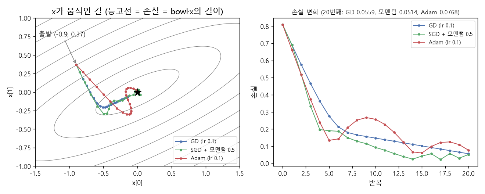

# Adam 업데이트 규칙 (Adam update rule)

[목차로 돌아가기](../../00_MIT%EB%94%A5%EB%9F%AC%EB%8B%9D_%EB%AA%A9%EC%B0%A8.md) · 먼저 볼 것: [MM08_SGD와_모멘텀](../../%EC%88%98%ED%95%99%EA%B0%9C%EB%85%90/05_%EC%8B%A0%EA%B2%BD%EB%A7%9D%EC%9D%98_%EA%B3%84%EC%82%B0/MM08_SGD%EC%99%80_%EB%AA%A8%EB%A9%98%ED%85%80.md), [MM36_지수_이동_평균](../../%EC%88%98%ED%95%99%EA%B0%9C%EB%85%90/05_%EC%8B%A0%EA%B2%BD%EB%A7%9D%EC%9D%98_%EA%B3%84%EC%82%B0/MM36_%EC%A7%80%EC%88%98_%EC%9D%B4%EB%8F%99_%ED%8F%89%EA%B7%A0.md) · 쓰는 곳: [PyTorch 튜토리얼 8](../../Tut_PyTorch_%ED%8A%9C%ED%86%A0%EB%A6%AC%EC%96%BC.md#8-%EC%98%B5%ED%8B%B0%EB%A7%88%EC%9D%B4%EC%A0%80) · [PyTorch 튜토리얼 10.2](../../Tut_PyTorch_%ED%8A%9C%ED%86%A0%EB%A6%AC%EC%96%BC.md#102-%EC%82%AC%EC%9D%B8-%EA%B3%A1%EC%84%A0-%EC%9C%84%EC%95%84%EB%9E%98-%EB%B6%84%EB%A5%98)

📚 학습 순서 42/99 (5. 신경망의 계산): ← 이전: [MM36_지수_이동_평균](../../%EC%88%98%ED%95%99%EA%B0%9C%EB%85%90/05_%EC%8B%A0%EA%B2%BD%EB%A7%9D%EC%9D%98_%EA%B3%84%EC%82%B0/MM36_%EC%A7%80%EC%88%98_%EC%9D%B4%EB%8F%99_%ED%8F%89%EA%B7%A0.md) · 다음: [MM33_표준화와_최소최대_정규화](../../%EC%88%98%ED%95%99%EA%B0%9C%EB%85%90/05_%EC%8B%A0%EA%B2%BD%EB%A7%9D%EC%9D%98_%EA%B3%84%EC%82%B0/MM33_%ED%91%9C%EC%A4%80%ED%99%94%EC%99%80_%EC%B5%9C%EC%86%8C%EC%B5%9C%EB%8C%80_%EC%A0%95%EA%B7%9C%ED%99%94.md) →

> [!NOTE]
> **3줄 요약**
> - [Adam](../../00_%EB%94%A5%EB%9F%AC%EB%8B%9D_%EC%9A%A9%EC%96%B4%EC%82%AC%EC%A0%84.md#adam-%EC%95%84%EB%8B%B4-%EC%98%B5%ED%8B%B0%EB%A7%88%EC%9D%B4%EC%A0%80)은 [기울기](../../00_%EB%94%A5%EB%9F%AC%EB%8B%9D_%EC%9A%A9%EC%96%B4%EC%82%AC%EC%A0%84.md#gradient-%EA%B8%B0%EC%9A%B8%EA%B8%B0)의 [지수 이동 평균](../../00_%EB%94%A5%EB%9F%AC%EB%8B%9D_%EC%9A%A9%EC%96%B4%EC%82%AC%EC%A0%84.md#exponential-moving-average-%EC%A7%80%EC%88%98-%EC%9D%B4%EB%8F%99-%ED%8F%89%EA%B7%A0) $m$(방향)과 [기울기](../../00_%EB%94%A5%EB%9F%AC%EB%8B%9D_%EC%9A%A9%EC%96%B4%EC%82%AC%EC%A0%84.md#gradient-%EA%B8%B0%EC%9A%B8%EA%B8%B0) 제곱의 [지수 이동 평균](../../00_%EB%94%A5%EB%9F%AC%EB%8B%9D_%EC%9A%A9%EC%96%B4%EC%82%AC%EC%A0%84.md#exponential-moving-average-%EC%A7%80%EC%88%98-%EC%9D%B4%EB%8F%99-%ED%8F%89%EA%B7%A0) $v$(크기)를 함께 기억하고, $\theta \leftarrow \theta - \eta\, \hat m / (\sqrt{\hat v} + \epsilon)$로 고친다.
> - $\hat m / \sqrt{\hat v}$는 "[기울기](../../00_%EB%94%A5%EB%9F%AC%EB%8B%9D_%EC%9A%A9%EC%96%B4%EC%82%AC%EC%A0%84.md#gradient-%EA%B8%B0%EC%9A%B8%EA%B8%B0) ÷ [기울기](../../00_%EB%94%A5%EB%9F%AC%EB%8B%9D_%EC%9A%A9%EC%96%B4%EC%82%AC%EC%A0%84.md#gradient-%EA%B8%B0%EC%9A%B8%EA%B8%B0) 크기"에 가까워서, 걸음 크기가 [기울기](../../00_%EB%94%A5%EB%9F%AC%EB%8B%9D_%EC%9A%A9%EC%96%B4%EC%82%AC%EC%A0%84.md#gradient-%EA%B8%B0%EC%9A%B8%EA%B8%B0) 크기와 상관없이 대략 [학습률](../../00_%EB%94%A5%EB%9F%AC%EB%8B%9D_%EC%9A%A9%EC%96%B4%EC%82%AC%EC%A0%84.md#learning-rate-%ED%95%99%EC%8A%B5%EB%A5%A0) $\eta$가 된다. [기울기](../../00_%EB%94%A5%EB%9F%AC%EB%8B%9D_%EC%9A%A9%EC%96%B4%EC%82%AC%EC%A0%84.md#gradient-%EA%B8%B0%EC%9A%B8%EA%B8%B0)가 0.01이든 100이든 첫 걸음은 0.1이다(η = 0.1).
> - 그래서 [파라미터](../../00_%EB%94%A5%EB%9F%AC%EB%8B%9D_%EC%9A%A9%EC%96%B4%EC%82%AC%EC%A0%84.md#parameter-%ED%8C%8C%EB%9D%BC%EB%AF%B8%ED%84%B0)마다 보폭이 자동으로 맞춰지지만, 최솟값 근처에서 [기울기](../../00_%EB%94%A5%EB%9F%AC%EB%8B%9D_%EC%9A%A9%EC%96%B4%EC%82%AC%EC%A0%84.md#gradient-%EA%B8%B0%EC%9A%B8%EA%B8%B0)가 작아져도 걸음이 줄지 않아 맴돌 수 있다. 튜토리얼의 그릇 예제에서 [손실](../../00_%EB%94%A5%EB%9F%AC%EB%8B%9D_%EC%9A%A9%EC%96%B4%EC%82%AC%EC%A0%84.md#loss-function-%EC%86%90%EC%8B%A4-%ED%95%A8%EC%88%98)이 0.1344 → 0.257 → 0.0768로 오르내렸다.

## 1. 개념 설명

비유: 산에서 눈을 가리고 내려간다. [경사하강법](../../00_%EB%94%A5%EB%9F%AC%EB%8B%9D_%EC%9A%A9%EC%96%B4%EC%82%AC%EC%A0%84.md#gradient-descent-%EA%B2%BD%EC%82%AC%ED%95%98%EA%B0%95%EB%B2%95)은 "경사가 가파르면 크게, 완만하면 작게" 걷는다. 그래서 경사가 아주 완만한 방향으로는 거의 움직이지 못하고, 가파른 방향으로는 너무 멀리 뛴다. [Adam](../../00_%EB%94%A5%EB%9F%AC%EB%8B%9D_%EC%9A%A9%EC%96%B4%EC%82%AC%EC%A0%84.md#adam-%EC%95%84%EB%8B%B4-%EC%98%B5%ED%8B%B0%EB%A7%88%EC%9D%B4%EC%A0%80)은 방향마다 "요즘 이 방향 경사가 보통 얼마나 가팔랐나"를 기억해 두었다가 그것으로 나눈다. 그러면 어느 방향이든 **비슷한 보폭**으로 걷게 된다.

- **1차 모멘트 $m$**: [기울기](../../00_%EB%94%A5%EB%9F%AC%EB%8B%9D_%EC%9A%A9%EC%96%B4%EC%82%AC%EC%A0%84.md#gradient-%EA%B8%B0%EC%9A%B8%EA%B8%B0)의 [지수 이동 평균](../../00_%EB%94%A5%EB%9F%AC%EB%8B%9D_%EC%9A%A9%EC%96%B4%EC%82%AC%EC%A0%84.md#exponential-moving-average-%EC%A7%80%EC%88%98-%EC%9D%B4%EB%8F%99-%ED%8F%89%EA%B7%A0). [모멘텀](../../%EC%88%98%ED%95%99%EA%B0%9C%EB%85%90/05_%EC%8B%A0%EA%B2%BD%EB%A7%9D%EC%9D%98_%EA%B3%84%EC%82%B0/MM08_SGD%EC%99%80_%EB%AA%A8%EB%A9%98%ED%85%80.md)과 같은 역할로, 잡음 섞인 [기울기](../../00_%EB%94%A5%EB%9F%AC%EB%8B%9D_%EC%9A%A9%EC%96%B4%EC%82%AC%EC%A0%84.md#gradient-%EA%B8%B0%EC%9A%B8%EA%B8%B0)의 평균 방향을 잡는다.
- **2차 모멘트 $v$**: [기울기](../../00_%EB%94%A5%EB%9F%AC%EB%8B%9D_%EC%9A%A9%EC%96%B4%EC%82%AC%EC%A0%84.md#gradient-%EA%B8%B0%EC%9A%B8%EA%B8%B0) **제곱**의 [지수 이동 평균](../../00_%EB%94%A5%EB%9F%AC%EB%8B%9D_%EC%9A%A9%EC%96%B4%EC%82%AC%EC%A0%84.md#exponential-moving-average-%EC%A7%80%EC%88%98-%EC%9D%B4%EB%8F%99-%ED%8F%89%EA%B7%A0). 그 방향 [기울기](../../00_%EB%94%A5%EB%9F%AC%EB%8B%9D_%EC%9A%A9%EC%96%B4%EC%82%AC%EC%A0%84.md#gradient-%EA%B8%B0%EC%9A%B8%EA%B8%B0)가 평소 얼마나 컸는지(크기)를 잰다.
- **[편향](../../00_%EB%94%A5%EB%9F%AC%EB%8B%9D_%EC%9A%A9%EC%96%B4%EC%82%AC%EC%A0%84.md#bias-%ED%8E%B8%ED%96%A5) 보정**: 둘 다 0에서 시작하므로 초반 값이 작게 치우친다. $1-\beta^t$로 나눠 바로잡는다([MM36_지수_이동_평균](../../%EC%88%98%ED%95%99%EA%B0%9C%EB%85%90/05_%EC%8B%A0%EA%B2%BD%EB%A7%9D%EC%9D%98_%EA%B3%84%EC%82%B0/MM36_%EC%A7%80%EC%88%98_%EC%9D%B4%EB%8F%99_%ED%8F%89%EA%B7%A0.md) 3절 (나)와 같은 방법).
- 이 모든 계산은 [파라미터](../../00_%EB%94%A5%EB%9F%AC%EB%8B%9D_%EC%9A%A9%EC%96%B4%EC%82%AC%EC%A0%84.md#parameter-%ED%8C%8C%EB%9D%BC%EB%AF%B8%ED%84%B0) 칸마다 **따로**(원소별로) 한다.

$$
\begin{aligned}
m_t &= \beta_1\, m_{t-1} + (1-\beta_1)\, g_t \\
v_t &= \beta_2\, v_{t-1} + (1-\beta_2)\, g_t^2 \\
\hat m_t &= \frac{m_t}{1-\beta_1^{\,t}}, \qquad \hat v_t = \frac{v_t}{1-\beta_2^{\,t}}
\end{aligned}
$$

<details><summary>기호 풀이</summary>

| 기호 | 읽는 법 | 뜻 | 예제 값 |
| --- | --- | --- | --- |
| $t$ | 티 | 몇 번째 걸음인가 (1부터 센다) | 1 |
| $g_t$ | 지 티 | t번째 걸음에서 잰 [기울기](../../00_%EB%94%A5%EB%9F%AC%EB%8B%9D_%EC%9A%A9%EC%96%B4%EC%82%AC%EC%A0%84.md#gradient-%EA%B8%B0%EC%9A%B8%EA%B8%B0) | 2 |
| $m_t$ | 엠 티 | [기울기](../../00_%EB%94%A5%EB%9F%AC%EB%8B%9D_%EC%9A%A9%EC%96%B4%EC%82%AC%EC%A0%84.md#gradient-%EA%B8%B0%EC%9A%B8%EA%B8%B0)의 [지수 이동 평균](../../00_%EB%94%A5%EB%9F%AC%EB%8B%9D_%EC%9A%A9%EC%96%B4%EC%82%AC%EC%A0%84.md#exponential-moving-average-%EC%A7%80%EC%88%98-%EC%9D%B4%EB%8F%99-%ED%8F%89%EA%B7%A0) (1차 모멘트) | 0.2 |
| $v_t$ | 브이 티 | [기울기](../../00_%EB%94%A5%EB%9F%AC%EB%8B%9D_%EC%9A%A9%EC%96%B4%EC%82%AC%EC%A0%84.md#gradient-%EA%B8%B0%EC%9A%B8%EA%B8%B0) 제곱의 [지수 이동 평균](../../00_%EB%94%A5%EB%9F%AC%EB%8B%9D_%EC%9A%A9%EC%96%B4%EC%82%AC%EC%A0%84.md#exponential-moving-average-%EC%A7%80%EC%88%98-%EC%9D%B4%EB%8F%99-%ED%8F%89%EA%B7%A0) (2차 모멘트) | 0.004 |
| $m_{t-1}, v_{t-1}$ | 엠·브이 티 빼기 1 | 바로 전 걸음의 값. 처음에는 0 | 0, 0 |
| $\beta_1$ | 베타 일 | $m$의 감쇠 계수 ([PyTorch](../../00_%EB%94%A5%EB%9F%AC%EB%8B%9D_%EC%9A%A9%EC%96%B4%EC%82%AC%EC%A0%84.md#pytorch-%ED%8C%8C%EC%9D%B4%ED%86%A0%EC%B9%98) 기본 0.9) | 0.9 |
| $\beta_2$ | 베타 이 | $v$의 감쇠 계수 ([PyTorch](../../00_%EB%94%A5%EB%9F%AC%EB%8B%9D_%EC%9A%A9%EC%96%B4%EC%82%AC%EC%A0%84.md#pytorch-%ED%8C%8C%EC%9D%B4%ED%86%A0%EC%B9%98) 기본 0.999) | 0.999 |
| $\beta_1^{\,t}$ | 베타 일의 티 제곱 | β₁을 t번 곱한 값 | 0.9 |
| $\hat m_t$ | 엠 햇 티 | 치우침을 바로잡은 1차 모멘트 | 2 |
| $\hat v_t$ | 브이 햇 티 | 치우침을 바로잡은 2차 모멘트 | 4 |

</details>

<details><summary>예제와 풀이</summary>

**문제**: [Adam](../../00_%EB%94%A5%EB%9F%AC%EB%8B%9D_%EC%9A%A9%EC%96%B4%EC%82%AC%EC%A0%84.md#adam-%EC%95%84%EB%8B%B4-%EC%98%B5%ED%8B%B0%EB%A7%88%EC%9D%B4%EC%A0%80)의 첫 걸음(t = 1)에서 [기울기](../../00_%EB%94%A5%EB%9F%AC%EB%8B%9D_%EC%9A%A9%EC%96%B4%EC%82%AC%EC%A0%84.md#gradient-%EA%B8%B0%EC%9A%B8%EA%B8%B0)가 2로 나왔다. 1차·2차 모멘트와 바로잡은 값은?

**주어진 값**:
- $t = 1$ (첫 걸음)
- $g_1 = 2$ (이번에 잰 [기울기](../../00_%EB%94%A5%EB%9F%AC%EB%8B%9D_%EC%9A%A9%EC%96%B4%EC%82%AC%EC%A0%84.md#gradient-%EA%B8%B0%EC%9A%B8%EA%B8%B0))
- $m_0 = 0$, $v_0 = 0$ (시작 값)
- $\beta_1 = 0.9$, $\beta_2 = 0.999$ (감쇠 계수, [PyTorch](../../00_%EB%94%A5%EB%9F%AC%EB%8B%9D_%EC%9A%A9%EC%96%B4%EC%82%AC%EC%A0%84.md#pytorch-%ED%8C%8C%EC%9D%B4%ED%86%A0%EC%B9%98) 기본값)

**풀이**
1. 식을 그대로 쓴다: $m_1 = \beta_1 m_0 + (1-\beta_1) g_1$, $v_1 = \beta_2 v_0 + (1-\beta_2) g_1^2$, $\hat m_1 = \frac{m_1}{1-\beta_1^{1}}$, $\hat v_1 = \frac{v_1}{1-\beta_2^{1}}$
2. 값을 대입한다: $m_1 = 0.9 × 0 + (1 - 0.9) × 2$, $v_1 = 0.999 × 0 + (1 - 0.999) × 2^2$, $\hat m_1 = \frac{m_1}{1-0.9^{1}}$, $\hat v_1 = \frac{v_1}{1-0.999^{1}}$
3. 괄호 안 뺄셈과 제곱을 먼저 한다: 1 − 0.9 = 0.1, 1 − 0.999 = 0.001, 2² = 2 × 2 = 4 이므로 $m_1 = 0.9 × 0 + 0.1 × 2$, $v_1 = 0.999 × 0 + 0.001 × 4$
4. 곱셈을 한다: 0.9 × 0 = 0, 0.1 × 2 = 0.2, 0.999 × 0 = 0, 0.001 × 4 = 0.004 이므로 $m_1 = 0 + 0.2$, $v_1 = 0 + 0.004$
5. 더한다: $m_1 = 0.2$, $v_1 = 0.004$ (0에서 시작해 실제 [기울기](../../00_%EB%94%A5%EB%9F%AC%EB%8B%9D_%EC%9A%A9%EC%96%B4%EC%82%AC%EC%A0%84.md#gradient-%EA%B8%B0%EC%9A%B8%EA%B8%B0) 2, 제곱 4보다 훨씬 작다)
6. 보정 분모를 계산한다: 0.9¹ = 0.9 이므로 1 − 0.9 = 0.1, 0.999¹ = 0.999 이므로 1 − 0.999 = 0.001
7. 나눈다: $\hat m_1 = 0.2 ÷ 0.1 = 2$, $\hat v_1 = 0.004 ÷ 0.001 = 4$

**답**: $m_1 = 0.2$, $v_1 = 0.004$, 바로잡은 값 $\hat m_1 = 2$, $\hat v_1 = 4$ ([기울기](../../00_%EB%94%A5%EB%9F%AC%EB%8B%9D_%EC%9A%A9%EC%96%B4%EC%82%AC%EC%A0%84.md#gradient-%EA%B8%B0%EC%9A%B8%EA%B8%B0) 2와 그 제곱 4가 그대로 돌아온다)

</details>

<details><summary>내 이해</summary>


</details>

바로잡은 두 값으로 [파라미터](../../00_%EB%94%A5%EB%9F%AC%EB%8B%9D_%EC%9A%A9%EC%96%B4%EC%82%AC%EC%A0%84.md#parameter-%ED%8C%8C%EB%9D%BC%EB%AF%B8%ED%84%B0)를 고친다. $\epsilon$은 0으로 나누는 것을 막는 아주 작은 수다.

$$
\theta_t = \theta_{t-1} - \eta\, \frac{\hat m_t}{\sqrt{\hat v_t} + \epsilon}
$$

<details><summary>기호 풀이</summary>

| 기호 | 읽는 법 | 뜻 | 예제 값 |
| --- | --- | --- | --- |
| $\theta_t$ | 세타 티 | t번째 걸음 뒤의 [파라미터](../../00_%EB%94%A5%EB%9F%AC%EB%8B%9D_%EC%9A%A9%EC%96%B4%EC%82%AC%EC%A0%84.md#parameter-%ED%8C%8C%EB%9D%BC%EB%AF%B8%ED%84%B0) | 0.9 |
| $\theta_{t-1}$ | 세타 티 빼기 1 | 걸음 전의 [파라미터](../../00_%EB%94%A5%EB%9F%AC%EB%8B%9D_%EC%9A%A9%EC%96%B4%EC%82%AC%EC%A0%84.md#parameter-%ED%8C%8C%EB%9D%BC%EB%AF%B8%ED%84%B0) | 1 |
| $\eta$ | 에타 | [학습률](../../00_%EB%94%A5%EB%9F%AC%EB%8B%9D_%EC%9A%A9%EC%96%B4%EC%82%AC%EC%A0%84.md#learning-rate-%ED%95%99%EC%8A%B5%EB%A5%A0). [Adam](../../00_%EB%94%A5%EB%9F%AC%EB%8B%9D_%EC%9A%A9%EC%96%B4%EC%82%AC%EC%A0%84.md#adam-%EC%95%84%EB%8B%B4-%EC%98%B5%ED%8B%B0%EB%A7%88%EC%9D%B4%EC%A0%80)에서는 "한 걸음의 대략 크기" | 0.1 |
| $\hat m_t$ | 엠 햇 티 | 바로잡은 1차 모멘트 (방향과 크기) | 2 |
| $\sqrt{\hat v_t}$ | 루트 브이 햇 티 | 바로잡은 2차 모멘트의 제곱근 = 평소 [기울기](../../00_%EB%94%A5%EB%9F%AC%EB%8B%9D_%EC%9A%A9%EC%96%B4%EC%82%AC%EC%A0%84.md#gradient-%EA%B8%B0%EC%9A%B8%EA%B8%B0) 크기 | √4 = 2 |
| $\epsilon$ | 엡실론 | 0으로 나누기 방지용 아주 작은 수 ([PyTorch](../../00_%EB%94%A5%EB%9F%AC%EB%8B%9D_%EC%9A%A9%EC%96%B4%EC%82%AC%EC%A0%84.md#pytorch-%ED%8C%8C%EC%9D%B4%ED%86%A0%EC%B9%98) 기본 1e-8 = 0.00000001) | 1e-8 |

</details>

<details><summary>예제와 풀이</summary>

**문제**: 위 예제에서 바로잡은 값이 $\hat m_1 = 2$, $\hat v_1 = 4$로 나왔다. [파라미터](../../00_%EB%94%A5%EB%9F%AC%EB%8B%9D_%EC%9A%A9%EC%96%B4%EC%82%AC%EC%A0%84.md#parameter-%ED%8C%8C%EB%9D%BC%EB%AF%B8%ED%84%B0)가 1이고 [학습률](../../00_%EB%94%A5%EB%9F%AC%EB%8B%9D_%EC%9A%A9%EC%96%B4%EC%82%AC%EC%A0%84.md#learning-rate-%ED%95%99%EC%8A%B5%EB%A5%A0)이 0.1이면 한 걸음 뒤 θ는?

**주어진 값**:
- $\theta_0 = 1$ (지금 [파라미터](../../00_%EB%94%A5%EB%9F%AC%EB%8B%9D_%EC%9A%A9%EC%96%B4%EC%82%AC%EC%A0%84.md#parameter-%ED%8C%8C%EB%9D%BC%EB%AF%B8%ED%84%B0))
- $\eta = 0.1$ ([학습률](../../00_%EB%94%A5%EB%9F%AC%EB%8B%9D_%EC%9A%A9%EC%96%B4%EC%82%AC%EC%A0%84.md#learning-rate-%ED%95%99%EC%8A%B5%EB%A5%A0))
- $\hat m_1 = 2$, $\hat v_1 = 4$ (위 예제에서 바로잡은 값)
- $\epsilon = 0.00000001$ (0으로 나누기 방지)

**풀이**
1. 식을 그대로 쓴다: $\theta_1 = \theta_0 - \eta\, \frac{\hat m_1}{\sqrt{\hat v_1} + \epsilon}$
2. 값을 대입한다: $\theta_1 = 1 - 0.1 × \frac{2}{\sqrt{4} + 0.00000001}$
3. 제곱근을 구한다. √a는 "제곱해서 a가 되는 양수"이고, 2 × 2 = 4 이므로 √4 = 2: $\theta_1 = 1 - 0.1 × \frac{2}{2 + 0.00000001}$
4. 분모를 더한다: 2 + 0.00000001 = 2.00000001 (사실상 2) 이므로 $\theta_1 = 1 - 0.1 × \frac{2}{2.00000001}$
5. 나눈다: 2 ÷ 2.00000001 = 0.999999995 (사실상 1) 이므로 $\theta_1 = 1 - 0.1 × 1$
6. 곱한다: 0.1 × 1 = 0.1 이므로 $\theta_1 = 1 - 0.1$
7. 뺀다: 1 − 0.1 = 0.9

**답**: θ₁ = 0.9 (걸음 크기가 정확히 [학습률](../../00_%EB%94%A5%EB%9F%AC%EB%8B%9D_%EC%9A%A9%EC%96%B4%EC%82%AC%EC%A0%84.md#learning-rate-%ED%95%99%EC%8A%B5%EB%A5%A0) 0.1. 같은 [학습률](../../00_%EB%94%A5%EB%9F%AC%EB%8B%9D_%EC%9A%A9%EC%96%B4%EC%82%AC%EC%A0%84.md#learning-rate-%ED%95%99%EC%8A%B5%EB%A5%A0)의 SGD라면 0.1 × 2 = 0.2만큼 움직인다)

</details>

<details><summary>내 이해</summary>


</details>

## 2. 필요한 이유

- [PyTorch 튜토리얼 8](../../Tut_PyTorch_%ED%8A%9C%ED%86%A0%EB%A6%AC%EC%96%BC.md#8-%EC%98%B5%ED%8B%B0%EB%A7%88%EC%9D%B4%EC%A0%80)에서 조교는 [경사하강법](../../00_%EB%94%A5%EB%9F%AC%EB%8B%9D_%EC%9A%A9%EC%96%B4%EC%82%AC%EC%A0%84.md#gradient-descent-%EA%B2%BD%EC%82%AC%ED%95%98%EA%B0%95%EB%B2%95), [SGD](../../00_%EB%94%A5%EB%9F%AC%EB%8B%9D_%EC%9A%A9%EC%96%B4%EC%82%AC%EC%A0%84.md#stochastic-gradient-descent-%ED%99%95%EB%A5%A0%EC%A0%81-%EA%B2%BD%EC%82%AC%ED%95%98%EA%B0%95%EB%B2%95)+[모멘텀](../../00_%EB%94%A5%EB%9F%AC%EB%8B%9D_%EC%9A%A9%EC%96%B4%EC%82%AC%EC%A0%84.md#momentum-%EB%AA%A8%EB%A9%98%ED%85%80), [Adam](../../00_%EB%94%A5%EB%9F%AC%EB%8B%9D_%EC%9A%A9%EC%96%B4%EC%82%AC%EC%A0%84.md#adam-%EC%95%84%EB%8B%B4-%EC%98%B5%ED%8B%B0%EB%A7%88%EC%9D%B4%EC%A0%80)을 같은 그릇 모양 [손실](../../00_%EB%94%A5%EB%9F%AC%EB%8B%9D_%EC%9A%A9%EC%96%B4%EC%82%AC%EC%A0%84.md#loss-function-%EC%86%90%EC%8B%A4-%ED%95%A8%EC%88%98)에 돌려 비교하고, "[Adam](../../00_%EB%94%A5%EB%9F%AC%EB%8B%9D_%EC%9A%A9%EC%96%B4%EC%82%AC%EC%A0%84.md#adam-%EC%95%84%EB%8B%B4-%EC%98%B5%ED%8B%B0%EB%A7%88%EC%9D%B4%EC%A0%80)이 실제로 가장 많이 쓰인다"고 말한다. 코드는 `torch.optim.Adam(params, lr=0.1)` 한 줄이라 안에서 무슨 계산을 하는지는 보이지 않는다. 이 노트가 그 한 줄의 속을 연다.
- [튜토리얼 10.2](../../Tut_PyTorch_%ED%8A%9C%ED%86%A0%EB%A6%AC%EC%96%BC.md#102-%EC%82%AC%EC%9D%B8-%EA%B3%A1%EC%84%A0-%EC%9C%84%EC%95%84%EB%9E%98-%EB%B6%84%EB%A5%98)의 분류기와 [Lec09 11.1](../../Lec09_%ED%95%B4%EC%BB%A4%EC%9D%98_%EB%94%A5%EB%9F%AC%EB%8B%9D_%EA%B0%80%EC%9D%B4%EB%93%9C.md#111-%EA%B8%B0%EB%B3%B8-%EB%A0%88%EC%8B%9C%ED%94%BC)의 기본 레시피도 [Adam](../../00_%EB%94%A5%EB%9F%AC%EB%8B%9D_%EC%9A%A9%EC%96%B4%EC%82%AC%EC%A0%84.md#adam-%EC%95%84%EB%8B%B4-%EC%98%B5%ED%8B%B0%EB%A7%88%EC%9D%B4%EC%A0%80)을 쓴다. [Lec07 6](../../Lec07_%EC%B5%9C%EC%A0%81%ED%99%94%EC%9D%98_%EC%8A%A4%EC%BC%80%EC%9D%BC%EB%A7%81_%EA%B7%9C%EC%B9%99.md#6-%EC%B5%9C%EA%B8%89%EA%B0%95%ED%95%98%EB%B2%95)의 🆕 업데이트는 "[지수 이동 평균](../../00_%EB%94%A5%EB%9F%AC%EB%8B%9D_%EC%9A%A9%EC%96%B4%EC%82%AC%EC%A0%84.md#exponential-moving-average-%EC%A7%80%EC%88%98-%EC%9D%B4%EB%8F%99-%ED%8F%89%EA%B7%A0)을 끈 [Adam](../../00_%EB%94%A5%EB%9F%AC%EB%8B%9D_%EC%9A%A9%EC%96%B4%EC%82%AC%EC%A0%84.md#adam-%EC%95%84%EB%8B%B4-%EC%98%B5%ED%8B%B0%EB%A7%88%EC%9D%B4%EC%A0%80)은 [부호 경사하강법](../../00_%EB%94%A5%EB%9F%AC%EB%8B%9D_%EC%9A%A9%EC%96%B4%EC%82%AC%EC%A0%84.md#sign-gradient-descent-%EB%B6%80%ED%98%B8-%EA%B2%BD%EC%82%AC%ED%95%98%EA%B0%95%EB%B2%95)"이라고 설명하는데, 아래 3절 (나)가 그 이유를 숫자로 보여 준다.

## 3. 숫자로 보기

**(가) [손실](../../00_%EB%94%A5%EB%9F%AC%EB%8B%9D_%EC%9A%A9%EC%96%B4%EC%82%AC%EC%A0%84.md#loss-function-%EC%86%90%EC%8B%A4-%ED%95%A8%EC%88%98) θ², θ = 1에서 세 걸음** ([학습률](../../00_%EB%94%A5%EB%9F%AC%EB%8B%9D_%EC%9A%A9%EC%96%B4%EC%82%AC%EC%A0%84.md#learning-rate-%ED%95%99%EC%8A%B5%EB%A5%A0) 0.1, 아래 4절 코드)

| 걸음 | [Adam](../../00_%EB%94%A5%EB%9F%AC%EB%8B%9D_%EC%9A%A9%EC%96%B4%EC%82%AC%EC%A0%84.md#adam-%EC%95%84%EB%8B%B4-%EC%98%B5%ED%8B%B0%EB%A7%88%EC%9D%B4%EC%A0%80)의 θ | SGD의 θ (θ ← θ − 0.1 × 2θ) |
|---|---|---|
| 1 | 0.9 | 0.8 |
| 2 | 0.8004 | 0.64 |
| 3 | 0.7016 | 0.512 |

- [Adam](../../00_%EB%94%A5%EB%9F%AC%EB%8B%9D_%EC%9A%A9%EC%96%B4%EC%82%AC%EC%A0%84.md#adam-%EC%95%84%EB%8B%B4-%EC%98%B5%ED%8B%B0%EB%A7%88%EC%9D%B4%EC%A0%80)은 걸음마다 거의 0.1씩 움직인다. SGD는 [기울기](../../00_%EB%94%A5%EB%9F%AC%EB%8B%9D_%EC%9A%A9%EC%96%B4%EC%82%AC%EC%A0%84.md#gradient-%EA%B8%B0%EC%9A%B8%EA%B8%B0) 2θ에 비례해서 움직이므로 θ가 작아질수록 걸음도 작아진다.

**(나) 첫 걸음의 크기는 [기울기](../../00_%EB%94%A5%EB%9F%AC%EB%8B%9D_%EC%9A%A9%EC%96%B4%EC%82%AC%EC%A0%84.md#gradient-%EA%B8%B0%EC%9A%B8%EA%B8%B0) 크기와 상관없다** ([학습률](../../00_%EB%94%A5%EB%9F%AC%EB%8B%9D_%EC%9A%A9%EC%96%B4%EC%82%AC%EC%A0%84.md#learning-rate-%ED%95%99%EC%8A%B5%EB%A5%A0) 0.1)

| [기울기](../../00_%EB%94%A5%EB%9F%AC%EB%8B%9D_%EC%9A%A9%EC%96%B4%EC%82%AC%EC%A0%84.md#gradient-%EA%B8%B0%EC%9A%B8%EA%B8%B0) g | [Adam](../../00_%EB%94%A5%EB%9F%AC%EB%8B%9D_%EC%9A%A9%EC%96%B4%EC%82%AC%EC%A0%84.md#adam-%EC%95%84%EB%8B%B4-%EC%98%B5%ED%8B%B0%EB%A7%88%EC%9D%B4%EC%A0%80) 첫 걸음 | SGD 첫 걸음 (0.1 × g) |
|---|---|---|
| 0.01 | 0.1 | 0.001 |
| 1 | 0.1 | 0.1 |
| 100 | 0.1 | 10 |

- 첫 걸음에서 $\hat m_1 = g$, $\hat v_1 = g^2$이므로 걸음 = $\eta\, g / (|g| + \epsilon)$ = η × (g의 부호). [기울기](../../00_%EB%94%A5%EB%9F%AC%EB%8B%9D_%EC%9A%A9%EC%96%B4%EC%82%AC%EC%A0%84.md#gradient-%EA%B8%B0%EC%9A%B8%EA%B8%B0)가 1만 배 차이 나도 걸음은 같다.

**(다) 그릇 예제의 맴돌기**: [튜토리얼 8](../../Tut_PyTorch_%ED%8A%9C%ED%86%A0%EB%A6%AC%EC%96%BC.md#8-%EC%98%B5%ED%8B%B0%EB%A7%88%EC%9D%B4%EC%A0%80)의 [손실](../../00_%EB%94%A5%EB%9F%AC%EB%8B%9D_%EC%9A%A9%EC%96%B4%EC%82%AC%EC%A0%84.md#loss-function-%EC%86%90%EC%8B%A4-%ED%95%A8%EC%88%98) ‖bowl·x‖에서 20번째 [손실](../../00_%EB%94%A5%EB%9F%AC%EB%8B%9D_%EC%9A%A9%EC%96%B4%EC%82%AC%EC%A0%84.md#loss-function-%EC%86%90%EC%8B%A4-%ED%95%A8%EC%88%98)은 GD 0.0559, [모멘텀](../../00_%EB%94%A5%EB%9F%AC%EB%8B%9D_%EC%9A%A9%EC%96%B4%EC%82%AC%EC%A0%84.md#momentum-%EB%AA%A8%EB%A9%98%ED%85%80) 0.0514, [Adam](../../00_%EB%94%A5%EB%9F%AC%EB%8B%9D_%EC%9A%A9%EC%96%B4%EC%82%AC%EC%A0%84.md#adam-%EC%95%84%EB%8B%B4-%EC%98%B5%ED%8B%B0%EB%A7%88%EC%9D%B4%EC%A0%80) 0.0768. [Adam](../../00_%EB%94%A5%EB%9F%AC%EB%8B%9D_%EC%9A%A9%EC%96%B4%EC%82%AC%EC%A0%84.md#adam-%EC%95%84%EB%8B%B4-%EC%98%B5%ED%8B%B0%EB%A7%88%EC%9D%B4%EC%A0%80)은 5번째 0.1344까지 빨리 내려갔다가 10번째 0.257로 다시 올랐다. 최솟값 근처에서도 걸음이 약 0.1로 줄지 않아 바닥을 지나쳤다가 돌아오기 때문이다.


*▲ 직접 그린 그림: 같은 출발점 (-0.9, 0.37)에서 세 [옵티마이저](../../00_%EB%94%A5%EB%9F%AC%EB%8B%9D_%EC%9A%A9%EC%96%B4%EC%82%AC%EC%A0%84.md#optimizer-%EC%98%B5%ED%8B%B0%EB%A7%88%EC%9D%B4%EC%A0%80)가 21번 움직인 길(왼쪽)과 [손실](../../00_%EB%94%A5%EB%9F%AC%EB%8B%9D_%EC%9A%A9%EC%96%B4%EC%82%AC%EC%A0%84.md#loss-function-%EC%86%90%EC%8B%A4-%ED%95%A8%EC%88%98)(오른쪽). [Adam](../../00_%EB%94%A5%EB%9F%AC%EB%8B%9D_%EC%9A%A9%EC%96%B4%EC%82%AC%EC%A0%84.md#adam-%EC%95%84%EB%8B%B4-%EC%98%B5%ED%8B%B0%EB%A7%88%EC%9D%B4%EC%A0%80)(빨강)은 바닥 근처에서 고리를 그린다 (숫자는 3절 (다), [튜토리얼 8](../../Tut_PyTorch_%ED%8A%9C%ED%86%A0%EB%A6%AC%EC%96%BC.md#8-%EC%98%B5%ED%8B%B0%EB%A7%88%EC%9D%B4%EC%A0%80) 표와 같음)*

<details><summary>기호 풀이 (이 노트 전체)</summary>

| 기호 | 읽는 법 | 뜻 | 예제 값 |
| --- | --- | --- | --- |
| $g_t$ | 지 티 | t번째 [기울기](../../00_%EB%94%A5%EB%9F%AC%EB%8B%9D_%EC%9A%A9%EC%96%B4%EC%82%AC%EC%A0%84.md#gradient-%EA%B8%B0%EC%9A%B8%EA%B8%B0) | 2 |
| $m_t,\ v_t$ | 엠 티, 브이 티 | [기울기](../../00_%EB%94%A5%EB%9F%AC%EB%8B%9D_%EC%9A%A9%EC%96%B4%EC%82%AC%EC%A0%84.md#gradient-%EA%B8%B0%EC%9A%B8%EA%B8%B0)와 [기울기](../../00_%EB%94%A5%EB%9F%AC%EB%8B%9D_%EC%9A%A9%EC%96%B4%EC%82%AC%EC%A0%84.md#gradient-%EA%B8%B0%EC%9A%B8%EA%B8%B0) 제곱의 [지수 이동 평균](../../00_%EB%94%A5%EB%9F%AC%EB%8B%9D_%EC%9A%A9%EC%96%B4%EC%82%AC%EC%A0%84.md#exponential-moving-average-%EC%A7%80%EC%88%98-%EC%9D%B4%EB%8F%99-%ED%8F%89%EA%B7%A0) | 0.2, 0.004 |
| $\beta_1,\ \beta_2$ | 베타 일, 베타 이 | 두 평균의 감쇠 계수 | 0.9, 0.999 |
| $\hat m_t,\ \hat v_t$ | 엠 햇, 브이 햇 | [편향](../../00_%EB%94%A5%EB%9F%AC%EB%8B%9D_%EC%9A%A9%EC%96%B4%EC%82%AC%EC%A0%84.md#bias-%ED%8E%B8%ED%96%A5) 보정한 값 | 2, 4 |
| $\eta$ | 에타 | [학습률](../../00_%EB%94%A5%EB%9F%AC%EB%8B%9D_%EC%9A%A9%EC%96%B4%EC%82%AC%EC%A0%84.md#learning-rate-%ED%95%99%EC%8A%B5%EB%A5%A0) ≈ 한 걸음 크기 | 0.1 |
| $\epsilon$ | 엡실론 | 0으로 나누기 방지 | 1e-8 |
| $\eta\, \hat m / (\sqrt{\hat v} + \epsilon)$ | | 실제 걸음 | 0.1 |

</details>

## 4. 코드로 확인

```python
# [함수] import math: 제곱근 math.sqrt를 쓰려고 불러온다
import math
# [함수] import torch: PyTorch의 Adam과 비교하려고 불러온다
import torch
# [변수] b1, b2, eps, lr: PyTorch Adam 기본값 β₁ = 0.9, β₂ = 0.999, ε = 1e-8과 학습률 0.1
# [연결] 1절 식의 기호
b1, b2, eps, lr = 0.9, 0.999, 1e-8, 0.1
# [함수] def adam_by_hand(theta, steps): 손실 θ²(기울기 2θ)에 Adam을 직접 적용해 θ 기록을 돌려준다
def adam_by_hand(theta, steps):
    # [변수] m, v: 1차·2차 모멘트. 0에서 시작한다
    m, v, hist = 0.0, 0.0, []
    # [함수] for t in range(1, steps + 1): t = 1, 2, 3 (편향 보정에 t가 필요해 1부터 센다)
    for t in range(1, steps + 1):
        # [변수] g: 지금 기울기 d(θ²)/dθ = 2θ
        g = 2 * theta
        # [변수] m: 기울기의 지수 이동 평균 (1절 첫 줄)
        m = b1 * m + (1 - b1) * g
        # [변수] v: 기울기 제곱의 지수 이동 평균 (1절 둘째 줄)
        v = b2 * v + (1 - b2) * g * g
        # [변수] m_hat, v_hat: 0에서 시작한 치우침을 1 - β^t로 나눠 바로잡은 값 (MM36 편향 보정)
        m_hat, v_hat = m / (1 - b1 ** t), v / (1 - b2 ** t)
        # [변수] theta: θ ← θ - lr · m̂ / (√v̂ + ε)  (1절 갱신 식)
        theta = theta - lr * m_hat / (math.sqrt(v_hat) + eps)
        # [함수] hist.append(round(theta, 4)): 넷째 자리로 반올림해 기록
        hist.append(round(theta, 4))
    # [쓸모] torch 결과와 나란히 비교한다
    return hist
# [변수] th: 같은 출발점 θ = 1을 PyTorch 텐서로
th = torch.tensor([1.0], requires_grad=True)
# [변수] opt: PyTorch Adam, 학습률 0.1 (나머지는 기본값)
opt = torch.optim.Adam([th], lr=0.1)
# [변수] hist: torch 쪽 θ 기록
hist = []
# [함수] for _ in range(3): 세 걸음
for _ in range(3):
    # [함수] opt.zero_grad(): 기울기를 비운다
    opt.zero_grad()
    # [함수] (th ** 2).sum().backward(): 손실 θ²의 기울기를 th.grad에 넣는다
    (th ** 2).sum().backward()
    # [함수] opt.step(): Adam 한 걸음
    opt.step()
    # [함수] hist.append(...): 갱신된 θ 기록
    hist.append(round(th.item(), 4))
# [연결] 출력 1~2행: 직접 짠 Adam과 torch.optim.Adam이 같다. 걸음마다 약 0.1씩 줄어든다 (3절 (가))
print(adam_by_hand(1.0, 3))
print(hist)
# [함수] for g in (...): 첫 걸음의 크기를 기울기 크기별로 비교한다
# [연결] 3절 (나) 표
for g in (0.01, 1.0, 100.0):
    # [변수] adam_step: 첫 걸음에서 m̂ = g, v̂ = g²이므로 걸음 = lr · g / (|g| + ε) ≈ 0.1
    adam_step = lr * g / (abs(g) + eps)
    # [변수] sgd_step: 같은 학습률의 SGD 걸음 lr · g (기울기에 비례)
    sgd_step = lr * g
    # [연결] 출력 3~5행: Adam은 언제나 0.1, SGD는 0.001 ~ 10
    print(g, round(adam_step, 6), round(sgd_step, 6))
```

**실행 결과**:

```text
[0.9, 0.8004, 0.7016]
[0.9, 0.8004, 0.7016]
0.01 0.1 0.001
1.0 0.1 0.1
100.0 0.1 10.0
```

> [!WARNING]
> **⚠ 주의**
> - **[학습률](../../00_%EB%94%A5%EB%9F%AC%EB%8B%9D_%EC%9A%A9%EC%96%B4%EC%82%AC%EC%A0%84.md#learning-rate-%ED%95%99%EC%8A%B5%EB%A5%A0)의 뜻이 다르다.** SGD의 [학습률](../../00_%EB%94%A5%EB%9F%AC%EB%8B%9D_%EC%9A%A9%EC%96%B4%EC%82%AC%EC%A0%84.md#learning-rate-%ED%95%99%EC%8A%B5%EB%A5%A0)은 [기울기](../../00_%EB%94%A5%EB%9F%AC%EB%8B%9D_%EC%9A%A9%EC%96%B4%EC%82%AC%EC%A0%84.md#gradient-%EA%B8%B0%EC%9A%B8%EA%B8%B0)에 곱하는 배율이고, [Adam](../../00_%EB%94%A5%EB%9F%AC%EB%8B%9D_%EC%9A%A9%EC%96%B4%EC%82%AC%EC%A0%84.md#adam-%EC%95%84%EB%8B%B4-%EC%98%B5%ED%8B%B0%EB%A7%88%EC%9D%B4%EC%A0%80)의 [학습률](../../00_%EB%94%A5%EB%9F%AC%EB%8B%9D_%EC%9A%A9%EC%96%B4%EC%82%AC%EC%A0%84.md#learning-rate-%ED%95%99%EC%8A%B5%EB%A5%A0)은 "한 걸음의 대략 크기"다. SGD에서 잘 되던 값을 그대로 옮기면 안 된다. [PyTorch](../../00_%EB%94%A5%EB%9F%AC%EB%8B%9D_%EC%9A%A9%EC%96%B4%EC%82%AC%EC%A0%84.md#pytorch-%ED%8C%8C%EC%9D%B4%ED%86%A0%EC%B9%98) `torch.optim.Adam`의 기본값은 lr = 0.001, betas = (0.9, 0.999), eps = 1e-8이다.
> - **바닥에서 맴돌 수 있다.** [기울기](../../00_%EB%94%A5%EB%9F%AC%EB%8B%9D_%EC%9A%A9%EC%96%B4%EC%82%AC%EC%A0%84.md#gradient-%EA%B8%B0%EC%9A%B8%EA%B8%B0)가 작아져도 걸음이 줄지 않는다(3절 (다)). 실전에서는 [학습률](../../00_%EB%94%A5%EB%9F%AC%EB%8B%9D_%EC%9A%A9%EC%96%B4%EC%82%AC%EC%A0%84.md#learning-rate-%ED%95%99%EC%8A%B5%EB%A5%A0)을 점점 줄이는 스케줄을 함께 쓴다.
> - **[가중치 감쇠](../../00_%EB%94%A5%EB%9F%AC%EB%8B%9D_%EC%9A%A9%EC%96%B4%EC%82%AC%EC%A0%84.md#weight-decay-%EA%B0%80%EC%A4%91%EC%B9%98-%EA%B0%90%EC%87%A0)는 AdamW로.** `Adam(weight_decay=...)`은 감쇠 항을 [기울기](../../00_%EB%94%A5%EB%9F%AC%EB%8B%9D_%EC%9A%A9%EC%96%B4%EC%82%AC%EC%A0%84.md#gradient-%EA%B8%B0%EC%9A%B8%EA%B8%B0)에 더해 $\sqrt{\hat v}$로 함께 나눠 버린다. [가중치 감쇠](../../00_%EB%94%A5%EB%9F%AC%EB%8B%9D_%EC%9A%A9%EC%96%B4%EC%82%AC%EC%A0%84.md#weight-decay-%EA%B0%80%EC%A4%91%EC%B9%98-%EA%B0%90%EC%87%A0)를 따로 적용하는 `torch.optim.AdamW`(또는 `Adam(..., decoupled_weight_decay=True)`)가 보통 더 낫다.
> - $\epsilon$은 [PyTorch](../../00_%EB%94%A5%EB%9F%AC%EB%8B%9D_%EC%9A%A9%EC%96%B4%EC%82%AC%EC%A0%84.md#pytorch-%ED%8C%8C%EC%9D%B4%ED%86%A0%EC%B9%98)에서 제곱근 **밖**에 더한다($\sqrt{\hat v} + \epsilon$). 구현마다 위치가 달라 아주 작은 [기울기](../../00_%EB%94%A5%EB%9F%AC%EB%8B%9D_%EC%9A%A9%EC%96%B4%EC%82%AC%EC%A0%84.md#gradient-%EA%B8%B0%EC%9A%B8%EA%B8%B0)에서 결과가 조금 다를 수 있다.

## 5. 개념 재확인

<details><summary>1. 기울기가 4, 그다음 −4로 부호가 바뀌었다. 두 번째 걸음의 크기와 방향은? (η = 0.1, β₁ = 0.9, β₂ = 0.999)</summary>

| 단계 | 하는 일 | 식 | 계산 | 결과 |
|---|---|---|---|---|
| 1 | 첫 걸음 모멘트 | $m_1 = 0.1 g_1$, $v_1 = 0.001 g_1^2$ | 0.1 × 4, 0.001 × 16 | 0.4, 0.016 |
| 2 | 둘째 걸음 모멘트 | $m_2 = 0.9 m_1 + 0.1 g_2$, $v_2 = 0.999 v_1 + 0.001 g_2^2$ | 0.36 − 0.4, 0.015984 + 0.016 | −0.04, 0.031984 |
| 3 | [편향](../../00_%EB%94%A5%EB%9F%AC%EB%8B%9D_%EC%9A%A9%EC%96%B4%EC%82%AC%EC%A0%84.md#bias-%ED%8E%B8%ED%96%A5) 보정 | $\hat m_2 = m_2 / (1-0.9^2)$, $\hat v_2 = v_2 / (1-0.999^2)$ | −0.04 / 0.19, 0.031984 / 0.001999 | −0.2105, 16 |
| 4 | 걸음 | $-\eta\, \hat m_2 / \sqrt{\hat v_2}$ | −0.1 × (−0.2105) / 4 | +0.0053 |

**① 쓰는 식**
$$m_t = \beta_1 m_{t-1} + (1-\beta_1) g_t,\quad v_t = \beta_2 v_{t-1} + (1-\beta_2) g_t^2,\quad \text{걸음} = -\eta\, \frac{m_t/(1-\beta_1^t)}{\sqrt{v_t/(1-\beta_2^t)} + \epsilon}$$
```python
# [변수] b1, b2, lr, eps: 문제의 계수 (PyTorch 기본 β와 ε, 학습률 0.1)
b1, b2, lr, eps = 0.9, 0.999, 0.1, 1e-8                      # ①
# [변수] m1, v1: 첫 걸음(g = 4)의 모멘트 0.4, 0.016
m1, v1 = (1 - b1) * 4, (1 - b2) * 16                         # ②
# [변수] m2, v2: 둘째 걸음(g = -4)의 모멘트 -0.04, 0.031984
m2, v2 = b1 * m1 + (1 - b1) * (-4), b2 * v1 + (1 - b2) * 16  # ③
# [변수] mh, vh: 편향 보정 (t = 2) -0.2105, 16
mh, vh = m2 / (1 - b1 ** 2), v2 / (1 - b2 ** 2)              # ④
# [변수] step: 실제로 θ에 더해지는 값 -lr · m̂ / (√v̂ + ε)
step = -lr * mh / (vh ** 0.5 + eps)                         # ⑤
# [연결] 출력: 0.4 0.016 -0.04 0.031984 -0.2105 16.0 0.0053
print(round(m1, 4), round(v1, 4), round(m2, 4), round(v2, 6), round(mh, 4), round(vh, 4), round(step, 4))
```

**문제**: [Adam](../../00_%EB%94%A5%EB%9F%AC%EB%8B%9D_%EC%9A%A9%EC%96%B4%EC%82%AC%EC%A0%84.md#adam-%EC%95%84%EB%8B%B4-%EC%98%B5%ED%8B%B0%EB%A7%88%EC%9D%B4%EC%A0%80)으로 [파라미터](../../00_%EB%94%A5%EB%9F%AC%EB%8B%9D_%EC%9A%A9%EC%96%B4%EC%82%AC%EC%A0%84.md#parameter-%ED%8C%8C%EB%9D%BC%EB%AF%B8%ED%84%B0) 하나를 고치는데, 첫 걸음의 [기울기](../../00_%EB%94%A5%EB%9F%AC%EB%8B%9D_%EC%9A%A9%EC%96%B4%EC%82%AC%EC%A0%84.md#gradient-%EA%B8%B0%EC%9A%B8%EA%B8%B0)가 4, 둘째 걸음의 [기울기](../../00_%EB%94%A5%EB%9F%AC%EB%8B%9D_%EC%9A%A9%EC%96%B4%EC%82%AC%EC%A0%84.md#gradient-%EA%B8%B0%EC%9A%B8%EA%B8%B0)가 −4였다(바닥을 지나쳤다는 뜻). 둘째 걸음이 θ를 얼마나, 어느 쪽으로 움직이는지 구한다.

**주어진 값**:
- $g_1 = 4$, $g_2 = -4$ (두 걸음의 [기울기](../../00_%EB%94%A5%EB%9F%AC%EB%8B%9D_%EC%9A%A9%EC%96%B4%EC%82%AC%EC%A0%84.md#gradient-%EA%B8%B0%EC%9A%B8%EA%B8%B0))
- $m_0 = v_0 = 0$ (시작 값)
- $\beta_1 = 0.9$, $\beta_2 = 0.999$ (감쇠 계수)
- $\eta = 0.1$ ([학습률](../../00_%EB%94%A5%EB%9F%AC%EB%8B%9D_%EC%9A%A9%EC%96%B4%EC%82%AC%EC%A0%84.md#learning-rate-%ED%95%99%EC%8A%B5%EB%A5%A0)), $\epsilon = 0.00000001$ (아주 작아 계산에서는 무시)

**② 첫 걸음 모멘트**
1. 식을 그대로 쓴다: $m_1 = \beta_1 m_0 + (1-\beta_1) g_1$, $v_1 = \beta_2 v_0 + (1-\beta_2) g_1^2$
2. 값을 대입한다: $m_1 = 0.9 × 0 + (1 - 0.9) × 4$, $v_1 = 0.999 × 0 + (1 - 0.999) × 4^2$
3. 괄호와 제곱을 먼저 한다: 1 − 0.9 = 0.1, 1 − 0.999 = 0.001, 4² = 16 이므로 $m_1 = 0 + 0.1 × 4$, $v_1 = 0 + 0.001 × 16$
4. 곱한다: $m_1 = 0.4$, $v_1 = 0.016$

**③ 둘째 걸음 모멘트**
1. 식을 그대로 쓴다: $m_2 = \beta_1 m_1 + (1-\beta_1) g_2$, $v_2 = \beta_2 v_1 + (1-\beta_2) g_2^2$
2. 값을 대입한다: $m_2 = 0.9 × 0.4 + (1 - 0.9) × (-4)$, $v_2 = 0.999 × 0.016 + (1 - 0.999) × (-4)^2$
3. 괄호와 제곱을 먼저 한다: 1 − 0.9 = 0.1, 1 − 0.999 = 0.001, (−4)² = 16 이므로 $m_2 = 0.9 × 0.4 + 0.1 × (-4)$, $v_2 = 0.999 × 0.016 + 0.001 × 16$
4. 곱한다: 0.9 × 0.4 = 0.36, 0.1 × (−4) = −0.4, 0.999 × 0.016 = 0.015984, 0.001 × 16 = 0.016
5. 더한다: $m_2 = 0.36 + (-0.4) = -0.04$, $v_2 = 0.015984 + 0.016 = 0.031984$

**④ [편향](../../00_%EB%94%A5%EB%9F%AC%EB%8B%9D_%EC%9A%A9%EC%96%B4%EC%82%AC%EC%A0%84.md#bias-%ED%8E%B8%ED%96%A5) 보정 (t = 2)**
1. 식을 그대로 쓴다: $\hat m_2 = \frac{m_2}{1-\beta_1^2}$, $\hat v_2 = \frac{v_2}{1-\beta_2^2}$
2. 값을 대입한다: $\hat m_2 = \frac{-0.04}{1 - 0.9^2}$, $\hat v_2 = \frac{0.031984}{1 - 0.999^2}$
3. 거듭제곱을 한다: 0.9² = 0.81, 0.999² = 0.998001 이므로 분모는 1 − 0.81 = 0.19, 1 − 0.998001 = 0.001999
4. 나눈다: $\hat m_2 = -0.04 ÷ 0.19 = -0.2105$, $\hat v_2 = 0.031984 ÷ 0.001999 = 16$

**⑤ 걸음**
1. 식을 그대로 쓴다: 걸음 $= -\eta\, \frac{\hat m_2}{\sqrt{\hat v_2} + \epsilon}$
2. 값을 대입한다: 걸음 $= -0.1 × \frac{-0.2105}{\sqrt{16} + 0.00000001}$
3. 제곱근을 구한다: 4 × 4 = 16 이므로 √16 = 4 (ε는 무시): 걸음 $= -0.1 × \frac{-0.2105}{4}$
4. 나눈다: −0.2105 ÷ 4 = −0.0526 이므로 걸음 $= -0.1 × (-0.0526)$
5. 곱한다: 음수 × 음수는 양수이므로 0.1 × 0.0526 = 0.0053

**답**: 둘째 걸음은 **+0.0053**. [기울기](../../00_%EB%94%A5%EB%9F%AC%EB%8B%9D_%EC%9A%A9%EC%96%B4%EC%82%AC%EC%A0%84.md#gradient-%EA%B8%B0%EC%9A%B8%EA%B8%B0) −4는 "θ를 키워라"는 뜻이라 방향은 맞지만, $m$에 남은 지난 방향(+0.4의 기억)이 상쇄해서 첫 걸음(0.1)의 약 1/19로 작아졌다. 부호가 오락가락하면 [모멘텀](../../00_%EB%94%A5%EB%9F%AC%EB%8B%9D_%EC%9A%A9%EC%96%B4%EC%82%AC%EC%A0%84.md#momentum-%EB%AA%A8%EB%A9%98%ED%85%80)이 걸음을 줄여 준다.

</details>

<details><summary>2. 기울기가 계속 0.5로 같을 때, PyTorch 기본 학습률(0.001)의 Adam이 θ를 0.01만큼 옮기려면 몇 걸음이 필요한가?</summary>

| 단계 | 하는 일 | 식 | 계산 | 결과 |
|---|---|---|---|---|
| 1 | 바로잡은 모멘트 | $\hat m_t = g$, $\hat v_t = g^2$ ([기울기](../../00_%EB%94%A5%EB%9F%AC%EB%8B%9D_%EC%9A%A9%EC%96%B4%EC%82%AC%EC%A0%84.md#gradient-%EA%B8%B0%EC%9A%B8%EA%B8%B0)가 같으면 보정 뒤 정확히 이렇다) | g = 0.5 | 0.5, 0.25 |
| 2 | 한 걸음 | $\eta\, \hat m / \sqrt{\hat v}$ | 0.001 × 0.5 / 0.5 | 0.001 |
| 3 | 걸음 수 | 0.01 ÷ 한 걸음 | 0.01 / 0.001 | 10 |

**① 쓰는 식**
$$\text{한 걸음} = \eta\, \frac{\hat m_t}{\sqrt{\hat v_t} + \epsilon}, \qquad \text{걸음 수} = \frac{0.01}{\text{한 걸음}}$$
```python
# [변수] g, lr, eps: 일정한 기울기 0.5, 기본 학습률 0.001, ε
g, lr, eps = 0.5, 0.001, 1e-8                                # ①
# [변수] mh, vh: 기울기가 계속 같으면 보정한 모멘트는 g와 g²
mh, vh = g, g ** 2                                           # ②
# [변수] one: 한 걸음 = lr · m̂ / (√v̂ + ε) ≈ 0.001
one = lr * mh / (vh ** 0.5 + eps)                            # ③
# [변수] n: 0.01을 가려면 필요한 걸음 수
n = 0.01 / one                                               # ④
# [연결] 출력: 0.5 0.25 0.001 10.0
print(mh, vh, round(one, 6), round(n, 4))
```

**문제**: [기울기](../../00_%EB%94%A5%EB%9F%AC%EB%8B%9D_%EC%9A%A9%EC%96%B4%EC%82%AC%EC%A0%84.md#gradient-%EA%B8%B0%EC%9A%B8%EA%B8%B0)가 걸음마다 똑같이 0.5인 [파라미터](../../00_%EB%94%A5%EB%9F%AC%EB%8B%9D_%EC%9A%A9%EC%96%B4%EC%82%AC%EC%A0%84.md#parameter-%ED%8C%8C%EB%9D%BC%EB%AF%B8%ED%84%B0)를 [Adam](../../00_%EB%94%A5%EB%9F%AC%EB%8B%9D_%EC%9A%A9%EC%96%B4%EC%82%AC%EC%A0%84.md#adam-%EC%95%84%EB%8B%B4-%EC%98%B5%ED%8B%B0%EB%A7%88%EC%9D%B4%EC%A0%80)([학습률](../../00_%EB%94%A5%EB%9F%AC%EB%8B%9D_%EC%9A%A9%EC%96%B4%EC%82%AC%EC%A0%84.md#learning-rate-%ED%95%99%EC%8A%B5%EB%A5%A0) 0.001)으로 고친다. 이 [파라미터](../../00_%EB%94%A5%EB%9F%AC%EB%8B%9D_%EC%9A%A9%EC%96%B4%EC%82%AC%EC%A0%84.md#parameter-%ED%8C%8C%EB%9D%BC%EB%AF%B8%ED%84%B0)가 0.01만큼 움직이려면 몇 걸음이 필요한지 구한다.

**주어진 값**:
- $g = 0.5$ (매번 같은 [기울기](../../00_%EB%94%A5%EB%9F%AC%EB%8B%9D_%EC%9A%A9%EC%96%B4%EC%82%AC%EC%A0%84.md#gradient-%EA%B8%B0%EC%9A%B8%EA%B8%B0))
- $\eta = 0.001$ ([학습률](../../00_%EB%94%A5%EB%9F%AC%EB%8B%9D_%EC%9A%A9%EC%96%B4%EC%82%AC%EC%A0%84.md#learning-rate-%ED%95%99%EC%8A%B5%EB%A5%A0), [PyTorch](../../00_%EB%94%A5%EB%9F%AC%EB%8B%9D_%EC%9A%A9%EC%96%B4%EC%82%AC%EC%A0%84.md#pytorch-%ED%8C%8C%EC%9D%B4%ED%86%A0%EC%B9%98) 기본값)
- $\epsilon = 0.00000001$ (아주 작아 무시)
- 목표 이동 거리 0.01

**② 바로잡은 모멘트**
1. [기울기](../../00_%EB%94%A5%EB%9F%AC%EB%8B%9D_%EC%9A%A9%EC%96%B4%EC%82%AC%EC%A0%84.md#gradient-%EA%B8%B0%EC%9A%B8%EA%B8%B0)가 계속 g이면 $m_t = g(1-\beta_1^t)$이므로 보정하면 $\hat m_t = \frac{g(1-\beta_1^t)}{1-\beta_1^t} = g$ (분자와 분모의 $1-\beta_1^t$가 지워진다)
2. 같은 이유로 $\hat v_t = g^2$
3. 값을 대입한다: $\hat m_t = 0.5$, $\hat v_t = 0.5^2 = 0.5 × 0.5 = 0.25$

**③ 한 걸음**
1. 식을 그대로 쓴다: 한 걸음 $= \eta\, \frac{\hat m_t}{\sqrt{\hat v_t} + \epsilon}$
2. 값을 대입한다: 한 걸음 $= 0.001 × \frac{0.5}{\sqrt{0.25} + 0.00000001}$
3. 제곱근을 구한다: 0.5 × 0.5 = 0.25 이므로 √0.25 = 0.5 (ε는 무시): 한 걸음 $= 0.001 × \frac{0.5}{0.5}$
4. 나눈다: 0.5 ÷ 0.5 = 1 이므로 한 걸음 $= 0.001 × 1$
5. 곱한다: 0.001 × 1 = 0.001

**④ 걸음 수**
1. 식을 그대로 쓴다: 걸음 수 $= \frac{0.01}{\text{한 걸음}}$
2. 값을 대입한다: 걸음 수 $= \frac{0.01}{0.001}$
3. 나눈다: 0.01 ÷ 0.001 = 10

**답**: **10**걸음. [기울기](../../00_%EB%94%A5%EB%9F%AC%EB%8B%9D_%EC%9A%A9%EC%96%B4%EC%82%AC%EC%A0%84.md#gradient-%EA%B8%B0%EC%9A%B8%EA%B8%B0)가 0.5든 50이든 답은 같다. 같은 [학습률](../../00_%EB%94%A5%EB%9F%AC%EB%8B%9D_%EC%9A%A9%EC%96%B4%EC%82%AC%EC%A0%84.md#learning-rate-%ED%95%99%EC%8A%B5%EB%A5%A0)의 SGD라면 한 걸음이 0.001 × 0.5 = 0.0005라서 20걸음이 걸린다.

</details>

## 예제 풀기

[예제 10문제 풀기](../../%EC%98%88%EC%A0%9C/05_%EC%8B%A0%EA%B2%BD%EB%A7%9D%EC%9D%98_%EA%B3%84%EC%82%B0/%EC%98%88%EC%A0%9C_MM83_Adam_%EC%97%85%EB%8D%B0%EC%9D%B4%ED%8A%B8_%EA%B7%9C%EC%B9%99.md)

<details><summary>내 이해</summary>


</details>
