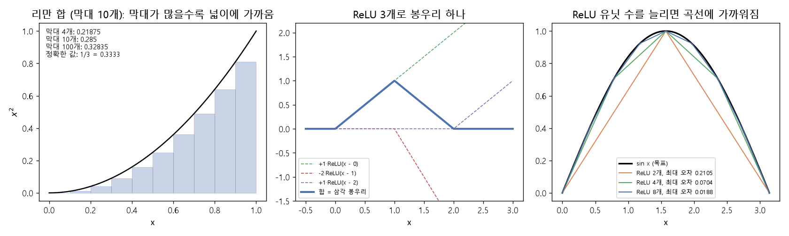

# 리만 합과 보편 근사 (Riemann sum, Universal approximation)

[목차로 돌아가기](../../00_MIT%EB%94%A5%EB%9F%AC%EB%8B%9D_%EB%AA%A9%EC%B0%A8.md) · 먼저 볼 것: [M02_시그마와_평균](../../%EC%88%98%ED%95%99%EA%B0%9C%EB%85%90/01_%EC%88%98%EC%99%80_%ED%95%A8%EC%88%98/M02_%EC%8B%9C%EA%B7%B8%EB%A7%88%EC%99%80_%ED%8F%89%EA%B7%A0.md), [MM06_합성함수와_비선형성](../../%EC%88%98%ED%95%99%EA%B0%9C%EB%85%90/05_%EC%8B%A0%EA%B2%BD%EB%A7%9D%EC%9D%98_%EA%B3%84%EC%82%B0/MM06_%ED%95%A9%EC%84%B1%ED%95%A8%EC%88%98%EC%99%80_%EB%B9%84%EC%84%A0%ED%98%95%EC%84%B1.md), [MM84_삼각함수와_단위원](../../%EC%88%98%ED%95%99%EA%B0%9C%EB%85%90/01_%EC%88%98%EC%99%80_%ED%95%A8%EC%88%98/MM84_%EC%82%BC%EA%B0%81%ED%95%A8%EC%88%98%EC%99%80_%EB%8B%A8%EC%9C%84%EC%9B%90.md), [MM86_정적분과_넓이](../../%EC%88%98%ED%95%99%EA%B0%9C%EB%85%90/02_%EB%AF%B8%EB%B6%84/MM86_%EC%A0%95%EC%A0%81%EB%B6%84%EA%B3%BC_%EB%84%93%EC%9D%B4.md) · 쓰는 곳: [Lec01 6.1 근사 이론](../../Lec01_%EB%94%A5%EB%9F%AC%EB%8B%9D_%EC%86%8C%EA%B0%9C.md#61-%EA%B7%BC%EC%82%AC-%EC%9D%B4%EB%A1%A0-%EB%AC%B4%EC%97%87%EC%9D%84-%ED%91%9C%ED%98%84%ED%95%A0-%EC%88%98-%EC%9E%88%EB%82%98)

📚 학습 순서 45/99 (6. 근사 이론): ← 이전: [MM32_층_정규화](../../%EC%88%98%ED%95%99%EA%B0%9C%EB%85%90/05_%EC%8B%A0%EA%B2%BD%EB%A7%9D%EC%9D%98_%EA%B3%84%EC%82%B0/MM32_%EC%B8%B5_%EC%A0%95%EA%B7%9C%ED%99%94.md) · 다음: [MM12_직사각형_근사와_차원의_저주](../../%EC%88%98%ED%95%99%EA%B0%9C%EB%85%90/06_%EA%B7%BC%EC%82%AC_%EC%9D%B4%EB%A1%A0/MM12_%EC%A7%81%EC%82%AC%EA%B0%81%ED%98%95_%EA%B7%BC%EC%82%AC%EC%99%80_%EC%B0%A8%EC%9B%90%EC%9D%98_%EC%A0%80%EC%A3%BC.md) →

> [!NOTE]
> **3줄 요약**
> - **[리만 합](../../00_%EB%94%A5%EB%9F%AC%EB%8B%9D_%EC%9A%A9%EC%96%B4%EC%82%AC%EC%A0%84.md#riemann-sum-%EB%A6%AC%EB%A7%8C-%ED%95%A9)**은 곡선 아래 넓이를 좁은 직사각형 막대의 넓이 합으로 어림하는 방법이다. 막대를 늘릴수록 정확해진다. $x^2$의 0~1 넓이(1/3)를 막대 10개로 어림하면 0.285, 100개면 0.32835.
> - [ReLU](../../00_%EB%94%A5%EB%9F%AC%EB%8B%9D_%EC%9A%A9%EC%96%B4%EC%82%AC%EC%A0%84.md#relu-%EB%A0%90%EB%A3%A8) 몇 개를 더하고 빼면 **꺾인 선**이 되고, [ReLU](../../00_%EB%94%A5%EB%9F%AC%EB%8B%9D_%EC%9A%A9%EC%96%B4%EC%82%AC%EC%A0%84.md#relu-%EB%A0%90%EB%A3%A8) 3개면 **삼각 봉우리** 하나가 된다. 봉우리나 꺾인 선을 촘촘히 이으면 어떤 곡선이든 따라갈 수 있다.
> - 그래서 [은닉층](../../00_%EB%94%A5%EB%9F%AC%EB%8B%9D_%EC%9A%A9%EC%96%B4%EC%82%AC%EC%A0%84.md#hidden-layer-%EC%9D%80%EB%8B%89%EC%B8%B5)이 충분히 넓은 2층 망은 이론상 어떤 연속 함수든 원하는 만큼 가깝게 근사할 수 있다(**[보편 근사](../../00_%EB%94%A5%EB%9F%AC%EB%8B%9D_%EC%9A%A9%EC%96%B4%EC%82%AC%EC%A0%84.md#universal-approximation-%EB%B3%B4%ED%8E%B8-%EA%B7%BC%EC%82%AC)**). 다만 "충분히 넓다"가 비현실적으로 클 수 있어서, 실제로는 깊게 쌓는 편이 효율적이다.

## 1. 개념 설명

비유: 레고 블록으로 곡선 모양 언덕을 만든다. 큰 블록 몇 개로는 계단처럼 울퉁불퉁하지만, 블록을 잘게 쪼갤수록 매끈한 곡선에 가까워진다. 블록이 [리만 합](../../00_%EB%94%A5%EB%9F%AC%EB%8B%9D_%EC%9A%A9%EC%96%B4%EC%82%AC%EC%A0%84.md#riemann-sum-%EB%A6%AC%EB%A7%8C-%ED%95%A9)의 막대이고, 신경망에서는 은닉 유닛 하나하나가 블록 역할을 한다.

- **[리만 합](../../00_%EB%94%A5%EB%9F%AC%EB%8B%9D_%EC%9A%A9%EC%96%B4%EC%82%AC%EC%A0%84.md#riemann-sum-%EB%A6%AC%EB%A7%8C-%ED%95%A9)**: 구간 $[a, b]$를 $n$칸으로 나누고, 칸마다 높이 $f(x_i)$, 너비 $\Delta x = \frac{b-a}{n}$인 막대를 세워 넓이를 더한다.
$$\sum_{i=0}^{n-1} f(x_i)\,\Delta x$$

<details><summary>기호 풀이</summary>

| 기호 | 읽는 법 | 뜻 | 예제 값 |
| --- | --- | --- | --- |
| $\sum_{i=0}^{n-1}$ | 시그마 아이는 0부터 엔 빼기 1까지 | 막대 n개의 넓이를 모두 더함 | 4개 항의 합 |
| $i$ | 아이 | 막대 번호 (0부터 셈) | 0, 1, 2, 3 |
| $n$ | 엔 | 막대 수 (은닉 유닛 수에 해당) | 4 |
| $x_i$ | 엑스 아이 | i번째 칸의 왼쪽 끝 | 0, 0.25, 0.5, 0.75 |
| $f(x_i)$ | 에프 엑스 아이 | i번째 막대의 높이 | $f(0.75) = 0.75$ |
| $\Delta x$ | 델타 엑스 | 막대 하나의 너비 $\frac{b-a}{n}$ | 0.25 |

</details>

<details><summary>예제와 풀이</summary>

**문제**: 직선 $f(x) = x$ 아래의 넓이를 구간 0~1에서 막대 4개(높이는 각 칸의 왼쪽 끝 값)로 어림하면 얼마이고, 정확한 넓이 0.5와 얼마나 다른가?

**주어진 값**:
- $f(x) = x$ (막대 높이를 정하는 함수)
- $a = 0,\ b = 1$ (구간의 왼쪽 끝과 오른쪽 끝)
- $n = 4$ (막대 수)
- $x_i = a + i\,\Delta x$ (i번째 칸의 왼쪽 끝)
- 정확한 넓이 0.5 (밑변 1, 높이 1인 삼각형 넓이 1 × 1 ÷ 2)

**풀이**
1. 식을 그대로 쓴다: $\sum_{i=0}^{n-1} f(x_i)\,\Delta x$, 여기서 $\Delta x = \frac{b-a}{n}$
2. 값을 대입한다: $\sum_{i=0}^{3} f(x_i) \times \frac{1 - 0}{4}$
3. 막대 너비를 구한다: (1 − 0) ÷ 4 = 0.25 이므로 $\sum_{i=0}^{3} f(x_i) \times 0.25$
4. 왼쪽 끝을 구한다 (0.25씩 더함): $x_0 = 0,\ x_1 = 0.25,\ x_2 = 0.5,\ x_3 = 0.75$
5. Σ를 네 항으로 펼친다: $f(0) \times 0.25 + f(0.25) \times 0.25 + f(0.5) \times 0.25 + f(0.75) \times 0.25$
6. f(x) = x라서 높이는 x 그대로다: $0 \times 0.25 + 0.25 \times 0.25 + 0.5 \times 0.25 + 0.75 \times 0.25$
7. 곱셈을 한다 (막대 넓이 4개): 0 + 0.0625 + 0.125 + 0.1875
8. 더한다: 0 + 0.0625 + 0.125 + 0.1875 = 0.375
9. 정확한 넓이와의 차이를 뺄셈으로 구한다: 0.5 − 0.375 = 0.125

**답**: 넓이 합 0.375, 정확한 값 0.5보다 0.125 작다 (왼쪽 끝 높이라 막대가 직선 아래에 놓인다)

</details>

<details><summary>내 이해</summary>


</details>

- **[ReLU](../../00_%EB%94%A5%EB%9F%AC%EB%8B%9D_%EC%9A%A9%EC%96%B4%EC%82%AC%EC%A0%84.md#relu-%EB%A0%90%EB%A3%A8) 봉우리**: $\mathrm{ReLU}(x) - 2\,\mathrm{ReLU}(x-1) + \mathrm{ReLU}(x-2)$는 0에서 올라가 1에서 꼭짓점(높이 1)을 찍고 2에서 다시 0이 되는 삼각형이다.
- **[보편 근사](../../00_%EB%94%A5%EB%9F%AC%EB%8B%9D_%EC%9A%A9%EC%96%B4%EC%82%AC%EC%A0%84.md#universal-approximation-%EB%B3%B4%ED%8E%B8-%EA%B7%BC%EC%82%AC)(Universal approximation)**: 막대 대신 이런 봉우리나 꺾인 선을 은닉 유닛으로 만들어 쌓으면, 유닛 수를 늘리는 만큼 목표 곡선에 가까워진다.

## 2. 필요한 이유

[Lec01 6.1](../../Lec01_%EB%94%A5%EB%9F%AC%EB%8B%9D_%EC%86%8C%EA%B0%9C.md#61-%EA%B7%BC%EC%82%AC-%EC%9D%B4%EB%A1%A0-%EB%AC%B4%EC%97%87%EC%9D%84-%ED%91%9C%ED%98%84%ED%95%A0-%EC%88%98-%EC%9E%88%EB%82%98)에서 강사는 "2층 이상이면 이론적으로 어떤 함수든 표현할 수 있다"를 [리만 합](../../00_%EB%94%A5%EB%9F%AC%EB%8B%9D_%EC%9A%A9%EC%96%B4%EC%82%AC%EC%A0%84.md#riemann-sum-%EB%A6%AC%EB%A7%8C-%ED%95%A9) 그림으로 설명하고, 이것이 "엄밀한 증명이 아닌 직관"이라고 밝힌다. 이 노트는 그 직관을 숫자로 확인한다. 엄밀한 이론은 3강(근사 이론)에서 다룬다.

## 3. 숫자로 보기

### 3.1 리만 합: $\int_0^1 x^2\,dx = \frac{1}{3}$ 어림하기

막대 높이는 각 칸의 **왼쪽 끝** 값으로 정한다.

| 막대 수 $n$ | 막대 너비 | 계산 | 넓이 합 | 1/3과의 차이 |
|---|---|---|---|---|
| 4 | 0.25 | $(0 + 0.0625 + 0.25 + 0.5625) × 0.25$ | 0.21875 | 0.1146 |
| 10 | 0.1 | 막대 10개의 합 | 0.285 | 0.0483 |
| 100 | 0.01 | 막대 100개의 합 | 0.32835 | 0.0050 |

- 막대를 10배 늘리면 [오차](../../00_%EB%94%A5%EB%9F%AC%EB%8B%9D_%EC%9A%A9%EC%96%B4%EC%82%AC%EC%A0%84.md#error-%EC%98%A4%EC%B0%A8)가 대략 10분의 1로 준다.

### 3.2 ReLU 3개로 봉우리 하나

$\mathrm{bump}(x) = \mathrm{ReLU}(x) - 2\,\mathrm{ReLU}(x-1) + \mathrm{ReLU}(x-2)$

| $x$ | [ReLU](../../00_%EB%94%A5%EB%9F%AC%EB%8B%9D_%EC%9A%A9%EC%96%B4%EC%82%AC%EC%A0%84.md#relu-%EB%A0%90%EB%A3%A8)(x) | −2·[ReLU](../../00_%EB%94%A5%EB%9F%AC%EB%8B%9D_%EC%9A%A9%EC%96%B4%EC%82%AC%EC%A0%84.md#relu-%EB%A0%90%EB%A3%A8)(x−1) | [ReLU](../../00_%EB%94%A5%EB%9F%AC%EB%8B%9D_%EC%9A%A9%EC%96%B4%EC%82%AC%EC%A0%84.md#relu-%EB%A0%90%EB%A3%A8)(x−2) | 합 |
|---|---|---|---|---|
| 0 | 0 | 0 | 0 | **0** |
| 0.5 | 0.5 | 0 | 0 | **0.5** |
| 1 | 1 | 0 | 0 | **1** |
| 1.5 | 1.5 | −1 | 0 | **0.5** |
| 2 | 2 | −2 | 0 | **0** |
| 3 | 3 | −4 | 1 | **0** |

- 0~1에서는 첫 [ReLU](../../00_%EB%94%A5%EB%9F%AC%EB%8B%9D_%EC%9A%A9%EC%96%B4%EC%82%AC%EC%A0%84.md#relu-%EB%A0%90%EB%A3%A8)만 켜져 [기울기](../../00_%EB%94%A5%EB%9F%AC%EB%8B%9D_%EC%9A%A9%EC%96%B4%EC%82%AC%EC%A0%84.md#gradient-%EA%B8%B0%EC%9A%B8%EA%B8%B0) +1로 올라간다.
- 1~2에서는 둘째 [ReLU](../../00_%EB%94%A5%EB%9F%AC%EB%8B%9D_%EC%9A%A9%EC%96%B4%EC%82%AC%EC%A0%84.md#relu-%EB%A0%90%EB%A3%A8)가 켜져 [기울기](../../00_%EB%94%A5%EB%9F%AC%EB%8B%9D_%EC%9A%A9%EC%96%B4%EC%82%AC%EC%A0%84.md#gradient-%EA%B8%B0%EC%9A%B8%EA%B8%B0)가 $1 - 2 = -1$로 바뀐다.
- 2 이후에는 셋째도 켜져 [기울기](../../00_%EB%94%A5%EB%9F%AC%EB%8B%9D_%EC%9A%A9%EC%96%B4%EC%82%AC%EC%A0%84.md#gradient-%EA%B8%B0%EC%9A%B8%EA%B8%B0)가 $1 - 2 + 1 = 0$, 평평해진다.

### 3.3 ReLU를 늘려 $\sin x$ 따라가기 ($0 \le x \le \pi$)

구간을 $n$칸으로 나눠 칸 끝점을 직선으로 이은 꺾인 선은 [ReLU](../../00_%EB%94%A5%EB%9F%AC%EB%8B%9D_%EC%9A%A9%EC%96%B4%EC%82%AC%EC%A0%84.md#relu-%EB%A0%90%EB%A3%A8) $n$개의 합으로 정확히 쓸 수 있다. 꺾이는 곳마다 [ReLU](../../00_%EB%94%A5%EB%9F%AC%EB%8B%9D_%EC%9A%A9%EC%96%B4%EC%82%AC%EC%A0%84.md#relu-%EB%A0%90%EB%A3%A8) 하나가 [기울기](../../00_%EB%94%A5%EB%9F%AC%EB%8B%9D_%EC%9A%A9%EC%96%B4%EC%82%AC%EC%A0%84.md#gradient-%EA%B8%B0%EC%9A%B8%EA%B8%B0)를 바꿔 주기 때문이다.

| [ReLU](../../00_%EB%94%A5%EB%9F%AC%EB%8B%9D_%EC%9A%A9%EC%96%B4%EC%82%AC%EC%A0%84.md#relu-%EB%A0%90%EB%A3%A8) 수 (칸 수) | 최대 [오차](../../00_%EB%94%A5%EB%9F%AC%EB%8B%9D_%EC%9A%A9%EC%96%B4%EC%82%AC%EC%A0%84.md#error-%EC%98%A4%EC%B0%A8) |
|---|---|
| 2 | 0.2105 |
| 4 | 0.0704 |
| 8 | 0.0188 |
| 16 | 0.0048 |

- 칸을 두 배로 늘리면 [오차](../../00_%EB%94%A5%EB%9F%AC%EB%8B%9D_%EC%9A%A9%EC%96%B4%EC%82%AC%EC%A0%84.md#error-%EC%98%A4%EC%B0%A8)가 약 4분의 1로 준다.
- $n = 2$일 때 식은 $0.6366\,\mathrm{ReLU}(x) - 1.2732\,\mathrm{ReLU}(x - \pi/2)$다. $x = \pi/2$에서 1(정확), $x = \pi/4$에서 0.5($\sin = 0.7071$)다.



<details><summary>기호 풀이</summary>

| 기호 | 읽는 법 | 뜻 | 예제 값 |
| --- | --- | --- | --- |
| $\int_0^1 x^2\,dx$ | 인테그럴 영에서 일 | 0~1에서 $x^2$ 아래 넓이 | 1/3 |
| $n$ | 엔 | 막대 수 (은닉 유닛 수에 해당) | 10 |
| $\Delta x$ | 델타 엑스 | 막대 하나의 너비 | 0.1 |
| $f(x_i)$ | 에프 엑스 아이 | i번째 막대의 높이 | - |
| $\mathrm{ReLU}(x - t)$ | [렐루](../../00_%EB%94%A5%EB%9F%AC%EB%8B%9D_%EC%9A%A9%EC%96%B4%EC%82%AC%EC%A0%84.md#relu-%EB%A0%90%EB%A3%A8) 엑스 빼기 티 | $x = t$부터 켜지는 경사로 | - |
| 최대 [오차](../../00_%EB%94%A5%EB%9F%AC%EB%8B%9D_%EC%9A%A9%EC%96%B4%EC%82%AC%EC%A0%84.md#error-%EC%98%A4%EC%B0%A8) | - | 근사한 선과 목표 곡선의 가장 큰 차이 | 0.0188 |

</details>

## 4. 코드로 확인

```python
# [함수] import: NumPy를 np로 불러온다. np.arange, np.linspace, np.interp, np.sin이 여기서 온다
import numpy as np

# [함수] np.maximum(0, z): ReLU. [변수] relu: 봉우리와 꺾인 선을 만들 부품
relu = lambda z: np.maximum(0, z)
# [변수] n: 막대 수. 4, 10, 100으로 늘리며 정확도가 어떻게 바뀌는지 보려고 되풀이한다
for n in (4, 10, 100):
    # [함수] np.arange(n) / n: 0, 1/n, 2/n, ... 칸 n개의 왼쪽 끝
    # [변수] xs: 막대마다 높이를 잴 위치 (왼쪽 끝)
    xs = np.arange(n) / n
    # [함수] .sum(): 모든 막대 높이의 합. / n은 막대 너비 1/n을 곱하는 것
    # [연결] 리만 합 Σ f(xᵢ)Δx (본문 1절) → 0.21875, 0.285, 0.32835 (본문 3.1 표)
    print(n, round((xs ** 2).sum() / n, 5))

# [변수] bump: ReLU 3개로 만든 삼각 봉우리. 0에서 올라가 1에서 꼭짓점, 2에서 0
# [연결] 본문 3.2 표, 은닉 유닛 3개짜리 층 하나와 같은 모양
bump = lambda x: relu(x) - 2 * relu(x - 1) + relu(x - 2)
# [함수] [... for v in ...]: 여러 x에서 bump를 계산해 목록으로 모은다. float: 숫자 하나로 바꿔 깔끔히 출력
# [연결] → [0.0, 0.5, 1.0, 0.5, 0.0, 0.0]
print([float(bump(v)) for v in (0, 0.5, 1, 1.5, 2, 3)])

# [함수] np.linspace(0, π, 10001): 0~π를 촘촘히 나눈 점 10001개
# [변수] grid: 오차를 잴 위치. 촘촘해야 최대 오차를 놓치지 않는다
grid = np.linspace(0, np.pi, 10001)
# [변수] n: 꺾인 선의 칸 수 = ReLU 수. 2배씩 늘려 오차 변화를 본다
for n in (2, 4, 8, 16):
    # [변수] t: 꺾이는 점 n+1개 (칸의 경계)
    t = np.linspace(0, np.pi, n + 1)
    # [함수] np.interp: 점 (t, sin t)들을 직선으로 이은 값을 grid에서 계산한다
    # [변수] approx: 꺾인 선 = ReLU n개의 합으로 쓸 수 있는 근사 (본문 3.3)
    approx = np.interp(grid, t, np.sin(t))
    # [함수] np.abs(...).max(): 차이의 절댓값 중 가장 큰 것 = 최대 오차
    # [연결] → 0.2105, 0.0704, 0.0188, 0.0048: 칸 2배에 오차 약 4분의 1 (보편 근사의 직관, Lec01 6.1)
    print(n, round(np.abs(approx - np.sin(grid)).max(), 4))
```

**실행 결과**:

```text
4 0.21875
10 0.285
100 0.32835
[0.0, 0.5, 1.0, 0.5, 0.0, 0.0]
2 0.2105
4 0.0704
8 0.0188
16 0.0048
```

> [!WARNING]
> **⚠ 주의**
> - [보편 근사](../../00_%EB%94%A5%EB%9F%AC%EB%8B%9D_%EC%9A%A9%EC%96%B4%EC%82%AC%EC%A0%84.md#universal-approximation-%EB%B3%B4%ED%8E%B8-%EA%B7%BC%EC%82%AC)는 "**표현할 수 있는** [가중치](../../00_%EB%94%A5%EB%9F%AC%EB%8B%9D_%EC%9A%A9%EC%96%B4%EC%82%AC%EC%A0%84.md#weight-%EA%B0%80%EC%A4%91%EC%B9%98)가 존재한다"는 말이다. [학습](../../00_%EB%94%A5%EB%9F%AC%EB%8B%9D_%EC%9A%A9%EC%96%B4%EC%82%AC%EC%A0%84.md#training-%ED%95%99%EC%8A%B5)([경사하강법](../../00_%EB%94%A5%EB%9F%AC%EB%8B%9D_%EC%9A%A9%EC%96%B4%EC%82%AC%EC%A0%84.md#gradient-descent-%EA%B2%BD%EC%82%AC%ED%95%98%EA%B0%95%EB%B2%95))으로 그 [가중치](../../00_%EB%94%A5%EB%9F%AC%EB%8B%9D_%EC%9A%A9%EC%96%B4%EC%82%AC%EC%A0%84.md#weight-%EA%B0%80%EC%A4%91%EC%B9%98)를 **찾을 수 있다**는 보장이나, [학습 데이터](../../00_%EB%94%A5%EB%9F%AC%EB%8B%9D_%EC%9A%A9%EC%96%B4%EC%82%AC%EC%A0%84.md#training-data-test-data-%ED%95%99%EC%8A%B5-%EB%8D%B0%EC%9D%B4%ED%84%B0%EC%99%80-%EC%8B%9C%ED%97%98-%EB%8D%B0%EC%9D%B4%ED%84%B0) 밖에서 잘 맞는다([일반화](../../00_%EB%94%A5%EB%9F%AC%EB%8B%9D_%EC%9A%A9%EC%96%B4%EC%82%AC%EC%A0%84.md#generalization-%EC%9D%BC%EB%B0%98%ED%99%94))는 보장은 아니다.
> - 1차원에서 [오차](../../00_%EB%94%A5%EB%9F%AC%EB%8B%9D_%EC%9A%A9%EC%96%B4%EC%82%AC%EC%A0%84.md#error-%EC%98%A4%EC%B0%A8)를 반으로 줄이는 데 유닛이 약 1.4배 필요하지만, 입력 차원이 커지면 필요한 유닛 수가 급격히 늘어난다. 강의에서 "넓은 2층보다 좁고 깊은 망이 효율적"이라고 한 이유와 이어진다.

## 5. 개념 재확인

<details><summary>1. $\mathrm{bump}(x) = \mathrm{ReLU}(x) - 2\,\mathrm{ReLU}(x-1) + \mathrm{ReLU}(x-2)$에서 $x = 0.25$와 $x = 1.75$의 값은?</summary>

| 단계 | 하는 일 | 계산 | 결과 |
|---|---|---|---|
| 1 | $x = 0.25$의 세 [ReLU](../../00_%EB%94%A5%EB%9F%AC%EB%8B%9D_%EC%9A%A9%EC%96%B4%EC%82%AC%EC%A0%84.md#relu-%EB%A0%90%EB%A3%A8) | 0.25, 0, 0 | - |
| 2 | 합 | 0.25 − 0 + 0 | 0.25 |
| 3 | $x = 1.75$의 세 [ReLU](../../00_%EB%94%A5%EB%9F%AC%EB%8B%9D_%EC%9A%A9%EC%96%B4%EC%82%AC%EC%A0%84.md#relu-%EB%A0%90%EB%A3%A8) | 1.75, 0.75, 0 | - |
| 4 | 합 | 1.75 − 2×0.75 + 0 | 0.25 |

**① 쓰는 식**
$$\mathrm{bump}(x) = \mathrm{ReLU}(x) - 2\,\mathrm{ReLU}(x-1) + \mathrm{ReLU}(x-2), \qquad \mathrm{ReLU}(z) = \max(0, z)$$
- 위 식 ← ② ($x = 0.25$의 세 [ReLU](../../00_%EB%94%A5%EB%9F%AC%EB%8B%9D_%EC%9A%A9%EC%96%B4%EC%82%AC%EC%A0%84.md#relu-%EB%A0%90%EB%A3%A8))와 ③ (합), ④ ($x = 1.75$의 세 [ReLU](../../00_%EB%94%A5%EB%9F%AC%EB%8B%9D_%EC%9A%A9%EC%96%B4%EC%82%AC%EC%A0%84.md#relu-%EB%A0%90%EB%A3%A8))와 ⑤ (합)에서 쓴다.
```python
# [변수] relu: ReLU, bump: ReLU 3개로 만든 봉우리 (① 쓰는 식 그대로)
relu = lambda z: np.maximum(0, z)
bump = lambda x: relu(x) - 2 * relu(x - 1) + relu(x - 2)
# [연결] 단계 ② x = 0.25에서 세 ReLU 각각 → 0.25 0.0 0.0 (첫째만 켜짐)
print(relu(0.25), relu(0.25 - 1), relu(0.25 - 2))     # ②
# [연결] 단계 ③ 합 → 0.25 (올라가는 쪽)
print(bump(0.25))                                      # ③
# [연결] 단계 ④ x = 1.75에서 세 ReLU → 1.75 0.75 0.0 (둘째까지 켜짐)
print(relu(1.75), relu(1.75 - 1), relu(1.75 - 2))     # ④
# [연결] 단계 ⑤ 합 1.75 - 2×0.75 → 0.25 (내려가는 쪽, 좌우 대칭)
print(bump(1.75))                                      # ⑤
```

**주어진 값**
- $\mathrm{bump}(x) = \mathrm{ReLU}(x) - 2\,\mathrm{ReLU}(x-1) + \mathrm{ReLU}(x-2)$ (봉우리 식)
- $\mathrm{ReLU}(z) = \max(0, z)$ (z가 0보다 작으면 0, 아니면 z)
- $x = 0.25$, $x = 1.75$ (두 입력)

**② $x = 0.25$의 세 [ReLU](../../00_%EB%94%A5%EB%9F%AC%EB%8B%9D_%EC%9A%A9%EC%96%B4%EC%82%AC%EC%A0%84.md#relu-%EB%A0%90%EB%A3%A8)**
1. 식을 그대로 쓴다: 세 항은 $\mathrm{ReLU}(x)$, $\mathrm{ReLU}(x-1)$, $\mathrm{ReLU}(x-2)$
2. 값을 대입한다: $\mathrm{ReLU}(0.25)$, $\mathrm{ReLU}(0.25 - 1)$, $\mathrm{ReLU}(0.25 - 2)$
3. 괄호 안을 계산한다: 0.25 − 1 = −0.75, 0.25 − 2 = −1.75 이므로 $\mathrm{ReLU}(0.25)$, $\mathrm{ReLU}(-0.75)$, $\mathrm{ReLU}(-1.75)$
4. [ReLU](../../00_%EB%94%A5%EB%9F%AC%EB%8B%9D_%EC%9A%A9%EC%96%B4%EC%82%AC%EC%A0%84.md#relu-%EB%A0%90%EB%A3%A8)를 적용한다 (음수는 0): $0.25,\ 0,\ 0$

**③ 합**
1. 식을 그대로 쓴다: $\mathrm{bump}(x) = \mathrm{ReLU}(x) - 2\,\mathrm{ReLU}(x-1) + \mathrm{ReLU}(x-2)$
2. 값을 대입한다: $\mathrm{bump}(0.25) = 0.25 - 2 \times 0 + 0$
3. 곱셈을 한다: 2 × 0 = 0 이므로 $0.25 - 0 + 0$
4. 계산한다: 0.25 − 0 + 0 = 0.25 (올라가는 쪽)

**④ $x = 1.75$의 세 [ReLU](../../00_%EB%94%A5%EB%9F%AC%EB%8B%9D_%EC%9A%A9%EC%96%B4%EC%82%AC%EC%A0%84.md#relu-%EB%A0%90%EB%A3%A8)**
1. 식을 그대로 쓴다: $\mathrm{ReLU}(x)$, $\mathrm{ReLU}(x-1)$, $\mathrm{ReLU}(x-2)$
2. 값을 대입한다: $\mathrm{ReLU}(1.75)$, $\mathrm{ReLU}(1.75 - 1)$, $\mathrm{ReLU}(1.75 - 2)$
3. 괄호 안을 계산한다: 1.75 − 1 = 0.75, 1.75 − 2 = −0.25 이므로 $\mathrm{ReLU}(1.75)$, $\mathrm{ReLU}(0.75)$, $\mathrm{ReLU}(-0.25)$
4. [ReLU](../../00_%EB%94%A5%EB%9F%AC%EB%8B%9D_%EC%9A%A9%EC%96%B4%EC%82%AC%EC%A0%84.md#relu-%EB%A0%90%EB%A3%A8)를 적용한다: $1.75,\ 0.75,\ 0$

**⑤ 합**
1. 식을 그대로 쓴다: $\mathrm{bump}(x) = \mathrm{ReLU}(x) - 2\,\mathrm{ReLU}(x-1) + \mathrm{ReLU}(x-2)$
2. 값을 대입한다: $\mathrm{bump}(1.75) = 1.75 - 2 \times 0.75 + 0$
3. 곱셈을 한다: 2 × 0.75 = 1.5 이므로 $1.75 - 1.5 + 0$
4. 계산한다: 1.75 − 1.5 + 0 = 0.25 (내려가는 쪽)

**답**: 둘 다 **0.25**. 봉우리가 $x = 1$을 중심으로 좌우 대칭이기 때문이다.

</details>

<details><summary>2. $\int_0^1 x^2\,dx$를 막대 2개(왼쪽 끝 높이)로 어림하면? 막대 4개일 때(0.21875)보다 정확한가?</summary>

| 단계 | 하는 일 | 계산 | 결과 |
|---|---|---|---|
| 1 | 막대 너비 | $1 ÷ 2$ | 0.5 |
| 2 | 왼쪽 끝 | 0, 0.5 | - |
| 3 | 높이 | $0^2$, $0.5^2$ | 0, 0.25 |
| 4 | 넓이 합 | $(0 + 0.25) × 0.5$ | 0.125 |
| 5 | 1/3과 비교 | 0.3333 − 0.125 | 0.2083 |

**① 쓰는 식**
$$\sum_{i=0}^{n-1} f(x_i)\,\Delta x, \qquad \Delta x = \frac{1}{n}, \quad x_i = \frac{i}{n}$$
- 위 식 ← $\Delta x$는 ② (막대 너비), $x_i$는 ③ (왼쪽 끝), $f(x_i)$는 ④ (높이), 합은 ⑤ (넓이 합)에서 쓰고 ⑥ (비교)에서 [오차](../../00_%EB%94%A5%EB%9F%AC%EB%8B%9D_%EC%9A%A9%EC%96%B4%EC%82%AC%EC%A0%84.md#error-%EC%98%A4%EC%B0%A8)를 잰다.
```python
# [변수] n = 2: 막대 수. 문제에서 준 값
n = 2                                    # ①
# [변수] dx = 0.5: 막대 하나의 너비 Δx = 1/n
dx = 1 / n                               # ②
# [함수] np.arange(n) / n: 칸의 왼쪽 끝들. [변수] xs = [0.  0.5]
xs = np.arange(n) / n                    # ③
# [변수] h = [0.   0.25]: 막대 높이 f(xᵢ) = xᵢ²
h = xs ** 2                              # ④
# [함수] (h * dx).sum(): 막대 넓이(높이 × 너비)를 모두 더함. [변수] area = 0.125
area = (h * dx).sum()                    # ⑤
# [연결] 단계 ⑥ 정확한 값 1/3과의 차이 → 0.125 0.2083 (막대 4개의 0.1146보다 큼)
print(area, round(1 / 3 - area, 4))      # ⑥
```

**주어진 값**
- $f(x) = x^2$ (막대 높이를 정하는 함수)
- $a = 0,\ b = 1$ (구간), $n = 2$ (막대 수)
- 정확한 넓이 $\frac{1}{3} \approx 0.3333$

**② 막대 너비**
1. 식을 그대로 쓴다: $\Delta x = \frac{b-a}{n}$
2. 값을 대입한다: $\Delta x = \frac{1 - 0}{2}$
3. 뺄셈을 한다: 1 − 0 = 1 이므로 $\Delta x = \frac{1}{2}$
4. 나눗셈을 한다: 1 ÷ 2 = 0.5

**③ 왼쪽 끝**
1. 식을 그대로 쓴다: $x_i = a + i\,\Delta x$ (i = 0, 1)
2. 값을 대입한다: $x_0 = 0 + 0 \times 0.5$, $x_1 = 0 + 1 \times 0.5$
3. 곱셈과 덧셈을 한다: $x_0 = 0$, $x_1 = 0.5$

**④ 높이**
1. 식을 그대로 쓴다: $f(x_i) = x_i^2$
2. 값을 대입한다: $f(0) = 0^2$, $f(0.5) = 0.5^2$
3. 거듭제곱을 한다: $0^2 = 0$, $0.5^2 = 0.5 \times 0.5 = 0.25$

**⑤ 넓이 합**
1. 식을 그대로 쓴다: $\sum_{i=0}^{n-1} f(x_i)\,\Delta x$
2. 값을 대입한다: $\sum_{i=0}^{1} f(x_i) \times 0.5$
3. Σ를 두 항으로 펼친다: $f(0) \times 0.5 + f(0.5) \times 0.5$
4. 높이를 넣는다: $0 \times 0.5 + 0.25 \times 0.5$
5. 곱셈을 한다: 0 × 0.5 = 0, 0.25 × 0.5 = 0.125 이므로 $0 + 0.125$
6. 더한다: 0 + 0.125 = 0.125

**⑥ 비교**
1. 식을 쓴다: [오차](../../00_%EB%94%A5%EB%9F%AC%EB%8B%9D_%EC%9A%A9%EC%96%B4%EC%82%AC%EC%A0%84.md#error-%EC%98%A4%EC%B0%A8) = 정확한 값 − 어림값
2. 값을 대입한다: $\frac{1}{3} - 0.125$
3. 뺄셈을 한다: 0.3333 − 0.125 = 0.2083 (막대 4개의 [오차](../../00_%EB%94%A5%EB%9F%AC%EB%8B%9D_%EC%9A%A9%EC%96%B4%EC%82%AC%EC%A0%84.md#error-%EC%98%A4%EC%B0%A8) 0.1146보다 크다)

**답**: **0.125**. 막대 4개보다 덜 정확하다. 막대가 적을수록 곡선과 막대 사이 빈틈이 커진다.

</details>

## 예제 풀기

[예제 10문제 풀기](../../%EC%98%88%EC%A0%9C/06_%EA%B7%BC%EC%82%AC_%EC%9D%B4%EB%A1%A0/%EC%98%88%EC%A0%9C_MM07_%EB%A6%AC%EB%A7%8C_%ED%95%A9%EA%B3%BC_%EB%B3%B4%ED%8E%B8_%EA%B7%BC%EC%82%AC.md)

<details><summary>내 이해</summary>


</details>
