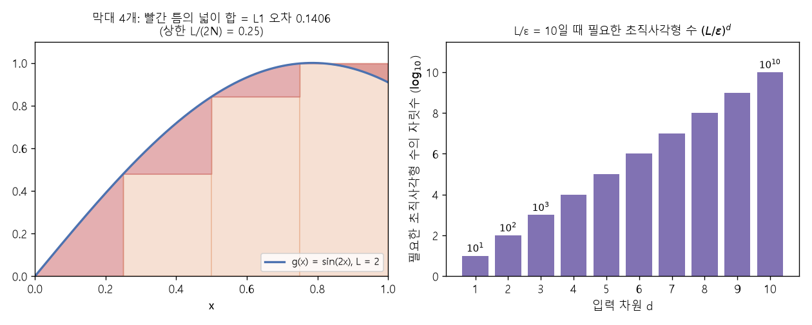

# 직사각형 근사와 차원의 저주 (Rectangle approximation, Curse of dimensionality)

[목차로 돌아가기](../../00_MIT%EB%94%A5%EB%9F%AC%EB%8B%9D_%EB%AA%A9%EC%B0%A8.md) · 먼저 볼 것: [MM07_리만_합과_보편_근사](../../%EC%88%98%ED%95%99%EA%B0%9C%EB%85%90/06_%EA%B7%BC%EC%82%AC_%EC%9D%B4%EB%A1%A0/MM07_%EB%A6%AC%EB%A7%8C_%ED%95%A9%EA%B3%BC_%EB%B3%B4%ED%8E%B8_%EA%B7%BC%EC%82%AC.md), [MM11_립시츠_연속과_노름](../../%EC%88%98%ED%95%99%EA%B0%9C%EB%85%90/03_%EC%84%A0%ED%98%95%EB%8C%80%EC%88%98/MM11_%EB%A6%BD%EC%8B%9C%EC%B8%A0_%EC%97%B0%EC%86%8D%EA%B3%BC_%EB%85%B8%EB%A6%84.md) · 쓰는 곳: [Lec03 7.1](../../Lec03_%EA%B7%BC%EC%82%AC_%EC%9D%B4%EB%A1%A0.md#71-1%EB%8B%A8%EA%B3%84-1%EC%B0%A8%EC%9B%90-%EC%A7%81%EC%82%AC%EA%B0%81%ED%98%95-%EB%A7%89%EB%8C%80), [Lec03 7.2](../../Lec03_%EA%B7%BC%EC%82%AC_%EC%9D%B4%EB%A1%A0.md#72-2%EB%8B%A8%EA%B3%84-%EA%B3%A0%EC%B0%A8%EC%9B%90-%EC%B4%88%EC%A7%81%EC%82%AC%EA%B0%81%ED%98%95)

📚 학습 순서 46/99 (6. 근사 이론): ← 이전: [MM07_리만_합과_보편_근사](../../%EC%88%98%ED%95%99%EA%B0%9C%EB%85%90/06_%EA%B7%BC%EC%82%AC_%EC%9D%B4%EB%A1%A0/MM07_%EB%A6%AC%EB%A7%8C_%ED%95%A9%EA%B3%BC_%EB%B3%B4%ED%8E%B8_%EA%B7%BC%EC%82%AC.md) · 다음: [MM13_ReLU로_만드는_직사각형](../../%EC%88%98%ED%95%99%EA%B0%9C%EB%85%90/06_%EA%B7%BC%EC%82%AC_%EC%9D%B4%EB%A1%A0/MM13_ReLU%EB%A1%9C_%EB%A7%8C%EB%93%9C%EB%8A%94_%EC%A7%81%EC%82%AC%EA%B0%81%ED%98%95.md) →

> [!NOTE]
> **3줄 요약**
> - [MM07](../../%EC%88%98%ED%95%99%EA%B0%9C%EB%85%90/06_%EA%B7%BC%EC%82%AC_%EC%9D%B4%EB%A1%A0/MM07_%EB%A6%AC%EB%A7%8C_%ED%95%A9%EA%B3%BC_%EB%B3%B4%ED%8E%B8_%EA%B7%BC%EC%82%AC.md)의 막대 근사에 **[오차](../../00_%EB%94%A5%EB%9F%AC%EB%8B%9D_%EC%9A%A9%EC%96%B4%EC%82%AC%EC%A0%84.md#error-%EC%98%A4%EC%B0%A8) 상한**을 붙인다. [기울기](../../00_%EB%94%A5%EB%9F%AC%EB%8B%9D_%EC%9A%A9%EC%96%B4%EC%82%AC%EC%A0%84.md#gradient-%EA%B8%B0%EC%9A%B8%EA%B8%B0)가 $L$ 이하인 함수를 0~1에서 막대 $N$개로 근사하면 [적분 오차](../../00_%EB%94%A5%EB%9F%AC%EB%8B%9D_%EC%9A%A9%EC%96%B4%EC%82%AC%EC%A0%84.md#l-error-l1-error-%EC%B5%9C%EB%8C%80-%EC%98%A4%EC%B0%A8%EC%99%80-%EC%A0%81%EB%B6%84-%EC%98%A4%EC%B0%A8)는 $\frac{L}{2N}$ 이하다. [오차](../../00_%EB%94%A5%EB%9F%AC%EB%8B%9D_%EC%9A%A9%EC%96%B4%EC%82%AC%EC%A0%84.md#error-%EC%98%A4%EC%B0%A8)를 $\varepsilon$ 이하로 만들려면 막대가 $N \ge \frac{L}{2\varepsilon}$개 필요하다(강의는 1/2을 버리고 $N \ge L/\varepsilon$).
> - 입력이 $d$차원이면 막대가 **[초직사각형](../../00_%EB%94%A5%EB%9F%AC%EB%8B%9D_%EC%9A%A9%EC%96%B4%EC%82%AC%EC%A0%84.md#hyperrectangle-%EC%B4%88%EC%A7%81%EC%82%AC%EA%B0%81%ED%98%95)([Hyperrectangle](../../00_%EB%94%A5%EB%9F%AC%EB%8B%9D_%EC%9A%A9%EC%96%B4%EC%82%AC%EC%A0%84.md#hyperrectangle-%EC%B4%88%EC%A7%81%EC%82%AC%EA%B0%81%ED%98%95))** 상자가 되고, 필요한 상자 수는 $(L/\varepsilon)^d$로 **차원에 지수적으로** 늘어난다. $L/\varepsilon = 10$이면 1차원 10개, 10차원 $10^{10}$개.
> - 이렇게 차원이 늘수록 필요한 양이 폭발하는 현상을 **[차원의 저주](../../00_%EB%94%A5%EB%9F%AC%EB%8B%9D_%EC%9A%A9%EC%96%B4%EC%82%AC%EC%A0%84.md#curse-of-dimensionality-%EC%B0%A8%EC%9B%90%EC%9D%98-%EC%A0%80%EC%A3%BC)(Curse of dimensionality)**라고 한다. 강의의 [보편 근사](../../00_%EB%94%A5%EB%9F%AC%EB%8B%9D_%EC%9A%A9%EC%96%B4%EC%82%AC%EC%A0%84.md#universal-approximation-%EB%B3%B4%ED%8E%B8-%EA%B7%BC%EC%82%AC) 정리가 실용적이지 않은 이유다.

## 1. 개념 설명

비유: 땅의 높낮이를 **블록**으로 본뜬다. 1차원(길 하나)이면 블록 10개로 충분해도, 2차원(넓은 땅)이면 가로 10 × 세로 10 = 100개, 3차원이면 1000개가 든다. 한 방향의 해상도를 지키려면 차원마다 10배씩 곱해진다.

- **막대 근사**: 0~1을 $N$칸으로 나누고 칸마다 왼쪽 끝 높이 $g(x_i)$의 막대를 세운다. 식으로는 **[지시 함수](../../00_%EB%94%A5%EB%9F%AC%EB%8B%9D_%EC%9A%A9%EC%96%B4%EC%82%AC%EC%A0%84.md#indicator-function-%EC%A7%80%EC%8B%9C-%ED%95%A8%EC%88%98)(Indicator function)** $\mathbb{1}_i(x)$(칸 $i$ 안이면 1, 밖이면 0)의 [가중합](../../00_%EB%94%A5%EB%9F%AC%EB%8B%9D_%EC%9A%A9%EC%96%B4%EC%82%AC%EC%A0%84.md#weighted-sum-%EA%B0%80%EC%A4%91%ED%95%A9)이다.
$$f(x) = \sum_{i=1}^{N} \alpha_i\,\mathbb{1}_i(x), \qquad \alpha_i = g(x_i)$$

<details><summary>기호 풀이</summary>

| 기호 | 읽는 법 | 뜻 | 예제 값 |
| --- | --- | --- | --- |
| $f(x)$ | 에프 엑스 | 막대 근사 함수 | $f(0.6) = 0.25$ |
| $N$ | 엔 | 막대(칸) 수 | 4 |
| $\sum_{i=1}^{N}$ | 시그마 아이는 1부터 엔까지 | 막대 $N$개를 모두 더함 | - |
| $\alpha_i$ | 알파 아이 | $i$번째 막대 높이 | $\alpha_3 = 0.25$ |
| $\mathbb{1}_i(x)$ | [지시 함수](../../00_%EB%94%A5%EB%9F%AC%EB%8B%9D_%EC%9A%A9%EC%96%B4%EC%82%AC%EC%A0%84.md#indicator-function-%EC%A7%80%EC%8B%9C-%ED%95%A8%EC%88%98) 아이 | [지시 함수](../../00_%EB%94%A5%EB%9F%AC%EB%8B%9D_%EC%9A%A9%EC%96%B4%EC%82%AC%EC%A0%84.md#indicator-function-%EC%A7%80%EC%8B%9C-%ED%95%A8%EC%88%98): 칸 $i$ 안이면 1, 밖이면 0 | $\mathbb{1}_3(0.6) = 1$ |
| $x_i$ | 엑스 아이 | 칸 $i$의 왼쪽 끝 | $x_3 = 0.5$ |
| $g$ | 지 | 목표 함수 | $g(x) = x^2$ |

</details>

<details><summary>예제와 풀이</summary>

**문제**: 목표 $g(x) = x^2$를 0~1에서 막대 4개(각 칸 왼쪽 끝 높이)로 근사하면, 입력 0.6에서 근사값은?

**주어진 값**:
- $g(x) = x^2$ (목표 함수)
- $N = 4$ (막대 수)
- $x = 0.6$ (입력)
- $x_i = 0,\ 0.25,\ 0.5,\ 0.75$ (칸 왼쪽 끝, 칸 너비 $1 \div 4 = 0.25$)

**풀이**
1. 식을 그대로 쓴다: $f(x) = \sum_{i=1}^{N} \alpha_i\,\mathbb{1}_i(x), \quad \alpha_i = g(x_i)$
2. 값을 대입한다: $f(0.6) = 0^2\,\mathbb{1}_1(0.6) + 0.25^2\,\mathbb{1}_2(0.6) + 0.5^2\,\mathbb{1}_3(0.6) + 0.75^2\,\mathbb{1}_4(0.6)$
3. 높이(제곱)를 구한다: $0^2 = 0$, $0.25^2 = 0.0625$, $0.5^2 = 0.25$, $0.75^2 = 0.5625$
4. [지시 함수](../../00_%EB%94%A5%EB%9F%AC%EB%8B%9D_%EC%9A%A9%EC%96%B4%EC%82%AC%EC%A0%84.md#indicator-function-%EC%A7%80%EC%8B%9C-%ED%95%A8%EC%88%98) 값을 정한다: 0.6은 셋째 칸 [0.5, 0.75)에 있으므로 $\mathbb{1}_3(0.6) = 1$, 나머지는 0
5. 항별 곱을 쓴다: $0 \times 0 + 0.0625 \times 0 + 0.25 \times 1 + 0.5625 \times 0$
6. 곱셈을 한다: $0 + 0 + 0.25 + 0$
7. 덧셈을 한다: $0.25$
8. 실제 값과 비교한다: $g(0.6) = 0.6^2 = 0.36$

**답**: $f(0.6) = 0.25$ (실제 값 0.36보다 0.11 낮다)

</details>

<details><summary>내 이해</summary>


</details>

- **한 칸의 [오차](../../00_%EB%94%A5%EB%9F%AC%EB%8B%9D_%EC%9A%A9%EC%96%B4%EC%82%AC%EC%A0%84.md#error-%EC%98%A4%EC%B0%A8)**: 칸 너비는 $\frac{1}{N}$. [기울기](../../00_%EB%94%A5%EB%9F%AC%EB%8B%9D_%EC%9A%A9%EC%96%B4%EC%82%AC%EC%A0%84.md#gradient-%EA%B8%B0%EC%9A%B8%EA%B8%B0)가 $L$ 이하이므로 칸 끝까지 가도 함수는 막대 높이에서 $\frac{L}{N}$ 넘게 벗어나지 못한다. 그래서 빈틈은 밑변 $\frac{1}{N}$, 높이 $\frac{L}{N}$인 **삼각형** 안에 들어간다.
$$\text{한 칸 오차} \le \frac{1}{2} \cdot \frac{1}{N} \cdot \frac{L}{N} = \frac{L}{2N^2}, \qquad \text{전체 오차} \le N \cdot \frac{L}{2N^2} = \frac{L}{2N}$$

<details><summary>기호 풀이</summary>

| 기호 | 읽는 법 | 뜻 | 예제 값 |
| --- | --- | --- | --- |
| $N$ | 엔 | 막대(칸) 수 | 5 |
| $L$ | 엘 | [립시츠](../../00_%EB%94%A5%EB%9F%AC%EB%8B%9D_%EC%9A%A9%EC%96%B4%EC%82%AC%EC%A0%84.md#lipschitz-continuity-%EB%A6%BD%EC%8B%9C%EC%B8%A0-%EC%97%B0%EC%86%8D) 상수 | 3 |
| $\frac{1}{N}$ | 엔분의 일 | 칸 너비(삼각형 밑변) | 0.2 |
| $\frac{L}{N}$ | 엔분의 엘 | 칸 끝까지 벗어날 수 있는 높이 | 0.6 |
| $\frac{L}{2N^2}$ | 이엔제곱분의 엘 | 한 칸 [오차](../../00_%EB%94%A5%EB%9F%AC%EB%8B%9D_%EC%9A%A9%EC%96%B4%EC%82%AC%EC%A0%84.md#error-%EC%98%A4%EC%B0%A8) 상한 | 0.06 |
| $\frac{L}{2N}$ | 이엔분의 엘 | 전체 [적분 오차](../../00_%EB%94%A5%EB%9F%AC%EB%8B%9D_%EC%9A%A9%EC%96%B4%EC%82%AC%EC%A0%84.md#l-error-l1-error-%EC%B5%9C%EB%8C%80-%EC%98%A4%EC%B0%A8%EC%99%80-%EC%A0%81%EB%B6%84-%EC%98%A4%EC%B0%A8) 상한 | 0.3 |

</details>

<details><summary>예제와 풀이</summary>

**문제**: [기울기](../../00_%EB%94%A5%EB%9F%AC%EB%8B%9D_%EC%9A%A9%EC%96%B4%EC%82%AC%EC%A0%84.md#gradient-%EA%B8%B0%EC%9A%B8%EA%B8%B0) 상한 3인 함수를 막대 5개로 근사할 때, 한 칸 [오차](../../00_%EB%94%A5%EB%9F%AC%EB%8B%9D_%EC%9A%A9%EC%96%B4%EC%82%AC%EC%A0%84.md#error-%EC%98%A4%EC%B0%A8)와 전체 [오차](../../00_%EB%94%A5%EB%9F%AC%EB%8B%9D_%EC%9A%A9%EC%96%B4%EC%82%AC%EC%A0%84.md#error-%EC%98%A4%EC%B0%A8)의 상한은?

**주어진 값**:
- $L = 3$ (립시츠 상수)
- $N = 5$ (막대 수)

**풀이**
1. 식을 그대로 쓴다: $\text{한 칸 오차} \le \frac{1}{2} \cdot \frac{1}{N} \cdot \frac{L}{N} = \frac{L}{2N^2}, \quad \text{전체 오차} \le N \cdot \frac{L}{2N^2} = \frac{L}{2N}$
2. 값을 대입한다: $\text{한 칸 오차} \le \frac{1}{2} \cdot \frac{1}{5} \cdot \frac{3}{5} = \frac{3}{2 \times 5^2}, \quad \text{전체 오차} \le 5 \cdot \frac{3}{2 \times 5^2} = \frac{3}{2 \times 5}$
3. 나눗셈을 한다: $1 \div 5 = 0.2$ (칸 너비)
4. 나눗셈을 한다: $3 \div 5 = 0.6$ (칸 끝까지 벗어날 수 있는 높이)
5. $\frac{1}{2}$을 곱한다: $0.5 \times 0.2 = 0.1$
6. 곱셈을 한다: $0.1 \times 0.6 = 0.06$ 이므로 한 칸 [오차](../../00_%EB%94%A5%EB%9F%AC%EB%8B%9D_%EC%9A%A9%EC%96%B4%EC%82%AC%EC%A0%84.md#error-%EC%98%A4%EC%B0%A8) ≤ 0.06
7. 오른쪽 모양으로 확인한다: $5^2 = 25$, $2 \times 25 = 50$, $3 \div 50 = 0.06$
8. 칸 수를 곱한다: $5 \times 0.06 = 0.3$ 이므로 전체 [오차](../../00_%EB%94%A5%EB%9F%AC%EB%8B%9D_%EC%9A%A9%EC%96%B4%EC%82%AC%EC%A0%84.md#error-%EC%98%A4%EC%B0%A8) ≤ 0.3
9. 오른쪽 모양으로 확인한다: $2 \times 5 = 10$, $3 \div 10 = 0.3$

**답**: 한 칸 ≤ 0.06, 전체 ≤ 0.3

</details>

<details><summary>내 이해</summary>


</details>

- **$d$차원**: 상자 $N$개로 $[0, 1]^d$를 채우면 상자 한 변은 $N^{-1/d}$, 윗면 넓이는 $\frac{1}{N}$. 상자 안 어느 점도 모서리에서 RMS 거리로 $N^{-1/d}$ 이내라서 높이 차이는 $L N^{-1/d}$ 이하다.
$$\text{전체 오차} \le N \times \underbrace{L N^{-1/d}}_{\text{높이}} \times \underbrace{\tfrac{1}{N}}_{\text{넓이}} = \frac{L}{N^{1/d}} \le \varepsilon \;\Longleftrightarrow\; N \ge \left(\frac{L}{\varepsilon}\right)^d$$

<details><summary>기호 풀이</summary>

| 기호 | 읽는 법 | 뜻 | 예제 값 |
| --- | --- | --- | --- |
| $N$ | 엔 | 상자 수 | 8 |
| $d$ | 디 | 입력 차원 | 3 |
| $N^{-1/d}$ | 엔의 마이너스 디분의 일 제곱 | 상자 한 변의 길이 | 0.5 |
| $L N^{-1/d}$ | 엘 곱하기 한 변 | 상자 위 높이 차이 상한 | 0.5 |
| $\tfrac{1}{N}$ | 엔분의 일 | 상자 바닥 넓이 | 0.125 |
| $L$ | 엘 | [립시츠](../../00_%EB%94%A5%EB%9F%AC%EB%8B%9D_%EC%9A%A9%EC%96%B4%EC%82%AC%EC%A0%84.md#lipschitz-continuity-%EB%A6%BD%EC%8B%9C%EC%B8%A0-%EC%97%B0%EC%86%8D) 상수 | 1 |
| $\varepsilon$ | 엡실론 | 원하는 [적분 오차](../../00_%EB%94%A5%EB%9F%AC%EB%8B%9D_%EC%9A%A9%EC%96%B4%EC%82%AC%EC%A0%84.md#l-error-l1-error-%EC%B5%9C%EB%8C%80-%EC%98%A4%EC%B0%A8%EC%99%80-%EC%A0%81%EB%B6%84-%EC%98%A4%EC%B0%A8) | 0.5 |
| $\Longleftrightarrow$ | 필요충분 | 왼쪽 조건과 오른쪽 조건이 같은 말 | - |

</details>

<details><summary>예제와 풀이</summary>

**문제**: 입력이 3개($d = 3$)이고 [기울기](../../00_%EB%94%A5%EB%9F%AC%EB%8B%9D_%EC%9A%A9%EC%96%B4%EC%82%AC%EC%A0%84.md#gradient-%EA%B8%B0%EC%9A%B8%EA%B8%B0) 상한 1인 함수를 상자 8개로 덮을 때, [오차](../../00_%EB%94%A5%EB%9F%AC%EB%8B%9D_%EC%9A%A9%EC%96%B4%EC%82%AC%EC%A0%84.md#error-%EC%98%A4%EC%B0%A8) 상한이 $\varepsilon = 0.5$ 이하이고 상자 수 조건도 맞는가?

**주어진 값**:
- $L = 1$ (립시츠 상수)
- $\varepsilon = 0.5$ (원하는 [오차](../../00_%EB%94%A5%EB%9F%AC%EB%8B%9D_%EC%9A%A9%EC%96%B4%EC%82%AC%EC%A0%84.md#error-%EC%98%A4%EC%B0%A8))
- $d = 3$ (입력 차원)
- $N = 8$ (상자 수)

**풀이**
1. 식을 그대로 쓴다: $\text{전체 오차} \le N \times L N^{-1/d} \times \tfrac{1}{N} = \frac{L}{N^{1/d}} \le \varepsilon \;\Longleftrightarrow\; N \ge \left(\frac{L}{\varepsilon}\right)^d$
2. 값을 대입한다: $\text{전체 오차} \le 8 \times 1 \times 8^{-1/3} \times \tfrac{1}{8} = \frac{1}{8^{1/3}} \le 0.5 \;\Longleftrightarrow\; 8 \ge \left(\frac{1}{0.5}\right)^3$
3. $8^{1/3}$의 뜻: 3분의 1 제곱은 세제곱근, 세 번 곱해 8이 되는 수다. $2 \times 2 \times 2 = 8$ 이므로 $8^{1/3} = 2$, $8^{-1/3} = \frac{1}{2} = 0.5$ (상자 한 변)
4. 곱셈을 한다: $1 \times 0.5 = 0.5$ (높이 상한)
5. 나눗셈을 한다: $1 \div 8 = 0.125$ (바닥 넓이)
6. 곱셈을 한다: $8 \times 0.5 = 4$
7. 곱셈을 한다: $4 \times 0.125 = 0.5$ 이므로 $0.5 \le 0.5$
8. 조건의 나눗셈을 한다: $1 \div 0.5 = 2$
9. 세제곱을 한다: $2^3 = 8$ 이므로 $8 \ge 8$

**답**: [오차](../../00_%EB%94%A5%EB%9F%AC%EB%8B%9D_%EC%9A%A9%EC%96%B4%EC%82%AC%EC%A0%84.md#error-%EC%98%A4%EC%B0%A8) 상한 0.5 ($= \varepsilon$), 상자 8개로 조건을 딱 맞춘다

</details>

<details><summary>내 이해</summary>


</details>


*▲ 직접 그린 그림: 왼쪽은 $\sin 2x$를 막대 4개로 근사했을 때의 빈틈(빨강), 오른쪽은 $L/\varepsilon = 10$일 때 차원별로 필요한 상자 수의 자릿수*

## 2. 필요한 이유

[Lec03 6절](../../Lec03_%EA%B7%BC%EC%82%AC_%EC%9D%B4%EB%A1%A0.md#6-%EC%A6%9D%EB%AA%85%ED%95%A0-%EC%A0%95%EB%A6%AC)의 정리는 "3층 [ReLU](../../00_%EB%94%A5%EB%9F%AC%EB%8B%9D_%EC%9A%A9%EC%96%B4%EC%82%AC%EC%A0%84.md#relu-%EB%A0%90%EB%A3%A8) 망에 뉴런 $4d(L/\varepsilon)^d$개면 [적분 오차](../../00_%EB%94%A5%EB%9F%AC%EB%8B%9D_%EC%9A%A9%EC%96%B4%EC%82%AC%EC%A0%84.md#l-error-l1-error-%EC%B5%9C%EB%8C%80-%EC%98%A4%EC%B0%A8%EC%99%80-%EC%A0%81%EB%B6%84-%EC%98%A4%EC%B0%A8)를 $2\varepsilon$ 아래로" 만든다고 말한다. 여기서 $(L/\varepsilon)^d$가 이 노트의 상자 수다. [7.1](../../Lec03_%EA%B7%BC%EC%82%AC_%EC%9D%B4%EB%A1%A0.md#71-1%EB%8B%A8%EA%B3%84-1%EC%B0%A8%EC%9B%90-%EC%A7%81%EC%82%AC%EA%B0%81%ED%98%95-%EB%A7%89%EB%8C%80)은 1차원, [7.2](../../Lec03_%EA%B7%BC%EC%82%AC_%EC%9D%B4%EB%A1%A0.md#72-2%EB%8B%A8%EA%B3%84-%EA%B3%A0%EC%B0%A8%EC%9B%90-%EC%B4%88%EC%A7%81%EC%82%AC%EA%B0%81%ED%98%95)는 $d$차원 계산이다. 상자 하나를 [ReLU](../../00_%EB%94%A5%EB%9F%AC%EB%8B%9D_%EC%9A%A9%EC%96%B4%EC%82%AC%EC%A0%84.md#relu-%EB%A0%90%EB%A3%A8)로 만드는 방법은 [MM13_ReLU로_만드는_직사각형](../../%EC%88%98%ED%95%99%EA%B0%9C%EB%85%90/06_%EA%B7%BC%EC%82%AC_%EC%9D%B4%EB%A1%A0/MM13_ReLU%EB%A1%9C_%EB%A7%8C%EB%93%9C%EB%8A%94_%EC%A7%81%EC%82%AC%EA%B0%81%ED%98%95.md).

## 3. 숫자로 보기

### 3.1 1차원: $g(x) = \sin 2x$ ($L = 2$)를 막대로

| 막대 수 $N$ | 실제 [적분 오차](../../00_%EB%94%A5%EB%9F%AC%EB%8B%9D_%EC%9A%A9%EC%96%B4%EC%82%AC%EC%A0%84.md#l-error-l1-error-%EC%B5%9C%EB%8C%80-%EC%98%A4%EC%B0%A8%EC%99%80-%EC%A0%81%EB%B6%84-%EC%98%A4%EC%B0%A8) | 상한 $\frac{L}{2N}$ |
|---|---|---|
| 4 | 0.1406 | 0.25 |
| 8 | 0.0692 | 0.125 |
| 16 | 0.0344 | 0.0625 |
| 32 | 0.0171 | 0.03125 |

- 막대를 2배로 늘리면 [오차](../../00_%EB%94%A5%EB%9F%AC%EB%8B%9D_%EC%9A%A9%EC%96%B4%EC%82%AC%EC%A0%84.md#error-%EC%98%A4%EC%B0%A8)가 약 절반이 된다. 상한도 $\frac{1}{N}$에 비례해 절반씩 준다.
- 실제 [오차](../../00_%EB%94%A5%EB%9F%AC%EB%8B%9D_%EC%9A%A9%EC%96%B4%EC%82%AC%EC%A0%84.md#error-%EC%98%A4%EC%B0%A8)는 상한의 약 절반이다. 상한은 "[기울기](../../00_%EB%94%A5%EB%9F%AC%EB%8B%9D_%EC%9A%A9%EC%96%B4%EC%82%AC%EC%A0%84.md#gradient-%EA%B8%B0%EC%9A%B8%EA%B8%B0)가 **어디서나** 최대 $L$"이라는 최악의 경우를 가정하기 때문이다.

### 3.2 오차 $\varepsilon$를 맞추려면 상자가 몇 개? ($L/\varepsilon = 10$)

| 입력 차원 $d$ | 상자 수 $(L/\varepsilon)^d$ | 정리의 뉴런 수 $4d(L/\varepsilon)^d$ |
|---|---|---|
| 1 | 10 | 40 |
| 2 | 100 | 800 |
| 3 | 1,000 | 12,000 |
| 10 | $10^{10}$ | $4 \times 10^{11}$ |
| 784 (28×28 [MNIST](../../00_%EB%94%A5%EB%9F%AC%EB%8B%9D_%EC%9A%A9%EC%96%B4%EC%82%AC%EC%A0%84.md#mnist-%EC%86%90%EA%B8%80%EC%94%A8-%EC%88%AB%EC%9E%90-%EB%8D%B0%EC%9D%B4%ED%84%B0%EC%85%8B) 이미지) | $10^{784}$ | - |

- 관측 가능한 우주의 원자 수가 약 $10^{80}$개라고 하니, $10^{784}$은 만들 수 없는 수다.

<details><summary>기호 풀이</summary>

| 기호 | 읽는 법 | 뜻 | 예제 값 |
| --- | --- | --- | --- |
| $N$ | 엔 | 막대(상자) 수 | 4 |
| $\mathbb{1}_i(x)$ | [지시 함수](../../00_%EB%94%A5%EB%9F%AC%EB%8B%9D_%EC%9A%A9%EC%96%B4%EC%82%AC%EC%A0%84.md#indicator-function-%EC%A7%80%EC%8B%9C-%ED%95%A8%EC%88%98) 아이 | 칸 $i$ 안이면 1, 밖이면 0 | - |
| $\alpha_i$ | 알파 아이 | 칸 $i$ 막대의 높이 | $g(x_i)$ |
| $L$ | 엘 | 립시츠 상수([기울기](../../00_%EB%94%A5%EB%9F%AC%EB%8B%9D_%EC%9A%A9%EC%96%B4%EC%82%AC%EC%A0%84.md#gradient-%EA%B8%B0%EC%9A%B8%EA%B8%B0) 상한) | 2 |
| $\varepsilon$ | 엡실론 | 허용하는 [오차](../../00_%EB%94%A5%EB%9F%AC%EB%8B%9D_%EC%9A%A9%EC%96%B4%EC%82%AC%EC%A0%84.md#error-%EC%98%A4%EC%B0%A8) | 0.1 |
| $d$ | 디 | 입력 차원 | 2 |
| $N^{-1/d}$ | 엔의 마이너스 d분의 1 제곱 | $d$차원 상자 한 변의 길이 | $400^{-1/2} = 0.05$ |
| $[0, 1]^d$ | 영 일 구간의 d제곱 | 모든 좌표가 0~1인 **[초입방체](../../00_%EB%94%A5%EB%9F%AC%EB%8B%9D_%EC%9A%A9%EC%96%B4%EC%82%AC%EC%A0%84.md#hypercube-%EC%B4%88%EC%9E%85%EB%B0%A9%EC%B2%B4)([Hypercube](../../00_%EB%94%A5%EB%9F%AC%EB%8B%9D_%EC%9A%A9%EC%96%B4%EC%82%AC%EC%A0%84.md#hypercube-%EC%B4%88%EC%9E%85%EB%B0%A9%EC%B2%B4))** | - |

</details>

## 4. 코드로 확인

```python
# [함수] import: NumPy를 np로 불러온다. linspace, floor, clip, trapezoid, sin이 여기서 온다
import numpy as np

# [변수] g: 근사할 함수 sin 2x. 기울기 2cos 2x의 최댓값이 2라서 L = 2 (MM11)
g = lambda v: np.sin(2 * v)
# [변수] L = 2: 립시츠 상수
L = 2
# [함수] np.linspace: 0~1을 촘촘히 나눈 점 1,000,001개. [변수] xs: 넓이(적분)를 잴 위치
xs = np.linspace(0, 1, 1_000_001)
# [변수] N: 막대 수. 2배씩 늘려 오차와 상한을 비교한다 (본문 3.1 표)
for N in (4, 8, 16, 32):
    # [함수] np.floor(xs * N) / N: 각 점이 속한 칸의 왼쪽 끝. clip은 x = 1이 N번째 칸으로 넘어가지 않게 막는다
    # [변수] left: 각 점에서 막대 높이를 정하는 위치
    left = np.floor(xs * N).clip(max=N - 1) / N
    # [함수] np.trapezoid: |g(x) - 막대 높이|의 넓이 = 적분 오차. [변수] err: 실제 오차
    err = np.trapezoid(np.abs(g(xs) - g(left)), xs)
    # [연결] → 실제 오차와 상한 L/(2N): 0.1406 ≤ 0.25 ... (본문 1절의 삼각형 계산, Lec03 7.1)
    print(N, round(err, 4), L / (2 * N))

# [변수] d: 입력 차원. 상자 수 (L/ε)^d가 어떻게 커지는지 본다 (본문 3.2 표)
for d in (1, 2, 3, 10):
    # [변수] boxes: L/ε = 10일 때 필요한 상자 수. neurons: 정리의 뉴런 수 4d × 상자 수
    boxes = 10 ** d
    neurons = 4 * d * boxes
    # [연결] → 10 40 / 100 800 / 1000 12000 / 10000000000 400000000000 (Lec03 6절 정리)
    print(d, boxes, neurons)
```

**실행 결과**:

```text
4 0.1406 0.25
8 0.0692 0.125
16 0.0344 0.0625
32 0.0171 0.03125
1 10 40
2 100 800
3 1000 12000
10 10000000000 400000000000
```

> [!WARNING]
> **⚠ 주의**
> - 이 계산은 **상한**이다. 실제 함수가 매끄럽거나 구조가 있으면 훨씬 적은 상자로도 된다. 강의도 "문제의 구조를 알면 훨씬 잘할 수 있을 것"이라고 했다.
> - 1차원에서 삼각형으로 셌을 때는 $\frac{L}{2N}$, $d$차원 공식에 $d = 1$을 넣으면 $\frac{L}{N}$이다. $d$차원 계산은 빈틈을 삼각형 대신 상자 높이 전체로 넉넉하게 잡았기 때문에 2배 느슨하다.
> - 상자 근사는 [학습 데이터](../../00_%EB%94%A5%EB%9F%AC%EB%8B%9D_%EC%9A%A9%EC%96%B4%EC%82%AC%EC%A0%84.md#training-data-test-data-%ED%95%99%EC%8A%B5-%EB%8D%B0%EC%9D%B4%ED%84%B0%EC%99%80-%EC%8B%9C%ED%97%98-%EB%8D%B0%EC%9D%B4%ED%84%B0)가 있는 칸만 높이가 맞춰지고 나머지 칸은 그대로라서 [일반화](../../00_%EB%94%A5%EB%9F%AC%EB%8B%9D_%EC%9A%A9%EC%96%B4%EC%82%AC%EC%A0%84.md#generalization-%EC%9D%BC%EB%B0%98%ED%99%94)가 나쁘다([Lec03 8.1](../../Lec03_%EA%B7%BC%EC%82%AC_%EC%9D%B4%EB%A1%A0.md#81-c--%EC%99%80-%EC%A7%81%EC%82%AC%EA%B0%81%ED%98%95-%EA%B8%B0%EC%A0%80)).

## 5. 개념 재확인

<details><summary>1. $L = 2$인 함수를 1차원에서 적분 오차 $\varepsilon = 0.1$ 이하로 근사하려면 막대가 몇 개 필요한가? (강의 식 $N \ge L/\varepsilon$) 그때 상한 $\frac{L}{2N}$은?</summary>

| 단계 | 하는 일 | 계산 | 결과 |
|---|---|---|---|
| 1 | 필요한 막대 수 | $2 ÷ 0.1$ | 20 |
| 2 | 막대 너비 | $1 ÷ 20$ | 0.05 |
| 3 | [오차](../../00_%EB%94%A5%EB%9F%AC%EB%8B%9D_%EC%9A%A9%EC%96%B4%EC%82%AC%EC%A0%84.md#error-%EC%98%A4%EC%B0%A8) 상한 | $2 ÷ (2 × 20)$ | 0.05 |

**① 쓰는 식**
$$N \ge \frac{L}{\varepsilon}, \qquad \text{오차} \le \frac{L}{2N}$$
- 위 식 ← 왼쪽은 ② (필요한 막대 수), 너비 $1/N$은 ③ (막대 너비), 오른쪽은 ④ ([오차](../../00_%EB%94%A5%EB%9F%AC%EB%8B%9D_%EC%9A%A9%EC%96%B4%EC%82%AC%EC%A0%84.md#error-%EC%98%A4%EC%B0%A8) 상한)에서 쓴다.
```python
# [변수] L = 2, eps = 0.1: 문제에서 준 값
L, eps = 2, 0.1                       # ①
# [변수] N = 20: 강의 식 N ≥ L/ε를 만족하는 가장 작은 정수
N = round(L / eps)                    # ②
# [변수] width = 0.05: 막대 하나의 너비
width = 1 / N                         # ③
# [연결] 단계 ④ 상한 L/(2N) → 20 0.05 0.05 (ε = 0.1의 절반, 여유가 있다)
print(N, width, L / (2 * N))          # ④
```

**주어진 값**
- $L = 2$ (립시츠 상수)
- $\varepsilon = 0.1$ (원하는 [적분 오차](../../00_%EB%94%A5%EB%9F%AC%EB%8B%9D_%EC%9A%A9%EC%96%B4%EC%82%AC%EC%A0%84.md#l-error-l1-error-%EC%B5%9C%EB%8C%80-%EC%98%A4%EC%B0%A8%EC%99%80-%EC%A0%81%EB%B6%84-%EC%98%A4%EC%B0%A8))
- 구간 0~1, 입력 1차원

**② 필요한 막대 수**
1. 식을 그대로 쓴다: $N \ge \frac{L}{\varepsilon}$
2. 값을 대입한다: $N \ge \frac{2}{0.1}$
3. 나눗셈을 한다: 2 ÷ 0.1 = 20 이므로 $N \ge 20$ (가장 작은 정수는 20)

**③ 막대 너비**
1. 식을 그대로 쓴다: 너비 $= \frac{1}{N}$
2. 값을 대입한다: $\frac{1}{20}$
3. 나눗셈을 한다: 1 ÷ 20 = 0.05

**④ [오차](../../00_%EB%94%A5%EB%9F%AC%EB%8B%9D_%EC%9A%A9%EC%96%B4%EC%82%AC%EC%A0%84.md#error-%EC%98%A4%EC%B0%A8) 상한**
1. 식을 그대로 쓴다: [오차](../../00_%EB%94%A5%EB%9F%AC%EB%8B%9D_%EC%9A%A9%EC%96%B4%EC%82%AC%EC%A0%84.md#error-%EC%98%A4%EC%B0%A8) $\le \frac{L}{2N}$
2. 값을 대입한다: $\frac{2}{2 \times 20}$
3. 분모의 곱셈을 한다: 2 × 20 = 40 이므로 $\frac{2}{40}$
4. 나눗셈을 한다: 2 ÷ 40 = 0.05
5. 비교한다: 0.05 ≤ 0.1. 강의가 1/2을 버려서 실제로는 목표의 절반까지 보장된다.

**답**: 막대 **20개**, [오차](../../00_%EB%94%A5%EB%9F%AC%EB%8B%9D_%EC%9A%A9%EC%96%B4%EC%82%AC%EC%A0%84.md#error-%EC%98%A4%EC%B0%A8) 상한 **0.05**.

</details>

<details><summary>2. 같은 $L = 2$, $\varepsilon = 0.1$에서 입력이 2차원이면 상자는 몇 개, 상자 한 변은 얼마, 정리의 뉴런 수 $4d(L/\varepsilon)^d$는?</summary>

| 단계 | 하는 일 | 계산 | 결과 |
|---|---|---|---|
| 1 | 상자 수 | $(2 ÷ 0.1)^2$ | 400 |
| 2 | 상자 한 변 | $400^{-1/2}$ | 0.05 |
| 3 | [오차](../../00_%EB%94%A5%EB%9F%AC%EB%8B%9D_%EC%9A%A9%EC%96%B4%EC%82%AC%EC%A0%84.md#error-%EC%98%A4%EC%B0%A8) 상한 | $2 ÷ 400^{1/2}$ | 0.1 |
| 4 | 뉴런 수 | $4 × 2 × 400$ | 3200 |

**① 쓰는 식**
$$N \ge \left(\frac{L}{\varepsilon}\right)^d, \qquad \text{한 변} = N^{-1/d}, \qquad \text{오차} \le \frac{L}{N^{1/d}}$$
- 위 식 ← 첫 식은 ② (상자 수), 둘째는 ③ (한 변), 셋째는 ④ ([오차](../../00_%EB%94%A5%EB%9F%AC%EB%8B%9D_%EC%9A%A9%EC%96%B4%EC%82%AC%EC%A0%84.md#error-%EC%98%A4%EC%B0%A8) 상한)에서 쓰고, ⑤ (뉴런 수)는 정리의 $4d$를 곱한다.
```python
# [변수] L = 2, eps = 0.1, d = 2: 문제에서 준 값
L, eps, d = 2, 0.1, 2                 # ①
# [변수] N = 400: (L/ε)^d. 1차원의 20개가 제곱이 됐다
N = round((L / eps) ** d)             # ②
# [변수] side = 0.05: 상자 한 변 N^(-1/d)
side = N ** (-1 / d)                  # ③
# [변수] bound = 0.1: 오차 상한 L / N^(1/d). 정확히 ε와 같다
bound = L / N ** (1 / d)              # ④
# [연결] 단계 ⑤ 뉴런 수 4dN → 400 0.05 0.1 3200
print(N, round(side, 4), round(bound, 4), 4 * d * N)   # ⑤
```

**주어진 값**
- $L = 2$ (립시츠 상수)
- $\varepsilon = 0.1$ (원하는 [적분 오차](../../00_%EB%94%A5%EB%9F%AC%EB%8B%9D_%EC%9A%A9%EC%96%B4%EC%82%AC%EC%A0%84.md#l-error-l1-error-%EC%B5%9C%EB%8C%80-%EC%98%A4%EC%B0%A8%EC%99%80-%EC%A0%81%EB%B6%84-%EC%98%A4%EC%B0%A8))
- $d = 2$ (입력 차원)

**② 상자 수**
1. 식을 그대로 쓴다: $N \ge \left(\frac{L}{\varepsilon}\right)^d$
2. 값을 대입한다: $N \ge \left(\frac{2}{0.1}\right)^2$
3. 괄호 안 나눗셈을 한다: 2 ÷ 0.1 = 20 이므로 $N \ge 20^2$
4. 제곱을 한다: 20 × 20 = 400

**③ 상자 한 변**
1. 식을 그대로 쓴다: 한 변 $= N^{-1/d}$ (−1/d 제곱은 d제곱근의 역수다)
2. 값을 대입한다: $400^{-1/2}$
3. 제곱근을 구한다: $400^{1/2} = \sqrt{400} = 20$ (20 × 20 = 400) 이므로 $400^{-1/2} = \frac{1}{20}$
4. 나눗셈을 한다: 1 ÷ 20 = 0.05. 1차원 막대 너비와 같다. 방향마다 20칸씩 나눈 격자다.

**④ [오차](../../00_%EB%94%A5%EB%9F%AC%EB%8B%9D_%EC%9A%A9%EC%96%B4%EC%82%AC%EC%A0%84.md#error-%EC%98%A4%EC%B0%A8) 상한**
1. 식을 그대로 쓴다: [오차](../../00_%EB%94%A5%EB%9F%AC%EB%8B%9D_%EC%9A%A9%EC%96%B4%EC%82%AC%EC%A0%84.md#error-%EC%98%A4%EC%B0%A8) $\le \frac{L}{N^{1/d}}$
2. 값을 대입한다: $\frac{2}{400^{1/2}}$
3. 제곱근을 구한다: $400^{1/2} = 20$ 이므로 $\frac{2}{20}$
4. 나눗셈을 한다: 2 ÷ 20 = 0.1 = ε

**⑤ 뉴런 수**
1. 식을 그대로 쓴다: 뉴런 수 $= 4d\left(\frac{L}{\varepsilon}\right)^d$
2. 값을 대입한다: $4 \times 2 \times 400$ ($(L/\varepsilon)^d = 400$은 ②에서 구했다)
3. 곱셈을 한다: 4 × 2 = 8, 8 × 400 = 3200. 1차원(20개 × 4 = 80)의 40배다.

**답**: 상자 **400개**, 한 변 **0.05**, 뉴런 **3200개**.

</details>

## 예제 풀기

[예제 10문제 풀기](../../%EC%98%88%EC%A0%9C/06_%EA%B7%BC%EC%82%AC_%EC%9D%B4%EB%A1%A0/%EC%98%88%EC%A0%9C_MM12_%EC%A7%81%EC%82%AC%EA%B0%81%ED%98%95_%EA%B7%BC%EC%82%AC%EC%99%80_%EC%B0%A8%EC%9B%90%EC%9D%98_%EC%A0%80%EC%A3%BC.md)

<details><summary>내 이해</summary>


</details>
