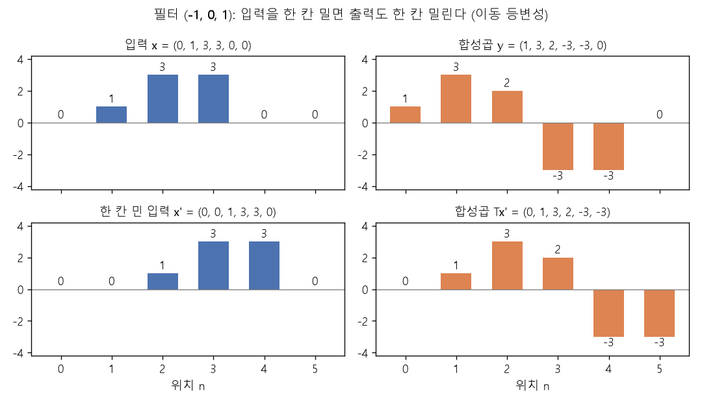

# 합성곱과 퇴플리츠 행렬 (Convolution as a Toeplitz matrix)

[목차로 돌아가기](../../00_MIT%EB%94%A5%EB%9F%AC%EB%8B%9D_%EB%AA%A9%EC%B0%A8.md) · 먼저 볼 것: [M05_벡터와_행렬](../../%EC%88%98%ED%95%99%EA%B0%9C%EB%85%90/03_%EC%84%A0%ED%98%95%EB%8C%80%EC%88%98/M05_%EB%B2%A1%ED%84%B0%EC%99%80_%ED%96%89%EB%A0%AC.md), [MM03_벡터_표기와_전치](../../%EC%88%98%ED%95%99%EA%B0%9C%EB%85%90/03_%EC%84%A0%ED%98%95%EB%8C%80%EC%88%98/MM03_%EB%B2%A1%ED%84%B0_%ED%91%9C%EA%B8%B0%EC%99%80_%EC%A0%84%EC%B9%98.md), D07_합성곱과_풀링 · 쓰는 곳: [Lec04 3.2](../../Lec04_%EA%B2%A9%EC%9E%90_%EC%95%84%ED%82%A4%ED%85%8D%EC%B2%98.md#32-%ED%96%89%EB%A0%AC%EB%A1%9C-%EB%B3%B8-%ED%95%A9%EC%84%B1%EA%B3%B1), [Lec04 4.3](../../Lec04_%EA%B2%A9%EC%9E%90_%EC%95%84%ED%82%A4%ED%85%8D%EC%B2%98.md#43-%ED%80%B4%EC%A6%88-%ED%8C%8C%EB%9D%BC%EB%AF%B8%ED%84%B0-%EC%84%B8%EA%B8%B0)

📚 학습 순서 49/99 (7. 구조 아키텍처): ← 이전: [MM14_꺾임_수와_깊이_분리](../../%EC%88%98%ED%95%99%EA%B0%9C%EB%85%90/06_%EA%B7%BC%EC%82%AC_%EC%9D%B4%EB%A1%A0/MM14_%EA%BA%BE%EC%9E%84_%EC%88%98%EC%99%80_%EA%B9%8A%EC%9D%B4_%EB%B6%84%EB%A6%AC.md) · 다음: [MM16_수용_영역과_출력_크기](../../%EC%88%98%ED%95%99%EA%B0%9C%EB%85%90/07_%EA%B5%AC%EC%A1%B0_%EC%95%84%ED%82%A4%ED%85%8D%EC%B2%98/MM16_%EC%88%98%EC%9A%A9_%EC%98%81%EC%97%AD%EA%B3%BC_%EC%B6%9C%EB%A0%A5_%ED%81%AC%EA%B8%B0.md) →

> [!NOTE]
> **3줄 요약**
> - 1차원 [합성곱](../../00_%EB%94%A5%EB%9F%AC%EB%8B%9D_%EC%9A%A9%EC%96%B4%EC%82%AC%EC%A0%84.md#convolution-%ED%95%A9%EC%84%B1%EA%B3%B1) $y[n] = \sum_k w[k]\,x[n+k]$는 **[행렬 곱](../../00_%EB%94%A5%EB%9F%AC%EB%8B%9D_%EC%9A%A9%EC%96%B4%EC%82%AC%EC%A0%84.md#matrix-multiplication-%ED%96%89%EB%A0%AC-%EA%B3%B1) $y = Tx$와 같다**. 이때 $T$는 대각선을 따라 같은 값($w[-1], w[0], w[1]$)이 되풀이되는 띠 모양 행렬, 곧 [퇴플리츠 행렬](../../00_%EB%94%A5%EB%9F%AC%EB%8B%9D_%EC%9A%A9%EC%96%B4%EC%82%AC%EC%A0%84.md#toeplitz-matrix-%ED%87%B4%ED%94%8C%EB%A6%AC%EC%B8%A0-%ED%96%89%EB%A0%AC)(Toeplitz matrix)이다.
> - 길이 6 입력이면 [덴스 층](../../00_%EB%94%A5%EB%9F%AC%EB%8B%9D_%EC%9A%A9%EC%96%B4%EC%82%AC%EC%A0%84.md#dense-layer-%EB%8D%B4%EC%8A%A4-%EC%B8%B5)은 $6 \times 6 = 36$개 [가중치](../../00_%EB%94%A5%EB%9F%AC%EB%8B%9D_%EC%9A%A9%EC%96%B4%EC%82%AC%EC%A0%84.md#weight-%EA%B0%80%EC%A4%91%EC%B9%98)를 따로 배우지만, [합성곱](../../00_%EB%94%A5%EB%9F%AC%EB%8B%9D_%EC%9A%A9%EC%96%B4%EC%82%AC%EC%A0%84.md#convolution-%ED%95%A9%EC%84%B1%EA%B3%B1)은 **3개**만 배운다. 강의 퀴즈(3채널 128×128 → 96채널)에서는 2,688개 대 약 773억 개다.
> - 같은 [가중치](../../00_%EB%94%A5%EB%9F%AC%EB%8B%9D_%EC%9A%A9%EC%96%B4%EC%82%AC%EC%A0%84.md#weight-%EA%B0%80%EC%A4%91%EC%B9%98)를 모든 위치에 쓰므로 **입력을 한 칸 밀면 출력도 한 칸 밀린다**([이동 등변성](../../00_%EB%94%A5%EB%9F%AC%EB%8B%9D_%EC%9A%A9%EC%96%B4%EC%82%AC%EC%A0%84.md#translation-equivariance-%EC%9D%B4%EB%8F%99-%EB%93%B1%EB%B3%80%EC%84%B1)). $x = (0,1,3,3,0,0)$의 출력 $(1,3,2,-3,-3,0)$이 한 칸 민 입력에서는 $(0,1,3,2,-3,-3)$이 된다.

## 1. 개념 설명

비유: 긴 줄에 늘어선 사람들 앞을 **같은 도장 하나**를 들고 한 칸씩 걸어가며 찍는다고 하자. 도장은 "오른쪽 사람 값 − 왼쪽 사람 값"을 찍는다. 어디서 찍든 도장은 똑같다. 이 걷기를 한 장의 표(행렬)로 적으면, 행마다 도장 무늬가 한 칸씩 오른쪽으로 밀려 적힌 표가 된다. 그 표가 [퇴플리츠 행렬](../../00_%EB%94%A5%EB%9F%AC%EB%8B%9D_%EC%9A%A9%EC%96%B4%EC%82%AC%EC%A0%84.md#toeplitz-matrix-%ED%87%B4%ED%94%8C%EB%A6%AC%EC%B8%A0-%ED%96%89%EB%A0%AC)이다.

- [선형층](../../00_%EB%94%A5%EB%9F%AC%EB%8B%9D_%EC%9A%A9%EC%96%B4%EC%82%AC%EC%A0%84.md#linear-layer-%EC%84%A0%ED%98%95%EC%B8%B5)은 $y = Wx$이고 $W$의 모든 칸이 자유로운 [파라미터](../../00_%EB%94%A5%EB%9F%AC%EB%8B%9D_%EC%9A%A9%EC%96%B4%EC%82%AC%EC%A0%84.md#parameter-%ED%8C%8C%EB%9D%BC%EB%AF%B8%ED%84%B0)다.
- [합성곱](../../00_%EB%94%A5%EB%9F%AC%EB%8B%9D_%EC%9A%A9%EC%96%B4%EC%82%AC%EC%A0%84.md#convolution-%ED%95%A9%EC%84%B1%EA%B3%B1) [층](../../00_%EB%94%A5%EB%9F%AC%EB%8B%9D_%EC%9A%A9%EC%96%B4%EC%82%AC%EC%A0%84.md#layer-%EC%B8%B5)도 $y = Tx$로 쓸 수 있다. 다만 $T$에는 두 가지 제약이 걸린다.
  1. **국소성**: 대각선 근처 몇 칸만 0이 아니다([필터](../../00_%EB%94%A5%EB%9F%AC%EB%8B%9D_%EC%9A%A9%EC%96%B4%EC%82%AC%EC%A0%84.md#filter-%ED%95%84%ED%84%B0) 길이 3이면 대각선과 그 위아래 한 칸).
  2. **[가중치 공유](../../00_%EB%94%A5%EB%9F%AC%EB%8B%9D_%EC%9A%A9%EC%96%B4%EC%82%AC%EC%A0%84.md#weight-sharing-%EA%B0%80%EC%A4%91%EC%B9%98-%EA%B3%B5%EC%9C%A0)**: 같은 대각선 위의 값은 모두 같다.
- 그래서 [합성곱](../../00_%EB%94%A5%EB%9F%AC%EB%8B%9D_%EC%9A%A9%EC%96%B4%EC%82%AC%EC%A0%84.md#convolution-%ED%95%A9%EC%84%B1%EA%B3%B1)은 "제약이 걸린 [선형층](../../00_%EB%94%A5%EB%9F%AC%EB%8B%9D_%EC%9A%A9%EC%96%B4%EC%82%AC%EC%A0%84.md#linear-layer-%EC%84%A0%ED%98%95%EC%B8%B5)"이다. 제약 덕분에 배울 값이 적고, 위치를 바꿔도 같은 일을 한다.

$$
y[n] = b + \sum_{k=-1}^{1} w[k]\, x[n+k]
\quad\Longleftrightarrow\quad
y = T x + b,\qquad T_{n,\,n+k} = w[k]
$$

<details><summary>기호 풀이</summary>

| 기호 | 읽는 법 | 뜻 | 예제 값 |
| --- | --- | --- | --- |
| $y[n]$ | 와이 엔 | 출력의 n번째 칸 | $y[1] = 5$ |
| $b$ | 비 | [편향](../../00_%EB%94%A5%EB%9F%AC%EB%8B%9D_%EC%9A%A9%EC%96%B4%EC%82%AC%EC%A0%84.md#bias-%ED%8E%B8%ED%96%A5) | 1 |
| $\sum_{k=-1}^{1}$ | 시그마 케이 마이너스 일부터 일까지 | k = −1, 0, 1 세 항을 더하기 | 3항 |
| $k$ | 케이 | 가운데 칸에서 떨어진 칸 수 | −1, 0, 1 |
| $w[k]$ | 더블유 케이 | [필터](../../00_%EB%94%A5%EB%9F%AC%EB%8B%9D_%EC%9A%A9%EC%96%B4%EC%82%AC%EC%A0%84.md#filter-%ED%95%84%ED%84%B0)의 k번째 [가중치](../../00_%EB%94%A5%EB%9F%AC%EB%8B%9D_%EC%9A%A9%EC%96%B4%EC%82%AC%EC%A0%84.md#weight-%EA%B0%80%EC%A4%91%EC%B9%98) | $w[-1] = 2$ |
| $x[n+k]$ | 엑스 엔플러스케이 | 입력의 n+k번째 칸 | $x[2] = 2$ |
| $\Longleftrightarrow$ | 동치 | 양쪽이 같은 계산 | - |
| $y,\ x$ | 와이, 엑스 | 출력·입력 전체를 세로 벡터로 본 것 | x = (1, 4, 2) |
| $T$ | 티 | [퇴플리츠 행렬](../../00_%EB%94%A5%EB%9F%AC%EB%8B%9D_%EC%9A%A9%EC%96%B4%EC%82%AC%EC%A0%84.md#toeplitz-matrix-%ED%87%B4%ED%94%8C%EB%A6%AC%EC%B8%A0-%ED%96%89%EB%A0%AC) | 3×3 |
| $T_{n,\,n+k}$ | 티 엔 엔플러스케이 | T의 n행 n+k열 칸 = $w[k]$ | $T_{1,0} = 2$ |

</details>

<details><summary>예제와 풀이</summary>

**문제**: 길이 3 입력에 [필터](../../00_%EB%94%A5%EB%9F%AC%EB%8B%9D_%EC%9A%A9%EC%96%B4%EC%82%AC%EC%A0%84.md#filter-%ED%95%84%ED%84%B0) 3칸을 얹어 가운데 출력 y[1]을 구하고, 같은 계산을 하는 행렬 T의 1행을 적는다.

**주어진 값**:
- $x = (1, 4, 2)$, 곧 $x[0] = 1,\ x[1] = 4,\ x[2] = 2$ (입력)
- $w[-1] = 2$ (왼쪽 이웃에 곱할 [가중치](../../00_%EB%94%A5%EB%9F%AC%EB%8B%9D_%EC%9A%A9%EC%96%B4%EC%82%AC%EC%A0%84.md#weight-%EA%B0%80%EC%A4%91%EC%B9%98))
- $w[0] = 1$ (자기 칸에 곱할 [가중치](../../00_%EB%94%A5%EB%9F%AC%EB%8B%9D_%EC%9A%A9%EC%96%B4%EC%82%AC%EC%A0%84.md#weight-%EA%B0%80%EC%A4%91%EC%B9%98))
- $w[1] = -1$ (오른쪽 이웃에 곱할 [가중치](../../00_%EB%94%A5%EB%9F%AC%EB%8B%9D_%EC%9A%A9%EC%96%B4%EC%82%AC%EC%A0%84.md#weight-%EA%B0%80%EC%A4%91%EC%B9%98))
- $b = 1$ ([편향](../../00_%EB%94%A5%EB%9F%AC%EB%8B%9D_%EC%9A%A9%EC%96%B4%EC%82%AC%EC%A0%84.md#bias-%ED%8E%B8%ED%96%A5))
- $n = 1$ (구할 출력 칸 번호)

**풀이**
1. 식을 그대로 쓴다: $y[n] = b + \sum_{k=-1}^{1} w[k]\, x[n+k] \quad\Longleftrightarrow\quad y = T x + b,\qquad T_{n,\,n+k} = w[k]$
2. 값을 대입한다: $y[1] = 1 + \sum_{k=-1}^{1} w[k]\, x[1+k] \quad\Longleftrightarrow\quad y = T x + 1,\qquad T_{1,\,1+k} = w[k]$
3. 시그마를 k = −1, 0, 1 세 항으로 풀어 쓴다: $y[1] = 1 + w[-1]\, x[0] + w[0]\, x[1] + w[1]\, x[2]$
4. [가중치](../../00_%EB%94%A5%EB%9F%AC%EB%8B%9D_%EC%9A%A9%EC%96%B4%EC%82%AC%EC%A0%84.md#weight-%EA%B0%80%EC%A4%91%EC%B9%98)와 입력 값을 넣는다: $y[1] = 1 + 2 \times 1 + 1 \times 4 + (-1) \times 2$
5. 곱셈을 먼저 한다: $2 \times 1 = 2$, $1 \times 4 = 4$, $(-1) \times 2 = -2$ 이므로 $y[1] = 1 + 2 + 4 + (-2)$
6. 앞에서부터 더한다: $1 + 2 = 3$ 이므로 $y[1] = 3 + 4 + (-2)$
7. 다음 덧셈을 한다: $3 + 4 = 7$ 이므로 $y[1] = 7 + (-2)$
8. 마지막 덧셈을 한다: $7 + (-2) = 5$
9. T의 1행을 칸마다 쓴다: $T_{1,\,1+k} = w[k]$에 k = −1, 0, 1을 넣으면 $T_{1,0} = w[-1] = 2$, $T_{1,1} = w[0] = 1$, $T_{1,2} = w[1] = -1$
10. [행렬 곱](../../00_%EB%94%A5%EB%9F%AC%EB%8B%9D_%EC%9A%A9%EC%96%B4%EC%82%AC%EC%A0%84.md#matrix-multiplication-%ED%96%89%EB%A0%AC-%EA%B3%B1)으로 확인한다. 1행 (2, 1, −1)과 x (1, 4, 2)를 칸끼리 곱한다: $2 \times 1 = 2$, $1 \times 4 = 4$, $(-1) \times 2 = -2$
11. 세 곱을 더한다: $2 + 4 + (-2) = 4$
12. [편향](../../00_%EB%94%A5%EB%9F%AC%EB%8B%9D_%EC%9A%A9%EC%96%B4%EC%82%AC%EC%A0%84.md#bias-%ED%8E%B8%ED%96%A5)을 더한다: $4 + 1 = 5$ (시그마로 구한 값과 같다)

**답**: $y[1] = 5$, T의 1행 $= (2, 1, -1)$

</details>

<details><summary>내 이해</summary>


</details>

> [!NOTE]
> **신경망의 "[합성곱](../../00_%EB%94%A5%EB%9F%AC%EB%8B%9D_%EC%9A%A9%EC%96%B4%EC%82%AC%EC%A0%84.md#convolution-%ED%95%A9%EC%84%B1%EA%B3%B1)"은 사실 [교차 상관](../../00_%EB%94%A5%EB%9F%AC%EB%8B%9D_%EC%9A%A9%EC%96%B4%EC%82%AC%EC%A0%84.md#cross-correlation-%EA%B5%90%EC%B0%A8-%EC%83%81%EA%B4%80)**
> 신호처리 교과서의 [합성곱](../../00_%EB%94%A5%EB%9F%AC%EB%8B%9D_%EC%9A%A9%EC%96%B4%EC%82%AC%EC%A0%84.md#convolution-%ED%95%A9%EC%84%B1%EA%B3%B1)은 [필터](../../00_%EB%94%A5%EB%9F%AC%EB%8B%9D_%EC%9A%A9%EC%96%B4%EC%82%AC%EC%A0%84.md#filter-%ED%95%84%ED%84%B0)를 뒤집어서 $\sum_k w[k]\,x[n-k]$로 쓴다. 신경망에서 쓰는 $\sum_k w[k]\,x[n+k]$는 엄밀히는 [교차 상관](../../00_%EB%94%A5%EB%9F%AC%EB%8B%9D_%EC%9A%A9%EC%96%B4%EC%82%AC%EC%A0%84.md#cross-correlation-%EA%B5%90%EC%B0%A8-%EC%83%81%EA%B4%80)([Cross-correlation](../../00_%EB%94%A5%EB%9F%AC%EB%8B%9D_%EC%9A%A9%EC%96%B4%EC%82%AC%EC%A0%84.md#cross-correlation-%EA%B5%90%EC%B0%A8-%EC%83%81%EA%B4%80))이다. [필터](../../00_%EB%94%A5%EB%9F%AC%EB%8B%9D_%EC%9A%A9%EC%96%B4%EC%82%AC%EC%A0%84.md#filter-%ED%95%84%ED%84%B0)는 어차피 학습하므로 뒤집혔는지는 상관없어서 그냥 [합성곱](../../00_%EB%94%A5%EB%9F%AC%EB%8B%9D_%EC%9A%A9%EC%96%B4%EC%82%AC%EC%A0%84.md#convolution-%ED%95%A9%EC%84%B1%EA%B3%B1)이라 부른다([Lec04 3.2](../../Lec04_%EA%B2%A9%EC%9E%90_%EC%95%84%ED%82%A4%ED%85%8D%EC%B2%98.md#32-%ED%96%89%EB%A0%AC%EB%A1%9C-%EB%B3%B8-%ED%95%A9%EC%84%B1%EA%B3%B1)).

## 2. 필요한 이유

[Lec04 3.2](../../Lec04_%EA%B2%A9%EC%9E%90_%EC%95%84%ED%82%A4%ED%85%8D%EC%B2%98.md#32-%ED%96%89%EB%A0%AC%EB%A1%9C-%EB%B3%B8-%ED%95%A9%EC%84%B1%EA%B3%B1)에서 강사는 [덴스 층](../../00_%EB%94%A5%EB%9F%AC%EB%8B%9D_%EC%9A%A9%EC%96%B4%EC%82%AC%EC%A0%84.md#dense-layer-%EB%8D%B4%EC%8A%A4-%EC%B8%B5)과 [합성곱](../../00_%EB%94%A5%EB%9F%AC%EB%8B%9D_%EC%9A%A9%EC%96%B4%EC%82%AC%EC%A0%84.md#convolution-%ED%95%A9%EC%84%B1%EA%B3%B1) [층](../../00_%EB%94%A5%EB%9F%AC%EB%8B%9D_%EC%9A%A9%EC%96%B4%EC%82%AC%EC%A0%84.md#layer-%EC%B8%B5)을 같은 그림 $y = Wx$로 놓고, [합성곱](../../00_%EB%94%A5%EB%9F%AC%EB%8B%9D_%EC%9A%A9%EC%96%B4%EC%82%AC%EC%A0%84.md#convolution-%ED%95%A9%EC%84%B1%EA%B3%B1)의 $W$가 "대각선 띠에 같은 값이 되풀이되는 희소 행렬"이라고 설명한다. 이 관점에서 세 가지가 바로 보인다.

- **[파라미터](../../00_%EB%94%A5%EB%9F%AC%EB%8B%9D_%EC%9A%A9%EC%96%B4%EC%82%AC%EC%A0%84.md#parameter-%ED%8C%8C%EB%9D%BC%EB%AF%B8%ED%84%B0)가 적다**: 띠 위의 몇 개 값만 배우므로 [과적합](../../00_%EB%94%A5%EB%9F%AC%EB%8B%9D_%EC%9A%A9%EC%96%B4%EC%82%AC%EC%A0%84.md#overfitting-%EA%B3%BC%EC%A0%81%ED%95%A9) 위험이 줄고 데이터가 적어도 된다.
- **[이동 등변성](../../00_%EB%94%A5%EB%9F%AC%EB%8B%9D_%EC%9A%A9%EC%96%B4%EC%82%AC%EC%A0%84.md#translation-equivariance-%EC%9D%B4%EB%8F%99-%EB%93%B1%EB%B3%80%EC%84%B1)**: 행마다 같은 무늬가 한 칸씩 밀려 있으니, 입력을 밀면 출력도 그만큼 밀린다.
- **입력 크기에 매이지 않는다**: 띠 무늬만 정해지면 행렬을 얼마든지 길게 늘일 수 있다. [덴스 층](../../00_%EB%94%A5%EB%9F%AC%EB%8B%9D_%EC%9A%A9%EC%96%B4%EC%82%AC%EC%A0%84.md#dense-layer-%EB%8D%B4%EC%8A%A4-%EC%B8%B5)은 입력 크기가 바뀌면 $W$의 모양부터 맞지 않는다.

## 3. 숫자로 보기

입력 $x = (0, 1, 3, 3, 0, 0)$, [필터](../../00_%EB%94%A5%EB%9F%AC%EB%8B%9D_%EC%9A%A9%EC%96%B4%EC%82%AC%EC%A0%84.md#filter-%ED%95%84%ED%84%B0) $(w[-1], w[0], w[1]) = (-1, 0, 1)$, [편향](../../00_%EB%94%A5%EB%9F%AC%EB%8B%9D_%EC%9A%A9%EC%96%B4%EC%82%AC%EC%A0%84.md#bias-%ED%8E%B8%ED%96%A5) $b = 0$. 이 [필터](../../00_%EB%94%A5%EB%9F%AC%EB%8B%9D_%EC%9A%A9%EC%96%B4%EC%82%AC%EC%A0%84.md#filter-%ED%95%84%ED%84%B0)는 $y[n] = x[n+1] - x[n-1]$, 곧 "오른쪽 − 왼쪽"을 계산하는 **경계 검출기**다. 끝을 넘어가는 칸은 0으로 본다([패딩](../../00_%EB%94%A5%EB%9F%AC%EB%8B%9D_%EC%9A%A9%EC%96%B4%EC%82%AC%EC%A0%84.md#padding-%ED%8C%A8%EB%94%A9)).

**한 칸씩 손계산** (한 줄에 한 동작)

| n | 계산 $-x[n-1] + x[n+1]$ | $y[n]$ |
|---|---|---|
| 0 | $-0 + 1$ (왼쪽은 [패딩](../../00_%EB%94%A5%EB%9F%AC%EB%8B%9D_%EC%9A%A9%EC%96%B4%EC%82%AC%EC%A0%84.md#padding-%ED%8C%A8%EB%94%A9) 0) | 1 |
| 1 | $-0 + 3$ | 3 |
| 2 | $-1 + 3$ | 2 |
| 3 | $-3 + 0$ | −3 |
| 4 | $-3 + 0$ | −3 |
| 5 | $-0 + 0$ (오른쪽은 [패딩](../../00_%EB%94%A5%EB%9F%AC%EB%8B%9D_%EC%9A%A9%EC%96%B4%EC%82%AC%EC%A0%84.md#padding-%ED%8C%A8%EB%94%A9) 0) | 0 |

- 값이 커지는 곳(0 → 1 → 3)에서 양수, 작아지는 곳(3 → 0)에서 음수가 나온다. 강의의 흰동가리 그림에서 어두움→밝음 경계는 밝게, 밝음→어두움 경계는 어둡게 나온 것과 같은 원리다.

**같은 계산을 행렬로**

$$
T = \begin{pmatrix}
0 & 1 & 0 & 0 & 0 & 0\\
-1 & 0 & 1 & 0 & 0 & 0\\
0 & -1 & 0 & 1 & 0 & 0\\
0 & 0 & -1 & 0 & 1 & 0\\
0 & 0 & 0 & -1 & 0 & 1\\
0 & 0 & 0 & 0 & -1 & 0
\end{pmatrix},\qquad
Tx = (1, 3, 2, -3, -3, 0)
$$

<details><summary>기호 풀이</summary>

| 기호 | 읽는 법 | 뜻 | 예제 값 |
| --- | --- | --- | --- |
| $T$ | 티 | 6×6 [퇴플리츠 행렬](../../00_%EB%94%A5%EB%9F%AC%EB%8B%9D_%EC%9A%A9%EC%96%B4%EC%82%AC%EC%A0%84.md#toeplitz-matrix-%ED%87%B4%ED%94%8C%EB%A6%AC%EC%B8%A0-%ED%96%89%EB%A0%AC) | 36칸 중 10칸이 0 아님 |
| $\begin{pmatrix} \cdots \end{pmatrix}$ | 행렬 괄호 | 칸을 행·열로 늘어놓은 행렬 | 6행 6열 |
| $-1$ (대각선 바로 아래) | 마이너스 일 | $w[-1]$, 왼쪽 이웃에 곱할 값 | −1 |
| $0$ (대각선) | 영 | $w[0]$, 자기 칸에 곱할 값 | 0 |
| $1$ (대각선 바로 위) | 일 | $w[1]$, 오른쪽 이웃에 곱할 값 | 1 |
| $x$ | 엑스 | 입력 벡터 | (1, 1, 4, 4, 2, 2) |
| $Tx$ | 티 엑스 | [행렬 곱](../../00_%EB%94%A5%EB%9F%AC%EB%8B%9D_%EC%9A%A9%EC%96%B4%EC%82%AC%EC%A0%84.md#matrix-multiplication-%ED%96%89%EB%A0%AC-%EA%B3%B1) 결과 = 출력 y | (1, 3, 3, −2, −2, −2) |

</details>

<details><summary>예제와 풀이</summary>

**문제**: 본문의 6×6 [퇴플리츠 행렬](../../00_%EB%94%A5%EB%9F%AC%EB%8B%9D_%EC%9A%A9%EC%96%B4%EC%82%AC%EC%A0%84.md#toeplitz-matrix-%ED%87%B4%ED%94%8C%EB%A6%AC%EC%B8%A0-%ED%96%89%EB%A0%AC) T에 새 입력 x를 곱해 출력 Tx(칸마다 오른쪽 − 왼쪽)를 구한다.

**주어진 값**:
- $T = \begin{pmatrix} 0 & 1 & 0 & 0 & 0 & 0\\ -1 & 0 & 1 & 0 & 0 & 0\\ 0 & -1 & 0 & 1 & 0 & 0\\ 0 & 0 & -1 & 0 & 1 & 0\\ 0 & 0 & 0 & -1 & 0 & 1\\ 0 & 0 & 0 & 0 & -1 & 0 \end{pmatrix}$ (본문과 같은 행렬. 대각선 아래 −1, 대각선 0, 위 1)
- $x = (1, 1, 4, 4, 2, 2)$ (새 입력, 세로 벡터로 본다)

**풀이**
1. 식을 그대로 쓴다: $T = \begin{pmatrix} 0 & 1 & 0 & 0 & 0 & 0\\ -1 & 0 & 1 & 0 & 0 & 0\\ 0 & -1 & 0 & 1 & 0 & 0\\ 0 & 0 & -1 & 0 & 1 & 0\\ 0 & 0 & 0 & -1 & 0 & 1\\ 0 & 0 & 0 & 0 & -1 & 0 \end{pmatrix},\qquad Tx = (1, 3, 2, -3, -3, 0)$
2. 값을 대입한다: $Tx = \begin{pmatrix} 0 & 1 & 0 & 0 & 0 & 0\\ -1 & 0 & 1 & 0 & 0 & 0\\ 0 & -1 & 0 & 1 & 0 & 0\\ 0 & 0 & -1 & 0 & 1 & 0\\ 0 & 0 & 0 & -1 & 0 & 1\\ 0 & 0 & 0 & 0 & -1 & 0 \end{pmatrix} \begin{pmatrix} 1\\ 1\\ 4\\ 4\\ 2\\ 2 \end{pmatrix}$
3. [행렬 곱](../../00_%EB%94%A5%EB%9F%AC%EB%8B%9D_%EC%9A%A9%EC%96%B4%EC%82%AC%EC%A0%84.md#matrix-multiplication-%ED%96%89%EB%A0%AC-%EA%B3%B1)의 뜻: 출력의 n번째 칸 = T의 n행과 x를 칸끼리 곱해 모두 더한 값
4. 0행을 풀어 쓴다 (T의 0행 $(0, 1, 0, 0, 0, 0)$와 x를 칸끼리 곱해 더한다): $0 \times 1 + 1 \times 1 + 0 \times 4 + 0 \times 4 + 0 \times 2 + 0 \times 2$
5. 0행의 곱셈을 한다: $0 + 1 + 0 + 0 + 0 + 0$
6. 0행의 덧셈을 한다: $= 1$
7. 1행을 풀어 쓴다 (T의 1행 $(-1, 0, 1, 0, 0, 0)$와 x를 칸끼리 곱해 더한다): $(-1) \times 1 + 0 \times 1 + 1 \times 4 + 0 \times 4 + 0 \times 2 + 0 \times 2$
8. 1행의 곱셈을 한다: $(-1) + 0 + 4 + 0 + 0 + 0$
9. 1행의 덧셈을 한다: $= 3$
10. 2행을 풀어 쓴다 (T의 2행 $(0, -1, 0, 1, 0, 0)$와 x를 칸끼리 곱해 더한다): $0 \times 1 + (-1) \times 1 + 0 \times 4 + 1 \times 4 + 0 \times 2 + 0 \times 2$
11. 2행의 곱셈을 한다: $0 + (-1) + 0 + 4 + 0 + 0$
12. 2행의 덧셈을 한다: $= 3$
13. 3행을 풀어 쓴다 (T의 3행 $(0, 0, -1, 0, 1, 0)$와 x를 칸끼리 곱해 더한다): $0 \times 1 + 0 \times 1 + (-1) \times 4 + 0 \times 4 + 1 \times 2 + 0 \times 2$
14. 3행의 곱셈을 한다: $0 + 0 + (-4) + 0 + 2 + 0$
15. 3행의 덧셈을 한다: $= -2$
16. 4행을 풀어 쓴다 (T의 4행 $(0, 0, 0, -1, 0, 1)$와 x를 칸끼리 곱해 더한다): $0 \times 1 + 0 \times 1 + 0 \times 4 + (-1) \times 4 + 0 \times 2 + 1 \times 2$
17. 4행의 곱셈을 한다: $0 + 0 + 0 + (-4) + 0 + 2$
18. 4행의 덧셈을 한다: $= -2$
19. 5행을 풀어 쓴다 (T의 5행 $(0, 0, 0, 0, -1, 0)$와 x를 칸끼리 곱해 더한다): $0 \times 1 + 0 \times 1 + 0 \times 4 + 0 \times 4 + (-1) \times 2 + 0 \times 2$
20. 5행의 곱셈을 한다: $0 + 0 + 0 + 0 + (-2) + 0$
21. 5행의 덧셈을 한다: $= -2$
22. 여섯 행의 결과를 차례로 모은다: $Tx = (1, 3, 3, -2, -2, -2)$

**답**: $Tx = (1, 3, 3, -2, -2, -2)$

</details>

<details><summary>내 이해</summary>


</details>

- 대각선 바로 아래는 모두 $w[-1] = -1$, 대각선은 $w[0] = 0$, 바로 위는 $w[1] = 1$이다. 36칸 가운데 0이 아닌 칸은 10개뿐이고 서로 다른 값은 3개뿐이다.

**입력을 한 칸 오른쪽으로 밀면**

- 민 입력 $x' = (0, 0, 1, 3, 3, 0)$
- $Tx' = (0, 1, 3, 2, -3, -3)$
- 원래 출력 $(1, 3, 2, -3, -3, 0)$을 한 칸 민 것과 똑같다. **밀고 [합성곱](../../00_%EB%94%A5%EB%9F%AC%EB%8B%9D_%EC%9A%A9%EC%96%B4%EC%82%AC%EC%A0%84.md#convolution-%ED%95%A9%EC%84%B1%EA%B3%B1) = 합성곱하고 밀기** ([이동 등변성](../../00_%EB%94%A5%EB%9F%AC%EB%8B%9D_%EC%9A%A9%EC%96%B4%EC%82%AC%EC%A0%84.md#translation-equivariance-%EC%9D%B4%EB%8F%99-%EB%93%B1%EB%B3%80%EC%84%B1)).



**[파라미터](../../00_%EB%94%A5%EB%9F%AC%EB%8B%9D_%EC%9A%A9%EC%96%B4%EC%82%AC%EC%A0%84.md#parameter-%ED%8C%8C%EB%9D%BC%EB%AF%B8%ED%84%B0) 수 비교** ([편향](../../00_%EB%94%A5%EB%9F%AC%EB%8B%9D_%EC%9A%A9%EC%96%B4%EC%82%AC%EC%A0%84.md#bias-%ED%8E%B8%ED%96%A5) 제외)

| [층](../../00_%EB%94%A5%EB%9F%AC%EB%8B%9D_%EC%9A%A9%EC%96%B4%EC%82%AC%EC%A0%84.md#layer-%EC%B8%B5) | 배우는 값 | 개수 |
|---|---|---|
| [덴스 층](../../00_%EB%94%A5%EB%9F%AC%EB%8B%9D_%EC%9A%A9%EC%96%B4%EC%82%AC%EC%A0%84.md#dense-layer-%EB%8D%B4%EC%8A%A4-%EC%B8%B5) (길이 6 → 6) | $W$의 모든 칸 | $6 \times 6 = 36$ |
| [합성곱](../../00_%EB%94%A5%EB%9F%AC%EB%8B%9D_%EC%9A%A9%EC%96%B4%EC%82%AC%EC%A0%84.md#convolution-%ED%95%A9%EC%84%B1%EA%B3%B1) ([필터](../../00_%EB%94%A5%EB%9F%AC%EB%8B%9D_%EC%9A%A9%EC%96%B4%EC%82%AC%EC%A0%84.md#filter-%ED%95%84%ED%84%B0) 길이 3) | $w[-1], w[0], w[1]$ | 3 |

<details><summary>기호 풀이</summary>

| 기호 | 읽는 법 | 뜻 | 예제 값 |
| --- | --- | --- | --- |
| $x[n]$ | 엑스 엔 | 입력의 n번째 칸 | $x[2] = 3$ |
| $w[k]$ | 더블유 케이 | [필터](../../00_%EB%94%A5%EB%9F%AC%EB%8B%9D_%EC%9A%A9%EC%96%B4%EC%82%AC%EC%A0%84.md#filter-%ED%95%84%ED%84%B0)의 k번째 [가중치](../../00_%EB%94%A5%EB%9F%AC%EB%8B%9D_%EC%9A%A9%EC%96%B4%EC%82%AC%EC%A0%84.md#weight-%EA%B0%80%EC%A4%91%EC%B9%98) (k = −1, 0, 1) | $w[1] = 1$ |
| $y[n]$ | 와이 엔 | 출력의 n번째 칸 | $y[2] = 2$ |
| $T$ | 티 | [합성곱](../../00_%EB%94%A5%EB%9F%AC%EB%8B%9D_%EC%9A%A9%EC%96%B4%EC%82%AC%EC%A0%84.md#convolution-%ED%95%A9%EC%84%B1%EA%B3%B1)을 행렬로 적은 [퇴플리츠 행렬](../../00_%EB%94%A5%EB%9F%AC%EB%8B%9D_%EC%9A%A9%EC%96%B4%EC%82%AC%EC%A0%84.md#toeplitz-matrix-%ED%87%B4%ED%94%8C%EB%A6%AC%EC%B8%A0-%ED%96%89%EB%A0%AC) | 6×6 |
| $T_{n,\,n+k}$ | 티 엔 엔플러스케이 | T의 n행 n+k열 칸 = $w[k]$ | $T_{2,3} = 1$ |
| $\star$ | 별 | 신경망에서 쓰는 [합성곱](../../00_%EB%94%A5%EB%9F%AC%EB%8B%9D_%EC%9A%A9%EC%96%B4%EC%82%AC%EC%A0%84.md#convolution-%ED%95%A9%EC%84%B1%EA%B3%B1) 기호 (강의는 오각별) | $w \star x$ |
| $x'$ | 엑스 프라임 | 한 칸 민 입력 | (0, 0, 1, 3, 3, 0) |

</details>

## 4. 코드로 확인

```python
# [함수] np.array: 숫자 목록을 numpy 배열로 만든다
# [변수] x: 입력 신호 (0, 1, 3, 3, 0, 0). 값이 올라갔다 내려가는 계단 모양
# [연결] 본문 3절 손계산 표의 입력
x = np.array([0, 1, 3, 3, 0, 0])
# [변수] w: 필터. 키는 위치 k, 값은 w[k]. (-1, 0, 1)은 "오른쪽 - 왼쪽" 경계 검출기
w = {-1: -1, 0: 0, 1: 1}
# [함수] len: 길이. [변수] N = 6
N = len(x)
# [함수] np.zeros((N, N), dtype=int): 0으로 채운 6×6 정수 행렬
# [변수] T: 이제부터 띠 모양으로 채울 퇴플리츠 행렬
T = np.zeros((N, N), dtype=int)
# [함수] for n in range(N): 행 0~5를 차례로 돈다
for n in range(N):
    # [함수] w.items(): (k, w[k]) 쌍을 하나씩 꺼낸다
    for k, wk in w.items():
        # [연결] n+k가 0~N-1 밖이면 패딩 0 자리라 적지 않는다 (본문 표의 "패딩 0")
        if 0 <= n + k < N:
            # [변수] T[n, n+k] = w[k]: 본문 1절 식 T_{n,n+k} = w[k]
            T[n, n + k] = wk
# [연결] 본문 3절의 행렬 T와 같은지 확인
print(T)
# [함수] @: 행렬 곱. [변수] y: 합성곱 결과 (1, 3, 2, -3, -3, 0)
y = T @ x
# [함수] np.pad(x, 1): 양 끝에 0을 하나씩 붙인다. np.correlate(..., "valid"): 필터를 밀며 곱해 더한다
# [쓸모] 행렬 곱과 "밀며 곱해 더하기"가 같은 계산인지 비교한다
print(y, np.correlate(np.pad(x, 1), [-1, 0, 1], mode="valid"))
# [함수] np.roll(x, 1): 배열을 오른쪽으로 한 칸 민다 (맨 끝 0이 맨 앞으로 온다)
# [변수] x_shift: (0, 0, 1, 3, 3, 0)
x_shift = np.roll(x, 1)
# [연결] 본문 3절 "입력을 한 칸 밀면": 왼쪽은 T x', 오른쪽은 y를 한 칸 민 것
print(T @ x_shift, np.roll(y, 1))
# [함수] np.count_nonzero: 0이 아닌 칸의 수. T.size: 전체 칸 수 36
# [연결] 본문 3절 "36칸 가운데 0이 아닌 칸은 10개"
print(np.count_nonzero(T), T.size)
```

**실행 결과**:

```text
[[ 0  1  0  0  0  0]
 [-1  0  1  0  0  0]
 [ 0 -1  0  1  0  0]
 [ 0  0 -1  0  1  0]
 [ 0  0  0 -1  0  1]
 [ 0  0  0  0 -1  0]]
[ 1  3  2 -3 -3  0] [ 1  3  2 -3 -3  0]
[ 0  1  3  2 -3 -3] [ 0  1  3  2 -3 -3]
10 36
```

> [!WARNING]
> **⚠ 주의**
> - 실제 라이브러리는 이 큰 행렬을 만들지 않는다. 행렬은 **이해를 위한 관점**이고, 계산은 패치별로 바로 한다(강의 Q&A에서도 같은 말을 한다).
> - [이동 등변성](../../00_%EB%94%A5%EB%9F%AC%EB%8B%9D_%EC%9A%A9%EC%96%B4%EC%82%AC%EC%A0%84.md#translation-equivariance-%EC%9D%B4%EB%8F%99-%EB%93%B1%EB%B3%80%EC%84%B1)은 **경계에서 깨질 수 있다**. 위 예는 $x$의 마지막 값과 $y$의 마지막 값이 0이어서 정확히 맞았다. 끝에 0이 아닌 값이 있으면 민 뒤 잘려 나가 조금 달라진다.
> - 이미지는 2차원이라 행렬을 쓰면 퇴플리츠 블록이 다시 퇴플리츠로 놓인 "이중 블록 퇴플리츠" 모양이 된다. 강의도 이미지를 한 줄로 펴서 1차원 [합성곱](../../00_%EB%94%A5%EB%9F%AC%EB%8B%9D_%EC%9A%A9%EC%96%B4%EC%82%AC%EC%A0%84.md#convolution-%ED%95%A9%EC%84%B1%EA%B3%B1)을 하면 줄무늬처럼 이상한 구조가 생긴다고 말한다.
> - [덴스 층](../../00_%EB%94%A5%EB%9F%AC%EB%8B%9D_%EC%9A%A9%EC%96%B4%EC%82%AC%EC%A0%84.md#dense-layer-%EB%8D%B4%EC%8A%A4-%EC%B8%B5)의 36개와 [합성곱](../../00_%EB%94%A5%EB%9F%AC%EB%8B%9D_%EC%9A%A9%EC%96%B4%EC%82%AC%EC%A0%84.md#convolution-%ED%95%A9%EC%84%B1%EA%B3%B1)의 3개는 **같은 입력 크기**일 때의 비교다. [합성곱](../../00_%EB%94%A5%EB%9F%AC%EB%8B%9D_%EC%9A%A9%EC%96%B4%EC%82%AC%EC%A0%84.md#convolution-%ED%95%A9%EC%84%B1%EA%B3%B1)의 수는 입력 길이와 상관없이 3개로 그대로다.

## 5. 개념 재확인

<details><summary>1. $x = (2, 5, 5, 1)$, 필터 $(w[-1], w[0], w[1]) = (1, 2, 1)$, $b = 0$, 끝은 0 패딩. 퇴플리츠 행렬 $T$와 출력 $y$는?</summary>

| 단계 | 하는 일 | 식 | 계산 | 결과 |
|---|---|---|---|---|
| 1 | 행렬 만들기 | $T_{n,n+k} = w[k]$ | 대각선 2, 위아래 1 | 4×4 띠 행렬 |
| 2 | y[0] | $0 \cdot 1 + 2 \cdot 2 + 5 \cdot 1$ | $0 + 4 + 5$ | 9 |
| 3 | y[1] | $2 \cdot 1 + 5 \cdot 2 + 5 \cdot 1$ | $2 + 10 + 5$ | 17 |
| 4 | y[2] | $5 \cdot 1 + 5 \cdot 2 + 1 \cdot 1$ | $5 + 10 + 1$ | 16 |
| 5 | y[3] | $5 \cdot 1 + 1 \cdot 2 + 0 \cdot 1$ | $5 + 2 + 0$ | 7 |

**① 쓰는 식**
$$y[n] = w[-1]\,x[n-1] + w[0]\,x[n] + w[1]\,x[n+1], \qquad y = Tx$$
- 위 식 ← 오른쪽 식은 ② (행렬 만들기), 왼쪽 식은 ③~⑥ (칸마다 계산)에서 쓴다.
```python
# [변수] x: 입력, w: 필터 (1, 2, 1). 이웃을 섞는 흐림(blur) 필터다
x, w = np.array([2, 5, 5, 1]), [1, 2, 1]                      # ①
# [함수] np.eye(4, k=-1): 대각선 바로 아래가 1인 행렬. k=0은 대각선, k=1은 바로 위
# [변수] T: 아래 띠 w[-1]=1, 대각선 w[0]=2, 위 띠 w[1]=1을 더한 퇴플리츠 행렬
T = (w[0] * np.eye(4, k=-1) + w[1] * np.eye(4) + w[2] * np.eye(4, k=1)).astype(int)  # ②
# [연결] ② 결과: 대각선 2, 그 위아래 1
print(T)
# [변수] y: 행렬 곱으로 한 번에 구한 출력. [연결] ③~⑥의 9, 17, 16, 7
print(T @ x)                                                   # ③④⑤⑥
```

**주어진 값**
- $x = (2, 5, 5, 1)$, 곧 $x[0] = 2,\ x[1] = 5,\ x[2] = 5,\ x[3] = 1$ (입력)
- $w[-1] = 1,\ w[0] = 2,\ w[1] = 1$ ([필터](../../00_%EB%94%A5%EB%9F%AC%EB%8B%9D_%EC%9A%A9%EC%96%B4%EC%82%AC%EC%A0%84.md#filter-%ED%95%84%ED%84%B0)의 세 [가중치](../../00_%EB%94%A5%EB%9F%AC%EB%8B%9D_%EC%9A%A9%EC%96%B4%EC%82%AC%EC%A0%84.md#weight-%EA%B0%80%EC%A4%91%EC%B9%98))
- $b = 0$ ([편향](../../00_%EB%94%A5%EB%9F%AC%EB%8B%9D_%EC%9A%A9%EC%96%B4%EC%82%AC%EC%A0%84.md#bias-%ED%8E%B8%ED%96%A5))
- $x[-1] = 0,\ x[4] = 0$ (끝을 넘는 칸은 [패딩](../../00_%EB%94%A5%EB%9F%AC%EB%8B%9D_%EC%9A%A9%EC%96%B4%EC%82%AC%EC%A0%84.md#padding-%ED%8C%A8%EB%94%A9) 0)

**② 행렬 만들기**
- 식을 쓴다: $T_{n,\,n+k} = w[k]$
- 값을 대입한다: $T_{n,\,n-1} = w[-1] = 1,\quad T_{n,\,n} = w[0] = 2,\quad T_{n,\,n+1} = w[1] = 1$ (k = −1, 0, 1을 넣었다)
- 대각선 아래는 1, 대각선은 2, 대각선 위는 1로 채우고 나머지는 0이다 (4×4): $T = \begin{pmatrix} 2&1&0&0\\ 1&2&1&0\\ 0&1&2&1\\ 0&0&1&2 \end{pmatrix}$

**③ y[0]**
- 식을 쓴다: $y[n] = w[-1]\,x[n-1] + w[0]\,x[n] + w[1]\,x[n+1]$
- 값을 대입한다 (n = 0): $y[0] = 1 \times x[-1] + 2 \times x[0] + 1 \times x[1]$
- 입력 값을 넣는다 (x[−1]은 [패딩](../../00_%EB%94%A5%EB%9F%AC%EB%8B%9D_%EC%9A%A9%EC%96%B4%EC%82%AC%EC%A0%84.md#padding-%ED%8C%A8%EB%94%A9) 0): $y[0] = 1 \times 0 + 2 \times 2 + 1 \times 5$
- 곱셈을 먼저 한다: 1 × 0 = 0, 2 × 2 = 4, 1 × 5 = 5 이므로 $y[0] = 0 + 4 + 5$
- 덧셈을 한다: 0 + 4 = 4, 4 + 5 = 9 이므로 $y[0] = 9$

**④ y[1]**
- 값을 대입한다 (n = 1): $y[1] = 1 \times x[0] + 2 \times x[1] + 1 \times x[2]$
- 입력 값을 넣는다: $y[1] = 1 \times 2 + 2 \times 5 + 1 \times 5$
- 곱셈을 먼저 한다: 1 × 2 = 2, 2 × 5 = 10, 1 × 5 = 5 이므로 $y[1] = 2 + 10 + 5$
- 덧셈을 한다: 2 + 10 = 12, 12 + 5 = 17 이므로 $y[1] = 17$

**⑤ y[2]**
- 값을 대입한다 (n = 2): $y[2] = 1 \times x[1] + 2 \times x[2] + 1 \times x[3]$
- 입력 값을 넣는다: $y[2] = 1 \times 5 + 2 \times 5 + 1 \times 1$
- 곱셈을 먼저 한다: 1 × 5 = 5, 2 × 5 = 10, 1 × 1 = 1 이므로 $y[2] = 5 + 10 + 1$
- 덧셈을 한다: 5 + 10 = 15, 15 + 1 = 16 이므로 $y[2] = 16$

**⑥ y[3]**
- 값을 대입한다 (n = 3): $y[3] = 1 \times x[2] + 2 \times x[3] + 1 \times x[4]$
- 입력 값을 넣는다 (x[4]는 [패딩](../../00_%EB%94%A5%EB%9F%AC%EB%8B%9D_%EC%9A%A9%EC%96%B4%EC%82%AC%EC%A0%84.md#padding-%ED%8C%A8%EB%94%A9) 0): $y[3] = 1 \times 5 + 2 \times 1 + 1 \times 0$
- 곱셈을 먼저 한다: 1 × 5 = 5, 2 × 1 = 2, 1 × 0 = 0 이므로 $y[3] = 5 + 2 + 0$
- 덧셈을 한다: 5 + 2 = 7, 7 + 0 = 7 이므로 $y[3] = 7$

**답**: $T$는 대각선 2·위아래 1인 띠 행렬, $y = $ **(9, 17, 16, 7)**

</details>

<details><summary>2. 강의 퀴즈: 입력 3×128×128, 출력 96×128×128, 3×3 필터. 필터 하나의 파라미터 수, 필터 수, 층 전체 파라미터 수(편향 포함)는? 같은 입출력을 덴스 층으로 이으면 가중치가 몇 개인가?</summary>

| 단계 | 하는 일 | 식 | 계산 | 결과 |
|---|---|---|---|---|
| 1 | [필터](../../00_%EB%94%A5%EB%9F%AC%EB%8B%9D_%EC%9A%A9%EC%96%B4%EC%82%AC%EC%A0%84.md#filter-%ED%95%84%ED%84%B0) 하나 | $K_1 \times K_2 \times C_l$ | $3 \times 3 \times 3$ | 27 |
| 2 | [필터](../../00_%EB%94%A5%EB%9F%AC%EB%8B%9D_%EC%9A%A9%EC%96%B4%EC%82%AC%EC%A0%84.md#filter-%ED%95%84%ED%84%B0) 수 | $C_{l+1}$ | 출력 [채널](../../00_%EB%94%A5%EB%9F%AC%EB%8B%9D_%EC%9A%A9%EC%96%B4%EC%82%AC%EC%A0%84.md#channel-%EC%B1%84%EB%84%90) 수 | 96 |
| 3 | [층](../../00_%EB%94%A5%EB%9F%AC%EB%8B%9D_%EC%9A%A9%EC%96%B4%EC%82%AC%EC%A0%84.md#layer-%EC%B8%B5) 전체 | $27 \times 96 + 96$ | $2592 + 96$ | 2,688 |
| 4 | 덴스 입력·출력 길이 | $3 \cdot 128^2$, $96 \cdot 128^2$ | 49,152, 1,572,864 | - |
| 5 | 덴스 [가중치](../../00_%EB%94%A5%EB%9F%AC%EB%8B%9D_%EC%9A%A9%EC%96%B4%EC%82%AC%EC%A0%84.md#weight-%EA%B0%80%EC%A4%91%EC%B9%98) | 입력 × 출력 | $49152 \times 1572864$ | 77,309,411,328 |

**① 쓰는 식**
$$\text{필터당} = K_1 K_2 C_l,\qquad \text{층 전체} = K_1 K_2 C_l \cdot C_{l+1} + C_{l+1}$$
- 위 식 ← 왼쪽 식은 ②, 오른쪽 식은 ③ ([필터](../../00_%EB%94%A5%EB%9F%AC%EB%8B%9D_%EC%9A%A9%EC%96%B4%EC%82%AC%EC%A0%84.md#filter-%ED%95%84%ED%84%B0) 수) ④ ([층](../../00_%EB%94%A5%EB%9F%AC%EB%8B%9D_%EC%9A%A9%EC%96%B4%EC%82%AC%EC%A0%84.md#layer-%EC%B8%B5) 전체)에서 쓴다. ⑤ ⑥은 덴스 층과의 비교다.
```python
# [변수] C_in, C_out: 입력·출력 채널 3, 96. K: 필터 한 변 3. H, W: 높이·너비 128
C_in, C_out, K, H, W = 3, 96, 3, 128, 128                    # ①
# [변수] per_filter = 3×3×3 = 27: 채널마다 3×3 가중치가 따로 있다
per_filter = K * K * C_in                                      # ②
# [변수] n_filters = 96: 출력 채널 하나에 필터 하나
n_filters = C_out                                              # ③
# [변수] conv_total = 27×96 + 96 = 2688: 가중치 + 필터마다 편향 하나
conv_total = per_filter * n_filters + n_filters                # ④
# [변수] dense_in, dense_out: 펴서 이은 길이 49152, 1572864
dense_in, dense_out = C_in * H * W, C_out * H * W              # ⑤
# [변수] dense_w: 덴스 가중치 수 = 입력 × 출력
dense_w = dense_in * dense_out                                 # ⑥
# [함수] f"{v:,}": 천 단위 쉼표. [연결] ⑥ 비율은 약 2,876만 배
print(per_filter, n_filters, conv_total, f"{dense_w:,}", round(dense_w / conv_total))
```

**주어진 값**
- $K_1 = 3,\ K_2 = 3$ ([필터](../../00_%EB%94%A5%EB%9F%AC%EB%8B%9D_%EC%9A%A9%EC%96%B4%EC%82%AC%EC%A0%84.md#filter-%ED%95%84%ED%84%B0)의 세로·가로 크기)
- $C_l = 3$ (입력 [채널](../../00_%EB%94%A5%EB%9F%AC%EB%8B%9D_%EC%9A%A9%EC%96%B4%EC%82%AC%EC%A0%84.md#channel-%EC%B1%84%EB%84%90) 수), $C_{l+1} = 96$ (출력 [채널](../../00_%EB%94%A5%EB%9F%AC%EB%8B%9D_%EC%9A%A9%EC%96%B4%EC%82%AC%EC%A0%84.md#channel-%EC%B1%84%EB%84%90) 수)
- $H = 128,\ W = 128$ (높이·너비)

**② [필터](../../00_%EB%94%A5%EB%9F%AC%EB%8B%9D_%EC%9A%A9%EC%96%B4%EC%82%AC%EC%A0%84.md#filter-%ED%95%84%ED%84%B0) 하나**
- 식을 쓴다: 필터당 $= K_1 K_2 C_l$
- 값을 대입한다: 필터당 $= 3 \times 3 \times 3$
- 곱셈을 한다: 3 × 3 = 9, 9 × 3 = 27 이므로 필터당 = 27 (9가 아니다: [채널](../../00_%EB%94%A5%EB%9F%AC%EB%8B%9D_%EC%9A%A9%EC%96%B4%EC%82%AC%EC%A0%84.md#channel-%EC%B1%84%EB%84%90)마다 따로 배운다)

**③ [필터](../../00_%EB%94%A5%EB%9F%AC%EB%8B%9D_%EC%9A%A9%EC%96%B4%EC%82%AC%EC%A0%84.md#filter-%ED%95%84%ED%84%B0) 수**
- 식을 쓴다: [필터](../../00_%EB%94%A5%EB%9F%AC%EB%8B%9D_%EC%9A%A9%EC%96%B4%EC%82%AC%EC%A0%84.md#filter-%ED%95%84%ED%84%B0) 수 $= C_{l+1}$
- 값을 대입한다: [필터](../../00_%EB%94%A5%EB%9F%AC%EB%8B%9D_%EC%9A%A9%EC%96%B4%EC%82%AC%EC%A0%84.md#filter-%ED%95%84%ED%84%B0) 수 $= 96$ (출력 [채널](../../00_%EB%94%A5%EB%9F%AC%EB%8B%9D_%EC%9A%A9%EC%96%B4%EC%82%AC%EC%A0%84.md#channel-%EC%B1%84%EB%84%90) 하나에 [필터](../../00_%EB%94%A5%EB%9F%AC%EB%8B%9D_%EC%9A%A9%EC%96%B4%EC%82%AC%EC%A0%84.md#filter-%ED%95%84%ED%84%B0) 하나)

**④ [층](../../00_%EB%94%A5%EB%9F%AC%EB%8B%9D_%EC%9A%A9%EC%96%B4%EC%82%AC%EC%A0%84.md#layer-%EC%B8%B5) 전체**
- 식을 쓴다: [층](../../00_%EB%94%A5%EB%9F%AC%EB%8B%9D_%EC%9A%A9%EC%96%B4%EC%82%AC%EC%A0%84.md#layer-%EC%B8%B5) 전체 $= K_1 K_2 C_l \cdot C_{l+1} + C_{l+1}$
- 값을 대입한다: [층](../../00_%EB%94%A5%EB%9F%AC%EB%8B%9D_%EC%9A%A9%EC%96%B4%EC%82%AC%EC%A0%84.md#layer-%EC%B8%B5) 전체 $= 3 \times 3 \times 3 \times 96 + 96$
- ②에서 27을 구했으므로 곱한다: 27 × 96 = 2592 (27 × 100 − 27 × 4 = 2700 − 108) 이므로 [층](../../00_%EB%94%A5%EB%9F%AC%EB%8B%9D_%EC%9A%A9%EC%96%B4%EC%82%AC%EC%A0%84.md#layer-%EC%B8%B5) 전체 $= 2592 + 96$
- 덧셈을 한다: 2592 + 96 = 2688 ([가중치](../../00_%EB%94%A5%EB%9F%AC%EB%8B%9D_%EC%9A%A9%EC%96%B4%EC%82%AC%EC%A0%84.md#weight-%EA%B0%80%EC%A4%91%EC%B9%98) 2592개 + [편향](../../00_%EB%94%A5%EB%9F%AC%EB%8B%9D_%EC%9A%A9%EC%96%B4%EC%82%AC%EC%A0%84.md#bias-%ED%8E%B8%ED%96%A5) 96개)

**⑤ [덴스 층](../../00_%EB%94%A5%EB%9F%AC%EB%8B%9D_%EC%9A%A9%EC%96%B4%EC%82%AC%EC%A0%84.md#dense-layer-%EB%8D%B4%EC%8A%A4-%EC%B8%B5) 입력·출력 길이**
- 식을 쓴다: 입력 길이 $= C_l \cdot H \cdot W$, 출력 길이 $= C_{l+1} \cdot H \cdot W$ (이미지를 한 줄로 편 길이)
- 값을 대입한다: 입력 길이 $= 3 \times 128 \times 128$, 출력 길이 $= 96 \times 128 \times 128$
- 공통 곱을 먼저 한다: 128 × 128 = 16384
- 입력 길이: 3 × 16384 = 49152
- 출력 길이: 96 × 16384 = 1572864

**⑥ 덴스 [가중치](../../00_%EB%94%A5%EB%9F%AC%EB%8B%9D_%EC%9A%A9%EC%96%B4%EC%82%AC%EC%A0%84.md#weight-%EA%B0%80%EC%A4%91%EC%B9%98)**
- 식을 쓴다: 덴스 [가중치](../../00_%EB%94%A5%EB%9F%AC%EB%8B%9D_%EC%9A%A9%EC%96%B4%EC%82%AC%EC%A0%84.md#weight-%EA%B0%80%EC%A4%91%EC%B9%98) 수 $=$ (입력 길이) × (출력 길이)
- 값을 대입한다: 덴스 [가중치](../../00_%EB%94%A5%EB%9F%AC%EB%8B%9D_%EC%9A%A9%EC%96%B4%EC%82%AC%EC%A0%84.md#weight-%EA%B0%80%EC%A4%91%EC%B9%98) 수 $= 49152 \times 1572864$
- 곱셈을 한다: 49152 = 3 × 2¹⁴, 1572864 = 96 × 2¹⁴ = 3 × 2¹⁹ 이므로 곱은 9 × 2³³ = 9 × 8,589,934,592 = 77,309,411,328 (약 773억)
- [합성곱](../../00_%EB%94%A5%EB%9F%AC%EB%8B%9D_%EC%9A%A9%EC%96%B4%EC%82%AC%EC%A0%84.md#convolution-%ED%95%A9%EC%84%B1%EA%B3%B1)과 비교한다: 77,309,411,328 ÷ 2,688 ≈ 28,760,942 (약 2,876만 배)

**답**: 필터당 **27**, [필터](../../00_%EB%94%A5%EB%9F%AC%EB%8B%9D_%EC%9A%A9%EC%96%B4%EC%82%AC%EC%A0%84.md#filter-%ED%95%84%ED%84%B0) **96**개, [층](../../00_%EB%94%A5%EB%9F%AC%EB%8B%9D_%EC%9A%A9%EC%96%B4%EC%82%AC%EC%A0%84.md#layer-%EC%B8%B5) 전체 **2,688**개. [덴스 층](../../00_%EB%94%A5%EB%9F%AC%EB%8B%9D_%EC%9A%A9%EC%96%B4%EC%82%AC%EC%A0%84.md#dense-layer-%EB%8D%B4%EC%8A%A4-%EC%B8%B5)이면 [가중치](../../00_%EB%94%A5%EB%9F%AC%EB%8B%9D_%EC%9A%A9%EC%96%B4%EC%82%AC%EC%A0%84.md#weight-%EA%B0%80%EC%A4%91%EC%B9%98)만 **77,309,411,328**개

</details>

## 예제 풀기

[예제 10문제 풀기](../../%EC%98%88%EC%A0%9C/07_%EA%B5%AC%EC%A1%B0_%EC%95%84%ED%82%A4%ED%85%8D%EC%B2%98/%EC%98%88%EC%A0%9C_MM15_%ED%95%A9%EC%84%B1%EA%B3%B1%EA%B3%BC_%ED%87%B4%ED%94%8C%EB%A6%AC%EC%B8%A0_%ED%96%89%EB%A0%AC.md)

<details><summary>내 이해</summary>


</details>
