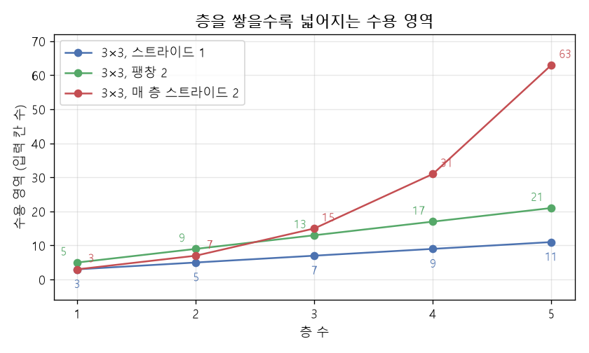

# 수용 영역과 출력 크기 (Receptive field and output size)

[목차로 돌아가기](../../00_MIT%EB%94%A5%EB%9F%AC%EB%8B%9D_%EB%AA%A9%EC%B0%A8.md) · 먼저 볼 것: [MM15_합성곱과_퇴플리츠_행렬](../../%EC%88%98%ED%95%99%EA%B0%9C%EB%85%90/07_%EA%B5%AC%EC%A1%B0_%EC%95%84%ED%82%A4%ED%85%8D%EC%B2%98/MM15_%ED%95%A9%EC%84%B1%EA%B3%B1%EA%B3%BC_%ED%87%B4%ED%94%8C%EB%A6%AC%EC%B8%A0_%ED%96%89%EB%A0%AC.md), D07_합성곱과_풀링 · 쓰는 곳: [Lec04 5절](../../Lec04_%EA%B2%A9%EC%9E%90_%EC%95%84%ED%82%A4%ED%85%8D%EC%B2%98.md#5-%ED%92%80%EB%A7%81-%EB%8B%A4%EC%9A%B4%EC%83%98%ED%94%8C%EB%A7%81-%EC%8A%A4%ED%8A%B8%EB%9D%BC%EC%9D%B4%EB%93%9C-%ED%8C%BD%EC%B0%BD), [Lec04 6절](../../Lec04_%EA%B2%A9%EC%9E%90_%EC%95%84%ED%82%A4%ED%85%8D%EC%B2%98.md#6-%EC%88%98%EC%9A%A9-%EC%98%81%EC%97%AD)

📚 학습 순서 50/99 (7. 구조 아키텍처): ← 이전: [MM15_합성곱과_퇴플리츠_행렬](../../%EC%88%98%ED%95%99%EA%B0%9C%EB%85%90/07_%EA%B5%AC%EC%A1%B0_%EC%95%84%ED%82%A4%ED%85%8D%EC%B2%98/MM15_%ED%95%A9%EC%84%B1%EA%B3%B1%EA%B3%BC_%ED%87%B4%ED%94%8C%EB%A6%AC%EC%B8%A0_%ED%96%89%EB%A0%AC.md) · 다음: [MM17_사인파_위치_인코딩](../../%EC%88%98%ED%95%99%EA%B0%9C%EB%85%90/07_%EA%B5%AC%EC%A1%B0_%EC%95%84%ED%82%A4%ED%85%8D%EC%B2%98/MM17_%EC%82%AC%EC%9D%B8%ED%8C%8C_%EC%9C%84%EC%B9%98_%EC%9D%B8%EC%BD%94%EB%94%A9.md) →

> [!NOTE]
> **3줄 요약**
> - [수용 영역](../../00_%EB%94%A5%EB%9F%AC%EB%8B%9D_%EC%9A%A9%EC%96%B4%EC%82%AC%EC%A0%84.md#receptive-field-%EC%88%98%EC%9A%A9-%EC%98%81%EC%97%AD)(Receptive field)은 **출력 한 칸이 입력의 몇 칸을 보고 있는가**다. [층](../../00_%EB%94%A5%EB%9F%AC%EB%8B%9D_%EC%9A%A9%EC%96%B4%EC%82%AC%EC%A0%84.md#layer-%EC%B8%B5)마다 $r \leftarrow r + D(K-1)\,j$, $j \leftarrow jS$로 커진다($K$ [필터](../../00_%EB%94%A5%EB%9F%AC%EB%8B%9D_%EC%9A%A9%EC%96%B4%EC%82%AC%EC%A0%84.md#filter-%ED%95%84%ED%84%B0) 크기, $D$ 팽창, $S$ [스트라이드](../../00_%EB%94%A5%EB%9F%AC%EB%8B%9D_%EC%9A%A9%EC%96%B4%EC%82%AC%EC%A0%84.md#stride-%EC%8A%A4%ED%8A%B8%EB%9D%BC%EC%9D%B4%EB%93%9C), $j$ 지금까지 누적된 보폭).
> - 3×3 [필터](../../00_%EB%94%A5%EB%9F%AC%EB%8B%9D_%EC%9A%A9%EC%96%B4%EC%82%AC%EC%A0%84.md#filter-%ED%95%84%ED%84%B0)를 [스트라이드](../../00_%EB%94%A5%EB%9F%AC%EB%8B%9D_%EC%9A%A9%EC%96%B4%EC%82%AC%EC%A0%84.md#stride-%EC%8A%A4%ED%8A%B8%EB%9D%BC%EC%9D%B4%EB%93%9C) 1로 쌓으면 3 → 5 → 7로 2씩, 팽창 2면 5 → 9 → 13으로 4씩, 매 [층](../../00_%EB%94%A5%EB%9F%AC%EB%8B%9D_%EC%9A%A9%EC%96%B4%EC%82%AC%EC%A0%84.md#layer-%EC%B8%B5) [스트라이드](../../00_%EB%94%A5%EB%9F%AC%EB%8B%9D_%EC%9A%A9%EC%96%B4%EC%82%AC%EC%A0%84.md#stride-%EC%8A%A4%ED%8A%B8%EB%9D%BC%EC%9D%B4%EB%93%9C) 2면 3 → 7 → 15로 거의 두 배씩 넓어진다.
> - 출력 크기는 $\lfloor (N + 2P - D(K-1) - 1)/S \rfloor + 1$이다. 128칸 입력에 3×3·[패딩](../../00_%EB%94%A5%EB%9F%AC%EB%8B%9D_%EC%9A%A9%EC%96%B4%EC%82%AC%EC%A0%84.md#padding-%ED%8C%A8%EB%94%A9) 1이면 [스트라이드](../../00_%EB%94%A5%EB%9F%AC%EB%8B%9D_%EC%9A%A9%EC%96%B4%EC%82%AC%EC%A0%84.md#stride-%EC%8A%A4%ED%8A%B8%EB%9D%BC%EC%9D%B4%EB%93%9C) 1은 128, [스트라이드](../../00_%EB%94%A5%EB%9F%AC%EB%8B%9D_%EC%9A%A9%EC%96%B4%EC%82%AC%EC%A0%84.md#stride-%EC%8A%A4%ED%8A%B8%EB%9D%BC%EC%9D%B4%EB%93%9C) 2는 64가 된다.

## 1. 개념 설명

비유: 회사 보고 체계를 떠올리자. 사원은 자기 자리 주변 3명만 본다. 팀장은 사원 3명의 보고를 받으니 사실상 5명분을 본다. 부장은 팀장 3명의 보고를 받으니 7명분을 본다. 직급([층](../../00_%EB%94%A5%EB%9F%AC%EB%8B%9D_%EC%9A%A9%EC%96%B4%EC%82%AC%EC%A0%84.md#layer-%EC%B8%B5))이 올라갈수록 **한 사람이 간접적으로 보는 범위**가 넓어진다. 이것이 [수용 영역](../../00_%EB%94%A5%EB%9F%AC%EB%8B%9D_%EC%9A%A9%EC%96%B4%EC%82%AC%EC%A0%84.md#receptive-field-%EC%88%98%EC%9A%A9-%EC%98%81%EC%97%AD)이다.

- [필터](../../00_%EB%94%A5%EB%9F%AC%EB%8B%9D_%EC%9A%A9%EC%96%B4%EC%82%AC%EC%A0%84.md#filter-%ED%95%84%ED%84%B0)를 **크게** 하면(K↑) 한 번에 보는 범위가 넓어진다. 대신 [파라미터](../../00_%EB%94%A5%EB%9F%AC%EB%8B%9D_%EC%9A%A9%EC%96%B4%EC%82%AC%EC%A0%84.md#parameter-%ED%8C%8C%EB%9D%BC%EB%AF%B8%ED%84%B0)가 $K^2$로 늘어난다.
- [층](../../00_%EB%94%A5%EB%9F%AC%EB%8B%9D_%EC%9A%A9%EC%96%B4%EC%82%AC%EC%A0%84.md#layer-%EC%B8%B5)을 **깊게** 쌓으면 작은 [필터](../../00_%EB%94%A5%EB%9F%AC%EB%8B%9D_%EC%9A%A9%EC%96%B4%EC%82%AC%EC%A0%84.md#filter-%ED%95%84%ED%84%B0)로도 범위가 넓어진다.
- **[스트라이드](../../00_%EB%94%A5%EB%9F%AC%EB%8B%9D_%EC%9A%A9%EC%96%B4%EC%82%AC%EC%A0%84.md#stride-%EC%8A%A4%ED%8A%B8%EB%9D%BC%EC%9D%B4%EB%93%9C)**로 건너뛰며 훑으면 다음 [층](../../00_%EB%94%A5%EB%9F%AC%EB%8B%9D_%EC%9A%A9%EC%96%B4%EC%82%AC%EC%A0%84.md#layer-%EC%B8%B5)의 한 칸이 입력의 여러 칸에 해당하게 되어($j$가 커짐) 그 뒤 [층](../../00_%EB%94%A5%EB%9F%AC%EB%8B%9D_%EC%9A%A9%EC%96%B4%EC%82%AC%EC%A0%84.md#layer-%EC%B8%B5)의 [수용 영역](../../00_%EB%94%A5%EB%9F%AC%EB%8B%9D_%EC%9A%A9%EC%96%B4%EC%82%AC%EC%A0%84.md#receptive-field-%EC%88%98%EC%9A%A9-%EC%98%81%EC%97%AD)이 빠르게 커진다.
- **팽창(dilation)**은 [필터](../../00_%EB%94%A5%EB%9F%AC%EB%8B%9D_%EC%9A%A9%EC%96%B4%EC%82%AC%EC%A0%84.md#filter-%ED%95%84%ED%84%B0) 칸 사이를 띄워 같은 [파라미터](../../00_%EB%94%A5%EB%9F%AC%EB%8B%9D_%EC%9A%A9%EC%96%B4%EC%82%AC%EC%A0%84.md#parameter-%ED%8C%8C%EB%9D%BC%EB%AF%B8%ED%84%B0) 수로 더 넓게 본다. 강의 표현으로 "[필터](../../00_%EB%94%A5%EB%9F%AC%EB%8B%9D_%EC%9A%A9%EC%96%B4%EC%82%AC%EC%A0%84.md#filter-%ED%95%84%ED%84%B0) 일부를 0으로 고정한 것"이다.

$$
r_l = r_{l-1} + D_l\,(K_l - 1)\,j_{l-1},\qquad j_l = j_{l-1}\,S_l,\qquad r_0 = j_0 = 1
$$

<details><summary>기호 풀이</summary>

| 기호 | 읽는 법 | 뜻 | 예제 값 |
| --- | --- | --- | --- |
| $l$ | 엘 | 몇 번째 층인지 | 1, 2 |
| $r_l$ | 알 엘 | l층 출력 한 칸의 [수용 영역](../../00_%EB%94%A5%EB%9F%AC%EB%8B%9D_%EC%9A%A9%EC%96%B4%EC%82%AC%EC%A0%84.md#receptive-field-%EC%88%98%EC%9A%A9-%EC%98%81%EC%97%AD) (입력 칸 수) | $r_2 = 11$ |
| $r_{l-1}$ | 알 엘마이너스일 | 바로 아래 층까지의 [수용 영역](../../00_%EB%94%A5%EB%9F%AC%EB%8B%9D_%EC%9A%A9%EC%96%B4%EC%82%AC%EC%A0%84.md#receptive-field-%EC%88%98%EC%9A%A9-%EC%98%81%EC%97%AD) | $r_1 = 3$ |
| $D_l$ | 디 엘 | l층의 팽창(dilation), [필터](../../00_%EB%94%A5%EB%9F%AC%EB%8B%9D_%EC%9A%A9%EC%96%B4%EC%82%AC%EC%A0%84.md#filter-%ED%95%84%ED%84%B0) 칸 사이 간격 | $D_2 = 2$ |
| $K_l$ | 케이 엘 | l층 [필터](../../00_%EB%94%A5%EB%9F%AC%EB%8B%9D_%EC%9A%A9%EC%96%B4%EC%82%AC%EC%A0%84.md#filter-%ED%95%84%ED%84%B0) 한 변의 크기 | 3 |
| $j_l$ | 제이 엘 | l층 한 칸이 입력에서 몇 칸 간격인지 (누적 [스트라이드](../../00_%EB%94%A5%EB%9F%AC%EB%8B%9D_%EC%9A%A9%EC%96%B4%EC%82%AC%EC%A0%84.md#stride-%EC%8A%A4%ED%8A%B8%EB%9D%BC%EC%9D%B4%EB%93%9C)) | $j_1 = 2$ |
| $j_{l-1}$ | 제이 엘마이너스일 | 바로 아래 층까지의 누적 보폭 | $j_0 = 1$ |
| $S_l$ | 에스 엘 | l층의 [스트라이드](../../00_%EB%94%A5%EB%9F%AC%EB%8B%9D_%EC%9A%A9%EC%96%B4%EC%82%AC%EC%A0%84.md#stride-%EC%8A%A4%ED%8A%B8%EB%9D%BC%EC%9D%B4%EB%93%9C) | $S_1 = 2$ |
| $r_0 = j_0 = 1$ | 알 영 = 제이 영 = 일 | 입력 자체는 한 칸이 한 칸을 본다 | 1 |

</details>

<details><summary>예제와 풀이</summary>

**문제**: [층](../../00_%EB%94%A5%EB%9F%AC%EB%8B%9D_%EC%9A%A9%EC%96%B4%EC%82%AC%EC%A0%84.md#layer-%EC%B8%B5) 2개를 쌓았을 때 2층 출력 한 칸이 입력의 몇 칸을 보는지([수용 영역](../../00_%EB%94%A5%EB%9F%AC%EB%8B%9D_%EC%9A%A9%EC%96%B4%EC%82%AC%EC%A0%84.md#receptive-field-%EC%88%98%EC%9A%A9-%EC%98%81%EC%97%AD) $r_2$)를 구한다.

**주어진 값**:
- $r_0 = 1,\ j_0 = 1$ (입력 자체: 한 칸이 한 칸을 보고, 칸 간격 1)
- $K_1 = 3,\ S_1 = 2,\ D_1 = 1$ (1층: [필터](../../00_%EB%94%A5%EB%9F%AC%EB%8B%9D_%EC%9A%A9%EC%96%B4%EC%82%AC%EC%A0%84.md#filter-%ED%95%84%ED%84%B0) 크기 3, [스트라이드](../../00_%EB%94%A5%EB%9F%AC%EB%8B%9D_%EC%9A%A9%EC%96%B4%EC%82%AC%EC%A0%84.md#stride-%EC%8A%A4%ED%8A%B8%EB%9D%BC%EC%9D%B4%EB%93%9C) 2, 팽창 1)
- $K_2 = 3,\ S_2 = 1,\ D_2 = 2$ (2층: [필터](../../00_%EB%94%A5%EB%9F%AC%EB%8B%9D_%EC%9A%A9%EC%96%B4%EC%82%AC%EC%A0%84.md#filter-%ED%95%84%ED%84%B0) 크기 3, [스트라이드](../../00_%EB%94%A5%EB%9F%AC%EB%8B%9D_%EC%9A%A9%EC%96%B4%EC%82%AC%EC%A0%84.md#stride-%EC%8A%A4%ED%8A%B8%EB%9D%BC%EC%9D%B4%EB%93%9C) 1, 팽창 2)

**풀이**
1. 식을 그대로 쓴다: $r_l = r_{l-1} + D_l\,(K_l - 1)\,j_{l-1},\qquad j_l = j_{l-1}\,S_l,\qquad r_0 = j_0 = 1$
2. 1층(l = 1) 값을 대입한다: $r_1 = 1 + 1\,(3 - 1)\,1,\qquad j_1 = 1 \times 2,\qquad r_0 = j_0 = 1$
3. 괄호 안 뺄셈을 먼저 한다: $3 - 1 = 2$ 이므로 $r_1 = 1 + 1 \times 2 \times 1$
4. 곱셈을 한다: $1 \times 2 \times 1 = 2$ 이므로 $r_1 = 1 + 2$
5. 덧셈을 한다: $1 + 2 = 3$ 이므로 $r_1 = 3$
6. 1층 칸 간격을 곱한다: $1 \times 2 = 2$ 이므로 $j_1 = 2$
7. 2층(l = 2) 값을 대입한다: $r_2 = 3 + 2\,(3 - 1)\,2,\qquad j_2 = 2 \times 1$
8. 괄호 안 뺄셈을 먼저 한다: $3 - 1 = 2$ 이므로 $r_2 = 3 + 2 \times 2 \times 2$
9. 곱셈을 한다: $2 \times 2 \times 2 = 8$ 이므로 $r_2 = 3 + 8$
10. 덧셈을 한다: $3 + 8 = 11$ 이므로 $r_2 = 11$
11. 2층 칸 간격을 곱한다: $2 \times 1 = 2$ 이므로 $j_2 = 2$

**답**: $r_2 = 11$칸

</details>

<details><summary>내 이해</summary>


</details>

$$
N_{\text{out}} = \left\lfloor \frac{N + 2P - D(K-1) - 1}{S} \right\rfloor + 1
$$

<details><summary>기호 풀이</summary>

| 기호 | 읽는 법 | 뜻 | 예제 값 |
| --- | --- | --- | --- |
| $N_{\text{out}}$ | 엔 아웃 | 출력 한 변의 칸 수 | 9 |
| $N$ | 엔 | 입력 한 변의 칸 수 | 20 |
| $P$ | 피 | 한쪽에 붙이는 [패딩](../../00_%EB%94%A5%EB%9F%AC%EB%8B%9D_%EC%9A%A9%EC%96%B4%EC%82%AC%EC%A0%84.md#padding-%ED%8C%A8%EB%94%A9) 칸 수 | 1 |
| $D$ | 디 | 팽창(dilation), [필터](../../00_%EB%94%A5%EB%9F%AC%EB%8B%9D_%EC%9A%A9%EC%96%B4%EC%82%AC%EC%A0%84.md#filter-%ED%95%84%ED%84%B0) 칸 사이 간격 | 2 |
| $K$ | 케이 | [필터](../../00_%EB%94%A5%EB%9F%AC%EB%8B%9D_%EC%9A%A9%EC%96%B4%EC%82%AC%EC%A0%84.md#filter-%ED%95%84%ED%84%B0) 한 변의 크기 | 3 |
| $D(K-1)$ | 디 케이마이너스일 | [필터](../../00_%EB%94%A5%EB%9F%AC%EB%8B%9D_%EC%9A%A9%EC%96%B4%EC%82%AC%EC%A0%84.md#filter-%ED%95%84%ED%84%B0) 첫 칸과 끝 칸 사이 거리 | 4 |
| $S$ | 에스 | [스트라이드](../../00_%EB%94%A5%EB%9F%AC%EB%8B%9D_%EC%9A%A9%EC%96%B4%EC%82%AC%EC%A0%84.md#stride-%EC%8A%A4%ED%8A%B8%EB%9D%BC%EC%9D%B4%EB%93%9C) | 2 |
| $\lfloor a \rfloor$ | 내림 | a보다 크지 않은 가장 큰 정수 | $\lfloor 8.5 \rfloor = 8$ |

</details>

<details><summary>예제와 풀이</summary>

**문제**: 길이 20인 입력에 팽창 2인 3칸 [필터](../../00_%EB%94%A5%EB%9F%AC%EB%8B%9D_%EC%9A%A9%EC%96%B4%EC%82%AC%EC%A0%84.md#filter-%ED%95%84%ED%84%B0)를 [스트라이드](../../00_%EB%94%A5%EB%9F%AC%EB%8B%9D_%EC%9A%A9%EC%96%B4%EC%82%AC%EC%A0%84.md#stride-%EC%8A%A4%ED%8A%B8%EB%9D%BC%EC%9D%B4%EB%93%9C) 2로 훑을 때 출력 길이 $N_{\text{out}}$을 구한다.

**주어진 값**:
- $N = 20$ (입력 한 변의 칸 수)
- $K = 3$ ([필터](../../00_%EB%94%A5%EB%9F%AC%EB%8B%9D_%EC%9A%A9%EC%96%B4%EC%82%AC%EC%A0%84.md#filter-%ED%95%84%ED%84%B0) 한 변의 크기)
- $P = 1$ (한쪽에 붙이는 [패딩](../../00_%EB%94%A5%EB%9F%AC%EB%8B%9D_%EC%9A%A9%EC%96%B4%EC%82%AC%EC%A0%84.md#padding-%ED%8C%A8%EB%94%A9) 칸 수)
- $S = 2$ ([스트라이드](../../00_%EB%94%A5%EB%9F%AC%EB%8B%9D_%EC%9A%A9%EC%96%B4%EC%82%AC%EC%A0%84.md#stride-%EC%8A%A4%ED%8A%B8%EB%9D%BC%EC%9D%B4%EB%93%9C), 한 번에 옮기는 칸 수)
- $D = 2$ (팽창, [필터](../../00_%EB%94%A5%EB%9F%AC%EB%8B%9D_%EC%9A%A9%EC%96%B4%EC%82%AC%EC%A0%84.md#filter-%ED%95%84%ED%84%B0) 칸 사이 간격)

**풀이**
1. 식을 그대로 쓴다: $N_{\text{out}} = \left\lfloor \frac{N + 2P - D(K-1) - 1}{S} \right\rfloor + 1$
2. 값을 대입한다: $N_{\text{out}} = \left\lfloor \frac{20 + 2 \times 1 - 2(3-1) - 1}{2} \right\rfloor + 1$
3. 괄호 안 뺄셈을 먼저 한다: $3 - 1 = 2$ 이므로 $\left\lfloor \frac{20 + 2 \times 1 - 2 \times 2 - 1}{2} \right\rfloor + 1$
4. 곱셈을 한다: $2 \times 1 = 2$, $2 \times 2 = 4$ 이므로 $\left\lfloor \frac{20 + 2 - 4 - 1}{2} \right\rfloor + 1$
5. 분자의 덧셈을 한다: $20 + 2 = 22$ 이므로 $\left\lfloor \frac{22 - 4 - 1}{2} \right\rfloor + 1$
6. 분자의 뺄셈을 한다: $22 - 4 = 18$ 이므로 $\left\lfloor \frac{18 - 1}{2} \right\rfloor + 1$
7. 분자의 남은 뺄셈을 한다: $18 - 1 = 17$ 이므로 $\left\lfloor \frac{17}{2} \right\rfloor + 1$
8. 나눗셈을 한다: $17 \div 2 = 8.5$ 이므로 $\lfloor 8.5 \rfloor + 1$
9. $\lfloor\ \rfloor$(내림)의 뜻: 소수 부분을 버리고 그 수보다 크지 않은 가장 큰 정수를 고른다. $\lfloor 8.5 \rfloor = 8$ 이므로 $8 + 1$
10. 덧셈을 한다: $8 + 1 = 9$

**답**: $N_{\text{out}} = 9$

</details>

<details><summary>내 이해</summary>


</details>

## 2. 필요한 이유

- [Lec04 6절](../../Lec04_%EA%B2%A9%EC%9E%90_%EC%95%84%ED%82%A4%ED%85%8D%EC%B2%98.md#6-%EC%88%98%EC%9A%A9-%EC%98%81%EC%97%AD): [수용 영역](../../00_%EB%94%A5%EB%9F%AC%EB%8B%9D_%EC%9A%A9%EC%96%B4%EC%82%AC%EC%A0%84.md#receptive-field-%EC%88%98%EC%9A%A9-%EC%98%81%EC%97%AD) 밖의 입력은 출력에 **어떤 영향도 줄 수 없다**. 새를 알아보려면 새 전체가 [수용 영역](../../00_%EB%94%A5%EB%9F%AC%EB%8B%9D_%EC%9A%A9%EC%96%B4%EC%82%AC%EC%A0%84.md#receptive-field-%EC%88%98%EC%9A%A9-%EC%98%81%EC%97%AD) 안에 들어와야 한다.
- [Lec04 5절](../../Lec04_%EA%B2%A9%EC%9E%90_%EC%95%84%ED%82%A4%ED%85%8D%EC%B2%98.md#5-%ED%92%80%EB%A7%81-%EB%8B%A4%EC%9A%B4%EC%83%98%ED%94%8C%EB%A7%81-%EC%8A%A4%ED%8A%B8%EB%9D%BC%EC%9D%B4%EB%93%9C-%ED%8C%BD%EC%B0%BD): [스트라이드](../../00_%EB%94%A5%EB%9F%AC%EB%8B%9D_%EC%9A%A9%EC%96%B4%EC%82%AC%EC%A0%84.md#stride-%EC%8A%A4%ED%8A%B8%EB%9D%BC%EC%9D%B4%EB%93%9C)와 팽창은 "계산량·[파라미터](../../00_%EB%94%A5%EB%9F%AC%EB%8B%9D_%EC%9A%A9%EC%96%B4%EC%82%AC%EC%A0%84.md#parameter-%ED%8C%8C%EB%9D%BC%EB%AF%B8%ED%84%B0) 수"와 "[수용 영역](../../00_%EB%94%A5%EB%9F%AC%EB%8B%9D_%EC%9A%A9%EC%96%B4%EC%82%AC%EC%A0%84.md#receptive-field-%EC%88%98%EC%9A%A9-%EC%98%81%EC%97%AD)" 사이의 거래다. 강사는 AlexNet처럼 큰 [필터](../../00_%EB%94%A5%EB%9F%AC%EB%8B%9D_%EC%9A%A9%EC%96%B4%EC%82%AC%EC%A0%84.md#filter-%ED%95%84%ED%84%B0)를 얕게 쓰던 흐름에서 5×5, 7×7 이하 작은 [필터](../../00_%EB%94%A5%EB%9F%AC%EB%8B%9D_%EC%9A%A9%EC%96%B4%EC%82%AC%EC%A0%84.md#filter-%ED%95%84%ED%84%B0)를 깊게 쌓는 흐름으로 바뀌었다고 말한다. 아래 계산이 그 이유를 숫자로 보여 준다.

## 3. 숫자로 보기

**① 3×3 [필터](../../00_%EB%94%A5%EB%9F%AC%EB%8B%9D_%EC%9A%A9%EC%96%B4%EC%82%AC%EC%A0%84.md#filter-%ED%95%84%ED%84%B0), [스트라이드](../../00_%EB%94%A5%EB%9F%AC%EB%8B%9D_%EC%9A%A9%EC%96%B4%EC%82%AC%EC%A0%84.md#stride-%EC%8A%A4%ED%8A%B8%EB%9D%BC%EC%9D%B4%EB%93%9C) 1, 팽창 1을 쌓기** (한 줄에 한 동작)
- 시작: $r_0 = 1$, $j_0 = 1$
- 1층: $r_1 = 1 + 1 \times 2 \times 1 = 3$
- 2층: $r_2 = 3 + 2 = 5$
- 3층: $r_3 = 5 + 2 = 7$

**② 같은 7칸을 [필터](../../00_%EB%94%A5%EB%9F%AC%EB%8B%9D_%EC%9A%A9%EC%96%B4%EC%82%AC%EC%A0%84.md#filter-%ED%95%84%ED%84%B0) 하나로 보면** (입력·출력 [채널](../../00_%EB%94%A5%EB%9F%AC%EB%8B%9D_%EC%9A%A9%EC%96%B4%EC%82%AC%EC%A0%84.md#channel-%EC%B1%84%EB%84%90) 1개, [편향](../../00_%EB%94%A5%EB%9F%AC%EB%8B%9D_%EC%9A%A9%EC%96%B4%EC%82%AC%EC%A0%84.md#bias-%ED%8E%B8%ED%96%A5) 제외)

| 방법 | [수용 영역](../../00_%EB%94%A5%EB%9F%AC%EB%8B%9D_%EC%9A%A9%EC%96%B4%EC%82%AC%EC%A0%84.md#receptive-field-%EC%88%98%EC%9A%A9-%EC%98%81%EC%97%AD) | [파라미터](../../00_%EB%94%A5%EB%9F%AC%EB%8B%9D_%EC%9A%A9%EC%96%B4%EC%82%AC%EC%A0%84.md#parameter-%ED%8C%8C%EB%9D%BC%EB%AF%B8%ED%84%B0) |
|---|---|---|
| 7×7 [필터](../../00_%EB%94%A5%EB%9F%AC%EB%8B%9D_%EC%9A%A9%EC%96%B4%EC%82%AC%EC%A0%84.md#filter-%ED%95%84%ED%84%B0) 1층 | 7 | $7 \times 7 = 49$ |
| 3×3 [필터](../../00_%EB%94%A5%EB%9F%AC%EB%8B%9D_%EC%9A%A9%EC%96%B4%EC%82%AC%EC%A0%84.md#filter-%ED%95%84%ED%84%B0) 3층 | 7 | $3 \times 9 = 27$ |

- 같은 범위를 보면서 [파라미터](../../00_%EB%94%A5%EB%9F%AC%EB%8B%9D_%EC%9A%A9%EC%96%B4%EC%82%AC%EC%A0%84.md#parameter-%ED%8C%8C%EB%9D%BC%EB%AF%B8%ED%84%B0)는 27개로 더 적고, [층](../../00_%EB%94%A5%EB%9F%AC%EB%8B%9D_%EC%9A%A9%EC%96%B4%EC%82%AC%EC%A0%84.md#layer-%EC%B8%B5) 사이에 [비선형성](../../00_%EB%94%A5%EB%9F%AC%EB%8B%9D_%EC%9A%A9%EC%96%B4%EC%82%AC%EC%A0%84.md#nonlinearity-%EB%B9%84%EC%84%A0%ED%98%95%EC%84%B1)도 두 번 더 들어간다.

**③ 팽창 2인 3×3 [필터](../../00_%EB%94%A5%EB%9F%AC%EB%8B%9D_%EC%9A%A9%EC%96%B4%EC%82%AC%EC%A0%84.md#filter-%ED%95%84%ED%84%B0)**
- [필터](../../00_%EB%94%A5%EB%9F%AC%EB%8B%9D_%EC%9A%A9%EC%96%B4%EC%82%AC%EC%A0%84.md#filter-%ED%95%84%ED%84%B0)가 차지하는 폭: $D(K-1) + 1 = 2 \times 2 + 1 = 5$
- 1층: $r_1 = 1 + 2 \times 2 \times 1 = 5$, [파라미터](../../00_%EB%94%A5%EB%9F%AC%EB%8B%9D_%EC%9A%A9%EC%96%B4%EC%82%AC%EC%A0%84.md#parameter-%ED%8C%8C%EB%9D%BC%EB%AF%B8%ED%84%B0)는 그대로 9개
- 2층: $r_2 = 5 + 4 = 9$, 3층: $r_3 = 13$

**④ 매 [층](../../00_%EB%94%A5%EB%9F%AC%EB%8B%9D_%EC%9A%A9%EC%96%B4%EC%82%AC%EC%A0%84.md#layer-%EC%B8%B5) 3×3, [스트라이드](../../00_%EB%94%A5%EB%9F%AC%EB%8B%9D_%EC%9A%A9%EC%96%B4%EC%82%AC%EC%A0%84.md#stride-%EC%8A%A4%ED%8A%B8%EB%9D%BC%EC%9D%B4%EB%93%9C) 2**
- 1층: $r_1 = 1 + 2 \times 1 = 3$, $j_1 = 2$
- 2층: $r_2 = 3 + 2 \times 2 = 7$, $j_2 = 4$
- 3층: $r_3 = 7 + 2 \times 4 = 15$, $j_3 = 8$

**⑤ 출력 크기** ($N = 128$)

| 설정 | 계산 | $N_{\text{out}}$ |
|---|---|---|
| K=3, P=1, S=1 | $\lfloor (128 + 2 - 2 - 1)/1 \rfloor + 1$ | 128 |
| K=3, P=1, S=2 | $\lfloor 127/2 \rfloor + 1 = 63 + 1$ | 64 |
| K=7, P=0, S=5 (강의의 예) | $\lfloor 121/5 \rfloor + 1 = 24 + 1$ | 25 |



<details><summary>기호 풀이</summary>

| 기호 | 읽는 법 | 뜻 | 예제 값 |
| --- | --- | --- | --- |
| $r_l$ | 알 엘 | l층 출력 한 칸의 [수용 영역](../../00_%EB%94%A5%EB%9F%AC%EB%8B%9D_%EC%9A%A9%EC%96%B4%EC%82%AC%EC%A0%84.md#receptive-field-%EC%88%98%EC%9A%A9-%EC%98%81%EC%97%AD)(입력 칸 수) | $r_3 = 7$ |
| $j_l$ | 제이 엘 | l층 한 칸이 입력에서 몇 칸 간격에 해당하는지 (누적 [스트라이드](../../00_%EB%94%A5%EB%9F%AC%EB%8B%9D_%EC%9A%A9%EC%96%B4%EC%82%AC%EC%A0%84.md#stride-%EC%8A%A4%ED%8A%B8%EB%9D%BC%EC%9D%B4%EB%93%9C)) | $j_2 = 4$ |
| $K$ | 케이 | [필터](../../00_%EB%94%A5%EB%9F%AC%EB%8B%9D_%EC%9A%A9%EC%96%B4%EC%82%AC%EC%A0%84.md#filter-%ED%95%84%ED%84%B0) 한 변의 크기 | 3 |
| $S$ | 에스 | [스트라이드](../../00_%EB%94%A5%EB%9F%AC%EB%8B%9D_%EC%9A%A9%EC%96%B4%EC%82%AC%EC%A0%84.md#stride-%EC%8A%A4%ED%8A%B8%EB%9D%BC%EC%9D%B4%EB%93%9C), 한 번에 옮기는 칸 수 | 2 |
| $D$ | 디 | 팽창(dilation), [필터](../../00_%EB%94%A5%EB%9F%AC%EB%8B%9D_%EC%9A%A9%EC%96%B4%EC%82%AC%EC%A0%84.md#filter-%ED%95%84%ED%84%B0) 칸 사이 간격 | 2 |
| $P$ | 피 | 한쪽에 붙이는 [패딩](../../00_%EB%94%A5%EB%9F%AC%EB%8B%9D_%EC%9A%A9%EC%96%B4%EC%82%AC%EC%A0%84.md#padding-%ED%8C%A8%EB%94%A9) 칸 수 | 1 |
| $\lfloor a \rfloor$ | 내림 | a보다 크지 않은 가장 큰 정수 | $\lfloor 63.5 \rfloor = 63$ |

</details>

## 4. 코드로 확인

```python
# [함수] def rf(layers): 층 목록 [(K, S, D), ...]을 받아 층마다의 수용 영역을 돌려준다
# [쓸모] 본문 1절 점화식 r ← r + D(K-1)j, j ← jS를 그대로 옮긴 것
def rf(layers):
    # [변수] r, j = 1, 1: 입력 한 칸은 자기 자신만 본다 (r_0 = j_0 = 1)
    r, j, out = 1, 1, []
    # [함수] for: 층을 하나씩 지나며 갱신한다
    for K, S, D in layers:
        # [변수] r: 이번 층에서 넓어진 수용 영역. 이전 보폭 j만큼 늘어난다
        r = r + D * (K - 1) * j
        # [변수] j: 누적 스트라이드. 스트라이드 2면 다음 층부터 두 배씩 건너뛴다
        j = j * S
        # [함수] append: 결과 목록에 추가
        out.append(r)
    # [변수] out: 층마다의 수용 영역 목록 r_1, r_2, ...
    return out
# [연결] 본문 3절 ① 3×3 스트라이드 1 → 3, 5, 7
print(rf([(3, 1, 1)] * 3))
# [연결] 본문 3절 ③ 팽창 2 → 5, 9, 13
print(rf([(3, 1, 2)] * 3))
# [연결] 본문 3절 ④ 매 층 스트라이드 2 → 3, 7, 15
print(rf([(3, 2, 1)] * 3))
# [연결] 본문 3절 ② 7×7 한 층과 3×3 세 층의 파라미터 수 49 vs 27
print(rf([(7, 1, 1)]), 7 * 7, 3 * 3 * 3)
# [함수] def out_size: 본문 1절 출력 크기 식. //는 내림 나눗셈
def out_size(N, K, P=0, S=1, D=1):
    # [변수] 반환값: 출력 한 변의 칸 수
    return (N + 2 * P - D * (K - 1) - 1) // S + 1
# [연결] 본문 3절 ⑤ 표: 128, 64, 25
print(out_size(128, 3, P=1), out_size(128, 3, P=1, S=2), out_size(128, 7, S=5))
```

**실행 결과**:

```text
[3, 5, 7]
[5, 9, 13]
[3, 7, 15]
[7] 49 27
128 64 25
```

> [!WARNING]
> **⚠ 주의**
> - 이 식은 **이론적** [수용 영역](../../00_%EB%94%A5%EB%9F%AC%EB%8B%9D_%EC%9A%A9%EC%96%B4%EC%82%AC%EC%A0%84.md#receptive-field-%EC%88%98%EC%9A%A9-%EC%98%81%EC%97%AD)이다. 실제로 출력에 크게 영향을 주는 범위(유효 [수용 영역](../../00_%EB%94%A5%EB%9F%AC%EB%8B%9D_%EC%9A%A9%EC%96%B4%EC%82%AC%EC%A0%84.md#receptive-field-%EC%88%98%EC%9A%A9-%EC%98%81%EC%97%AD))는 가운데에 몰려 있어 이보다 좁은 경우가 많다.
> - [스트라이드](../../00_%EB%94%A5%EB%9F%AC%EB%8B%9D_%EC%9A%A9%EC%96%B4%EC%82%AC%EC%A0%84.md#stride-%EC%8A%A4%ED%8A%B8%EB%9D%BC%EC%9D%B4%EB%93%9C)는 [수용 영역](../../00_%EB%94%A5%EB%9F%AC%EB%8B%9D_%EC%9A%A9%EC%96%B4%EC%82%AC%EC%A0%84.md#receptive-field-%EC%88%98%EC%9A%A9-%EC%98%81%EC%97%AD)을 빨리 키우지만, 건너뛴 만큼 세밀한 위치 정보를 잃는다. 강사가 [스트라이드](../../00_%EB%94%A5%EB%9F%AC%EB%8B%9D_%EC%9A%A9%EC%96%B4%EC%82%AC%EC%A0%84.md#stride-%EC%8A%A4%ED%8A%B8%EB%9D%BC%EC%9D%B4%EB%93%9C)를 [필터](../../00_%EB%94%A5%EB%9F%AC%EB%8B%9D_%EC%9A%A9%EC%96%B4%EC%82%AC%EC%A0%84.md#filter-%ED%95%84%ED%84%B0)보다 작게 잡아(예: 7×7에 [스트라이드](../../00_%EB%94%A5%EB%9F%AC%EB%8B%9D_%EC%9A%A9%EC%96%B4%EC%82%AC%EC%A0%84.md#stride-%EC%8A%A4%ED%8A%B8%EB%9D%BC%EC%9D%B4%EB%93%9C) 5) 패치가 겹치게 하라고 한 이유다.
> - 팽창 [필터](../../00_%EB%94%A5%EB%9F%AC%EB%8B%9D_%EC%9A%A9%EC%96%B4%EC%82%AC%EC%A0%84.md#filter-%ED%95%84%ED%84%B0)는 칸 사이를 건너뛰므로 팽창만 계속 쌓으면 입력 일부를 한 번도 보지 않는 "구멍"이 생길 수 있다.
> - 출력 크기 식에서 나눗셈은 **내림**이다. 나누어떨어지지 않으면 끝의 몇 칸은 버려진다.

## 5. 개념 재확인

<details><summary>1. 5×5 합성곱(스트라이드 1) → 3×3 합성곱(스트라이드 1) → 2×2 맥스 풀링(스트라이드 2) → 3×3 합성곱(스트라이드 1). 마지막 출력 한 칸의 수용 영역은?</summary>

| 단계 | 하는 일 | 식 | 계산 | 결과 |
|---|---|---|---|---|
| 1 | 5×5 [합성곱](../../00_%EB%94%A5%EB%9F%AC%EB%8B%9D_%EC%9A%A9%EC%96%B4%EC%82%AC%EC%A0%84.md#convolution-%ED%95%A9%EC%84%B1%EA%B3%B1) | $r + (K-1)j$ | $1 + 4 \times 1$ | r = 5, j = 1 |
| 2 | 3×3 [합성곱](../../00_%EB%94%A5%EB%9F%AC%EB%8B%9D_%EC%9A%A9%EC%96%B4%EC%82%AC%EC%A0%84.md#convolution-%ED%95%A9%EC%84%B1%EA%B3%B1) | $r + (K-1)j$ | $5 + 2 \times 1$ | r = 7, j = 1 |
| 3 | 2×2 풀링, S=2 | $r + (K-1)j$, $j \cdot S$ | $7 + 1 \times 1$ | r = 8, j = 2 |
| 4 | 3×3 [합성곱](../../00_%EB%94%A5%EB%9F%AC%EB%8B%9D_%EC%9A%A9%EC%96%B4%EC%82%AC%EC%A0%84.md#convolution-%ED%95%A9%EC%84%B1%EA%B3%B1) | $r + (K-1)j$ | $8 + 2 \times 2$ | r = 12 |

**① 쓰는 식**
$$r \leftarrow r + D(K-1)\,j,\qquad j \leftarrow jS$$
- 위 식 ← ②~⑤ 모든 [층](../../00_%EB%94%A5%EB%9F%AC%EB%8B%9D_%EC%9A%A9%EC%96%B4%EC%82%AC%EC%A0%84.md#layer-%EC%B8%B5)에서 쓴다. 풀링도 "[가중치](../../00_%EB%94%A5%EB%9F%AC%EB%8B%9D_%EC%9A%A9%EC%96%B4%EC%82%AC%EC%A0%84.md#weight-%EA%B0%80%EC%A4%91%EC%B9%98) 없는 [필터](../../00_%EB%94%A5%EB%9F%AC%EB%8B%9D_%EC%9A%A9%EC%96%B4%EC%82%AC%EC%A0%84.md#filter-%ED%95%84%ED%84%B0)"라서 같은 식을 쓴다.
```python
# [변수] layers: (K, S, D) 목록. 풀링은 K=2, S=2인 필터로 본다
layers = [(5, 1, 1), (3, 1, 1), (2, 2, 1), (3, 1, 1)]     # ①
# [변수] r, j: 입력 한 칸에서 시작
r, j = 1, 1
# [함수] for: 네 층을 차례로 지난다
for K, S, D in layers:
    # [변수] r: 층마다 넓어진 수용 영역 5 → 7 → 8 → 12
    r = r + D * (K - 1) * j                                 # ②③④⑤
    # [변수] j: 풀링 뒤부터 2
    j = j * S
    # [연결] 출력 네 줄이 단계 표의 네 행
    print(K, S, r, j)
```

**주어진 값**
- [층](../../00_%EB%94%A5%EB%9F%AC%EB%8B%9D_%EC%9A%A9%EC%96%B4%EC%82%AC%EC%A0%84.md#layer-%EC%B8%B5) 목록 $(K, S, D)$: $(5, 1, 1)$, $(3, 1, 1)$, $(2, 2, 1)$, $(3, 1, 1)$ (풀링은 [가중치](../../00_%EB%94%A5%EB%9F%AC%EB%8B%9D_%EC%9A%A9%EC%96%B4%EC%82%AC%EC%A0%84.md#weight-%EA%B0%80%EC%A4%91%EC%B9%98) 없는 2×2 [필터](../../00_%EB%94%A5%EB%9F%AC%EB%8B%9D_%EC%9A%A9%EC%96%B4%EC%82%AC%EC%A0%84.md#filter-%ED%95%84%ED%84%B0), [스트라이드](../../00_%EB%94%A5%EB%9F%AC%EB%8B%9D_%EC%9A%A9%EC%96%B4%EC%82%AC%EC%A0%84.md#stride-%EC%8A%A4%ED%8A%B8%EB%9D%BC%EC%9D%B4%EB%93%9C) 2로 본다)
- $r_0 = 1,\ j_0 = 1$ (입력 자체)

**② 5×5 [합성곱](../../00_%EB%94%A5%EB%9F%AC%EB%8B%9D_%EC%9A%A9%EC%96%B4%EC%82%AC%EC%A0%84.md#convolution-%ED%95%A9%EC%84%B1%EA%B3%B1)**
- 식을 쓴다: $r_l = r_{l-1} + D_l\,(K_l - 1)\,j_{l-1},\qquad j_l = j_{l-1}\,S_l$
- 1층 값을 대입한다: $r_1 = 1 + 1\,(5 - 1)\,1,\qquad j_1 = 1 \times 1$
- 괄호 안 뺄셈을 한다: 5 − 1 = 4 이므로 $r_1 = 1 + 1 \times 4 \times 1$
- 곱셈을 한다: 1 × 4 × 1 = 4 이므로 $r_1 = 1 + 4$
- 덧셈을 한다: 1 + 4 = 5 이므로 $r_1 = 5$, [스트라이드](../../00_%EB%94%A5%EB%9F%AC%EB%8B%9D_%EC%9A%A9%EC%96%B4%EC%82%AC%EC%A0%84.md#stride-%EC%8A%A4%ED%8A%B8%EB%9D%BC%EC%9D%B4%EB%93%9C) 1이라 $j_1 = 1$

**③ 3×3 [합성곱](../../00_%EB%94%A5%EB%9F%AC%EB%8B%9D_%EC%9A%A9%EC%96%B4%EC%82%AC%EC%A0%84.md#convolution-%ED%95%A9%EC%84%B1%EA%B3%B1)**
- 2층 값을 대입한다: $r_2 = 5 + 1\,(3 - 1)\,1,\qquad j_2 = 1 \times 1$
- 괄호 안 뺄셈을 한다: 3 − 1 = 2 이므로 $r_2 = 5 + 1 \times 2 \times 1$
- 곱셈을 한다: 1 × 2 × 1 = 2 이므로 $r_2 = 5 + 2$
- 덧셈을 한다: 5 + 2 = 7 이므로 $r_2 = 7$, $j_2 = 1$

**④ 2×2 풀링 (S = 2)**
- 3층 값을 대입한다: $r_3 = 7 + 1\,(2 - 1)\,1,\qquad j_3 = 1 \times 2$
- 괄호 안 뺄셈을 한다: 2 − 1 = 1 이므로 $r_3 = 7 + 1 \times 1 \times 1$
- 곱셈과 덧셈을 한다: 1 × 1 × 1 = 1, 7 + 1 = 8 이므로 $r_3 = 8$
- 누적 보폭을 곱한다: 1 × 2 = 2 이므로 $j_3 = 2$

**⑤ 3×3 [합성곱](../../00_%EB%94%A5%EB%9F%AC%EB%8B%9D_%EC%9A%A9%EC%96%B4%EC%82%AC%EC%A0%84.md#convolution-%ED%95%A9%EC%84%B1%EA%B3%B1)**
- 4층 값을 대입한다: $r_4 = 8 + 1\,(3 - 1)\,2,\qquad j_4 = 2 \times 1$
- 괄호 안 뺄셈을 한다: 3 − 1 = 2 이므로 $r_4 = 8 + 1 \times 2 \times 2$
- 곱셈을 한다: 1 × 2 × 2 = 4 이므로 $r_4 = 8 + 4$ (풀링 뒤라 한 칸이 입력 2칸 간격이어서 4가 더해진다)
- 덧셈을 한다: 8 + 4 = 12 이므로 $r_4 = 12$

**답**: [수용 영역](../../00_%EB%94%A5%EB%9F%AC%EB%8B%9D_%EC%9A%A9%EC%96%B4%EC%82%AC%EC%A0%84.md#receptive-field-%EC%88%98%EC%9A%A9-%EC%98%81%EC%97%AD) **12칸** (2차원이면 12×12)

</details>

<details><summary>2. 32×32 입력 → 5×5 합성곱(P=0, S=1) → 2×2 풀링(S=2) → 3×3 합성곱(P=1, S=2). 각 단계의 가로 크기는?</summary>

| 단계 | 하는 일 | 식 | 계산 | 결과 |
|---|---|---|---|---|
| 1 | 5×5 [합성곱](../../00_%EB%94%A5%EB%9F%AC%EB%8B%9D_%EC%9A%A9%EC%96%B4%EC%82%AC%EC%A0%84.md#convolution-%ED%95%A9%EC%84%B1%EA%B3%B1) | $\lfloor (32 + 0 - 4 - 1)/1 \rfloor + 1$ | $27 + 1$ | 28 |
| 2 | 2×2 풀링 | $\lfloor (28 - 1 - 1)/2 \rfloor + 1$ | $13 + 1$ | 14 |
| 3 | 3×3 [합성곱](../../00_%EB%94%A5%EB%9F%AC%EB%8B%9D_%EC%9A%A9%EC%96%B4%EC%82%AC%EC%A0%84.md#convolution-%ED%95%A9%EC%84%B1%EA%B3%B1), S=2 | $\lfloor (14 + 2 - 2 - 1)/2 \rfloor + 1$ | $\lfloor 6.5 \rfloor + 1$ | 7 |

**① 쓰는 식**
$$N_{\text{out}} = \left\lfloor \frac{N + 2P - D(K-1) - 1}{S} \right\rfloor + 1$$
- 위 식 ← ② ③ ④ 모든 단계에서 쓴다.
```python
# [함수] out_size: 본문 1절 출력 크기 식
out_size = lambda N, K, P=0, S=1, D=1: (N + 2*P - D*(K-1) - 1) // S + 1   # ①
# [변수] a = 28: 패딩 없이 5×5라 4칸 줄어든다
a = out_size(32, 5)                                          # ②
# [변수] b = 14: 2칸씩 건너뛰어 절반
b = out_size(a, 2, S=2)                                      # ③
# [변수] c = 7: 스트라이드 2라 다시 절반 (내림 포함)
c = out_size(b, 3, P=1, S=2)                                 # ④
# [연결] 출력 28 14 7이 단계 표의 결과 칸
print(a, b, c)
```

**주어진 값**
- $N = 32$ (입력 한 변)
- 5×5 [합성곱](../../00_%EB%94%A5%EB%9F%AC%EB%8B%9D_%EC%9A%A9%EC%96%B4%EC%82%AC%EC%A0%84.md#convolution-%ED%95%A9%EC%84%B1%EA%B3%B1): $K = 5,\ P = 0,\ S = 1,\ D = 1$
- 2×2 풀링: $K = 2,\ P = 0,\ S = 2,\ D = 1$
- 3×3 [합성곱](../../00_%EB%94%A5%EB%9F%AC%EB%8B%9D_%EC%9A%A9%EC%96%B4%EC%82%AC%EC%A0%84.md#convolution-%ED%95%A9%EC%84%B1%EA%B3%B1): $K = 3,\ P = 1,\ S = 2,\ D = 1$

**② 5×5 [합성곱](../../00_%EB%94%A5%EB%9F%AC%EB%8B%9D_%EC%9A%A9%EC%96%B4%EC%82%AC%EC%A0%84.md#convolution-%ED%95%A9%EC%84%B1%EA%B3%B1)**
- 식을 쓴다: $N_{\text{out}} = \left\lfloor \frac{N + 2P - D(K-1) - 1}{S} \right\rfloor + 1$
- 값을 대입한다: $N_{\text{out}} = \left\lfloor \frac{32 + 2 \times 0 - 1 \times (5-1) - 1}{1} \right\rfloor + 1$
- 괄호 안 뺄셈과 곱셈을 한다: 5 − 1 = 4, 2 × 0 = 0, 1 × 4 = 4 이므로 $\left\lfloor \frac{32 + 0 - 4 - 1}{1} \right\rfloor + 1$
- 분자를 앞에서부터 계산한다: 32 + 0 = 32, 32 − 4 = 28, 28 − 1 = 27 이므로 $\lfloor 27 / 1 \rfloor + 1$
- 나눗셈과 내림을 한다: 27 ÷ 1 = 27 (내림해도 27) 이므로 $27 + 1$
- 덧셈을 한다: 27 + 1 = 28

**③ 2×2 풀링**
- 값을 대입한다 (N = 28): $N_{\text{out}} = \left\lfloor \frac{28 + 2 \times 0 - 1 \times (2-1) - 1}{2} \right\rfloor + 1$
- 괄호 안 뺄셈과 곱셈을 한다: 2 − 1 = 1, 2 × 0 = 0, 1 × 1 = 1 이므로 $\left\lfloor \frac{28 + 0 - 1 - 1}{2} \right\rfloor + 1$
- 분자를 계산한다: 28 + 0 = 28, 28 − 1 = 27, 27 − 1 = 26 이므로 $\lfloor 26 / 2 \rfloor + 1$
- 나눗셈과 내림을 한다: 26 ÷ 2 = 13 (정수) 이므로 $13 + 1 = 14$

**④ 3×3 [합성곱](../../00_%EB%94%A5%EB%9F%AC%EB%8B%9D_%EC%9A%A9%EC%96%B4%EC%82%AC%EC%A0%84.md#convolution-%ED%95%A9%EC%84%B1%EA%B3%B1), S = 2**
- 값을 대입한다 (N = 14): $N_{\text{out}} = \left\lfloor \frac{14 + 2 \times 1 - 1 \times (3-1) - 1}{2} \right\rfloor + 1$
- 괄호 안 뺄셈과 곱셈을 한다: 3 − 1 = 2, 2 × 1 = 2, 1 × 2 = 2 이므로 $\left\lfloor \frac{14 + 2 - 2 - 1}{2} \right\rfloor + 1$
- 분자를 계산한다: 14 + 2 = 16, 16 − 2 = 14, 14 − 1 = 13 이므로 $\lfloor 13 / 2 \rfloor + 1$
- 나눗셈을 한다: 13 ÷ 2 = 6.5 이므로 $\lfloor 6.5 \rfloor + 1$
- 내림을 한다: ⌊6.5⌋ = 6 (소수 부분을 버린다) 이므로 $6 + 1 = 7$

**답**: **28 → 14 → 7**

</details>

## 예제 풀기

[예제 10문제 풀기](../../%EC%98%88%EC%A0%9C/07_%EA%B5%AC%EC%A1%B0_%EC%95%84%ED%82%A4%ED%85%8D%EC%B2%98/%EC%98%88%EC%A0%9C_MM16_%EC%88%98%EC%9A%A9_%EC%98%81%EC%97%AD%EA%B3%BC_%EC%B6%9C%EB%A0%A5_%ED%81%AC%EA%B8%B0.md)

<details><summary>내 이해</summary>


</details>
