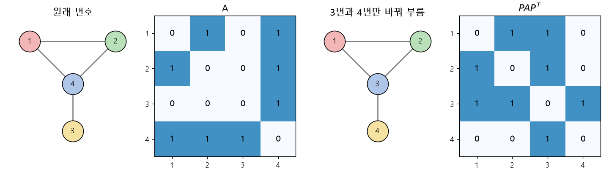

# 인접 행렬과 순열 (Adjacency matrix, Permutation)

[목차로 돌아가기](../../00_MIT%EB%94%A5%EB%9F%AC%EB%8B%9D_%EB%AA%A9%EC%B0%A8.md) · 먼저 볼 것: [M05_벡터와_행렬](../../%EC%88%98%ED%95%99%EA%B0%9C%EB%85%90/03_%EC%84%A0%ED%98%95%EB%8C%80%EC%88%98/M05_%EB%B2%A1%ED%84%B0%EC%99%80_%ED%96%89%EB%A0%AC.md), [MM03_벡터_표기와_전치](../../%EC%88%98%ED%95%99%EA%B0%9C%EB%85%90/03_%EC%84%A0%ED%98%95%EB%8C%80%EC%88%98/MM03_%EB%B2%A1%ED%84%B0_%ED%91%9C%EA%B8%B0%EC%99%80_%EC%A0%84%EC%B9%98.md) · 쓰는 곳: [Lec05 3절](../../Lec05_%EA%B7%B8%EB%9E%98%ED%94%84_%EC%8B%A0%EA%B2%BD%EB%A7%9D.md#3-%EA%B7%B8%EB%9E%98%ED%94%84%EB%A5%BC-%EC%9E%85%EB%A0%A5%EC%9C%BC%EB%A1%9C-%ED%91%9C%ED%98%84%ED%95%98%EA%B8%B0), [Lec05 4절](../../Lec05_%EA%B7%B8%EB%9E%98%ED%94%84_%EC%8B%A0%EA%B2%BD%EB%A7%9D.md#4-mlp%EC%97%90-%EA%B7%B8%EB%8C%80%EB%A1%9C-%EB%84%A3%EC%9C%BC%EB%A9%B4-%EC%95%88-%EB%90%98%EB%8A%94-%EC%9D%B4%EC%9C%A0), [Lec05 6.1](../../Lec05_%EA%B7%B8%EB%9E%98%ED%94%84_%EC%8B%A0%EA%B2%BD%EB%A7%9D.md#61-%EC%A7%91%EA%B3%84%EC%99%80-%EA%B0%B1%EC%8B%A0)

📚 학습 순서 52/99 (7. 구조 아키텍처): ← 이전: [MM17_사인파_위치_인코딩](../../%EC%88%98%ED%95%99%EA%B0%9C%EB%85%90/07_%EA%B5%AC%EC%A1%B0_%EC%95%84%ED%82%A4%ED%85%8D%EC%B2%98/MM17_%EC%82%AC%EC%9D%B8%ED%8C%8C_%EC%9C%84%EC%B9%98_%EC%9D%B8%EC%BD%94%EB%94%A9.md) · 다음: [MM19_멀티셋_집계_함수](../../%EC%88%98%ED%95%99%EA%B0%9C%EB%85%90/07_%EA%B5%AC%EC%A1%B0_%EC%95%84%ED%82%A4%ED%85%8D%EC%B2%98/MM19_%EB%A9%80%ED%8B%B0%EC%85%8B_%EC%A7%91%EA%B3%84_%ED%95%A8%EC%88%98.md) →

> [!NOTE]
> **3줄 요약**
> - [인접 행렬](../../00_%EB%94%A5%EB%9F%AC%EB%8B%9D_%EC%9A%A9%EC%96%B4%EC%82%AC%EC%A0%84.md#adjacency-matrix-%EC%9D%B8%EC%A0%91-%ED%96%89%EB%A0%AC) $A$는 "i번과 j번 노드가 이어져 있으면 $A_{ij} = 1$"인 표다. 행의 합이 그 노드의 이웃 수(차수)이고, $A\mathbf{x}$는 **노드마다 이웃 값의 합**이다.
> - 노드 번호는 사람이 아무렇게나 붙인 것이다. 번호를 바꾸는 일은 순열 행렬 $P$로 $A \to PAP^\top$, $X \to PX$라고 쓴다. 그래프는 그대로인데 행렬 숫자는 바뀐다.
> - 그래서 그래프 전체에 대한 답은 [순열 불변](../../00_%EB%94%A5%EB%9F%AC%EB%8B%9D_%EC%9A%A9%EC%96%B4%EC%82%AC%EC%A0%84.md#permutation-invariance-permutation-equivariance-%EC%88%9C%EC%97%B4-%EB%B6%88%EB%B3%80%EC%84%B1%EA%B3%BC-%EC%88%9C%EC%97%B4-%EB%93%B1%EB%B3%80%EC%84%B1) $f(PAP^\top, PX) = f(A, X)$, 노드별 답은 순열 등변 $f(PAP^\top, PX) = P f(A, X)$이어야 한다. $A\mathbf{x}$는 등변, 그 합은 불변이다.

## 1. 개념 설명

비유: 반 친구 4명의 "누가 누구와 친한가"를 출석부 번호로 적은 표가 [인접 행렬](../../00_%EB%94%A5%EB%9F%AC%EB%8B%9D_%EC%9A%A9%EC%96%B4%EC%82%AC%EC%A0%84.md#adjacency-matrix-%EC%9D%B8%EC%A0%91-%ED%96%89%EB%A0%AC)이다. 출석부 번호를 다시 매기면 표의 숫자 배치는 달라지지만, 실제 친구 관계는 하나도 바뀌지 않는다. 표를 한 줄로 펴서 외우는 방법(MLP)은 번호가 바뀌면 다른 반으로 착각한다. "내 친구들 값의 합"처럼 번호와 상관없는 계산만 써야 같은 반으로 알아본다.

- **[그래프](../../00_%EB%94%A5%EB%9F%AC%EB%8B%9D_%EC%9A%A9%EC%96%B4%EC%82%AC%EC%A0%84.md#graph-node-edge-%EA%B7%B8%EB%9E%98%ED%94%84-%EB%85%B8%EB%93%9C-%EC%97%A3%EC%A7%80)**: 노드(점) $n$개와 엣지(선)로 이루어진다. 노드마다 $d$차원 속성 벡터가 있어 $n \times d$ 행렬 $X$로 모은다.
- **[인접 행렬](../../00_%EB%94%A5%EB%9F%AC%EB%8B%9D_%EC%9A%A9%EC%96%B4%EC%82%AC%EC%A0%84.md#adjacency-matrix-%EC%9D%B8%EC%A0%91-%ED%96%89%EB%A0%AC)** $A$ ($n \times n$): $A_{ij} = 1$이면 i와 j가 이웃, 0이면 아니다. 방향이 없는 그래프라 $A = A^\top$(대칭)이다.
- **순열 행렬** $P$: 단위 행렬의 행 순서를 바꾼 것. $PX$는 X의 행(노드) 순서를 바꾸고, $PAP^\top$는 A의 행과 열을 똑같이 바꾼다.

$$
(A\mathbf{x})_i = \sum_{j} A_{ij} x_j = \sum_{j \in \mathcal{N}(i)} x_j
$$

<details><summary>기호 풀이</summary>

| 기호 | 읽는 법 | 뜻 | 예제 값 |
| --- | --- | --- | --- |
| $A$ | 에이 | [인접 행렬](../../00_%EB%94%A5%EB%9F%AC%EB%8B%9D_%EC%9A%A9%EC%96%B4%EC%82%AC%EC%A0%84.md#adjacency-matrix-%EC%9D%B8%EC%A0%91-%ED%96%89%EB%A0%AC) | 3절의 4×4 행렬 |
| $\mathbf{x}$ | 엑스 벡터 | 노드마다 값 하나를 모은 벡터 | (2, 0, 1, 5) |
| $(A\mathbf{x})_i$ | 에이 엑스의 i번째 | [행렬 곱](../../00_%EB%94%A5%EB%9F%AC%EB%8B%9D_%EC%9A%A9%EC%96%B4%EC%82%AC%EC%A0%84.md#matrix-multiplication-%ED%96%89%EB%A0%AC-%EA%B3%B1) 결과의 i번째 칸 | $(A\mathbf{x})_1 = 5$ |
| $i$, $j$ | 아이, 제이 | 행 번호(받는 노드), 열 번호(보내는 노드) | $i = 1$ |
| $A_{ij}$ | 에이 아이 제이 | i와 j가 이웃이면 1, 아니면 0 | $A_{12} = 1$, $A_{13} = 0$ |
| $x_j$ | 엑스 제이 | 노드 j의 값 | $x_4 = 5$ |
| $\sum_{j}$ | 시그마 제이 | 모든 j에 대해 더함 | 4칸을 더함 |
| $\mathcal{N}(i)$ | 엔 오브 아이 | i의 이웃 집합 | $\mathcal{N}(1) = \{2, 4\}$ |

</details>

<details><summary>예제와 풀이</summary>

**문제**: 노드 1~4의 값이 $\mathbf{x}$일 때, 노드 1이 받는 이웃 값의 합 $(A\mathbf{x})_1$을 구하라.

**주어진 값**:
- $i = 1$ (값을 구할 노드)
- $A$의 1행 $= (A_{11}, A_{12}, A_{13}, A_{14}) = (0, 1, 0, 1)$ (3절의 [인접 행렬](../../00_%EB%94%A5%EB%9F%AC%EB%8B%9D_%EC%9A%A9%EC%96%B4%EC%82%AC%EC%A0%84.md#adjacency-matrix-%EC%9D%B8%EC%A0%91-%ED%96%89%EB%A0%AC), 노드 1은 2, 4와 이어짐)
- $\mathbf{x} = (x_1, x_2, x_3, x_4) = (2, 0, 1, 5)$ (노드 1~4의 값)
- $\mathcal{N}(1) = \{2, 4\}$ (노드 1의 이웃)

**풀이**
1. 식을 그대로 쓴다: $(A\mathbf{x})_i = \sum_{j} A_{ij} x_j = \sum_{j \in \mathcal{N}(i)} x_j$
2. 값을 대입한다: $(A\mathbf{x})_1 = \sum_{j=1}^{4} A_{1j} x_j = \sum_{j \in \{2, 4\}} x_j$
3. 시그마를 j = 1, 2, 3, 4로 풀어 값을 넣는다: $0 \times 2 + 1 \times 0 + 0 \times 1 + 1 \times 5$
4. 첫 곱셈을 한다: $0 \times 2 = 0$ 이므로 $0 + 1 \times 0 + 0 \times 1 + 1 \times 5$
5. 둘째 곱셈을 한다: $1 \times 0 = 0$ 이므로 $0 + 0 + 0 \times 1 + 1 \times 5$
6. 셋째 곱셈을 한다: $0 \times 1 = 0$ 이므로 $0 + 0 + 0 + 1 \times 5$
7. 넷째 곱셈을 한다: $1 \times 5 = 5$ 이므로 $0 + 0 + 0 + 5$
8. 앞의 0들을 더한다: $0 + 0 + 0 = 0$ 이므로 $0 + 5$
9. 마지막 덧셈을 한다: $0 + 5 = 5$
10. 오른쪽 식으로 확인한다: 이웃 2, 4의 값만 더하면 $x_2 + x_4 = 0 + 5 = 5$ 로 같다

**답**: $(A\mathbf{x})_1 = 5$

</details>

<details><summary>내 이해</summary>


</details>

## 2. 필요한 이유

[Lec05 4절](../../Lec05_%EA%B7%B8%EB%9E%98%ED%94%84_%EC%8B%A0%EA%B2%BD%EB%A7%9D.md#4-mlp%EC%97%90-%EA%B7%B8%EB%8C%80%EB%A1%9C-%EB%84%A3%EC%9C%BC%EB%A9%B4-%EC%95%88-%EB%90%98%EB%8A%94-%EC%9D%B4%EC%9C%A0)에서 강사는 "[인접 행렬](../../00_%EB%94%A5%EB%9F%AC%EB%8B%9D_%EC%9A%A9%EC%96%B4%EC%82%AC%EC%A0%84.md#adjacency-matrix-%EC%9D%B8%EC%A0%91-%ED%96%89%EB%A0%AC)과 노드 속성을 한 줄로 펴서 MLP에 넣으면 왜 안 되나?"를 묻습니다. 답은 **노드 번호를 바꾸면 같은 그래프가 다른 입력이 되기 때문**입니다. 그래서 [GNN](../../00_%EB%94%A5%EB%9F%AC%EB%8B%9D_%EC%9A%A9%EC%96%B4%EC%82%AC%EC%A0%84.md#gnn-graph-neural-network-%EA%B7%B8%EB%9E%98%ED%94%84-%EC%8B%A0%EA%B2%BD%EB%A7%9D)은 번호에 영향받지 않는 계산(이웃 값의 합 같은 집계)만 씁니다. [6.1](../../Lec05_%EA%B7%B8%EB%9E%98%ED%94%84_%EC%8B%A0%EA%B2%BD%EB%A7%9D.md#61-%EC%A7%91%EA%B3%84%EC%99%80-%EA%B0%B1%EC%8B%A0)의 집계를 합으로 하면 그대로 $A X$가 됩니다.

## 3. 숫자로 보기

강의 슬라이드 [18:20]의 그래프를 쓴다. 노드 4가 1, 2, 3과 이어져 있고, 1과 2도 이어져 있다.

$$
A = \begin{pmatrix} 0&1&0&1 \\ 1&0&0&1 \\ 0&0&0&1 \\ 1&1&1&0 \end{pmatrix}
$$

<details><summary>기호 풀이</summary>

| 기호 | 읽는 법 | 뜻 | 예제 값 |
| --- | --- | --- | --- |
| $A$ | 에이 | [인접 행렬](../../00_%EB%94%A5%EB%9F%AC%EB%8B%9D_%EC%9A%A9%EC%96%B4%EC%82%AC%EC%A0%84.md#adjacency-matrix-%EC%9D%B8%EC%A0%91-%ED%96%89%EB%A0%AC) | 4×4 |
| $A_{ij}$ | 에이 아이 제이 | i행 j열 칸. 1이면 i와 j가 이웃 | $A_{24} = 1$ |
| i행 | 아이 행 | 노드 i가 누구와 이어졌는지 표시한 줄 | 2행 = (1, 0, 0, 1) |
| 0, 1 | 영, 일 | 엣지 없음, 엣지 있음 | - |

</details>

<details><summary>예제와 풀이</summary>

**문제**: 위 [인접 행렬](../../00_%EB%94%A5%EB%9F%AC%EB%8B%9D_%EC%9A%A9%EC%96%B4%EC%82%AC%EC%A0%84.md#adjacency-matrix-%EC%9D%B8%EC%A0%91-%ED%96%89%EB%A0%AC) $A$에서 노드 2의 이웃과 차수(이웃 수)를 구하고, $A_{24}$와 $A_{42}$가 같은지 확인하라.

**주어진 값**:
- $A$ (위 4×4 [인접 행렬](../../00_%EB%94%A5%EB%9F%AC%EB%8B%9D_%EC%9A%A9%EC%96%B4%EC%82%AC%EC%A0%84.md#adjacency-matrix-%EC%9D%B8%EC%A0%91-%ED%96%89%EB%A0%AC), 칸이 1이면 두 노드가 이웃)
- 노드 2 (이웃을 찾을 노드, 곧 2행)

**풀이**
1. 식을 그대로 쓴다: $A = \begin{pmatrix} 0&1&0&1 \\ 1&0&0&1 \\ 0&0&0&1 \\ 1&1&1&0 \end{pmatrix}$
2. 값을 대입한다: 2행을 읽으면 $(A_{21}, A_{22}, A_{23}, A_{24}) = (1, 0, 0, 1)$
3. 1인 칸을 찾는다: 1열과 4열이 1이라 이웃은 {1, 4}
4. 차수는 행의 합이다. 첫 덧셈을 한다: $1 + 0 = 1$ 이므로 $1 + 0 + 1$
5. 다음 덧셈을 한다: $1 + 0 = 1$ 이므로 $1 + 1$
6. 마지막 덧셈을 한다: $1 + 1 = 2$ 이므로 차수는 2
7. 대칭을 확인한다: 2행 4열 $A_{24} = 1$, 4행 2열 $A_{42} = 1$ 이라 같다

**답**: 이웃 {1, 4}, 차수 2, $A_{24} = A_{42} = 1$

</details>

<details><summary>내 이해</summary>


</details>

**차수 (행의 합)**
- 1행: 0+1+0+1 = 2
- 2행: 1+0+0+1 = 2
- 3행: 0+0+0+1 = 1
- 4행: 1+1+1+0 = **3** ← 강의에서 "1이 세 개인 행은 파란 노드"라고 맞힌 근거

**이웃 값의 합 $A\mathbf{x}$**, $\mathbf{x} = (1, 2, 3, 4)$
- 노드 1: 이웃 2, 4 → 2 + 4 = 6
- 노드 2: 이웃 1, 4 → 1 + 4 = 5
- 노드 3: 이웃 4 → 4
- 노드 4: 이웃 1, 2, 3 → 1 + 2 + 3 = 6
- $A\mathbf{x} = (6, 5, 4, 6)$

**번호 바꾸기**: 3번과 4번의 이름만 맞바꾼다 ($P$ = 단위 행렬의 3행과 4행을 바꾼 것).

| | 원래 | 번호를 바꾼 뒤 |
|---|---|---|
| [인접 행렬](../../00_%EB%94%A5%EB%9F%AC%EB%8B%9D_%EC%9A%A9%EC%96%B4%EC%82%AC%EC%A0%84.md#adjacency-matrix-%EC%9D%B8%EC%A0%91-%ED%96%89%EB%A0%AC) | $A$ (위) | $PAP^\top = \begin{pmatrix} 0&1&1&0 \\ 1&0&1&0 \\ 1&1&0&1 \\ 0&0&1&0 \end{pmatrix}$ (슬라이드와 같음) |
| 노드 값 | (1, 2, 3, 4) | $P\mathbf{x}$ = (1, 2, 4, 3) |
| 이웃 합 | (6, 5, 4, 6) | (6, 5, **6, 4**) = 원래 결과를 같은 방식으로 섞은 것 → **등변** |
| 이웃 합의 총합 | 21 | 21 → **불변** |
| 한 줄로 편 A | 0101 1001 0001 1110 | 0110 1010 1101 0010 → **다른 입력** (MLP는 다른 그래프로 봄) |



<details><summary>기호 풀이</summary>

| 기호 | 읽는 법 | 뜻 | 예제 값 |
| --- | --- | --- | --- |
| $A$ | 에이 | [인접 행렬](../../00_%EB%94%A5%EB%9F%AC%EB%8B%9D_%EC%9A%A9%EC%96%B4%EC%82%AC%EC%A0%84.md#adjacency-matrix-%EC%9D%B8%EC%A0%91-%ED%96%89%EB%A0%AC), $n \times n$ | 위 4×4 행렬 |
| $A_{ij}$ | 에이 아이 제이 | i와 j가 이어졌으면 1 | $A_{14} = 1$, $A_{13} = 0$ |
| $X$ | 엑스 | 노드 속성 행렬, $n \times d$ | 여기서는 $d = 1$, (1, 2, 3, 4) |
| $\mathcal{N}(i)$ | 엔 오브 아이 | i의 이웃 집합 | $\mathcal{N}(4) = \{1, 2, 3\}$ |
| $P$ | 피 | 순열 행렬 (행 순서를 바꾼 단위 행렬) | 3행과 4행을 바꾼 것 |
| $P^\top$ | 피 [전치](../../00_%EB%94%A5%EB%9F%AC%EB%8B%9D_%EC%9A%A9%EC%96%B4%EC%82%AC%EC%A0%84.md#transpose-%EC%A0%84%EC%B9%98) | P의 [전치](../../00_%EB%94%A5%EB%9F%AC%EB%8B%9D_%EC%9A%A9%EC%96%B4%EC%82%AC%EC%A0%84.md#transpose-%EC%A0%84%EC%B9%98). 열 순서를 같은 방식으로 바꿈 | - |
| $f(PAP^\top, PX) = f(A, X)$ | - | 순열 불변 (그래프 전체 답) | 총합 21 = 21 |
| $f(PAP^\top, PX) = Pf(A, X)$ | - | 순열 등변 (노드별 답) | (6, 5, 6, 4) |

</details>

## 4. 코드로 확인

```python
# [함수] np.array: 리스트를 행렬로 만든다
# [변수] A: 강의 슬라이드의 인접 행렬. A[i, j] = 1이면 i번과 j번 노드가 이웃이다
# [연결] 본문 3절의 A, Lec05 4절 슬라이드
A = np.array([[0, 1, 0, 1], [1, 0, 0, 1], [0, 0, 0, 1], [1, 1, 1, 0]])
# [함수] A.sum(axis=1): 행마다 더한다 = 행마다 1의 개수
# [변수] deg = [2 2 1 3]: 노드마다 이웃 수(차수). 4번 노드만 3이다
# [연결] 본문 3절 "차수" 계산
deg = A.sum(axis=1)
# [함수] print: 화면에 출력
print(deg)
# [변수] x: 노드마다 값 하나 (1, 2, 3, 4). 속성 행렬 X를 열 하나로 줄인 것
# [연결] Lec05 그림 ①의 입력 h(0)
x = np.array([1, 2, 3, 4])
# [함수] @: 행렬 곱. A의 i행이 x에서 i의 이웃 칸만 골라 더한다
# [변수] m = [6 5 4 6]: 노드마다 이웃 값의 합 = 합 집계 메시지
# [쓸모] GNN 한 층의 집계를 행렬 곱 한 번으로 계산할 수 있다
# [연결] Lec05 6.1 집계, 그림 ②
m = A @ x
print(m)
# [함수] np.eye(4, dtype=int): 4×4 단위 행렬. [[0, 1, 3, 2]]: 행을 0, 1, 3, 2 순서로 다시 뽑는다
# [변수] P: 3번과 4번의 이름을 맞바꾸는 순열 행렬
P = np.eye(4, dtype=int)[[0, 1, 3, 2]]
# [함수] P.T: P의 전치. P @ A @ P.T는 A의 행과 열을 같은 방식으로 바꾼다
# [변수] A2: 번호만 바꾼 같은 그래프의 인접 행렬
# [연결] 슬라이드 [22:00]의 PAPᵀ와 같은 행렬
A2 = P @ A @ P.T
print(A2)
# [함수] (A2 == A).all(): 모든 칸이 같으면 True
# [쓸모] False이므로 행렬을 펴서 넣는 MLP에게는 다른 입력이다 (본문 3절 표 마지막 줄)
print((A2 == A).all())
# [변수] m2 = [6 5 6 4]: 번호를 바꾼 그래프와 값으로 다시 계산한 이웃 합
m2 = A2 @ (P @ x)
# [연결] 등변성: m2가 원래 결과 m을 같은 순서로 섞은 P @ m과 같다
print(m2, P @ m, (m2 == P @ m).all())
# [함수] .sum(): 모든 원소의 합. 그래프 전체를 숫자 하나로 모으는 리드아웃
# [연결] 불변성: 번호를 바꿔도 21 그대로 (Lec05 6.5 리드아웃)
print(m.sum(), m2.sum())
```

**실행 결과**:

```text
[2 2 1 3]
[6 5 4 6]
[[0 1 1 0]
 [1 0 1 0]
 [1 1 0 1]
 [0 0 1 0]]
False
[6 5 6 4] [6 5 6 4] True
21 21
```

> [!WARNING]
> **⚠ 주의**
> - $PAP^\top$에서 $P^\top$를 빼먹고 $PA$만 쓰면 행만 바뀌고 열은 그대로라 **다른 그래프**가 된다. 노드 이름은 행과 열 양쪽에 붙어 있다.
> - 등변은 "결과가 같다"가 아니라 "결과가 **입력과 같은 방식으로 섞인다**"는 뜻이다. (6, 5, 4, 6)과 (6, 5, 6, 4)는 숫자 배치가 다르지만 등변이다.
> - [인접 행렬](../../00_%EB%94%A5%EB%9F%AC%EB%8B%9D_%EC%9A%A9%EC%96%B4%EC%82%AC%EC%A0%84.md#adjacency-matrix-%EC%9D%B8%EC%A0%91-%ED%96%89%EB%A0%AC)은 $n^2$칸이라 노드가 많으면 대부분이 0이다. 실제 라이브러리는 엣지 목록([희소 표현](../../00_%EB%94%A5%EB%9F%AC%EB%8B%9D_%EC%9A%A9%EC%96%B4%EC%82%AC%EC%A0%84.md#sparse-representation-%ED%9D%AC%EC%86%8C-%ED%91%9C%ED%98%84))으로 저장한다.

## 5. 개념 재확인

<details><summary>1. 같은 그래프에서 노드 값이 $\mathbf{x} = (2, 0, 1, 3)$이면 이웃 합 $A\mathbf{x}$는?</summary>

| 단계 | 하는 일 | 식 | 계산 | 결과 |
|---|---|---|---|---|
| 1 | 노드 1 (이웃 2, 4) | $x_2 + x_4$ | 0 + 3 | 3 |
| 2 | 노드 2 (이웃 1, 4) | $x_1 + x_4$ | 2 + 3 | 5 |
| 3 | 노드 3 (이웃 4) | $x_4$ | 3 | 3 |
| 4 | 노드 4 (이웃 1, 2, 3) | $x_1 + x_2 + x_3$ | 2 + 0 + 1 | 3 |

**① 쓰는 식**
$$(A\mathbf{x})_i = \sum_{j \in \mathcal{N}(i)} x_j$$
- 위 식 ← ② ~ ⑤에서 노드마다 이웃만 골라 더할 때 쓴다.
```python
# [변수] A: 본문과 같은 인접 행렬, x: 문제에서 준 노드 값
A = np.array([[0, 1, 0, 1], [1, 0, 0, 1], [0, 0, 0, 1], [1, 1, 1, 0]])   # ①
x = np.array([2, 0, 1, 3])                                               # ①
# [함수] @: 행렬 곱. 네 노드의 이웃 합 ②~⑤를 한 번에 계산한다
# [연결] 결과 [3 5 3 3]이 아래 단계별 풀이와 같다
print(A @ x)                                                             # ②③④⑤
```

**주어진 값**
- $A = \begin{pmatrix} 0&1&0&1 \\ 1&0&0&1 \\ 0&0&0&1 \\ 1&1&1&0 \end{pmatrix}$ (본문과 같은 [인접 행렬](../../00_%EB%94%A5%EB%9F%AC%EB%8B%9D_%EC%9A%A9%EC%96%B4%EC%82%AC%EC%A0%84.md#adjacency-matrix-%EC%9D%B8%EC%A0%91-%ED%96%89%EB%A0%AC))
- $\mathbf{x} = (x_1, x_2, x_3, x_4) = (2, 0, 1, 3)$ (노드 1~4의 값)

**② 노드 1**
- 식을 쓴다: $(A\mathbf{x})_i = \sum_{j} A_{ij} x_j$
- 시그마를 j = 1~4로 풀어 값을 대입한다 (i = 1, A의 1행은 (0, 1, 0, 1)): $(A\mathbf{x})_1 = 0 \times 2 + 1 \times 0 + 0 \times 1 + 1 \times 3$
- 곱셈을 한다: 0 × 2 = 0, 1 × 0 = 0, 0 × 1 = 0, 1 × 3 = 3 이므로 $0 + 0 + 0 + 3$
- 덧셈을 한다: 0 + 0 + 0 + 3 = 3
- 확인한다: 이웃 2, 4의 값만 더하면 $x_2 + x_4 = 0 + 3 = 3$

**③ 노드 2**
- 값을 대입한다 (A의 2행은 (1, 0, 0, 1)): $(A\mathbf{x})_2 = 1 \times 2 + 0 \times 0 + 0 \times 1 + 1 \times 3$
- 곱셈을 한다: 1 × 2 = 2, 0 × 0 = 0, 0 × 1 = 0, 1 × 3 = 3 이므로 $2 + 0 + 0 + 3$
- 덧셈을 한다: 2 + 0 + 0 + 3 = 5

**④ 노드 3**
- 값을 대입한다 (A의 3행은 (0, 0, 0, 1)): $(A\mathbf{x})_3 = 0 \times 2 + 0 \times 0 + 0 \times 1 + 1 \times 3$
- 곱셈을 한다: 0, 0, 0, 3 이므로 $0 + 0 + 0 + 3$
- 덧셈을 한다: 0 + 0 + 0 + 3 = 3

**⑤ 노드 4**
- 값을 대입한다 (A의 4행은 (1, 1, 1, 0)): $(A\mathbf{x})_4 = 1 \times 2 + 1 \times 0 + 1 \times 1 + 0 \times 3$
- 곱셈을 한다: 1 × 2 = 2, 1 × 0 = 0, 1 × 1 = 1, 0 × 3 = 0 이므로 $2 + 0 + 1 + 0$
- 덧셈을 한다: 2 + 0 + 1 + 0 = 3

**답**: $A\mathbf{x}$ = **(3, 5, 3, 3)**

</details>

<details><summary>2. 1번과 2번의 이름을 맞바꾸는 순열 $Q$로 $QAQ^\top$를 만들면 A와 같은가? 이유는?</summary>

| 단계 | 하는 일 | 계산 | 결과 |
|---|---|---|---|
| 1 | Q 만들기 | 단위 행렬의 1행과 2행을 바꿈 | Q |
| 2 | 행 바꾸기 (QA) | A의 1행 ↔ 2행 | (1,0,0,1), (0,1,0,1), ... |
| 3 | 열 바꾸기 ($QAQ^\top$) | 1열 ↔ 2열 | (0,1,0,1), (1,0,0,1), ... |
| 4 | 비교 | A와 칸마다 비교 | 같음 |

**① 쓰는 식**
$$A \;\to\; QAQ^\top \quad (\text{행과 열을 같은 방식으로 바꿈})$$
- 위 식 ← ③ (행), ④ (열)에서 쓰고, ⑤에서 A와 비교한다.
```python
# [변수] A: 본문과 같은 인접 행렬
A = np.array([[0, 1, 0, 1], [1, 0, 0, 1], [0, 0, 0, 1], [1, 1, 1, 0]])
# [변수] Q: 1번과 2번(코드 번호 0과 1)을 맞바꾸는 순열 행렬
Q = np.eye(4, dtype=int)[[1, 0, 2, 3]]                                   # ②
# [함수] Q @ A: 행 바꾸기, @ Q.T: 열 바꾸기. == A ... .all(): 모든 칸이 같은지
# [연결] 결과 True: 이름을 바꿔도 행렬까지 그대로인 특별한 경우
print((Q @ A @ Q.T == A).all())                                          # ③④⑤
```

**주어진 값**
- $A = \begin{pmatrix} 0&1&0&1 \\ 1&0&0&1 \\ 0&0&0&1 \\ 1&1&1&0 \end{pmatrix}$
- $Q$ = 단위 행렬의 1행과 2행을 맞바꾼 순열 행렬

**② Q 만들기**
- 식을 쓴다: $Q$ = 단위 행렬 $I$의 1행과 2행을 바꾼 것
- $I = \begin{pmatrix} 1&0&0&0 \\ 0&1&0&0 \\ 0&0&1&0 \\ 0&0&0&1 \end{pmatrix}$ 에서 1행 (1,0,0,0)과 2행 (0,1,0,0)을 맞바꾼다: $Q = \begin{pmatrix} 0&1&0&0 \\ 1&0&0&0 \\ 0&0&1&0 \\ 0&0&0&1 \end{pmatrix}$ ($Q^\top = Q$)

**③ 행 바꾸기 ($QA$)**
- 식을 쓴다: $QA$의 i행 = ($Q$의 i행과 $A$의 각 열을 칸끼리 곱해 더한 값)
- 값을 대입한다 (1행, Q의 1행은 (0, 1, 0, 0)): $0 \times (A\text{의 1행}) + 1 \times (A\text{의 2행}) + 0 \times (A\text{의 3행}) + 0 \times (A\text{의 4행})$
- 계산한다: 결국 A의 2행만 남으므로 $QA$의 1행 = (1, 0, 0, 1)
- 같은 방식으로 2행은 A의 1행 (0, 1, 0, 1), 3행과 4행은 그대로다: $QA = \begin{pmatrix} 1&0&0&1 \\ 0&1&0&1 \\ 0&0&0&1 \\ 1&1&1&0 \end{pmatrix}$

**④ 열 바꾸기 ($QAQ^\top$)**
- 식을 쓴다: 오른쪽에 $Q^\top$를 곱하면 1열과 2열이 서로 바뀐다
- 값을 대입한다: $QAQ^\top = (QA)\,Q^\top$, 각 행 $(a, b, c, d)$가 $(b, a, c, d)$로 바뀐다
- 1행: (1, 0, 0, 1) → (0, 1, 0, 1)
- 2행: (0, 1, 0, 1) → (1, 0, 0, 1)
- 3행: (0, 0, 0, 1) → 앞 두 칸이 같아 (0, 0, 0, 1) 그대로
- 4행: (1, 1, 1, 0) → 앞 두 칸이 같아 (1, 1, 1, 0) 그대로
- 모으면 $QAQ^\top = \begin{pmatrix} 0&1&0&1 \\ 1&0&0&1 \\ 0&0&0&1 \\ 1&1&1&0 \end{pmatrix}$

**⑤ 비교**
- 네 행을 A의 행과 하나씩 비교한다: (0,1,0,1) = (0,1,0,1), (1,0,0,1) = (1,0,0,1), (0,0,0,1) = (0,0,0,1), (1,1,1,0) = (1,1,1,0)

**답**: **같다**. 노드 1과 2는 둘 다 "서로 이어져 있고 4와도 이어진" 똑같은 자리라서, 이름을 바꿔도 구조가 그대로다. 이런 대칭이 있으면 [GNN](../../00_%EB%94%A5%EB%9F%AC%EB%8B%9D_%EC%9A%A9%EC%96%B4%EC%82%AC%EC%A0%84.md#gnn-graph-neural-network-%EA%B7%B8%EB%9E%98%ED%94%84-%EC%8B%A0%EA%B2%BD%EB%A7%9D)은 두 노드에 **같은 [임베딩](../../00_%EB%94%A5%EB%9F%AC%EB%8B%9D_%EC%9A%A9%EC%96%B4%EC%82%AC%EC%A0%84.md#embedding-%EC%9E%84%EB%B2%A0%EB%94%A9)**을 줄 수밖에 없다([Lec05 9.3](../../Lec05_%EA%B7%B8%EB%9E%98%ED%94%84_%EC%8B%A0%EA%B2%BD%EB%A7%9D.md#93-gnn%EC%9D%B4-%EA%B5%AC%EB%B3%84%ED%95%98%EC%A7%80-%EB%AA%BB%ED%95%98%EB%8A%94-%EA%B7%B8%EB%9E%98%ED%94%84)).

</details>

## 예제 풀기

[예제 10문제 풀기](../../%EC%98%88%EC%A0%9C/07_%EA%B5%AC%EC%A1%B0_%EC%95%84%ED%82%A4%ED%85%8D%EC%B2%98/%EC%98%88%EC%A0%9C_MM18_%EC%9D%B8%EC%A0%91%ED%96%89%EB%A0%AC%EA%B3%BC_%EC%88%9C%EC%97%B4.md)

<details><summary>내 이해</summary>


</details>
