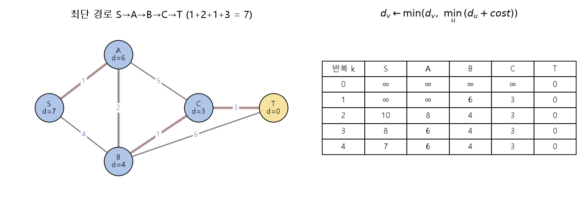

# 최소 집계와 최단 경로 (Bellman-Ford as min-aggregation)

[목차로 돌아가기](../../00_MIT%EB%94%A5%EB%9F%AC%EB%8B%9D_%EB%AA%A9%EC%B0%A8.md) · 먼저 볼 것: [MM01_argmin과_argmax](../../%EC%88%98%ED%95%99%EA%B0%9C%EB%85%90/02_%EB%AF%B8%EB%B6%84/MM01_argmin%EA%B3%BC_argmax.md), [MM19_멀티셋_집계_함수](../../%EC%88%98%ED%95%99%EA%B0%9C%EB%85%90/07_%EA%B5%AC%EC%A1%B0_%EC%95%84%ED%82%A4%ED%85%8D%EC%B2%98/MM19_%EB%A9%80%ED%8B%B0%EC%85%8B_%EC%A7%91%EA%B3%84_%ED%95%A8%EC%88%98.md) · 쓰는 곳: [Lec05 6.3](../../Lec05_%EA%B7%B8%EB%9E%98%ED%94%84_%EC%8B%A0%EA%B2%BD%EB%A7%9D.md#63-%EC%B5%9C%EC%86%8C-%EC%A7%91%EA%B3%84%EB%A1%9C-%EC%B5%9C%EB%8B%A8-%EA%B2%BD%EB%A1%9C-%ED%92%80%EA%B8%B0)

📚 학습 순서 54/99 (7. 구조 아키텍처): ← 이전: [MM19_멀티셋_집계_함수](../../%EC%88%98%ED%95%99%EA%B0%9C%EB%85%90/07_%EA%B5%AC%EC%A1%B0_%EC%95%84%ED%82%A4%ED%85%8D%EC%B2%98/MM19_%EB%A9%80%ED%8B%B0%EC%85%8B_%EC%A7%91%EA%B3%84_%ED%95%A8%EC%88%98.md) · 다음: [MM21_WL_색칠_알고리즘](../../%EC%88%98%ED%95%99%EA%B0%9C%EB%85%90/07_%EA%B5%AC%EC%A1%B0_%EC%95%84%ED%82%A4%ED%85%8D%EC%B2%98/MM21_WL_%EC%83%89%EC%B9%A0_%EC%95%8C%EA%B3%A0%EB%A6%AC%EC%A6%98.md) →

> [!NOTE]
> **3줄 요약**
> - [벨만-포드 알고리즘](../../00_%EB%94%A5%EB%9F%AC%EB%8B%9D_%EC%9A%A9%EC%96%B4%EC%82%AC%EC%A0%84.md#bellman-ford-algorithm-%EB%B2%A8%EB%A7%8C-%ED%8F%AC%EB%93%9C-%EC%95%8C%EA%B3%A0%EB%A6%AC%EC%A6%98)은 노드마다 "목표까지 거리 추정값" $d$를 두고, $d_v \leftarrow \min(d_v,\ \min_{u} (d_u + \text{cost}(u, v)))$를 되풀이한다. 처음에는 목표만 0, 나머지는 ∞.
> - 이 식은 [GNN](../../00_%EB%94%A5%EB%9F%AC%EB%8B%9D_%EC%9A%A9%EC%96%B4%EC%82%AC%EC%A0%84.md#gnn-graph-neural-network-%EA%B7%B8%EB%9E%98%ED%94%84-%EC%8B%A0%EA%B2%BD%EB%A7%9D) 한 [층](../../00_%EB%94%A5%EB%9F%AC%EB%8B%9D_%EC%9A%A9%EC%96%B4%EC%82%AC%EC%A0%84.md#layer-%EC%B8%B5)과 모양이 같다: **이웃 값에 비용을 더하는 것**이 메시지, **min**이 [집계 함수](../../00_%EB%94%A5%EB%9F%AC%EB%8B%9D_%EC%9A%A9%EC%96%B4%EC%82%AC%EC%A0%84.md#aggregation-function-%EC%A7%91%EA%B3%84-%ED%95%A8%EC%88%98), 자기 값과 비교하는 것이 갱신이다.
> - 한 번 반복할 때마다 정보가 한 칸(한 홉) 더 퍼진다. 노드가 $n$개면 $n - 1$번이면 끝난다. 예제(노드 5개)는 4번째 반복에서 S의 거리가 7로 확정된다.

## 1. 개념 설명

비유: 목적지 T에 서 있는 친구가 "나는 0분 거리야"라고 외친다. 바로 옆 사람은 "T까지 길이 3분이니 나는 3분"이라고 다음 사람에게 전한다. 사람들은 이웃이 알려 준 시간에 그 이웃까지 가는 시간을 더하고, 여러 소식 가운데 **가장 짧은 것만** 기억한다. 소식이 한 번 전달될 때마다 한 사람씩 더 멀리 퍼지고, 결국 모두가 자기 최단 시간을 안다.

- 노드 속성 = 스칼라 하나 $d_v$ (목표까지 거리 추정값)
- 메시지 = $d_u + \text{cost}(u, v)$ (이웃 u를 거쳐 갈 때의 거리)
- 집계 = $\min$ (순서와 무관한 [멀티셋](../../00_%EB%94%A5%EB%9F%AC%EB%8B%9D_%EC%9A%A9%EC%96%B4%EC%82%AC%EC%A0%84.md#multiset-%EB%A9%80%ED%8B%B0%EC%85%8B) 함수)
- 갱신 = 지금 값과 메시지 중 작은 것

$$
d_v^{(k)} = \min\Big(d_v^{(k-1)},\ \min_{u \in \mathcal{N}(v)} \big(d_u^{(k-1)} + \text{cost}(u, v)\big)\Big)
$$

<details><summary>기호 풀이</summary>

| 기호 | 읽는 법 | 뜻 | 예제 값 |
| --- | --- | --- | --- |
| $d_v^{(k)}$ | 디 브이 케이 | k번째 반복 뒤 v에서 목표까지 거리 추정값 | $d_B^{(2)} = 4$ |
| $d_v^{(k-1)}$ | 디 브이 케이 마이너스 원 | 지난 반복의 내 추정값 | $d_B^{(1)} = 6$ |
| $d_u^{(k-1)}$ | 디 유 케이 마이너스 원 | 지난 반복의 이웃 u 추정값 | $d_C^{(1)} = 3$ |
| $\text{cost}(u, v)$ | 코스트 유 브이 | u와 v 사이 엣지 길이 | $\text{cost}(C, B) = 1$ |
| $\mathcal{N}(v)$ | 엔 오브 브이 | v의 이웃 집합 | B: {S, A, C, T} |
| $\min_{u \in \mathcal{N}(v)}$ | 민 유 인 엔 오브 브이 | 이웃이 보낸 메시지 중 가장 작은 것 ([집계](../../00_%EB%94%A5%EB%9F%AC%EB%8B%9D_%EC%9A%A9%EC%96%B4%EC%82%AC%EC%A0%84.md#aggregation-function-%EC%A7%91%EA%B3%84-%ED%95%A8%EC%88%98)) | min(∞, ∞, 4, 6) = 4 |
| $\min(\cdot, \cdot)$ | 민 | 지금 값과 메시지 중 작은 것 (갱신) | min(6, 4) = 4 |
| $k$ | 케이 | 반복 번호 | 2 |

</details>

<details><summary>예제와 풀이</summary>

**문제**: 3절 그래프에서 반복 1이 끝난 거리 추정값으로, 반복 2에서 노드 B의 목표 T까지 거리 추정값 $d_B^{(2)}$를 구하라.

**주어진 값**:
- $v = B$, $k = 2$ (값을 새로 구할 노드와 반복 번호)
- $d_B^{(1)} = 6$ (B의 지난 추정값)
- $\mathcal{N}(B) = \{S, A, C, T\}$ (B의 이웃)
- $d_S^{(1)} = \infty$, $d_A^{(1)} = \infty$, $d_C^{(1)} = 3$, $d_T^{(1)} = 0$ (이웃의 지난 추정값)
- $\text{cost}(S, B) = 4$, $\text{cost}(A, B) = 2$, $\text{cost}(C, B) = 1$, $\text{cost}(T, B) = 6$ (B까지 엣지 길이)

**풀이**
1. 식을 그대로 쓴다: $d_v^{(k)} = \min\Big(d_v^{(k-1)},\ \min_{u \in \mathcal{N}(v)} \big(d_u^{(k-1)} + \text{cost}(u, v)\big)\Big)$
2. 값을 대입한다: $d_B^{(2)} = \min\Big(6,\ \min\big(\infty + 4,\ \infty + 2,\ 3 + 1,\ 0 + 6\big)\Big)$
3. ∞와 min의 뜻: ∞(무한대)는 "아직 길을 모름"이고, 무엇을 더해도 ∞이며 어떤 수보다도 크다. $\min(\dots)$은 괄호 안에서 가장 작은 값을 고른다
4. S를 거치는 길을 더한다: $\infty + 4 = \infty$
5. A를 거치는 길을 더한다: $\infty + 2 = \infty$
6. C를 거치는 길을 더한다: $3 + 1 = 4$
7. T로 바로 가는 길을 더한다: $0 + 6 = 6$ 이므로 $\min\big(6,\ \min(\infty, \infty, 4, 6)\big)$
8. 안쪽 min을 고른다: $\infty, \infty, 4, 6$ 중 가장 작은 것은 4 이므로 $\min(6, 4)$
9. 바깥 min을 고른다: 6과 4 중 작은 것은 4

**답**: $d_B^{(2)} = 4$ (B → C → T 경로)

</details>

<details><summary>내 이해</summary>


</details>

## 2. 필요한 이유

[Lec05 6.3](../../Lec05_%EA%B7%B8%EB%9E%98%ED%94%84_%EC%8B%A0%EA%B2%BD%EB%A7%9D.md#63-%EC%B5%9C%EC%86%8C-%EC%A7%91%EA%B3%84%EB%A1%9C-%EC%B5%9C%EB%8B%A8-%EA%B2%BD%EB%A1%9C-%ED%92%80%EA%B8%B0)에서 강사는 고전 알고리즘인 벨만-포드가 "집계를 min으로 둔 [GNN](../../00_%EB%94%A5%EB%9F%AC%EB%8B%9D_%EC%9A%A9%EC%96%B4%EC%82%AC%EC%A0%84.md#gnn-graph-neural-network-%EA%B7%B8%EB%9E%98%ED%94%84-%EC%8B%A0%EA%B2%BD%EB%A7%9D)"으로 그대로 표현된다는 것을 보여 줍니다(슬라이드에서는 [GNN](../../00_%EB%94%A5%EB%9F%AC%EB%8B%9D_%EC%9A%A9%EC%96%B4%EC%82%AC%EC%A0%84.md#gnn-graph-neural-network-%EA%B7%B8%EB%9E%98%ED%94%84-%EC%8B%A0%EA%B2%BD%EB%A7%9D) 쪽 집계가 Σ이고 "sum or max pooling"이라 적혀 있지만, 벨만-포드와 맞추려면 min입니다). 이것이 **[GNN](../../00_%EB%94%A5%EB%9F%AC%EB%8B%9D_%EC%9A%A9%EC%96%B4%EC%82%AC%EC%A0%84.md#gnn-graph-neural-network-%EA%B7%B8%EB%9E%98%ED%94%84-%EC%8B%A0%EA%B2%BD%EB%A7%9D)이 그래프 알고리즘을 흉내 낼 수 있다**는 근거이고, 구글 지도 같은 곳에서 고전 알고리즘보다 빠른 근사 해법을 학습하는 연구(신경 알고리즘 추론, Neural algorithmic reasoning)의 출발점입니다.

## 3. 숫자로 보기

그래프: 노드 S, A, B, C, T. 엣지 비용 S-A 1, S-B 4, A-B 2, A-C 5, B-C 1, C-T 3, B-T 6 (방향 없음). 목표는 T.

**반복 1** (k = 0에서는 T만 0)
- C: min(∞, T+3) = **3**
- B: min(∞, T+6) = **6**
- S, A: 이웃이 모두 ∞라 그대로 ∞

**반복 2**
- S: min(∞, A+1 = ∞, B+4 = 10) = **10**
- A: min(∞, S+1 = ∞, B+2 = 8, C+5 = 8) = **8**
- B: min(6, C+1 = 4, T+6 = 6, ...) = **4** (C를 거치는 길을 찾음)

**반복 3**
- S: min(10, A+1 = 9, B+4 = 8) = **8**
- A: min(8, B+2 = 6, C+5 = 8, S+1 = 11) = **6**

**반복 4**
- S: min(8, A+1 = 7, B+4 = 8) = **7** → S→A→B→C→T = 1 + 2 + 1 + 3 = 7

| 반복 k | S | A | B | C | T |
|---|---|---|---|---|---|
| 0 | ∞ | ∞ | ∞ | ∞ | 0 |
| 1 | ∞ | ∞ | 6 | 3 | 0 |
| 2 | 10 | 8 | 4 | 3 | 0 |
| 3 | 8 | 6 | 4 | 3 | 0 |
| 4 | **7** | 6 | 4 | 3 | 0 |
| 5 | 7 | 6 | 4 | 3 | 0 (더 이상 안 바뀜) |



<details><summary>기호 풀이</summary>

| 기호 | 읽는 법 | 뜻 | 예제 값 |
| --- | --- | --- | --- |
| $d_v^{(k)}$ | 디 브이 케이 | k번 반복 뒤 v의 거리 추정값 | $d_S^{(4)} = 7$ |
| $\text{cost}(u, v)$ | 코스트 | 엣지 u-v의 비용(길이) | cost(B, C) = 1 |
| $\min_{u \in \mathcal{N}(v)}$ | 민 | 이웃 가운데 가장 작은 값 | - |
| ∞ | 무한대 | 아직 길을 모름 | 처음 값 |
| $\lvert S \rvert - 1$ | 노드 수 빼기 1 | 필요한 반복 횟수의 상한 | 5 - 1 = 4 |

</details>

## 4. 코드로 확인

```python
# [변수] W: 엣지와 비용. ("S", "A"): 1은 S와 A 사이 길이가 1이라는 뜻
# [연결] 본문 3절의 그래프, 그림의 보라색 숫자
W = {("S", "A"): 1, ("S", "B"): 4, ("A", "B"): 2, ("A", "C"): 5, ("B", "C"): 1, ("C", "T"): 3, ("B", "T"): 6}
# [변수] nb: 노드마다 {이웃: 비용} 사전. 처음에는 빈 사전 5개
nb = {v: {} for v in "SABCT"}
# [함수] W.items(): (엣지, 비용) 쌍을 하나씩 꺼낸다
for (u, v), c in W.items():
    # [변수] 방향이 없으니 u→v와 v→u를 모두 적는다
    nb[u][v] = c
    nb[v][u] = c
# [함수] float("inf"): 무한대. 아직 길을 모른다는 뜻
# [변수] d: 노드마다 거리 추정값. 목표 T만 0
d = {v: float("inf") for v in "SABCT"}
d["T"] = 0
# [함수] list(d.values()): S, A, B, C, T 순서의 값 목록
print(0, list(d.values()))
# [함수] range(1, 6): 반복 1~5. 노드 5개라 4번이면 충분하고, 5번째는 변화가 없음을 보이려고 넣었다
for k in range(1, 6):
    # [함수] min([...]): 자기 값과 "이웃 값 + 비용" 메시지들 가운데 최솟값 = min 집계 + 갱신
    # [변수] 새 d: 모든 노드를 이전 d로 한꺼번에 갱신 (GNN 한 층과 같음)
    # [연결] 본문 1절의 식, Lec05 6.3 슬라이드의 d[k][u] = min_v d[k-1][v] + cost(v, u)
    d = {v: min([d[v]] + [d[u] + c for u, c in nb[v].items()]) for v in "SABCT"}
    # [연결] 출력 한 줄이 본문 3절 표의 한 행
    print(k, list(d.values()))
```

**실행 결과**:

```text
0 [inf, inf, inf, inf, 0]
1 [inf, inf, 6, 3, 0]
2 [10, 8, 4, 3, 0]
3 [8, 6, 4, 3, 0]
4 [7, 6, 4, 3, 0]
5 [7, 6, 4, 3, 0]
```

> [!WARNING]
> **⚠ 주의**
> - 갱신은 **이전 반복의 값으로 한꺼번에** 해야 [GNN](../../00_%EB%94%A5%EB%9F%AC%EB%8B%9D_%EC%9A%A9%EC%96%B4%EC%82%AC%EC%A0%84.md#gnn-graph-neural-network-%EA%B7%B8%EB%9E%98%ED%94%84-%EC%8B%A0%EA%B2%BD%EB%A7%9D) 한 [층](../../00_%EB%94%A5%EB%9F%AC%EB%8B%9D_%EC%9A%A9%EC%96%B4%EC%82%AC%EC%A0%84.md#layer-%EC%B8%B5)과 같다. 한 노드를 갱신하자마자 그 값을 다른 노드가 바로 쓰면 더 빨리 끝나기도 하지만, 층별 계산과 맞지 않는다.
> - 반복 1~3의 S 값(∞, 10, 8)은 틀린 답이 아니라 "그 홉 수 안에서의 최단 거리"다. [층](../../00_%EB%94%A5%EB%9F%AC%EB%8B%9D_%EC%9A%A9%EC%96%B4%EC%82%AC%EC%A0%84.md#layer-%EC%B8%B5) 수(반복 수)가 부족하면 먼 노드는 [정답](../../00_%EB%94%A5%EB%9F%AC%EB%8B%9D_%EC%9A%A9%EC%96%B4%EC%82%AC%EC%A0%84.md#label-%EC%A0%95%EB%8B%B5)에 도달하지 못한다. [GNN](../../00_%EB%94%A5%EB%9F%AC%EB%8B%9D_%EC%9A%A9%EC%96%B4%EC%82%AC%EC%A0%84.md#gnn-graph-neural-network-%EA%B7%B8%EB%9E%98%ED%94%84-%EC%8B%A0%EA%B2%BD%EB%A7%9D)의 깊이가 [수용 영역](../../Lec05_%EA%B7%B8%EB%9E%98%ED%94%84_%EC%8B%A0%EA%B2%BD%EB%A7%9D.md#91-%EA%B3%84%EC%82%B0-%ED%8A%B8%EB%A6%AC%EC%99%80-%EA%B0%80%EC%A4%91%EC%B9%98-%EA%B3%B5%EC%9C%A0)을 정하는 것과 같다.
> - 비용이 음수인 엣지가 섞이면 벨만-포드는 음수 고리를 따로 검사해야 한다. 이 노트의 예는 모두 양수다.

## 5. 개념 재확인

<details><summary>1. 같은 그래프에서 모든 엣지 비용을 1로 바꾸면 T까지의 거리는? (강의 슬라이드처럼 "한 홉 = 1")</summary>

| 단계 | 하는 일 | 계산 | 결과 |
|---|---|---|---|
| 1 | T와 바로 이웃 | C, B | 1 |
| 2 | 그다음 이웃 | S(B 경유), A(B 또는 C 경유) | 2 |
| 3 | 정리 | | S 2, A 2, B 1, C 1, T 0 |

**① 쓰는 식**
$$d_v \leftarrow \min\big(d_v,\ \min_u (d_u + 1)\big)$$
- 위 식 ← ②, ③에서 쓴다. 비용이 모두 1이면 거리 = 홉 수다.
```python
# [변수] W1: 본문 그래프와 같은 엣지, 비용은 모두 1
W1 = {e: 1 for e in [("S", "A"), ("S", "B"), ("A", "B"), ("A", "C"), ("B", "C"), ("C", "T"), ("B", "T")]}   # ①
# [변수] nb: 노드마다 {이웃: 비용}
nb = {v: {} for v in "SABCT"}
for (u, v), c in W1.items():
    nb[u][v] = c
    nb[v][u] = c
# [변수] d: 목표 T만 0, 나머지는 무한대
d = {v: float("inf") for v in "SABCT"}
d["T"] = 0
# [함수] range(4): 노드 5개 - 1 = 4번 반복
for k in range(4):
    # [연결] 본문 코드와 같은 min 집계 + 갱신
    d = {v: min([d[v]] + [d[u] + c for u, c in nb[v].items()]) for v in "SABCT"}   # ②③
# [연결] {'S': 2, 'A': 2, 'B': 1, 'C': 1, 'T': 0}
print(d)
```

**주어진 값**
- 모든 엣지 비용 $= 1$ (엣지: S-A, S-B, A-B, A-C, B-C, C-T, B-T)
- 처음 값 $d^{(0)}$: T만 0, S, A, B, C는 ∞ (아직 길을 모름)
- 이웃: $\mathcal{N}(C) = \{A, B, T\}$, $\mathcal{N}(B) = \{S, A, C, T\}$, $\mathcal{N}(S) = \{A, B\}$, $\mathcal{N}(A) = \{S, B, C\}$

**② 한 홉 (반복 1)**
- 식을 쓴다: $d_v^{(k)} = \min\Big(d_v^{(k-1)},\ \min_{u \in \mathcal{N}(v)} \big(d_u^{(k-1)} + 1\big)\Big)$
- C에 값을 대입한다: $d_C^{(1)} = \min\big(\infty,\ \min(\infty + 1,\ \infty + 1,\ 0 + 1)\big)$ (이웃 A, B, T)
- 더한다: ∞ + 1 = ∞, 0 + 1 = 1 이므로 $\min\big(\infty,\ \min(\infty, \infty, 1)\big)$
- 가장 작은 값을 고른다: 안쪽 min은 1, 바깥 min(∞, 1) = 1 이므로 $d_C^{(1)} = 1$
- B에 값을 대입한다: $d_B^{(1)} = \min\big(\infty,\ \min(\infty + 1,\ \infty + 1,\ \infty + 1,\ 0 + 1)\big)$ (이웃 S, A, C, T) → 안쪽 min은 1 이므로 $d_B^{(1)} = 1$
- S와 A는 이웃(A, B 또는 S, B, C)이 모두 ∞라 그대로 ∞

**③ 두 홉 (반복 2)**
- S에 값을 대입한다 (반복 1의 값 $d_A = \infty$, $d_B = 1$): $d_S^{(2)} = \min\big(\infty,\ \min(\infty + 1,\ 1 + 1)\big)$
- 더한다: ∞ + 1 = ∞, 1 + 1 = 2 이므로 $\min\big(\infty,\ \min(\infty, 2)\big)$
- 가장 작은 값을 고른다: min(∞, 2) = 2, min(∞, 2) = 2 이므로 $d_S^{(2)} = 2$
- A에 값을 대입한다 (반복 1의 값 $d_S = \infty$, $d_B = 1$, $d_C = 1$): $d_A^{(2)} = \min\big(\infty,\ \min(\infty + 1,\ 1 + 1,\ 1 + 1)\big)$
- 더하고 고른다: ∞ + 1 = ∞, 1 + 1 = 2, 1 + 1 = 2 중 가장 작은 값은 2 이므로 $d_A^{(2)} = 2$

**답**: S **2**, A **2**, B **1**, C **1**, T **0**

</details>

<details><summary>2. 본문 그래프에서 B-C 비용을 1에서 4로 올리면 S의 거리는?</summary>

| 단계 | 하는 일 | 계산 | 결과 |
|---|---|---|---|
| 1 | C (변화 없음) | T+3 | 3 |
| 2 | B | min(T+6, C+4) | 6 |
| 3 | A | min(B+2, C+5) | 8 |
| 4 | S | min(A+1, B+4) | 9 |

**① 쓰는 식**
$$d_v = \min_{u \in \mathcal{N}(v)} \big(d_u + \text{cost}(u, v)\big) \quad (\text{수렴한 뒤})$$
- 위 식 ← ②~⑤에서 T에 가까운 노드부터 차례로 쓴다.
```python
# [변수] W2: 본문 W에서 B-C 비용만 4로 바꾼 그래프
W2 = {("S", "A"): 1, ("S", "B"): 4, ("A", "B"): 2, ("A", "C"): 5, ("B", "C"): 4, ("C", "T"): 3, ("B", "T"): 6}   # ①
nb = {v: {} for v in "SABCT"}
for (u, v), c in W2.items():
    nb[u][v] = c
    nb[v][u] = c
d = {v: float("inf") for v in "SABCT"}
d["T"] = 0
for k in range(4):
    # [연결] min 집계 + 갱신을 4번
    d = {v: min([d[v]] + [d[u] + c for u, c in nb[v].items()]) for v in "SABCT"}   # ②③④⑤
# [연결] {'S': 9, 'A': 8, 'B': 6, 'C': 3, 'T': 0}
print(d)
```

**주어진 값**
- 엣지 비용: S-A 1, S-B 4, A-B 2, A-C 5, **B-C 4** (1에서 바꿈), C-T 3, B-T 6
- 목표 T: $d_T = 0$
- 식 $d_v = \min_{u \in \mathcal{N}(v)} (d_u + \text{cost}(u, v))$ 는 수렴한 뒤의 값에 대해 성립한다. 아직 모르는 값은 더하면 커지기만 하므로, T에 가까운 노드부터 차례로 정한다.

**② C**
- 식을 쓴다: $d_C = \min_{u \in \mathcal{N}(C)} \big(d_u + \text{cost}(u, C)\big)$
- 값을 대입한다 (이웃 T, B, A): $d_C = \min(d_T + 3,\ d_B + 4,\ d_A + 5) = \min(0 + 3,\ d_B + 4,\ d_A + 5)$
- 더한다: 0 + 3 = 3. 아직 모르는 B, A의 값은 0 이상이라 $d_B + 4 \ge 4$, $d_A + 5 \ge 5$ 이다.
- 가장 작은 값을 고른다: 3이 가장 작으므로 $d_C = 3$

**③ B**
- 값을 대입한다 (이웃 T와 C를 쓴다): $d_B = \min(d_T + 6,\ d_C + 4) = \min(0 + 6,\ 3 + 4)$
- 더한다: 0 + 6 = 6, 3 + 4 = 7 이므로 $d_B = \min(6, 7)$
- 가장 작은 값을 고른다: $d_B = 6$ (이제 C를 거치는 길 7이 T로 바로 가는 길 6보다 길다. A, S를 거치는 길은 다시 B나 C를 지나야 하므로 더 길다)

**④ A**
- 값을 대입한다 (이웃 B와 C를 쓴다): $d_A = \min(d_B + 2,\ d_C + 5) = \min(6 + 2,\ 3 + 5)$
- 더한다: 6 + 2 = 8, 3 + 5 = 8 이므로 $d_A = \min(8, 8)$
- 가장 작은 값을 고른다: $d_A = 8$ (두 길이 같다)

**⑤ S**
- 값을 대입한다 (이웃 A와 B): $d_S = \min(d_A + 1,\ d_B + 4) = \min(8 + 1,\ 6 + 4)$
- 더한다: 8 + 1 = 9, 6 + 4 = 10 이므로 $d_S = \min(9, 10)$
- 가장 작은 값을 고른다: $d_S = 9$

**답**: S의 거리는 **9** (예: S→A→B→T = 1 + 2 + 6 또는 S→A→C→T = 1 + 5 + 3). 엣지 하나의 비용이 바뀌자 최단 경로 자체가 달라졌다.

</details>

## 예제 풀기

[예제 10문제 풀기](../../%EC%98%88%EC%A0%9C/07_%EA%B5%AC%EC%A1%B0_%EC%95%84%ED%82%A4%ED%85%8D%EC%B2%98/%EC%98%88%EC%A0%9C_MM20_%EC%B5%9C%EC%86%8C_%EC%A7%91%EA%B3%84%EC%99%80_%EC%B5%9C%EB%8B%A8_%EA%B2%BD%EB%A1%9C.md)

<details><summary>내 이해</summary>


</details>
