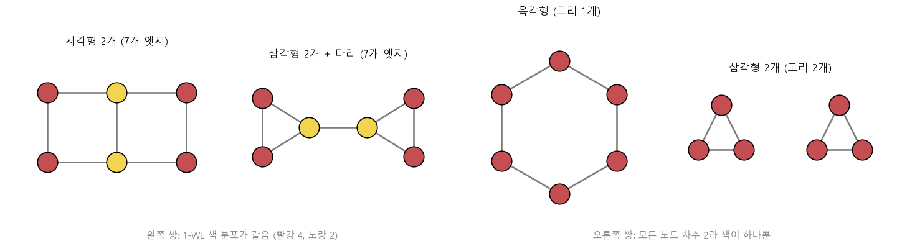

# WL 색칠 알고리즘 (1-WL, Weisfeiler-Leman color refinement)

[목차로 돌아가기](../../00_MIT%EB%94%A5%EB%9F%AC%EB%8B%9D_%EB%AA%A9%EC%B0%A8.md) · 먼저 볼 것: [MM18_인접행렬과_순열](../../%EC%88%98%ED%95%99%EA%B0%9C%EB%85%90/07_%EA%B5%AC%EC%A1%B0_%EC%95%84%ED%82%A4%ED%85%8D%EC%B2%98/MM18_%EC%9D%B8%EC%A0%91%ED%96%89%EB%A0%AC%EA%B3%BC_%EC%88%9C%EC%97%B4.md), [MM19_멀티셋_집계_함수](../../%EC%88%98%ED%95%99%EA%B0%9C%EB%85%90/07_%EA%B5%AC%EC%A1%B0_%EC%95%84%ED%82%A4%ED%85%8D%EC%B2%98/MM19_%EB%A9%80%ED%8B%B0%EC%85%8B_%EC%A7%91%EA%B3%84_%ED%95%A8%EC%88%98.md) · 쓰는 곳: [Lec05 9.3](../../Lec05_%EA%B7%B8%EB%9E%98%ED%94%84_%EC%8B%A0%EA%B2%BD%EB%A7%9D.md#93-gnn%EC%9D%B4-%EA%B5%AC%EB%B3%84%ED%95%98%EC%A7%80-%EB%AA%BB%ED%95%98%EB%8A%94-%EA%B7%B8%EB%9E%98%ED%94%84), [Lec05 9.4](../../Lec05_%EA%B7%B8%EB%9E%98%ED%94%84_%EC%8B%A0%EA%B2%BD%EB%A7%9D.md#94-1-wl-%EC%95%8C%EA%B3%A0%EB%A6%AC%EC%A6%98%EA%B3%BC-%EA%B0%99%EC%9D%80-%EA%B5%AC%EB%B3%84%EB%A0%A5)

📚 학습 순서 55/99 (7. 구조 아키텍처): ← 이전: [MM20_최소_집계와_최단_경로](../../%EC%88%98%ED%95%99%EA%B0%9C%EB%85%90/07_%EA%B5%AC%EC%A1%B0_%EC%95%84%ED%82%A4%ED%85%8D%EC%B2%98/MM20_%EC%B5%9C%EC%86%8C_%EC%A7%91%EA%B3%84%EC%99%80_%EC%B5%9C%EB%8B%A8_%EA%B2%BD%EB%A1%9C.md) · 다음: [MM30_스케일드_내적_어텐션](../../%EC%88%98%ED%95%99%EA%B0%9C%EB%85%90/07_%EA%B5%AC%EC%A1%B0_%EC%95%84%ED%82%A4%ED%85%8D%EC%B2%98/MM30_%EC%8A%A4%EC%BC%80%EC%9D%BC%EB%93%9C_%EB%82%B4%EC%A0%81_%EC%96%B4%ED%85%90%EC%85%98.md) →

> [!NOTE]
> **3줄 요약**
> - [1-WL](../../00_%EB%94%A5%EB%9F%AC%EB%8B%9D_%EC%9A%A9%EC%96%B4%EC%82%AC%EC%A0%84.md#weisfeiler-leman-test-wl-%ED%85%8C%EC%8A%A4%ED%8A%B8)은 모든 노드를 같은 색으로 칠한 뒤, "내 색 + 이웃 색들의 [멀티셋](../../00_%EB%94%A5%EB%9F%AC%EB%8B%9D_%EC%9A%A9%EC%96%B4%EC%82%AC%EC%A0%84.md#multiset-%EB%A9%80%ED%8B%B0%EC%85%8B)"을 새 색 이름으로 바꾸는 일을 되풀이한다. 두 그래프의 색 분포가 다르면 **확실히 다른 그래프**다.
> - 색 분포가 끝까지 같으면 1-WL은 둘을 구별하지 못한다. 예: 사각형 2개를 붙인 그래프 vs 삼각형 2개를 다리로 이은 그래프, 육각형 vs 삼각형 2개.
> - [메시지 전달](../../00_%EB%94%A5%EB%9F%AC%EB%8B%9D_%EC%9A%A9%EC%96%B4%EC%82%AC%EC%A0%84.md#message-passing-%EB%A9%94%EC%8B%9C%EC%A7%80-%EC%A0%84%EB%8B%AC) [GNN](../../00_%EB%94%A5%EB%9F%AC%EB%8B%9D_%EC%9A%A9%EC%96%B4%EC%82%AC%EC%A0%84.md#gnn-graph-neural-network-%EA%B7%B8%EB%9E%98%ED%94%84-%EC%8B%A0%EA%B2%BD%EB%A7%9D)의 한 [층](../../00_%EB%94%A5%EB%9F%AC%EB%8B%9D_%EC%9A%A9%EC%96%B4%EC%82%AC%EC%A0%84.md#layer-%EC%B8%B5)도 "내 벡터 + 이웃 벡터의 [멀티셋](../../00_%EB%94%A5%EB%9F%AC%EB%8B%9D_%EC%9A%A9%EC%96%B4%EC%82%AC%EC%A0%84.md#multiset-%EB%A9%80%ED%8B%B0%EC%85%8B) → 새 벡터"라서, **[GNN](../../00_%EB%94%A5%EB%9F%AC%EB%8B%9D_%EC%9A%A9%EC%96%B4%EC%82%AC%EC%A0%84.md#gnn-graph-neural-network-%EA%B7%B8%EB%9E%98%ED%94%84-%EC%8B%A0%EA%B2%BD%EB%A7%9D)은 1-WL보다 더 잘 구별할 수 없다**. 집계가 단사(합 + MLP)이면 1-WL만큼은 구별한다.

## 1. 개념 설명

비유: 이름표 없이 사람들만 있는 두 파티가 같은 파티인지 확인하는 놀이다.
1. 처음에는 모두에게 같은 스티커(색)를 붙인다.
2. 각자 "내 스티커 + 내 친구들 스티커 목록"을 적는다. 같은 내용을 적은 사람끼리 같은 새 스티커를 받는다. 첫 번째에는 결국 친구 수(차수)로 나뉜다.
3. 이를 몇 번 되풀이한다. 두 파티의 스티커 개수표가 어느 순간 달라지면 "다른 파티"다.
4. 끝까지 같으면 "다르다는 증거를 못 찾음"이다. 같은 파티라는 증명은 아니다.

$$
c^{(t)}(v) = \text{Hash}\Big(c^{(t-1)}(v),\ \{\!\{c^{(t-1)}(u) : u \in \mathcal{N}(v)\}\!\}\Big)
$$

<details><summary>기호 풀이</summary>

| 기호 | 읽는 법 | 뜻 | 예제 값 |
| --- | --- | --- | --- |
| $c^{(t)}(v)$ | 씨 티 오브 브이 | t번째 반복에서 v의 색 | $c^{(1)}(2) = 2$ |
| $c^{(t-1)}(v)$ | 씨 티 마이너스 원 오브 브이 | 지난 반복의 내 색 | 0 |
| $c^{(t-1)}(u)$ | 씨 티 마이너스 원 오브 유 | 지난 반복의 이웃 u 색 | 0 |
| $\{\!\{\cdot\}\!\}$ | [멀티셋](../../00_%EB%94%A5%EB%9F%AC%EB%8B%9D_%EC%9A%A9%EC%96%B4%EC%82%AC%EC%A0%84.md#multiset-%EB%A9%80%ED%8B%B0%EC%85%8B) | 순서 없음, 중복 허용 | $\{\!\{0, 0, 0\}\!\}$ |
| $\mathcal{N}(v)$ | 엔 오브 브이 | v의 이웃 집합 | $\mathcal{N}(2) = \{0, 1, 3\}$ |
| $\text{Hash}$ | 해시 | 서로 다른 서명에 서로 다른 새 색을 주는 함수 | 서명 → 0, 1, 2 |
| $t$ | 티 | 반복 번호 | 1 |

</details>

<details><summary>예제와 풀이</summary>

**문제**: 삼각형 0-1-2에 꼬리 2-3이 붙은 그래프에서 처음 색이 모두 0일 때, 1-WL 한 번 뒤의 새 색 $c^{(1)}$을 구하라.

**주어진 값**:
- $\mathcal{N}(0) = \{1, 2\}$, $\mathcal{N}(1) = \{0, 2\}$, $\mathcal{N}(2) = \{0, 1, 3\}$, $\mathcal{N}(3) = \{2\}$ (각 노드의 이웃)
- $c^{(0)}(v) = 0$ (모든 노드의 처음 색)
- $t = 1$ (첫 반복)
- Hash = 서명을 정렬해 작은 것부터 0, 1, 2, ... 번호를 주는 함수

**풀이**
1. 식을 그대로 쓴다: $c^{(t)}(v) = \text{Hash}\Big(c^{(t-1)}(v),\ \{\!\{c^{(t-1)}(u) : u \in \mathcal{N}(v)\}\!\}\Big)$
2. 값을 대입한다: $c^{(1)}(0) = \text{Hash}\big(0, \{\!\{0, 0\}\!\}\big)$, $c^{(1)}(1) = \text{Hash}\big(0, \{\!\{0, 0\}\!\}\big)$, $c^{(1)}(2) = \text{Hash}\big(0, \{\!\{0, 0, 0\}\!\}\big)$, $c^{(1)}(3) = \text{Hash}\big(0, \{\!\{0\}\!\}\big)$
3. Hash의 뜻: (내 색, 이웃 색 [멀티셋](../../00_%EB%94%A5%EB%9F%AC%EB%8B%9D_%EC%9A%A9%EC%96%B4%EC%82%AC%EC%A0%84.md#multiset-%EB%A9%80%ED%8B%B0%EC%85%8B)) 묶음인 서명이 같으면 같은 번호, 다르면 다른 번호를 준다
4. 서로 다른 서명을 모은다: $(0, \{\!\{0\}\!\})$, $(0, \{\!\{0, 0\}\!\})$, $(0, \{\!\{0, 0, 0\}\!\})$ 세 가지
5. 서명을 정렬해 번호를 준다: $(0, \{\!\{0\}\!\}) \to 0$, $(0, \{\!\{0, 0\}\!\}) \to 1$, $(0, \{\!\{0, 0, 0\}\!\}) \to 2$
6. 노드마다 번호를 붙인다: 노드 0, 1은 1, 노드 2는 2, 노드 3은 0

**답**: $c^{(1)} = (1, 1, 2, 0)$

</details>

<details><summary>내 이해</summary>


</details>

[GNN](../../00_%EB%94%A5%EB%9F%AC%EB%8B%9D_%EC%9A%A9%EC%96%B4%EC%82%AC%EC%A0%84.md#gnn-graph-neural-network-%EA%B7%B8%EB%9E%98%ED%94%84-%EC%8B%A0%EA%B2%BD%EB%A7%9D)과 나란히 놓으면 다음과 같다(강의 슬라이드 [72:30]).

| 1-WL | [GNN](../../00_%EB%94%A5%EB%9F%AC%EB%8B%9D_%EC%9A%A9%EC%96%B4%EC%82%AC%EC%A0%84.md#gnn-graph-neural-network-%EA%B7%B8%EB%9E%98%ED%94%84-%EC%8B%A0%EA%B2%BD%EB%A7%9D) |
|---|---|
| 색 $c^{(t)}(v)$ | 노드 벡터 $h_v^{(t)}$ |
| 이웃 색의 [멀티셋](../../00_%EB%94%A5%EB%9F%AC%EB%8B%9D_%EC%9A%A9%EC%96%B4%EC%82%AC%EC%A0%84.md#multiset-%EB%A9%80%ED%8B%B0%EC%85%8B) | 이웃 벡터의 [멀티셋](../../00_%EB%94%A5%EB%9F%AC%EB%8B%9D_%EC%9A%A9%EC%96%B4%EC%82%AC%EC%A0%84.md#multiset-%EB%A9%80%ED%8B%B0%EC%85%8B) → 집계 $f_{Agg}$ |
| Hash (서로 다른 입력 → 반드시 다른 색) | 갱신 $f_{Update}$ (학습한 함수, 단사라는 보장 없음) |

Hash는 다른 입력에 항상 다른 색을 주므로 [GNN](../../00_%EB%94%A5%EB%9F%AC%EB%8B%9D_%EC%9A%A9%EC%96%B4%EC%82%AC%EC%A0%84.md#gnn-graph-neural-network-%EA%B7%B8%EB%9E%98%ED%94%84-%EC%8B%A0%EA%B2%BD%EB%A7%9D)이 할 수 있는 최선과 같다. 그래서 [GNN](../../00_%EB%94%A5%EB%9F%AC%EB%8B%9D_%EC%9A%A9%EC%96%B4%EC%82%AC%EC%A0%84.md#gnn-graph-neural-network-%EA%B7%B8%EB%9E%98%ED%94%84-%EC%8B%A0%EA%B2%BD%EB%A7%9D)의 구별력 ≤ 1-WL이다.

## 2. 필요한 이유

[Lec05 9.3](../../Lec05_%EA%B7%B8%EB%9E%98%ED%94%84_%EC%8B%A0%EA%B2%BD%EB%A7%9D.md#93-gnn%EC%9D%B4-%EA%B5%AC%EB%B3%84%ED%95%98%EC%A7%80-%EB%AA%BB%ED%95%98%EB%8A%94-%EA%B7%B8%EB%9E%98%ED%94%84)은 "모든 노드에서 본 계산 트리가 같으면 [GNN](../../00_%EB%94%A5%EB%9F%AC%EB%8B%9D_%EC%9A%A9%EC%96%B4%EC%82%AC%EC%A0%84.md#gnn-graph-neural-network-%EA%B7%B8%EB%9E%98%ED%94%84-%EC%8B%A0%EA%B2%BD%EB%A7%9D)은 두 그래프를 구별하지 못한다"고 말합니다. 1-WL 색이 바로 그 계산 트리를 요약한 이름입니다. 색 분포가 같은 두 그래프에 다른 [정답](../../00_%EB%94%A5%EB%9F%AC%EB%8B%9D_%EC%9A%A9%EC%96%B4%EC%82%AC%EC%A0%84.md#label-%EC%A0%95%EB%8B%B5)(예: 독성 있음/없음)이 붙어 있으면, 어떤 [GNN](../../00_%EB%94%A5%EB%9F%AC%EB%8B%9D_%EC%9A%A9%EC%96%B4%EC%82%AC%EC%A0%84.md#gnn-graph-neural-network-%EA%B7%B8%EB%9E%98%ED%94%84-%EC%8B%A0%EA%B2%BD%EB%A7%9D)도 둘 다 맞힐 수 없습니다. [9.6](../../Lec05_%EA%B7%B8%EB%9E%98%ED%94%84_%EC%8B%A0%EA%B2%BD%EB%A7%9D.md#96-%EA%B3%84%EC%82%B0%ED%95%A0-%EC%88%98-%EC%97%86%EB%8A%94-%EC%84%B1%EC%A7%88%EA%B3%BC-%EC%9C%84%EC%B9%98-%EC%9D%B8%EC%BD%94%EB%94%A9)에서 [위치 인코딩](../../00_%EB%94%A5%EB%9F%AC%EB%8B%9D_%EC%9A%A9%EC%96%B4%EC%82%AC%EC%A0%84.md#positional-encoding-%EC%9C%84%EC%B9%98-%EC%9D%B8%EC%BD%94%EB%94%A9)을 넣는 이유도 이 한계를 깨기 위해서입니다.

## 3. 숫자로 보기

색은 숫자로 쓴다. 매 반복마다 두 그래프의 서명을 함께 정렬해 0, 1, 2, ... 를 새로 붙인다.

**구별되는 쌍: 일자(0-1-2-3) vs 별(0이 가운데)**
- 반복 1: 서명 = (내 색 0, 이웃 색 목록). 일자 끝점은 (0, [0]), 가운데 둘은 (0, [0, 0]). 별의 잎 셋은 (0, [0]), 가운데는 (0, [0, 0, 0]).
- 서명 3종류를 정렬해 번호: (0,[0]) → 0, (0,[0,0]) → 1, (0,[0,0,0]) → 2
- 일자: [0, 0, 1, 1], 별: [0, 0, 0, 2] → **다르다**. 1번 만에 구별된다(차수 분포가 다름).

**구별되지 않는 쌍: 사각형 2개 (사다리) vs 삼각형 2개 + 다리** (둘 다 노드 6, 엣지 7)
- 반복 1: 둘 다 차수 2인 노드 4개, 차수 3인 노드 2개 → [0, 0, 0, 0, 1, 1] 같음
- 반복 2: 차수 2 노드는 둘 다 "이웃: 차수 2 하나, 차수 3 하나", 차수 3 노드는 둘 다 "이웃: 차수 2 둘, 차수 3 하나" → 같음
- 반복 3: 더 이상 새로 갈라지지 않는다 → **구별 못 함**. 하지만 하나는 사각형, 하나는 삼각형이 있는 다른 그래프다.

**구별되지 않는 쌍 2: 육각형 vs 삼각형 2개** — 모든 노드가 차수 2라 처음부터 끝까지 색이 하나뿐이다. 고리가 1개인지 2개인지 1-WL은 모른다.



<details><summary>기호 풀이</summary>

| 기호 | 읽는 법 | 뜻 | 예제 값 |
| --- | --- | --- | --- |
| $c^{(t)}(v)$ | 씨 티 오브 브이 | t번째 반복에서 v의 색 | 별 가운데: 2 |
| $\{\!\{\cdot\}\!\}$ | [멀티셋](../../00_%EB%94%A5%EB%9F%AC%EB%8B%9D_%EC%9A%A9%EC%96%B4%EC%82%AC%EC%A0%84.md#multiset-%EB%A9%80%ED%8B%B0%EC%85%8B) | 순서 없음, 중복 허용 | {0, 0, 0} |
| Hash | 해시 | 서로 다른 입력에 서로 다른 이름을 주는 함수 | 서명 → 0, 1, 2 |
| $V(G) \to \Sigma$ | - | 노드마다 색 하나를 주는 함수 | - |
| 1-WL | 원 더블유엘 | 노드 하나씩 색칠하는 WL (k-WL은 노드 k개 묶음을 색칠) | - |
| 색 분포 | - | 색별 노드 수 | [0, 0, 1, 1] |

</details>

## 4. 코드로 확인

```python
# [함수] adj: 노드 수 n과 엣지 목록으로 {노드: 이웃 목록} 사전을 만든다
def adj(n, edges):
    # [변수] g: 처음에는 노드마다 빈 이웃 목록
    g = {v: [] for v in range(n)}
    for u, v in edges:
        # [변수] 방향이 없으니 양쪽에 서로를 적는다
        g[u].append(v)
        g[v].append(u)
    return g
# [함수] wl: 두 그래프를 같은 색 이름표로 함께 색칠하고, 반복마다 색 분포를 출력한다
def wl(g1, g2, rounds):
    # [변수] c1, c2: 처음 색. 정보가 없으니 모두 0
    c1 = {v: 0 for v in g1}
    c2 = {v: 0 for v in g2}
    for t in range(rounds):
        # [변수] s1, s2: 서명 = (내 색, 이웃 색을 정렬한 튜플). 정렬해서 순서와 무관하게(멀티셋) 만든다
        # [연결] 본문 1절 식의 Hash 안쪽 = GNN의 (h_v, 이웃 멀티셋)
        s1 = {v: (c1[v], tuple(sorted(c1[u] for u in g1[v]))) for v in g1}
        s2 = {v: (c2[v], tuple(sorted(c2[u] for u in g2[v]))) for v in g2}
        # [변수] table: 두 그래프의 서명을 모아 정렬한 뒤 0, 1, 2, ... 번호를 붙인 표 = Hash
        # [쓸모] 같은 표를 쓰므로 두 그래프의 색 번호를 서로 비교할 수 있다
        table = {s: i for i, s in enumerate(sorted(set(s1.values()) | set(s2.values())))}
        # [변수] 새 색: 서명을 번호로 바꾼 것
        c1 = {v: table[s1[v]] for v in g1}
        c2 = {v: table[s2[v]] for v in g2}
        # [함수] sorted(c.values()): 색 분포. 두 목록이 다르면 다른 그래프
        print(t + 1, sorted(c1.values()), sorted(c2.values()))
# [변수] path: 일자 0-1-2-3, star: 0이 가운데인 별
# [연결] 본문 3절 첫 번째 쌍 → 반복 1에서 분포가 다르다
wl(adj(4, [(0, 1), (1, 2), (2, 3)]), adj(4, [(0, 1), (0, 2), (0, 3)]), 2)
# [변수] 사다리(사각형 2개)와 삼각형 2개 + 다리. 강의 슬라이드 [69:20]의 쌍과 같은 구조
# [연결] 본문 3절 두 번째 쌍 → 세 번 모두 같은 분포 = 1-WL로 구별 못 함
wl(adj(6, [(0, 1), (1, 2), (3, 4), (4, 5), (0, 3), (1, 4), (2, 5)]),
   adj(6, [(0, 1), (1, 2), (2, 0), (3, 4), (4, 5), (5, 3), (2, 3)]), 3)
```

**실행 결과**:

```text
1 [0, 0, 1, 1] [0, 0, 0, 2]
2 [0, 0, 2, 2] [1, 1, 1, 3]
1 [0, 0, 0, 0, 1, 1] [0, 0, 0, 0, 1, 1]
2 [0, 0, 0, 0, 1, 1] [0, 0, 0, 0, 1, 1]
3 [0, 0, 0, 0, 1, 1] [0, 0, 0, 0, 1, 1]
```

> [!WARNING]
> **⚠ 주의**
> - 색 분포가 같다고 **같은 그래프라는 뜻은 아니다**. 1-WL은 "다르다"만 확실히 말할 수 있다([그래프 동형](../../00_%EB%94%A5%EB%9F%AC%EB%8B%9D_%EC%9A%A9%EC%96%B4%EC%82%AC%EC%A0%84.md#graph-isomorphism-%EA%B7%B8%EB%9E%98%ED%94%84-%EB%8F%99%ED%98%95) 판정의 필요조건).
> - 색 번호는 반복마다 새로 붙이므로 반복 1의 "1"과 반복 2의 "1"은 다른 색이다. 비교는 **같은 반복에서 두 그래프끼리**만 한다.
> - 두 그래프를 따로 색칠하면 같은 서명에 다른 번호가 붙을 수 있다. 코드처럼 이름표(table)를 함께 써야 한다.
> - 노드 속성이 처음부터 다르면(예: 원자 종류) 처음 색도 다르게 시작한다. 이 노트는 속성이 없는 경우다.

## 5. 개념 재확인

<details><summary>1. 삼각형(0-1-2-0)과 일자 3개(0-1-2)를 1-WL로 구별할 수 있나?</summary>

| 단계 | 하는 일 | 계산 | 결과 |
|---|---|---|---|
| 1 | 처음 색 | 모두 0 | [0,0,0] / [0,0,0] |
| 2 | 서명 | 삼각형: 모두 (0,[0,0]) / 일자: 끝 (0,[0]), 가운데 (0,[0,0]) | 2종류 |
| 3 | 번호 붙이기 | (0,[0]) → 0, (0,[0,0]) → 1 | |
| 4 | 분포 비교 | [1,1,1] vs [0,0,1] | 다름 |

**① 쓰는 식**
$$c^{(1)}(v) = \text{Hash}\big(c^{(0)}(v),\ \{\!\{c^{(0)}(u)\}\!\}\big)$$
- 위 식 ← ③ (서명), ④ (번호)에서 쓰고, ⑤에서 분포를 비교한다.
```python
# [변수] tri, p3: 삼각형과 일자 3개의 {노드: 이웃 목록}
tri = {0: [1, 2], 1: [0, 2], 2: [1, 0]}                            # ①
p3 = {0: [1], 1: [0, 2], 2: [1]}                                   # ①
# [변수] 처음 색은 모두 0이라 서명은 (0, 이웃 수만큼 0)
s1 = {v: (0, tuple(0 for u in tri[v])) for v in tri}               # ③
s2 = {v: (0, tuple(0 for u in p3[v])) for v in p3}                 # ③
# [변수] table: 두 그래프 서명을 합쳐 정렬한 번호표 = Hash
table = {s: i for i, s in enumerate(sorted(set(s1.values()) | set(s2.values())))}   # ④
# [연결] [1, 1, 1] [0, 0, 1] → 분포가 다름
print(sorted(table[s] for s in s1.values()), sorted(table[s] for s in s2.values()))  # ⑤
```

**주어진 값**
- 삼각형: $\mathcal{N}(0) = \{1, 2\}$, $\mathcal{N}(1) = \{0, 2\}$, $\mathcal{N}(2) = \{0, 1\}$
- 일자 3개: $\mathcal{N}(0) = \{1\}$, $\mathcal{N}(1) = \{0, 2\}$, $\mathcal{N}(2) = \{1\}$
- $c^{(0)}(v) = 0$ (모든 노드의 처음 색)
- Hash: 두 그래프의 서명을 함께 정렬해 0, 1, 2, ... 번호를 준다 (이웃이 적은 서명이 앞)

**② 처음 색**
- 삼각형 $c^{(0)} = (0, 0, 0)$, 일자 $c^{(0)} = (0, 0, 0)$ → 두 그래프 모두 [0, 0, 0]

**③ 서명**
- 식을 쓴다: $c^{(1)}(v) = \text{Hash}\big(c^{(0)}(v),\ \{\!\{c^{(0)}(u) : u \in \mathcal{N}(v)\}\!\}\big)$
- 삼각형 노드 0에 값을 대입한다: $\text{Hash}\big(0,\ \{\!\{c^{(0)}(1), c^{(0)}(2)\}\!\}\big) = \text{Hash}\big(0,\ \{\!\{0, 0\}\!\}\big)$ (노드 1과 2도 같은 모양)
- 일자 노드 0에 값을 대입한다: $\text{Hash}\big(0,\ \{\!\{c^{(0)}(1)\}\!\}\big) = \text{Hash}\big(0,\ \{\!\{0\}\!\}\big)$ (노드 2도 같다)
- 일자 노드 1에 값을 대입한다: $\text{Hash}\big(0,\ \{\!\{c^{(0)}(0), c^{(0)}(2)\}\!\}\big) = \text{Hash}\big(0,\ \{\!\{0, 0\}\!\}\big)$

**④ 번호**
- 서명은 두 종류다: $(0, \{\!\{0\}\!\})$ 와 $(0, \{\!\{0, 0\}\!\})$
- 정렬한다: 이웃이 적은 쪽이 앞이므로 $(0, \{\!\{0\}\!\}) \to 0$, $(0, \{\!\{0, 0\}\!\}) \to 1$
- 노드마다 번호를 붙인다: 삼각형은 세 노드 모두 $(0, \{\!\{0, 0\}\!\})$ 이므로 $c^{(1)} = (1, 1, 1)$, 일자는 노드 0, 2가 0, 노드 1이 1 이므로 $c^{(1)} = (0, 1, 0)$

**⑤ 분포**
- 색 분포(색을 모아 정렬한 목록)를 쓴다: 삼각형 [1, 1, 1], 일자 [0, 0, 1] → 다르다

**답**: **구별할 수 있다** (반복 1번, 차수 분포가 다르기 때문).

</details>

<details><summary>2. 팔각형(노드 8개 고리)과 사각형 2개(노드 4개 고리 둘)는?</summary>

| 단계 | 하는 일 | 계산 | 결과 |
|---|---|---|---|
| 1 | 차수 | 두 그래프 모두 모든 노드 차수 2 | 같음 |
| 2 | 반복 1 | 서명이 모두 (0, [0, 0]) | 색 하나 |
| 3 | 반복 2 | 서명이 모두 (0, [0, 0]) | 색 하나 |
| 4 | 결론 | 분포가 계속 같음 | 구별 못 함 |

**① 쓰는 식**
$$c^{(t)}(v) = \text{Hash}\big(c^{(t-1)}(v),\ \{\!\{c^{(t-1)}(u)\}\!\}\big)$$
- 위 식 ← ③, ④에서 되풀이해 쓴다.
```python
# [변수] c8: 8개 고리, sq2: 4개 고리 두 개 ({노드: 이웃 목록})
c8 = {v: [(v - 1) % 8, (v + 1) % 8] for v in range(8)}                            # ①
sq2 = {v: [(v // 4) * 4 + (v - 1) % 4, (v // 4) * 4 + (v + 1) % 4] for v in range(8)}   # ①
# [변수] c1, c2: 처음 색 0
c1, c2 = {v: 0 for v in c8}, {v: 0 for v in sq2}
# [함수] range(2): 두 번 반복
for t in range(2):
    # [변수] 서명 = (내 색, 이웃 색 정렬)
    s1 = {v: (c1[v], tuple(sorted(c1[u] for u in c8[v]))) for v in c8}           # ③④
    s2 = {v: (c2[v], tuple(sorted(c2[u] for u in sq2[v]))) for v in sq2}         # ③④
    # [변수] table: 공동 번호표
    table = {s: i for i, s in enumerate(sorted(set(s1.values()) | set(s2.values())))}
    c1, c2 = {v: table[s1[v]] for v in c8}, {v: table[s2[v]] for v in sq2}
    # [연결] 매번 [0]*8 대 [0]*8 → 같은 분포
    print(t + 1, sorted(c1.values()) == sorted(c2.values()), len(table))        # ⑤
```

**주어진 값**
- 팔각형: 노드 $v$의 이웃은 양옆 두 칸, 곧 $\mathcal{N}(v) = \{v-1, v+1\}$ (8을 넘으면 0으로 돌아간다)
- 사각형 2개: 각 고리 안에서 노드마다 양옆 두 칸이 이웃
- $c^{(0)}(v) = 0$ (모든 노드의 처음 색)

**② 차수**
- 팔각형: 모든 노드의 이웃 수는 2
- 사각형 2개: 모든 노드의 이웃 수는 2 → 두 그래프의 차수 분포가 같다

**③ 반복 1**
- 식을 쓴다: $c^{(1)}(v) = \text{Hash}\big(c^{(0)}(v),\ \{\!\{c^{(0)}(u) : u \in \mathcal{N}(v)\}\!\}\big)$
- 값을 대입한다 (두 그래프의 모든 노드): $c^{(1)}(v) = \text{Hash}\big(0,\ \{\!\{0, 0\}\!\}\big)$
- 서명이 한 종류뿐이다: $(0, \{\!\{0, 0\}\!\}) \to 0$ 이므로 두 그래프의 색은 모두 [0, 0, 0, 0, 0, 0, 0, 0]

**④ 반복 2**
- 값을 대입한다: $c^{(2)}(v) = \text{Hash}\big(c^{(1)}(v),\ \{\!\{c^{(1)}(u) : u \in \mathcal{N}(v)\}\!\}\big) = \text{Hash}\big(0,\ \{\!\{0, 0\}\!\}\big)$
- 이웃의 색도 모두 0이라 서명이 다시 한 종류뿐이다: 색은 계속 모두 0

**⑤ 결론**
- 코드 출력 `1 True 1`, `2 True 1`: 두 그래프의 색 분포가 같고 색은 1종류뿐이다

**답**: **구별하지 못한다**. 고리가 하나인지 둘인지(연결 요소 수, 가장 긴 고리 길이)를 1-WL과 [GNN](../../00_%EB%94%A5%EB%9F%AC%EB%8B%9D_%EC%9A%A9%EC%96%B4%EC%82%AC%EC%A0%84.md#gnn-graph-neural-network-%EA%B7%B8%EB%9E%98%ED%94%84-%EC%8B%A0%EA%B2%BD%EB%A7%9D)은 알 수 없다. [Lec05 9.6](../../Lec05_%EA%B7%B8%EB%9E%98%ED%94%84_%EC%8B%A0%EA%B2%BD%EB%A7%9D.md#96-%EA%B3%84%EC%82%B0%ED%95%A0-%EC%88%98-%EC%97%86%EB%8A%94-%EC%84%B1%EC%A7%88%EA%B3%BC-%EC%9C%84%EC%B9%98-%EC%9D%B8%EC%BD%94%EB%94%A9)의 "가장 긴 고리를 계산할 수 없다"가 이런 경우다.

</details>

## 예제 풀기

[예제 10문제 풀기](../../%EC%98%88%EC%A0%9C/07_%EA%B5%AC%EC%A1%B0_%EC%95%84%ED%82%A4%ED%85%8D%EC%B2%98/%EC%98%88%EC%A0%9C_MM21_WL_%EC%83%89%EC%B9%A0_%EC%95%8C%EA%B3%A0%EB%A6%AC%EC%A6%98.md)

<details><summary>내 이해</summary>


</details>
