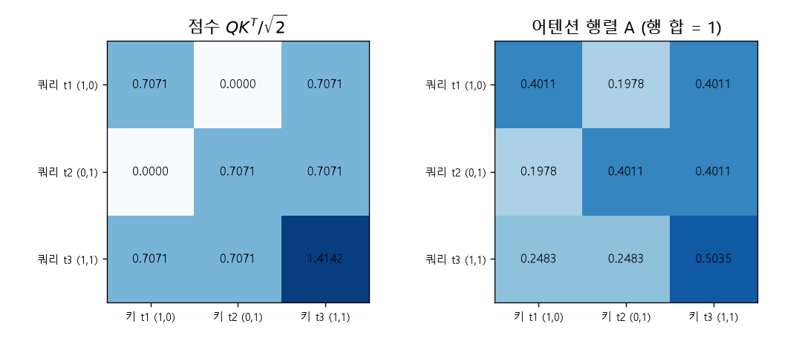
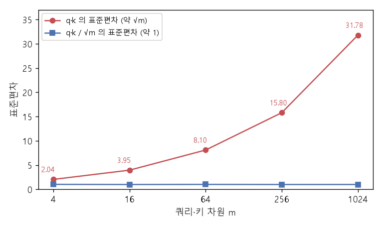

# 스케일드 내적 어텐션 (Scaled dot-product attention, Query·Key·Value)

[목차로 돌아가기](../../00_MIT%EB%94%A5%EB%9F%AC%EB%8B%9D_%EB%AA%A9%EC%B0%A8.md) · 먼저 볼 것: [M05_벡터와_행렬](../../%EC%88%98%ED%95%99%EA%B0%9C%EB%85%90/03_%EC%84%A0%ED%98%95%EB%8C%80%EC%88%98/M05_%EB%B2%A1%ED%84%B0%EC%99%80_%ED%96%89%EB%A0%AC.md), [MM03_벡터_표기와_전치](../../%EC%88%98%ED%95%99%EA%B0%9C%EB%85%90/03_%EC%84%A0%ED%98%95%EB%8C%80%EC%88%98/MM03_%EB%B2%A1%ED%84%B0_%ED%91%9C%EA%B8%B0%EC%99%80_%EC%A0%84%EC%B9%98.md), [M06_지수와_e](../../%EC%88%98%ED%95%99%EA%B0%9C%EB%85%90/01_%EC%88%98%EC%99%80_%ED%95%A8%EC%88%98/M06_%EC%A7%80%EC%88%98%EC%99%80_e.md), D05_소프트맥스와_다중분류 · 쓰는 곳: [Lec08 5.3](../../Lec08_%ED%8A%B8%EB%9E%9C%EC%8A%A4%ED%8F%AC%EB%A8%B8.md#53-%EC%BF%BC%EB%A6%AC-%ED%82%A4-%EA%B0%92-%EC%96%B4%ED%85%90%EC%85%98), [Lec08 5.5](../../Lec08_%ED%8A%B8%EB%9E%9C%EC%8A%A4%ED%8F%AC%EB%A8%B8.md#55-%EC%96%B4%ED%85%90%EC%85%98-%EC%8B%9D)

📚 학습 순서 56/99 (7. 구조 아키텍처): ← 이전: [MM21_WL_색칠_알고리즘](../../%EC%88%98%ED%95%99%EA%B0%9C%EB%85%90/07_%EA%B5%AC%EC%A1%B0_%EC%95%84%ED%82%A4%ED%85%8D%EC%B2%98/MM21_WL_%EC%83%89%EC%B9%A0_%EC%95%8C%EA%B3%A0%EB%A6%AC%EC%A6%98.md) · 다음: [MM31_순열_등변성과_인과_마스크](../../%EC%88%98%ED%95%99%EA%B0%9C%EB%85%90/07_%EA%B5%AC%EC%A1%B0_%EC%95%84%ED%82%A4%ED%85%8D%EC%B2%98/MM31_%EC%88%9C%EC%97%B4_%EB%93%B1%EB%B3%80%EC%84%B1%EA%B3%BC_%EC%9D%B8%EA%B3%BC_%EB%A7%88%EC%8A%A4%ED%81%AC.md) →

> [!NOTE]
> **3줄 요약**
> - [토큰](../../00_%EB%94%A5%EB%9F%AC%EB%8B%9D_%EC%9A%A9%EC%96%B4%EC%82%AC%EC%A0%84.md#token-%ED%86%A0%ED%81%B0)마다 **쿼리**(무엇을 찾나), **키**(나는 무엇인가), **값**(내가 건넬 내용)을 선형 사영으로 만든다. 쿼리와 키의 [내적](../../00_%EB%94%A5%EB%9F%AC%EB%8B%9D_%EC%9A%A9%EC%96%B4%EC%82%AC%EC%A0%84.md#dot-product-%EB%82%B4%EC%A0%81)을 $\sqrt{m}$으로 나눠 [소프트맥스](../../00_%EB%94%A5%EB%9F%AC%EB%8B%9D_%EC%9A%A9%EC%96%B4%EC%82%AC%EC%A0%84.md#softmax-%EC%86%8C%ED%94%84%ED%8A%B8%EB%A7%A5%EC%8A%A4)를 하면 [가중치](../../00_%EB%94%A5%EB%9F%AC%EB%8B%9D_%EC%9A%A9%EC%96%B4%EC%82%AC%EC%A0%84.md#weight-%EA%B0%80%EC%A4%91%EC%B9%98)가 되고, 그 [가중치](../../00_%EB%94%A5%EB%9F%AC%EB%8B%9D_%EC%9A%A9%EC%96%B4%EC%82%AC%EC%A0%84.md#weight-%EA%B0%80%EC%A4%91%EC%B9%98)로 값들을 더한 것이 출력이다: $\text{softmax}(QK^\top/\sqrt{m})\,V$.
> - 예: [토큰](../../00_%EB%94%A5%EB%9F%AC%EB%8B%9D_%EC%9A%A9%EC%96%B4%EC%82%AC%EC%A0%84.md#token-%ED%86%A0%ED%81%B0) (1,0), (0,1), (1,1)을 그대로 쿼리·키·값으로 쓰면 첫 [토큰](../../00_%EB%94%A5%EB%9F%AC%EB%8B%9D_%EC%9A%A9%EC%96%B4%EC%82%AC%EC%A0%84.md#token-%ED%86%A0%ED%81%B0)의 점수는 (0.7071, 0, 0.7071), [가중치](../../00_%EB%94%A5%EB%9F%AC%EB%8B%9D_%EC%9A%A9%EC%96%B4%EC%82%AC%EC%A0%84.md#weight-%EA%B0%80%EC%A4%91%EC%B9%98)는 (0.4011, 0.1978, 0.4011), 출력은 (0.8022, 0.5989)다.
> - $\sqrt{m}$으로 나누는 이유: 무작위 쿼리·키의 [내적](../../00_%EB%94%A5%EB%9F%AC%EB%8B%9D_%EC%9A%A9%EC%96%B4%EC%82%AC%EC%A0%84.md#dot-product-%EB%82%B4%EC%A0%81)은 표준편차가 약 $\sqrt{m}$이라 차원이 크면 점수가 커지고 [소프트맥스](../../00_%EB%94%A5%EB%9F%AC%EB%8B%9D_%EC%9A%A9%EC%96%B4%EC%82%AC%EC%A0%84.md#softmax-%EC%86%8C%ED%94%84%ED%8A%B8%EB%A7%A5%EC%8A%A4)가 한 칸에 쏠린다. 나누면 m = 4든 1024든 표준편차가 약 1로 일정하다.

## 1. 개념 설명

비유: 도서관에서 책을 찾는다. 내 손에 든 **질문 카드**가 쿼리, 책등에 붙은 **[분류](../../00_%EB%94%A5%EB%9F%AC%EB%8B%9D_%EC%9A%A9%EC%96%B4%EC%82%AC%EC%A0%84.md#regression-classification-%ED%9A%8C%EA%B7%80%EC%99%80-%EB%B6%84%EB%A5%98) 색인**이 키, 책을 펼쳐서 얻는 **내용**이 값이다. 질문 카드와 색인이 잘 맞는 책일수록 오래 읽고(큰 [가중치](../../00_%EB%94%A5%EB%9F%AC%EB%8B%9D_%EC%9A%A9%EC%96%B4%EC%82%AC%EC%A0%84.md#weight-%EA%B0%80%EC%A4%91%EC%B9%98)), 안 맞는 책은 훑기만 한다(작은 [가중치](../../00_%EB%94%A5%EB%9F%AC%EB%8B%9D_%EC%9A%A9%EC%96%B4%EC%82%AC%EC%A0%84.md#weight-%EA%B0%80%EC%A4%91%EC%B9%98)). 마지막에 읽은 내용을 읽은 시간만큼 섞어 내 답을 만든다.

- [토큰](../../00_%EB%94%A5%EB%9F%AC%EB%8B%9D_%EC%9A%A9%EC%96%B4%EC%82%AC%EC%A0%84.md#token-%ED%86%A0%ED%81%B0) 행렬 $T$ ($n$개 [토큰](../../00_%EB%94%A5%EB%9F%AC%EB%8B%9D_%EC%9A%A9%EC%96%B4%EC%82%AC%EC%A0%84.md#token-%ED%86%A0%ED%81%B0) × $d$칸)에 학습하는 행렬 $W_Q, W_K, W_V$ ($d \times m$)를 곱해 쿼리·키·값 행렬을 만든다.
- 쿼리 $i$와 키 $j$의 [내적](../../00_%EB%94%A5%EB%9F%AC%EB%8B%9D_%EC%9A%A9%EC%96%B4%EC%82%AC%EC%A0%84.md#dot-product-%EB%82%B4%EC%A0%81) $\mathbf{q}_i \cdot \mathbf{k}_j$가 "[토큰](../../00_%EB%94%A5%EB%9F%AC%EB%8B%9D_%EC%9A%A9%EC%96%B4%EC%82%AC%EC%A0%84.md#token-%ED%86%A0%ED%81%B0) $i$가 [토큰](../../00_%EB%94%A5%EB%9F%AC%EB%8B%9D_%EC%9A%A9%EC%96%B4%EC%82%AC%EC%A0%84.md#token-%ED%86%A0%ED%81%B0) $j$를 얼마나 볼지"의 점수다. 모든 쌍을 한꺼번에 계산하면 $QK^\top$ ($n \times n$)이다.
- 점수를 $\sqrt{m}$으로 나누고 행마다 [소프트맥스](../../00_%EB%94%A5%EB%9F%AC%EB%8B%9D_%EC%9A%A9%EC%96%B4%EC%82%AC%EC%A0%84.md#softmax-%EC%86%8C%ED%94%84%ED%8A%B8%EB%A7%A5%EC%8A%A4)를 하면 행 합이 1인 **[어텐션](../../00_%EB%94%A5%EB%9F%AC%EB%8B%9D_%EC%9A%A9%EC%96%B4%EC%82%AC%EC%A0%84.md#attention-%EC%96%B4%ED%85%90%EC%85%98) 행렬** $A$가 된다.
- 출력 $T_{\text{out}} = AV$의 $i$번째 행은 값 벡터들의 가중 평균이다.

$$
Q = T W_Q,\quad K = T W_K,\quad V = T W_V,\qquad
A = \text{softmax}\!\Big(\frac{QK^\top}{\sqrt{m}}\Big),\qquad
T_{\text{out}} = A V
$$

<details><summary>기호 풀이</summary>

| 기호 | 읽는 법 | 뜻 | 예제 값 |
| --- | --- | --- | --- |
| $T$ | 티 | 입력 [토큰](../../00_%EB%94%A5%EB%9F%AC%EB%8B%9D_%EC%9A%A9%EC%96%B4%EC%82%AC%EC%A0%84.md#token-%ED%86%A0%ED%81%B0)을 행으로 쌓은 행렬 ($n \times d$) | `[[1, 0], [1, 1]]` |
| $W_Q, W_K, W_V$ | 더블유 큐, 케이, 브이 | 쿼리·키·값으로 사영하는 [학습](../../00_%EB%94%A5%EB%9F%AC%EB%8B%9D_%EC%9A%A9%EC%96%B4%EC%82%AC%EC%A0%84.md#training-%ED%95%99%EC%8A%B5) 행렬 ($d \times m$) | 단위행렬 $I_2$ |
| $Q, K, V$ | 큐, 케이, 브이 | 쿼리·키·값 행렬 (행 = [토큰](../../00_%EB%94%A5%EB%9F%AC%EB%8B%9D_%EC%9A%A9%EC%96%B4%EC%82%AC%EC%A0%84.md#token-%ED%86%A0%ED%81%B0) 하나) | 모두 $T$와 같음 |
| $K^\top$ | 케이 [전치](../../00_%EB%94%A5%EB%9F%AC%EB%8B%9D_%EC%9A%A9%EC%96%B4%EC%82%AC%EC%A0%84.md#transpose-%EC%A0%84%EC%B9%98) | $K$의 행과 열을 바꾼 것 | `[[1, 1], [0, 1]]` |
| $QK^\top$ | 큐 케이 [전치](../../00_%EB%94%A5%EB%9F%AC%EB%8B%9D_%EC%9A%A9%EC%96%B4%EC%82%AC%EC%A0%84.md#transpose-%EC%A0%84%EC%B9%98) | 모든 쿼리·키 쌍의 [내적](../../00_%EB%94%A5%EB%9F%AC%EB%8B%9D_%EC%9A%A9%EC%96%B4%EC%82%AC%EC%A0%84.md#dot-product-%EB%82%B4%EC%A0%81) 표 ($n \times n$) | `[[1, 1], [1, 2]]` |
| $m$ | 엠 | 쿼리·키 벡터의 차원 | 2 |
| $\sqrt{m}$ | 루트 엠 | 점수를 나누는 수 | 1.4142 |
| $\text{softmax}$ | [소프트맥스](../../00_%EB%94%A5%EB%9F%AC%EB%8B%9D_%EC%9A%A9%EC%96%B4%EC%82%AC%EC%A0%84.md#softmax-%EC%86%8C%ED%94%84%ED%8A%B8%EB%A7%A5%EC%8A%A4) | 행마다 $e^{s}$로 바꾸고 합 1로 나눔 | (0.5, 0.5) |
| $A$ | 에이 | [어텐션](../../00_%EB%94%A5%EB%9F%AC%EB%8B%9D_%EC%9A%A9%EC%96%B4%EC%82%AC%EC%A0%84.md#attention-%EC%96%B4%ED%85%90%EC%85%98) 행렬 (행 합 1) | `[[0.5, 0.5], [0.3302, 0.6698]]` |
| $T_{\text{out}}$ | 티 아웃 | 출력 [토큰](../../00_%EB%94%A5%EB%9F%AC%EB%8B%9D_%EC%9A%A9%EC%96%B4%EC%82%AC%EC%A0%84.md#token-%ED%86%A0%ED%81%B0) 행렬 ($n \times m$) | `[[1, 0.5], [1, 0.6698]]` |

</details>

<details><summary>예제와 풀이</summary>

**문제**: 입력 [토큰](../../00_%EB%94%A5%EB%9F%AC%EB%8B%9D_%EC%9A%A9%EC%96%B4%EC%82%AC%EC%A0%84.md#token-%ED%86%A0%ED%81%B0) 두 개 $\mathbf{t}_1 = (1, 0)$, $\mathbf{t}_2 = (1, 1)$을 [셀프 어텐션](../../00_%EB%94%A5%EB%9F%AC%EB%8B%9D_%EC%9A%A9%EC%96%B4%EC%82%AC%EC%A0%84.md#self-attention-%EC%85%80%ED%94%84-%EC%96%B4%ED%85%90%EC%85%98)에 넣는다. 사영 행렬이 모두 단위행렬이고 쿼리·키 차원이 2일 때 출력 [토큰](../../00_%EB%94%A5%EB%9F%AC%EB%8B%9D_%EC%9A%A9%EC%96%B4%EC%82%AC%EC%A0%84.md#token-%ED%86%A0%ED%81%B0) 행렬 $T_{\text{out}}$을 구한다.

**주어진 값**:
- $T = \begin{pmatrix}1&0\\1&1\end{pmatrix}$ (입력 [토큰](../../00_%EB%94%A5%EB%9F%AC%EB%8B%9D_%EC%9A%A9%EC%96%B4%EC%82%AC%EC%A0%84.md#token-%ED%86%A0%ED%81%B0)을 행으로 쌓은 행렬)
- $W_Q = W_K = W_V = I_2$ (단위행렬: 곱해도 그대로)
- $m = 2$ (쿼리·키 차원)

**풀이**
1. 식을 그대로 쓴다: $Q = TW_Q$, $K = TW_K$, $V = TW_V$, $A = \text{softmax}\big(QK^\top/\sqrt{m}\big)$, $T_{\text{out}} = AV$
2. 값을 대입한다: $T_{\text{out}} = \text{softmax}\Big(\begin{pmatrix}1&0\\1&1\end{pmatrix}I_2\Big(\begin{pmatrix}1&0\\1&1\end{pmatrix}I_2\Big)^\top \big/ \sqrt{2}\Big)\begin{pmatrix}1&0\\1&1\end{pmatrix}I_2$
3. 단위행렬을 곱한다 (바뀌지 않음): $Q = K = V = \begin{pmatrix}1&0\\1&1\end{pmatrix}$
4. [전치](../../00_%EB%94%A5%EB%9F%AC%EB%8B%9D_%EC%9A%A9%EC%96%B4%EC%82%AC%EC%A0%84.md#transpose-%EC%A0%84%EC%B9%98)의 뜻: 행과 열을 바꾼다. $K^\top = \begin{pmatrix}1&1\\0&1\end{pmatrix}$
5. $QK^\top$의 (1,1)칸 = 쿼리 1과 키 1의 [내적](../../00_%EB%94%A5%EB%9F%AC%EB%8B%9D_%EC%9A%A9%EC%96%B4%EC%82%AC%EC%A0%84.md#dot-product-%EB%82%B4%EC%A0%81)(같은 자리끼리 곱해 더함)을 펼친다: $1 \times 1 + 0 \times 0 = 1$
6. (1,2)칸 = 쿼리 1과 키 2: $1 \times 1 + 0 \times 1 = 1$
7. (2,1)칸 = 쿼리 2와 키 1: $1 \times 1 + 1 \times 0 = 1$
8. (2,2)칸 = 쿼리 2와 키 2: $1 \times 1 + 1 \times 1 = 2$ 이므로 $QK^\top = \begin{pmatrix}1&1\\1&2\end{pmatrix}$
9. $\sqrt{\ }$의 뜻: 제곱하면 그 수가 되는 양수다. $\sqrt{2}$는 코드 `np.sqrt(2)`로 구하면 1.4142
10. 나눗셈을 한다: $1 \div 1.4142 = 0.7071$, $2 \div 1.4142 = 1.4142$ 이므로 점수 $\begin{pmatrix}0.7071&0.7071\\0.7071&1.4142\end{pmatrix}$
11. softmax의 뜻: 한 행의 점수마다 $e^{s}$를 구하고 그 행의 합으로 나눠 합 1인 비율로 만든다. $e$는 약 2.7183인 수이고 $e^{s}$는 코드 `np.exp(s)`로 구한다. 1행에 대입한다: $\Big(\frac{e^{0.7071}}{e^{0.7071} + e^{0.7071}},\ \frac{e^{0.7071}}{e^{0.7071} + e^{0.7071}}\Big)$
12. [지수](../../00_%EB%94%A5%EB%9F%AC%EB%8B%9D_%EC%9A%A9%EC%96%B4%EC%82%AC%EC%A0%84.md#e-exponent-e%EC%99%80-%EC%A7%80%EC%88%98)를 계산한다: $e^{0.7071} = 2.0281$ 이므로 $\big(\frac{2.0281}{4.0562},\ \frac{2.0281}{4.0562}\big) = (0.5, 0.5)$
13. 2행에 대입한다: $\Big(\frac{e^{0.7071}}{e^{0.7071} + e^{1.4142}},\ \frac{e^{1.4142}}{e^{0.7071} + e^{1.4142}}\Big)$
14. [지수](../../00_%EB%94%A5%EB%9F%AC%EB%8B%9D_%EC%9A%A9%EC%96%B4%EC%82%AC%EC%A0%84.md#e-exponent-e%EC%99%80-%EC%A7%80%EC%88%98)를 계산한다: $e^{0.7071} = 2.0281$, $e^{1.4142} = 4.1133$
15. 분모의 덧셈을 한다: $2.0281 + 4.1133 = 6.1414$
16. 나눗셈을 한다: $2.0281 \div 6.1414 = 0.3302$, $4.1133 \div 6.1414 = 0.6698$
17. $AV$의 1행을 펼친다: $0.5 \times (1, 0) + 0.5 \times (1, 1) = (0.5 + 0.5,\ 0 + 0.5) = (1, 0.5)$
18. $AV$의 2행을 펼친다: $0.3302 \times (1, 0) + 0.6698 \times (1, 1) = (0.3302 + 0.6698,\ 0 + 0.6698) = (1, 0.6698)$

**답**: $T_{\text{out}} = \begin{pmatrix}1&0.5\\1&0.6698\end{pmatrix}$. [토큰](../../00_%EB%94%A5%EB%9F%AC%EB%8B%9D_%EC%9A%A9%EC%96%B4%EC%82%AC%EC%A0%84.md#token-%ED%86%A0%ED%81%B0) 2는 자기와 더 닮은 자기 자신(점수 1.4142)을 더 많이 본다.

</details>

<details><summary>내 이해</summary>


</details>

**왜 $\sqrt{m}$으로 나누나.** 쿼리와 키의 각 칸이 평균 0, [분산](../../00_%EB%94%A5%EB%9F%AC%EB%8B%9D_%EC%9A%A9%EC%96%B4%EC%82%AC%EC%A0%84.md#variance-%EB%B6%84%EC%82%B0) 1인 [독립](../../00_%EB%94%A5%EB%9F%AC%EB%8B%9D_%EC%9A%A9%EC%96%B4%EC%82%AC%EC%A0%84.md#independence-%EB%8F%85%EB%A6%BD) 난수라면 [내적](../../00_%EB%94%A5%EB%9F%AC%EB%8B%9D_%EC%9A%A9%EC%96%B4%EC%82%AC%EC%A0%84.md#dot-product-%EB%82%B4%EC%A0%81) $\mathbf{q}\cdot\mathbf{k} = \sum_{i=1}^m q_i k_i$는 [분산](../../00_%EB%94%A5%EB%9F%AC%EB%8B%9D_%EC%9A%A9%EC%96%B4%EC%82%AC%EC%A0%84.md#variance-%EB%B6%84%EC%82%B0)이 1인 항 $m$개의 합이라 [분산](../../00_%EB%94%A5%EB%9F%AC%EB%8B%9D_%EC%9A%A9%EC%96%B4%EC%82%AC%EC%A0%84.md#variance-%EB%B6%84%EC%82%B0)이 $m$이다. 차원이 커질수록 점수의 폭이 넓어지고, [소프트맥스](../../00_%EB%94%A5%EB%9F%AC%EB%8B%9D_%EC%9A%A9%EC%96%B4%EC%82%AC%EC%A0%84.md#softmax-%EC%86%8C%ED%94%84%ED%8A%B8%EB%A7%A5%EC%8A%A4)는 가장 큰 점수 하나에 거의 모든 [가중치](../../00_%EB%94%A5%EB%9F%AC%EB%8B%9D_%EC%9A%A9%EC%96%B4%EC%82%AC%EC%A0%84.md#weight-%EA%B0%80%EC%A4%91%EC%B9%98)를 준다(점수 (1, 2, 3)은 (0.09, 0.2447, 0.6652)지만 16배인 (16, 32, 48)은 (0, 0, 1)). 그러면 [기울기](../../00_%EB%94%A5%EB%9F%AC%EB%8B%9D_%EC%9A%A9%EC%96%B4%EC%82%AC%EC%A0%84.md#gradient-%EA%B8%B0%EC%9A%B8%EA%B8%B0)가 거의 0이 되어 [학습](../../00_%EB%94%A5%EB%9F%AC%EB%8B%9D_%EC%9A%A9%EC%96%B4%EC%82%AC%EC%A0%84.md#training-%ED%95%99%EC%8A%B5)이 어렵다. $\sqrt{m}$으로 나누면 [분산](../../00_%EB%94%A5%EB%9F%AC%EB%8B%9D_%EC%9A%A9%EC%96%B4%EC%82%AC%EC%A0%84.md#variance-%EB%B6%84%EC%82%B0)이 1로 돌아온다.

$$
\text{Var}(\mathbf{q}\cdot\mathbf{k}) = m, \qquad \text{Var}\Big(\frac{\mathbf{q}\cdot\mathbf{k}}{\sqrt{m}}\Big) = 1
$$

<details><summary>기호 풀이</summary>

| 기호 | 읽는 법 | 뜻 | 예제 값 |
| --- | --- | --- | --- |
| $\mathbf{q}, \mathbf{k}$ | 큐, 케이 | 쿼리 벡터와 키 벡터 (칸마다 평균 0, [분산](../../00_%EB%94%A5%EB%9F%AC%EB%8B%9D_%EC%9A%A9%EC%96%B4%EC%82%AC%EC%A0%84.md#variance-%EB%B6%84%EC%82%B0) 1인 [독립](../../00_%EB%94%A5%EB%9F%AC%EB%8B%9D_%EC%9A%A9%EC%96%B4%EC%82%AC%EC%A0%84.md#independence-%EB%8F%85%EB%A6%BD) 난수) | 칸마다 +1 또는 -1 |
| $\mathbf{q}\cdot\mathbf{k}$ | 큐 [내적](../../00_%EB%94%A5%EB%9F%AC%EB%8B%9D_%EC%9A%A9%EC%96%B4%EC%82%AC%EC%A0%84.md#dot-product-%EB%82%B4%EC%A0%81) 케이 | 같은 칸끼리 곱해 더한 값 | -2, 0, 2 |
| $\text{Var}$ | [분산](../../00_%EB%94%A5%EB%9F%AC%EB%8B%9D_%EC%9A%A9%EC%96%B4%EC%82%AC%EC%A0%84.md#variance-%EB%B6%84%EC%82%B0) | 평균에서 벗어난 정도의 제곱 평균 | 2 |
| $m$ | 엠 | 벡터의 차원 (칸 수) | 2 |
| $\sqrt{m}$ | 루트 엠 | 표준편차를 1로 되돌리는 나눗수 | 1.4142 |

</details>

<details><summary>예제와 풀이</summary>

**문제**: 2칸짜리 쿼리 $\mathbf{q}$와 키 $\mathbf{k}$의 각 칸이 +1 또는 -1을 반반 [확률](../../00_%EB%94%A5%EB%9F%AC%EB%8B%9D_%EC%9A%A9%EC%96%B4%EC%82%AC%EC%A0%84.md#probability-%ED%99%95%EB%A5%A0)로 갖는다. [내적](../../00_%EB%94%A5%EB%9F%AC%EB%8B%9D_%EC%9A%A9%EC%96%B4%EC%82%AC%EC%A0%84.md#dot-product-%EB%82%B4%EC%A0%81) $\mathbf{q}\cdot\mathbf{k}$의 [분산](../../00_%EB%94%A5%EB%9F%AC%EB%8B%9D_%EC%9A%A9%EC%96%B4%EC%82%AC%EC%A0%84.md#variance-%EB%B6%84%EC%82%B0)이 차원 $m = 2$와 같은지, $\sqrt{2}$로 나누면 [분산](../../00_%EB%94%A5%EB%9F%AC%EB%8B%9D_%EC%9A%A9%EC%96%B4%EC%82%AC%EC%A0%84.md#variance-%EB%B6%84%EC%82%B0)이 1이 되는지 확인한다.

**주어진 값**:
- $m = 2$ (쿼리·키의 칸 수)
- $q_i, k_i \in \{+1, -1\}$, [확률](../../00_%EB%94%A5%EB%9F%AC%EB%8B%9D_%EC%9A%A9%EC%96%B4%EC%82%AC%EC%A0%84.md#probability-%ED%99%95%EB%A5%A0) 1/2씩 (각 칸이 평균 0, [분산](../../00_%EB%94%A5%EB%9F%AC%EB%8B%9D_%EC%9A%A9%EC%96%B4%EC%82%AC%EC%A0%84.md#variance-%EB%B6%84%EC%82%B0) 1인 난수)

**풀이**
1. 식을 그대로 쓴다: $\text{Var}(\mathbf{q}\cdot\mathbf{k}) = m$, $\text{Var}\big(\frac{\mathbf{q}\cdot\mathbf{k}}{\sqrt{m}}\big) = 1$
2. 값을 대입한다: $\text{Var}(q_1k_1 + q_2k_2) = 2$, $\text{Var}\big(\frac{q_1k_1 + q_2k_2}{\sqrt{2}}\big) = 1$ (맞는지 확인할 식)
3. 칸별 곱을 본다: 같은 부호면 $(+1)(+1) = (-1)(-1) = +1$, 다른 부호면 $-1$ 이고, 둘이 반반이다
4. 두 칸의 곱을 더한 경우를 모두 쓴다: $(+1) + (+1) = 2$, $(+1) + (-1) = 0$, $(-1) + (+1) = 0$, $(-1) + (-1) = -2$, 각 [확률](../../00_%EB%94%A5%EB%9F%AC%EB%8B%9D_%EC%9A%A9%EC%96%B4%EC%82%AC%EC%A0%84.md#probability-%ED%99%95%EB%A5%A0) 1/4
5. 같은 값을 모은다: 2는 1/4, 0은 $1/4 + 1/4 = 1/2$, -2는 1/4
6. 평균(값 × [확률](../../00_%EB%94%A5%EB%9F%AC%EB%8B%9D_%EC%9A%A9%EC%96%B4%EC%82%AC%EC%A0%84.md#probability-%ED%99%95%EB%A5%A0)의 합)을 펼친다: $2 \times \frac14 + 0 \times \frac12 + (-2) \times \frac14 = 0.5 + 0 - 0.5 = 0$
7. [분산](../../00_%EB%94%A5%EB%9F%AC%EB%8B%9D_%EC%9A%A9%EC%96%B4%EC%82%AC%EC%A0%84.md#variance-%EB%B6%84%EC%82%B0)의 뜻: 평균과의 차를 제곱해 [확률](../../00_%EB%94%A5%EB%9F%AC%EB%8B%9D_%EC%9A%A9%EC%96%B4%EC%82%AC%EC%A0%84.md#probability-%ED%99%95%EB%A5%A0)로 평균 낸 값. 평균이 0이라 제곱의 평균이다. 펼친다: $2^2 \times \frac14 + 0^2 \times \frac12 + (-2)^2 \times \frac14$
8. 제곱을 한다: $4 \times \frac14 + 0 \times \frac12 + 4 \times \frac14$
9. 곱셈을 한다: $1 + 0 + 1$
10. 덧셈을 한다: $\text{Var}(\mathbf{q}\cdot\mathbf{k}) = 2$ → $m$과 같다
11. $\sqrt{\ }$의 뜻: 제곱하면 그 수가 되는 양수. $\sqrt{2} = 1.4142$. 값을 나눈다: $2 \div 1.4142 = 1.4142$, $0$, $-2 \div 1.4142 = -1.4142$
12. 나눈 값의 [분산](../../00_%EB%94%A5%EB%9F%AC%EB%8B%9D_%EC%9A%A9%EC%96%B4%EC%82%AC%EC%A0%84.md#variance-%EB%B6%84%EC%82%B0)을 펼친다: $1.4142^2 \times \frac14 + 0^2 \times \frac12 + (-1.4142)^2 \times \frac14$
13. 제곱을 한다 ($1.4142^2 = 2$): $2 \times \frac14 + 0 + 2 \times \frac14$
14. 곱셈과 덧셈을 한다: $0.5 + 0 + 0.5 = 1$

**답**: $\text{Var}(\mathbf{q}\cdot\mathbf{k}) = 2 = m$, 나눈 뒤의 [분산](../../00_%EB%94%A5%EB%9F%AC%EB%8B%9D_%EC%9A%A9%EC%96%B4%EC%82%AC%EC%A0%84.md#variance-%EB%B6%84%EC%82%B0)은 **1**

</details>

<details><summary>내 이해</summary>


</details>

## 2. 필요한 이유

[Lec08 5.3](../../Lec08_%ED%8A%B8%EB%9E%9C%EC%8A%A4%ED%8F%AC%EB%A8%B8.md#53-%EC%BF%BC%EB%A6%AC-%ED%82%A4-%EA%B0%92-%EC%96%B4%ED%85%90%EC%85%98)에서 강사는 "임팔라 머리는 무슨 색인가?"라는 질문 [토큰](../../00_%EB%94%A5%EB%9F%AC%EB%8B%9D_%EC%9A%A9%EC%96%B4%EC%82%AC%EC%A0%84.md#token-%ED%86%A0%ED%81%B0)이 쿼리를 내고, 이미지 패치 [토큰](../../00_%EB%94%A5%EB%9F%AC%EB%8B%9D_%EC%9A%A9%EC%96%B4%EC%82%AC%EC%A0%84.md#token-%ED%86%A0%ED%81%B0)들이 키와 값을 내는 그림으로 [어텐션](../../00_%EB%94%A5%EB%9F%AC%EB%8B%9D_%EC%9A%A9%EC%96%B4%EC%82%AC%EC%A0%84.md#attention-%EC%96%B4%ED%85%90%EC%85%98)을 설명한다. [Lec08 5.5](../../Lec08_%ED%8A%B8%EB%9E%9C%EC%8A%A4%ED%8F%AC%EB%A8%B8.md#55-%EC%96%B4%ED%85%90%EC%85%98-%EC%8B%9D)에서는 이를 모든 [토큰](../../00_%EB%94%A5%EB%9F%AC%EB%8B%9D_%EC%9A%A9%EC%96%B4%EC%82%AC%EC%A0%84.md#token-%ED%86%A0%ED%81%B0)이 쿼리를 내는 [셀프 어텐션](../../00_%EB%94%A5%EB%9F%AC%EB%8B%9D_%EC%9A%A9%EC%96%B4%EC%82%AC%EC%A0%84.md#self-attention-%EC%85%80%ED%94%84-%EC%96%B4%ED%85%90%EC%85%98)으로 넓혀 한 줄짜리 식 $\text{softmax}(QK^\top/\sqrt{m})V$로 줄인다. [트랜스포머](../../00_%EB%94%A5%EB%9F%AC%EB%8B%9D_%EC%9A%A9%EC%96%B4%EC%82%AC%EC%A0%84.md#transformer-%ED%8A%B8%EB%9E%9C%EC%8A%A4%ED%8F%AC%EB%A8%B8)에서 **새로 등장한 연산은 이것 하나뿐**이라 이 식을 손으로 계산할 수 있으면 [트랜스포머](../../00_%EB%94%A5%EB%9F%AC%EB%8B%9D_%EC%9A%A9%EC%96%B4%EC%82%AC%EC%A0%84.md#transformer-%ED%8A%B8%EB%9E%9C%EC%8A%A4%ED%8F%AC%EB%A8%B8)의 핵심을 이해한 것이다.

## 3. 숫자로 보기

[토큰](../../00_%EB%94%A5%EB%9F%AC%EB%8B%9D_%EC%9A%A9%EC%96%B4%EC%82%AC%EC%A0%84.md#token-%ED%86%A0%ED%81%B0) 세 개, $d = m = 2$, $W_Q = W_K = W_V = I_2$ (설명용으로 사영을 생략):

$$
T = \begin{pmatrix}1&0\\0&1\\1&1\end{pmatrix}
$$

<details><summary>예제와 풀이</summary>

**문제**: 위 $T$의 1행 [토큰](../../00_%EB%94%A5%EB%9F%AC%EB%8B%9D_%EC%9A%A9%EC%96%B4%EC%82%AC%EC%A0%84.md#token-%ED%86%A0%ED%81%B0) $\mathbf{t}_1$과 3행 [토큰](../../00_%EB%94%A5%EB%9F%AC%EB%8B%9D_%EC%9A%A9%EC%96%B4%EC%82%AC%EC%A0%84.md#token-%ED%86%A0%ED%81%B0) $\mathbf{t}_3$의 [내적](../../00_%EB%94%A5%EB%9F%AC%EB%8B%9D_%EC%9A%A9%EC%96%B4%EC%82%AC%EC%A0%84.md#dot-product-%EB%82%B4%EC%A0%81)(닮은 정도), 그리고 $\mathbf{t}_3$과 자기 자신의 [내적](../../00_%EB%94%A5%EB%9F%AC%EB%8B%9D_%EC%9A%A9%EC%96%B4%EC%82%AC%EC%A0%84.md#dot-product-%EB%82%B4%EC%A0%81)을 구한다.

**주어진 값**:
- $\mathbf{t}_1 = (1, 0)$ ($T$의 1행 [토큰](../../00_%EB%94%A5%EB%9F%AC%EB%8B%9D_%EC%9A%A9%EC%96%B4%EC%82%AC%EC%A0%84.md#token-%ED%86%A0%ED%81%B0))
- $\mathbf{t}_3 = (1, 1)$ ($T$의 3행 [토큰](../../00_%EB%94%A5%EB%9F%AC%EB%8B%9D_%EC%9A%A9%EC%96%B4%EC%82%AC%EC%A0%84.md#token-%ED%86%A0%ED%81%B0))

**풀이**
1. 식을 그대로 쓴다 (2칸 벡터의 [내적](../../00_%EB%94%A5%EB%9F%AC%EB%8B%9D_%EC%9A%A9%EC%96%B4%EC%82%AC%EC%A0%84.md#dot-product-%EB%82%B4%EC%A0%81)): $\mathbf{a}\cdot\mathbf{b} = a_1 b_1 + a_2 b_2$
2. 값을 대입한다: $\mathbf{t}_1\cdot\mathbf{t}_3 = 1 \times 1 + 0 \times 1$
3. 곱셈을 한다: $1 + 0$
4. 덧셈을 한다: $\mathbf{t}_1\cdot\mathbf{t}_3 = 1$
5. 값을 대입한다: $\mathbf{t}_3\cdot\mathbf{t}_3 = 1 \times 1 + 1 \times 1$
6. 곱셈을 한다: $1 + 1$
7. 덧셈을 한다: $\mathbf{t}_3\cdot\mathbf{t}_3 = 2$

**답**: 1과 2. 이 두 수가 아래 점수 표의 (1,3)칸과 (3,3)칸이다.

</details>

<details><summary>기호 풀이</summary>

| 기호 | 읽는 법 | 뜻 | 예제 값 |
| --- | --- | --- | --- |
| $T$ | 티 | [토큰](../../00_%EB%94%A5%EB%9F%AC%EB%8B%9D_%EC%9A%A9%EC%96%B4%EC%82%AC%EC%A0%84.md#token-%ED%86%A0%ED%81%B0) 3개를 행으로 쌓은 3×2 행렬 | 1행 (1, 0) |
| $\mathbf{t}_i$ | 티 아이 | $T$의 $i$번째 행 = [토큰](../../00_%EB%94%A5%EB%9F%AC%EB%8B%9D_%EC%9A%A9%EC%96%B4%EC%82%AC%EC%A0%84.md#token-%ED%86%A0%ED%81%B0) 하나 | $\mathbf{t}_3 = (1, 1)$ |

</details>

<details><summary>내 이해</summary>


</details>

**첫 [토큰](../../00_%EB%94%A5%EB%9F%AC%EB%8B%9D_%EC%9A%A9%EC%96%B4%EC%82%AC%EC%A0%84.md#token-%ED%86%A0%ED%81%B0)(1행) 따라가기** (한 줄에 한 동작)
- 점수: $\mathbf{q}_1 \cdot \mathbf{k}_j$ = (1, 0, 1)
- 나누기: $\div \sqrt{2}$ → (0.7071, 0, 0.7071)
- [지수](../../00_%EB%94%A5%EB%9F%AC%EB%8B%9D_%EC%9A%A9%EC%96%B4%EC%82%AC%EC%A0%84.md#e-exponent-e%EC%99%80-%EC%A7%80%EC%88%98): $e^{0.7071} = 2.0281$, $e^{0} = 1$ → (2.0281, 1, 2.0281)
- 합: 5.0562
- [가중치](../../00_%EB%94%A5%EB%9F%AC%EB%8B%9D_%EC%9A%A9%EC%96%B4%EC%82%AC%EC%A0%84.md#weight-%EA%B0%80%EC%A4%91%EC%B9%98): (0.4011, 0.1978, 0.4011)
- 출력: $0.4011 × (1,0) + 0.1978 × (0,1) + 0.4011 × (1,1) = (0.8022, 0.5989)$

**전체 결과**

| 쿼리 | 점수 $QK^\top/\sqrt2$ | [가중치](../../00_%EB%94%A5%EB%9F%AC%EB%8B%9D_%EC%9A%A9%EC%96%B4%EC%82%AC%EC%A0%84.md#weight-%EA%B0%80%EC%A4%91%EC%B9%98) (A의 행) | 출력 ($AV$의 행) |
|---|---|---|---|
| [토큰](../../00_%EB%94%A5%EB%9F%AC%EB%8B%9D_%EC%9A%A9%EC%96%B4%EC%82%AC%EC%A0%84.md#token-%ED%86%A0%ED%81%B0) 1 (1, 0) | (0.7071, 0, 0.7071) | (0.4011, 0.1978, 0.4011) | (0.8022, 0.5989) |
| [토큰](../../00_%EB%94%A5%EB%9F%AC%EB%8B%9D_%EC%9A%A9%EC%96%B4%EC%82%AC%EC%A0%84.md#token-%ED%86%A0%ED%81%B0) 2 (0, 1) | (0, 0.7071, 0.7071) | (0.1978, 0.4011, 0.4011) | (0.5989, 0.8022) |
| [토큰](../../00_%EB%94%A5%EB%9F%AC%EB%8B%9D_%EC%9A%A9%EC%96%B4%EC%82%AC%EC%A0%84.md#token-%ED%86%A0%ED%81%B0) 3 (1, 1) | (0.7071, 0.7071, 1.4142) | (0.2483, 0.2483, 0.5035) | (0.7517, 0.7517) |


*▲ 직접 그린 그림: 위 표의 점수와 [어텐션](../../00_%EB%94%A5%EB%9F%AC%EB%8B%9D_%EC%9A%A9%EC%96%B4%EC%82%AC%EC%A0%84.md#attention-%EC%96%B4%ED%85%90%EC%85%98) 행렬. 행마다 합이 1이고, 자기와 닮은 [토큰](../../00_%EB%94%A5%EB%9F%AC%EB%8B%9D_%EC%9A%A9%EC%96%B4%EC%82%AC%EC%A0%84.md#token-%ED%86%A0%ED%81%B0)([내적](../../00_%EB%94%A5%EB%9F%AC%EB%8B%9D_%EC%9A%A9%EC%96%B4%EC%82%AC%EC%A0%84.md#dot-product-%EB%82%B4%EC%A0%81)이 큰 칸)이 진하다*

**[파라미터](../../00_%EB%94%A5%EB%9F%AC%EB%8B%9D_%EC%9A%A9%EC%96%B4%EC%82%AC%EC%A0%84.md#parameter-%ED%8C%8C%EB%9D%BC%EB%AF%B8%ED%84%B0) 수**: [어텐션](../../00_%EB%94%A5%EB%9F%AC%EB%8B%9D_%EC%9A%A9%EC%96%B4%EC%82%AC%EC%A0%84.md#attention-%EC%96%B4%ED%85%90%EC%85%98) 행렬 $A$를 직접 배우면 $n^2$개가 필요하다. [토큰](../../00_%EB%94%A5%EB%9F%AC%EB%8B%9D_%EC%9A%A9%EC%96%B4%EC%82%AC%EC%A0%84.md#token-%ED%86%A0%ED%81%B0) $n = 1000$개면 1,000,000개이고 [토큰](../../00_%EB%94%A5%EB%9F%AC%EB%8B%9D_%EC%9A%A9%EC%96%B4%EC%82%AC%EC%A0%84.md#token-%ED%86%A0%ED%81%B0) 수가 바뀌면 쓸 수도 없다. $W_Q, W_K, W_V$를 배우면 $3dm$개로, $d = m = 64$일 때 12,288개이며 [토큰](../../00_%EB%94%A5%EB%9F%AC%EB%8B%9D_%EC%9A%A9%EC%96%B4%EC%82%AC%EC%A0%84.md#token-%ED%86%A0%ED%81%B0) 수와 무관하다.

**차원과 점수의 폭** (아래 4절 코드, 무작위 쿼리·키 2000쌍)

| m | 4 | 16 | 64 | 256 | 1024 |
|---|---|---|---|---|---|
| $\mathbf{q}\cdot\mathbf{k}$ 표준편차 | 2.04 | 3.95 | 8.1 | 15.8 | 31.78 |
| $\div\sqrt{m}$ 뒤 표준편차 | 1.02 | 0.99 | 1.01 | 0.99 | 0.99 |


*▲ 직접 그린 그림: [내적](../../00_%EB%94%A5%EB%9F%AC%EB%8B%9D_%EC%9A%A9%EC%96%B4%EC%82%AC%EC%A0%84.md#dot-product-%EB%82%B4%EC%A0%81)의 표준편차는 $\sqrt{m}$을 따라 커지고(2, 4, 8, 16, 32 근처), $\sqrt{m}$으로 나누면 1 근처로 일정하다*

<details><summary>기호 풀이</summary>

| 기호 | 읽는 법 | 뜻 | 예제 값 |
| --- | --- | --- | --- |
| $n$ | 엔 | [토큰](../../00_%EB%94%A5%EB%9F%AC%EB%8B%9D_%EC%9A%A9%EC%96%B4%EC%82%AC%EC%A0%84.md#token-%ED%86%A0%ED%81%B0) 개수 | 3 |
| $d$ | 디 | [토큰](../../00_%EB%94%A5%EB%9F%AC%EB%8B%9D_%EC%9A%A9%EC%96%B4%EC%82%AC%EC%A0%84.md#token-%ED%86%A0%ED%81%B0) 벡터의 차원 | 2 |
| $m$ | 엠 | 쿼리·키·값의 차원 | 2 |
| $W_Q, W_K, W_V$ | 더블유 큐·케이·브이 | 학습하는 사영 행렬 ($d \times m$) | $I_2$ |
| $\mathbf{q}_i, \mathbf{k}_j, \mathbf{v}_j$ | 큐 아이, 케이 제이, 브이 제이 | $Q, K, V$의 $i$, $j$번째 행 | $\mathbf{q}_1 = (1, 0)$ |
| $QK^\top/\sqrt{m}$ | 스케일드 점수 | 모든 쌍의 [내적](../../00_%EB%94%A5%EB%9F%AC%EB%8B%9D_%EC%9A%A9%EC%96%B4%EC%82%AC%EC%A0%84.md#dot-product-%EB%82%B4%EC%A0%81)을 $\sqrt{m}$으로 나눈 표 | 1행 (0.7071, 0, 0.7071) |
| $A$ | [어텐션](../../00_%EB%94%A5%EB%9F%AC%EB%8B%9D_%EC%9A%A9%EC%96%B4%EC%82%AC%EC%A0%84.md#attention-%EC%96%B4%ED%85%90%EC%85%98) 행렬 | 점수의 행별 [소프트맥스](../../00_%EB%94%A5%EB%9F%AC%EB%8B%9D_%EC%9A%A9%EC%96%B4%EC%82%AC%EC%A0%84.md#softmax-%EC%86%8C%ED%94%84%ED%8A%B8%EB%A7%A5%EC%8A%A4) | 1행 (0.4011, 0.1978, 0.4011) |
| $AV$ | 에이 브이 | 값들의 가중 평균 = 출력 | 1행 (0.8022, 0.5989) |
| $3dm$ | 삼 디 엠 | 사영 행렬 세 개의 [파라미터](../../00_%EB%94%A5%EB%9F%AC%EB%8B%9D_%EC%9A%A9%EC%96%B4%EC%82%AC%EC%A0%84.md#parameter-%ED%8C%8C%EB%9D%BC%EB%AF%B8%ED%84%B0) 수 | 12,288 ($d = m = 64$) |

</details>

## 4. 코드로 확인

```python
# [함수] def softmax(Z): 행마다 소프트맥스를 하는 함수를 정의한다
def softmax(Z):
    # [변수] Z: 행마다 최댓값을 빼 둔다. 결과는 같고 e^큰수로 넘치는 것을 막는다
    Z = Z - Z.max(axis=1, keepdims=True)
    # [변수] E: 각 칸의 e^z
    E = np.exp(Z)
    # [함수] E / 행 합: 행마다 합이 1이 되게 나눈다
    # [연결] 본문 3절 "첫 토큰 따라가기"의 지수 → 합 → 가중치 단계
    return E / E.sum(axis=1, keepdims=True)
# [변수] T: 토큰 3개 (1,0), (0,1), (1,1)을 행으로 쌓은 3×2 행렬
# [연결] 본문 3절의 T
T = np.array([[1.0, 0], [0, 1], [1, 1]])
# [변수] Wq, Wk, Wv: 사영 행렬. 설명용으로 2×2 단위행렬을 쓴다 (학습하면 다른 값이 된다)
Wq = Wk = Wv = np.eye(2)
# [함수] @: 행렬 곱. 토큰마다 쿼리·키·값을 한꺼번에 만든다
# [변수] Q, K, V: 여기서는 모두 T와 같다
Q, K, V = T @ Wq, T @ Wk, T @ Wv
# [변수] m: 쿼리·키 차원 = 2
m = Q.shape[1]
# [함수] Q @ K.T / √m: 모든 쌍의 스케일드 점수 (3×3)
# [쓸모] 어느 토큰이 어느 토큰을 볼지 정하는 원재료
S = Q @ K.T / np.sqrt(m)
# [변수] A: 어텐션 행렬. 행 합이 1
A = softmax(S)
# [연결] 본문 표의 "가중치" 열
print(A.round(4))
# [함수] A @ V: 값들의 가중 평균 = 출력 토큰
# [연결] 본문 표의 "출력" 열
print((A @ V).round(4))
# [함수] 1000**2, 3*64*64: A를 직접 배울 때와 사영 행렬을 배울 때의 파라미터 수
# [연결] 본문 3절 "파라미터 수"
print(1000 ** 2, 3 * 64 * 64)
# [변수] rng: 시드 0으로 고정한 난수 생성기 (그림·표 숫자 재현용)
rng = np.random.default_rng(0)
# [함수] for m in ...: 쿼리·키 차원을 바꿔 가며 점수의 폭을 잰다
for m in [4, 16, 64, 256, 1024]:
    # [변수] q, k: 칸마다 평균 0, 분산 1인 무작위 쿼리·키 2000쌍
    q, k = rng.standard_normal((2000, m)), rng.standard_normal((2000, m))
    # [변수] d: 쌍마다 내적 (2000개)
    d = (q * k).sum(axis=1)
    # [함수] std: 표준편차. 나누기 전은 약 √m, 나눈 뒤는 약 1
    # [연결] 본문 3절 "차원과 점수의 폭" 표와 MM30_fig_scaling
    print(m, round(d.std(), 2), round((d / np.sqrt(m)).std(), 2))
```

**실행 결과**:

```text
[[0.4011 0.1978 0.4011]
 [0.1978 0.4011 0.4011]
 [0.2483 0.2483 0.5035]]
[[0.8022 0.5989]
 [0.5989 0.8022]
 [0.7517 0.7517]]
1000000 12288
4 2.04 1.02
16 3.95 0.99
64 8.1 1.01
256 15.8 0.99
1024 31.78 0.99
```

> [!WARNING]
> **⚠ 주의**
> - 이 노트는 $W_Q = W_K = W_V = I$로 두어 계산을 단순하게 했다. 실제로는 세 행렬이 서로 다르게 학습되므로 "자기와 닮은 [토큰](../../00_%EB%94%A5%EB%9F%AC%EB%8B%9D_%EC%9A%A9%EC%96%B4%EC%82%AC%EC%A0%84.md#token-%ED%86%A0%ED%81%B0)을 본다"는 성질이 늘 성립하지는 않는다. 쿼리와 키를 다르게 사영하면 "명사가 동사를 본다"처럼 비대칭인 관계도 표현할 수 있다.
> - $A$는 행 합이 1이지 열 합이 1이 아니다. 출력 하나가 입력들을 어떤 비율로 섞는지가 한 행이다.
> - [소프트맥스](../../00_%EB%94%A5%EB%9F%AC%EB%8B%9D_%EC%9A%A9%EC%96%B4%EC%82%AC%EC%A0%84.md#softmax-%EC%86%8C%ED%94%84%ED%8A%B8%EB%A7%A5%EC%8A%A4) 안의 점수에 같은 수를 더해도 결과는 같다(코드에서 최댓값을 빼는 이유). 반대로 점수에 **곱한** 수는 결과를 바꾼다. 그래서 $\sqrt{m}$으로 나누는 것이 의미가 있다.
> - 계산량은 $n^2$에 비례한다. [토큰](../../00_%EB%94%A5%EB%9F%AC%EB%8B%9D_%EC%9A%A9%EC%96%B4%EC%82%AC%EC%A0%84.md#token-%ED%86%A0%ED%81%B0)이 10배 늘면 점수 표는 100배가 된다. 긴 문맥 모델이 [어텐션](../../00_%EB%94%A5%EB%9F%AC%EB%8B%9D_%EC%9A%A9%EC%96%B4%EC%82%AC%EC%A0%84.md#attention-%EC%96%B4%ED%85%90%EC%85%98)을 효율적으로 계산하는 방법을 따로 연구하는 이유다.

## 5. 개념 재확인

<details><summary>1. 질문 토큰의 쿼리가 $\mathbf{q} = (2, 0)$이고 패치 세 개의 키가 (1, 0), (0, 1), (0.5, 0.5), 값이 (1, 0), (0, 1), (1, 1)이다. 스케일 없이(강의 5.3 그림처럼) 출력 토큰을 구하라.</summary>

| 단계 | 하는 일 | 식 | 계산 | 결과 |
|---|---|---|---|---|
| 1 | 점수 | $s_j = \mathbf{q}\cdot\mathbf{k}_j$ | 2, 0, 1 | (2, 0, 1) |
| 2 | [가중치](../../00_%EB%94%A5%EB%9F%AC%EB%8B%9D_%EC%9A%A9%EC%96%B4%EC%82%AC%EC%A0%84.md#weight-%EA%B0%80%EC%A4%91%EC%B9%98) | $a = \text{softmax}(s)$ | $e^2, e^0, e^1$을 합으로 나눔 | (0.6652, 0.09, 0.2447) |
| 3 | [가중합](../../00_%EB%94%A5%EB%9F%AC%EB%8B%9D_%EC%9A%A9%EC%96%B4%EC%82%AC%EC%A0%84.md#weighted-sum-%EA%B0%80%EC%A4%91%ED%95%A9) | $\sum_j a_j \mathbf{v}_j$ | 0.6652(1,0) + 0.09(0,1) + 0.2447(1,1) | (0.91, 0.3348) |

**① 쓰는 식**
$$\mathbf{t}_{\text{out}} = \sum_j \text{softmax}(\mathbf{q}\cdot\mathbf{k}_j)\,\mathbf{v}_j$$
- 위 식 ← ② (점수), ③ ([소프트맥스](../../00_%EB%94%A5%EB%9F%AC%EB%8B%9D_%EC%9A%A9%EC%96%B4%EC%82%AC%EC%A0%84.md#softmax-%EC%86%8C%ED%94%84%ED%8A%B8%EB%A7%A5%EC%8A%A4)), ④ ([가중합](../../00_%EB%94%A5%EB%9F%AC%EB%8B%9D_%EC%9A%A9%EC%96%B4%EC%82%AC%EC%A0%84.md#weighted-sum-%EA%B0%80%EC%A4%91%ED%95%A9))에서 차례로 계산한다.
```python
# [변수] q, K, V: 질문의 쿼리, 패치 세 개의 키와 값
q = np.array([2.0, 0]); K = np.array([[1.0, 0], [0, 1], [0.5, 0.5]]); V = np.array([[1.0, 0], [0, 1], [1, 1]])   # ①
# [함수] K @ q: 키마다 쿼리와 내적 → (2, 0, 1)
s = K @ q                                          # ②
# [변수] a: 소프트맥스 가중치 (합 1)
a = np.exp(s) / np.exp(s).sum()                    # ③
# [연결] (0.6652, 0.09, 0.2447)과 출력 (0.91, 0.3348)
print(a.round(4), (a @ V).round(4))                # ④
```

**주어진 값**:
- $\mathbf{q} = (2, 0)$ (질문 [토큰](../../00_%EB%94%A5%EB%9F%AC%EB%8B%9D_%EC%9A%A9%EC%96%B4%EC%82%AC%EC%A0%84.md#token-%ED%86%A0%ED%81%B0)의 쿼리)
- $\mathbf{k}_1 = (1, 0)$, $\mathbf{k}_2 = (0, 1)$, $\mathbf{k}_3 = (0.5, 0.5)$ (패치 세 개의 키)
- $\mathbf{v}_1 = (1, 0)$, $\mathbf{v}_2 = (0, 1)$, $\mathbf{v}_3 = (1, 1)$ (패치 세 개의 값)

**② 점수**
1. 식을 그대로 쓴다: $s_j = \mathbf{q}\cdot\mathbf{k}_j$
2. 값을 대입한다: $\mathbf{s} = \big((2, 0)\cdot(1, 0),\ (2, 0)\cdot(0, 1),\ (2, 0)\cdot(0.5, 0.5)\big)$
3. 첫 [내적](../../00_%EB%94%A5%EB%9F%AC%EB%8B%9D_%EC%9A%A9%EC%96%B4%EC%82%AC%EC%A0%84.md#dot-product-%EB%82%B4%EC%A0%81)을 펼친다 (같은 자리끼리 곱해 더함): $2 \times 1 + 0 \times 0 = 2 + 0 = 2$
4. 둘째 [내적](../../00_%EB%94%A5%EB%9F%AC%EB%8B%9D_%EC%9A%A9%EC%96%B4%EC%82%AC%EC%A0%84.md#dot-product-%EB%82%B4%EC%A0%81)을 펼친다: $2 \times 0 + 0 \times 1 = 0 + 0 = 0$
5. 셋째 [내적](../../00_%EB%94%A5%EB%9F%AC%EB%8B%9D_%EC%9A%A9%EC%96%B4%EC%82%AC%EC%A0%84.md#dot-product-%EB%82%B4%EC%A0%81)을 펼친다: $2 \times 0.5 + 0 \times 0.5 = 1 + 0 = 1$ 이므로 $\mathbf{s} = (2, 0, 1)$

**③ [가중치](../../00_%EB%94%A5%EB%9F%AC%EB%8B%9D_%EC%9A%A9%EC%96%B4%EC%82%AC%EC%A0%84.md#weight-%EA%B0%80%EC%A4%91%EC%B9%98)**
1. 식을 그대로 쓴다: $a_j = \dfrac{e^{s_j}}{\sum_i e^{s_i}}$ (softmax: 점수마다 $e^{s}$를 구해 합으로 나눔. $e$ = 2.7183, 코드 `np.exp`)
2. 값을 대입한다: $\mathbf{a} = \Big(\frac{e^2}{e^2 + e^0 + e^1},\ \frac{e^0}{e^2 + e^0 + e^1},\ \frac{e^1}{e^2 + e^0 + e^1}\Big)$
3. [지수](../../00_%EB%94%A5%EB%9F%AC%EB%8B%9D_%EC%9A%A9%EC%96%B4%EC%82%AC%EC%A0%84.md#e-exponent-e%EC%99%80-%EC%A7%80%EC%88%98)를 계산한다: $e^2 = 7.3891$, $e^0 = 1$ (0제곱은 1), $e^1 = 2.7183$
4. 분모의 덧셈을 한다: $7.3891 + 1 + 2.7183 = 11.1073$ (반올림 전 값으로 더함)
5. 나눗셈을 한다: $7.3891 \div 11.1073 = 0.6652$, $1 \div 11.1073 = 0.09$, $2.7183 \div 11.1073 = 0.2447$

**④ [가중합](../../00_%EB%94%A5%EB%9F%AC%EB%8B%9D_%EC%9A%A9%EC%96%B4%EC%82%AC%EC%A0%84.md#weighted-sum-%EA%B0%80%EC%A4%91%ED%95%A9)**
1. 식을 그대로 쓴다: $\mathbf{t}_{\text{out}} = a_1\mathbf{v}_1 + a_2\mathbf{v}_2 + a_3\mathbf{v}_3$
2. 값을 대입한다: $\mathbf{t}_{\text{out}} = 0.6652 \times (1, 0) + 0.09 \times (0, 1) + 0.2447 \times (1, 1)$
3. 첫 칸을 펼친다: $0.6652 \times 1 + 0.09 \times 0 + 0.2447 \times 1 = 0.6652 + 0 + 0.2447 = 0.91$ (반올림 전 값으로 계산)
4. 둘째 칸을 펼친다: $0.6652 \times 0 + 0.09 \times 1 + 0.2447 \times 1 = 0 + 0.09 + 0.2447 = 0.3348$ (반올림 전 값으로 계산)

**답**: $\mathbf{t}_{\text{out}} = (0.91, 0.3348)$. 쿼리와 가장 잘 맞는 첫 패치의 값이 가장 많이 섞였다.

</details>

<details><summary>2. 토큰이 $n = 4096$개, $d = m = 128$인 어텐션 층에서 (a) $A$를 직접 배울 때와 (b) $W_Q, W_K, W_V$를 배울 때의 파라미터 수, (c) 점수 표의 칸 수를 구하라.</summary>

| 단계 | 하는 일 | 식 | 계산 | 결과 |
|---|---|---|---|---|
| 1 | (a) 직접 | $n^2$ | 4096² | 16,777,216 |
| 2 | (b) 사영 | $3dm$ | 3 × 128 × 128 | 49,152 |
| 3 | 비율 | (a)/(b) | 16,777,216 / 49,152 | 341.33 |
| 4 | (c) 점수 칸 | $n^2$ | 4096² | 16,777,216 |

**① 쓰는 식**
$$\#A = n^2, \qquad \#(W_Q, W_K, W_V) = 3dm$$
- 위 식 ← 왼쪽은 ②, ⑤, 오른쪽은 ③, 비교는 ④에서 쓴다.
```python
# [변수] n, d, m: 토큰 수와 차원
n, d, m = 4096, 128, 128                           # ①
# [변수] direct: A를 직접 배우면 n² 개
direct = n ** 2                                    # ②
# [변수] proj: 사영 행렬 세 개는 3dm 개
proj = 3 * d * m                                   # ③
# [연결] 16777216 49152 341.33 → 사영이 훨씬 적다. 점수 칸 수(⑤)도 n² = 16777216
print(direct, proj, round(direct / proj, 2))       # ④⑤
```

**주어진 값**:
- $n = 4096$ ([토큰](../../00_%EB%94%A5%EB%9F%AC%EB%8B%9D_%EC%9A%A9%EC%96%B4%EC%82%AC%EC%A0%84.md#token-%ED%86%A0%ED%81%B0) 개수)
- $d = 128$ ([토큰](../../00_%EB%94%A5%EB%9F%AC%EB%8B%9D_%EC%9A%A9%EC%96%B4%EC%82%AC%EC%A0%84.md#token-%ED%86%A0%ED%81%B0) 벡터의 차원)
- $m = 128$ (쿼리·키·값의 차원)

**② (a) 직접**
1. 식을 그대로 쓴다: $\#A = n^2$
2. 값을 대입한다: $\#A = 4096^2$
3. 제곱(같은 수를 두 번 곱함)을 한다: $4096 \times 4096 = 16{,}777{,}216$

**③ (b) 사영**
1. 식을 그대로 쓴다: $\#(W_Q, W_K, W_V) = 3dm$
2. 값을 대입한다: $3 \times 128 \times 128$
3. 앞의 곱셈을 한다: $3 \times 128 = 384$ 이므로 $384 \times 128$
4. 곱셈을 한다: $384 \times 128 = 49{,}152$

**④ 비율**
1. 나눗셈을 한다: $16{,}777{,}216 \div 49{,}152 = 341.33$ → 사영 쪽이 약 341배 적다

**⑤ (c) 점수 칸**
1. 점수 표는 $n \times n$ 이므로 대입한다: $4096 \times 4096 = 16{,}777{,}216$칸. [파라미터](../../00_%EB%94%A5%EB%9F%AC%EB%8B%9D_%EC%9A%A9%EC%96%B4%EC%82%AC%EC%A0%84.md#parameter-%ED%8C%8C%EB%9D%BC%EB%AF%B8%ED%84%B0)는 아니지만 계산할 때 이만큼의 표가 생긴다

**답**: (a) **16,777,216**개, (b) **49,152**개, (c) **16,777,216**칸. [파라미터](../../00_%EB%94%A5%EB%9F%AC%EB%8B%9D_%EC%9A%A9%EC%96%B4%EC%82%AC%EC%A0%84.md#parameter-%ED%8C%8C%EB%9D%BC%EB%AF%B8%ED%84%B0)는 [토큰](../../00_%EB%94%A5%EB%9F%AC%EB%8B%9D_%EC%9A%A9%EC%96%B4%EC%82%AC%EC%A0%84.md#token-%ED%86%A0%ED%81%B0) 수와 무관하게 적지만, 계산량은 여전히 $n^2$이다.

</details>

## 예제 풀기

[예제 10문제 풀기](../../%EC%98%88%EC%A0%9C/07_%EA%B5%AC%EC%A1%B0_%EC%95%84%ED%82%A4%ED%85%8D%EC%B2%98/%EC%98%88%EC%A0%9C_MM30_%EC%8A%A4%EC%BC%80%EC%9D%BC%EB%93%9C_%EB%82%B4%EC%A0%81_%EC%96%B4%ED%85%90%EC%85%98.md)

<details><summary>내 이해</summary>


</details>
