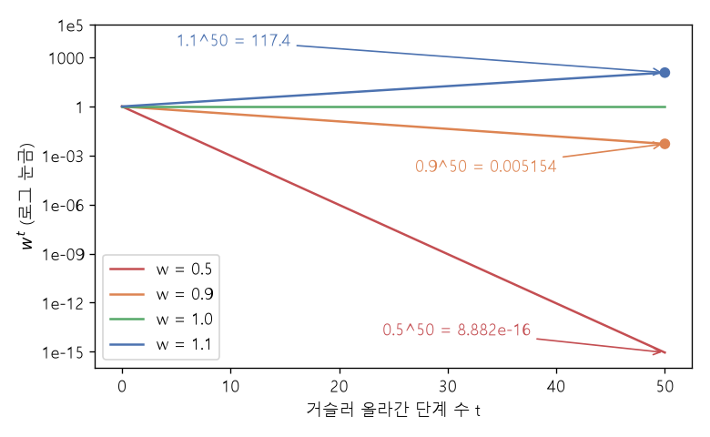

# 순환식 펼치기와 거듭제곱 (Unrolling a recurrence, powers of W)

[목차로 돌아가기](../../00_MIT%EB%94%A5%EB%9F%AC%EB%8B%9D_%EB%AA%A9%EC%B0%A8.md) · 먼저 볼 것: [M02_시그마와_평균](../../%EC%88%98%ED%95%99%EA%B0%9C%EB%85%90/01_%EC%88%98%EC%99%80_%ED%95%A8%EC%88%98/M02_%EC%8B%9C%EA%B7%B8%EB%A7%88%EC%99%80_%ED%8F%89%EA%B7%A0.md), [MM09_야코비안과_연쇄법칙](../../%EC%88%98%ED%95%99%EA%B0%9C%EB%85%90/05_%EC%8B%A0%EA%B2%BD%EB%A7%9D%EC%9D%98_%EA%B3%84%EC%82%B0/MM09_%EC%95%BC%EC%BD%94%EB%B9%84%EC%95%88%EA%B3%BC_%EC%97%B0%EC%87%84%EB%B2%95%EC%B9%99.md), [MM10_선형층과_ReLU의_역전파](../../%EC%88%98%ED%95%99%EA%B0%9C%EB%85%90/05_%EC%8B%A0%EA%B2%BD%EB%A7%9D%EC%9D%98_%EA%B3%84%EC%82%B0/MM10_%EC%84%A0%ED%98%95%EC%B8%B5%EA%B3%BC_ReLU%EC%9D%98_%EC%97%AD%EC%A0%84%ED%8C%8C.md) · 쓰는 곳: [Lec10 4](../../Lec10_%EA%B8%B0%EC%96%B5%EA%B3%BC_%EC%8B%9C%ED%80%80%EC%8A%A4.md#4-%EC%8B%9C%EA%B0%84-%EC%97%AD%EC%A0%84%ED%8C%8C), [Lec10 5.2](../../Lec10_%EA%B8%B0%EC%96%B5%EA%B3%BC_%EC%8B%9C%ED%80%80%EC%8A%A4.md#52-w%EC%9D%98-%EA%B1%B0%EB%93%AD%EC%A0%9C%EA%B3%B1%EA%B3%BC-%EA%B8%B0%EC%9A%B8%EA%B8%B0-%EC%86%8C%EC%8B%A4)

📚 학습 순서 58/99 (7. 구조 아키텍처): ← 이전: [MM31_순열_등변성과_인과_마스크](../../%EC%88%98%ED%95%99%EA%B0%9C%EB%85%90/07_%EA%B5%AC%EC%A1%B0_%EC%95%84%ED%82%A4%ED%85%8D%EC%B2%98/MM31_%EC%88%9C%EC%97%B4_%EB%93%B1%EB%B3%80%EC%84%B1%EA%B3%BC_%EC%9D%B8%EA%B3%BC_%EB%A7%88%EC%8A%A4%ED%81%AC.md) · 다음: [MM38_LSTM_게이트와_원소별_곱](../../%EC%88%98%ED%95%99%EA%B0%9C%EB%85%90/07_%EA%B5%AC%EC%A1%B0_%EC%95%84%ED%82%A4%ED%85%8D%EC%B2%98/MM38_LSTM_%EA%B2%8C%EC%9D%B4%ED%8A%B8%EC%99%80_%EC%9B%90%EC%86%8C%EB%B3%84_%EA%B3%B1.md) →

> [!NOTE]
> **3줄 요약**
> - [RNN](../../00_%EB%94%A5%EB%9F%AC%EB%8B%9D_%EC%9A%A9%EC%96%B4%EC%82%AC%EC%A0%84.md#rnn-recurrent-neural-network-%EC%88%9C%ED%99%98-%EC%8B%A0%EA%B2%BD%EB%A7%9D)의 순환식 $h_t = w h_{t-1} + u x_t$를 끝까지 풀어 쓰면 $h_t = w^t h_0 + \sum_k w^{t-k} u x_k$가 된다. $w = 0.5$, $u = 1$, $x = (1, 2, 3)$, $h_0 = 0$이면 $h_3 = 0.25 + 1 + 3 = 4.25$.
> - $k$단계 전의 입력은 $w$가 **$t-k$번 곱해져서** 들어온다. 그래서 $|w| < 1$이면 옛 정보와 그 [기울기](../../00_%EB%94%A5%EB%9F%AC%EB%8B%9D_%EC%9A%A9%EC%96%B4%EC%82%AC%EC%A0%84.md#gradient-%EA%B8%B0%EC%9A%B8%EA%B8%B0)가 지수적으로 줄고($0.9^{50} = 0.005154$), $|w| > 1$이면 폭발한다($1.1^{50} = 117.4$).
> - 행렬 $W$이면 같은 일이 **[고윳값](../../00_%EB%94%A5%EB%9F%AC%EB%8B%9D_%EC%9A%A9%EC%96%B4%EC%82%AC%EC%A0%84.md#eigenvector-eigenvalue-%EA%B3%A0%EC%9C%A0%EB%B2%A1%ED%84%B0%EC%99%80-%EA%B3%A0%EC%9C%B3%EA%B0%92)마다** 일어난다. $W = \mathrm{diag}(0.5, 1.2)$를 20번 곱하면 한 방향은 $9.537 \times 10^{-7}$, 다른 방향은 $38.34$가 된다.

## 1. 개념 설명

비유: 귓속말 전달 놀이. 한 사람이 들은 말을 다음 사람에게 전할 때마다 목소리가 0.9배로 작아진다면, 50명을 거친 첫 문장은 처음 크기의 0.5%만 남는다. 반대로 매번 1.1배로 키워 전하면 50명 뒤에는 117배로 커져 고함이 된다. 정확히 1배일 때만 끝까지 같은 크기로 간다.

- [RNN](../../00_%EB%94%A5%EB%9F%AC%EB%8B%9D_%EC%9A%A9%EC%96%B4%EC%82%AC%EC%A0%84.md#rnn-recurrent-neural-network-%EC%88%9C%ED%99%98-%EC%8B%A0%EA%B2%BD%EB%A7%9D)은 매 단계 같은 [가중치](../../00_%EB%94%A5%EB%9F%AC%EB%8B%9D_%EC%9A%A9%EC%96%B4%EC%82%AC%EC%A0%84.md#weight-%EA%B0%80%EC%A4%91%EC%B9%98) $w$로 이전 [은닉 상태](../../00_%EB%94%A5%EB%9F%AC%EB%8B%9D_%EC%9A%A9%EC%96%B4%EC%82%AC%EC%A0%84.md#hidden-state-%EC%9D%80%EB%8B%89-%EC%83%81%ED%83%9C)를 다음 단계로 넘긴다. 이것이 "전할 때마다 곱하는 배율"이다.
- 순환식을 한 단계씩 대입해 풀어 쓰는 것을 **펼치기(Unrolling)**라고 한다. 펼치면 순환이 사라지고 보통의 합과 거듭제곱만 남는다.
- [역전파](../../00_%EB%94%A5%EB%9F%AC%EB%8B%9D_%EC%9A%A9%EC%96%B4%EC%82%AC%EC%A0%84.md#backpropagation-%EC%97%AD%EC%A0%84%ED%8C%8C)도 같은 사슬을 거꾸로 지나므로, [기울기](../../00_%EB%94%A5%EB%9F%AC%EB%8B%9D_%EC%9A%A9%EC%96%B4%EC%82%AC%EC%A0%84.md#gradient-%EA%B8%B0%EC%9A%B8%EA%B8%B0) 역시 단계마다 $w$가 곱해진다. 이것이 [기울기 소실](../../00_%EB%94%A5%EB%9F%AC%EB%8B%9D_%EC%9A%A9%EC%96%B4%EC%82%AC%EC%A0%84.md#vanishing-gradient-%EA%B8%B0%EC%9A%B8%EA%B8%B0-%EC%86%8C%EC%8B%A4)과 [기울기 폭주](../../00_%EB%94%A5%EB%9F%AC%EB%8B%9D_%EC%9A%A9%EC%96%B4%EC%82%AC%EC%A0%84.md#exploding-gradient-%EA%B8%B0%EC%9A%B8%EA%B8%B0-%ED%8F%AD%EC%A3%BC)의 원인이다.

$$
h_t = w\, h_{t-1} + u\, x_t
$$

<details><summary>기호 풀이</summary>

| 기호 | 읽는 법 | 뜻 | 예제 값 |
| --- | --- | --- | --- |
| $h_t$ | 에이치 티 | t단계의 [은닉 상태](../../00_%EB%94%A5%EB%9F%AC%EB%8B%9D_%EC%9A%A9%EC%96%B4%EC%82%AC%EC%A0%84.md#hidden-state-%EC%9D%80%EB%8B%89-%EC%83%81%ED%83%9C) (기억) | $h_1 = 1$ |
| $h_{t-1}$ | 에이치 티 마이너스 일 | 바로 전 단계의 [은닉 상태](../../00_%EB%94%A5%EB%9F%AC%EB%8B%9D_%EC%9A%A9%EC%96%B4%EC%82%AC%EC%A0%84.md#hidden-state-%EC%9D%80%EB%8B%89-%EC%83%81%ED%83%9C) | $h_0 = 0$ |
| $w$ | 더블유 | 기억을 다음 단계로 넘기는 배율 (모든 단계 공유) | 0.5 |
| $u$ | 유 | 새 입력을 받아들이는 배율 | 1 |
| $x_t$ | 엑스 티 | t단계의 입력 | $x_1 = 1$ |

</details>

<details><summary>예제와 풀이</summary>

**문제**: 기억을 넘기는 배율 $w$, 입력 배율 $u$, 처음 기억 $h_0$, 두 단계의 입력 $x_1, x_2$가 주어질 때 2단계 기억 $h_2$를 구한다.

**주어진 값**:
- $w = 0.5$ (기억을 다음 단계로 넘길 때 곱하는 배율. 매 단계 같은 값)
- $u = 1$ (새 입력을 받아들일 때 곱하는 배율)
- $h_0 = 0$ (처음에는 기억이 비어 있음)
- $x_1 = 1$ (1단계 입력)
- $x_2 = 2$ (2단계 입력)

**풀이**
1. 식을 그대로 쓴다: $h_t = w\, h_{t-1} + u\, x_t$
2. 1단계 값을 대입한다: $h_1 = 0.5 \times 0 + 1 \times 1$
3. 곱셈을 먼저 한다: $0.5 \times 0 = 0$, $1 \times 1 = 1$
4. 더한다: $h_1 = 0 + 1 = 1$
5. 2단계 값을 대입한다 (방금 구한 $h_1$을 씀): $h_2 = 0.5 \times 1 + 1 \times 2$
6. 곱셈을 먼저 한다: $0.5 \times 1 = 0.5$, $1 \times 2 = 2$
7. 더한다: $h_2 = 0.5 + 2 = 2.5$

**답**: $h_2 = 2.5$

</details>

<details><summary>내 이해</summary>


</details>

## 2. 필요한 이유

[Lec10 5.2](../../Lec10_%EA%B8%B0%EC%96%B5%EA%B3%BC_%EC%8B%9C%ED%80%80%EC%8A%A4.md#52-w%EC%9D%98-%EA%B1%B0%EB%93%AD%EC%A0%9C%EA%B3%B1%EA%B3%BC-%EA%B8%B0%EC%9A%B8%EA%B8%B0-%EC%86%8C%EC%8B%A4)에서 강사는 칠판에 $h_1 = W h_0 + U x_1$, $h_2 = W(W h_0 + U x_1) + U x_2$를 쓰고 "$W^2$, $W^3$, ... $W^n$이 나온다"고 짚습니다. [RNN](../../00_%EB%94%A5%EB%9F%AC%EB%8B%9D_%EC%9A%A9%EC%96%B4%EC%82%AC%EC%A0%84.md#rnn-recurrent-neural-network-%EC%88%9C%ED%99%98-%EC%8B%A0%EA%B2%BD%EB%A7%9D)이 오래된 것을 잊고, [학습](../../00_%EB%94%A5%EB%9F%AC%EB%8B%9D_%EC%9A%A9%EC%96%B4%EC%82%AC%EC%A0%84.md#training-%ED%95%99%EC%8A%B5)이 불안정해지는 이유가 이 거듭제곱 하나로 설명됩니다. [LSTM](../../Lec10_%EA%B8%B0%EC%96%B5%EA%B3%BC_%EC%8B%9C%ED%80%80%EC%8A%A4.md#6-lstm)은 바로 이 곱셈을 피하려고 만든 구조입니다. [Lec10 4](../../Lec10_%EA%B8%B0%EC%96%B5%EA%B3%BC_%EC%8B%9C%ED%80%80%EC%8A%A4.md#4-%EC%8B%9C%EA%B0%84-%EC%97%AD%EC%A0%84%ED%8C%8C)의 [시간 역전파](../../00_%EB%94%A5%EB%9F%AC%EB%8B%9D_%EC%9A%A9%EC%96%B4%EC%82%AC%EC%A0%84.md#bptt-backpropagation-through-time-%EC%8B%9C%EA%B0%84-%EC%97%AD%EC%A0%84%ED%8C%8C)에서 $w$의 [기울기](../../00_%EB%94%A5%EB%9F%AC%EB%8B%9D_%EC%9A%A9%EC%96%B4%EC%82%AC%EC%A0%84.md#gradient-%EA%B8%B0%EC%9A%B8%EA%B8%B0)가 "단계마다 하나씩 더한 합"이 되는 것도 펼친 식에서 바로 보입니다.

## 3. 숫자로 보기

$w = 0.5$, $u = 1$, $h_0 = 0$, $x = (1, 2, 3)$을 쓴다.

**한 단계씩 계산** (한 줄에 한 동작)
- $h_1 = 0.5 × 0 + 1 = 1$
- $h_2 = 0.5 × 1 + 2 = 2.5$
- $h_3 = 0.5 × 2.5 + 3 = 4.25$

**펼친 식으로 한 번에**

$$
h_t = w^t h_0 + \sum_{k=1}^{t} w^{\,t-k}\, u\, x_k
$$

<details><summary>기호 풀이</summary>

| 기호 | 읽는 법 | 뜻 | 예제 값 |
| --- | --- | --- | --- |
| $w^t h_0$ | 더블유의 티제곱 곱하기 에이치 영 | 처음 상태가 t번 곱해져 남은 몫 | $0.5^3 × 0 = 0$ |
| $\sum_{k=1}^{t}$ | 시그마 k는 1부터 t까지 | 입력마다 남은 몫을 모두 더함 | 3개 항 |
| $w^{t-k}$ | 더블유의 t 마이너스 k제곱 | k단계 입력이 지금까지 곱해진 배율 | $x_1$은 $0.5^2 = 0.25$ |
| $u\,x_k$ | 유 엑스 케이 | k단계에 새로 들어온 값 | $u x_2 = 2$ |

</details>

<details><summary>예제와 풀이</summary>

**문제**: 순환식을 한 단계씩 돌리지 않고, 펼친 식에 한 번에 넣어 3단계 기억 $h_3$을 구한다.

**주어진 값**:
- $w = 0.5$ (기억을 넘길 때마다 곱하는 배율)
- $u = 1$ (입력 배율)
- $h_0 = 2$ (처음 기억)
- $x_1 = 1$, $x_2 = 2$, $x_3 = 3$ (세 단계의 입력)
- $t = 3$ (구하려는 단계)

**풀이**
1. 식을 그대로 쓴다: $h_t = w^t h_0 + \sum_{k=1}^{t} w^{\,t-k}\, u\, x_k$
2. 값을 대입한다: $h_3 = 0.5^3 \times 2 + \sum_{k=1}^{3} 0.5^{\,3-k} \times 1 \times x_k$
3. 시그마(Σ, k를 1부터 3까지 바꿔 가며 더하라는 기호)를 세 항으로 풀어 쓴다: $h_3 = 0.5^3 \times 2 + 0.5^2 \times 1 \times 1 + 0.5^1 \times 1 \times 2 + 0.5^0 \times 1 \times 3$
4. 거듭제곱을 계산한다 ($0.5^0$은 아무것도 곱하지 않은 것이라 1): $0.5^3 = 0.125$, $0.5^2 = 0.25$, $0.5^1 = 0.5$, $0.5^0 = 1$
5. 처음 기억의 몫을 곱한다: $0.125 \times 2 = 0.25$
6. $x_1$의 몫을 곱한다: $0.25 \times 1 \times 1 = 0.25$
7. $x_2$의 몫을 곱한다: $0.5 \times 1 \times 2 = 1$
8. $x_3$의 몫을 곱한다: $1 \times 1 \times 3 = 3$
9. 모두 더한다: $0.25 + 0.25 + 1 + 3 = 4.5$

**답**: $h_3 = 4.5$ (한 단계씩 계산해도 4.5)

</details>

<details><summary>내 이해</summary>


</details>

- $h_0 = 0$이면 $h_3 = 0.25 × 1 + 0.5 × 2 + 1 × 3 = 0.25 + 1 + 3 = 4.25$. 한 단계씩 계산한 값과 같다.
- 가장 오래된 입력 $x_1$에 붙은 배율이 가장 작다(0.25). 오래될수록 흐려진다.

**[기울기](../../00_%EB%94%A5%EB%9F%AC%EB%8B%9D_%EC%9A%A9%EC%96%B4%EC%82%AC%EC%A0%84.md#gradient-%EA%B8%B0%EC%9A%B8%EA%B8%B0)도 같은 배율로 줄어든다**

$h_t$를 $k$단계 전 상태로 [미분](../../00_%EB%94%A5%EB%9F%AC%EB%8B%9D_%EC%9A%A9%EC%96%B4%EC%82%AC%EC%A0%84.md#derivative-%EB%AF%B8%EB%B6%84)하면 사슬의 고리마다 $\partial h_j / \partial h_{j-1} = w$가 곱해진다([연쇄법칙](../../%EC%88%98%ED%95%99%EA%B0%9C%EB%85%90/05_%EC%8B%A0%EA%B2%BD%EB%A7%9D%EC%9D%98_%EA%B3%84%EC%82%B0/MM09_%EC%95%BC%EC%BD%94%EB%B9%84%EC%95%88%EA%B3%BC_%EC%97%B0%EC%87%84%EB%B2%95%EC%B9%99.md)).

$$
\frac{\partial h_t}{\partial h_k} = \prod_{j=k+1}^{t} \frac{\partial h_j}{\partial h_{j-1}} = w^{\,t-k}
$$

<details><summary>기호 풀이</summary>

| 기호 | 읽는 법 | 뜻 | 예제 값 |
| --- | --- | --- | --- |
| $\frac{\partial h_t}{\partial h_k}$ | 파셜 에이치 티 파셜 에이치 케이 | k단계 상태를 조금 바꾸면 t단계 상태가 몇 배로 바뀌나 | $0.9^{50} = 0.005154$ |
| $\prod_{j=k+1}^{t}$ | 파이, j는 k+1부터 t까지 | 괄호 안 값을 모두 곱함 | 50개의 곱 |
| $\frac{\partial h_j}{\partial h_{j-1}}$ | 한 고리의 [미분](../../00_%EB%94%A5%EB%9F%AC%EB%8B%9D_%EC%9A%A9%EC%96%B4%EC%82%AC%EC%A0%84.md#derivative-%EB%AF%B8%EB%B6%84) | 한 단계 넘어갈 때의 배율 | $w = 0.9$ |
| $w^{t-k}$ | 더블유의 t 마이너스 k제곱 | 고리 수만큼 곱한 결과 | $t - k = 50$ |

</details>

<details><summary>예제와 풀이</summary>

**문제**: 지금 단계가 $t = 50$이고 처음 상태가 $k = 0$단계일 때, 처음 상태를 조금 바꾸면 지금 상태가 몇 배로 바뀌는지([기울기](../../00_%EB%94%A5%EB%9F%AC%EB%8B%9D_%EC%9A%A9%EC%96%B4%EC%82%AC%EC%A0%84.md#gradient-%EA%B8%B0%EC%9A%B8%EA%B8%B0) 배율)를 구한다.

**주어진 값**:
- $w = 1.1$ (한 단계 넘어갈 때의 배율, 곧 고리 하나의 [미분](../../00_%EB%94%A5%EB%9F%AC%EB%8B%9D_%EC%9A%A9%EC%96%B4%EC%82%AC%EC%A0%84.md#derivative-%EB%AF%B8%EB%B6%84) 값)
- $t = 50$ (지금 단계)
- $k = 0$ (거슬러 올라갈 처음 단계)

**풀이**
1. 식을 그대로 쓴다: $\frac{\partial h_t}{\partial h_k} = \prod_{j=k+1}^{t} \frac{\partial h_j}{\partial h_{j-1}} = w^{\,t-k}$
2. 값을 대입한다: $\frac{\partial h_{50}}{\partial h_0} = \prod_{j=1}^{50} 1.1 = 1.1^{\,50-0}$
3. 파이(Π, 범위 안의 값을 모두 곱하라는 기호)를 풀어 쓴다: $1.1 \times 1.1 \times \cdots \times 1.1$ (50개)
4. [지수](../../00_%EB%94%A5%EB%9F%AC%EB%8B%9D_%EC%9A%A9%EC%96%B4%EC%82%AC%EC%A0%84.md#e-exponent-e%EC%99%80-%EC%A7%80%EC%88%98)를 계산한다: $50 - 0 = 50$
5. 거듭제곱을 계산한다: $1.1^{50} = 117.39$

**답**: 약 **117.4배**로 폭주한다.

</details>

<details><summary>내 이해</summary>


</details>

| $w$ | $w^{10}$ | $w^{20}$ | $w^{50}$ | 결과 |
|---|---|---|---|---|
| 0.5 | 0.0009766 | 9.537e-07 | 8.882e-16 | 거의 즉시 잊음 |
| 0.9 | 0.3487 | 0.1216 | 0.005154 | 천천히 잊음 (소실) |
| 1.0 | 1 | 1 | 1 | 그대로 유지 |
| 1.1 | 2.594 | 6.727 | 117.4 | 폭주 |


*▲ 직접 그린 그림: 배율 $w$를 t번 곱한 값 (세로축 [로그](../../00_%EB%94%A5%EB%9F%AC%EB%8B%9D_%EC%9A%A9%EC%96%B4%EC%82%AC%EC%A0%84.md#log-ln-%EB%A1%9C%EA%B7%B8) 눈금). 1보다 조금만 작아도 50단계 뒤에는 거의 0, 조금만 커도 수백 배가 된다*

**$w$의 [기울기](../../00_%EB%94%A5%EB%9F%AC%EB%8B%9D_%EC%9A%A9%EC%96%B4%EC%82%AC%EC%A0%84.md#gradient-%EA%B8%B0%EC%9A%B8%EA%B8%B0)는 단계마다 하나씩 더한 합**

$w$는 매 단계 같은 값을 쓰므로([가중치 공유](../../00_%EB%94%A5%EB%9F%AC%EB%8B%9D_%EC%9A%A9%EC%96%B4%EC%82%AC%EC%A0%84.md#weight-sharing-%EA%B0%80%EC%A4%91%EC%B9%98-%EA%B3%B5%EC%9C%A0)), $w$를 바꾸면 모든 단계가 함께 바뀐다. 각 단계 몫을 더하면([가지치기에서 기울기를 더하는 규칙](../../%EC%88%98%ED%95%99%EA%B0%9C%EB%85%90/05_%EC%8B%A0%EA%B2%BD%EB%A7%9D%EC%9D%98_%EA%B3%84%EC%82%B0/MM10_%EC%84%A0%ED%98%95%EC%B8%B5%EA%B3%BC_ReLU%EC%9D%98_%EC%97%AD%EC%A0%84%ED%8C%8C.md)):

$$
\frac{\partial h_t}{\partial w} = \sum_{k=1}^{t} w^{\,t-k}\, h_{k-1}
$$

<details><summary>기호 풀이</summary>

| 기호 | 읽는 법 | 뜻 | 예제 값 |
| --- | --- | --- | --- |
| $\frac{\partial h_t}{\partial w}$ | 파셜 에이치 티 파셜 더블유 | 공유 [가중치](../../00_%EB%94%A5%EB%9F%AC%EB%8B%9D_%EC%9A%A9%EC%96%B4%EC%82%AC%EC%A0%84.md#weight-%EA%B0%80%EC%A4%91%EC%B9%98) w를 조금 바꿀 때 $h_t$의 변화율 | $\partial h_3/\partial w = 3$ |
| $h_{k-1}$ | 에이치 케이 마이너스 일 | k단계에서 w가 곱해진 값 (그 단계 몫의 크기) | $h_2 = 2.5$ |
| $w^{t-k}$ | 더블유의 t 마이너스 k제곱 | k단계 몫이 지금까지 전해지며 곱해진 배율 | $w^1 = 0.5$ |

</details>

<details><summary>예제와 풀이</summary>

**문제**: 공유 [가중치](../../00_%EB%94%A5%EB%9F%AC%EB%8B%9D_%EC%9A%A9%EC%96%B4%EC%82%AC%EC%A0%84.md#weight-%EA%B0%80%EC%A4%91%EC%B9%98) $w$를 조금 바꿀 때 3단계 기억 $h_3$이 얼마나 바뀌는지($\partial h_3 / \partial w$)를 구한다.

**주어진 값**:
- $w = 0.5$ (매 단계 공유하는 순환 배율)
- $t = 3$ (구하려는 단계)
- $h_0 = 0$, $h_1 = 1$, $h_2 = 2.5$ (본문 3절에서 한 단계씩 구한 기억들. $u = 1$, $x = (1, 2, 3)$)

**풀이**
1. 식을 그대로 쓴다: $\frac{\partial h_t}{\partial w} = \sum_{k=1}^{t} w^{\,t-k}\, h_{k-1}$
2. 값을 대입한다: $\frac{\partial h_3}{\partial w} = \sum_{k=1}^{3} 0.5^{\,3-k}\, h_{k-1}$
3. 시그마를 세 항으로 풀어 쓴다: $0.5^2 \times h_0 + 0.5^1 \times h_1 + 0.5^0 \times h_2$
4. 기억 값을 넣는다: $0.5^2 \times 0 + 0.5^1 \times 1 + 0.5^0 \times 2.5$
5. 거듭제곱을 계산한다: $0.25 \times 0 + 0.5 \times 1 + 1 \times 2.5$
6. 곱셈을 한다: $0 + 0.5 + 2.5$
7. 더한다: $3$

**답**: $\partial h_3 / \partial w = 3$ (수치 [미분](../../00_%EB%94%A5%EB%9F%AC%EB%8B%9D_%EC%9A%A9%EC%96%B4%EC%82%AC%EC%A0%84.md#derivative-%EB%AF%B8%EB%B6%84)도 3.0)

</details>

<details><summary>내 이해</summary>


</details>

**행렬이면: [고윳값](../../00_%EB%94%A5%EB%9F%AC%EB%8B%9D_%EC%9A%A9%EC%96%B4%EC%82%AC%EC%A0%84.md#eigenvector-eigenvalue-%EA%B3%A0%EC%9C%A0%EB%B2%A1%ED%84%B0%EC%99%80-%EA%B3%A0%EC%9C%B3%EA%B0%92)마다 따로**

$W$가 행렬이면 $W^t$가 곱해진다. 대각 행렬 $W = \mathrm{diag}(0.5, 1.2)$이면 $W^{20} = \mathrm{diag}(0.5^{20}, 1.2^{20}) = \mathrm{diag}(9.537 \times 10^{-7},\ 38.34)$. 한 방향의 기억은 사라지고 다른 방향은 폭주한다. 일반 행렬에서도 가장 큰 [고윳값](../../00_%EB%94%A5%EB%9F%AC%EB%8B%9D_%EC%9A%A9%EC%96%B4%EC%82%AC%EC%A0%84.md#eigenvector-eigenvalue-%EA%B3%A0%EC%9C%A0%EB%B2%A1%ED%84%B0%EC%99%80-%EA%B3%A0%EC%9C%B3%EA%B0%92)의 절댓값([스펙트럼 반지름](../../00_%EB%94%A5%EB%9F%AC%EB%8B%9D_%EC%9A%A9%EC%96%B4%EC%82%AC%EC%A0%84.md#spectral-radius-%EC%8A%A4%ED%8E%99%ED%8A%B8%EB%9F%BC-%EB%B0%98%EC%A7%80%EB%A6%84))이 1보다 크냐 작으냐가 장기적인 운명을 정한다.

<details><summary>기호 풀이</summary>

| 기호 | 읽는 법 | 뜻 | 예제 값 |
| --- | --- | --- | --- |
| $w$ | 더블유 | 매 단계 공유하는 순환 배율 | 0.5 |
| $u$ | 유 | 입력 배율 | 1 |
| $h_t$ | 에이치 티 | t단계 [은닉 상태](../../00_%EB%94%A5%EB%9F%AC%EB%8B%9D_%EC%9A%A9%EC%96%B4%EC%82%AC%EC%A0%84.md#hidden-state-%EC%9D%80%EB%8B%89-%EC%83%81%ED%83%9C) | $h_3 = 4.25$ |
| $x_t$ | 엑스 티 | t단계 입력 | (1, 2, 3) |
| $w^t$ | 더블유의 티제곱 | t단계를 건너며 쌓인 배율 | $0.9^{50} = 0.005154$ |
| $\mathrm{diag}(a, b)$ | 대각 행렬 | 대각선에 a, b가 있고 나머지는 0인 행렬 | diag(0.5, 1.2) |

</details>

## 4. 코드로 확인

```python
# [변수] w = 0.5: 순환 배율, u = 1.0: 입력 배율, h = 0.0: 처음 은닉 상태 h_0
# [연결] 본문 3절의 예와 같은 값
w, u, h = 0.5, 1.0, 0.0
# [변수] xs: 세 단계의 입력 x_1, x_2, x_3
xs = [1, 2, 3]
# [변수] hs: 각 단계의 은닉 상태를 모아 둔다. 기울기 계산(h_{k-1})에 다시 쓴다
hs = [h]
# [함수] enumerate(xs, 1): (1, 1), (2, 2), (3, 3)처럼 단계 번호와 입력을 함께 내준다
for t, x in enumerate(xs, 1):
    # [변수] h: 순환식 h_t = w h_{t-1} + u x_t로 새로 계산한 상태. 1 → 2.5 → 4.25
    # [연결] 본문 첫 식, Lec10 3.2의 단순 RNN에서 비선형 함수를 뺀 꼴
    h = w * h + u * x
    # [쓸모] 다음 줄의 출력과 기울기 계산에 쓰려고 저장
    hs.append(h)
    # [함수] print: 단계 번호와 상태를 한 줄로 출력
    print(t, h)
# [함수] sum(...): 펼친 식 Σ w^(t-k) u x_k를 계산한다
# [변수] closed: 펼친 식으로 한 번에 구한 h_3. 위의 4.25와 같아야 한다
# [연결] 본문 3절 "펼친 식으로 한 번에"
closed = sum(w ** (3 - k) * u * x for k, x in enumerate(xs, 1))
# [변수] grad: ∂h_3/∂w = Σ w^(3-k) h_{k-1}. 단계마다 생긴 몫을 더한 값
# [연결] 본문 "w의 기울기는 단계마다 하나씩 더한 합", MM10의 가지치기 규칙
grad = sum(w ** (3 - k) * hs[k - 1] for k in (1, 2, 3))
# [함수] print: 펼친 식 결과와 기울기 출력 → 4.25 3.0
print(closed, grad)
# [함수] for ... in (...): 네 가지 배율을 차례로 시험한다
for w in (0.5, 0.9, 1.0, 1.1):
    # [함수] f"{v:.4g}": 유효숫자 4자리로 줄인다. float(...)로 다시 숫자로 바꿔 깔끔하게 출력
    # [연결] 본문 3절의 거듭제곱 표 (w^10, w^20, w^50)
    print(w, [float(f"{w ** t:.4g}") for t in (10, 20, 50)])
```

**실행 결과**:

```text
1 1.0
2 2.5
3 4.25
4.25 3.0
0.5 [0.0009766, 9.537e-07, 8.882e-16]
0.9 [0.3487, 0.1216, 0.005154]
1.0 [1.0, 1.0, 1.0]
1.1 [2.594, 6.727, 117.4]
```

> [!WARNING]
> **⚠ 주의**
> - 실제 [RNN](../../00_%EB%94%A5%EB%9F%AC%EB%8B%9D_%EC%9A%A9%EC%96%B4%EC%82%AC%EC%A0%84.md#rnn-recurrent-neural-network-%EC%88%9C%ED%99%98-%EC%8B%A0%EA%B2%BD%EB%A7%9D)에는 [tanh](../../00_%EB%94%A5%EB%9F%AC%EB%8B%9D_%EC%9A%A9%EC%96%B4%EC%82%AC%EC%A0%84.md#tanh-%EC%8C%8D%EA%B3%A1%ED%83%84%EC%A0%A0%ED%8A%B8) 같은 [활성화 함수](../../00_%EB%94%A5%EB%9F%AC%EB%8B%9D_%EC%9A%A9%EC%96%B4%EC%82%AC%EC%A0%84.md#activation-function-%ED%99%9C%EC%84%B1%ED%99%94-%ED%95%A8%EC%88%98)가 끼어 있다. [tanh](../../00_%EB%94%A5%EB%9F%AC%EB%8B%9D_%EC%9A%A9%EC%96%B4%EC%82%AC%EC%A0%84.md#tanh-%EC%8C%8D%EA%B3%A1%ED%83%84%EC%A0%A0%ED%8A%B8)의 [미분](../../00_%EB%94%A5%EB%9F%AC%EB%8B%9D_%EC%9A%A9%EC%96%B4%EC%82%AC%EC%A0%84.md#derivative-%EB%AF%B8%EB%B6%84)은 최대 1이므로([MM05_활성화_함수의_미분](../../%EC%88%98%ED%95%99%EA%B0%9C%EB%85%90/05_%EC%8B%A0%EA%B2%BD%EB%A7%9D%EC%9D%98_%EA%B3%84%EC%82%B0/MM05_%ED%99%9C%EC%84%B1%ED%99%94_%ED%95%A8%EC%88%98%EC%9D%98_%EB%AF%B8%EB%B6%84.md)) 한 고리의 배율이 더 작아질 뿐, 소실 문제는 오히려 심해진다.
> - [그래디언트 클리핑](../../00_%EB%94%A5%EB%9F%AC%EB%8B%9D_%EC%9A%A9%EC%96%B4%EC%82%AC%EC%A0%84.md#gradient-clipping-%EA%B7%B8%EB%9E%98%EB%94%94%EC%96%B8%ED%8A%B8-%ED%81%B4%EB%A6%AC%ED%95%91)이나 [노름](../../00_%EB%94%A5%EB%9F%AC%EB%8B%9D_%EC%9A%A9%EC%96%B4%EC%82%AC%EC%A0%84.md#norm-%EB%85%B8%EB%A6%84) [정규화](../../00_%EB%94%A5%EB%9F%AC%EB%8B%9D_%EC%9A%A9%EC%96%B4%EC%82%AC%EC%A0%84.md#normalization-%EC%A0%95%EA%B7%9C%ED%99%94)로 **폭주**는 눌러 줄 수 있지만, 0에 가까워진 **소실**은 되살릴 수 없다. 강의가 [LSTM](../../00_%EB%94%A5%EB%9F%AC%EB%8B%9D_%EC%9A%A9%EC%96%B4%EC%82%AC%EC%A0%84.md#lstm-long-short-term-memory-%EC%9E%A5%EB%8B%A8%EA%B8%B0-%EB%A9%94%EB%AA%A8%EB%A6%AC)으로 넘어가는 이유다.

## 5. 개념 재확인

<details><summary>1. $w = 0.8$, $u = 2$, $h_0 = 1$, $x = (1, 0, -1)$이면 $h_3$은? 한 단계씩과 펼친 식 두 가지로 구하라.</summary>

| 단계 | 하는 일 | 식 | 계산 | 결과 |
|---|---|---|---|---|
| 1 | $h_1$ | $w h_0 + u x_1$ | $0.8 × 1 + 2 × 1$ | 2.8 |
| 2 | $h_2$ | $w h_1 + u x_2$ | $0.8 × 2.8 + 0$ | 2.24 |
| 3 | $h_3$ | $w h_2 + u x_3$ | $0.8 × 2.24 - 2$ | −0.208 |
| 4 | 펼친 식 | $w^3 h_0 + \sum w^{3-k} u x_k$ | $0.512 + 1.28 + 0 - 2$ | −0.208 |

**① 쓰는 식**
$$h_t = w h_{t-1} + u x_t, \qquad h_3 = w^3 h_0 + \sum_{k=1}^{3} w^{3-k} u x_k$$
- 왼쪽 식 ← ② ③ ④ (한 단계씩), 오른쪽 식 ← ⑤ (펼친 식)
```python
# [변수] w = 0.8, u = 2, h = 1.0: 문제에서 준 배율과 처음 상태
w, u, h = 0.8, 2, 1.0                     # ①
# [변수] xs: 세 입력 (1, 0, -1)
xs = [1, 0, -1]
# [함수] for: 세 단계를 차례로 계산
for x in xs:
    # [변수] h: 2.8 → 2.24 → -0.208
    h = w * h + u * x                     # ②③④
    # [함수] round(h, 4): 소수 넷째 자리로 반올림해 출력
    print(round(h, 4))
# [변수] closed: 펼친 식으로 구한 h_3. w^3 h_0 = 0.512에 입력 몫을 더한다
closed = w ** 3 * 1.0 + sum(w ** (3 - k) * u * x for k, x in enumerate(xs, 1))  # ⑤
# [연결] 위의 마지막 값 -0.208과 같아야 한다
print(round(closed, 4))
```

**문제**: 순환식을 세 번 돌려 $h_3$을 구하고, 같은 값을 펼친 식으로도 구해 맞는지 확인한다.

**주어진 값**:
- $w = 0.8$ (기억을 넘길 때 곱하는 배율)
- $u = 2$ (입력 배율)
- $h_0 = 1$ (처음 기억)
- $x_1 = 1$, $x_2 = 0$, $x_3 = -1$ (세 단계의 입력)

**② $h_1$**
1. 식을 그대로 쓴다: $h_1 = w\, h_0 + u\, x_1$
2. 값을 대입한다: $h_1 = 0.8 \times 1 + 2 \times 1$
3. 곱셈을 먼저 한다: $0.8 + 2$
4. 더한다: $h_1 = 2.8$

**③ $h_2$**
1. 식을 그대로 쓴다: $h_2 = w\, h_1 + u\, x_2$
2. 값을 대입한다: $h_2 = 0.8 \times 2.8 + 2 \times 0$
3. 곱셈을 먼저 한다: $2.24 + 0$
4. 더한다: $h_2 = 2.24$

**④ $h_3$**
1. 식을 그대로 쓴다: $h_3 = w\, h_2 + u\, x_3$
2. 값을 대입한다: $h_3 = 0.8 \times 2.24 + 2 \times (-1)$
3. 곱셈을 먼저 한다: $1.792 + (-2)$
4. 더한다: $h_3 = -0.208$

**⑤ 펼친 식**
1. 식을 그대로 쓴다: $h_3 = w^3 h_0 + \sum_{k=1}^{3} w^{3-k} u x_k$
2. 값을 대입한다: $h_3 = 0.8^3 \times 1 + \sum_{k=1}^{3} 0.8^{3-k} \times 2 \times x_k$
3. 시그마를 세 항으로 풀어 쓴다: $0.8^3 \times 1 + 0.8^2 \times 2 \times 1 + 0.8^1 \times 2 \times 0 + 0.8^0 \times 2 \times (-1)$
4. 거듭제곱을 계산한다: $0.8^3 = 0.512$, $0.8^2 = 0.64$, $0.8^1 = 0.8$, $0.8^0 = 1$
5. 항마다 곱한다: $0.512 + 1.28 + 0 + (-2)$
6. 더한다: $-0.208$

**답**: $h_3 = $ **−0.208** (두 방법이 같다)

</details>

<details><summary>2. $w = 0.9$일 때 기억이 1% 아래로 떨어지려면 몇 단계가 지나야 하나? 또 $W = \mathrm{diag}(0.5, 1.2)$를 20번 곱하면?</summary>

| 단계 | 하는 일 | 계산 | 결과 |
|---|---|---|---|
| 1 | $0.9^{43}$ | 아직 1% 위 | 0.01078 |
| 2 | $0.9^{44}$ | 처음으로 1% 아래 | 0.009698 |
| 3 | $0.5^{20}$ | 첫째 방향 | 9.537e-07 |
| 4 | $1.2^{20}$ | 둘째 방향 | 38.34 |

**① 쓰는 식**
$$\frac{\partial h_t}{\partial h_k} = w^{t-k}, \qquad W^{t} = \mathrm{diag}(a^{t}, b^{t})$$
- 왼쪽 식 ← ② (1% 아래가 되는 첫 t), 오른쪽 식 ← ③ (대각 행렬의 거듭제곱)
```python
# [함수] next(...): 조건을 처음 만족하는 t를 찾는다. range(1, 200)에서 0.9^t < 0.01인 첫 값
# [변수] t: 기억이 1% 아래로 내려가는 첫 단계 수 → 44
t = next(t for t in range(1, 200) if 0.9 ** t < 0.01)   # ②
# [함수] f"{v:.4g}": 유효숫자 4자리로 출력. 경계 양쪽 값을 함께 본다 → 44 0.01078 0.009698
print(t, f"{0.9 ** 43:.4g}", f"{0.9 ** 44:.4g}")
# [변수] W: 대각 행렬 diag(0.5, 1.2). 두 방향의 배율이 다르다
W = np.array([[0.5, 0], [0, 1.2]])
# [함수] np.linalg.matrix_power(W, 20): W를 20번 곱한다
# [변수] P: 대각선에 0.5^20, 1.2^20이 놓인다
P = np.linalg.matrix_power(W, 20)                       # ③
# [함수] f"{v:.4g}": 유효숫자 4자리로 출력
print(f"{P[0, 0]:.4g}", f"{P[1, 1]:.4g}")
```

**문제**: 기억이 단계마다 $w$배가 될 때 처음의 1%(0.01) 아래로 떨어지는 첫 단계 수를 찾고, 대각 행렬 $W$를 20번 곱한 결과를 구한다.

**주어진 값**:
- $w = 0.9$ (한 단계마다 기억에 곱해지는 배율)
- 기준 0.01 (처음 기억의 1%)
- $W = \mathrm{diag}(0.5, 1.2)$ (대각선에 0.5와 1.2가 있고 나머지는 0인 행렬. 두 방향의 배율이 다름)
- $t = 20$ (행렬을 곱하는 횟수)

**② 1% 아래가 되는 첫 t**
1. 식을 그대로 쓴다: $\frac{\partial h_t}{\partial h_k} = w^{t-k}$, 여기서 $t - k$를 그냥 $t$로 쓴다
2. 값을 대입한다: $0.9^{t} < 0.01$을 만족하는 가장 작은 $t$
3. $t = 43$을 넣어 본다: $0.9^{43} = 0.01078$ (아직 0.01보다 크다)
4. $t = 44$를 넣어 본다: $0.9^{44} = 0.009698$ (처음으로 0.01보다 작다)

**③ 대각 행렬의 거듭제곱**
1. 식을 그대로 쓴다: $W^{t} = \mathrm{diag}(a^{t}, b^{t})$ (대각 행렬끼리 곱하면 대각선 칸끼리만 곱해진다)
2. 값을 대입한다: $W^{20} = \mathrm{diag}(0.5^{20},\ 1.2^{20})$
3. 첫째 칸을 계산한다: $0.5^{20} = 9.537 \times 10^{-7}$ (0.0000009537)
4. 둘째 칸을 계산한다: $1.2^{20} = 38.34$

**답**: **44단계**. $W^{20}$은 $\mathrm{diag}(9.537 \times 10^{-7},\ 38.34)$로, 한 방향은 사라지고 한 방향은 폭주한다.

</details>

## 예제 풀기

[예제 10문제 풀기](../../%EC%98%88%EC%A0%9C/07_%EA%B5%AC%EC%A1%B0_%EC%95%84%ED%82%A4%ED%85%8D%EC%B2%98/%EC%98%88%EC%A0%9C_MM37_%EC%88%9C%ED%99%98%EC%8B%9D_%ED%8E%BC%EC%B9%98%EA%B8%B0%EC%99%80_%EA%B1%B0%EB%93%AD%EC%A0%9C%EA%B3%B1.md)

<details><summary>내 이해</summary>


</details>
