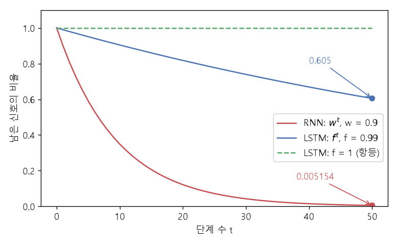

# LSTM 게이트와 원소별 곱 (Gates and the Hadamard product)

[목차로 돌아가기](../../00_MIT%EB%94%A5%EB%9F%AC%EB%8B%9D_%EB%AA%A9%EC%B0%A8.md) · 먼저 볼 것: [M11_오즈와_로짓](../../%EC%88%98%ED%95%99%EA%B0%9C%EB%85%90/04_%ED%99%95%EB%A5%A0%EA%B3%BC_%EC%A0%95%EB%B3%B4/M11_%EC%98%A4%EC%A6%88%EC%99%80_%EB%A1%9C%EC%A7%93.md), [MM05_활성화_함수의_미분](../../%EC%88%98%ED%95%99%EA%B0%9C%EB%85%90/05_%EC%8B%A0%EA%B2%BD%EB%A7%9D%EC%9D%98_%EA%B3%84%EC%82%B0/MM05_%ED%99%9C%EC%84%B1%ED%99%94_%ED%95%A8%EC%88%98%EC%9D%98_%EB%AF%B8%EB%B6%84.md), [MM37_순환식_펼치기와_거듭제곱](../../%EC%88%98%ED%95%99%EA%B0%9C%EB%85%90/07_%EA%B5%AC%EC%A1%B0_%EC%95%84%ED%82%A4%ED%85%8D%EC%B2%98/MM37_%EC%88%9C%ED%99%98%EC%8B%9D_%ED%8E%BC%EC%B9%98%EA%B8%B0%EC%99%80_%EA%B1%B0%EB%93%AD%EC%A0%9C%EA%B3%B1.md) · 쓰는 곳: [Lec10 6](../../Lec10_%EA%B8%B0%EC%96%B5%EA%B3%BC_%EC%8B%9C%ED%80%80%EC%8A%A4.md#6-lstm)

📚 학습 순서 59/99 (7. 구조 아키텍처): ← 이전: [MM37_순환식_펼치기와_거듭제곱](../../%EC%88%98%ED%95%99%EA%B0%9C%EB%85%90/07_%EA%B5%AC%EC%A1%B0_%EC%95%84%ED%82%A4%ED%85%8D%EC%B2%98/MM37_%EC%88%9C%ED%99%98%EC%8B%9D_%ED%8E%BC%EC%B9%98%EA%B8%B0%EC%99%80_%EA%B1%B0%EB%93%AD%EC%A0%9C%EA%B3%B1.md) · 다음: [MM23_최소_노름_해와_이중_하강](../../%EC%88%98%ED%95%99%EA%B0%9C%EB%85%90/08_%EC%9D%BC%EB%B0%98%ED%99%94/MM23_%EC%B5%9C%EC%86%8C_%EB%85%B8%EB%A6%84_%ED%95%B4%EC%99%80_%EC%9D%B4%EC%A4%91_%ED%95%98%EA%B0%95.md) →

> [!NOTE]
> **3줄 요약**
> - **[게이트](../../00_%EB%94%A5%EB%9F%AC%EB%8B%9D_%EC%9A%A9%EC%96%B4%EC%82%AC%EC%A0%84.md#gate-%EA%B2%8C%EC%9D%B4%ED%8A%B8)**는 [시그모이드](../../00_%EB%94%A5%EB%9F%AC%EB%8B%9D_%EC%9A%A9%EC%96%B4%EC%82%AC%EC%A0%84.md#sigmoid-%EC%8B%9C%EA%B7%B8%EB%AA%A8%EC%9D%B4%EB%93%9C)로 만든 0~1 사이의 벡터를 다른 벡터에 **칸마다 곱하는([원소별 곱](../../00_%EB%94%A5%EB%9F%AC%EB%8B%9D_%EC%9A%A9%EC%96%B4%EC%82%AC%EC%A0%84.md#hadamard-product-%EC%9B%90%EC%86%8C%EB%B3%84-%EA%B3%B1), ⊙)** 장치다. 1에 가까운 칸은 통과, 0에 가까운 칸은 차단된다. $(2, -1, 0.5) \odot (0.982, 0.018, 0.5) = (1.964, -0.018, 0.25)$.
> - [LSTM](../../00_%EB%94%A5%EB%9F%AC%EB%8B%9D_%EC%9A%A9%EC%96%B4%EC%82%AC%EC%A0%84.md#lstm-long-short-term-memory-%EC%9E%A5%EB%8B%A8%EA%B8%B0-%EB%A9%94%EB%AA%A8%EB%A6%AC)의 [셀 상태](../../00_%EB%94%A5%EB%9F%AC%EB%8B%9D_%EC%9A%A9%EC%96%B4%EC%82%AC%EC%A0%84.md#cell-state-%EC%85%80-%EC%83%81%ED%83%9C)는 $C_t = f_t \odot C_{t-1} + i_t \odot \tilde{C}_t$로 갱신된다. 망각 [게이트](../../00_%EB%94%A5%EB%9F%AC%EB%8B%9D_%EC%9A%A9%EC%96%B4%EC%82%AC%EC%A0%84.md#gate-%EA%B2%8C%EC%9D%B4%ED%8A%B8) $f_t$로 지우고, 입력 [게이트](../../00_%EB%94%A5%EB%9F%AC%EB%8B%9D_%EC%9A%A9%EC%96%B4%EC%82%AC%EC%A0%84.md#gate-%EA%B2%8C%EC%9D%B4%ED%8A%B8) $i_t$로 새 내용을 쓴다.
> - [셀 상태](../../00_%EB%94%A5%EB%9F%AC%EB%8B%9D_%EC%9A%A9%EC%96%B4%EC%82%AC%EC%A0%84.md#cell-state-%EC%85%80-%EC%83%81%ED%83%9C)를 따라 거슬러 가는 [기울기](../../00_%EB%94%A5%EB%9F%AC%EB%8B%9D_%EC%9A%A9%EC%96%B4%EC%82%AC%EC%A0%84.md#gradient-%EA%B8%B0%EC%9A%B8%EA%B8%B0)는 $w$가 아니라 $f_t$가 곱해진다. $f = 0.99$면 50단계 뒤에도 0.605가 남는다([RNN](../../00_%EB%94%A5%EB%9F%AC%EB%8B%9D_%EC%9A%A9%EC%96%B4%EC%82%AC%EC%A0%84.md#rnn-recurrent-neural-network-%EC%88%9C%ED%99%98-%EC%8B%A0%EA%B2%BD%EB%A7%9D) $w = 0.9$는 0.005154).

## 1. 개념 설명

비유: 화이트보드와 지우개. 칠판([셀 상태](../../00_%EB%94%A5%EB%9F%AC%EB%8B%9D_%EC%9A%A9%EC%96%B4%EC%82%AC%EC%A0%84.md#cell-state-%EC%85%80-%EC%83%81%ED%83%9C))에 적힌 내용을 매 단계 통째로 다시 베껴 쓰면([RNN](../../00_%EB%94%A5%EB%9F%AC%EB%8B%9D_%EC%9A%A9%EC%96%B4%EC%82%AC%EC%A0%84.md#rnn-recurrent-neural-network-%EC%88%9C%ED%99%98-%EC%8B%A0%EA%B2%BD%EB%A7%9D)의 $W$ 곱) 조금씩 흐려진다. [LSTM](../../00_%EB%94%A5%EB%9F%AC%EB%8B%9D_%EC%9A%A9%EC%96%B4%EC%82%AC%EC%A0%84.md#lstm-long-short-term-memory-%EC%9E%A5%EB%8B%A8%EA%B8%B0-%EB%A9%94%EB%AA%A8%EB%A6%AC)은 칠판을 **그대로 두고**, 지울 칸만 지우개로 지우고(망각 [게이트](../../00_%EB%94%A5%EB%9F%AC%EB%8B%9D_%EC%9A%A9%EC%96%B4%EC%82%AC%EC%A0%84.md#gate-%EA%B2%8C%EC%9D%B4%ED%8A%B8)) 새로 쓸 칸에만 분필로 덧쓴다(입력 [게이트](../../00_%EB%94%A5%EB%9F%AC%EB%8B%9D_%EC%9A%A9%EC%96%B4%EC%82%AC%EC%A0%84.md#gate-%EA%B2%8C%EC%9D%B4%ED%8A%B8)). 그리고 칠판 중 지금 보여 줄 부분만 가림막을 열어 내보낸다(출력 [게이트](../../00_%EB%94%A5%EB%9F%AC%EB%8B%9D_%EC%9A%A9%EC%96%B4%EC%82%AC%EC%A0%84.md#gate-%EA%B2%8C%EC%9D%B4%ED%8A%B8)).

- **[게이트](../../00_%EB%94%A5%EB%9F%AC%EB%8B%9D_%EC%9A%A9%EC%96%B4%EC%82%AC%EC%A0%84.md#gate-%EA%B2%8C%EC%9D%B4%ED%8A%B8) 값**은 [시그모이드](../../00_%EB%94%A5%EB%9F%AC%EB%8B%9D_%EC%9A%A9%EC%96%B4%EC%82%AC%EC%A0%84.md#sigmoid-%EC%8B%9C%EA%B7%B8%EB%AA%A8%EC%9D%B4%EB%93%9C) $\sigma(z) = 1/(1 + e^{-z})$로 만든다. 출력이 0~1이라 "몇 퍼센트 통과시킬지"로 읽을 수 있다. $\sigma(4) = 0.982$, $\sigma(0) = 0.5$, $\sigma(-4) = 0.018$.
- **[원소별 곱](../../00_%EB%94%A5%EB%9F%AC%EB%8B%9D_%EC%9A%A9%EC%96%B4%EC%82%AC%EC%A0%84.md#hadamard-product-%EC%9B%90%EC%86%8C%EB%B3%84-%EA%B3%B1) ⊙**은 같은 크기의 두 벡터를 같은 자리끼리만 곱한다. [행렬 곱](../../00_%EB%94%A5%EB%9F%AC%EB%8B%9D_%EC%9A%A9%EC%96%B4%EC%82%AC%EC%A0%84.md#matrix-multiplication-%ED%96%89%EB%A0%AC-%EA%B3%B1)과 달리 칸끼리 섞이지 않는다. 그래서 칸마다 따로 "기억할지 말지"를 정할 수 있다.

$$
\mathbf{g} \odot \mathbf{v} = (g_1 v_1,\ g_2 v_2,\ \dots,\ g_n v_n), \qquad g_j = \sigma(z_j) \in (0, 1)
$$

<details><summary>기호 풀이</summary>

| 기호 | 읽는 법 | 뜻 | 예제 값 |
| --- | --- | --- | --- |
| $\mathbf{g}$ | [게이트](../../00_%EB%94%A5%EB%9F%AC%EB%8B%9D_%EC%9A%A9%EC%96%B4%EC%82%AC%EC%A0%84.md#gate-%EA%B2%8C%EC%9D%B4%ED%8A%B8) 벡터 지 | 칸마다 통과 비율 (0~1) | (0.982, 0.018, 0.5) |
| $\mathbf{v}$ | 벡터 브이 | [게이트](../../00_%EB%94%A5%EB%9F%AC%EB%8B%9D_%EC%9A%A9%EC%96%B4%EC%82%AC%EC%A0%84.md#gate-%EA%B2%8C%EC%9D%B4%ED%8A%B8)를 통과시킬 값 | (2, −1, 0.5) |
| $\odot$ | [원소별 곱](../../00_%EB%94%A5%EB%9F%AC%EB%8B%9D_%EC%9A%A9%EC%96%B4%EC%82%AC%EC%A0%84.md#hadamard-product-%EC%9B%90%EC%86%8C%EB%B3%84-%EA%B3%B1), 아다마르 곱 | 같은 자리끼리만 곱하기 | - |
| $\sigma(z_j)$ | 시그마 제트 제이 | [시그모이드](../../00_%EB%94%A5%EB%9F%AC%EB%8B%9D_%EC%9A%A9%EC%96%B4%EC%82%AC%EC%A0%84.md#sigmoid-%EC%8B%9C%EA%B7%B8%EB%AA%A8%EC%9D%B4%EB%93%9C), 아무 수를 0~1로 눌러 줌 | $\sigma(4) = 0.982$ |
| $z_j$ | 제트 제이 | [게이트](../../00_%EB%94%A5%EB%9F%AC%EB%8B%9D_%EC%9A%A9%EC%96%B4%EC%82%AC%EC%A0%84.md#gate-%EA%B2%8C%EC%9D%B4%ED%8A%B8)를 만드는 점수 ([선형층](../../00_%EB%94%A5%EB%9F%AC%EB%8B%9D_%EC%9A%A9%EC%96%B4%EC%82%AC%EC%A0%84.md#linear-layer-%EC%84%A0%ED%98%95%EC%B8%B5) 출력) | (4, −4, 0) |

</details>

<details><summary>예제와 풀이</summary>

**문제**: 점수 벡터 $z$로 [게이트](../../00_%EB%94%A5%EB%9F%AC%EB%8B%9D_%EC%9A%A9%EC%96%B4%EC%82%AC%EC%A0%84.md#gate-%EA%B2%8C%EC%9D%B4%ED%8A%B8) $\mathbf{g}$를 만들고, 그 [게이트](../../00_%EB%94%A5%EB%9F%AC%EB%8B%9D_%EC%9A%A9%EC%96%B4%EC%82%AC%EC%A0%84.md#gate-%EA%B2%8C%EC%9D%B4%ED%8A%B8)를 값 벡터 $\mathbf{v}$에 칸마다 곱해 무엇이 남는지 구한다.

**주어진 값**:
- $z = (4, -4, 0)$ ([게이트](../../00_%EB%94%A5%EB%9F%AC%EB%8B%9D_%EC%9A%A9%EC%96%B4%EC%82%AC%EC%A0%84.md#gate-%EA%B2%8C%EC%9D%B4%ED%8A%B8)를 만드는 점수. 클수록 많이 통과)
- $\mathbf{v} = (2, -1, 0.5)$ ([게이트](../../00_%EB%94%A5%EB%9F%AC%EB%8B%9D_%EC%9A%A9%EC%96%B4%EC%82%AC%EC%A0%84.md#gate-%EA%B2%8C%EC%9D%B4%ED%8A%B8)를 통과시킬 값)

**풀이**
1. 식을 그대로 쓴다: $\mathbf{g} \odot \mathbf{v} = (g_1 v_1,\ g_2 v_2,\ g_3 v_3)$, $g_j = \sigma(z_j)$
2. 값을 대입한다: $\mathbf{g} \odot \mathbf{v} = (\sigma(4) \times 2,\ \sigma(-4) \times (-1),\ \sigma(0) \times 0.5)$
3. [시그모이드](../../00_%EB%94%A5%EB%9F%AC%EB%8B%9D_%EC%9A%A9%EC%96%B4%EC%82%AC%EC%A0%84.md#sigmoid-%EC%8B%9C%EA%B7%B8%EB%AA%A8%EC%9D%B4%EB%93%9C) 뜻: $\sigma(z) = 1/(1 + e^{-z})$. $e$는 약 2.718인 수이고, 결과는 항상 0과 1 사이다
4. 첫째 칸 [게이트](../../00_%EB%94%A5%EB%9F%AC%EB%8B%9D_%EC%9A%A9%EC%96%B4%EC%82%AC%EC%A0%84.md#gate-%EA%B2%8C%EC%9D%B4%ED%8A%B8): $\sigma(4) = 1/(1 + e^{-4}) = 1/(1 + 0.0183) = 0.982$
5. 둘째 칸 [게이트](../../00_%EB%94%A5%EB%9F%AC%EB%8B%9D_%EC%9A%A9%EC%96%B4%EC%82%AC%EC%A0%84.md#gate-%EA%B2%8C%EC%9D%B4%ED%8A%B8): $\sigma(-4) = 1/(1 + e^{4}) = 1/(1 + 54.6) = 0.018$
6. 셋째 칸 [게이트](../../00_%EB%94%A5%EB%9F%AC%EB%8B%9D_%EC%9A%A9%EC%96%B4%EC%82%AC%EC%A0%84.md#gate-%EA%B2%8C%EC%9D%B4%ED%8A%B8): $\sigma(0) = 1/(1 + 1) = 0.5$
7. 첫째 칸끼리 곱한다: $0.982 \times 2 = 1.964$
8. 둘째 칸끼리 곱한다: $0.018 \times (-1) = -0.018$
9. 셋째 칸끼리 곱한다: $0.5 \times 0.5 = 0.25$

**답**: $(1.964,\ -0.018,\ 0.25)$. 첫 칸은 거의 그대로, 둘째 칸은 거의 지워지고, 셋째 칸은 절반만 남는다.

</details>

<details><summary>내 이해</summary>


</details>

## 2. 필요한 이유

[MM37_순환식_펼치기와_거듭제곱](../../%EC%88%98%ED%95%99%EA%B0%9C%EB%85%90/07_%EA%B5%AC%EC%A1%B0_%EC%95%84%ED%82%A4%ED%85%8D%EC%B2%98/MM37_%EC%88%9C%ED%99%98%EC%8B%9D_%ED%8E%BC%EC%B9%98%EA%B8%B0%EC%99%80_%EA%B1%B0%EB%93%AD%EC%A0%9C%EA%B3%B1.md)에서 본 것처럼 [RNN](../../00_%EB%94%A5%EB%9F%AC%EB%8B%9D_%EC%9A%A9%EC%96%B4%EC%82%AC%EC%A0%84.md#rnn-recurrent-neural-network-%EC%88%9C%ED%99%98-%EC%8B%A0%EA%B2%BD%EB%A7%9D)은 같은 $W$를 거듭 곱해 옛 기억을 지수적으로 잃는다. [Lec10 6](../../Lec10_%EA%B8%B0%EC%96%B5%EA%B3%BC_%EC%8B%9C%ED%80%80%EC%8A%A4.md#6-lstm)에서 강사는 [LSTM](../../00_%EB%94%A5%EB%9F%AC%EB%8B%9D_%EC%9A%A9%EC%96%B4%EC%82%AC%EC%A0%84.md#lstm-long-short-term-memory-%EC%9E%A5%EB%8B%A8%EA%B8%B0-%EB%A9%94%EB%AA%A8%EB%A6%AC)을 "기본값이 **잊지 않기**이고, 잊는 법을 따로 배우는" 구조로 소개합니다. 그 장치가 [시그모이드](../../00_%EB%94%A5%EB%9F%AC%EB%8B%9D_%EC%9A%A9%EC%96%B4%EC%82%AC%EC%A0%84.md#sigmoid-%EC%8B%9C%EA%B7%B8%EB%AA%A8%EC%9D%B4%EB%93%9C) [게이트](../../00_%EB%94%A5%EB%9F%AC%EB%8B%9D_%EC%9A%A9%EC%96%B4%EC%82%AC%EC%A0%84.md#gate-%EA%B2%8C%EC%9D%B4%ED%8A%B8)와 [원소별 곱](../../00_%EB%94%A5%EB%9F%AC%EB%8B%9D_%EC%9A%A9%EC%96%B4%EC%82%AC%EC%A0%84.md#hadamard-product-%EC%9B%90%EC%86%8C%EB%B3%84-%EA%B3%B1)입니다. 강사가 "곱셈(multiplicative) 관계가 처음 등장한다"고 짚은 부분이 바로 ⊙입니다.

## 3. 숫자로 보기

크기 3짜리 [셀 상태](../../00_%EB%94%A5%EB%9F%AC%EB%8B%9D_%EC%9A%A9%EC%96%B4%EC%82%AC%EC%A0%84.md#cell-state-%EC%85%80-%EC%83%81%ED%83%9C) 하나를 한 단계 갱신한다. 이전 [셀 상태](../../00_%EB%94%A5%EB%9F%AC%EB%8B%9D_%EC%9A%A9%EC%96%B4%EC%82%AC%EC%A0%84.md#cell-state-%EC%85%80-%EC%83%81%ED%83%9C) $C_{t-1} = (2, -1, 0.5)$.

**셀 갱신 식**

$$
C_t = f_t \odot C_{t-1} + i_t \odot \tilde{C}_t
$$

<details><summary>기호 풀이</summary>

| 기호 | 읽는 법 | 뜻 | 예제 값 |
| --- | --- | --- | --- |
| $C_t$ | 씨 티 | 새 [셀 상태](../../00_%EB%94%A5%EB%9F%AC%EB%8B%9D_%EC%9A%A9%EC%96%B4%EC%82%AC%EC%A0%84.md#cell-state-%EC%85%80-%EC%83%81%ED%83%9C) (긴 기억) | (1.9777, 0.9287, −0.1308) |
| $C_{t-1}$ | 씨 티 마이너스 일 | 이전 [셀 상태](../../00_%EB%94%A5%EB%9F%AC%EB%8B%9D_%EC%9A%A9%EC%96%B4%EC%82%AC%EC%A0%84.md#cell-state-%EC%85%80-%EC%83%81%ED%83%9C) | (2, −1, 0.5) |
| $f_t$ | 에프 티 | 망각 [게이트](../../00_%EB%94%A5%EB%9F%AC%EB%8B%9D_%EC%9A%A9%EC%96%B4%EC%82%AC%EC%A0%84.md#gate-%EA%B2%8C%EC%9D%B4%ED%8A%B8): 이전 내용을 얼마나 남길지 | (0.982, 0.018, 0.5) |
| $i_t$ | 아이 티 | 입력 [게이트](../../00_%EB%94%A5%EB%9F%AC%EB%8B%9D_%EC%9A%A9%EC%96%B4%EC%82%AC%EC%A0%84.md#gate-%EA%B2%8C%EC%9D%B4%ED%8A%B8): 새 내용을 얼마나 쓸지 | (0.018, 0.982, 0.5) |
| $\tilde{C}_t$ | 씨 틸드 티 | 새로 쓸 후보 내용 ([tanh](../../00_%EB%94%A5%EB%9F%AC%EB%8B%9D_%EC%9A%A9%EC%96%B4%EC%82%AC%EC%A0%84.md#tanh-%EC%8C%8D%EA%B3%A1%ED%83%84%EC%A0%A0%ED%8A%B8) 출력, −1~1) | (0.7616, 0.964, −0.7616) |
| $\odot$ | [원소별 곱](../../00_%EB%94%A5%EB%9F%AC%EB%8B%9D_%EC%9A%A9%EC%96%B4%EC%82%AC%EC%A0%84.md#hadamard-product-%EC%9B%90%EC%86%8C%EB%B3%84-%EA%B3%B1) | 칸끼리 곱하기 | - |

</details>

<details><summary>예제와 풀이</summary>

**문제**: 칸이 하나뿐인 [셀 상태](../../00_%EB%94%A5%EB%9F%AC%EB%8B%9D_%EC%9A%A9%EC%96%B4%EC%82%AC%EC%A0%84.md#cell-state-%EC%85%80-%EC%83%81%ED%83%9C)를 한 단계 갱신해 새 [셀 상태](../../00_%EB%94%A5%EB%9F%AC%EB%8B%9D_%EC%9A%A9%EC%96%B4%EC%82%AC%EC%A0%84.md#cell-state-%EC%85%80-%EC%83%81%ED%83%9C) $C_t$를 구한다.

**주어진 값**:
- $C_{t-1} = 3$ (이전 [셀 상태](../../00_%EB%94%A5%EB%9F%AC%EB%8B%9D_%EC%9A%A9%EC%96%B4%EC%82%AC%EC%A0%84.md#cell-state-%EC%85%80-%EC%83%81%ED%83%9C), 지금까지의 긴 기억)
- $f_t = \sigma(2)$ (망각 [게이트](../../00_%EB%94%A5%EB%9F%AC%EB%8B%9D_%EC%9A%A9%EC%96%B4%EC%82%AC%EC%A0%84.md#gate-%EA%B2%8C%EC%9D%B4%ED%8A%B8). 점수 2로 만든 남길 비율)
- $i_t = \sigma(-1)$ (입력 [게이트](../../00_%EB%94%A5%EB%9F%AC%EB%8B%9D_%EC%9A%A9%EC%96%B4%EC%82%AC%EC%A0%84.md#gate-%EA%B2%8C%EC%9D%B4%ED%8A%B8). 점수 −1로 만든 쓸 비율)
- $\tilde{C}_t = \tanh(0.5)$ (새로 쓸 후보 내용)

**풀이**
1. 식을 그대로 쓴다: $C_t = f_t \odot C_{t-1} + i_t \odot \tilde{C}_t$
2. 값을 대입한다: $C_t = \sigma(2) \times 3 + \sigma(-1) \times \tanh(0.5)$
3. 망각 [게이트](../../00_%EB%94%A5%EB%9F%AC%EB%8B%9D_%EC%9A%A9%EC%96%B4%EC%82%AC%EC%A0%84.md#gate-%EA%B2%8C%EC%9D%B4%ED%8A%B8)를 계산한다 ($\sigma(z) = 1/(1 + e^{-z})$): $\sigma(2) = 1/(1 + 0.1353) = 0.8808$
4. 입력 [게이트](../../00_%EB%94%A5%EB%9F%AC%EB%8B%9D_%EC%9A%A9%EC%96%B4%EC%82%AC%EC%A0%84.md#gate-%EA%B2%8C%EC%9D%B4%ED%8A%B8)를 계산한다: $\sigma(-1) = 1/(1 + 2.7183) = 0.2689$
5. 후보를 계산한다 ($\tanh$는 아무 수를 −1~1 사이로 눌러 주는 함수): $\tanh(0.5) = 0.4621$
6. 남긴 몫을 곱한다: $0.8808 \times 3 = 2.6424$
7. 새로 쓴 몫을 곱한다: $0.2689 \times 0.4621 = 0.1243$
8. 더한다: $2.6424 + 0.1243 = 2.7667$

**답**: $C_t = 2.7667$

</details>

<details><summary>내 이해</summary>


</details>

| 칸 | $z_f$ → $f$ | $z_i$ → $i$ | $\tilde{C}$ | $f \odot C_{t-1}$ | $i \odot \tilde{C}$ | $C_t$ | 읽는 법 |
|---|---|---|---|---|---|---|---|
| 1 | 4 → 0.982 | −4 → 0.018 | [tanh](../../00_%EB%94%A5%EB%9F%AC%EB%8B%9D_%EC%9A%A9%EC%96%B4%EC%82%AC%EC%A0%84.md#tanh-%EC%8C%8D%EA%B3%A1%ED%83%84%EC%A0%A0%ED%8A%B8)(1) = 0.7616 | 1.964 | 0.0137 | **1.9777** | 옛 값 2를 거의 그대로 유지 |
| 2 | −4 → 0.018 | 4 → 0.982 | [tanh](../../00_%EB%94%A5%EB%9F%AC%EB%8B%9D_%EC%9A%A9%EC%96%B4%EC%82%AC%EC%A0%84.md#tanh-%EC%8C%8D%EA%B3%A1%ED%83%84%EC%A0%A0%ED%8A%B8)(2) = 0.964 | −0.018 | 0.9467 | **0.9287** | 옛 값 −1을 지우고 새 값으로 교체 |
| 3 | 0 → 0.5 | 0 → 0.5 | [tanh](../../00_%EB%94%A5%EB%9F%AC%EB%8B%9D_%EC%9A%A9%EC%96%B4%EC%82%AC%EC%A0%84.md#tanh-%EC%8C%8D%EA%B3%A1%ED%83%84%EC%A0%A0%ED%8A%B8)(−1) = −0.7616 | 0.25 | −0.3808 | **−0.1308** | 반반 섞음 |

**출력 [게이트](../../00_%EB%94%A5%EB%9F%AC%EB%8B%9D_%EC%9A%A9%EC%96%B4%EC%82%AC%EC%A0%84.md#gate-%EA%B2%8C%EC%9D%B4%ED%8A%B8)**: [셀 상태](../../00_%EB%94%A5%EB%9F%AC%EB%8B%9D_%EC%9A%A9%EC%96%B4%EC%82%AC%EC%A0%84.md#cell-state-%EC%85%80-%EC%83%81%ED%83%9C) 전체를 내보내지 않고 걸러서 [은닉 상태](../../00_%EB%94%A5%EB%9F%AC%EB%8B%9D_%EC%9A%A9%EC%96%B4%EC%82%AC%EC%A0%84.md#hidden-state-%EC%9D%80%EB%8B%89-%EC%83%81%ED%83%9C) $h_t$를 만든다.

$$
h_t = o_t \odot \tanh(C_t)
$$

<details><summary>기호 풀이</summary>

| 기호 | 읽는 법 | 뜻 | 예제 값 |
| --- | --- | --- | --- |
| $h_t$ | 에이치 티 | 다음 단계와 출력으로 보내는 [은닉 상태](../../00_%EB%94%A5%EB%9F%AC%EB%8B%9D_%EC%9A%A9%EC%96%B4%EC%82%AC%EC%A0%84.md#hidden-state-%EC%9D%80%EB%8B%89-%EC%83%81%ED%83%9C) | (0.8477, 0.643, −0.1146) |
| $o_t$ | 오 티 | 출력 [게이트](../../00_%EB%94%A5%EB%9F%AC%EB%8B%9D_%EC%9A%A9%EC%96%B4%EC%82%AC%EC%A0%84.md#gate-%EA%B2%8C%EC%9D%B4%ED%8A%B8): 셀 중 무엇을 보여 줄지 | (0.8808, 0.8808, 0.8808) |
| $\tanh(C_t)$ | 탄에이치 씨 티 | [셀 상태](../../00_%EB%94%A5%EB%9F%AC%EB%8B%9D_%EC%9A%A9%EC%96%B4%EC%82%AC%EC%A0%84.md#cell-state-%EC%85%80-%EC%83%81%ED%83%9C)를 −1~1로 눌러 준 값 | (0.9624, 0.73, −0.1301) |

</details>

<details><summary>예제와 풀이</summary>

**문제**: 위 표 1번 칸의 새 [셀 상태](../../00_%EB%94%A5%EB%9F%AC%EB%8B%9D_%EC%9A%A9%EC%96%B4%EC%82%AC%EC%A0%84.md#cell-state-%EC%85%80-%EC%83%81%ED%83%9C)를 출력 [게이트](../../00_%EB%94%A5%EB%9F%AC%EB%8B%9D_%EC%9A%A9%EC%96%B4%EC%82%AC%EC%A0%84.md#gate-%EA%B2%8C%EC%9D%B4%ED%8A%B8)로 걸러 [은닉 상태](../../00_%EB%94%A5%EB%9F%AC%EB%8B%9D_%EC%9A%A9%EC%96%B4%EC%82%AC%EC%A0%84.md#hidden-state-%EC%9D%80%EB%8B%89-%EC%83%81%ED%83%9C) $h_t$를 구한다.

**주어진 값**:
- $C_t = 1.9777$ (위 표 1번 칸의 새 [셀 상태](../../00_%EB%94%A5%EB%9F%AC%EB%8B%9D_%EC%9A%A9%EC%96%B4%EC%82%AC%EC%A0%84.md#cell-state-%EC%85%80-%EC%83%81%ED%83%9C))
- $o_t = \sigma(2)$ (출력 [게이트](../../00_%EB%94%A5%EB%9F%AC%EB%8B%9D_%EC%9A%A9%EC%96%B4%EC%82%AC%EC%A0%84.md#gate-%EA%B2%8C%EC%9D%B4%ED%8A%B8). 점수 2로 만든 내보낼 비율)

**풀이**
1. 식을 그대로 쓴다: $h_t = o_t \odot \tanh(C_t)$
2. 값을 대입한다: $h_t = \sigma(2) \times \tanh(1.9777)$
3. 출력 [게이트](../../00_%EB%94%A5%EB%9F%AC%EB%8B%9D_%EC%9A%A9%EC%96%B4%EC%82%AC%EC%A0%84.md#gate-%EA%B2%8C%EC%9D%B4%ED%8A%B8)를 계산한다 ($\sigma(z) = 1/(1 + e^{-z})$, 0~1로 눌러 줌): $\sigma(2) = 0.8808$
4. [셀 상태](../../00_%EB%94%A5%EB%9F%AC%EB%8B%9D_%EC%9A%A9%EC%96%B4%EC%82%AC%EC%A0%84.md#cell-state-%EC%85%80-%EC%83%81%ED%83%9C)를 누른다 ($\tanh$는 −1~1로 눌러 주는 함수): $\tanh(1.9777) = 0.9624$
5. 곱한다: $0.8808 \times 0.9624 = 0.8477$

**답**: $h_t = 0.8477$

</details>

<details><summary>내 이해</summary>


</details>

**[기울기](../../00_%EB%94%A5%EB%9F%AC%EB%8B%9D_%EC%9A%A9%EC%96%B4%EC%82%AC%EC%A0%84.md#gradient-%EA%B8%B0%EC%9A%B8%EA%B8%B0)가 지나가는 길**

[셀 상태](../../00_%EB%94%A5%EB%9F%AC%EB%8B%9D_%EC%9A%A9%EC%96%B4%EC%82%AC%EC%A0%84.md#cell-state-%EC%85%80-%EC%83%81%ED%83%9C)만 따라 거슬러 가면 $C_t$를 $C_{t-1}$로 [미분](../../00_%EB%94%A5%EB%9F%AC%EB%8B%9D_%EC%9A%A9%EC%96%B4%EC%82%AC%EC%A0%84.md#derivative-%EB%AF%B8%EB%B6%84)한 값은 $f_t$다([게이트](../../00_%EB%94%A5%EB%9F%AC%EB%8B%9D_%EC%9A%A9%EC%96%B4%EC%82%AC%EC%A0%84.md#gate-%EA%B2%8C%EC%9D%B4%ED%8A%B8) 값이 입력에 따라 바뀌는 효과는 무시한 근사). 여러 단계면 [게이트](../../00_%EB%94%A5%EB%9F%AC%EB%8B%9D_%EC%9A%A9%EC%96%B4%EC%82%AC%EC%A0%84.md#gate-%EA%B2%8C%EC%9D%B4%ED%8A%B8) 값들의 곱이 된다.

$$
\frac{\partial C_T}{\partial C_0} \approx \prod_{t=1}^{T} f_t
$$

<details><summary>기호 풀이</summary>

| 기호 | 읽는 법 | 뜻 | 예제 값 |
| --- | --- | --- | --- |
| $\frac{\partial C_T}{\partial C_0}$ | 파셜 씨 티 파셜 씨 영 | 처음 셀 값이 T단계 뒤에 남는 비율 ([기울기](../../00_%EB%94%A5%EB%9F%AC%EB%8B%9D_%EC%9A%A9%EC%96%B4%EC%82%AC%EC%A0%84.md#gradient-%EA%B8%B0%EC%9A%B8%EA%B8%B0)) | $0.99^{50} = 0.605$ |
| $\prod_{t=1}^{T}$ | 파이, t는 1부터 T까지 | 단계별 값을 모두 곱함 | 50개 곱 |
| $f_t$ | 에프 티 | t단계의 망각 [게이트](../../00_%EB%94%A5%EB%9F%AC%EB%8B%9D_%EC%9A%A9%EC%96%B4%EC%82%AC%EC%A0%84.md#gate-%EA%B2%8C%EC%9D%B4%ED%8A%B8) 값 | 0.99 |
| $\approx$ | 근사 | [게이트](../../00_%EB%94%A5%EB%9F%AC%EB%8B%9D_%EC%9A%A9%EC%96%B4%EC%82%AC%EC%A0%84.md#gate-%EA%B2%8C%EC%9D%B4%ED%8A%B8)가 입력에 따라 바뀌는 효과를 뺀 근사 | - |

</details>

<details><summary>예제와 풀이</summary>

**문제**: 망각 [게이트](../../00_%EB%94%A5%EB%9F%AC%EB%8B%9D_%EC%9A%A9%EC%96%B4%EC%82%AC%EC%A0%84.md#gate-%EA%B2%8C%EC%9D%B4%ED%8A%B8)가 20단계 내내 같은 값일 때, 처음 셀 값이 20단계 뒤에 몇 배로 남는지 구한다.

**주어진 값**:
- $f_t = 0.95$ (매 단계의 망각 [게이트](../../00_%EB%94%A5%EB%9F%AC%EB%8B%9D_%EC%9A%A9%EC%96%B4%EC%82%AC%EC%A0%84.md#gate-%EA%B2%8C%EC%9D%B4%ED%8A%B8) 값, 곧 남길 비율)
- $T = 20$ (지나가는 단계 수)

**풀이**
1. 식을 그대로 쓴다: $\frac{\partial C_T}{\partial C_0} \approx \prod_{t=1}^{T} f_t$
2. 값을 대입한다: $\frac{\partial C_{20}}{\partial C_0} \approx \prod_{t=1}^{20} 0.95$
3. 파이(Π, 모두 곱하라는 기호)를 풀어 쓴다: $0.95 \times 0.95 \times \cdots \times 0.95$ (20개)
4. 거듭제곱으로 계산한다: $0.95^{20} = 0.3585$

**답**: 약 **0.3585배**. 같은 20단계에서 [RNN](../../00_%EB%94%A5%EB%9F%AC%EB%8B%9D_%EC%9A%A9%EC%96%B4%EC%82%AC%EC%A0%84.md#rnn-recurrent-neural-network-%EC%88%9C%ED%99%98-%EC%8B%A0%EA%B2%BD%EB%A7%9D) $w = 0.9$는 $0.9^{20} = 0.1216$이다.

</details>

<details><summary>내 이해</summary>


</details>

- [RNN](../../00_%EB%94%A5%EB%9F%AC%EB%8B%9D_%EC%9A%A9%EC%96%B4%EC%82%AC%EC%A0%84.md#rnn-recurrent-neural-network-%EC%88%9C%ED%99%98-%EC%8B%A0%EA%B2%BD%EB%A7%9D)은 고리마다 같은 $w$가 곱해져서, 1보다 작으면 무조건 줄어든다.
- [LSTM](../../00_%EB%94%A5%EB%9F%AC%EB%8B%9D_%EC%9A%A9%EC%96%B4%EC%82%AC%EC%A0%84.md#lstm-long-short-term-memory-%EC%9E%A5%EB%8B%A8%EA%B8%B0-%EB%A9%94%EB%AA%A8%EB%A6%AC)의 $f_t$는 **[학습](../../00_%EB%94%A5%EB%9F%AC%EB%8B%9D_%EC%9A%A9%EC%96%B4%EC%82%AC%EC%A0%84.md#training-%ED%95%99%EC%8A%B5)으로 정하는 값**이다. 기억해야 할 칸은 $f_t \approx 1$로 배우면 된다. $f_t = 1$, $i_t = 0$이면 $C_t = C_{t-1}$, 곧 항등 함수다. 강사가 [잔차 연결](../../00_%EB%94%A5%EB%9F%AC%EB%8B%9D_%EC%9A%A9%EC%96%B4%EC%82%AC%EC%A0%84.md#residual-connection-%EC%9E%94%EC%B0%A8-%EC%97%B0%EA%B2%B0)([ResNet](../../00_%EB%94%A5%EB%9F%AC%EB%8B%9D_%EC%9A%A9%EC%96%B4%EC%82%AC%EC%A0%84.md#resnet-%EB%A0%88%EC%A6%88%EB%84%B7))에 빗댄 이유다.


*▲ 직접 그린 그림: t단계 뒤에 남는 신호의 비율. [RNN](../../00_%EB%94%A5%EB%9F%AC%EB%8B%9D_%EC%9A%A9%EC%96%B4%EC%82%AC%EC%A0%84.md#rnn-recurrent-neural-network-%EC%88%9C%ED%99%98-%EC%8B%A0%EA%B2%BD%EB%A7%9D)($w = 0.9$)은 50단계 뒤 0.005154, [LSTM](../../00_%EB%94%A5%EB%9F%AC%EB%8B%9D_%EC%9A%A9%EC%96%B4%EC%82%AC%EC%A0%84.md#lstm-long-short-term-memory-%EC%9E%A5%EB%8B%A8%EA%B8%B0-%EB%A9%94%EB%AA%A8%EB%A6%AC) 망각 [게이트](../../00_%EB%94%A5%EB%9F%AC%EB%8B%9D_%EC%9A%A9%EC%96%B4%EC%82%AC%EC%A0%84.md#gate-%EA%B2%8C%EC%9D%B4%ED%8A%B8) 0.99는 0.605, 1이면 그대로 1*

<details><summary>기호 풀이</summary>

| 기호 | 읽는 법 | 뜻 | 예제 값 |
| --- | --- | --- | --- |
| $\sigma$ | 시그마 | [시그모이드](../../00_%EB%94%A5%EB%9F%AC%EB%8B%9D_%EC%9A%A9%EC%96%B4%EC%82%AC%EC%A0%84.md#sigmoid-%EC%8B%9C%EA%B7%B8%EB%AA%A8%EC%9D%B4%EB%93%9C), [게이트](../../00_%EB%94%A5%EB%9F%AC%EB%8B%9D_%EC%9A%A9%EC%96%B4%EC%82%AC%EC%A0%84.md#gate-%EA%B2%8C%EC%9D%B4%ED%8A%B8) 값을 0~1로 | $\sigma(4) = 0.982$ |
| $\odot$ | [원소별 곱](../../00_%EB%94%A5%EB%9F%AC%EB%8B%9D_%EC%9A%A9%EC%96%B4%EC%82%AC%EC%A0%84.md#hadamard-product-%EC%9B%90%EC%86%8C%EB%B3%84-%EA%B3%B1) | 칸끼리 곱하기 | (2, −1)⊙(1, 0) = (2, 0) |
| $f_t, i_t, o_t$ | 에프·아이·오 티 | 망각·입력·출력 [게이트](../../00_%EB%94%A5%EB%9F%AC%EB%8B%9D_%EC%9A%A9%EC%96%B4%EC%82%AC%EC%A0%84.md#gate-%EA%B2%8C%EC%9D%B4%ED%8A%B8) | 0.982, 0.018, 0.8808 |
| $\tilde{C}_t$ | 씨 틸드 티 | 새로 쓸 후보 | 0.7616 |
| $C_t$ | 씨 티 | [셀 상태](../../00_%EB%94%A5%EB%9F%AC%EB%8B%9D_%EC%9A%A9%EC%96%B4%EC%82%AC%EC%A0%84.md#cell-state-%EC%85%80-%EC%83%81%ED%83%9C) | 1.9777 |
| $h_t$ | 에이치 티 | [은닉 상태](../../00_%EB%94%A5%EB%9F%AC%EB%8B%9D_%EC%9A%A9%EC%96%B4%EC%82%AC%EC%A0%84.md#hidden-state-%EC%9D%80%EB%8B%89-%EC%83%81%ED%83%9C) | 0.8477 |

</details>

## 4. 코드로 확인

```python
# [함수] sig(z): 시그모이드 1/(1+e^-z). np.exp를 써서 벡터도 칸마다 계산한다
# [연결] M11_오즈와_로짓의 시그모이드, 본문 1절의 게이트 값
sig = lambda z: 1 / (1 + np.exp(-z))
# [변수] C_prev: 이전 셀 상태 (2, -1, 0.5). 본문 3절 표의 C_{t-1}
C_prev = np.array([2, -1, 0.5])
# [변수] f: 망각 게이트 σ(4, -4, 0) = (0.982, 0.018, 0.5). 1칸은 남기고 2칸은 지우고 3칸은 반만
f = sig(np.array([4, -4, 0.0]))
# [변수] i: 입력 게이트 σ(-4, 4, 0) = (0.018, 0.982, 0.5). f와 반대로 2칸에만 새로 쓴다
i = sig(np.array([-4, 4, 0.0]))
# [함수] np.tanh: 후보 내용을 -1~1로 눌러 준다
# [변수] C_tilde: 새로 쓸 후보 (0.7616, 0.964, -0.7616)
C_tilde = np.tanh(np.array([1, 2, -1.0]))
# [함수] *: numpy 배열끼리의 *는 원소별 곱 ⊙다 (행렬 곱은 @)
# [변수] C: 새 셀 상태 = f⊙C_prev + i⊙C_tilde
# [연결] 본문 셀 갱신 식 C_t = f_t ⊙ C_{t-1} + i_t ⊙ C̃_t, Lec10 6.3
C = f * C_prev + i * C_tilde
# [변수] o: 출력 게이트 σ(2) = 0.8808 (세 칸 같음)
o = sig(np.array([2, 2, 2.0]))
# [변수] h: 은닉 상태 = o ⊙ tanh(C). 본문 출력 게이트 식
h = o * np.tanh(C)
# [함수] np.round(v, 4): 소수 넷째 자리로 반올림. 차례로 f, i, C, h 출력
# [연결] 본문 3절 표의 f, i, C_t 열과 h_t 예제 값
for v in (f, i, C, h):
    print(np.round(v, 4))
# [변수] 0.9**50: RNN에서 50단계 뒤 남는 비율, 0.99**50: LSTM 망각 게이트 0.99일 때
# [연결] 본문 "기울기가 지나가는 길"과 그림
print(round(0.9 ** 50, 6), round(0.99 ** 50, 4))
```

**실행 결과**:

```text
[0.982 0.018 0.5  ]
[0.018 0.982 0.5  ]
[ 1.9777  0.9287 -0.1308]
[ 0.8477  0.643  -0.1146]
0.005154 0.605
```

> [!WARNING]
> **⚠ 주의**
> - 강의 슬라이드(Chris Olah 그림에서 가져옴)의 $f_t * C_{t-1}$에서 `*`는 [행렬 곱](../../00_%EB%94%A5%EB%9F%AC%EB%8B%9D_%EC%9A%A9%EC%96%B4%EC%82%AC%EC%A0%84.md#matrix-multiplication-%ED%96%89%EB%A0%AC-%EA%B3%B1)이 아니라 **[원소별 곱](../../00_%EB%94%A5%EB%9F%AC%EB%8B%9D_%EC%9A%A9%EC%96%B4%EC%82%AC%EC%A0%84.md#hadamard-product-%EC%9B%90%EC%86%8C%EB%B3%84-%EA%B3%B1)**이다. [게이트](../../00_%EB%94%A5%EB%9F%AC%EB%8B%9D_%EC%9A%A9%EC%96%B4%EC%82%AC%EC%A0%84.md#gate-%EA%B2%8C%EC%9D%B4%ED%8A%B8) 계산 $W_f \cdot [h_{t-1}, x_t]$의 `·`만 [행렬 곱](../../00_%EB%94%A5%EB%9F%AC%EB%8B%9D_%EC%9A%A9%EC%96%B4%EC%82%AC%EC%A0%84.md#matrix-multiplication-%ED%96%89%EB%A0%AC-%EA%B3%B1)이다.
> - [게이트](../../00_%EB%94%A5%EB%9F%AC%EB%8B%9D_%EC%9A%A9%EC%96%B4%EC%82%AC%EC%A0%84.md#gate-%EA%B2%8C%EC%9D%B4%ED%8A%B8) [가중치](../../00_%EB%94%A5%EB%9F%AC%EB%8B%9D_%EC%9A%A9%EC%96%B4%EC%82%AC%EC%A0%84.md#weight-%EA%B0%80%EC%A4%91%EC%B9%98) $W_f$가 대각 행렬이라는 뜻은 아니다(강의 질의응답). [게이트](../../00_%EB%94%A5%EB%9F%AC%EB%8B%9D_%EC%9A%A9%EC%96%B4%EC%82%AC%EC%A0%84.md#gate-%EA%B2%8C%EC%9D%B4%ED%8A%B8)를 계산할 때는 모든 칸이 섞이고, [게이트](../../00_%EB%94%A5%EB%9F%AC%EB%8B%9D_%EC%9A%A9%EC%96%B4%EC%82%AC%EC%A0%84.md#gate-%EA%B2%8C%EC%9D%B4%ED%8A%B8)를 **적용할 때만** 칸끼리 곱한다.
> - 실제 [기울기](../../00_%EB%94%A5%EB%9F%AC%EB%8B%9D_%EC%9A%A9%EC%96%B4%EC%82%AC%EC%A0%84.md#gradient-%EA%B8%B0%EC%9A%B8%EA%B8%B0)에는 [게이트](../../00_%EB%94%A5%EB%9F%AC%EB%8B%9D_%EC%9A%A9%EC%96%B4%EC%82%AC%EC%A0%84.md#gate-%EA%B2%8C%EC%9D%B4%ED%8A%B8) 값 자체가 입력에 따라 바뀌는 항도 더해진다. $\prod f_t$는 [셀 상태](../../00_%EB%94%A5%EB%9F%AC%EB%8B%9D_%EC%9A%A9%EC%96%B4%EC%82%AC%EC%A0%84.md#cell-state-%EC%85%80-%EC%83%81%ED%83%9C) 길만 본 근사다.

## 5. 개념 재확인

<details><summary>1. 크기 1짜리 셀. $C_{t-1} = 3$, 망각 점수 2, 입력 점수 −1, 후보 점수 0.5일 때 $C_t$는?</summary>

| 단계 | 하는 일 | 식 | 계산 | 결과 |
|---|---|---|---|---|
| 1 | 망각 [게이트](../../00_%EB%94%A5%EB%9F%AC%EB%8B%9D_%EC%9A%A9%EC%96%B4%EC%82%AC%EC%A0%84.md#gate-%EA%B2%8C%EC%9D%B4%ED%8A%B8) | $\sigma(2)$ | $1/(1+e^{-2})$ | 0.8808 |
| 2 | 입력 [게이트](../../00_%EB%94%A5%EB%9F%AC%EB%8B%9D_%EC%9A%A9%EC%96%B4%EC%82%AC%EC%A0%84.md#gate-%EA%B2%8C%EC%9D%B4%ED%8A%B8) | $\sigma(-1)$ | $1/(1+e^{1})$ | 0.2689 |
| 3 | 후보 | $\tanh(0.5)$ | - | 0.4621 |
| 4 | 남긴 몫 | $f \cdot C_{t-1}$ | $0.8808 × 3$ | 2.6424 |
| 5 | 새로 쓴 몫 | $i \cdot \tilde{C}$ | $0.2689 × 0.4621$ | 0.1243 |
| 6 | 합 | 4 + 5 | $2.6424 + 0.1243$ | 2.7667 |

**① 쓰는 식**
$$C_t = f_t \odot C_{t-1} + i_t \odot \tilde{C}_t$$
- 위 식 ← ② ③ ④ ([게이트](../../00_%EB%94%A5%EB%9F%AC%EB%8B%9D_%EC%9A%A9%EC%96%B4%EC%82%AC%EC%A0%84.md#gate-%EA%B2%8C%EC%9D%B4%ED%8A%B8)와 후보 만들기), ⑤ (남긴 몫), ⑥ (새로 쓴 몫), ⑦ (합)
```python
# [함수] sig: 시그모이드. 크기 1이라 math 대신 np.exp로 같은 함수를 쓴다
sig = lambda z: 1 / (1 + np.exp(-z))     # ①
# [변수] f = σ(2) = 0.8808: 망각 게이트
f = sig(2.0)                             # ②
# [변수] i = σ(-1) = 0.2689: 입력 게이트
i = sig(-1.0)                            # ③
# [변수] c = tanh(0.5) = 0.4621: 새로 쓸 후보
c = np.tanh(0.5)                         # ④
# [변수] keep = 0.8808 × 3 = 2.6424: 이전 셀에서 남긴 몫
keep = f * 3                             # ⑤
# [변수] write = 0.2689 × 0.4621 = 0.1243: 새로 쓴 몫
write = i * c                            # ⑥
# [연결] 단계 ⑦ 합 → 2.7667
print(round(float(keep), 4), round(float(write), 4), round(float(keep + write), 4))  # ⑦
```

**문제**: 칸이 하나뿐인 [셀 상태](../../00_%EB%94%A5%EB%9F%AC%EB%8B%9D_%EC%9A%A9%EC%96%B4%EC%82%AC%EC%A0%84.md#cell-state-%EC%85%80-%EC%83%81%ED%83%9C)를 점수로 [게이트](../../00_%EB%94%A5%EB%9F%AC%EB%8B%9D_%EC%9A%A9%EC%96%B4%EC%82%AC%EC%A0%84.md#gate-%EA%B2%8C%EC%9D%B4%ED%8A%B8)를 만들어 한 단계 갱신한다.

**주어진 값**:
- $C_{t-1} = 3$ (이전 [셀 상태](../../00_%EB%94%A5%EB%9F%AC%EB%8B%9D_%EC%9A%A9%EC%96%B4%EC%82%AC%EC%A0%84.md#cell-state-%EC%85%80-%EC%83%81%ED%83%9C))
- 망각 점수 2 (망각 [게이트](../../00_%EB%94%A5%EB%9F%AC%EB%8B%9D_%EC%9A%A9%EC%96%B4%EC%82%AC%EC%A0%84.md#gate-%EA%B2%8C%EC%9D%B4%ED%8A%B8) $f_t = \sigma(2)$를 만드는 값)
- 입력 점수 −1 (입력 [게이트](../../00_%EB%94%A5%EB%9F%AC%EB%8B%9D_%EC%9A%A9%EC%96%B4%EC%82%AC%EC%A0%84.md#gate-%EA%B2%8C%EC%9D%B4%ED%8A%B8) $i_t = \sigma(-1)$을 만드는 값)
- 후보 점수 0.5 (후보 $\tilde{C}_t = \tanh(0.5)$를 만드는 값)

**② 망각 [게이트](../../00_%EB%94%A5%EB%9F%AC%EB%8B%9D_%EC%9A%A9%EC%96%B4%EC%82%AC%EC%A0%84.md#gate-%EA%B2%8C%EC%9D%B4%ED%8A%B8)**
1. 식을 그대로 쓴다: $f_t = \sigma(z) = 1/(1 + e^{-z})$ ($e$는 약 2.718인 수, 결과는 0~1)
2. 값을 대입한다: $f_t = 1/(1 + e^{-2})$
3. $e^{-2}$를 계산한다: $0.1353$
4. 분모를 더한다: $1 + 0.1353 = 1.1353$
5. 나눈다: $1/1.1353 = 0.8808$

**③ 입력 [게이트](../../00_%EB%94%A5%EB%9F%AC%EB%8B%9D_%EC%9A%A9%EC%96%B4%EC%82%AC%EC%A0%84.md#gate-%EA%B2%8C%EC%9D%B4%ED%8A%B8)**
1. 식을 그대로 쓴다: $i_t = 1/(1 + e^{-z})$
2. 값을 대입한다: $i_t = 1/(1 + e^{1})$
3. $e^{1}$을 계산한다: $2.7183$
4. 분모를 더하고 나눈다: $1/3.7183 = 0.2689$

**④ 후보**
1. 식을 그대로 쓴다: $\tilde{C}_t = \tanh(z)$ ($\tanh$는 아무 수를 −1~1로 눌러 주는 함수)
2. 값을 대입한다: $\tilde{C}_t = \tanh(0.5) = 0.4621$

**⑤ 남긴 몫**
1. 식을 그대로 쓴다: $f_t \odot C_{t-1}$
2. 값을 대입해 곱한다: $0.8808 \times 3 = 2.6424$

**⑥ 새로 쓴 몫**
1. 식을 그대로 쓴다: $i_t \odot \tilde{C}_t$
2. 값을 대입해 곱한다: $0.2689 \times 0.4621 = 0.1243$

**⑦ 합**
1. 식을 그대로 쓴다: $C_t = f_t \odot C_{t-1} + i_t \odot \tilde{C}_t$
2. 값을 대입한다: $C_t = 2.6424 + 0.1243$
3. 더한다: $2.7667$

**답**: $C_t = $ **2.7667**

</details>

<details><summary>2. 망각 게이트가 매 단계 0.99면 처음 기억이 절반 아래로 떨어지는 데 몇 단계가 걸리나? 같은 일이 RNN $w = 0.9$에서는?</summary>

| 단계 | 하는 일 | 계산 | 결과 |
|---|---|---|---|
| 1 | $0.99^{68}$ | 아직 절반 위 | 0.5049 |
| 2 | $0.99^{69}$ | 처음으로 절반 아래 | 0.4998 |
| 3 | $0.9^{6}$ | [RNN](../../00_%EB%94%A5%EB%9F%AC%EB%8B%9D_%EC%9A%A9%EC%96%B4%EC%82%AC%EC%A0%84.md#rnn-recurrent-neural-network-%EC%88%9C%ED%99%98-%EC%8B%A0%EA%B2%BD%EB%A7%9D)은 아직 절반 위 | 0.5314 |
| 4 | $0.9^{7}$ | [RNN](../../00_%EB%94%A5%EB%9F%AC%EB%8B%9D_%EC%9A%A9%EC%96%B4%EC%82%AC%EC%A0%84.md#rnn-recurrent-neural-network-%EC%88%9C%ED%99%98-%EC%8B%A0%EA%B2%BD%EB%A7%9D)은 7단계 만에 절반 아래 | 0.4783 |

**① 쓰는 식**
$$\frac{\partial C_T}{\partial C_0} \approx \prod_{t=1}^{T} f_t = f^{T}$$
- 위 식 ← ② ([LSTM](../../00_%EB%94%A5%EB%9F%AC%EB%8B%9D_%EC%9A%A9%EC%96%B4%EC%82%AC%EC%A0%84.md#lstm-long-short-term-memory-%EC%9E%A5%EB%8B%A8%EA%B8%B0-%EB%A9%94%EB%AA%A8%EB%A6%AC), f = 0.99), ③ ([RNN](../../00_%EB%94%A5%EB%9F%AC%EB%8B%9D_%EC%9A%A9%EC%96%B4%EC%82%AC%EC%A0%84.md#rnn-recurrent-neural-network-%EC%88%9C%ED%99%98-%EC%8B%A0%EA%B2%BD%EB%A7%9D), 같은 꼴에 w = 0.9)
```python
# [함수] next(...): 조건을 처음 만족하는 T를 찾는다
# [변수] T_lstm: 0.99^T < 0.5가 되는 첫 T → 69
T_lstm = next(T for T in range(1, 500) if 0.99 ** T < 0.5)   # ②
# [변수] T_rnn: 0.9^T < 0.5가 되는 첫 T → 7
T_rnn = next(T for T in range(1, 500) if 0.9 ** T < 0.5)     # ③
# [함수] f"{v:.4g}": 유효숫자 4자리. 경계 값도 함께 출력
print(T_lstm, f"{0.99 ** 68:.4g}", f"{0.99 ** 69:.4g}")
print(T_rnn, f"{0.9 ** 6:.4g}", f"{0.9 ** 7:.4g}")
```

**문제**: 매 단계 같은 비율이 곱해질 때, 처음 기억이 절반(0.5) 아래로 떨어지는 첫 단계 수를 [LSTM](../../00_%EB%94%A5%EB%9F%AC%EB%8B%9D_%EC%9A%A9%EC%96%B4%EC%82%AC%EC%A0%84.md#lstm-long-short-term-memory-%EC%9E%A5%EB%8B%A8%EA%B8%B0-%EB%A9%94%EB%AA%A8%EB%A6%AC)과 [RNN](../../00_%EB%94%A5%EB%9F%AC%EB%8B%9D_%EC%9A%A9%EC%96%B4%EC%82%AC%EC%A0%84.md#rnn-recurrent-neural-network-%EC%88%9C%ED%99%98-%EC%8B%A0%EA%B2%BD%EB%A7%9D)에 대해 구한다.

**주어진 값**:
- $f = 0.99$ ([LSTM](../../00_%EB%94%A5%EB%9F%AC%EB%8B%9D_%EC%9A%A9%EC%96%B4%EC%82%AC%EC%A0%84.md#lstm-long-short-term-memory-%EC%9E%A5%EB%8B%A8%EA%B8%B0-%EB%A9%94%EB%AA%A8%EB%A6%AC) 망각 [게이트](../../00_%EB%94%A5%EB%9F%AC%EB%8B%9D_%EC%9A%A9%EC%96%B4%EC%82%AC%EC%A0%84.md#gate-%EA%B2%8C%EC%9D%B4%ED%8A%B8), 매 단계 남길 비율)
- $w = 0.9$ ([RNN](../../00_%EB%94%A5%EB%9F%AC%EB%8B%9D_%EC%9A%A9%EC%96%B4%EC%82%AC%EC%A0%84.md#rnn-recurrent-neural-network-%EC%88%9C%ED%99%98-%EC%8B%A0%EA%B2%BD%EB%A7%9D) 순환 배율, 매 단계 곱해지는 값)
- 기준 0.5 (처음 기억의 절반)

**② [LSTM](../../00_%EB%94%A5%EB%9F%AC%EB%8B%9D_%EC%9A%A9%EC%96%B4%EC%82%AC%EC%A0%84.md#lstm-long-short-term-memory-%EC%9E%A5%EB%8B%A8%EA%B8%B0-%EB%A9%94%EB%AA%A8%EB%A6%AC) (f = 0.99)**
1. 식을 그대로 쓴다: $\prod_{t=1}^{T} f_t = f^{T}$
2. 값을 대입한다: $0.99^{T} < 0.5$를 만족하는 가장 작은 $T$
3. $T = 68$을 넣어 본다: $0.99^{68} = 0.5049$ (아직 절반 위)
4. $T = 69$를 넣어 본다: $0.99^{69} = 0.4998$ (처음으로 절반 아래)

**③ [RNN](../../00_%EB%94%A5%EB%9F%AC%EB%8B%9D_%EC%9A%A9%EC%96%B4%EC%82%AC%EC%A0%84.md#rnn-recurrent-neural-network-%EC%88%9C%ED%99%98-%EC%8B%A0%EA%B2%BD%EB%A7%9D) (w = 0.9)**
1. 같은 식에 $w$를 넣는다: $0.9^{T} < 0.5$를 만족하는 가장 작은 $T$
2. $T = 6$을 넣어 본다: $0.9^{6} = 0.5314$ (아직 절반 위)
3. $T = 7$을 넣어 본다: $0.9^{7} = 0.4783$ (처음으로 절반 아래)

**답**: [LSTM](../../00_%EB%94%A5%EB%9F%AC%EB%8B%9D_%EC%9A%A9%EC%96%B4%EC%82%AC%EC%A0%84.md#lstm-long-short-term-memory-%EC%9E%A5%EB%8B%A8%EA%B8%B0-%EB%A9%94%EB%AA%A8%EB%A6%AC)은 **69단계**, [RNN](../../00_%EB%94%A5%EB%9F%AC%EB%8B%9D_%EC%9A%A9%EC%96%B4%EC%82%AC%EC%A0%84.md#rnn-recurrent-neural-network-%EC%88%9C%ED%99%98-%EC%8B%A0%EA%B2%BD%EB%A7%9D)은 **7단계**. 기억이 약 10배 오래 간다.

</details>

## 예제 풀기

[예제 10문제 풀기](../../%EC%98%88%EC%A0%9C/07_%EA%B5%AC%EC%A1%B0_%EC%95%84%ED%82%A4%ED%85%8D%EC%B2%98/%EC%98%88%EC%A0%9C_MM38_LSTM_%EA%B2%8C%EC%9D%B4%ED%8A%B8%EC%99%80_%EC%9B%90%EC%86%8C%EB%B3%84_%EA%B3%B1.md)

<details><summary>내 이해</summary>


</details>
