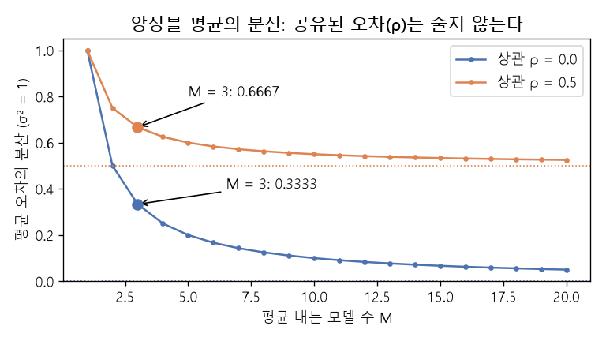

# 앙상블 평균과 오차 상쇄 (Ensemble averaging)

[목차로 돌아가기](../../00_MIT%EB%94%A5%EB%9F%AC%EB%8B%9D_%EB%AA%A9%EC%B0%A8.md) · 먼저 볼 것: [M02_시그마와_평균](../../%EC%88%98%ED%95%99%EA%B0%9C%EB%85%90/01_%EC%88%98%EC%99%80_%ED%95%A8%EC%88%98/M02_%EC%8B%9C%EA%B7%B8%EB%A7%88%EC%99%80_%ED%8F%89%EA%B7%A0.md), [M08_확률_기초](../../%EC%88%98%ED%95%99%EA%B0%9C%EB%85%90/04_%ED%99%95%EB%A5%A0%EA%B3%BC_%EC%A0%95%EB%B3%B4/M08_%ED%99%95%EB%A5%A0_%EA%B8%B0%EC%B4%88.md), [MM22_기댓값과_일반화_간극](../../%EC%88%98%ED%95%99%EA%B0%9C%EB%85%90/04_%ED%99%95%EB%A5%A0%EA%B3%BC_%EC%A0%95%EB%B3%B4/MM22_%EA%B8%B0%EB%8C%93%EA%B0%92%EA%B3%BC_%EC%9D%BC%EB%B0%98%ED%99%94_%EA%B0%84%EA%B7%B9.md), [MM24_경우의_수와_VC_한계](../../%EC%88%98%ED%95%99%EA%B0%9C%EB%85%90/04_%ED%99%95%EB%A5%A0%EA%B3%BC_%EC%A0%95%EB%B3%B4/MM24_%EA%B2%BD%EC%9A%B0%EC%9D%98_%EC%88%98%EC%99%80_VC_%ED%95%9C%EA%B3%84.md) · 쓰는 곳: [Lec18 5.3](../../Lec18_%EC%A0%84%EC%9D%B4_%ED%95%99%EC%8A%B5_%EB%AA%A8%EB%8D%B8.md#53-%EB%AA%A8%EB%8B%AC%EB%A6%AC%ED%8B%B0%EB%A5%BC-%EA%B1%B4%EB%84%88%EB%8A%94-%EC%A6%9D%EB%A5%98%EC%99%80-%EC%95%99%EC%83%81%EB%B8%94-%EC%A6%9D%EB%A5%98)

📚 학습 순서 61/99 (8. 일반화): ← 이전: [MM23_최소_노름_해와_이중_하강](../../%EC%88%98%ED%95%99%EA%B0%9C%EB%85%90/08_%EC%9D%BC%EB%B0%98%ED%99%94/MM23_%EC%B5%9C%EC%86%8C_%EB%85%B8%EB%A6%84_%ED%95%B4%EC%99%80_%EC%9D%B4%EC%A4%91_%ED%95%98%EA%B0%95.md) · 다음: [MM26_테일러_전개와_뉴턴_방법](../../%EC%88%98%ED%95%99%EA%B0%9C%EB%85%90/09_%EC%B5%9C%EC%A0%81%ED%99%94%EC%9D%98_%EA%B8%B0%ED%95%98/MM26_%ED%85%8C%EC%9D%BC%EB%9F%AC_%EC%A0%84%EA%B0%9C%EC%99%80_%EB%89%B4%ED%84%B4_%EB%B0%A9%EB%B2%95.md) →

> [!NOTE]
> **3줄 요약**
> - **[앙상블](../../00_%EB%94%A5%EB%9F%AC%EB%8B%9D_%EC%9A%A9%EC%96%B4%EC%82%AC%EC%A0%84.md#ensemble-%EC%95%99%EC%83%81%EB%B8%94)**은 여러 모델의 예측을 평균(또는 다수결)한다. 모델마다 실수는 제각각이고 [정답](../../00_%EB%94%A5%EB%9F%AC%EB%8B%9D_%EC%9A%A9%EC%96%B4%EC%82%AC%EC%A0%84.md#label-%EC%A0%95%EB%8B%B5)은 공유되므로, 평균을 내면 실수가 서로 상쇄된다. 고양이 [확률](../../00_%EB%94%A5%EB%9F%AC%EB%8B%9D_%EC%9A%A9%EC%96%B4%EC%82%AC%EC%A0%84.md#probability-%ED%99%95%EB%A5%A0) 0.7, 0.5, 0.9를 평균하면 0.7.
> - [오차](../../00_%EB%94%A5%EB%9F%AC%EB%8B%9D_%EC%9A%A9%EC%96%B4%EC%82%AC%EC%A0%84.md#error-%EC%98%A4%EC%B0%A8)가 서로 [독립](../../00_%EB%94%A5%EB%9F%AC%EB%8B%9D_%EC%9A%A9%EC%96%B4%EC%82%AC%EC%A0%84.md#independence-%EB%8F%85%EB%A6%BD)이면 [평균 오차](../../00_%EB%94%A5%EB%9F%AC%EB%8B%9D_%EC%9A%A9%EC%96%B4%EC%82%AC%EC%A0%84.md#average-error-%ED%8F%89%EA%B7%A0-%EC%98%A4%EC%B0%A8)의 [분산](../../00_%EB%94%A5%EB%9F%AC%EB%8B%9D_%EC%9A%A9%EC%96%B4%EC%82%AC%EC%A0%84.md#variance-%EB%B6%84%EC%82%B0)은 $\sigma^2 / M$으로 줄어든다(모델 3개면 1/3). [오차](../../00_%EB%94%A5%EB%9F%AC%EB%8B%9D_%EC%9A%A9%EC%96%B4%EC%82%AC%EC%A0%84.md#error-%EC%98%A4%EC%B0%A8)의 상관이 $\rho$면 $\rho\sigma^2 + (1-\rho)\sigma^2/M$이라, $\rho = 0.5$일 때 모델을 아무리 늘려도 0.5 밑으로는 안 내려간다.
> - 각각 70% 맞히는 [독립](../../00_%EB%94%A5%EB%9F%AC%EB%8B%9D_%EC%9A%A9%EC%96%B4%EC%82%AC%EC%A0%84.md#independence-%EB%8F%85%EB%A6%BD) 모델 3개의 다수결은 78.4% 맞힌다. 하지만 모든 모델이 같이 틀리는 구석 사례(공유된 [편향](../../00_%EB%94%A5%EB%9F%AC%EB%8B%9D_%EC%9A%A9%EC%96%B4%EC%82%AC%EC%A0%84.md#bias-%ED%8E%B8%ED%96%A5))는 [앙상블](../../00_%EB%94%A5%EB%9F%AC%EB%8B%9D_%EC%9A%A9%EC%96%B4%EC%82%AC%EC%A0%84.md#ensemble-%EC%95%99%EC%83%81%EB%B8%94)로도, [앙상블](../../00_%EB%94%A5%EB%9F%AC%EB%8B%9D_%EC%9A%A9%EC%96%B4%EC%82%AC%EC%A0%84.md#ensemble-%EC%95%99%EC%83%81%EB%B8%94)을 증류한 학생으로도 고쳐지지 않는다.

## 1. 개념 설명

비유: 항아리 속 콩의 개수를 여러 사람이 어림한다. 한 사람의 어림은 많이 빗나가지만, 많이 쓴 사람과 적게 쓴 사람의 실수가 섞여 평균은 참값에 가까워진다(군중의 지혜). 그런데 모두가 같은 착시(예: 항아리가 실제보다 작아 보임)에 속으면 그 몫은 평균을 내도 그대로 남는다.

- **평균 [앙상블](../../00_%EB%94%A5%EB%9F%AC%EB%8B%9D_%EC%9A%A9%EC%96%B4%EC%82%AC%EC%A0%84.md#ensemble-%EC%95%99%EC%83%81%EB%B8%94)**: 모델 $M$개의 [소프트맥스](../../00_%EB%94%A5%EB%9F%AC%EB%8B%9D_%EC%9A%A9%EC%96%B4%EC%82%AC%EC%A0%84.md#softmax-%EC%86%8C%ED%94%84%ED%8A%B8%EB%A7%A5%EC%8A%A4) [확률](../../00_%EB%94%A5%EB%9F%AC%EB%8B%9D_%EC%9A%A9%EC%96%B4%EC%82%AC%EC%A0%84.md#probability-%ED%99%95%EB%A5%A0)을 칸별로 평균한다. 결과도 [확률](../../00_%EB%94%A5%EB%9F%AC%EB%8B%9D_%EC%9A%A9%EC%96%B4%EC%82%AC%EC%A0%84.md#probability-%ED%99%95%EB%A5%A0) 분포(합 1)다. 이 평균 분포가 [앙상블 증류](../../Lec18_%EC%A0%84%EC%9D%B4_%ED%95%99%EC%8A%B5_%EB%AA%A8%EB%8D%B8.md#53-%EB%AA%A8%EB%8B%AC%EB%A6%AC%ED%8B%B0%EB%A5%BC-%EA%B1%B4%EB%84%88%EB%8A%94-%EC%A6%9D%EB%A5%98%EC%99%80-%EC%95%99%EC%83%81%EB%B8%94-%EC%A6%9D%EB%A5%98)의 교사가 된다.
- **[오차](../../00_%EB%94%A5%EB%9F%AC%EB%8B%9D_%EC%9A%A9%EC%96%B4%EC%82%AC%EC%A0%84.md#error-%EC%98%A4%EC%B0%A8) 상쇄**: 모델 $m$의 예측 = 참값 + [오차](../../00_%EB%94%A5%EB%9F%AC%EB%8B%9D_%EC%9A%A9%EC%96%B4%EC%82%AC%EC%A0%84.md#error-%EC%98%A4%EC%B0%A8) $\varepsilon_m$. 평균의 [오차](../../00_%EB%94%A5%EB%9F%AC%EB%8B%9D_%EC%9A%A9%EC%96%B4%EC%82%AC%EC%A0%84.md#error-%EC%98%A4%EC%B0%A8)는 $\bar\varepsilon = \frac{1}{M}\sum_m \varepsilon_m$이다. [오차](../../00_%EB%94%A5%EB%9F%AC%EB%8B%9D_%EC%9A%A9%EC%96%B4%EC%82%AC%EC%A0%84.md#error-%EC%98%A4%EC%B0%A8)의 평균이 0이고 서로 [독립](../../00_%EB%94%A5%EB%9F%AC%EB%8B%9D_%EC%9A%A9%EC%96%B4%EC%82%AC%EC%A0%84.md#independence-%EB%8F%85%EB%A6%BD)이면 [분산](../../00_%EB%94%A5%EB%9F%AC%EB%8B%9D_%EC%9A%A9%EC%96%B4%EC%82%AC%EC%A0%84.md#variance-%EB%B6%84%EC%82%B0)이 $M$배로 줄어든다.
- **상관 $\rho$**: 같은 데이터, 비슷한 구조로 학습한 모델들은 비슷하게 틀린다. 공유된 몫 $\rho\sigma^2$은 평균으로 지워지지 않는다. 강의가 말하는 "데이터에서 배운 [편향](../../00_%EB%94%A5%EB%9F%AC%EB%8B%9D_%EC%9A%A9%EC%96%B4%EC%82%AC%EC%A0%84.md#bias-%ED%8E%B8%ED%96%A5)은 모든 모델에 공통"이 이 항이다.


*▲ 직접 그린 그림: [평균 오차](../../00_%EB%94%A5%EB%9F%AC%EB%8B%9D_%EC%9A%A9%EC%96%B4%EC%82%AC%EC%A0%84.md#average-error-%ED%8F%89%EA%B7%A0-%EC%98%A4%EC%B0%A8)의 [분산](../../00_%EB%94%A5%EB%9F%AC%EB%8B%9D_%EC%9A%A9%EC%96%B4%EC%82%AC%EC%A0%84.md#variance-%EB%B6%84%EC%82%B0)($\sigma^2 = 1$). [독립](../../00_%EB%94%A5%EB%9F%AC%EB%8B%9D_%EC%9A%A9%EC%96%B4%EC%82%AC%EC%A0%84.md#independence-%EB%8F%85%EB%A6%BD)(파랑)이면 $1/M$로 0에 다가가고, $\rho = 0.5$(주황)면 0.5에서 멈춘다*

## 2. 필요한 이유

[Lec18 5.3](../../Lec18_%EC%A0%84%EC%9D%B4_%ED%95%99%EC%8A%B5_%EB%AA%A8%EB%8D%B8.md#53-%EB%AA%A8%EB%8B%AC%EB%A6%AC%ED%8B%B0%EB%A5%BC-%EA%B1%B4%EB%84%88%EB%8A%94-%EC%A6%9D%EB%A5%98%EC%99%80-%EC%95%99%EC%83%81%EB%B8%94-%EC%A6%9D%EB%A5%98)에서 강사는 [앙상블](../../00_%EB%94%A5%EB%9F%AC%EB%8B%9D_%EC%9A%A9%EC%96%B4%EC%82%AC%EC%A0%84.md#ensemble-%EC%95%99%EC%83%81%EB%B8%94)이 지금도 단일 모델보다 예측이 좋은 경우가 많지만 모델 여러 개를 늘 돌리기는 비싸므로, [앙상블](../../00_%EB%94%A5%EB%9F%AC%EB%8B%9D_%EC%9A%A9%EC%96%B4%EC%82%AC%EC%A0%84.md#ensemble-%EC%95%99%EC%83%81%EB%B8%94)의 평균 분포를 작은 학생 하나에 증류한다고 설명한다. 슬라이드의 이유("각 모델은 서로 다른 무작위 방식으로 불완전하다. [오차](../../00_%EB%94%A5%EB%9F%AC%EB%8B%9D_%EC%9A%A9%EC%96%B4%EC%82%AC%EC%A0%84.md#error-%EC%98%A4%EC%B0%A8)는 상쇄되고 진실은 공유된다")와 한계("모두가 틀리는 구석 사례")를 숫자로 확인한다.

## 3. 숫자로 보기

**평균** (세 모델의 고양이 [확률](../../00_%EB%94%A5%EB%9F%AC%EB%8B%9D_%EC%9A%A9%EC%96%B4%EC%82%AC%EC%A0%84.md#probability-%ED%99%95%EB%A5%A0) 0.7, 0.5, 0.9)
- $(0.7 + 0.5 + 0.9) / 3 = 2.1 / 3 = 0.7$

**[분산](../../00_%EB%94%A5%EB%9F%AC%EB%8B%9D_%EC%9A%A9%EC%96%B4%EC%82%AC%EC%A0%84.md#variance-%EB%B6%84%EC%82%B0)** ($\sigma^2 = 1$)

| 모델 수 $M$ | [독립](../../00_%EB%94%A5%EB%9F%AC%EB%8B%9D_%EC%9A%A9%EC%96%B4%EC%82%AC%EC%A0%84.md#independence-%EB%8F%85%EB%A6%BD) ($\rho = 0$) | $\rho = 0.5$ |
|---|---|---|
| 1 | 1 | 1 |
| 3 | 0.3333 | 0.6667 |
| 10 | 0.1 | 0.55 |
| 무한히 많음 | 0 | 0.5 |

- 시뮬레이션(표본 10만 개, 4절 코드): [독립](../../00_%EB%94%A5%EB%9F%AC%EB%8B%9D_%EC%9A%A9%EC%96%B4%EC%82%AC%EC%A0%84.md#independence-%EB%8F%85%EB%A6%BD) [오차](../../00_%EB%94%A5%EB%9F%AC%EB%8B%9D_%EC%9A%A9%EC%96%B4%EC%82%AC%EC%A0%84.md#error-%EC%98%A4%EC%B0%A8) 3개 평균의 [분산](../../00_%EB%94%A5%EB%9F%AC%EB%8B%9D_%EC%9A%A9%EC%96%B4%EC%82%AC%EC%A0%84.md#variance-%EB%B6%84%EC%82%B0) 0.3329, 상관 0.5인 [오차](../../00_%EB%94%A5%EB%9F%AC%EB%8B%9D_%EC%9A%A9%EC%96%B4%EC%82%AC%EC%A0%84.md#error-%EC%98%A4%EC%B0%A8) 3개 평균의 [분산](../../00_%EB%94%A5%EB%9F%AC%EB%8B%9D_%EC%9A%A9%EC%96%B4%EC%82%AC%EC%A0%84.md#variance-%EB%B6%84%EC%82%B0) 0.6716. 식의 값(0.3333, 0.6667)과 맞는다.

**다수결** (각각 70% 맞히는 [독립](../../00_%EB%94%A5%EB%9F%AC%EB%8B%9D_%EC%9A%A9%EC%96%B4%EC%82%AC%EC%A0%84.md#independence-%EB%8F%85%EB%A6%BD) 모델 3개)
- 셋 다 맞힘: $0.7^3 = 0.343$
- 둘만 맞힘: $3 \times 0.7^2 \times 0.3 = 0.441$
- 더한다: $0.343 + 0.441 = 0.784$

평균 [앙상블](../../00_%EB%94%A5%EB%9F%AC%EB%8B%9D_%EC%9A%A9%EC%96%B4%EC%82%AC%EC%A0%84.md#ensemble-%EC%95%99%EC%83%81%EB%B8%94)은 다음과 같다.

$$
\bar p = \frac{1}{M}\sum_{m=1}^{M} p_m
$$

<details><summary>기호 풀이</summary>

| 기호 | 읽는 법 | 뜻 | 예제 값 |
| --- | --- | --- | --- |
| $M$ | 엠 | 모델 수 | 3 |
| $p_m$ | 피 엠 | $m$번 모델의 예측 [확률](../../00_%EB%94%A5%EB%9F%AC%EB%8B%9D_%EC%9A%A9%EC%96%B4%EC%82%AC%EC%A0%84.md#probability-%ED%99%95%EB%A5%A0) | 0.7, 0.5, 0.9 |
| $\sum_{m=1}^{M}$ | 시그마 | $m = 1$부터 $M$까지 더한다 | 2.1 |
| $\bar p$ | 피 바 | [앙상블](../../00_%EB%94%A5%EB%9F%AC%EB%8B%9D_%EC%9A%A9%EC%96%B4%EC%82%AC%EC%A0%84.md#ensemble-%EC%95%99%EC%83%81%EB%B8%94)의 예측 (평균) | 0.7 |

</details>

<details><summary>예제와 풀이</summary>

**문제**: 세 모델이 같은 사진에 대해 "고양이일 [확률](../../00_%EB%94%A5%EB%9F%AC%EB%8B%9D_%EC%9A%A9%EC%96%B4%EC%82%AC%EC%A0%84.md#probability-%ED%99%95%EB%A5%A0)"을 0.7, 0.5, 0.9로 냈다. 평균 [앙상블](../../00_%EB%94%A5%EB%9F%AC%EB%8B%9D_%EC%9A%A9%EC%96%B4%EC%82%AC%EC%A0%84.md#ensemble-%EC%95%99%EC%83%81%EB%B8%94)의 [확률](../../00_%EB%94%A5%EB%9F%AC%EB%8B%9D_%EC%9A%A9%EC%96%B4%EC%82%AC%EC%A0%84.md#probability-%ED%99%95%EB%A5%A0)은?

**주어진 값**
- $M = 3$ (모델 수)
- $p_1 = 0.7$, $p_2 = 0.5$, $p_3 = 0.9$ (각 모델의 고양이 [확률](../../00_%EB%94%A5%EB%9F%AC%EB%8B%9D_%EC%9A%A9%EC%96%B4%EC%82%AC%EC%A0%84.md#probability-%ED%99%95%EB%A5%A0))

**풀이**
1. 식을 그대로 쓴다: $\bar p = \dfrac{1}{M}\sum_{m=1}^{M} p_m$
2. 값을 대입한다: $\bar p = \dfrac{1}{3}\sum_{m=1}^{3} p_m$
3. Σ를 풀어 쓴다: $\bar p = \dfrac{1}{3}(0.7 + 0.5 + 0.9)$
4. 앞의 둘을 더한다: $0.7 + 0.5 = 1.2$ 이므로 $\bar p = \dfrac{1}{3}(1.2 + 0.9)$
5. 마저 더한다: $1.2 + 0.9 = 2.1$ 이므로 $\bar p = \dfrac{2.1}{3}$
6. 나눈다: $2.1 / 3 = 0.7$

**답**: $\bar p = $ **0.7**. 두 번째 모델의 낮은 값(0.5)과 세 번째 모델의 높은 값(0.9)이 상쇄되었다.

</details>

<details><summary>내 이해</summary>


</details>

[평균 오차](../../00_%EB%94%A5%EB%9F%AC%EB%8B%9D_%EC%9A%A9%EC%96%B4%EC%82%AC%EC%A0%84.md#average-error-%ED%8F%89%EA%B7%A0-%EC%98%A4%EC%B0%A8)의 [분산](../../00_%EB%94%A5%EB%9F%AC%EB%8B%9D_%EC%9A%A9%EC%96%B4%EC%82%AC%EC%A0%84.md#variance-%EB%B6%84%EC%82%B0)은 상관에 따라 다르다.

$$
\operatorname{Var}(\bar\varepsilon) = \rho\,\sigma^2 + \frac{(1 - \rho)\,\sigma^2}{M}
$$

<details><summary>기호 풀이</summary>

| 기호 | 읽는 법 | 뜻 | 예제 값 |
| --- | --- | --- | --- |
| $\bar\varepsilon$ | 엡실론 바 | 평균 예측의 [오차](../../00_%EB%94%A5%EB%9F%AC%EB%8B%9D_%EC%9A%A9%EC%96%B4%EC%82%AC%EC%A0%84.md#error-%EC%98%A4%EC%B0%A8) | |
| $\operatorname{Var}$ | [분산](../../00_%EB%94%A5%EB%9F%AC%EB%8B%9D_%EC%9A%A9%EC%96%B4%EC%82%AC%EC%A0%84.md#variance-%EB%B6%84%EC%82%B0) | [오차](../../00_%EB%94%A5%EB%9F%AC%EB%8B%9D_%EC%9A%A9%EC%96%B4%EC%82%AC%EC%A0%84.md#error-%EC%98%A4%EC%B0%A8)가 퍼진 정도 (제곱 평균) | 0.6667 |
| $\sigma^2$ | 시그마 제곱 | 모델 하나의 [오차](../../00_%EB%94%A5%EB%9F%AC%EB%8B%9D_%EC%9A%A9%EC%96%B4%EC%82%AC%EC%A0%84.md#error-%EC%98%A4%EC%B0%A8) [분산](../../00_%EB%94%A5%EB%9F%AC%EB%8B%9D_%EC%9A%A9%EC%96%B4%EC%82%AC%EC%A0%84.md#variance-%EB%B6%84%EC%82%B0) | 1 |
| $\rho$ | 로 | 두 모델 [오차](../../00_%EB%94%A5%EB%9F%AC%EB%8B%9D_%EC%9A%A9%EC%96%B4%EC%82%AC%EC%A0%84.md#error-%EC%98%A4%EC%B0%A8)의 상관 (0이면 [독립](../../00_%EB%94%A5%EB%9F%AC%EB%8B%9D_%EC%9A%A9%EC%96%B4%EC%82%AC%EC%A0%84.md#independence-%EB%8F%85%EB%A6%BD), 1이면 똑같이 틀림) | 0.5 |
| $M$ | 엠 | 모델 수 | 3 |

</details>

<details><summary>예제와 풀이</summary>

**문제**: [오차](../../00_%EB%94%A5%EB%9F%AC%EB%8B%9D_%EC%9A%A9%EC%96%B4%EC%82%AC%EC%A0%84.md#error-%EC%98%A4%EC%B0%A8) [분산](../../00_%EB%94%A5%EB%9F%AC%EB%8B%9D_%EC%9A%A9%EC%96%B4%EC%82%AC%EC%A0%84.md#variance-%EB%B6%84%EC%82%B0)이 1인 모델 3개를 평균한다. [오차](../../00_%EB%94%A5%EB%9F%AC%EB%8B%9D_%EC%9A%A9%EC%96%B4%EC%82%AC%EC%A0%84.md#error-%EC%98%A4%EC%B0%A8)가 서로 독립일 때와 상관이 0.5일 때 [평균 오차](../../00_%EB%94%A5%EB%9F%AC%EB%8B%9D_%EC%9A%A9%EC%96%B4%EC%82%AC%EC%A0%84.md#average-error-%ED%8F%89%EA%B7%A0-%EC%98%A4%EC%B0%A8)의 [분산](../../00_%EB%94%A5%EB%9F%AC%EB%8B%9D_%EC%9A%A9%EC%96%B4%EC%82%AC%EC%A0%84.md#variance-%EB%B6%84%EC%82%B0)은?

**주어진 값**
- $\sigma^2 = 1$ (모델 하나의 [오차](../../00_%EB%94%A5%EB%9F%AC%EB%8B%9D_%EC%9A%A9%EC%96%B4%EC%82%AC%EC%A0%84.md#error-%EC%98%A4%EC%B0%A8) [분산](../../00_%EB%94%A5%EB%9F%AC%EB%8B%9D_%EC%9A%A9%EC%96%B4%EC%82%AC%EC%A0%84.md#variance-%EB%B6%84%EC%82%B0))
- $M = 3$ (모델 수)
- $\rho = 0$ 또는 $0.5$ ([오차](../../00_%EB%94%A5%EB%9F%AC%EB%8B%9D_%EC%9A%A9%EC%96%B4%EC%82%AC%EC%A0%84.md#error-%EC%98%A4%EC%B0%A8)의 상관)

**풀이**
1. 식을 그대로 쓴다: $\operatorname{Var}(\bar\varepsilon) = \rho\,\sigma^2 + \dfrac{(1 - \rho)\,\sigma^2}{M}$
2. 값을 대입한다 ($\rho = 0$): $\operatorname{Var} = 0 \times 1 + \dfrac{(1 - 0) \times 1}{3}$
3. 곱셈을 한다: $0 \times 1 = 0$, $(1 - 0) \times 1 = 1$ 이므로 $\operatorname{Var} = 0 + \dfrac{1}{3}$
4. 나눈다: $1 / 3 = 0.3333$
5. 값을 대입한다 ($\rho = 0.5$): $\operatorname{Var} = 0.5 \times 1 + \dfrac{(1 - 0.5) \times 1}{3}$
6. 괄호를 계산한다: $1 - 0.5 = 0.5$ 이므로 $\operatorname{Var} = 0.5 + \dfrac{0.5}{3}$
7. 나눈다: $0.5 / 3 = 0.1667$ 이므로 $\operatorname{Var} = 0.5 + 0.1667$
8. 더한다: $0.5 + 0.1667 = 0.6667$

**답**: [독립](../../00_%EB%94%A5%EB%9F%AC%EB%8B%9D_%EC%9A%A9%EC%96%B4%EC%82%AC%EC%A0%84.md#independence-%EB%8F%85%EB%A6%BD)이면 **0.3333**, 상관 0.5면 **0.6667**. 상관이 있으면 [앙상블](../../00_%EB%94%A5%EB%9F%AC%EB%8B%9D_%EC%9A%A9%EC%96%B4%EC%82%AC%EC%A0%84.md#ensemble-%EC%95%99%EC%83%81%EB%B8%94)의 이득이 절반쯤으로 줄어든다.

</details>

<details><summary>내 이해</summary>


</details>

다수결이 맞을 [확률](../../00_%EB%94%A5%EB%9F%AC%EB%8B%9D_%EC%9A%A9%EC%96%B4%EC%82%AC%EC%A0%84.md#probability-%ED%99%95%EB%A5%A0)은 이항 분포로 센다.

$$
P(\text{다수결 정답}) = \sum_{k > M/2} \binom{M}{k}\, p^{k} (1 - p)^{M - k}
$$

<details><summary>기호 풀이</summary>

| 기호 | 읽는 법 | 뜻 | 예제 값 |
| --- | --- | --- | --- |
| $p$ | 피 | 모델 하나가 맞힐 [확률](../../00_%EB%94%A5%EB%9F%AC%EB%8B%9D_%EC%9A%A9%EC%96%B4%EC%82%AC%EC%A0%84.md#probability-%ED%99%95%EB%A5%A0) (모델끼리 [독립](../../00_%EB%94%A5%EB%9F%AC%EB%8B%9D_%EC%9A%A9%EC%96%B4%EC%82%AC%EC%A0%84.md#independence-%EB%8F%85%EB%A6%BD)이라 가정) | 0.7 |
| $M$ | 엠 | 모델 수 (홀수) | 3 |
| $k$ | 케이 | 맞힌 모델 수. 과반($k > M/2$)만 더한다 | 2, 3 |
| $\binom{M}{k}$ | 엠 콤비네이션 케이 | $M$개 중 맞힌 $k$개를 고르는 경우의 수 ([MM24_경우의_수와_VC_한계](../../%EC%88%98%ED%95%99%EA%B0%9C%EB%85%90/04_%ED%99%95%EB%A5%A0%EA%B3%BC_%EC%A0%95%EB%B3%B4/MM24_%EA%B2%BD%EC%9A%B0%EC%9D%98_%EC%88%98%EC%99%80_VC_%ED%95%9C%EA%B3%84.md)) | 3, 1 |
| $P$ | 피 | 다수결이 맞힐 [확률](../../00_%EB%94%A5%EB%9F%AC%EB%8B%9D_%EC%9A%A9%EC%96%B4%EC%82%AC%EC%A0%84.md#probability-%ED%99%95%EB%A5%A0) | 0.784 |

</details>

<details><summary>예제와 풀이</summary>

**문제**: 각각 70% [확률](../../00_%EB%94%A5%EB%9F%AC%EB%8B%9D_%EC%9A%A9%EC%96%B4%EC%82%AC%EC%A0%84.md#probability-%ED%99%95%EB%A5%A0)로 맞히는 [독립](../../00_%EB%94%A5%EB%9F%AC%EB%8B%9D_%EC%9A%A9%EC%96%B4%EC%82%AC%EC%A0%84.md#independence-%EB%8F%85%EB%A6%BD) 모델 3개가 다수결로 답한다. 다수결이 맞힐 [확률](../../00_%EB%94%A5%EB%9F%AC%EB%8B%9D_%EC%9A%A9%EC%96%B4%EC%82%AC%EC%A0%84.md#probability-%ED%99%95%EB%A5%A0)은?

**주어진 값**
- $p = 0.7$ (모델 하나의 [정확도](../../00_%EB%94%A5%EB%9F%AC%EB%8B%9D_%EC%9A%A9%EC%96%B4%EC%82%AC%EC%A0%84.md#accuracy-%EC%A0%95%ED%99%95%EB%8F%84))
- $M = 3$ (모델 수). 과반은 $k = 2, 3$

**풀이**
1. 식을 그대로 쓴다: $P = \sum_{k > M/2} \binom{M}{k}\, p^{k} (1 - p)^{M - k}$
2. 값을 대입한다: $P = \sum_{k > 1.5} \binom{3}{k}\, 0.7^{k} (1 - 0.7)^{3 - k}$
3. Σ를 풀어 쓴다 ($k = 2, 3$): $P = \binom{3}{2} 0.7^{2} \times 0.3^{1} + \binom{3}{3} 0.7^{3} \times 0.3^{0}$
4. 경우의 수를 센다: $\binom{3}{2} = 3$ (셋 중 맞힌 둘을 고르는 방법), $\binom{3}{3} = 1$
5. 거듭제곱을 계산한다: $0.7^2 = 0.49$, $0.7^3 = 0.343$, $0.3^0 = 1$
6. 첫 항을 곱한다: $3 \times 0.49 \times 0.3 = 0.441$
7. 둘째 항을 곱한다: $1 \times 0.343 \times 1 = 0.343$
8. 더한다: $0.441 + 0.343 = 0.784$

**답**: **0.784** (78.4%). 모델 하나(70%)보다 높다.

</details>

<details><summary>내 이해</summary>


</details>

## 4. 코드로 확인

```python
# [연결] 3절 평균: 0.7, 0.5, 0.9의 평균 0.7
print(round(np.mean([0.7, 0.5, 0.9]), 4))
# [함수] def var_avg(rho, M): 식 ρσ² + (1-ρ)σ²/M (σ² = 1)
def var_avg(rho, M):
    # [연결] 본문 둘째 식
    return rho + (1 - rho) / M
# [연결] 3절 표: ρ = 0과 0.5에서 M = 1, 3, 10
print([round(var_avg(0, M), 4) for M in (1, 3, 10)], [round(var_avg(0.5, M), 4) for M in (1, 3, 10)])
# [변수] rng: 시드 0으로 고정한 난수 생성기 (본문 숫자를 재현하려고)
rng = np.random.default_rng(0)
# [변수] err: 독립 오차, 표본 10만 개 × 모델 3개 (분산 1)
err = rng.normal(0, 1, (100000, 3))
# [변수] shared, own: 모든 모델이 공유하는 오차와 모델마다 다른 오차
shared, own = rng.normal(0, 1, (100000, 1)), rng.normal(0, 1, (100000, 3))
# [변수] corr: 공유 몫 0.5, 고유 몫 0.5를 섞어 상관 0.5인 오차 (분산은 여전히 1)
corr = np.sqrt(0.5) * shared + np.sqrt(0.5) * own
# [연결] 3절 시뮬레이션: 0.3329 (식 0.3333), 0.6716 (식 0.6667)
print(round(err.mean(1).var(), 4), round(corr.mean(1).var(), 4))
# [함수] math.comb(M, k): M개 중 k개를 고르는 경우의 수
from math import comb
# [연결] 3절 다수결: 0.7^3 + 3·0.7^2·0.3 = 0.784
print(round(sum(comb(3, k) * 0.7 ** k * 0.3 ** (3 - k) for k in (2, 3)), 4))
```

**실행 결과**:

```text
0.7
[1.0, 0.3333, 0.1] [1.0, 0.6667, 0.55]
0.3329 0.6716
0.784
```

> [!WARNING]
> **⚠ 주의**
> - 상관 $\rho$가 클수록 [앙상블](../../00_%EB%94%A5%EB%9F%AC%EB%8B%9D_%EC%9A%A9%EC%96%B4%EC%82%AC%EC%A0%84.md#ensemble-%EC%95%99%EC%83%81%EB%B8%94)의 이득이 줄어든다. 같은 데이터로 같은 구조를 학습한 모델들은 대개 $\rho$가 꽤 크다. 그래서 초기값, 데이터 순서, 구조를 다르게 해 다양성을 만든다.
> - 다수결 식은 모델이 **[독립](../../00_%EB%94%A5%EB%9F%AC%EB%8B%9D_%EC%9A%A9%EC%96%B4%EC%82%AC%EC%A0%84.md#independence-%EB%8F%85%EB%A6%BD)**이라는 가정 위에 있다. 모두가 똑같이 틀리는 구석 사례에서는 다수결도 틀린다.
> - [앙상블](../../00_%EB%94%A5%EB%9F%AC%EB%8B%9D_%EC%9A%A9%EC%96%B4%EC%82%AC%EC%A0%84.md#ensemble-%EC%95%99%EC%83%81%EB%B8%94)은 [확률](../../00_%EB%94%A5%EB%9F%AC%EB%8B%9D_%EC%9A%A9%EC%96%B4%EC%82%AC%EC%A0%84.md#probability-%ED%99%95%EB%A5%A0)을 평균하는 것이 보통이다. [로짓](../../00_%EB%94%A5%EB%9F%AC%EB%8B%9D_%EC%9A%A9%EC%96%B4%EC%82%AC%EC%A0%84.md#logit-%EB%A1%9C%EC%A7%93)을 평균하면 다른 결과가 나올 수 있다.

## 5. 개념 재확인

<details><summary>1. 각각 60% 맞히는 독립 모델 5개의 다수결은 몇 % 맞히나?</summary>

| 단계 | 하는 일 | 계산 | 결과 |
|---|---|---|---|
| 1 | 셋 맞힘 | $10 \times 0.6^3 \times 0.4^2$ | 0.3456 |
| 2 | 넷 맞힘 | $5 \times 0.6^4 \times 0.4$ | 0.2592 |
| 3 | 다섯 맞힘 | $0.6^5$ | 0.0778 |
| 4 | 합 | $0.3456 + 0.2592 + 0.0778$ | 0.6826 |

**① 쓰는 식**
$$P = \sum_{k=3}^{5}\binom{5}{k}\, 0.6^{k}\, 0.4^{5-k}$$
- 위 식 ← ② (각 항), ③ (합)에서 쓴다.
```python
# [함수] comb: 경우의 수
from math import comb                                       # ①
# [변수] terms = [0.3456, 0.2592, 0.0778]: k = 3, 4, 5 항
terms = [comb(5, k) * 0.6 ** k * 0.4 ** (5 - k) for k in (3, 4, 5)]   # ②
# [연결] [0.3456, 0.2592, 0.0778] 0.6826
print([round(t, 4) for t in terms], round(sum(terms), 4))   # ③
```

**주어진 값**
- $p = 0.6$ (모델 하나의 [정확도](../../00_%EB%94%A5%EB%9F%AC%EB%8B%9D_%EC%9A%A9%EC%96%B4%EC%82%AC%EC%A0%84.md#accuracy-%EC%A0%95%ED%99%95%EB%8F%84))
- $M = 5$ (모델 수). 과반은 $k = 3, 4, 5$

**풀이**
1. 식을 그대로 쓴다: $P = \sum_{k > M/2}\binom{M}{k}\, p^{k} (1 - p)^{M-k}$
2. 값을 대입한다: $P = \sum_{k=3}^{5}\binom{5}{k}\, 0.6^{k}\, 0.4^{5-k}$
3. Σ를 풀어 쓴다: $P = \binom{5}{3}0.6^3 \, 0.4^2 + \binom{5}{4}0.6^4 \, 0.4^1 + \binom{5}{5}0.6^5 \, 0.4^0$
4. (②) 경우의 수를 센다: $\binom{5}{3} = 10$, $\binom{5}{4} = 5$, $\binom{5}{5} = 1$
5. (②) 거듭제곱을 계산한다: $0.6^3 = 0.216$, $0.6^4 = 0.1296$, $0.6^5 = 0.0778$, $0.4^2 = 0.16$
6. (②) 첫 항: $10 \times 0.216 \times 0.16 = 0.3456$
7. (②) 둘째 항: $5 \times 0.1296 \times 0.4 = 0.2592$
8. (②) 셋째 항: $1 \times 0.0778 \times 1 = 0.0778$
9. (③) 앞의 둘을 더한다: $0.3456 + 0.2592 = 0.6048$
10. (③) 마저 더한다: $0.6048 + 0.0778 = 0.6826$

**답**: **68.26%**. 모델 하나(60%)보다 8%p 남짓 높다.

</details>

<details><summary>2. 오차 분산 1, 상관 0.2인 모델 4개를 평균하면 평균 오차의 분산은?</summary>

| 단계 | 하는 일 | 계산 | 결과 |
|---|---|---|---|
| 1 | 공유 몫 | $0.2 \times 1$ | 0.2 |
| 2 | 고유 몫 | $(1 - 0.2) \times 1 / 4$ | 0.2 |
| 3 | 합 | $0.2 + 0.2$ | 0.4 |

**① 쓰는 식**
$$\operatorname{Var}(\bar\varepsilon) = \rho\,\sigma^2 + \frac{(1 - \rho)\,\sigma^2}{M}$$
- 위 식 ← ② (공유 몫), ③ (고유 몫), ④ (합)에서 쓴다.
```python
# [변수] rho, s2, M: 상관 0.2, 분산 1, 모델 4개
rho, s2, M = 0.2, 1.0, 4                                  # ①
# [변수] a = 0.2 (공유 몫), b = 0.2 (고유 몫)
a, b = rho * s2, (1 - rho) * s2 / M                       # ②③
# [연결] 0.2 0.2 0.4
print(round(a, 4), round(b, 4), round(a + b, 4))          # ④
```

**주어진 값**
- $\sigma^2 = 1$ (모델 하나의 [오차](../../00_%EB%94%A5%EB%9F%AC%EB%8B%9D_%EC%9A%A9%EC%96%B4%EC%82%AC%EC%A0%84.md#error-%EC%98%A4%EC%B0%A8) [분산](../../00_%EB%94%A5%EB%9F%AC%EB%8B%9D_%EC%9A%A9%EC%96%B4%EC%82%AC%EC%A0%84.md#variance-%EB%B6%84%EC%82%B0))
- $\rho = 0.2$ ([오차](../../00_%EB%94%A5%EB%9F%AC%EB%8B%9D_%EC%9A%A9%EC%96%B4%EC%82%AC%EC%A0%84.md#error-%EC%98%A4%EC%B0%A8)의 상관)
- $M = 4$ (모델 수)

**풀이**
1. 식을 그대로 쓴다: $\operatorname{Var}(\bar\varepsilon) = \rho\,\sigma^2 + \dfrac{(1 - \rho)\,\sigma^2}{M}$
2. 값을 대입한다: $\operatorname{Var} = 0.2 \times 1 + \dfrac{(1 - 0.2) \times 1}{4}$
3. (②) 공유 몫을 곱한다: $0.2 \times 1 = 0.2$
4. (③) 괄호를 계산한다: $1 - 0.2 = 0.8$
5. (③) 나눈다: $0.8 \times 1 / 4 = 0.2$
6. (④) 더한다: $0.2 + 0.2 = 0.4$

**답**: **0.4**. 모델을 무한히 늘려도 공유 몫 0.2 밑으로는 내려가지 않는다.

</details>

## 예제 풀기

[예제 10문제 풀기](../../%EC%98%88%EC%A0%9C/08_%EC%9D%BC%EB%B0%98%ED%99%94/%EC%98%88%EC%A0%9C_MM67_%EC%95%99%EC%83%81%EB%B8%94_%ED%8F%89%EA%B7%A0%EA%B3%BC_%EC%98%A4%EC%B0%A8_%EC%83%81%EC%87%84.md)

<details><summary>내 이해</summary>


</details>
