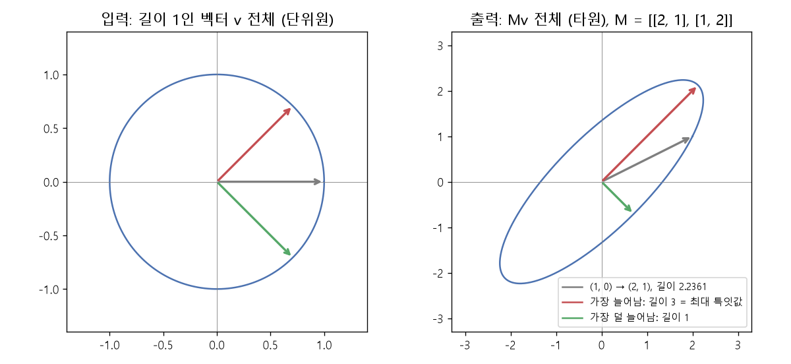

# 스펙트럼 노름과 RMS 연산자 노름 (Spectral norm, Induced operator norm, RMS→RMS norm)

[목차로 돌아가기](../../00_MIT%EB%94%A5%EB%9F%AC%EB%8B%9D_%EB%AA%A9%EC%B0%A8.md) · 먼저 볼 것: [MM11_립시츠_연속과_노름](../../%EC%88%98%ED%95%99%EA%B0%9C%EB%85%90/03_%EC%84%A0%ED%98%95%EB%8C%80%EC%88%98/MM11_%EB%A6%BD%EC%8B%9C%EC%B8%A0_%EC%97%B0%EC%86%8D%EA%B3%BC_%EB%85%B8%EB%A6%84.md), [MM25_랭크와_유효_랭크](../../%EC%88%98%ED%95%99%EA%B0%9C%EB%85%90/04_%ED%99%95%EB%A5%A0%EA%B3%BC_%EC%A0%95%EB%B3%B4/MM25_%EB%9E%AD%ED%81%AC%EC%99%80_%EC%9C%A0%ED%9A%A8_%EB%9E%AD%ED%81%AC.md), [MM27_노름에_따른_최급강하법](../../%EC%88%98%ED%95%99%EA%B0%9C%EB%85%90/09_%EC%B5%9C%EC%A0%81%ED%99%94%EC%9D%98_%EA%B8%B0%ED%95%98/MM27_%EB%85%B8%EB%A6%84%EC%97%90_%EB%94%B0%EB%A5%B8_%EC%B5%9C%EA%B8%89%EA%B0%95%ED%95%98%EB%B2%95.md), [MM88_고윳값과_특잇값_분해](../../%EC%88%98%ED%95%99%EA%B0%9C%EB%85%90/03_%EC%84%A0%ED%98%95%EB%8C%80%EC%88%98/MM88_%EA%B3%A0%EC%9C%B3%EA%B0%92%EA%B3%BC_%ED%8A%B9%EC%9E%87%EA%B0%92_%EB%B6%84%ED%95%B4.md) · 쓰는 곳: [Lec07 7](../../Lec07_%EC%B5%9C%EC%A0%81%ED%99%94%EC%9D%98_%EC%8A%A4%EC%BC%80%EC%9D%BC%EB%A7%81_%EA%B7%9C%EC%B9%99.md#7-%EC%97%85%EB%8D%B0%EC%9D%B4%ED%8A%B8-%ED%81%AC%EA%B8%B0%EC%99%80-%ED%96%89%EB%A0%AC-%EB%85%B8%EB%A6%84), [Lec07 8](../../Lec07_%EC%B5%9C%EC%A0%81%ED%99%94%EC%9D%98_%EC%8A%A4%EC%BC%80%EC%9D%BC%EB%A7%81_%EA%B7%9C%EC%B9%99.md#8-rms-%EC%97%B0%EC%82%B0%EC%9E%90-%EB%85%B8%EB%A6%84%EA%B3%BC-%EB%84%88%EB%B9%84-%EC%8A%A4%EC%BC%80%EC%9D%BC%EB%A7%81)

📚 학습 순서 64/99 (9. 최적화의 기하): ← 이전: [MM27_노름에_따른_최급강하법](../../%EC%88%98%ED%95%99%EA%B0%9C%EB%85%90/09_%EC%B5%9C%EC%A0%81%ED%99%94%EC%9D%98_%EA%B8%B0%ED%95%98/MM27_%EB%85%B8%EB%A6%84%EC%97%90_%EB%94%B0%EB%A5%B8_%EC%B5%9C%EA%B8%89%EA%B0%95%ED%95%98%EB%B2%95.md) · 다음: [MM29_곱의_극한과_잔차_배율](../../%EC%88%98%ED%95%99%EA%B0%9C%EB%85%90/09_%EC%B5%9C%EC%A0%81%ED%99%94%EC%9D%98_%EA%B8%B0%ED%95%98/MM29_%EA%B3%B1%EC%9D%98_%EA%B7%B9%ED%95%9C%EA%B3%BC_%EC%9E%94%EC%B0%A8_%EB%B0%B0%EC%9C%A8.md) →

> [!NOTE]
> **3줄 요약**
> - 행렬의 크기도 여러 방법으로 잰다. **[스펙트럼 노름](../../00_%EB%94%A5%EB%9F%AC%EB%8B%9D_%EC%9A%A9%EC%96%B4%EC%82%AC%EC%A0%84.md#spectral-norm-%EC%8A%A4%ED%8E%99%ED%8A%B8%EB%9F%BC-%EB%85%B8%EB%A6%84)(Spectral norm)**은 "길이 1인 벡터를 넣었을 때 나올 수 있는 가장 긴 출력"이고, 가장 큰 **특잇값(Singular value)**과 같다. $M = \begin{pmatrix}2&1\\1&2\end{pmatrix}$은 특잇값 3, 1이라 [스펙트럼 노름](../../00_%EB%94%A5%EB%9F%AC%EB%8B%9D_%EC%9A%A9%EC%96%B4%EC%82%AC%EC%A0%84.md#spectral-norm-%EC%8A%A4%ED%8E%99%ED%8A%B8%EB%9F%BC-%EB%85%B8%EB%A6%84) 3, [프로베니우스 노름](../../00_%EB%94%A5%EB%9F%AC%EB%8B%9D_%EC%9A%A9%EC%96%B4%EC%82%AC%EC%A0%84.md#frobenius-norm-%ED%94%84%EB%A1%9C%EB%B2%A0%EB%8B%88%EC%9A%B0%EC%8A%A4-%EB%85%B8%EB%A6%84) $\sqrt{10} = 3.1623$이다.
> - 입력과 출력의 크기를 무엇으로 재느냐를 바꾸면 **[유도 연산자 노름](../../00_%EB%94%A5%EB%9F%AC%EB%8B%9D_%EC%9A%A9%EC%96%B4%EC%82%AC%EC%A0%84.md#induced-operator-norm-%EC%9C%A0%EB%8F%84-%EC%97%B0%EC%82%B0%EC%9E%90-%EB%85%B8%EB%A6%84)(Induced operator norm)**이 된다. 둘 다 [RMS 노름](../../%EC%88%98%ED%95%99%EA%B0%9C%EB%85%90/03_%EC%84%A0%ED%98%95%EB%8C%80%EC%88%98/MM11_%EB%A6%BD%EC%8B%9C%EC%B8%A0_%EC%97%B0%EC%86%8D%EA%B3%BC_%EB%85%B8%EB%A6%84.md)으로 재면 $\lVert M \rVert_{\mathrm{RMS}\to\mathrm{RMS}} = \sqrt{d_\text{in}/d_\text{out}}\, \lVert M \rVert_\ast$이다.
> - 강의의 주장: [층](../../00_%EB%94%A5%EB%9F%AC%EB%8B%9D_%EC%9A%A9%EC%96%B4%EC%82%AC%EC%A0%84.md#layer-%EC%B8%B5)마다 초기 [가중치](../../00_%EB%94%A5%EB%9F%AC%EB%8B%9D_%EC%9A%A9%EC%96%B4%EC%82%AC%EC%A0%84.md#weight-%EA%B0%80%EC%A4%91%EC%B9%98)와 매 업데이트의 RMS→[RMS 노름](../../00_%EB%94%A5%EB%9F%AC%EB%8B%9D_%EC%9A%A9%EC%96%B4%EC%82%AC%EC%A0%84.md#rms-norm-rms-%EB%85%B8%EB%A6%84)을 1 근처로 맞추면 너비를 바꿔도 활성값 크기와 최적 [학습률](../../00_%EB%94%A5%EB%9F%AC%EB%8B%9D_%EC%9A%A9%EC%96%B4%EC%82%AC%EC%A0%84.md#learning-rate-%ED%95%99%EC%8A%B5%EB%A5%A0)이 그대로다. 성분을 $N(0, 1/d)$로 뽑으면 너비 64, 256, 1024에서 출력 RMS가 1.163, 1.037, 1.004로 일정하고, $N(0, 1)$이면 9.306, 16.588, 32.133으로 커진다.

## 1. 개념 설명

비유: 행렬은 벡터를 늘이고 돌리는 기계다. 강의 그림처럼 행렬이 "벡터를 얼마나 크게 부풀릴 수 있나"를 묻는다. 길이 1인 화살표를 모든 방향으로 넣어 보면(단위원), 나오는 화살표 끝은 타원을 그린다. 그 타원의 **가장 긴 반지름**이 [스펙트럼 노름](../../00_%EB%94%A5%EB%9F%AC%EB%8B%9D_%EC%9A%A9%EC%96%B4%EC%82%AC%EC%A0%84.md#spectral-norm-%EC%8A%A4%ED%8E%99%ED%8A%B8%EB%9F%BC-%EB%85%B8%EB%A6%84)이다.

- **[특잇값 분해](../../00_%EB%94%A5%EB%9F%AC%EB%8B%9D_%EC%9A%A9%EC%96%B4%EC%82%AC%EC%A0%84.md#singular-value-decomposition-%ED%8A%B9%EC%9E%87%EA%B0%92-%EB%B6%84%ED%95%B4)(SVD, Singular value decomposition)**: 모든 행렬은 "돌리기 → 축마다 늘이기 → 돌리기"로 쪼갤 수 있다. 축마다 늘이는 배율이 특잇값 $\sigma_1 \ge \sigma_2 \ge \cdots$이다([MM25_랭크와_유효_랭크](../../%EC%88%98%ED%95%99%EA%B0%9C%EB%85%90/04_%ED%99%95%EB%A5%A0%EA%B3%BC_%EC%A0%95%EB%B3%B4/MM25_%EB%9E%AD%ED%81%AC%EC%99%80_%EC%9C%A0%ED%9A%A8_%EB%9E%AD%ED%81%AC.md)에서도 썼다). [고윳값](../../00_%EB%94%A5%EB%9F%AC%EB%8B%9D_%EC%9A%A9%EC%96%B4%EC%82%AC%EC%A0%84.md#eigenvector-eigenvalue-%EA%B3%A0%EC%9C%A0%EB%B2%A1%ED%84%B0%EC%99%80-%EA%B3%A0%EC%9C%B3%EA%B0%92) 분해는 정사각 행렬 일부만 되지만 SVD는 모든 행렬에 있다.
- **[스펙트럼 노름](../../00_%EB%94%A5%EB%9F%AC%EB%8B%9D_%EC%9A%A9%EC%96%B4%EC%82%AC%EC%A0%84.md#spectral-norm-%EC%8A%A4%ED%8E%99%ED%8A%B8%EB%9F%BC-%EB%85%B8%EB%A6%84)** = 가장 큰 특잇값 $\sigma_1$. **[프로베니우스 노름](../../00_%EB%94%A5%EB%9F%AC%EB%8B%9D_%EC%9A%A9%EC%96%B4%EC%82%AC%EC%A0%84.md#frobenius-norm-%ED%94%84%EB%A1%9C%EB%B2%A0%EB%8B%88%EC%9A%B0%EC%8A%A4-%EB%85%B8%EB%A6%84)**(Frobenius norm) = 모든 성분 제곱합의 제곱근 = $\sqrt{\sum \sigma_i^2}$. **핵 [노름](../../00_%EB%94%A5%EB%9F%AC%EB%8B%9D_%EC%9A%A9%EC%96%B4%EC%82%AC%EC%A0%84.md#norm-%EB%85%B8%EB%A6%84)**(Nuclear norm) = $\sum \sigma_i$. 이들은 **샤텐 p-노름**(Schatten p-norm)이라는 한 가족이다.

$$
\lVert M \rVert_\ast = \max_{\lVert v \rVert_2 = 1} \lVert Mv \rVert_2 = \sigma_{\max}(M)
$$

<details><summary>기호 풀이</summary>

| 기호 | 읽는 법 | 뜻 | 예제 값 |
| --- | --- | --- | --- |
| $\lVert M \rVert_\ast$ | 엠의 [스펙트럼 노름](../../00_%EB%94%A5%EB%9F%AC%EB%8B%9D_%EC%9A%A9%EC%96%B4%EC%82%AC%EC%A0%84.md#spectral-norm-%EC%8A%A4%ED%8E%99%ED%8A%B8%EB%9F%BC-%EB%85%B8%EB%A6%84) (강의 표기) | 행렬이 벡터를 늘이는 최대 배율 | 3 |
| $v$ | 브이 | 입력 벡터 후보 | (0.7071, 0.7071) |
| $\lVert v \rVert_2 = 1$ | 브이의 길이가 1 | 길이 1인 입력만 본다 | - |
| $\lVert Mv \rVert_2$ | 엠브이의 길이 | 출력의 유클리드 길이 | 3 |
| $\max$ | 맥스 | 모든 후보 중 가장 큰 값 | 3 |
| $\sigma_{\max}(M)$ | 시그마 맥스 | 가장 큰 특잇값 | 3 |

</details>

<details><summary>예제와 풀이</summary>

**문제**: 행렬 $M = \begin{pmatrix}2&1\\1&2\end{pmatrix}$에 길이 1인 입력 $v = (0.7071, 0.7071)$을 넣으면 출력 길이는 얼마이고, 이것이 [스펙트럼 노름](../../00_%EB%94%A5%EB%9F%AC%EB%8B%9D_%EC%9A%A9%EC%96%B4%EC%82%AC%EC%A0%84.md#spectral-norm-%EC%8A%A4%ED%8E%99%ED%8A%B8%EB%9F%BC-%EB%85%B8%EB%A6%84)(최대 확대 배율)과 같은가?

**주어진 값**:
- $M = \begin{pmatrix}2&1\\1&2\end{pmatrix}$ (행렬, 특잇값 3과 1)
- $v = (0.7071, 0.7071)$ (입력. $0.7071 = 1/\sqrt{2}$이고, $\sqrt{\ }$(제곱근)은 제곱해서 그 수가 되는 값: $0.7071^2 = 0.5$)
- $\lVert v \rVert_2 = \sqrt{0.5 + 0.5} = 1$ (입력 길이: 성분 제곱합의 제곱근)

**풀이**
1. 식을 그대로 쓴다: $\lVert Mv \rVert_2 = \sqrt{(Mv)_1^2 + (Mv)_2^2}$
2. 값을 대입한다: $Mv = \begin{pmatrix}2&1\\1&2\end{pmatrix}\begin{pmatrix}0.7071\\0.7071\end{pmatrix}$
3. [행렬 곱](../../00_%EB%94%A5%EB%9F%AC%EB%8B%9D_%EC%9A%A9%EC%96%B4%EC%82%AC%EC%A0%84.md#matrix-multiplication-%ED%96%89%EB%A0%AC-%EA%B3%B1)의 첫째 줄을 펼친다: $2 \times 0.7071 + 1 \times 0.7071 = 1.4142 + 0.7071 = 2.1213$
4. [행렬 곱](../../00_%EB%94%A5%EB%9F%AC%EB%8B%9D_%EC%9A%A9%EC%96%B4%EC%82%AC%EC%A0%84.md#matrix-multiplication-%ED%96%89%EB%A0%AC-%EA%B3%B1)의 둘째 줄을 펼친다: $1 \times 0.7071 + 2 \times 0.7071 = 0.7071 + 1.4142 = 2.1213$ 이므로 $Mv = (2.1213, 2.1213)$
5. 성분을 제곱한다: $2.1213^2 = 4.5$, $2.1213^2 = 4.5$
6. 더한다: $4.5 + 4.5 = 9$
7. 제곱근을 구한다: $\sqrt{9} = 3$
8. 비교로 $v = (1, 0)$을 넣으면 $Mv = (2, 1)$, 길이 $\sqrt{4 + 1} = \sqrt5 = 2.2361$로 3보다 작다.

**답**: 출력 길이 **3** = 가장 큰 특잇값 3 = [스펙트럼 노름](../../00_%EB%94%A5%EB%9F%AC%EB%8B%9D_%EC%9A%A9%EC%96%B4%EC%82%AC%EC%A0%84.md#spectral-norm-%EC%8A%A4%ED%8E%99%ED%8A%B8%EB%9F%BC-%EB%85%B8%EB%A6%84). 어떤 길이 1 입력도 3배 넘게 늘어나지 않는다.

</details>

<details><summary>내 이해</summary>


</details>

## 2. 필요한 이유

[Lec07 7절](../../Lec07_%EC%B5%9C%EC%A0%81%ED%99%94%EC%9D%98_%EC%8A%A4%EC%BC%80%EC%9D%BC%EB%A7%81_%EA%B7%9C%EC%B9%99.md#7-%EC%97%85%EB%8D%B0%EC%9D%B4%ED%8A%B8-%ED%81%AC%EA%B8%B0%EC%99%80-%ED%96%89%EB%A0%AC-%EB%85%B8%EB%A6%84)에서 강사는 "업데이트가 너무 크다, 작다고 말할 때는 **어떤 [노름](../../00_%EB%94%A5%EB%9F%AC%EB%8B%9D_%EC%9A%A9%EC%96%B4%EC%82%AC%EC%A0%84.md#norm-%EB%85%B8%EB%A6%84)으로**인지 물어야 한다"고 한다. 신경망은 벡터 하나가 아니라 **행렬들**로 되어 있으니 행렬 [노름](../../00_%EB%94%A5%EB%9F%AC%EB%8B%9D_%EC%9A%A9%EC%96%B4%EC%82%AC%EC%A0%84.md#norm-%EB%85%B8%EB%A6%84)을 쓰자는 것이다. 그리고 실제로 행렬이 하는 일(벡터를 받아 벡터를 내보냄)을 그대로 재는 연산자 [노름](../../00_%EB%94%A5%EB%9F%AC%EB%8B%9D_%EC%9A%A9%EC%96%B4%EC%82%AC%EC%A0%84.md#norm-%EB%85%B8%EB%A6%84)을 고른다.

[8절](../../Lec07_%EC%B5%9C%EC%A0%81%ED%99%94%EC%9D%98_%EC%8A%A4%EC%BC%80%EC%9D%BC%EB%A7%81_%EA%B7%9C%EC%B9%99.md#8-rms-%EC%97%B0%EC%82%B0%EC%9E%90-%EB%85%B8%EB%A6%84%EA%B3%BC-%EB%84%88%EB%B9%84-%EC%8A%A4%EC%BC%80%EC%9D%BC%EB%A7%81)은 입력과 출력을 [RMS 노름](../../00_%EB%94%A5%EB%9F%AC%EB%8B%9D_%EC%9A%A9%EC%96%B4%EC%82%AC%EC%A0%84.md#rms-norm-rms-%EB%85%B8%EB%A6%84)(원소 하나의 평균 크기)으로 잰다. [RMS 노름](../../00_%EB%94%A5%EB%9F%AC%EB%8B%9D_%EC%9A%A9%EC%96%B4%EC%82%AC%EC%A0%84.md#rms-norm-rms-%EB%85%B8%EB%A6%84)이 1이면 성분 하나하나가 1 근처라는 뜻이라, 너비가 바뀌어도 의미가 같다.

$$
\lVert v \rVert_{\mathrm{RMS}} = \frac{\lVert v \rVert_2}{\sqrt{d}}, \qquad \lVert M \rVert_{\mathrm{RMS}\to\mathrm{RMS}} = \max_{\lVert v \rVert_{\mathrm{RMS}} = 1} \lVert Mv \rVert_{\mathrm{RMS}} = \sqrt{\frac{d_\text{in}}{d_\text{out}}}\, \lVert M \rVert_\ast
$$

<details><summary>기호 풀이</summary>

| 기호 | 읽는 법 | 뜻 | 예제 값 |
| --- | --- | --- | --- |
| $\lVert v \rVert_{\mathrm{RMS}}$ | 브이의 [RMS 노름](../../00_%EB%94%A5%EB%9F%AC%EB%8B%9D_%EC%9A%A9%EC%96%B4%EC%82%AC%EC%A0%84.md#rms-norm-rms-%EB%85%B8%EB%A6%84) | 유클리드 길이 ÷ $\sqrt{d}$, 성분 하나의 평균 크기 | (1, 1) → 1 |
| $d$ | 디 | 벡터의 차원 | 2 |
| $d_\text{in}$, $d_\text{out}$ | 디 인, 디 아웃 | 행렬의 입력 차원(열 수), 출력 차원(행 수) | 2, 3 |
| $\lVert M \rVert_{\mathrm{RMS}\to\mathrm{RMS}}$ | RMS에서 RMS로 가는 연산자 [노름](../../00_%EB%94%A5%EB%9F%AC%EB%8B%9D_%EC%9A%A9%EC%96%B4%EC%82%AC%EC%A0%84.md#norm-%EB%85%B8%EB%A6%84) | RMS 1인 입력이 낼 수 있는 가장 큰 출력 RMS | 1.4142 |
| $\lVert M \rVert_\ast$ | [스펙트럼 노름](../../00_%EB%94%A5%EB%9F%AC%EB%8B%9D_%EC%9A%A9%EC%96%B4%EC%82%AC%EC%A0%84.md#spectral-norm-%EC%8A%A4%ED%8E%99%ED%8A%B8%EB%9F%BC-%EB%85%B8%EB%A6%84) | 가장 큰 특잇값 | 1.7321 |
| $\sqrt{d_\text{in}/d_\text{out}}$ | 루트 디 인 나누기 디 아웃 | 두 RMS의 $\sqrt{d}$ 차이를 맞추는 배율 | 0.8165 |

</details>

<details><summary>예제와 풀이</summary>

**문제**: 입력 2차원, 출력 3차원인 행렬 $W = \begin{pmatrix}1&0\\0&1\\1&1\end{pmatrix}$의 [스펙트럼 노름](../../00_%EB%94%A5%EB%9F%AC%EB%8B%9D_%EC%9A%A9%EC%96%B4%EC%82%AC%EC%A0%84.md#spectral-norm-%EC%8A%A4%ED%8E%99%ED%8A%B8%EB%9F%BC-%EB%85%B8%EB%A6%84)이 1.7321일 때, RMS 1인 입력이 낼 수 있는 가장 큰 출력 RMS(RMS→[RMS 노름](../../00_%EB%94%A5%EB%9F%AC%EB%8B%9D_%EC%9A%A9%EC%96%B4%EC%82%AC%EC%A0%84.md#rms-norm-rms-%EB%85%B8%EB%A6%84))는?

**주어진 값**:
- $d_\text{in} = 2$ (입력 차원, 행렬의 열 수)
- $d_\text{out} = 3$ (출력 차원, 행렬의 행 수)
- $\lVert W \rVert_\ast = 1.7321$ ([스펙트럼 노름](../../00_%EB%94%A5%EB%9F%AC%EB%8B%9D_%EC%9A%A9%EC%96%B4%EC%82%AC%EC%A0%84.md#spectral-norm-%EC%8A%A4%ED%8E%99%ED%8A%B8%EB%9F%BC-%EB%85%B8%EB%A6%84) = 가장 큰 특잇값 $\sqrt{3}$, `np.linalg.svd`로 구함)

**풀이**
1. 식을 그대로 쓴다: $\lVert W \rVert_{\mathrm{RMS}\to\mathrm{RMS}} = \sqrt{\dfrac{d_\text{in}}{d_\text{out}}}\, \lVert W \rVert_\ast$
2. 값을 대입한다: $\lVert W \rVert_{\mathrm{RMS}\to\mathrm{RMS}} = \sqrt{\dfrac{2}{3}} \times 1.7321$
3. 분수를 계산한다: $2 \div 3 = 0.6667$ 이므로 $\sqrt{0.6667} \times 1.7321$
4. 제곱근을 구한다: $\sqrt{0.6667} = 0.8165$ 이므로 $0.8165 \times 1.7321$
5. 곱한다: $0.8165 \times 1.7321 = 1.4142$
6. 확인으로 $v = (1, 1)$을 넣는다: RMS $= \sqrt{1^2 + 1^2} / \sqrt{2} = 1$, $Wv = (1 \cdot 1 + 0 \cdot 1,\ 0 \cdot 1 + 1 \cdot 1,\ 1 \cdot 1 + 1 \cdot 1) = (1, 1, 2)$
7. 출력 RMS를 구한다: $\sqrt{1 + 1 + 4} / \sqrt{3} = \sqrt{6} / \sqrt{3} = 2.4495 / 1.7321 = 1.4142$

**답**: **1.4142** ($v = (1, 1)$이 그 최댓값을 낸다)

</details>

<details><summary>내 이해</summary>


</details>

## 3. 숫자로 보기

### 3.1 행렬 노름 비교: $M = \begin{pmatrix}2&1\\1&2\end{pmatrix}$, 특잇값 3, 1

| [노름](../../00_%EB%94%A5%EB%9F%AC%EB%8B%9D_%EC%9A%A9%EC%96%B4%EC%82%AC%EC%A0%84.md#norm-%EB%85%B8%EB%A6%84) | 계산 | 값 |
|---|---|---|
| 스펙트럼 $\sigma_{\max}$ | 가장 큰 특잇값 | 3 |
| 프로베니우스 | $\sqrt{4 + 1 + 1 + 4} = \sqrt{3^2 + 1^2}$ | 3.1623 |
| 핵 [노름](../../00_%EB%94%A5%EB%9F%AC%EB%8B%9D_%EC%9A%A9%EC%96%B4%EC%82%AC%EC%A0%84.md#norm-%EB%85%B8%EB%A6%84) $\sum \sigma_i$ | $3 + 1$ | 4 |



### 3.2 너비를 바꿀 때 초기화 (입력 $x$ = 1이 $d$개, RMS 1)

| 너비 $d$ | $N(0, 1)$ 성분: 출력 RMS | $N(0, 1/d)$ 성분: 출력 RMS |
|---|---|---|
| 64 | 9.306 | 1.163 |
| 256 | 16.588 | 1.037 |
| 1024 | 32.133 | 1.004 |

- $N(0, 1)$로 뽑으면 출력이 대략 $\sqrt{d}$배(8, 16, 32)로 커진다. [층](../../00_%EB%94%A5%EB%9F%AC%EB%8B%9D_%EC%9A%A9%EC%96%B4%EC%82%AC%EC%A0%84.md#layer-%EC%B8%B5)을 쌓으면 곱으로 폭발한다.
- $N(0, 1/d)$로 뽑으면 [스펙트럼 노름](../../00_%EB%94%A5%EB%9F%AC%EB%8B%9D_%EC%9A%A9%EC%96%B4%EC%82%AC%EC%A0%84.md#spectral-norm-%EC%8A%A4%ED%8E%99%ED%8A%B8%EB%9F%BC-%EB%85%B8%EB%A6%84)이 약 $2$(정사각 행렬이라 RMS→[RMS 노름](../../00_%EB%94%A5%EB%9F%AC%EB%8B%9D_%EC%9A%A9%EC%96%B4%EC%82%AC%EC%A0%84.md#rms-norm-rms-%EB%85%B8%EB%A6%84)도 약 2)로 너비와 상관없이 일정하고, 출력 RMS는 1 근처에 머문다. 강의의 "초기 [가중치](../../00_%EB%94%A5%EB%9F%AC%EB%8B%9D_%EC%9A%A9%EC%96%B4%EC%82%AC%EC%A0%84.md#weight-%EA%B0%80%EC%A4%91%EC%B9%98)의 RMS→[RMS 노름](../../00_%EB%94%A5%EB%9F%AC%EB%8B%9D_%EC%9A%A9%EC%96%B4%EC%82%AC%EC%A0%84.md#rms-norm-rms-%EB%85%B8%EB%A6%84)을 1 근처로"와 같은 방향이다.

### 3.3 업데이트 크기 (기울기가 모두 1인 $d \times d$ 행렬, 입력 1이 $d$개)

| 너비 $d$ | 그냥 η = 0.01 곱한 업데이트: 출력 변화 RMS | RMS→[RMS 노름](../../00_%EB%94%A5%EB%9F%AC%EB%8B%9D_%EC%9A%A9%EC%96%B4%EC%82%AC%EC%A0%84.md#rms-norm-rms-%EB%85%B8%EB%A6%84) 1로 맞춘 업데이트: 출력 변화 RMS |
|---|---|---|
| 64 | 0.64 | 1 |
| 256 | 2.56 | 1 |
| 1024 | 10.24 | 1 |

- [학습률](../../00_%EB%94%A5%EB%9F%AC%EB%8B%9D_%EC%9A%A9%EC%96%B4%EC%82%AC%EC%A0%84.md#learning-rate-%ED%95%99%EC%8A%B5%EB%A5%A0)을 고정하면 너비가 4배 될 때마다 출력 변화도 4배가 된다. 그래서 큰 모델에서는 [학습률](../../00_%EB%94%A5%EB%9F%AC%EB%8B%9D_%EC%9A%A9%EC%96%B4%EC%82%AC%EC%A0%84.md#learning-rate-%ED%95%99%EC%8A%B5%EB%A5%A0)을 다시 찾아야 한다(강의의 "최적 [학습률](../../00_%EB%94%A5%EB%9F%AC%EB%8B%9D_%EC%9A%A9%EC%96%B4%EC%82%AC%EC%A0%84.md#learning-rate-%ED%95%99%EC%8A%B5%EB%A5%A0)이 움직인다").
- 업데이트를 먼저 RMS→[RMS 노름](../../00_%EB%94%A5%EB%9F%AC%EB%8B%9D_%EC%9A%A9%EC%96%B4%EC%82%AC%EC%A0%84.md#rms-norm-rms-%EB%85%B8%EB%A6%84) 1로 맞춘 뒤 [학습률](../../00_%EB%94%A5%EB%9F%AC%EB%8B%9D_%EC%9A%A9%EC%96%B4%EC%82%AC%EC%A0%84.md#learning-rate-%ED%95%99%EC%8A%B5%EB%A5%A0)을 곱하면, 너비가 바뀌어도 같은 [학습률](../../00_%EB%94%A5%EB%9F%AC%EB%8B%9D_%EC%9A%A9%EC%96%B4%EC%82%AC%EC%A0%84.md#learning-rate-%ED%95%99%EC%8A%B5%EB%A5%A0)이 같은 크기의 변화를 만든다.

<details><summary>기호 풀이</summary>

| 기호 | 읽는 법 | 뜻 | 예제 값 |
| --- | --- | --- | --- |
| $\sigma_i$ | 시그마 아이 | i번째 특잇값 | 3, 1 |
| $\lVert M \rVert_F$ | [프로베니우스 노름](../../00_%EB%94%A5%EB%9F%AC%EB%8B%9D_%EC%9A%A9%EC%96%B4%EC%82%AC%EC%A0%84.md#frobenius-norm-%ED%94%84%EB%A1%9C%EB%B2%A0%EB%8B%88%EC%9A%B0%EC%8A%A4-%EB%85%B8%EB%A6%84) | 성분 제곱합의 제곱근 | 3.1623 |
| $N(0, 1/d)$ | 평균 0, [분산](../../00_%EB%94%A5%EB%9F%AC%EB%8B%9D_%EC%9A%A9%EC%96%B4%EC%82%AC%EC%A0%84.md#variance-%EB%B6%84%EC%82%B0) 1/d [정규분포](../../00_%EB%94%A5%EB%9F%AC%EB%8B%9D_%EC%9A%A9%EC%96%B4%EC%82%AC%EC%A0%84.md#normal-distribution-%EC%A0%95%EA%B7%9C%EB%B6%84%ED%8F%AC) | 초기 [가중치](../../00_%EB%94%A5%EB%9F%AC%EB%8B%9D_%EC%9A%A9%EC%96%B4%EC%82%AC%EC%A0%84.md#weight-%EA%B0%80%EC%A4%91%EC%B9%98)를 뽑는 분포 | d = 64면 표준편차 0.125 |
| $\Delta W$ | 델타 더블유 | 한 번의 [가중치](../../00_%EB%94%A5%EB%9F%AC%EB%8B%9D_%EC%9A%A9%EC%96%B4%EC%82%AC%EC%A0%84.md#weight-%EA%B0%80%EC%A4%91%EC%B9%98) 업데이트(행렬) | - |
| η | 에타 | [학습률](../../00_%EB%94%A5%EB%9F%AC%EB%8B%9D_%EC%9A%A9%EC%96%B4%EC%82%AC%EC%A0%84.md#learning-rate-%ED%95%99%EC%8A%B5%EB%A5%A0) | 0.01 |

</details>

## 4. 코드로 확인

```python
# [함수] import: NumPy를 np로 불러온다. linalg.svd, linalg.norm, random이 여기서 온다
import numpy as np
# [변수] M: 3.1 표의 행렬 [[2, 1], [1, 2]]
M = np.array([[2.0, 1.0], [1.0, 2.0]])
# [함수] np.linalg.svd(M, compute_uv=False): 특잇값만 큰 것부터 돌려준다
# [변수] s: 특잇값 [3, 1]
s = np.linalg.svd(M, compute_uv=False)
# [함수] np.linalg.norm(M): 행렬에 쓰면 프로베니우스 노름
# [연결] → [3. 1.] 3.1623 4.0 (3.1 표: 스펙트럼, 프로베니우스, 핵 노름)
print(s, round(np.linalg.norm(M), 4), s.sum())
# [변수] rng: 시드 0인 난수 생성기. 같은 시드라 Lec07 그림과 같은 숫자가 나온다
rng = np.random.default_rng(0)
# [함수] for: 너비 세 가지로 되풀이
for d in [64, 256, 1024]:
    # [변수] x: 1이 d개인 입력. RMS 노름이 1이다
    x = np.ones(d)
    # [함수] rng.standard_normal((d, d)): 성분이 N(0, 1)인 d×d 행렬
    # [변수] W: 크기 조정 없이 뽑은 초기 가중치
    W = rng.standard_normal((d, d))
    # [변수] raw: N(0, 1) 행렬의 출력 RMS, scaled: W/√d (= N(0, 1/d)) 행렬의 출력 RMS
    # [연결] 3.2 표의 두 칸, Lec07_fig_width_init 그림
    raw, scaled = np.linalg.norm(W @ x) / np.sqrt(d), np.linalg.norm(W / np.sqrt(d) @ x) / np.sqrt(d)
    # [변수] G: 성분이 모두 1인 기울기 행렬. 스펙트럼 노름이 d다
    G = np.ones((d, d))
    # [변수] plain: η = 0.01을 그냥 곱한 업데이트의 출력 변화 RMS, normed: G/d (RMS→RMS 노름 1)로 맞춘 업데이트의 출력 변화 RMS
    # [연결] 3.3 표의 두 칸
    plain, normed = np.linalg.norm(0.01 * G @ x) / np.sqrt(d), np.linalg.norm(G / d @ x) / np.sqrt(d)
    # [연결] → 64 9.306 1.163 0.64 1.0 / 256 ... / 1024 ...
    print(d, round(raw, 3), round(scaled, 3), round(plain, 2), round(normed, 2))
```

**실행 결과**:

```text
[3. 1.] 3.1623 4.0
64 9.306 1.163 0.64 1.0
256 16.588 1.037 2.56 1.0
1024 32.133 1.004 10.24 1.0
```

> [!WARNING]
> **⚠ 주의**
> - 강의는 [스펙트럼 노름](../../00_%EB%94%A5%EB%9F%AC%EB%8B%9D_%EC%9A%A9%EC%96%B4%EC%82%AC%EC%A0%84.md#spectral-norm-%EC%8A%A4%ED%8E%99%ED%8A%B8%EB%9F%BC-%EB%85%B8%EB%A6%84)을 $\lVert \cdot \rVert_\ast$로 쓴다. 다른 교재에서는 $\lVert \cdot \rVert_\ast$가 **핵 [노름](../../00_%EB%94%A5%EB%9F%AC%EB%8B%9D_%EC%9A%A9%EC%96%B4%EC%82%AC%EC%A0%84.md#norm-%EB%85%B8%EB%A6%84)**이나 [쌍대 노름](../../00_%EB%94%A5%EB%9F%AC%EB%8B%9D_%EC%9A%A9%EC%96%B4%EC%82%AC%EC%A0%84.md#dual-norm-%EC%8C%8D%EB%8C%80-%EB%85%B8%EB%A6%84)을 뜻하는 경우가 많으니 표기를 확인한다. [스펙트럼 노름](../../00_%EB%94%A5%EB%9F%AC%EB%8B%9D_%EC%9A%A9%EC%96%B4%EC%82%AC%EC%A0%84.md#spectral-norm-%EC%8A%A4%ED%8E%99%ED%8A%B8%EB%9F%BC-%EB%85%B8%EB%A6%84)은 흔히 $\lVert \cdot \rVert_2$나 $\lVert \cdot \rVert_{\mathrm{op}}$로도 쓴다.
> - 연산자 [노름](../../00_%EB%94%A5%EB%9F%AC%EB%8B%9D_%EC%9A%A9%EC%96%B4%EC%82%AC%EC%A0%84.md#norm-%EB%85%B8%EB%A6%84)은 **상한**이다. "출력이 이보다 더 커질 수 없다"는 것이지 "늘 이만큼 커진다"는 것이 아니다(강의 질의응답). 3.2 표에서 무작위 입력의 출력 RMS(약 1)가 [노름](../../00_%EB%94%A5%EB%9F%AC%EB%8B%9D_%EC%9A%A9%EC%96%B4%EC%82%AC%EC%A0%84.md#norm-%EB%85%B8%EB%A6%84)(약 2)보다 작은 것도 그래서다.
> - 3.3 표의 "모두 1인 [기울기](../../00_%EB%94%A5%EB%9F%AC%EB%8B%9D_%EC%9A%A9%EC%96%B4%EC%82%AC%EC%A0%84.md#gradient-%EA%B8%B0%EC%9A%B8%EA%B8%B0)"는 계산을 쉽게 하려고 고른 극단적인 예다([랭크](../../00_%EB%94%A5%EB%9F%AC%EB%8B%9D_%EC%9A%A9%EC%96%B4%EC%82%AC%EC%A0%84.md#rank-%EB%9E%AD%ED%81%AC) 1, 입력과 완전히 정렬). 실제 [기울기](../../00_%EB%94%A5%EB%9F%AC%EB%8B%9D_%EC%9A%A9%EC%96%B4%EC%82%AC%EC%A0%84.md#gradient-%EA%B8%B0%EC%9A%B8%EA%B8%B0)에서는 증가 속도가 다를 수 있지만 "[학습률](../../00_%EB%94%A5%EB%9F%AC%EB%8B%9D_%EC%9A%A9%EC%96%B4%EC%82%AC%EC%A0%84.md#learning-rate-%ED%95%99%EC%8A%B5%EB%A5%A0)을 고정하면 너비에 따라 변화량이 바뀐다"는 결론은 같다.

## 5. 개념 재확인

<details><summary>1. $W$가 1이 4개인 4×1 행렬(입력 1차원 → 출력 4차원)일 때 스펙트럼 노름과 RMS→RMS 노름은?</summary>

| 단계 | 하는 일 | 식 | 계산 | 결과 |
|---|---|---|---|---|
| 1 | 모양 | $d_\text{out} \times d_\text{in}$ | 4×1 | $d_\text{in} = 1$, $d_\text{out} = 4$ |
| 2 | [스펙트럼 노름](../../00_%EB%94%A5%EB%9F%AC%EB%8B%9D_%EC%9A%A9%EC%96%B4%EC%82%AC%EC%A0%84.md#spectral-norm-%EC%8A%A4%ED%8E%99%ED%8A%B8%EB%9F%BC-%EB%85%B8%EB%A6%84) | 열 하나의 길이 | $\sqrt{1+1+1+1}$ | 2 |
| 3 | 배율 | $\sqrt{d_\text{in}/d_\text{out}}$ | $\sqrt{1/4}$ | 0.5 |
| 4 | RMS→[RMS 노름](../../00_%EB%94%A5%EB%9F%AC%EB%8B%9D_%EC%9A%A9%EC%96%B4%EC%82%AC%EC%A0%84.md#rms-norm-rms-%EB%85%B8%EB%A6%84) | 배율 × 스펙트럼 | $0.5 \times 2$ | 1 |
| 5 | 확인 | 입력 [1]의 출력 RMS | $\sqrt{4}/\sqrt{4}$ | 1 |

**① 쓰는 식**
$$\lVert W \rVert_{\mathrm{RMS}\to\mathrm{RMS}} = \sqrt{\frac{d_\text{in}}{d_\text{out}}}\, \lVert W \rVert_\ast$$
- 위 식 ← ②에서 [스펙트럼 노름](../../00_%EB%94%A5%EB%9F%AC%EB%8B%9D_%EC%9A%A9%EC%96%B4%EC%82%AC%EC%A0%84.md#spectral-norm-%EC%8A%A4%ED%8E%99%ED%8A%B8%EB%9F%BC-%EB%85%B8%EB%A6%84), ③에서 배율, ④에서 곱을 쓰고, ⑤에서 정의(RMS 1 입력의 출력 RMS)로 확인한다.
```python
# [함수] np.ones((4, 1)): 1로 채운 4×1 행렬
W = np.ones((4, 1))                                   # ①
# [변수] s: 가장 큰 특잇값 2
s = np.linalg.svd(W, compute_uv=False)[0]             # ②
# [변수] r: RMS→RMS 노름 = √(1/4) × 2 = 1
r = np.sqrt(1 / 4) * s                                # ③④
# [연결] 단계 ⑤ → 2.0 1.0 1.0 (스펙트럼, RMS→RMS, 입력 [1]의 출력 RMS)
print(s, r, np.linalg.norm(W @ np.array([1.0])) / np.sqrt(4))  # ⑤
```

**문제**: 입력 1차원, 출력 4차원이고 성분이 모두 1인 행렬 $W$의 [스펙트럼 노름](../../00_%EB%94%A5%EB%9F%AC%EB%8B%9D_%EC%9A%A9%EC%96%B4%EC%82%AC%EC%A0%84.md#spectral-norm-%EC%8A%A4%ED%8E%99%ED%8A%B8%EB%9F%BC-%EB%85%B8%EB%A6%84)(유클리드 기준 최대 배율)과 RMS→[RMS 노름](../../00_%EB%94%A5%EB%9F%AC%EB%8B%9D_%EC%9A%A9%EC%96%B4%EC%82%AC%EC%A0%84.md#rms-norm-rms-%EB%85%B8%EB%A6%84)(성분 하나 크기 기준 최대 배율)은?

**주어진 값**:
- $W = (1, 1, 1, 1)^\top$ (4×1 행렬, 열이 하나)
- $d_\text{in} = 1$ (입력 차원), $d_\text{out} = 4$ (출력 차원)

**풀이**
1. 식을 그대로 쓴다: $\lVert W \rVert_{\mathrm{RMS}\to\mathrm{RMS}} = \sqrt{\dfrac{d_\text{in}}{d_\text{out}}}\, \lVert W \rVert_\ast$
2. 값을 대입한다: $\lVert W \rVert_{\mathrm{RMS}\to\mathrm{RMS}} = \sqrt{\dfrac{1}{4}} \times \lVert (1, 1, 1, 1)^\top \rVert_\ast$
3. (②) [스펙트럼 노름](../../00_%EB%94%A5%EB%9F%AC%EB%8B%9D_%EC%9A%A9%EC%96%B4%EC%82%AC%EC%A0%84.md#spectral-norm-%EC%8A%A4%ED%8E%99%ED%8A%B8%EB%9F%BC-%EB%85%B8%EB%A6%84)을 구한다: 열이 하나뿐이면 특잇값은 그 열의 길이다. $\sqrt{1^2 + 1^2 + 1^2 + 1^2} = \sqrt{4} = 2$ 이므로 $\sqrt{\frac14} \times 2$
4. (③) 분수를 계산한다: $1 \div 4 = 0.25$, 제곱근 $\sqrt{0.25} = 0.5$ 이므로 $0.5 \times 2$
5. (④) 곱한다: $0.5 \times 2 = 1$
6. (⑤) 확인: 입력 [1]은 RMS $\sqrt{1}/\sqrt{1} = 1$, 출력 $(1, 1, 1, 1)$은 RMS $\sqrt{4}/\sqrt{4} = 2/2 = 1$

**답**: [스펙트럼 노름](../../00_%EB%94%A5%EB%9F%AC%EB%8B%9D_%EC%9A%A9%EC%96%B4%EC%82%AC%EC%A0%84.md#spectral-norm-%EC%8A%A4%ED%8E%99%ED%8A%B8%EB%9F%BC-%EB%85%B8%EB%A6%84) **2**, RMS→[RMS 노름](../../00_%EB%94%A5%EB%9F%AC%EB%8B%9D_%EC%9A%A9%EC%96%B4%EC%82%AC%EC%A0%84.md#rms-norm-rms-%EB%85%B8%EB%A6%84) **1**. 유클리드 기준으로는 2배 키우지만 성분 하나의 크기로는 그대로다.

</details>

<details><summary>2. 2×4 층의 기울기가 $G = u x^\top$, $u = (1, 1)$, $x = (1, 1, 1, 1)$이다. RMS→RMS 노름이 1이 되도록 $G$를 나눠 맞춘 업데이트 $\Delta W$의 성분 값은?</summary>

| 단계 | 하는 일 | 식 | 계산 | 결과 |
|---|---|---|---|---|
| 1 | [스펙트럼 노름](../../00_%EB%94%A5%EB%9F%AC%EB%8B%9D_%EC%9A%A9%EC%96%B4%EC%82%AC%EC%A0%84.md#spectral-norm-%EC%8A%A4%ED%8E%99%ED%8A%B8%EB%9F%BC-%EB%85%B8%EB%A6%84) | $\lVert u \rVert \lVert x \rVert$ ([랭크](../../00_%EB%94%A5%EB%9F%AC%EB%8B%9D_%EC%9A%A9%EC%96%B4%EC%82%AC%EC%A0%84.md#rank-%EB%9E%AD%ED%81%AC) 1) | $\sqrt{2} \times 2$ | 2.8284 |
| 2 | 목표 스펙트럼 | $\sqrt{d_\text{out}/d_\text{in}} \times 1$ | $\sqrt{2/4}$ | 0.7071 |
| 3 | 성분 | $0.7071 \times G / 2.8284$ | $0.7071 / 2.8284$ | 0.25 |
| 4 | 확인 | $\Delta W x$ | $(0.25 \times 4,\ 0.25 \times 4)$ | (1, 1), RMS 1 |

**① 쓰는 식**
$$\Delta W = \sqrt{\frac{d_\text{out}}{d_\text{in}}}\, \frac{G}{\lVert G \rVert_\ast}$$
- 위 식 ← ②에서 $\lVert G \rVert_\ast$, ③에서 배율, ④에서 성분을 만들고 ⑤에서 출력 RMS로 확인한다.
```python
# [함수] np.outer(u, x): 바깥곱 u xᵀ. 선형층 기울기 모양 (MM10)
G = np.outer(np.ones(2), np.ones(4))                   # ①
# [변수] s: G의 스펙트럼 노름 √2 × 2 = 2.8284
s = np.linalg.svd(G, compute_uv=False)[0]              # ②
# [변수] dW: 스펙트럼 노름을 √(2/4)로 맞춘 업데이트 → RMS→RMS 노름 1
dW = np.sqrt(2 / 4) * G / s                            # ③④
# [연결] 단계 ⑤ → 2.8284 0.25 1.0 (스펙트럼, 성분, 출력 RMS)
print(round(s, 4), round(dW[0, 0], 4), round(np.linalg.norm(dW @ np.ones(4)) / np.sqrt(2), 4))  # ⑤
```

**문제**: 출력 2차원, 입력 4차원인 [층](../../00_%EB%94%A5%EB%9F%AC%EB%8B%9D_%EC%9A%A9%EC%96%B4%EC%82%AC%EC%A0%84.md#layer-%EC%B8%B5)의 [기울기](../../00_%EB%94%A5%EB%9F%AC%EB%8B%9D_%EC%9A%A9%EC%96%B4%EC%82%AC%EC%A0%84.md#gradient-%EA%B8%B0%EC%9A%B8%EA%B8%B0)가 성분이 모두 1인 행렬 $G = u x^\top$일 때, RMS→[RMS 노름](../../00_%EB%94%A5%EB%9F%AC%EB%8B%9D_%EC%9A%A9%EC%96%B4%EC%82%AC%EC%A0%84.md#rms-norm-rms-%EB%85%B8%EB%A6%84)이 1이 되도록 맞춘 업데이트 $\Delta W$의 성분 값은?

**주어진 값**:
- $u = (1, 1)$ (출력 쪽 벡터), $x = (1, 1, 1, 1)$ (입력 쪽 벡터)
- $d_\text{out} = 2$, $d_\text{in} = 4$ (출력, 입력 차원)
- $G$의 성분은 모두 $1 \times 1 = 1$ (바깥곱: $G_{ij} = u_i x_j$)

**풀이**
1. 식을 그대로 쓴다: $\Delta W = \sqrt{\dfrac{d_\text{out}}{d_\text{in}}}\, \dfrac{G}{\lVert G \rVert_\ast}$
2. 값을 대입한다: $\Delta W = \sqrt{\dfrac{2}{4}}\, \dfrac{G}{\lVert u \rVert \cdot \lVert x \rVert}$ ([랭크](../../00_%EB%94%A5%EB%9F%AC%EB%8B%9D_%EC%9A%A9%EC%96%B4%EC%82%AC%EC%A0%84.md#rank-%EB%9E%AD%ED%81%AC) 1 행렬 $ux^\top$의 [스펙트럼 노름](../../00_%EB%94%A5%EB%9F%AC%EB%8B%9D_%EC%9A%A9%EC%96%B4%EC%82%AC%EC%A0%84.md#spectral-norm-%EC%8A%A4%ED%8E%99%ED%8A%B8%EB%9F%BC-%EB%85%B8%EB%A6%84)은 두 벡터 길이의 곱)
3. (②) 벡터 길이를 구한다: $\lVert u \rVert = \sqrt{1 + 1} = 1.4142$, $\lVert x \rVert = \sqrt{1 + 1 + 1 + 1} = 2$
4. 곱한다: $1.4142 \times 2 = 2.8284$ 이므로 $\Delta W = \sqrt{\frac24} \times \frac{G}{2.8284}$
5. (③) 분수와 제곱근을 계산한다: $2 \div 4 = 0.5$, $\sqrt{0.5} = 0.7071$ 이므로 $\Delta W = 0.7071 \times \frac{G}{2.8284}$
6. (④) 성분 하나(값 1)에 대해 나눗셈을 한다: $0.7071 \times 1 \div 2.8284 = 0.25$
7. (⑤) 확인: $\Delta W x$의 첫째 줄 $0.25 + 0.25 + 0.25 + 0.25 = 1$, 둘째 줄도 1 → 출력 변화 $(1, 1)$, RMS $\sqrt{1 + 1}/\sqrt{2} = 1$

**답**: 성분 **0.25**. RMS 1인 입력에 대해 출력을 RMS **1**만큼 바꾼다.

</details>

## 예제 풀기

[예제 10문제 풀기](../../%EC%98%88%EC%A0%9C/09_%EC%B5%9C%EC%A0%81%ED%99%94%EC%9D%98_%EA%B8%B0%ED%95%98/%EC%98%88%EC%A0%9C_MM28_%EC%8A%A4%ED%8E%99%ED%8A%B8%EB%9F%BC_%EB%85%B8%EB%A6%84%EA%B3%BC_RMS_%EC%97%B0%EC%82%B0%EC%9E%90_%EB%85%B8%EB%A6%84.md)

<details><summary>내 이해</summary>


</details>
