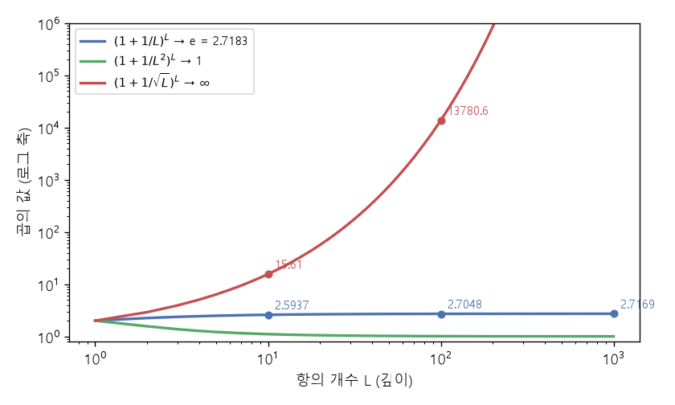

# 곱의 극한과 잔차 배율 (Limit of a product, Residual block multiplier)

[목차로 돌아가기](../../00_MIT%EB%94%A5%EB%9F%AC%EB%8B%9D_%EB%AA%A9%EC%B0%A8.md) · 먼저 볼 것: [M06_지수와_e](../../%EC%88%98%ED%95%99%EA%B0%9C%EB%85%90/01_%EC%88%98%EC%99%80_%ED%95%A8%EC%88%98/M06_%EC%A7%80%EC%88%98%EC%99%80_e.md), [MM06_합성함수와_비선형성](../../%EC%88%98%ED%95%99%EA%B0%9C%EB%85%90/05_%EC%8B%A0%EA%B2%BD%EB%A7%9D%EC%9D%98_%EA%B3%84%EC%82%B0/MM06_%ED%95%A9%EC%84%B1%ED%95%A8%EC%88%98%EC%99%80_%EB%B9%84%EC%84%A0%ED%98%95%EC%84%B1.md) · 쓰는 곳: [Lec07 9](../../Lec07_%EC%B5%9C%EC%A0%81%ED%99%94%EC%9D%98_%EC%8A%A4%EC%BC%80%EC%9D%BC%EB%A7%81_%EA%B7%9C%EC%B9%99.md#9-%EA%B9%8A%EC%9D%B4-%EC%8A%A4%EC%BC%80%EC%9D%BC%EB%A7%81)

📚 학습 순서 65/99 (9. 최적화의 기하): ← 이전: [MM28_스펙트럼_노름과_RMS_연산자_노름](../../%EC%88%98%ED%95%99%EA%B0%9C%EB%85%90/09_%EC%B5%9C%EC%A0%81%ED%99%94%EC%9D%98_%EA%B8%B0%ED%95%98/MM28_%EC%8A%A4%ED%8E%99%ED%8A%B8%EB%9F%BC_%EB%85%B8%EB%A6%84%EA%B3%BC_RMS_%EC%97%B0%EC%82%B0%EC%9E%90_%EB%85%B8%EB%A6%84.md) · 다음: [MM77_코시_슈바르츠와_립시츠_매끄러움](../../%EC%88%98%ED%95%99%EA%B0%9C%EB%85%90/09_%EC%B5%9C%EC%A0%81%ED%99%94%EC%9D%98_%EA%B8%B0%ED%95%98/MM77_%EC%BD%94%EC%8B%9C_%EC%8A%88%EB%B0%94%EB%A5%B4%EC%B8%A0%EC%99%80_%EB%A6%BD%EC%8B%9C%EC%B8%A0_%EB%A7%A4%EB%81%84%EB%9F%AC%EC%9B%80.md) →

> [!NOTE]
> **3줄 요약**
> - $(1 + x/L)^L$은 항 $L$개를 곱해도 터지지도 사라지지도 않고 $e^x$로 다가간다. $x = 1$이면 $L$ = 10, 100, 1000에서 2.5937, 2.7048, 2.7169 → $e = 2.7183$.
> - 나누는 값을 바꾸면 결과가 망가진다. $L^2$로 나누면 1로 가서 입력 $x$의 영향이 **사라지고**, $\sqrt{L}$로 나누면 $L = 100$에서 13780.61처럼 **터진다**($x < 0$이면 0으로 간다). (강의는 $L^2$일 때 0이 된다고 했지만 실제로는 1로 간다.)
> - 잔차 신경망의 블록도 같다: $h \leftarrow h + \frac{1}{L^\alpha}\mathrm{Block}(h)$. 블록 출력이 서로 **같은 방향**이면 $1/L$이, 서로 **무작위**면 $1/\sqrt{L}$이 합을 일정하게 지킨다. 무엇이 맞는지는 아직 연구 중이다.

## 1. 개념 설명

비유: 이자를 생각하자. 연 100% 이자를 1년에 한 번 붙이면 2배, 반년마다 50%씩 두 번 붙이면 2.25배, 매일 붙이면 약 2.7146배다. 쪼갤수록 늘지만 끝없이 늘지는 않고 $e$배로 다가간다. **한 번에 붙이는 양을 쪼갠 횟수로 정확히 나눴기 때문**이다. 너무 적게 나누면(√ 횟수) 이자가 폭발하고, 너무 많이 나누면(횟수²) 이자가 거의 안 붙는다.

- 깊은 신경망은 [층](../../00_%EB%94%A5%EB%9F%AC%EB%8B%9D_%EC%9A%A9%EC%96%B4%EC%82%AC%EC%A0%84.md#layer-%EC%B8%B5) $L$개를 차례로 통과하는 "곱"과 같다. [층](../../00_%EB%94%A5%EB%9F%AC%EB%8B%9D_%EC%9A%A9%EC%96%B4%EC%82%AC%EC%A0%84.md#layer-%EC%B8%B5)이 늘어도 출력이 터지거나 0이 되지 않으려면 [층](../../00_%EB%94%A5%EB%9F%AC%EB%8B%9D_%EC%9A%A9%EC%96%B4%EC%82%AC%EC%A0%84.md#layer-%EC%B8%B5) 하나가 바꾸는 양을 $L$에 맞춰 줄여야 한다.

$$
\lim_{L \to \infty} \left(1 + \frac{x}{L}\right)^L = e^x
$$

<details><summary>기호 풀이</summary>

| 기호 | 읽는 법 | 뜻 | 예제 값 |
| --- | --- | --- | --- |
| $\lim_{L \to \infty}$ | 리밋 L이 무한대로 | L을 끝없이 키울 때 다가가는 값 | - |
| $L$ | 엘 | 곱하는 항의 개수(깊이) | 10 |
| $x$ | 엑스 | 전체 변화량(입력) | 1 |
| $\frac{x}{L}$ | 엑스 나누기 엘 | 항 하나가 바꾸는 양 | 0.1 |
| $(\cdot)^L$ | L제곱 | 같은 항을 L번 곱함 | $1.1^{10}$ |
| $e^x$ | 이의 엑스 제곱 | 극한값 ([M06](../../%EC%88%98%ED%95%99%EA%B0%9C%EB%85%90/01_%EC%88%98%EC%99%80_%ED%95%A8%EC%88%98/M06_%EC%A7%80%EC%88%98%EC%99%80_e.md)) | 2.7183 |

</details>

<details><summary>예제와 풀이</summary>

**문제**: 전체 변화량 $x = 1$을 [층](../../00_%EB%94%A5%EB%9F%AC%EB%8B%9D_%EC%9A%A9%EC%96%B4%EC%82%AC%EC%A0%84.md#layer-%EC%B8%B5) $L = 10$개에 똑같이 나눠 곱하면 $(1 + x/L)^L$은 얼마이고, 극한 $e^x$와 얼마나 다른가?

**주어진 값**:
- $x = 1$ (전체 변화량)
- $L = 10$ (항의 개수, 깊이)
- $e = 2.7183$ (자연상수. $(1 + 1/L)^L$에서 $L$을 끝없이 키울 때 다가가는 값이며 계산기의 $e^1$로 얻는다)

**풀이**
1. 식을 그대로 쓴다: $\left(1 + \dfrac{x}{L}\right)^L$
2. 값을 대입한다: $\left(1 + \dfrac{1}{10}\right)^{10}$
3. 나눗셈을 먼저 한다: $1 \div 10 = 0.1$ 이므로 $(1 + 0.1)^{10}$
4. 괄호 안을 더한다: $1 + 0.1 = 1.1$ 이므로 $1.1^{10}$
5. 거듭제곱을 한다(1.1을 10번 곱함): $1.1^{10} = 2.5937$
6. 극한과의 차이를 잰다: $2.7183 - 2.5937 = 0.1246$

**답**: **2.5937**. $L$을 1000으로 늘리면 $1.001^{1000} = 2.7169$로 $e$에 더 가까워진다.

</details>

<details><summary>내 이해</summary>


</details>

## 2. 필요한 이유

[Lec07 9절](../../Lec07_%EC%B5%9C%EC%A0%81%ED%99%94%EC%9D%98_%EC%8A%A4%EC%BC%80%EC%9D%BC%EB%A7%81_%EA%B7%9C%EC%B9%99.md#9-%EA%B9%8A%EC%9D%B4-%EC%8A%A4%EC%BC%80%EC%9D%BC%EB%A7%81)에서 강사는 이 극한을 예로 들어 "잔차 블록을 **올바르게 매개변수화**하라"고 말한다. 잔차 신경망([Lec04](../../Lec04_%EA%B2%A9%EC%9E%90_%EC%95%84%ED%82%A4%ED%85%8D%EC%B2%98.md)의 [ResNet](../../00_%EB%94%A5%EB%9F%AC%EB%8B%9D_%EC%9A%A9%EC%96%B4%EC%82%AC%EC%A0%84.md#resnet-%EB%A0%88%EC%A6%88%EB%84%B7))의 블록 하나는 입력에 블록 출력을 더한다. 블록이 $L$개 있으면 이 덧셈을 $L$번 되풀이하므로, 블록 출력 앞에 붙이는 배율(block multiplier)이 깊이에 맞지 않으면 깊어질수록 신호가 터지거나 블록이 아무 일도 못 한다.

$$
h_{l+1} = h_l + \frac{1}{L^\alpha}\, \mathrm{Block}_l(h_l)
$$

<details><summary>기호 풀이</summary>

| 기호 | 읽는 법 | 뜻 | 예제 값 |
| --- | --- | --- | --- |
| $h_l$ | 에이치 엘 | l번째 블록에 들어가는 값(잔차 흐름) | $h_0 = 1$ |
| $\mathrm{Block}_l$ | 블록 엘 | l번째 블록(작은 MLP나 [어텐션](../../00_%EB%94%A5%EB%9F%AC%EB%8B%9D_%EC%9A%A9%EC%96%B4%EC%82%AC%EC%A0%84.md#attention-%EC%96%B4%ED%85%90%EC%85%98) [층](../../00_%EB%94%A5%EB%9F%AC%EB%8B%9D_%EC%9A%A9%EC%96%B4%EC%82%AC%EC%A0%84.md#layer-%EC%B8%B5)) | $\mathrm{Block}(h) = h$ |
| $L$ | 엘 | 블록 개수(깊이) | 4 |
| $\alpha$ | 알파 | 배율의 [지수](../../00_%EB%94%A5%EB%9F%AC%EB%8B%9D_%EC%9A%A9%EC%96%B4%EC%82%AC%EC%A0%84.md#e-exponent-e%EC%99%80-%EC%A7%80%EC%88%98). 1이면 $1/L$, 0.5면 $1/\sqrt{L}$ | 1 |
| $\frac{1}{L^\alpha}$ | 엘의 알파 제곱 분의 일 | [블록 배율](../../00_%EB%94%A5%EB%9F%AC%EB%8B%9D_%EC%9A%A9%EC%96%B4%EC%82%AC%EC%A0%84.md#block-multiplier-%EB%B8%94%EB%A1%9D-%EB%B0%B0%EC%9C%A8) | 0.25 |

</details>

<details><summary>예제와 풀이</summary>

**문제**: 블록이 입력을 그대로 내보내고($\mathrm{Block}(h) = h$) 처음 값이 $h_0 = 1$일 때, 블록 $L = 4$개를 배율 $1/L$($\alpha = 1$)로 지나면 마지막 값 $h_4$는?

**주어진 값**:
- $h_0 = 1$ (처음 값)
- $L = 4$ (블록 개수)
- $\alpha = 1$ (배율 [지수](../../00_%EB%94%A5%EB%9F%AC%EB%8B%9D_%EC%9A%A9%EC%96%B4%EC%82%AC%EC%A0%84.md#e-exponent-e%EC%99%80-%EC%A7%80%EC%88%98), 배율 $1/L^1$)

**풀이**
1. 식을 그대로 쓴다: $h_{l+1} = h_l + \dfrac{1}{L^\alpha}\, h_l$
2. 값을 대입한다(첫 블록): $h_1 = 1 + \dfrac{1}{4^1} \times 1$
3. 거듭제곱과 나눗셈을 한다: $4^1 = 4$, $1 \div 4 = 0.25$ 이므로 $h_1 = 1 + 0.25 \times 1 = 1.25$
4. 둘째 블록: $h_2 = 1.25 + 0.25 \times 1.25 = 1.25 + 0.3125 = 1.5625$
5. 셋째 블록: $h_3 = 1.5625 + 0.25 \times 1.5625 = 1.5625 + 0.390625 = 1.953125$
6. 넷째 블록: $h_4 = 1.953125 + 0.25 \times 1.953125 = 1.953125 + 0.48828125 = 2.4414$
7. 비교로 $\alpha = 0.5$(배율 $1/\sqrt{4}$, $\sqrt{4} = 2$라서 0.5)면 한 블록마다 1.5배라 $1.5 \times 1.5 \times 1.5 \times 1.5 = 5.0625$

**답**: $\alpha = 1$이면 **2.4414** (L이 커지면 $e$로 [수렴](../../00_%EB%94%A5%EB%9F%AC%EB%8B%9D_%EC%9A%A9%EC%96%B4%EC%82%AC%EC%A0%84.md#convergence-%EC%88%98%EB%A0%B4)), $\alpha = 0.5$면 **5.0625** (L이 커지면 폭발)

</details>

<details><summary>내 이해</summary>


</details>

## 3. 숫자로 보기

### 3.1 나누는 값에 따른 곱 $(1 + 1/s)^L$

| $L$ | $s = L$ | $s = L^2$ | $s = \sqrt{L}$ |
|---|---|---|---|
| 1 | 2 | 2 | 2 |
| 10 | 2.5937 | 1.1046 | 15.61 |
| 100 | 2.7048 | 1.01 | 13780.61 |
| 1000 | 2.7169 | 1.001 | 약 3.3 × 10¹³ |
| 극한 | $e$ = 2.7183 | 1 | ∞ |

- $x = -1$에 $s = \sqrt{L}$이면 $L$ = 10, 100에서 0.022342, 0.000027로 0에 다가간다([기울기 소실](../../00_%EB%94%A5%EB%9F%AC%EB%8B%9D_%EC%9A%A9%EC%96%B4%EC%82%AC%EC%A0%84.md#vanishing-gradient-%EA%B8%B0%EC%9A%B8%EA%B8%B0-%EC%86%8C%EC%8B%A4)과 같은 꼴).



### 3.2 블록 출력이 같은 방향일 때와 무작위일 때 (블록마다 +1 또는 ±1을 더함)

블록 $L$개의 기여를 더한 크기: 같은 방향이면 $L \times \frac{1}{L^\alpha}$, 무작위(±1 동전 던지기)면 표준편차 $\sqrt{L} \times \frac{1}{L^\alpha}$.

| $L$ | 같은 방향, $1/L$ | 같은 방향, $1/\sqrt{L}$ | 무작위, $1/L$ | 무작위, $1/\sqrt{L}$ |
|---|---|---|---|---|
| 4 | 1 | 2 | 0.5 | 1 |
| 16 | 1 | 4 | 0.25 | 1 |
| 64 | 1 | 8 | 0.125 | 1 |
| 256 | 1 | 16 | 0.0625 | 1 |

- 같은 방향이면 $1/L$이 일정(1)하고, 무작위면 $1/\sqrt{L}$이 일정(1)하다. 강의가 말한 "표준 [트랜스포머](../../00_%EB%94%A5%EB%9F%AC%EB%8B%9D_%EC%9A%A9%EC%96%B4%EC%82%AC%EC%A0%84.md#transformer-%ED%8A%B8%EB%9E%9C%EC%8A%A4%ED%8F%AC%EB%A8%B8)가 $1/\sqrt{L}$을 쓰는 이유는 초기에 블록들이 서로 무작위라 랜덤 워크처럼 $\sqrt{\text{걸음 수}}$만큼 움직이기 때문"이 오른쪽 두 칸이다. [학습](../../00_%EB%94%A5%EB%9F%AC%EB%8B%9D_%EC%9A%A9%EC%96%B4%EC%82%AC%EC%A0%84.md#training-%ED%95%99%EC%8A%B5)이 진행되어 블록들이 같은 방향으로 맞춰지면 왼쪽 두 칸 상황이 된다.

<details><summary>기호 풀이</summary>

| 기호 | 읽는 법 | 뜻 | 예제 값 |
| --- | --- | --- | --- |
| $s$ | 에스 | 항 하나에서 나누는 값 | $L$, $L^2$, $\sqrt{L}$ |
| $L$ | 엘 | 항(블록) 개수 | 16 |
| $\alpha$ | 알파 | 배율 [지수](../../00_%EB%94%A5%EB%9F%AC%EB%8B%9D_%EC%9A%A9%EC%96%B4%EC%82%AC%EC%A0%84.md#e-exponent-e%EC%99%80-%EC%A7%80%EC%88%98) | 1 또는 0.5 |
| $\sqrt{L}$ | 루트 엘 | 무작위 ±1 L개 합의 표준편차 | 4 |

</details>

## 4. 코드로 확인

```python
# [함수] import: NumPy를 np로 불러온다
import numpy as np
# [함수] for: 항 개수 L을 1, 10, 100, 1000으로 바꿔 가며 되풀이
for L in [1, 10, 100, 1000]:
    # [변수] a: 1/L로 나눈 곱 (e로 수렴), b: 1/L²로 나눈 곱 (1로 수렴), c: 1/√L로 나눈 곱 (폭발)
    # [연결] 3.1 표의 세 칸, Lec07_fig_depth_limit 그림
    a, b, c = (1 + 1 / L) ** L, (1 + 1 / L**2) ** L, (1 + 1 / np.sqrt(L)) ** L
    # [함수] round: 표와 같은 자릿수로 반올림. 1000에서 c는 너무 커서 지수 표기로 찍는다
    print(L, round(a, 4), round(b, 4), round(c, 2) if L < 1000 else f"{c:.1e}")
# [함수] for: 블록 개수 L을 4배씩 늘려 본다
for L in [4, 16, 64, 256]:
    # [변수] coh1, coh2: 같은 방향 기여 L개의 합 (배율 1/L, 1/√L)
    # [변수] rnd1, rnd2: 무작위 ±1 기여 L개 합의 표준편차 √L에 배율을 곱한 값
    # [연결] 3.2 표의 네 칸
    coh1, coh2, rnd1, rnd2 = L / L, L / np.sqrt(L), np.sqrt(L) / L, np.sqrt(L) / np.sqrt(L)
    # [연결] → 같은 방향은 1/L에서, 무작위는 1/√L에서 1로 일정
    print(L, coh1, coh2, rnd1, rnd2)
```

**실행 결과**:

```text
1 2.0 2.0 2.0
10 2.5937 1.1046 15.61
100 2.7048 1.01 13780.61
1000 2.7169 1.001 3.3e+13
4 1.0 2.0 0.5 1.0
16 1.0 4.0 0.25 1.0
64 1.0 8.0 0.125 1.0
256 1.0 16.0 0.0625 1.0
```

> [!WARNING]
> **⚠ 주의**
> - 강의에서 "$L^2$로 나누면 0이 된다"고 했지만 $(1 + x/L^2)^L \to 1$이다. 0이 아니라 **입력의 영향이 사라진다**(블록이 아무 일도 안 하는 셈)는 뜻으로 읽으면 된다.
> - 3.2 표는 블록 출력이 완전히 같은 방향이거나 완전히 무작위인 두 극단이다. 실제 [학습](../../00_%EB%94%A5%EB%9F%AC%EB%8B%9D_%EC%9A%A9%EC%96%B4%EC%82%AC%EC%A0%84.md#training-%ED%95%99%EC%8A%B5) 중 블록은 그 사이 어딘가라, $1/L$과 $1/\sqrt{L}$ 중 무엇이 맞는지는 강사도 "더 연구가 필요하다"고 했다(2026 업데이트는 [Lec07 9절](../../Lec07_%EC%B5%9C%EC%A0%81%ED%99%94%EC%9D%98_%EC%8A%A4%EC%BC%80%EC%9D%BC%EB%A7%81_%EA%B7%9C%EC%B9%99.md#9-%EA%B9%8A%EC%9D%B4-%EC%8A%A4%EC%BC%80%EC%9D%BC%EB%A7%81)).
> - 실제 구현은 블록 출력에 배율을 곱하는 대신 블록 마지막 [층](../../00_%EB%94%A5%EB%9F%AC%EB%8B%9D_%EC%9A%A9%EC%96%B4%EC%82%AC%EC%A0%84.md#layer-%EC%B8%B5)의 **초기화**를 줄이는 경우가 많다([GPT](../../00_%EB%94%A5%EB%9F%AC%EB%8B%9D_%EC%9A%A9%EC%96%B4%EC%82%AC%EC%A0%84.md#gpt-%EC%83%9D%EC%84%B1%ED%98%95-%EC%82%AC%EC%A0%84%ED%95%99%EC%8A%B5-%ED%8A%B8%EB%9E%9C%EC%8A%A4%ED%8F%AC%EB%A8%B8)-2는 잔차 [층](../../00_%EB%94%A5%EB%9F%AC%EB%8B%9D_%EC%9A%A9%EC%96%B4%EC%82%AC%EC%A0%84.md#layer-%EC%B8%B5) 초기 [가중치](../../00_%EB%94%A5%EB%9F%AC%EB%8B%9D_%EC%9A%A9%EC%96%B4%EC%82%AC%EC%A0%84.md#weight-%EA%B0%80%EC%A4%91%EC%B9%98)를 $1/\sqrt{\text{잔차 층 수}}$배로 줄였다).

## 5. 개념 재확인

<details><summary>1. $(1 + 2/L)^L$에서 $L = 100$이면 값은? 극한 $e^2$와 비교하라.</summary>

| 단계 | 하는 일 | 식 | 계산 | 결과 |
|---|---|---|---|---|
| 1 | 조건 | $x = 2$, $L = 100$ | - | - |
| 2 | 항 하나 | $1 + x/L$ | $1 + 0.02$ | 1.02 |
| 3 | 100번 곱 | $1.02^{100}$ | - | 7.2446 |
| 4 | 극한 | $e^2$ | - | 7.3891 |
| 5 | 비교 | 차이 | $7.3891 - 7.2446$ | 0.1445 |

**① 쓰는 식**
$$\left(1 + \frac{x}{L}\right)^L \to e^x$$
- 위 식 ← ②에서 항 하나, ③에서 거듭제곱, ④에서 극한을 쓴다.
```python
# [변수] x, L: 문제에서 준 값
x, L = 2, 100                                  # ①
# [변수] term = 1.02: 항 하나
term = 1 + x / L                               # ②
# [변수] p: 1.02를 100번 곱한 값
p = term ** L                                  # ③
# [함수] np.exp(2): e² = 7.3891
# [연결] 단계 ⑤ → 7.2446 7.3891
print(round(p, 4), round(np.exp(x), 4))        # ④⑤
```

**문제**: 전체 변화량 $x = 2$를 $L = 100$개 항에 나눠 곱한 $(1 + x/L)^L$은 얼마이고, 극한 $e^2$와 얼마나 다른가?

**주어진 값**:
- $x = 2$ (전체 변화량)
- $L = 100$ (항의 개수)
- $e^2 = 7.3891$ ($e = 2.71828$을 두 번 곱한 값, 계산기로 구함)

**풀이**
1. 식을 그대로 쓴다: $\left(1 + \dfrac{x}{L}\right)^L$
2. 값을 대입한다: $\left(1 + \dfrac{2}{100}\right)^{100}$
3. (②) 나눗셈을 먼저 한다: $2 \div 100 = 0.02$ 이므로 $(1 + 0.02)^{100}$
4. 괄호 안을 더한다: $1 + 0.02 = 1.02$ 이므로 $1.02^{100}$
5. (③) 거듭제곱을 한다(1.02를 100번 곱함): $1.02^{100} = 7.2446$
6. (④⑤) 극한과의 차이를 잰다: $7.3891 - 7.2446 = 0.1445$

**답**: **7.2446** (극한 7.3891)

</details>

<details><summary>2. 블록 16개가 무작위 ±1을 더할 때, 합의 표준편차를 1로 지키려면 배율 지수 $\alpha$는? 같은 방향이면?</summary>

| 단계 | 하는 일 | 식 | 계산 | 결과 |
|---|---|---|---|---|
| 1 | 무작위 합의 표준편차 | $\sqrt{L}$ | $\sqrt{16}$ | 4 |
| 2 | 1로 만들 배율 | $1/\sqrt{L}$ | $1/4$ | $\alpha = 0.5$ |
| 3 | 같은 방향 합 | $L$ | 16 | 16 |
| 4 | 1로 만들 배율 | $1/L$ | $1/16$ | $\alpha = 1$ |
| 5 | 엇갈려 쓰면 | 무작위에 $1/L$ | $4/16$ | 0.25 (줄어듦) |

**① 쓰는 식**
$$\text{무작위: } \frac{\sqrt{L}}{L^\alpha}, \qquad \text{같은 방향: } \frac{L}{L^\alpha}$$
- 위 식 ← 왼쪽은 ①②⑤, 오른쪽은 ③④에서 쓴다.
```python
# [변수] L: 블록 수 16
L = 16
# [변수] rnd: 무작위 ±1 16개 합의 표준편차 = √16 = 4
rnd = np.sqrt(L)                               # ①
# [변수] coh: 같은 방향 +1 16개의 합 = 16
coh = L                                        # ③
# [연결] 단계 ②④⑤ → 1.0 1.0 0.25 (무작위/√L, 같은 방향/L, 무작위/L)
print(rnd / np.sqrt(L), coh / L, rnd / L)      # ②④⑤
```

**문제**: 블록 16개가 각각 +1 또는 −1을 무작위로 더할 때, 합의 크기(표준편차)를 1로 지키려면 [블록 배율](../../00_%EB%94%A5%EB%9F%AC%EB%8B%9D_%EC%9A%A9%EC%96%B4%EC%82%AC%EC%A0%84.md#block-multiplier-%EB%B8%94%EB%A1%9D-%EB%B0%B0%EC%9C%A8)의 [지수](../../00_%EB%94%A5%EB%9F%AC%EB%8B%9D_%EC%9A%A9%EC%96%B4%EC%82%AC%EC%A0%84.md#e-exponent-e%EC%99%80-%EC%A7%80%EC%88%98) $\alpha$를 얼마로 해야 하나? 모두 +1(같은 방향)이면?

**주어진 값**:
- $L = 16$ (블록 개수)
- 무작위 ±1 16개 합의 표준편차 $= \sqrt{L}$ (동전 던지기 합이 퍼지는 정도. $\sqrt{16}$은 제곱해서 16이 되는 수 4)
- 같은 방향 +1 16개의 합 $= L$

**풀이**
1. 식을 그대로 쓴다: 무작위 $\dfrac{\sqrt{L}}{L^\alpha}$, 같은 방향 $\dfrac{L}{L^\alpha}$
2. 값을 대입한다: 무작위 $\dfrac{\sqrt{16}}{16^\alpha}$, 같은 방향 $\dfrac{16}{16^\alpha}$
3. (①) 제곱근을 구한다: $\sqrt{16} = 4$ 이므로 무작위 $\dfrac{4}{16^\alpha}$
4. (②) 무작위가 1이 되려면 분모가 4여야 한다: $16^\alpha = 4$ → $16^{0.5} = \sqrt{16} = 4$ 이므로 $\alpha = 0.5$, 확인 $4 \div 4 = 1$
5. (③④) 같은 방향이 1이 되려면 분모가 16이어야 한다: $16^\alpha = 16$ → $\alpha = 1$, 확인 $16 \div 16 = 1$
6. (⑤) 엇갈려 쓰면(무작위인데 $\alpha = 1$): $4 \div 16 = 0.25$로 블록 기여가 깊이에 따라 줄어든다

**답**: 무작위면 **α = 0.5** ($1/\sqrt{L}$), 같은 방향이면 **α = 1** ($1/L$)

</details>

## 예제 풀기

[예제 10문제 풀기](../../%EC%98%88%EC%A0%9C/09_%EC%B5%9C%EC%A0%81%ED%99%94%EC%9D%98_%EA%B8%B0%ED%95%98/%EC%98%88%EC%A0%9C_MM29_%EA%B3%B1%EC%9D%98_%EA%B7%B9%ED%95%9C%EA%B3%BC_%EC%9E%94%EC%B0%A8_%EB%B0%B0%EC%9C%A8.md)

<details><summary>내 이해</summary>


</details>
